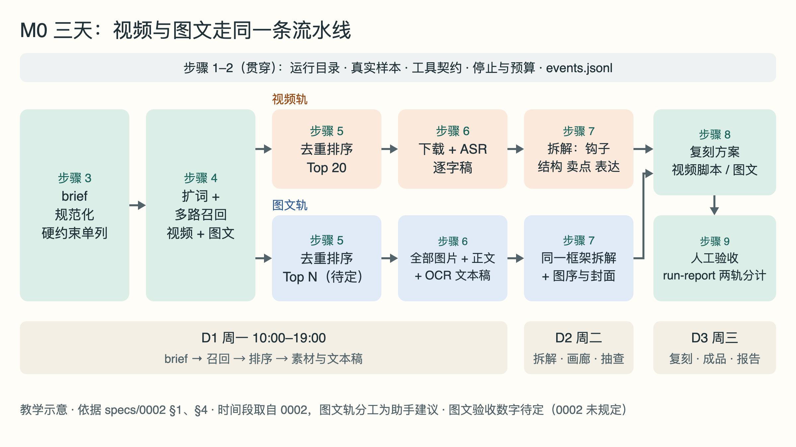
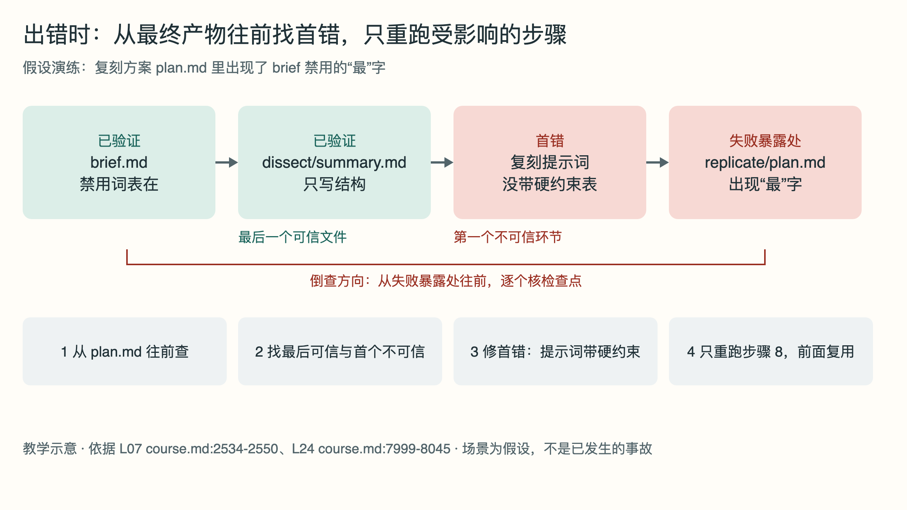

# video-mcp M0 三天实战手册：用 Agent 课程方法跑通视频与图文

> 手册类型：定制版

## 阅读说明

这本手册只服务一件事：周一到周三（每天 10:00–19:00），按 `specs/0002-m0-delivery-plan.md`（下称 0002）把 video-mcp 的 M0 从零跑通一遍——拿一份广告主的真实 brief，召回爆款参考，取回素材并转成文本稿，拆解，再按产品出复刻方案，最后写 `run-report.md`（D1–D3 安排见 §4）[<a id="cite-o2-1"></a>[O2](#source-o2)]。M0 同时覆盖**视频**和**图文**两类内容：两条轨道走同一套流程，只在“取素材、转文本稿”和“拆解多一项”上有差别；原始需求写的就是“找爆款(视频+图文)”（0001-video-mcp.md:104）[<a id="cite-o7-1"></a>[O7](#source-o7)]。

- **起点是真实的空项目。** 仓库代码目前只有入口 `src/video_mcp/__init__.py`，它只打印 “Hello from video-mcp!”（本机核对 2026-10-26）[<a id="cite-o9-1"></a>[O9](#source-o9)]。下文提到的工具、目录和文件都要在执行对应步骤时才会产生，手册写完不代表任何功能已实现。
- **三层材料，性质不同。** 方法来自邓明的 Agent 课程（标到讲次与 `course.md` 行号）；业务做法来自 video-mcp 自己的 spec 和 `docs/research/` 调研；陈天 w5 的 pg-mcp 源码只作工程写法参照。标“助手建议”的是本手册为你排的做法，不是课程原话或已验证的结果。
- **数字的性质。** 0002 的 “≥200 条候选”“Top 20”“60 秒视频端到端中位数 ≤20 秒”“抽查 5 条至少 4 条拆得对”是验收**目标**，不是已有结果；调研里的单价、耗时是 2026-10-23 至 2026-10-26 的调研记录或估计，执行当天要按账户和实测重核。课程里的数字（例如“预算 8000 却推荐 9999 元”）是教学案例，不是任何人的生产数据。
- **不承诺结果。** 手册只保证动作清楚、产物可查；召回准不准、拆得对不对、成品能不能投放，要靠三天里的实际运行和你的人工验收来判断。
- **占位是虚构的。** 模板里用〔〕标出的品牌、产品、ID 都是虚构占位，执行前换成真实值。
- **术语先说白话。** 第一次出现的术语会用一句话解释，[附录 G 术语表](#section-glossary)集中列出。
- **来源编号。** 方括号里的 O1、O2 等是本地来源编号，点击跳到文末，文末再点“回到正文”返回。正文在标记前写出讲次、章节或“文件:行号”。课程第 14 讲正文在本地缺失，手册没有引用它。

先看下方路线图和时间表，再按步骤做；不做的事、案例、模板和课程覆盖表都在附录。

## 三天路线图

| 阶段 | 本阶段怎么做（视频轨 / 图文轨同一套流程） | 点开对应章节 |
| --- | --- | --- |
| 开工前（周一 10:00 前看完） | 看清阻断缺口；确认图文验收数字等待你拍板的事项 | [阻断缺口](#gaps) · [条件不同时怎么调](#adjust) |
| D1 周一上午 | 建运行目录、录入 brief、每个平台抓视频与图文真实样本；定下工具契约、停止条件、预算和日志格式；把 brief 规范化 | [时间表](#section-schedule) · [步骤 1 开工](#section-setup) · [步骤 2 契约与停止](#section-contract) · [步骤 3 brief](#section-brief) |
| D1 周一下午 | 扩词、多路召回两类内容；去重、过滤、各自排出 Top N；取回素材并转成文本稿（视频逐字稿 / 图文正文 + 图中文字） | [步骤 4 召回](#section-recall) · [步骤 5 排序](#section-rank) · [步骤 6 文本稿](#section-text) |
| D2 周二 | 用同一个拆解框架拆两类内容，做 Top 5 共性总结，搭本地画廊，你人工抽查后修提示词 | [步骤 7 拆解](#section-dissect) |
| D3 周三 | 出复刻方案（视频脚本 / 图文成品方案）和成品包；人工验收，写 `run-report.md` | [步骤 8 复刻](#section-replicate) · [步骤 9 验收与报告](#section-report) |

这三天先不做：意图分类、用户画像、长任务中断恢复、上下文窗口编排、摘要细节召回、评估回流、向量库、多租户、自动发布和前端；以后再看[附录 A：以后再看的课程模块](#section-later)。

## 本次条件

| 项目 | 你的情况 | 对手册的影响 |
| --- | --- | --- |
| 要完成什么 | M0 生产验证：一份真实 brief 从零跑通全流程，留下全部中间产物（0002 §1）[<a id="cite-o2-2"></a>[O2](#source-o2)] | 主线只留 9 个必需步骤，其余课程模块进附录 A |
| 内容类型 | 视频 + 图文，整体逻辑一样（你在 2026-10-26 补充的要求） | 每一步写两条轨道；图文用“正文 + 图中文字”文本稿代替逐字稿 |
| 当前进度 | 你说流程已基本拆清、基础接口跑通过（0001-video-mcp.md:124-125）[<a id="cite-o7-2"></a>[O7](#source-o7)]；仓库代码只有 Hello [<a id="cite-o9-2"></a>[O9](#source-o9)] | 不从调研开始，但代码要从头写 |
| 可用时间 | 周一到周三，每天 10:00–19:00 | 时间表按 0002 的 D1–D3 排，每天含 1 小时午休，实际工作 8 小时 |
| 平台与数据源 | 小红书、抖音，经 TikHub；Key 和余额待你提供（0002 §3 #1）[<a id="cite-o2-3"></a>[O2](#source-o2)] | 拿到 Key 前只能做离线部分，见 [G2](#gaps) |
| 工程环境 | Python 3.13、uv、`make check`；本机有 ffmpeg/ffprobe、tesseract 5.5.2（含简体中文语言包）和 video-asr（SenseVoice）技能脚本 [<a id="cite-o9-3"></a>[O9](#source-o9)] | 转写与图中文字识别（OCR）先用本机工具；效果未测 |

未经确认的示例条件：图文 Top N、图文文本稿和耗时的验收数字，本手册**不**代你定，见 [G6](#gaps)。

<a id="adjust"></a>
## 条件不同时怎么调

- **周一还没有真实 brief：** 只做不依赖 brief 的部分——步骤 1 的目录与真实样本、步骤 2 的契约、步骤 3 用虚构 brief 跑通字段校验（文件里标 `simulation: true`）。召回、排序、拆解结果一律不算 M0 结果，因为 0002 要验证的正是“真实 brief”[<a id="cite-o2-4"></a>[O2](#source-o2)]。
- **没有 TikHub Key 或余额不够：** 步骤 4–6 改用你手上已有的本地视频和图文笔记（来源写清楚），先把下载之后的链路（文本稿、拆解、画廊）跑通；召回部分记为未测。不要换用来路不明的抓取方式。
- **没有 few-shot 样例：** 召回照做，但 D1 傍晚的“命中几条”无法计算，只能由你人工逐条判断 Top N 是否可用，并在 run-report 写明没有对照基准（0002 §3 #3 写明 few-shot 是召回的验收标准）[<a id="cite-o2-5"></a>[O2](#source-o2)]。
- **没有素材文件夹，也没有数字人 Key 和授权：** 按 0002 §7，D3 改走有素材路线（产品实拍或图文版），复刻方案照常产出 [<a id="cite-o2-6"></a>[O2](#source-o2)]。
- **只想先学课程、不跑项目：** 不必按时间表走。先读[附录 A](#section-later)的课程覆盖表，挑步骤 2、3、7、9 对应的讲次读，再回来实施。
- **从下周一开始：** 日期整体顺延，每天内容不变（0002 第 4 行）[<a id="cite-o2-7"></a>[O2](#source-o2)]。
- **本机 OCR 效果太差：** 图文仍保留正文文本稿，每张图标 `ocr_status: failed` 并记入缺口；拆解时把原图交给能看图的模型补“画面描述”，不要因此把图文整条轨道砍掉。

## 要完成什么

下表数字来自 0002，均为**验收目标，不是结果**；0002 没有规定的写“待定”，不由手册补数字。

| 产出 | 视频轨 | 图文轨 | 在哪一步 | 依据 |
| --- | --- | --- | --- | --- |
| 结构化 brief：`brief.md` | 1 份（两轨共用） | 同左 | [步骤 3](#section-brief) | 0002 §6 [<a id="cite-o2-8"></a>[O2](#source-o2)] |
| 扩词结果：`keywords.json` | 1 份（两轨共用） | 同左 | [步骤 4](#section-recall) | 0002 D1 [<a id="cite-o2-9"></a>[O2](#source-o2)] |
| 候选：`candidates.jsonl` | 合计 ≥200 条；0002 未分视频与图文各占多少 | 同左（配额待定） | [步骤 4](#section-recall) | 0002 D1 [<a id="cite-o2-10"></a>[O2](#source-o2)] |
| 排序结果：`ranked.json` | Top 20 | Top N 待定（0002 未规定） | [步骤 5](#section-rank) | 0002 D1 [<a id="cite-o2-11"></a>[O2](#source-o2)] |
| 本地素材：`media/` | Top 20 本地可播放 | 每条的全部图片；条数随 Top N 待定 | [步骤 6](#section-text) | 0002 D1 验收 [<a id="cite-o2-12"></a>[O2](#source-o2)] |
| 文本稿：`transcripts/` | Top 20 逐字稿齐全 | 正文 + 图中文字（OCR）文本稿；“齐全”标准待定 | [步骤 6](#section-text) | 0002 D1 验收 [<a id="cite-o2-13"></a>[O2](#source-o2)] |
| 耗时 | 60 秒视频端到端中位数 ≤20 秒 | 图文验收数字待定（0002 未规定） | [步骤 6](#section-text) | 0002 D1 验收 [<a id="cite-o2-14"></a>[O2](#source-o2)] |
| 单篇拆解：`dissect/<id>.json` | Top 20 每条 1 份 | Top N 每条 1 份 | [步骤 7](#section-dissect) | 0002 D2 [<a id="cite-o2-15"></a>[O2](#source-o2)] |
| 共性总结：`dissect/summary.md` | Top 5 共性 | Top 5 共性（同一文件分两节，助手建议） | [步骤 7](#section-dissect) | 0002 D2 [<a id="cite-o2-16"></a>[O2](#source-o2)] |
| 本地画廊：`gallery/index.html` | 视频网格 | 图文卡片 | [步骤 7](#section-dissect) | 0002 D2 [<a id="cite-o2-17"></a>[O2](#source-o2)] |
| 人工抽查 | 0002 写抽 5 条、至少 4 条“拆得对”，没有按类型分 | 是否两类各抽 5 条待你确认 | [步骤 7](#section-dissect) | 0002 D2 验收 [<a id="cite-o2-18"></a>[O2](#source-o2)] |
| 复刻方案：`replicate/plan.md` | 脚本（分镜 + 口播）、标题、封面文案、笔记正文、tag | 标题、封面、图序、正文、tag | [步骤 8](#section-replicate) | 0002 D3 [<a id="cite-o2-19"></a>[O2](#source-o2)] |
| 成品 | 1 条可直接发布的成品（`final.mp4`、`cover.png`） | 图文成品是否算 M0 交付、怎样出图，0002 未规定，待确认 | [步骤 8](#section-replicate) | 0002 D3、§5 [<a id="cite-o2-20"></a>[O2](#source-o2)] |
| 生产基线：`run-report.md` | 1 份，写每步耗时、成本、失败率、靠人工的环节和 M1 待办；两轨分开统计 | 同左 | [步骤 9](#section-report) | 0002 D3、§5 [<a id="cite-o2-21"></a>[O2](#source-o2)] |

<a id="gaps"></a>
## 阻断缺口（动手前先看）

0002 §3 写明“缺任何一项，对应的那一步就无法开始”[<a id="cite-o2-22"></a>[O2](#source-o2)]。下面按影响先后排列，括号里是缺了之后还能先做什么。

- **G1 真实 brief。** 需要 workbuddy 链接里那份或另选一份，链接要能打开或导出成文本（0002 §3 #2）。影响步骤 3 起的全部真实结果。（先做步骤 1–2，并用虚构 brief 只验字段。）
- **G2 TikHub Key 与余额。** 0002 估计约 300 次调用、约 $3–10，这是写 spec 时的估计，未写明是否已包含图文轨的调用；PGY（小红书蒲公英）系列端点返回 HTTP 200 就扣费、查无结果也扣（survey-viral-search-media-asr.md:33）[<a id="cite-o2-23"></a>[O2](#source-o2)、<a id="cite-o3-1"></a>[O3](#source-o3)]。影响步骤 4–6。（先用本地已有素材跑步骤 6 之后的链路。）
- **G3 few-shot 样例。** 指你以前“输入的 brief → 你选出的爆款 → 选它的理由”（0002 §3 #3）。需要同时含视频和图文的例子，否则图文召回没有对照基准。影响步骤 5 的命中检查。（先由你人工逐条判断。）
- **G4 复刻路线与授权。** 有素材就给素材文件夹；没有素材就要 Kling 或 HeyGen 的 Key 加数字人形象授权；配音和转写还要 ElevenLabs Key，或确认改用 SenseVoice 加其他 TTS（0002 §3 #4、#5）[<a id="cite-o2-24"></a>[O2](#source-o2)]。另外，下载到本地的参考视频和图片只供内部拆解，是否允许在画廊之外使用，0002 没写，需要你确认。影响步骤 8。
- **G5 转写与 OCR 环境。** 本机已有 SenseVoice 脚本和 tesseract 中文语言包，但 SenseVoice 模型是否已安装、tesseract 对小红书花字的识别效果都没测过 [<a id="cite-o9-4"></a>[O9](#source-o9)]；`docs/research/` 里没有 OCR 选型调研。影响步骤 6。（周一 10:00–11:00 用真实样本各试 1 条。）
- **G6 图文验收数字待定（0002 未规定）。** 需要你确认：图文 Top N 取多少；图文文本稿怎样算“齐全”；图文是否要耗时目标；人工抽查是否两类各 5 条；图文成品是否属于 M0 交付及出图方式。手册在这些位置都写“待定”，不编数字。（不影响动手，但 D1 傍晚前要定，否则步骤 5–9 的图文验收无法判通过或失败。）
- **G7 其余输入。** 素人侧小程序原型链接只影响成品格式；context 与 output 目录不提供时默认用 0002 §6 的结构（0002 §3 #6、#7）[<a id="cite-o2-25"></a>[O2](#source-o2)]。

还有一处需要你知道的不一致：0002 §5 第 5 项要求把三天写的脚本收进 video-mcp、做成 5 个 MCP 工具并通过 `make check`，但 §4 的时间表里没有给这件事排时间 [<a id="cite-o2-26"></a>[O2](#source-o2)]。手册把它放进步骤 2 的契约和步骤 9 的收尾，是否要在三天内完成，请你决定。

<a id="section-schedule"></a>
## 三天时间表

这一章把 0002 §4 的时间段原样搬过来，再在每段里分出视频轨和图文轨各做什么。时间段与当段产物以 0002 为准；“图文轨”一列和标“助手建议”的分工是本手册加的，没有实测过能否在原时段内完成。



图注：教学示意，2026-10-26 依据 0002 §1、§4 和本手册步骤绘制。上下两条轨道表示视频和图文，只在“取素材与文本稿”“拆解”两格有差异；时间段取自 0002，图文轨的分工为助手建议，未经实测。

### D1 周一：打通“brief → 召回 → 素材 + 文本稿”

| 时间 | 视频轨 | 图文轨（助手建议） | 当段产物 | 步骤 |
| --- | --- | --- | --- | --- |
| 10:00–11:00 | 补齐输入；每平台用真实视频样本调接口，原始 JSON 存 `fixtures/` | 同时取图文样本，核图片列表、正文字段；各试 1 条 OCR | 直链有效期、字幕字段是否存在的实测记录（0002）；图文字段与 OCR 试跑记录 | [步骤 1](#section-setup)、[步骤 2](#section-contract) |
| 11:00–13:00 | brief 规范化；LLM 扩词，调 `get_keyword_related`、`get_keyword_stat` 按热度筛词 | 同一份词表，两轨共用 | `brief.md`、`keywords.json` | [步骤 3](#section-brief)、[步骤 4](#section-recall) |
| 13:00–14:00 | 午休 | 午休 | — | — |
| 14:00–16:30 | 小红书与抖音搜索、内容广场、抖音热榜；去重，逐条拉详情补 `liked_count` | 同一批路由里保留图文笔记，按内容类型打标 | `candidates.jsonl`，≥200 条 | [步骤 4](#section-recall)、[步骤 5](#section-rank) |
| 16:30–18:30 | 打分排序取 Top 20，下载转存 `media/`，SenseVoice 转逐字稿，记每条耗时 | 图文排出 Top N（待定），下载全部图片与正文，跑 OCR，记耗时 | `ranked.json`、`media/`、`transcripts/`、耗时表 | [步骤 5](#section-rank)、[步骤 6](#section-text) |
| 18:30–19:00 | 对照 few-shot 检查 Top 20 命中几条 | 对照 few-shot 检查图文 Top N | D1 小结 | [步骤 5](#section-rank)、[步骤 9](#section-report) |

D1 验收（0002 原文，只针对视频）：Top 20 视频能在本地播放、逐字稿齐全；每条 60 秒视频端到端耗时中位数 ≤20 秒。图文验收数字待定，见 [G6](#gaps)。

### D2 周二：拆解，并在画廊里展示

| 时间 | 视频轨 | 图文轨（助手建议） | 当段产物 | 步骤 |
| --- | --- | --- | --- | --- |
| 10:00–12:30 | 逐字稿 + 关键帧（1fps 切镜）+ 文案交给 LLM，输出结构化因子 | 正文 + OCR 文本 + 按图序的图片交给 LLM，同一框架，多拆“图序与封面” | `dissect/<id>.json` | [步骤 7](#section-dissect) |
| 12:30–13:30 | 午休 | 午休 | — | — |
| 13:30–15:00 | Top 5 共性：标题公式、开头 3 秒钩子、内容结构、视觉风格、复刻指南 | 图文 Top 5 共性：标题公式、封面与首图、图序结构、正文结构、复刻指南 | `dissect/summary.md` | [步骤 7](#section-dissect) |
| 15:00–17:30 | 本地静态画廊：视频网格，点开看逐字稿和拆解，只引用本地文件 | 图文卡片，点开看全部图片、正文、OCR 文本和拆解 | `gallery/index.html` | [步骤 7](#section-dissect) |
| 17:30–19:00 | 你抽查拆解结果，按意见修提示词 | 同左；抽查数量待确认 | 修订后的提示词 | [步骤 7](#section-dissect) |

D2 验收（0002 原文）：打开画廊就能逐条播放、看因子，不出现 403、不出现直链失效；抽查的 5 条里至少 4 条认为“拆得对”。

### D3 周三：复刻，加上交付复盘

| 时间 | 视频轨 | 图文轨（助手建议） | 当段产物 | 步骤 |
| --- | --- | --- | --- | --- |
| 10:00–12:00 | 按产品卖点和 summary 生成复刻方案：脚本（分镜 + 口播）、标题、封面文案、笔记正文、tag | 图文方案：标题、封面文案、图序（每张图放什么）、正文、tag | `replicate/plan.md` | [步骤 8](#section-replicate) |
| 12:00–13:00 | 午休 | 午休 | — | — |
| 13:00–16:30 | 按选定路线出成品：有素材用 video-use；无素材走 creative-workflow 数字人 | 图文成品是否在 M0 内、怎样出图待确认 | `replicate/final.mp4`、`cover.png` | [步骤 8](#section-replicate) |
| 16:30–18:00 | 整理成品包，小红书、抖音各一份 | 图文成品包（若确认在范围内） | `replicate/<platform>/` | [步骤 8](#section-replicate) |
| 18:00–19:00 | 复盘耗时、每次运行成本、靠人工的环节、M1 待办 | 同左，两轨分开统计 | `run-report.md` | [步骤 9](#section-report) |

D3 验收（0002 原文）：手上有 1 条可以直接发布的成品，整个运行目录可以复现；报告写清每一步的耗时、成本和失败率。

时间不够时，按 0002 §7 的顺序砍：先砍画廊样式，再砍双平台成品包（只留一个平台），不砍 run-report [<a id="cite-o2-27"></a>[O2](#source-o2)]。助手建议再加一条：不要砍图文轨，因为两类内容都覆盖是这次验证的前提；图文 OCR 超时就先保留正文文本稿，把 OCR 记为缺口。

<a id="section-setup"></a>
## 步骤 1 开工：建运行目录，用真实样本核接口

调研里有好几处写着“待实测”：两个平台的直链能用多久、小红书视频的 `master_url` 字段长什么样、抖音有没有字幕字段（survey-viral-search-media-asr.md:61-67）[<a id="cite-o3-2"></a>[O3](#source-o3)]。图文这边，调研只记了“图文接口对视频笔记只返回封面”，图文笔记本身的图片列表和正文字段还没人用真实样本看过。这一小时先把这些未知变成记录，后面写代码才有依据。

**目标**：在 10:00–11:00 内建好一次运行的目录，并为每个平台各留下视频和图文的真实原始响应与字段记录。

1. 在项目根目录按 0002 §6 建运行目录 `runs/<YYYYMMDD>-<brand>-<product>/`，把 brief 原文放进 `brief.md`。助手建议另加 `events.jsonl`（每步做了什么）、`calls.jsonl`（每次外部调用）、`timings.csv`（每条耗时）三个记录文件，它们是 run-report 的数据来源（0002 §6、§5 第 4 项）[<a id="cite-o2-28"></a>[O2](#source-o2)]。
2. 每个平台调 5 条真实样本，原始 JSON 原样存进 `fixtures/`（0002 D1 10:00–11:00）。助手建议视频、图文各 5 条：小红书先调 `get_image_note_detail`，视频笔记再调 `get_video_note_detail`（study-vita-api-fetch-recall-asr.md:40）；抖音图文看 `aweme_type==68` 时的 `images[].url_list`（同文件:42）[<a id="cite-o2-29"></a>[O2](#source-o2)、<a id="cite-o4-1"></a>[O4](#source-o4)]。
3. 逐条记字段：视频记直链字段和过期时间、有没有字幕字段；图文记图片张数、每张图的地址字段、正文字段、有没有可用的文字字段。抖音的字幕和 `ocr_content` 字段在调研里只是“推测存在，未证实”（survey-viral-search-media-asr.md:11），以样本为准 [<a id="cite-o3-3"></a>[O3](#source-o3)]。
4. 各取 1 条试跑转写和 OCR：视频跑 `node ~/.claude/skills/video-asr/scripts/asr.mjs <视频> --out <目录> --lang zh`（首次需按该技能说明装模型）；图文跑 `tesseract <图片> stdout -l chi_sim`。只记“能不能跑、大概多久、错字多不多”，不调参数 [<a id="cite-o9-5"></a>[O9](#source-o9)]。
5. 每次调用写一行 `calls.jsonl`：端点、参数摘要、HTTP 状态、业务是否有数据、是否计费、耗时。PGY 端点即使查无结果也扣费，调用前先核余额，失败不自动重试（survey-viral-search-media-asr.md:33）[<a id="cite-o3-4"></a>[O3](#source-o3)]。

**做完的标准**：

- `fixtures/` 里每个平台有视频和图文的原始响应；有一份字段记录，写明直链有效期、字幕字段、图文图片与正文字段是否存在。
- 视频转写和图文 OCR 各试过 1 条，结果（成功、失败及原因）写进记录；没跑通就写没跑通。

- [ ] 运行目录与三个记录文件已建
- [ ] 两个平台的视频、图文样本已存 `fixtures/`
- [ ] 字段记录写完，含“未证实”字段的实测结论
- [ ] 转写、OCR 各试跑 1 条并记录

补充说明：

- 0002 §2 说“原视频能拿到”“画廊由后端带 Referer 下载后引用本地文件”，这一步验证的就是这些结论在今天是否仍成立 [<a id="cite-o2-30"></a>[O2](#source-o2)]。
- 为什么先抓样本再写代码：课程把“当前知道什么、还缺什么”列为计划的上下文（Context）部分，缺了就会“凭空 Plan”（L05「G4C」，course.md:1648-1670）[<a id="cite-o1-1"></a>[O1](#source-o1)]。

参见模板：[T1 运行目录与记录文件](#template-t1)。

<a id="section-contract"></a>
## 步骤 2 先写工具契约、停止条件、预算和日志格式

这一步不产出业务结果，但决定后面每个工具出错时会不会“看起来成功”。课程的说法是：工具（课程叫 Action，指一个业务上完整的操作）的能力边界、参数和返回要写清楚，执行前用代码检查，不交给模型猜（L09，course.md:3494、3620-3660）[<a id="cite-o1-2"></a>[O1](#source-o1)]。M0 的流程是固定的（召回 → 文本稿 → 拆解 → 复刻），调研结论是不需要做通用的 Agent 循环，由编排代码按顺序调各个工具即可（study-agent-harness-patterns.md:81）[<a id="cite-o5-1"></a>[O5](#source-o5)]。

**目标**：写出 5 个工具的契约文件和一份共用的停止、预算、日志规则，后续每个步骤实现工具时照着填。

1. 按 0002 §5 的工具名写契约：`search_viral`、`fetch_media`、`transcribe`、`dissect`、`replicate_plan`。每个写名称、能做什么、适用与不适用场景、必填参数、返回字段（L09「Action 如何描述」，course.md:3620-3640）[<a id="cite-o1-3"></a>[O1](#source-o1)、<a id="cite-o2-31"></a>[O2](#source-o2)]。两类内容用同一组工具，参数里带 `content_type: video | image_note`；`transcribe` 对视频做语音转写，对图文做“正文 + OCR”，这是助手建议，工具名要不要改由你定。
2. 每个工具的返回分两层：调用状态（成功、参数错、没权限、超时、上游失败、查无结果）和业务是否合格（例如视频能否播放、图文图片是否齐）。参照 w5：参数不合法时返回带 `code`、`message` 的结构化错误，而不是抛异常（w5 server.py:327-353）[<a id="cite-o6-1"></a>[O6](#source-o6)]；工具出错要返回给编排代码可读的错误，并标明能不能重试（study-agent-harness-patterns.md:36-38）[<a id="cite-o5-2"></a>[O5](#source-o5)]。
3. 写停止条件。课程把每一轮之后的去向归成六种：继续、完成、澄清、重试、重新规划、报错中断（L08「TAO 有哪些下一步」，course.md:3348-3362）[<a id="cite-o1-4"></a>[O1](#source-o1)]。落到 M0：偶发网络错误才重试，且有次数上限；PGY 端点不重试；缺输入就停下来问你；同一条连续失败就跳过并记录，不让整批卡住。
4. 写预算 `budget` 段：每次运行的最大调用次数、最大花费、每条素材的超时。课程建议预算包含剩余时间、最大轮次、最大查询数等，并在预算不足时主动降级（L21「基于预算的动态检索」，course.md:7323-7351）[<a id="cite-o1-5"></a>[O1](#source-o1)]。具体数值等 G2 的余额确定后再填，先填“未定”也比没有这一段好。
5. 定日志格式：每个步骤往 `events.jsonl` 写一行，至少含运行 ID、步骤、内容 ID、内容类型、输入文件、输出文件、状态、耗时、错误。课程要求 trace（把一次执行经过的每个决策点记下来）能回答“当时理解成了什么、用了什么参数、工具返回了什么”（L24「Agent 可观测性的基础做法」，course.md:7927-7955）[<a id="cite-o1-6"></a>[O1](#source-o1)]。

**做完的标准**：

- 5 个工具都有契约，能回答“缺什么参数会被拒、返回什么才算可以继续、什么情况不重试”。
- 停止规则、预算段、日志字段写进同一个设计文件，后续步骤直接引用。

- [ ] 5 个工具契约（含 `content_type`）
- [ ] 调用状态与业务合格分两个字段
- [ ] 停止与重试规则，PGY 标“不重试”
- [ ] 预算段（数值可暂写未定）
- [ ] `events.jsonl` 字段约定

补充说明：

- 0002 §5 要求最后把这 5 个工具做成 MCP 工具并通过 `make check`，但没有排时间，见[阻断缺口](#gaps)末段。若三天内要做，参照 w5 的写法：服务启动时初始化资源（`lifespan`，w5 server.py:42-249），工具函数只做参数检查和结构化返回，业务逻辑放到单独的协调层 [<a id="cite-o6-2"></a>[O6](#source-o6)]。
- 不要把 w5 的“受控重试”误当成通用恢复机制：它只在 SQL 校验失败时把错误回送给模型重写，最多 `max_retries + 1` 次（w5 orchestrator.py:373-422）[<a id="cite-o6-3"></a>[O6](#source-o6)]。

参见模板：[T2 工具契约](#template-t2)、[T3 日志一行](#template-t3)；不采用的做法见[附录 B](#section-dont)。

<a id="section-brief"></a>
## 步骤 3 把 brief 规范化成可检查的需求

广告主的 brief 往往是口语：“要高级感”“做出爆款”“别太硬广”。课程第 1 讲的判断是，任何没有量化的形容词都会让结果漂移，要把它变成调用工具时的参数或判定标准（L01「可量化是一件极为重要的事情」，course.md:446-470）[<a id="cite-o1-7"></a>[O1](#source-o1)]。这一步把 brief 里的硬约束（不能违反的，如禁用表达）和软偏好分开，后面每一步都对照它。

**目标**：得到一份结构化 `brief.md`，每个字段能回到 brief 原文，硬约束单独列出。

1. 保留原文，再抽字段：品牌、产品、卖点、目标人群、使用场景、目标平台、内容类型（视频、图文或两者）、禁用表达、交付格式（0002 §6 `brief.md` 的定义）[<a id="cite-o2-32"></a>[O2](#source-o2)]。每个字段后面注明来自原文哪一句；原文没有的写“未提供”，不由模型补。
2. 给负责规范化的提示词划清边界：只做指代消解、补全省略、统一术语、判断要不要问你；不做最终推荐、不补产品事实、不猜低把握的内容（L01「Prompt 撰写要点」职责表，course.md:307-330）[<a id="cite-o1-8"></a>[O1](#source-o1)]。
3. 把形容词改写成可检查的标准，例如“高级感”拆成画面、配色、语气的具体要求，“爆款”拆成平台、时间窗、互动指标的筛选口径；拆不出来的列为待问问题（L01，course.md:446-470）[<a id="cite-o1-9"></a>[O1](#source-o1)]。
4. 硬约束单独成表，后面每次调用模型都原样带上，不允许摘要或改写。课程提醒，重新规划时如果不再次强调约束，会出现偶发的违背硬约束（L06「再次强调约束」，course.md:2338-2344）[<a id="cite-o1-10"></a>[O1](#source-o1)]。

**做完的标准**：

- `brief.md` 里每个字段都能指回原文；“未提供”和“待问”单独列出。
- 硬约束（尤其禁用表达、不能宣称的功效）逐条可见，没有被改成“尽量”。

- [ ] 原文与结构化字段都在 `brief.md`
- [ ] 内容类型字段写明视频、图文或两者
- [ ] 形容词已改写成可检查标准，或列为待问
- [ ] 硬约束单独成表

补充说明：

- “G4C”是课程给计划定的五个要素：目标（Goal）、上下文（Context）、选择（Choice）、检查点（Checkpoint）、纠偏（Correction）（L05，course.md:1648-1670）[<a id="cite-o1-11"></a>[O1](#source-o1)]。M0 的流程已由 0002 定死，这一步只用到前两个：目标就是 0002 的验收标准，上下文就是 `brief.md` 里“已知、未知、硬约束”三栏。
- 待问问题在 11:00 前集中发给你，不要边跑边猜。

参见模板：[T4 结构化 brief](#template-t4)、[P1 规范化提示词](#template-p1)。

<a id="section-recall"></a>
## 步骤 4 扩词，并多路召回视频和图文

直接拿 brief 原句去平台搜索，结果通常很散。课程的做法是先问“为了完成目标还缺什么信息”，再决定查什么、去哪查（L18，course.md:5973-6003）[<a id="cite-o1-12"></a>[O1](#source-o1)]。M0 的查询空间就是两个平台的搜索、热词和热榜接口，0002 已定好扩词和多路搜索的组合（0002 §2）[<a id="cite-o2-33"></a>[O2](#source-o2)]。

**目标**：得到一份带热度的词表 `keywords.json`，以及合计至少 200 条、带内容类型标记的候选 `candidates.jsonl`。

1. 用 LLM 从 brief 的产品、卖点、人群、场景展开 10–20 个场景词，再调 `pgy/get_keyword_related` 换成用户真实搜索词，用 `pgy/get_keyword_stat` 比较热度后筛词（survey-viral-search-media-asr.md:28-29、37-40）[<a id="cite-o3-5"></a>[O3](#source-o3)]。课程的 5W1H（谁、什么、何时、何地、为何、如何）可以用来检查词表有没有漏掉某个维度（L18，course.md:6263-6290）[<a id="cite-o1-13"></a>[O1](#source-o1)]。
2. 多路召回：小红书 `search_notes`、抖音 `fetch_video_search_v2`，加小红书内容广场 `get_content_square` 和抖音热榜（survey-viral-search-media-asr.md:23-31）[<a id="cite-o3-6"></a>[O3](#source-o3)]。两类内容在同一批路由里召回，每条打上 `content_type`；小红书搜索的笔记类型筛选在调研里只记了“视频笔记”这个取值，图文的取值执行时按接口文档核对 [<a id="cite-o3-7"></a>[O3](#source-o3)]。
3. 所有来源写成统一结构：平台、原生 ID、内容类型、标题、正文、互动数、发布时间、抓取时间、召回路由、原始 JSON 位置。课程建议多路召回的结果统一结构，否则无法过滤、去重和排查（L20「多路、多源召回」，course.md:6789-6803）[<a id="cite-o1-14"></a>[O1](#source-o1)]。
4. 搜索结果不带互动数，要逐条拉详情补上（study-vita-api-fetch-recall-asr.md:18；0002 D1 写“补上 `liked_count`”）[<a id="cite-o4-2"></a>[O4](#source-o4)、<a id="cite-o2-34"></a>[O2](#source-o2)]。拉不到的字段写 `null`，不写 0。
5. 每次调用记 `calls.jsonl`。PGY 返回 200 即扣费，查无结果不自动重试；蒲公英（PGY）是达人商业合作数据，不是聚光广告报表，不要把它的数字当投放效果（survey-tikhub-xhs-juguang-douyin-index.md:8）[<a id="cite-o3-8"></a>[O3](#source-o3)、<a id="cite-o8-1"></a>[O8](#source-o8)]。

**做完的标准**：

- `keywords.json` 每个词有来源（LLM 展开或平台关联词）和热度字段。
- `candidates.jsonl` 合计 ≥200 条（0002 目标），视频与图文分别计数；不足时写实际数和原因（哪一路少）。

- [ ] 词表含真实搜索词与热度
- [ ] 四路召回都跑过，或写明哪一路没跑及原因
- [ ] 每条候选有 `content_type` 和召回路由
- [ ] 详情已补互动数，缺失为 `null`
- [ ] `calls.jsonl` 记录了全部调用

补充说明：

- 召回数量不足 200 时，先看是词的问题还是路由的问题，再决定补词还是加路由；不要靠重复调用凑数。
- 两类候选的比例 0002 没有规定（[G6](#gaps)），D1 中午前请你给一个大致配额，否则排序阶段可能图文太少。

参见模板：[T5 候选一行](#template-t5)。

<a id="section-rank"></a>
## 步骤 5 去重、过滤，分别排出视频和图文的 Top N

召回很多不等于可用。课程把这一段拆成四件事：过滤、合并去重、混合排序、业务规则调整，并强调“硬约束决定能不能留下，排序只决定谁排前面”（L20，course.md:6805-6865）[<a id="cite-o1-15"></a>[O1](#source-o1)]。视频和图文的互动规模不同，放在一起排会互相挤占，所以各排各的。

**目标**：得到 `ranked.json`，视频 Top 20、图文 Top N（N 待定），每条有分数分项和入选理由，并对照 few-shot 写出 D1 小结。

1. 去重：以“平台 + 原生 ID”合并，多路召回到的同一条保留全部路由（L20「结果合并与去重」，course.md:6813-6821）[<a id="cite-o1-16"></a>[O1](#source-o1)]。
2. 过滤：命中 brief 硬约束的（如禁用品类、时间窗外）直接删除并记理由，不靠把分数调成 0 来压低（L20「过滤」，course.md:6805-6811）[<a id="cite-o1-17"></a>[O1](#source-o1)]。
3. 打分：按 0002 §2，brief 与候选算向量相似度，再乘热度加权；M0 在内存里计算，不建向量库（0002 §2；survey-viral-search-media-asr.md:44-50）[<a id="cite-o2-35"></a>[O2](#source-o2)、<a id="cite-o3-9"></a>[O3](#source-o3)]。热度可参考 xhsgrowth 的“潜力值 = 点赞 / 粉丝”（study-vita-api-fetch-recall-asr.md:48）[<a id="cite-o4-3"></a>[O4](#source-o4)]。此时还没有转写，相似度只能用标题、正文、标签，转写拿到后可二次排序。
4. 视频、图文分别排序取 Top N，`ranked.json` 每条写各项分数、配置版本、缺失字段和入选理由。课程提醒自定义加权最难在不同分数的尺度不统一，所以要把每一项单独记下，方便事后调权重（L20「混合排序」，course.md:6823-6847）[<a id="cite-o1-18"></a>[O1](#source-o1)]。
5. 18:30 对照 few-shot：两类分别数 Top N 里命中几条你的历史选择，写 D1 小结（0002 D1 18:30–19:00）[<a id="cite-o2-36"></a>[O2](#source-o2)]。课程建议看长尾失败，不只看平均（L20「如何衡量检索效果」，course.md:6867-6889）[<a id="cite-o1-19"></a>[O1](#source-o1)]，所以把没命中的几条单独列出原因。

**做完的标准**：

- `ranked.json` 有视频 Top 20 和图文 Top N 两组，每条可解释为什么入选。
- D1 小结写了两类各自的 few-shot 命中数；没有 few-shot 就写“无对照基准”。

- [ ] 去重键为平台 + 原生 ID
- [ ] 硬约束过滤有删除记录
- [ ] 视频、图文分别排序
- [ ] 分数分项与配置版本已写
- [ ] D1 小结含两类命中数或“无基准”

补充说明：

- 命中率偏低时，0002 §7 的应对是 D2 上午先调扩词和打分权重，拆解顺延半天 [<a id="cite-o2-37"></a>[O2](#source-o2)]。这相当于课程说的 Replan（重新规划：原路径不合适时换一条路走）；改之前把旧的 `ranked.json` 留一份，方便对比。
- RRF（倒数排名融合：只看每一路里的排名、不看原始分数的合并方法）适合多路分数不可比时用（course.md:6823-6829）[<a id="cite-o1-20"></a>[O1](#source-o1)]，是否换用由你看 D1 结果再定。

参见模板：[T6 排序一行](#template-t6)。

<a id="section-text"></a>
## 步骤 6 取回素材，转成文本稿

拆解只能吃文本和图片，所以每条入选内容都要变成“本地素材 + 文本稿”。视频的文本稿是逐字稿；图文的文本稿是正文加图中文字（OCR）。课程提醒，OCR 只识别出文字，没有解读图片，流程图、对比图之类需要再用能看图的模型补描述（L19「图片的处理方式」，course.md:6475-6481）[<a id="cite-o1-21"></a>[O1](#source-o1)]。

**目标**：Top N 每条都有本地素材和文本稿，视频能在本地播放，图文图片齐全，并留下每条的耗时记录。

1. 拿到链接立刻下载，存到 `media/`。小红书 CDN 会校验 Referer（请求头里说明“从哪个页面来”的字段），浏览器直接请求会被拒绝，下载时要带 `Referer: https://www.xiaohongshu.com/`；抖音直链带过期签名（survey-viral-search-media-asr.md:7）[<a id="cite-o3-10"></a>[O3](#source-o3)]。下载失败就重新拉详情换新链接（0002 §7；study-vita-api-fetch-recall-asr.md:19）[<a id="cite-o2-38"></a>[O2](#source-o2)、<a id="cite-o4-4"></a>[O4](#source-o4)]。
2. 视频：小红书笔记带字幕字段的优先用字幕，取不到或是占位稿再走 ASR（自动语音识别）（study-vita-api-fetch-recall-asr.md:28；0002 §2）[<a id="cite-o4-5"></a>[O4](#source-o4)、<a id="cite-o2-39"></a>[O2](#source-o2)]。ASR 用本机 SenseVoice，输出 txt、srt、json 三种（0002 §6 `transcripts/<id>.{txt,srt,json}`）[<a id="cite-o2-40"></a>[O2](#source-o2)]。用 `ffprobe` 核时长和音轨，没有音轨的标出来，不生成空逐字稿。
3. 图文：下载全部图片，按原顺序编号保存（助手建议 `media/<platform>-<id>-01.jpg` 起）；正文原样保存；每张图跑 OCR，结果按图序写进 `transcripts/<id>.json`，`transcripts/<id>.txt` 是“正文 + 各图文字”的合并稿。图上主要是画面、几乎没字的，`ocr_text` 为空并标 `image_only`，留给步骤 7 用看图模型描述。课程的第三种做法正是“同时保存原图和文本描述”，文本用于检索和拆解，原图留作证据（L19，course.md:6485）；小红书图文的图片地址字段见 study-vita-api-fetch-recall-asr.md:39 [<a id="cite-o1-22"></a>[O1](#source-o1)、<a id="cite-o4-6"></a>[O4](#source-o4)]。
4. 给每个文件标可信状态：课程建议中间结果至少分“已验证、可暂用、无效”几档（L07「给中间结果标记可信状态」，course.md:2612-2640）[<a id="cite-o1-23"></a>[O1](#source-o1)]。视频以“能播放、逐字稿非空”为已验证；图文以“图片张数与详情一致、正文非空”为已验证；OCR 结果默认只算可暂用。
5. 每条写一行 `timings.csv`：拉详情、下载、转写或 OCR、校验、合计，失败的也记。调研估计一条 60 秒视频端到端约 5–20 秒、瓶颈在下载（survey-viral-search-media-asr.md:12-16），这是估计值，以你的实测为准 [<a id="cite-o3-11"></a>[O3](#source-o3)]。

**做完的标准**：

- 视频：Top 20 本地可播放、逐字稿齐全；60 秒视频端到端中位数 ≤20 秒是 0002 目标，按实测样本算，不足 20 条或没有 60 秒样本时写实际情况 [<a id="cite-o2-41"></a>[O2](#source-o2)]。
- 图文：Top N 每条图片齐全、正文与 OCR 合并稿已生成；“齐全”和耗时标准待你确认（[G6](#gaps)），确认前只报实际数。
- `timings.csv` 含成功和失败两部分，失败条有原因。

- [ ] 素材全部存本地，画廊不引用平台直链
- [ ] 视频逐字稿 txt / srt / json
- [ ] 图文图片按序编号、正文与 OCR 合并稿
- [ ] 每个文件有可信状态
- [ ] 耗时表含失败条

补充说明：

- 只有字幕或 ASR 本身带时间戳时才生成 srt，不按时长平均切时间伪造字幕。
- 同一条内容重跑时先查本地是否已有已验证的文件，有就跳过，不重复下载、不重复付费。这就是“幂等”：同一操作做两次和做一次结果相同。

参见模板：[T7 文本稿](#template-t7)。

<a id="section-dissect"></a>
## 步骤 7 用同一个框架拆解视频和图文，搭画廊，人工抽查

拆解要回答“这条为什么火、哪些可以复刻”。0002 已定拆解维度：单篇拆钩子、结构、人群、价值点、画面，Top 5 再总结标题公式、内容模板、视觉风格和复刻指南（0002 §2，来源 xhsgrowth `ai.ts:53-122`）[<a id="cite-o2-42"></a>[O2](#source-o2)、<a id="cite-o4-7"></a>[O4](#source-o4)]。两类内容用同一套维度，图文多一项“图序与封面”。课程强调，模型拿到工具结果后，解释数据比存储数据更重要（L08「Observation」，course.md:3318）[<a id="cite-o1-24"></a>[O1](#source-o1)]——所以拆解结论要指回原文或原图，而不是只写印象。

**目标**：Top N 每条有一份结构化拆解，两类各有一份 Top 5 共性总结，画廊能离线查看全部结果，你抽查后提示词已修订。

1. 单篇拆解：视频输入逐字稿、1fps 切镜关键帧和文案（关键帧做法见 study-vita-api-fetch-recall-asr.md:32）；图文输入正文、OCR 文本和按图序排好的图片 [<a id="cite-o2-43"></a>[O2](#source-o2)、<a id="cite-o4-8"></a>[O4](#source-o4)]。输出同一组字段：钩子、结构、目标人群、卖点、表达与画面；图文多 `image_sequence`（每张图的作用）和 `cover`（封面写了什么、为什么抓人）。每个结论带依据：视频写时间点，图文写第几张图或正文哪一句。
2. 输出先过结构检查：字段缺失、依据为空、引用了不存在的图序号，就带着错误信息让模型重写一次，再失败就标“拆解失败”。这参照 w5 把校验错误回送给模型重写的做法（w5 orchestrator.py:373-422）[<a id="cite-o6-4"></a>[O6](#source-o6)]；课程把这类“怎么知道这一步做对了”的检查叫检查点（Checkpoint）（L05，course.md:1851-1867）[<a id="cite-o1-25"></a>[O1](#source-o1)]。
3. Top 5 共性：两类分开写进 `dissect/summary.md` 的两节。视频总结标题公式、开头 3 秒钩子、内容结构、视觉风格、复刻指南（0002 D2）；图文总结标题公式、封面与首图、图序结构、正文结构、复刻指南 [<a id="cite-o2-44"></a>[O2](#source-o2)]。拆解提示词用 Top 5 做 few-shot 例子，不写长篇规则（study-agent-harness-patterns.md:86）[<a id="cite-o5-3"></a>[O5](#source-o5)]。
4. 画廊 `gallery/index.html`：视频网格加图文卡片，点开看逐字稿或正文与 OCR、拆解结果；媒体全部引用本地文件（0002 D2 15:00–17:30）[<a id="cite-o2-45"></a>[O2](#source-o2)]。
5. 17:30 人工抽查：你按“拆得对 / 不对 / 理由”逐条标注，按意见改提示词并留下修改前后版本（0002 D2 17:30–19:00）[<a id="cite-o2-46"></a>[O2](#source-o2)]。课程认为专业业务最可靠的是懂行的人评审，常见做法是抽样审核（L23「专家评审」，course.md:7627-7635）[<a id="cite-o1-26"></a>[O1](#source-o1)]。

**做完的标准**：

- `dissect/<id>.json` 覆盖视频 Top 20 和图文 Top N，每条结论有依据；失败条单列。
- 画廊离线打开，逐条可播放或翻图，不出现 403 和直链失效（0002 D2 验收）[<a id="cite-o2-47"></a>[O2](#source-o2)]。
- 抽查记录在案：0002 目标是 5 条至少 4 条“拆得对”；两类是否各抽 5 条待你确认（[G6](#gaps)）。

- [ ] 两类共用一套拆解字段，图文多图序与封面
- [ ] 结构检查与一次重写已接上
- [ ] `summary.md` 两节
- [ ] 画廊只引用本地文件
- [ ] 抽查标注与提示词修订版

补充说明：

- “拆得对”要事先写成你能判断的几条标准（例如钩子是否就是开头那句、卖点是否在原文出现），否则抽查结论会随心情变化——这正是 L01 说的“可量化”（course.md:446）[<a id="cite-o1-27"></a>[O1](#source-o1)]。
- 画面层面的因子（镜头、节奏、字幕样式）调研建议只对头部样本用能直接看视频的模型（survey-viral-search-media-asr.md:59）[<a id="cite-o3-12"></a>[O3](#source-o3)]，不必每条都做。

参见模板：[T8 拆解结果](#template-t8)、[P2 拆解提示词](#template-p2)。

<a id="section-replicate"></a>
## 步骤 8 按产品出复刻方案和成品包

复刻不是照抄。参考内容提供结构，产品事实只能来自 brief；任何参考里有、而你的产品没有的卖点都不能写进去。课程反复强调硬约束要在后续每一步重新带上（L06，course.md:2338-2344）[<a id="cite-o1-28"></a>[O1](#source-o1)]，这里是最容易违反它的地方。

**目标**：得到 `replicate/plan.md`（视频方案和图文方案），以及按 0002 选定路线做出的 1 条视频成品；图文成品按你确认的范围交付。

1. 输入固定为三样：`brief.md`（产品事实与硬约束）、`dissect/summary.md`（结构）、你挑的 1–3 条参考。输出视频方案：分镜加口播脚本、标题、封面文案、笔记正文、tag；图文方案：标题、封面文案、图序（每张图放什么、配什么字）、正文、tag（0002 D3 10:00–12:00）[<a id="cite-o2-48"></a>[O2](#source-o2)]。
2. 用另一个模型审核方案：逐条检查有没有违反禁用表达、有没有 brief 里不存在的功效或数字，最多驳回 2 次，仍不过就交给你人工改（study-agent-harness-patterns.md:64-66、88）[<a id="cite-o5-4"></a>[O5](#source-o5)]。
3. 视频成品按 G4 选定的路线：有素材用 video-use 剪辑、配字幕、配音；没有素材走 creative-workflow 的数字人流程（Kling 或 HeyGen）；数字人授权或 Key 没到位就改走有素材路线（0002 D3 13:00–16:30、§7）[<a id="cite-o2-49"></a>[O2](#source-o2)]。
4. 整理成品包：视频、封面、笔记、文案、tag，按小红书和抖音各出一份，放 `replicate/<platform>/`（0002 D3 16:30–18:00）[<a id="cite-o2-50"></a>[O2](#source-o2)]。图文成品若确认在范围内，同样分平台存放；不在范围内就只交方案。

**做完的标准**：

- `plan.md` 两类方案齐全，审核记录写明驳回原因和最终处理人。
- 有 1 条可直接发布的视频成品（0002 D3 目标）；图文按 [G6](#gaps) 的确认结果交付，确认前只算方案。

- [ ] 方案只用 brief 内的产品事实
- [ ] 审核最多驳回 2 次的记录
- [ ] 视频成品按选定路线产出
- [ ] 成品包按平台分目录

补充说明：

- 时间不够时，先砍双平台成品包（只留一个平台），不砍方案和审核（0002 §7）[<a id="cite-o2-51"></a>[O2](#source-o2)]。
- 复刻生成可参考 vita-api 里已有的写作技能目录（study-vita-api-fetch-recall-asr.md:53），它们是私有仓库内容，只作写法参考 [<a id="cite-o4-9"></a>[O4](#source-o4)]。

参见模板：[P3 复刻审核提示词](#template-p3)。

<a id="section-report"></a>
## 步骤 9 人工验收，写 run-report

M0 的价值是留下一份生产基线：每一步多久、花多少钱、失败多少、哪里靠人。课程说用户真正感受到的是端到端多久拿到靠谱结果，而且不要只看平均数，要看 P50、P95（一半和 95% 的请求在多长时间内完成）（L21，course.md:7151-7185）[<a id="cite-o1-29"></a>[O1](#source-o1)]。出了错，先找“首错”——最早出错的那一步，而不是报错暴露出来的那一步（L07，course.md:2534-2550）[<a id="cite-o1-30"></a>[O1](#source-o1)]。

**目标**：逐项对照 0002 验收标准给出通过、失败或未测，写出两轨分开统计的 `run-report.md`，并把发现的问题定位到具体步骤。

1. 逐条核验收：D1（视频可播放、逐字稿齐全、耗时中位数）、D2（画廊无 403、抽查 4/5）、D3（1 条可发布成品、目录可复现、报告完整）；图文项按 G6 的确认结果核，未确认的写“未定标准”，不写通过 [<a id="cite-o2-52"></a>[O2](#source-o2)]。
2. 从 `timings.csv` 和 `calls.jsonl` 算两轨各自的耗时 P50 / P95、调用次数、花费、失败率，失败条不删。课程提醒性能要和准确率一起看，不能为了快牺牲召回（L21「性能不能脱离准确率讨论」，course.md:7209-7227）[<a id="cite-o1-31"></a>[O1](#source-o1)]。
3. 有问题的结果按检查点倒查：从最终产物往前，找到最后一个可信的中间文件和第一个不可信的，错误就在两者之间（L24「借助 Checkpoint 快速定位」，course.md:7999-8045）[<a id="cite-o1-32"></a>[O1](#source-o1)]。例如复刻方案出现禁用词，就依次查 `brief.md` 有没有、拆解有没有带进来、方案提示词有没有带上硬约束。
4. 写 `run-report.md`：每个环节的耗时、成本、成功率、哪些环节靠人工、M1 待办（0002 §5 第 4 项）；每个数字注明样本数和统计口径 [<a id="cite-o2-53"></a>[O2](#source-o2)]。图文验收数字若仍未定，单列为 M1 前必须确认的事项。
5. 收尾：若你决定三天内收进 MCP 工具，在项目根目录跑 `make check` 并记录结果（0002 §5 第 5 项）[<a id="cite-o2-54"></a>[O2](#source-o2)、<a id="cite-o9-6"></a>[O9](#source-o9)]；没做就在报告里写“未收进 MCP 工具”。

**做完的标准**：

- 0002 每条验收都有“通过 / 失败 / 未测”和证据文件路径；图文项没有标准的写“未定标准”。
- `run-report.md` 两轨分开统计，数字都能追到 `timings.csv`、`calls.jsonl` 或抽查记录。

- [ ] 验收表逐条有结论和证据
- [ ] 两轨耗时 P50 / P95、花费、失败率
- [ ] 至少一个问题写到首错位置
- [ ] M1 待办与待确认事项
- [ ] `make check` 结果或“未收进”的说明



图注：教学示意，2026-10-26 依据 L07（course.md:2534-2550）与 L24（course.md:7999-8045）的检查点倒查思路绘制。图中“复刻方案出现禁用词”是假设的演练场景，不是已发生的事故。

补充说明：

- 修复后只重跑首错之后受影响的步骤，前面已验证的文件直接复用；课程把这叫“已有结果复用率”，是评估重新规划好坏的指标之一（L07，course.md:2886-2892）[<a id="cite-o1-33"></a>[O1](#source-o1)]。
- run-report 是 M1 的输入：0002 写明 M1 的 PRD、设计和实施计划要等 run-report 出来后再写（specs/index.md 的 Build order）。

参见模板：[T9 run-report 骨架](#template-t9)；案例见[附录 C](#section-cases)。

<a id="section-later"></a>
## 附录 A｜以后再看的课程模块

这一附录回答两个问题：课程里没进主线的模块是什么、什么情况下才值得做；以及课程每一讲在本手册的哪里用到。M0 只验证一条固定流程，下面这些在 run-report 出来、发现对应问题之后再考虑。

| 模块 | 一句话说明 | 什么情况下才需要做 | 讲次与位置 |
| --- | --- | --- | --- |
| 三层意图识别 | 先判断用户要哪一类服务，再进入对应流程 | 入口不止“给 brief 出复刻”一种请求，例如还要答疑、改稿、查数据 | L02–L04（course.md:506、1034、1392） |
| 动态 few-shot 与向量兜底 | 按当前请求挑最相关的例子给模型 | 意图或拆解的例子多到放不下，且有误判记录 | L03（course.md:1186、1290） |
| DAG 计划与并行 | 把任务画成依赖图，独立的步骤并行跑 | 单条耗时成为瓶颈，且外部接口限流允许并发 | L05（course.md:2122） |
| TCC 式重新规划 | 先试新计划最脆弱的一步，确认后提交，不行就回滚 | 流程不再固定，需要运行时换路径 | L06（course.md:2406） |
| 双层 TAO 循环 | TAO 即“想一步、做一步、看结果”的循环；双层指阶段目标和局部动作分开循环 | 要做通用 Agent，而不是固定流水线 | L08（course.md:3400） |
| 海量工具筛选 | 工具太多时先缩小候选再让模型选 | 工具超过十几个、模型开始选错 | L09（course.md:3708） |
| 多轮纠正场景 | 用户中途改要求，系统只改受影响部分 | 广告主会在一次任务里反复改 brief | L10（course.md:3806-3935） |
| Context Item 与窗口编排 | 给每条进入模型窗口的信息一个统一记录，并按预算挑选、压缩、排序 | 单次调用的输入接近窗口上限，或硬约束开始被挤掉 | L11–L12（course.md:4064、4349、4545） |
| 摘要与细节召回 | 压缩后还能按 ID 找回原话 | 对话或任务长到需要摘要 | L13（course.md:4898） |
| 用户画像 | 记录广告主的长期偏好，区分本次要求和长期习惯 | 同一广告主多次使用、偏好稳定可复用 | L15（course.md:5124-5490）；L14 正文本地缺失 |
| 长任务恢复 | 用事件记录和可信快照，中断后从可信状态继续 | 一次运行跨越数小时、需要断点续跑 | L16（course.md:5501、5669） |
| Chunk 与父子文档 | 把长文切块入库，小块负责找、大块负责答 | 候选跨任务累积到上万条，需要知识库 | L19（course.md:6531）；调研建议上万条后再考虑向量库（survey-viral-search-media-asr.md:50） |
| 迭代式检索与缓存 | 证据不足时再查一轮；相同查询复用结果 | 同类 brief 反复出现，或召回一轮不够 | L20（course.md:6939）、L21（course.md:7247、7353） |
| 评估集、Judge 与回流 | 固定测试集、模型评分、线上问题回流成测试 | 有多次运行记录，需要比较版本好坏 | L23（course.md:7597-7625、7769-7867） |
| 多 Agent 协作 | 多个 Agent 各管一段并交接 | 出现独立目标和需要隔离的上下文 | 结束语（course.md:8190） |
| 项目表达与简历 | 把做成的项目写成可追问的材料 | M0 跑完、有真实证据之后 | 加餐-简历篇（course.md:8959）；方法论 v2 §4–§5（framework.md:330-425）[<a id="cite-o10-1"></a>[O10](#source-o10)] |

### 课程覆盖映射

| 课程位置 | 在本手册的用法 |
| --- | --- |
| 开篇词 | 未单独使用（课程介绍） |
| L01 输入规范化 | [步骤 3](#section-brief)；“可量化”也用于[步骤 7](#section-dissect)的抽查标准 |
| L02–L04 意图识别 | 以后再看（上表） |
| L05 Plan / G4C | [步骤 1](#section-setup)、[步骤 3](#section-brief) 用目标与上下文；[步骤 7](#section-dissect) 用检查点 |
| L06 Replan（上） | [步骤 3](#section-brief)、[步骤 8](#section-replicate) 的“再次强调约束”；TCC 以后再看 |
| L07 Replan（下） | [步骤 6](#section-text) 的可信状态；[步骤 9](#section-report) 的首错与复用 |
| L08 TAO | [步骤 2](#section-contract) 的停止出口；[步骤 7](#section-dissect) 的 Observation |
| L09 Action | [步骤 2](#section-contract) 的工具契约 |
| L10 场景设计 | 以后再看 |
| L11–L13 上下文 | 以后再看 |
| L14 用户画像（上） | 本地正文缺失，未引用 |
| L15 用户画像（下） | 以后再看 |
| L16 长任务 | 以后再看（M0 只借用其中“事件记录”的思路写 `events.jsonl`） |
| L17 上下文面试 | 以后再看（表达类） |
| L18 信息检索 | [步骤 4](#section-recall) |
| L19 Chunk | [步骤 6](#section-text) 的图片处理；切块入库以后再看 |
| L20 召回准确率 | [步骤 4](#section-recall)、[步骤 5](#section-rank) |
| L21 检索性能 | [步骤 2](#section-contract) 的预算；[步骤 9](#section-report) 的 P50/P95 |
| L22 检索面试 | 以后再看（表达类） |
| L23 评估 | [步骤 7](#section-dissect) 的人工抽查；评估集以后再看 |
| L24 可观测 | [步骤 2](#section-contract) 的日志；[步骤 9](#section-report) 的首错定位 |
| 结束语、直播、加餐、结课测试 | 以后再看；结课测试原题在图片和外部链接中，本手册未转录 |

<a id="section-dont"></a>
## 附录 B｜不做 / 依据 / 改为

这些做法在三天的压力下最容易出现。每条都给了依据和替代办法，对应步骤里也有链接回到这里。

| 不做 | 依据 | 改为 |
| --- | --- | --- |
| 让模型放松硬约束，例如把“不要夸大”改写成“尽量不夸大” | 硬约束不单独强调会被偶发违背（L06，course.md:2338-2344）；硬约束决定能否留下，不是排序问题（L20，course.md:6805-6811）[<a id="cite-o1-34"></a>[O1](#source-o1)] | 硬约束单独成表原样注入，复刻方案用另一个模型独立审核（[步骤 3](#section-brief)、[步骤 8](#section-replicate)） |
| 把 HTTP 200 当成功 | PGY 返回 200 即扣费、查无结果也扣（survey-viral-search-media-asr.md:33）[<a id="cite-o3-13"></a>[O3](#source-o3)]；w5 的结果语义校验失败也不让请求失败（w5 orchestrator.py:210-211）[<a id="cite-o6-5"></a>[O6](#source-o6)] | 调用状态和业务合格分两个字段（[步骤 2](#section-contract)） |
| 不记录首错就整条重跑 | 失败点不等于根因点（L07，course.md:2534-2550）；用检查点倒查（L24，course.md:7999-8045）[<a id="cite-o1-35"></a>[O1](#source-o1)] | 写 `events.jsonl`，定位后只重跑受影响的步骤（[步骤 9](#section-report)） |
| 未核计费就批量调 PGY 端点，或失败自动重试 | survey-viral-search-media-asr.md:33；0002 §7 [<a id="cite-o2-55"></a>[O2](#source-o2)、<a id="cite-o3-14"></a>[O3](#source-o3)]；调研的项目取舍也要求标注“Do not retry”（study-agent-harness-patterns.md:85）[<a id="cite-o5-5"></a>[O5](#source-o5)] | 先单条试调、记余额变化，再批量；PGY 不重试（[步骤 1](#section-setup)、[步骤 4](#section-recall)） |
| 画廊直接引用平台直链 | 小红书校验 Referer、抖音直链会过期（survey-viral-search-media-asr.md:7）[<a id="cite-o3-15"></a>[O3](#source-o3)] | 下载到本地再引用（[步骤 6](#section-text)） |
| 缺失的互动数写 0，或用 0 分代替过滤 | 搜索结果本来就不带互动数（study-vita-api-fetch-recall-asr.md:18）[<a id="cite-o4-10"></a>[O4](#source-o4)]；课程认为把分数设 0 代替过滤“意义不明”（course.md:6811）[<a id="cite-o1-36"></a>[O1](#source-o1)] | 缺失写 `null`；不合格的直接删除并记理由（[步骤 5](#section-rank)） |
| 把图文当附带项：只拿封面、不做文本稿 | 原始需求是“找爆款(视频+图文)”（0001-video-mcp.md:104）[<a id="cite-o7-3"></a>[O7](#source-o7)]；图文接口对视频笔记只返回封面，图文自己的图片列表要单独核（survey-viral-search-media-asr.md:27）[<a id="cite-o3-16"></a>[O3](#source-o3)] | 图文取全部图片 + 正文 + OCR，和视频走同一条流程（[步骤 6](#section-text)） |
| 把 OCR 文字当成图片的意思 | OCR 只识别文字，不理解图意（L19，course.md:6481）[<a id="cite-o1-37"></a>[O1](#source-o1)] | OCR 文本和画面描述分开记，`image_only` 的图交给看图模型（[步骤 6](#section-text)、[步骤 7](#section-dissect)） |
| 把调研估计、0002 目标或课程示例当成绩写进报告 | 0002 的数字是验收目标；调研耗时标“估计值，待实测”（survey-viral-search-media-asr.md:12）[<a id="cite-o2-56"></a>[O2](#source-o2)、<a id="cite-o3-17"></a>[O3](#source-o3)] | run-report 只写实测数，注明样本数和口径（[步骤 9](#section-report)） |
| 为了“覆盖课程”在 M0 里加意图分类、向量库、通用循环 | 流程固定，不需要通用循环（study-agent-harness-patterns.md:81）[<a id="cite-o5-6"></a>[O5](#source-o5)]；第一版不建向量库（survey-viral-search-media-asr.md:50）[<a id="cite-o3-18"></a>[O3](#source-o3)] | 放到[附录 A](#section-later)，等 run-report 证明需要再做 |

<a id="section-cases"></a>
## 附录 C｜案例卡

这里只收两类真实材料：课程里的教学反例（不是任何人的生产事故），以及陈天 w5 源码的静态观察（只读了代码，没有运行）。每张卡都写了迁移到 video-mcp 时该看哪一步。

<a id="case-c1"></a>
### C1 预算 8000，却推荐了 9999 元的游戏本（课程教学反例）

- 起点：用户明确要 8000 元以内的笔记本，监控显示 HTTP 200、检索成功、没有异常（L24，course.md:7895）[<a id="cite-o1-38"></a>[O1](#source-o1)]。
- 做法：沿链路逐环核对：输入里有没有 8000、槽位有没有提取、上下文有没有保留、工具参数有没有带上、返回结果有没有超出（course.md:7957-7971）[<a id="cite-o1-39"></a>[O1](#source-o1)]。
- 结果：材料是教学示例，未给出量化结果。
- 迁移：复刻方案出现禁用词时，按同样顺序查 `brief.md` → 拆解 → 方案提示词（[步骤 9](#section-report)）。

<a id="case-c2"></a>
### C2 查退款政策，答不了“这一笔”为什么没到账（课程教学反例）

- 起点：用户问自己的退款为何没到账，Agent 却去知识库检索《退款到账时间说明》（L18，course.md:6009）[<a id="cite-o1-40"></a>[O1](#source-o1)]。
- 做法：区分“通用知识”和“这一笔的实时状态”，后者去业务系统查。
- 结果：教学示例，未给出量化结果。
- 迁移：“这类内容的趋势”去平台搜索和热榜查；“这一条为什么下载失败”去 `calls.jsonl` 和详情接口查，不要混用（[步骤 4](#section-recall)、[步骤 6](#section-text)）。

<a id="case-c3"></a>
### C3 “性价比高”被理解成“价格低”（课程教学反例）

- 起点：用户要“更有性价比的牛仔裤”，很多 Agent 直接按低价推荐（L01，course.md:466）[<a id="cite-o1-41"></a>[O1](#source-o1)]。
- 做法：把形容词解释成工具参数，例如限定价格区间（course.md:468）[<a id="cite-o1-42"></a>[O1](#source-o1)]。
- 结果：教学示例，未给出量化结果。
- 迁移：“高级感”“爆款”同样要先拆成可检查的标准（[步骤 3](#section-brief)）。

<a id="case-c4"></a>
### C4 “退货并退款”与“仅退款”两个工具职责重叠，模型选错（课程教学反例）

- 起点：两个工具在业务上都合理，但都包含“退款”，模型可能把该退货退款的执行成仅退款（L09，course.md:3508-3510）[<a id="cite-o1-43"></a>[O1](#source-o1)]。
- 做法：工具按业务完整的操作划分，并尽量互不重叠。
- 结果：教学示例，课程也承认实践中无法完全不重叠。
- 迁移：视频和图文不拆成两套工具，而是同一工具带 `content_type`，避免“下载视频”和“下载笔记”职责重叠（[步骤 2](#section-contract)）。

<a id="case-c5"></a>
### C5 缺失的 token 数被补成 0（w5 静态观察）

- 起点：w5 的 `query` 工具在返回结果没有 `tokens_used` 时补 `0`，异常分支也返回 `0`（w5 server.py:359-361、372）[<a id="cite-o6-6"></a>[O6](#source-o6)]。
- 做法：只读代码，未运行。
- 结果：从返回值看不出“没花钱”和“没统计”的区别。
- 迁移：`calls.jsonl` 里拿不到费用就写 `null` 并注明原因，run-report 不能把空值算成 0（[步骤 9](#section-report)）。

<a id="case-c6"></a>
### C6 结果校验失败不影响整体成功（w5 静态观察）

- 起点：w5 协调器第 6 步结果校验注释为“非阻断，失败不让请求失败”（w5 orchestrator.py:210-211）[<a id="cite-o6-7"></a>[O6](#source-o6)]。
- 做法：只读代码，未运行数据库和模型。
- 结果：整体 `success` 不能证明结果语义合格。
- 迁移：禁用表达和产品事实检查必须是阻断式的，不过就不算完成（[步骤 8](#section-replicate)）。

<a id="case-c7"></a>
### C7 校验失败带错误信息让模型重写，有次数上限（w5 静态观察）

- 起点：w5 生成 SQL 后先做确定性校验，失败时把上一次的输出和错误信息一起交回模型重写（w5 orchestrator.py:373-422）[<a id="cite-o6-8"></a>[O6](#source-o6)]。
- 做法：重试次数来自配置 `max_retries`，默认 3、上限 10（w5 settings.py:153）[<a id="cite-o6-9"></a>[O6](#source-o6)]。
- 结果：只读代码；用尽次数后抛出错误，未运行验证。
- 迁移：拆解 JSON 结构检查失败时带错误重写一次（[步骤 7](#section-dissect)）。

<a id="case-c8"></a>
### C8 名为端到端的测试，成功断言放在条件分支里（w5 静态观察）

- 起点：w5 `tests/e2e/test_mcp.py` 直接调用 Python 函数，部分断言写在 `if result.get("success"):` 之下（test_mcp.py:38、55）[<a id="cite-o6-10"></a>[O6](#source-o6)]。
- 做法：只读代码，未运行测试。
- 结果：调用失败时这些断言不会执行，测试仍可能通过；也没有经过真实的 MCP 客户端握手。
- 迁移：video-mcp 的测试对业务结果写无条件断言；若做成 MCP 工具，另测真实客户端的发现与调用（[步骤 9](#section-report)）。

<a id="section-templates"></a>
## 附录 D｜可套用模板

以下全部是虚构占位，〔〕里换成真实值；字段是本手册建议的最小集合，不是 0002 的硬性要求。

<a id="template-t1"></a>
### T1 运行目录与记录文件

```text
runs/〔20261026〕-〔品牌〕-〔产品〕/
├── brief.md                     # 0002 §6
├── keywords.json                # 0002 §6
├── candidates.jsonl             # 0002 §6，每行带 content_type
├── ranked.json                  # 0002 §6，video 与 image_note 两组
├── media/                       # 视频：<platform>-<id>.mp4；图文：<platform>-<id>-01.jpg 起（助手建议）
├── transcripts/                 # 视频：<id>.txt/.srt/.json；图文：<id>.txt（正文+OCR）/.json（逐图）
├── dissect/<id>.json  summary.md
├── gallery/index.html
├── replicate/plan.md  final.mp4  cover.png  <platform>/
├── run-report.md
├── events.jsonl                 # 助手建议：每步一行
├── calls.jsonl                  # 助手建议：每次外部调用一行
└── timings.csv                  # 助手建议：每条素材一行
```

<a id="template-t2"></a>
### T2 工具契约（以 fetch_media 为例）

```yaml
name: fetch_media
description: 按候选 ID 取回素材到本地并校验
applicable: ranked.json 中已入选的视频或图文
not_applicable: 未入选的候选；只有搜索结果、没拉过详情的条目
params:
  candidate_id: 〔平台-原生ID〕
  content_type: video | image_note
returns:
  call_status: ok | invalid_input | denied | timeout | upstream_failed | empty
  business_ok: true | false
  files: [〔media/xhs-123.mp4〕]
  trust: verified | available | invalid
  error: {code: 〔EXPIRED_URL〕, message: 〔直链已过期〕, retryable: true}
retry: 网络超时最多 〔2〕 次；直链过期先重新拉详情；PGY 端点不重试
budget: 单条超时 〔60〕 秒
```

<a id="template-t3"></a>
### T3 日志一行（events.jsonl）

```json
{"run_id": "〔20261026-品牌-产品〕", "step": "transcribe", "content_id": "〔xhs-123〕", "content_type": "image_note", "inputs": ["media/〔xhs-123-01.jpg〕"], "outputs": ["transcripts/〔xhs-123〕.txt"], "status": "ok", "trust": "available", "elapsed_ms": 〔2300〕, "error": null}
```

<a id="template-t4"></a>
### T4 结构化 brief（brief.md）

```text
## 原文
〔粘贴 brief 原文，按段编号 P1、P2…〕

## 结构化字段
- 品牌：〔虚构品牌〕（P1）
- 产品：〔虚构轻行杯〕（P1）
- 卖点：〔一手可开盖〕（P2）
- 人群：〔通勤上班族〕（P2）
- 场景：〔地铁通勤〕（P3）
- 平台：小红书、抖音（P4）
- 内容类型：视频 + 图文（P4）
- 交付格式：〔未提供〕

## 硬约束（每次调用模型原样带上）
- H1：不得宣称〔保温时长〕（P5）
- H2：禁用表达〔“最”“第一”〕（P5）

## 待问
- “高级感”指画面、配色还是语气？
```

<a id="template-t5"></a>
### T5 候选一行（candidates.jsonl）

```json
{"platform": "xhs", "native_id": "〔123〕", "content_type": "image_note", "title": "〔标题〕", "text": "〔正文〕", "stats": {"liked_count": null, "collected_count": 〔120〕}, "published_at": "〔2026-09-01〕", "fetched_at": "〔2026-10-26T15:02:00+08:00〕", "routes": ["search_notes:〔词A〕", "content_square"], "raw_ref": "fixtures/〔xhs-123〕.json"}
```

<a id="template-t6"></a>
### T6 排序一行（ranked.json）

```json
{"content_type": "video", "rank": 〔1〕, "id": "〔dy-456〕", "similarity": 〔0.71〕, "heat": 〔0.88〕, "score": 〔0.62〕, "missing": ["follower_count"], "reason": "〔场景与卖点都命中〕", "config_version": "〔rank-v1〕"}
```

<a id="template-t7"></a>
### T7 文本稿（图文的 transcripts/<id>.json）

```json
{"id": "〔xhs-123〕", "content_type": "image_note", "body": "〔正文原样〕", "images": [{"seq": 1, "file": "media/〔xhs-123-01.jpg〕", "ocr_status": "ok", "ocr_text": "〔通勤党必备〕"}, {"seq": 2, "file": "media/〔xhs-123-02.jpg〕", "ocr_status": "image_only", "ocr_text": ""}]}
```

<a id="template-t8"></a>
### T8 拆解结果（dissect/<id>.json）

```json
{"id": "〔xhs-123〕", "content_type": "image_note", "hook": {"text": "〔封面大字〕", "evidence": "图1"}, "structure": ["〔痛点〕", "〔对比〕", "〔清单〕"], "target_audience": "〔通勤上班族〕", "value_points": [{"text": "〔单手开盖〕", "evidence": "图3、正文第2句"}], "expression": "〔口语、短句〕", "image_sequence": [{"seq": 1, "role": "〔封面钩子〕"}, {"seq": 2, "role": "〔场景〕"}], "cover": {"text": "〔封面写了什么〕", "why": "〔为什么抓人〕"}, "check": {"status": "passed", "retries": 0}}
```

视频的拆解用同一组字段，去掉 `image_sequence` 和 `cover`，`evidence` 写时间点（如“00:03”）。

<a id="template-t9"></a>
### T9 run-report 骨架

```text
# run-report：〔运行 ID〕

## 验收结论（逐条：通过 / 失败 / 未测 / 未定标准，附证据路径）
## 耗时（视频、图文分开；P50 / P95；样本数；失败条）
## 成本（调用次数、花费；拿不到费用的写 null 及原因）
## 失败与首错（现象 → 最后可信文件 → 首错步骤 → 修复 → 重跑范围）
## 靠人工的环节（抽查、审核、成品）
## M1 待办与待确认事项（含图文验收数字）
```

<a id="template-p1"></a>
### P1 规范化提示词

```text
你只负责把下面的广告主 brief 整理成结构化字段。
可以做：指代消解、补全省略、统一术语、指出需要追问的问题。
不能做：补充原文没有的产品事实、做最终推荐、猜测低把握的内容。
每个字段后注明来自原文哪一段；原文没有的写“未提供”。
否定词、数字、范围原样保留，不能把“不得”改成“尽量不要”。
把“高级感”“爆款”这类形容词拆成可检查的标准，拆不出来就列为待问。
```

<a id="template-p2"></a>
### P2 拆解提示词

```text
输入：内容类型（视频或图文）、文本稿、关键帧或按图序排列的图片、标题与正文。
按固定字段输出 JSON：hook、structure、target_audience、value_points、expression；
图文另输出 image_sequence（每张图的作用）和 cover（封面写了什么、为什么抓人）。
每个结论附 evidence：视频写时间点，图文写图序号或正文句子。找不到依据就写 null。
只描述这条内容本身，不评价产品，不补充内容里没有的卖点。
下面是 〔Top 5 中的 2 条〕 的标准拆解，作为格式和粒度的例子：〔例子〕
```

<a id="template-p3"></a>
### P3 复刻审核提示词

```text
你是审核员，不改写方案，只找问题。
对照 brief 的硬约束和产品事实，逐句检查复刻方案：
1）有没有禁用表达；2）有没有 brief 里不存在的功效、数字、对比；3）图文的图序与正文是否对得上。
输出：通过 / 驳回；驳回时列出每处问题的原句和违反的条目。
```

<a id="section-0002"></a>
## 附录 E｜与 0002 原文的对照

这一附录说明本手册哪里照搬 0002、哪里是新增，方便你核对。0002 已从快照原样恢复，本手册读取的文本与快照 `_raw/delivery.md` 的 SHA-256 一致。

| 0002 位置 | 本手册如何处理 |
| --- | --- |
| §1 要验证什么、不做的事 | 照搬；“不做”并入路线图下方一句与[附录 A](#section-later) |
| §2 已经确定的结论 | 照搬为步骤 4–7 的依据，不重新讨论 |
| §3 开工前要提供的 7 项 | 改写为[阻断缺口](#gaps) G1–G7；新增 G5 中的 OCR、G6 图文验收数字 |
| §4 D1–D3 时间段与当段产物 | [时间表](#section-schedule)时间段与产物照搬；新增“图文轨”列，标助手建议 |
| §4 三天验收 | 照搬到时间表与步骤 6、7、9；0002 的硬数字只针对视频，图文写“待定” |
| §5 交付物 | 第 1–4 项进入步骤 9；第 5 项（收进 MCP 工具）在 §4 无排期，列为待你决定 |
| §6 输出目录 | 照搬；新增 `events.jsonl`、`calls.jsonl`、`timings.csv` 与图文多图命名，标助手建议 |
| §7 风险和应对 | 照搬到步骤 5、6、8 与时间表末段；新增“不砍图文轨”建议 |

<a id="section-w5"></a>
## 附录 F｜陈天 w5 可参考的代码位置

只列本次读过的文件与行号；全部是静态阅读，没有启动服务或运行测试。w5 的 `pyproject.toml` 要求 Python ≥3.14，本项目 `.python-version` 是 3.13，不要拿它的依赖清单覆盖本项目 [<a id="cite-o6-11"></a>[O6](#source-o6)、<a id="cite-o9-7"></a>[O9](#source-o9)]。

| 位置 | 看到了什么 | 在 video-mcp 怎么用 |
| --- | --- | --- |
| `src/pg_mcp/server.py:42` `lifespan` | 启动时初始化连接与服务，退出时在 `finally` 清理（:218） | 启动时初始化 HTTP 客户端、ASR、OCR，退出时清理 |
| `server.py:252-353` `query` | 先检查初始化与参数，返回带 `code`、`message` 的结构化错误 | 工具函数只做参数检查和结构化返回（[步骤 2](#section-contract)） |
| `server.py:359-361` | 缺少 `tokens_used` 时补 0 | 反例，见[案例 C5](#case-c5) |
| `services/orchestrator.py:104` `execute_query` | 协调层按步骤执行，并把已知错误转成结构化响应（:237-278） | 编排代码按 0002 顺序调工具 |
| `orchestrator.py:373-422` | 校验失败带错误重写，有次数上限 | 拆解结构检查（[案例 C7](#case-c7)） |
| `orchestrator.py:210-211` | 结果校验非阻断 | 反例，见[案例 C6](#case-c6) |
| `services/sql_validator.py:117` `validate_or_raise` | 执行前用确定性代码校验 | 执行前用代码校验参数和硬约束 |
| `config/settings.py:148-153` | 重试次数等配置集中定义并限定范围 | 预算与重试上限集中配置（[步骤 2](#section-contract)） |
| `tests/e2e/test_mcp.py:38、55` | 成功断言写在条件分支里 | 反例，见[案例 C8](#case-c8) |

<a id="section-glossary"></a>
## 附录 G｜术语表

| 术语 | 白话解释 |
| --- | --- |
| brief | 广告主给的投放需求说明 |
| few-shot | 给模型看的几个示范例子；在 0002 里也指你以前“brief → 选中的爆款 → 理由”的历史记录 |
| Action / 工具 | 一个业务上完整的操作，例如“取回一条素材”；内部可以调多个接口 |
| 工具契约 | 写清一个工具能做什么、要什么参数、返回什么、什么时候不能用的说明 |
| G4C | 课程给计划定的五个要素：目标、上下文、选择、检查点、纠偏 |
| 检查点（Checkpoint） | 判断“这一步做对没有”的检查，事后也用来倒查错误 |
| TAO | Think–Action–Observation，想一步、做一步、看结果的循环 |
| Observation | 工具执行后返回给模型的结果，以及模型对它的解读 |
| Replan | 重新规划：原路径不合适时换一条路，而不是原样重试 |
| Context Item | 进入模型窗口的每一条信息的统一记录（来源、版本、作用范围等） |
| 工件 | 每一步落盘的文件，例如 `ranked.json`、`dissect/<id>.json` |
| 首错 | 最早引入错误的那一步；不一定是报错的那一步 |
| 幂等 | 同一操作做两次和做一次结果相同，不会重复下载或重复扣费 |
| 硬约束 | 不能违反的要求，例如禁用表达；违反就不能用 |
| 直链 | 平台素材文件的直接下载地址，通常会过期 |
| Referer | 请求头里说明“从哪个页面来”的字段，小红书下载时会校验 |
| ASR | 自动语音识别，把视频里说的话转成文字 |
| OCR | 光学字符识别，把图片里的文字识别出来；不理解图片的意思 |
| PGY | 小红书蒲公英，达人商业合作数据平台；不是聚光广告报表 |
| RRF | 倒数排名融合：只按每一路的排名合并多路结果 |
| P50 / P95 | 一半、95% 的请求在多长时间内完成 |
| trace / 日志 | 把一次执行经过的每个步骤、参数、结果记下来，供事后排查 |
| fixtures | 固定的测试输入样本，这里指真实接口的原始响应 |
| not_tested | 未测试：没有真实运行过，不能当作通过 |

## 来源、缺口与核对范围

行号以本地文件为准；快照在本目录 `_raw/`，与原文件 SHA-256 一致，清单见 `_raw/source-manifest.json`。本次只使用已授权的本地材料，没有使用生财 MCP，也没有做站外检索。

<a id="source-o1"></a>
### O1 邓明《AI Agent 系统设计面试现场》课程正文 30 讲

文件：`/Users/ziye/Desktop/tyr/jk-ai-agent/03-课程正文-30讲.md`（快照 `_raw/course.md`，正文写作 `course.md:行号`）。2026-10-02 本地抓取稿，2026-10-26 读取。

怎么用：每个主线步骤的方法依据，标到讲次和行号；案例 C1–C4 的教学反例。

缺口与核对状态：第 14 讲在本地只有标题和“本讲未抓到”的提示（course.md:5118-5122），手册未引用；结课测试和部分导图是图片或外部链接，未转录。引用处均已读上下文；课程内容是教学观点，不是生产数据。[回到正文](#cite-o1-1)

<a id="source-o2"></a>
### O2 video-mcp M0 交付方案（specs/0002-m0-delivery-plan.md）

文件：`video-mcp/specs/0002-m0-delivery-plan.md`（快照 `_raw/delivery.md`）。2026-10-26 读取；该文件已从快照原样恢复，两者 SHA-256 均为 `9c90136e…2c9e`。

怎么用：本次目标、时间表、验收数字、阻断输入、输出目录、风险应对的唯一依据；正文按节号（§1–§7）和时间段引用。

缺口与核对状态：0002 的硬验收只写了视频；图文的 Top N、文本稿、耗时、抽查和成品标准未规定（列为 G6）；§5 第 5 项无排期。手册没有修改 0002。[回到正文](#cite-o2-1)

<a id="source-o3"></a>
### O3 调研：爆款搜索、视频直链、语义召回与逐字稿转写

文件：`video-mcp/docs/research/survey-viral-search-media-asr.md`（快照 `_raw/api-research.md`）。调研日期 2026-10-26。

怎么用：端点名称、扩词与召回流程、直链与 Referer、PGY 计费、ASR 选型与耗时估计，按行号引用。

缺口与核对状态：端点与价格来自调研当日的 TikHub 文档，本次未在线复核；耗时是估计值；没有 OCR 选型；小红书图文的 `note_type` 取值未记录。[回到正文](#cite-o3-1)

<a id="source-o4"></a>
### O4 调研：vita-api 抓取、召回与转写管线

文件：`video-mcp/docs/research/study-vita-api-fetch-recall-asr.md`（快照 `_raw/study-vita.md`）。研究日期 2026-10-26。

怎么用：详情调用顺序、图文与视频字段映射、立即下载、字幕优先、关键帧、xhsgrowth 拆解字段与潜力值。

缺口与核对状态：所述仓库为私有仓库，本次只读调研文档，未读原仓库代码；行号是调研文档自身的行号。[回到正文](#cite-o4-1)

<a id="source-o5"></a>
### O5 调研：Agent 为什么好用（课程结论与 vita-api / ancher 实现）

文件：`video-mcp/docs/research/study-agent-harness-patterns.md`（快照 `_raw/study-harness.md`）。研究日期 2026-10-26。

怎么用：固定流程不需要通用循环、工具错误可读并标明能否重试、审核模型最多驳回 2 次、few-shot 优于长规则。

缺口与核对状态：转述了陈天 w6 逐字稿与 vita-api 代码，本次未回读这些原件。[回到正文](#cite-o5-1)

<a id="source-o6"></a>
### O6 陈天 w5 pg-mcp 源码（静态阅读）

文件：`/Users/ziye/Desktop/tyr/geektime-bootcamp-ai/w5/pg-mcp/` 下 `src/pg_mcp/server.py`、`services/orchestrator.py`、`services/sql_validator.py`、`config/settings.py`、`tests/e2e/test_mcp.py`、`pyproject.toml`（快照 `_raw/w5-*.py`、`_raw/w5-project.toml`）。2026-10-26 读取。

怎么用：步骤 2 的工具写法参照；案例 C5–C8；附录 F。

缺口与核对状态：只做静态阅读，未安装依赖、未启动服务、未运行测试。[回到正文](#cite-o6-1)

<a id="source-o7"></a>
### O7 video-mcp 原始需求（specs/0001-video-mcp.md）

文件：`video-mcp/specs/0001-video-mcp.md`（快照 `_raw/project.md`）。

怎么用：“找爆款(视频+图文)”的原始要求（:104）和你的当前进度（:124-125）。

缺口与核对状态：原始素材未整理；其中提到的 workbuddy brief、小程序原型链接未在本次打开。[回到正文](#cite-o7-1)

<a id="source-o8"></a>
### O8 调研：TikHub 对接小红书聚光与抖音指数

文件：`video-mcp/docs/research/survey-tikhub-xhs-juguang-douyin-index.md`（快照 `_raw/survey-tikhub.md`）。调研日期 2026-10-23。

怎么用：区分蒲公英（PGY）与聚光广告报表。

缺口与核对状态：官方接入条件与价格未在本次复核。[回到正文](#cite-o8-1)

<a id="source-o9"></a>
### O9 本机环境只读核对

文件：`_raw/env-check.txt`。2026-10-26 在本机运行 `which`、`tesseract --version`、`tesseract --list-langs`、`make help` 等只读命令的原样输出。

怎么用：仓库入口只有 Hello、Python 版本 3.13、`make` 目标、本机已有 ffmpeg/ffprobe、tesseract 中文语言包和 video-asr 脚本。

缺口与核对状态：未运行转写或 OCR，SenseVoice 模型是否已安装、识别效果均未测；未运行 `make check`（本次只改文档）。[回到正文](#cite-o9-1)

<a id="source-o10"></a>
### O10 Agent 项目萃取框架（方法论 v2）

文件：`/Users/ziye/Desktop/tyr/jk-ai-agent/04-方法论v2-Agent项目萃取框架.md`（快照 `_raw/framework.md`）。

怎么用：仅在附录 A 指向“项目表达与简历”的后续阅读位置（§4–§5）。

缺口与核对状态：派生整理稿，不是课程原话；本次未用于主线。[回到正文](#cite-o10-1)

### 本次核对范围

- 文件检查：`check_manual.py` 的结果见 `agent-project-file-check.json`。
- 内容核对：主线 9 步逐条核对了来源原文上下文，记录在 `agent-project-review.json`。
- 真实试用：not_tested。没有真实 brief、平台 Key 和运行，手册里的步骤都没有在真实数据上跑过。
