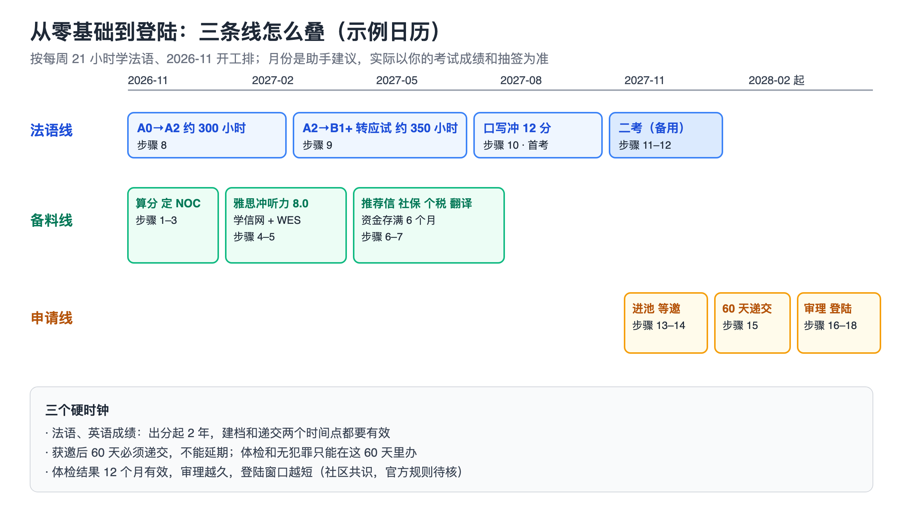
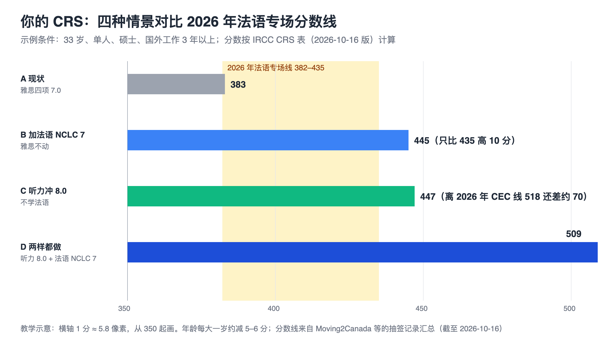
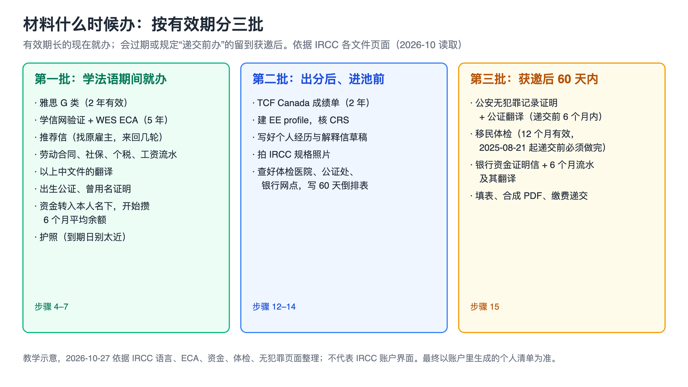
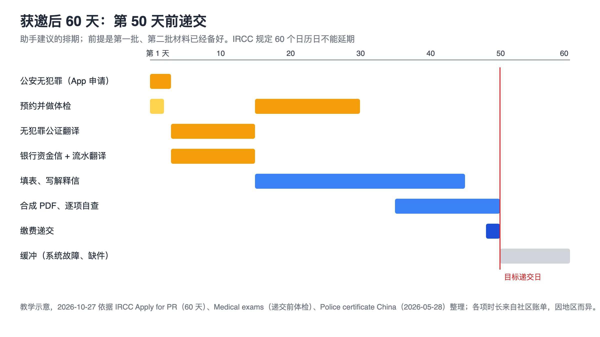

# TCF Canada 法语移民实战手册：从零基础到登陆

> 手册类型：定制版

<a id="section-intro"></a>
## 阅读说明

这本手册写给你：30 出头、硕士、受雇白领 3 年以上、英语不错（雅思约 7 分）、法语零基础，打算一个人申请，通过加拿大联邦 Express Entry（下称 EE）的法语专场拿到永久居民身份。主骨架是 2026-10-26 做的两份调研报告（考试与路径、申请全流程），分数表在 2026-10-27 按 IRCC 官网现行页面重新核过 [[O1](#source-o1)、[O3](#source-o3)、[O4](#source-o4)]。

- **先看下面的路线图**，再按步骤往下做。分数对照表、费用表、案例卡、模板、不做清单都在附录，正文用链接跳过去。
- **你的分已经替你算好了。** 按官方表，你现在大约 383 分；只学法语到四项 NCLC 7 是 445 分；先把雅思听力从 7.0 提到 8.0 再学法语是 509 分。为什么先冲雅思听力，见[步骤 1](#section-step1)。这些分是按“未经确认的示例条件”算的，你的真实分要在步骤 1 用自己的成绩重算。
- **规则会变，而且 2026 年 11 月就有一次大变化。** 2026-11-03 起 CRS 加入新的“劳动力市场融合”分，抽签会暂停最多两周 [[O2](#source-o2)]；2027 年的抽签类别清单和移民配额截至 2026-10-26 都还没公布。规则查询日期写在每条来源里，递交前以 IRCC 账户和官网当时显示为准。
- **数字的性质。** 抽签分数线、处理时间来自对 IRCC 公告的整理 [[S1](#source-s1)、[S2](#source-s2)]；学习时长、考试次数、花费、审理时间都是小红书和 Reddit 上的个人自述，大多是成功的人才发帖，只能当计划区间，不能当你的目标线。
- **不承诺结果。** 这本手册给的是动作和时间安排，不保证你考到 NCLC 7，也不保证获邀或获批。考不出、政策变了怎么办，在[步骤 12](#section-step12) 和[附录 F](#section-appendix-f) 写了。
- **本次学习修订（2026-10-29）。** 新增十三册分工、24 模块、336 天打勾表。每天 5 课的具体对象和实测分钟尚待确认；先按每天最多 5 个任务块编排。申请政策仍沿用原版核对日期，本次没有重新认证其现行有效性。
- **示例是虚构的。** 手册里的“33 岁”“雅思四项 7.0”“2026-11-02 开工”“每晚 2 小时、周末每天 5.5 小时”，以及模板里用〔〕标出的公司名、职位、金额，都是为了演示怎么填而设的，要换成你自己的。
- **有些做法不采用。** 找人代考、买“内部考位”、背整段口语答案、用冻结存单代替银行信、同时开两个档案拿两份邀请，素材里都出现过，本手册一律不写进步骤，理由和替代办法见[附录 A](#section-appendix-a)。
- **编号怎么读。** “步骤 1”是要动手的操作或判断；方括号里的 O1 是官方页面（IRCC、考点、认证机构），S1 是第三方整理、律所文章和个人经验帖。点一下跳到文末，文末“回到正文”跳回来。T1–T11 是[附录 C](#section-appendix-c) 的模板。
- **几个反复出现的词**：NCLC / CLB 是加拿大的语言等级，法语叫 NCLC、英语叫 CLB，数字一样；CRS 是 EE 候选池里的排名分；ITA 是获邀申请；eAPR 是获邀后在线递交的永居申请；COPR 是永居确认函。更多见[附录 E 术语表](#section-appendix-e)。

<a id="section-roadmap"></a>
## 约 2 年路线图

三条线一起走。下表保留原版约 2 年的申请日历示例；本次学习细排采用 24 模块、48 周，阶段验收与实际考期会使后续月份移动。它不是获邀、递交或获批时间预测。备料线趁学法语的空档把有效期长的材料办完；申请线在法语出分后才开始，但它的 60 天窗口要靠前两条线提前铺好。下表的月份按“2026-11 开工、每周学法语 21 小时”排，是助手建议。

| 阶段 | 这一阶段做什么 | 点开对应章节 |
| --- | --- | --- |
| 第 1–2 周（2026-11）：算分、定方向 | 用官方表算你的 FSW 67 分和 CRS；定职业代码，核工作经历能不能用；排出学习和考试日历 | [步骤 1 算分](#section-step1) · [步骤 2 定 NOC](#section-step2) · [步骤 3 排日历](#section-step3) |
| 第 1–4 个月（2026-11 到 2027-02）：法语打基础，同时备料 | 法语学到 A2；考一次雅思冲听力 8.0；办学信网验证和 WES 学历认证；找原雇主开推荐信、导出社保个税；把资金转到本人名下开始攒 6 个月平均余额 | [步骤 4 雅思](#section-step4) · [步骤 5 学历认证](#section-step5) · [步骤 6 工作证明](#section-step6) · [步骤 7 资金与民事文件](#section-step7) · [步骤 8 法语到 A2](#section-step8) |
| 第 5–8 个月（2027-03 到 2027-06）：转应试 | W17–W28 继续 B1；W29 起做 B2 桥接，逐步熟悉题型；写作和口语保留反馈 | [步骤 9 转应试](#section-step9) · [步骤 10 口写冲 12 分](#section-step10) |
| 第 9–13 个月（2027-07 到 2027-11）：考试 | W41–W48 集中限时；通过四项准备检查后选择首考和备用场次；以实际考点通知为准 | [步骤 10 口写冲 12 分](#section-step10) · [步骤 11 报名与考试](#section-step11) · [步骤 12 看分决定](#section-step12) |
| 第 12–16 个月（2027-10 到 2028-02）：进池、获邀、递交 | 出分当周建档；等邀期间写好 60 天倒排表；获邀后 60 天内递交 | [步骤 13 建档](#section-step13) · [步骤 14 等邀](#section-step14) · [步骤 15 60 天递交](#section-step15) |
| 第 16 个月以后（约 2028-03 起）：审理、贴签、登陆 | 录指纹、回应补件、查进度；贴签拿 COPR；在期限内登陆，办 SIN，收 PR 卡 | [步骤 16 审理](#section-step16) · [步骤 17 贴签](#section-step17) · [步骤 18 登陆](#section-step18) |

每周怎么分配时间、每个月产出什么，见[时间表](#section-schedule)。



图注：教学示意，2026-10-27 依据本手册步骤清单与 IRCC 语言成绩、60 天、体检规则绘制 [[O4](#source-o4)、[O9](#source-o9)、[O10](#source-o10)]；月份是助手建议，不代表 IRCC 账户界面。“体检 12 个月决定登陆期限”是社区说法，官方规则待核（G8）。

这一路先不做：魁北克 PSTQ / PEQ、各省省提名的法语通道、C16 法语工签、配偶和子女随行的额外材料、登陆后找工作；以后再看[附录 F](#section-appendix-f)。

<a id="section-conditions"></a>
## 本次条件

| 项目 | 你的情况 |
| --- | --- |
| 已确认（2026-10-27） | 30–34 岁；最高学历硕士；过去 10 年受雇白领 3 年以上；英语好，雅思约 7；法语零基础；单人申请；只走联邦 EE 法语专场 |
| 身份与时间 | 一个人做 AI 工具和内容，周一到周三 10:00–19:00 留给项目（`context/reader.md`）；学法语用每天晚上和周末（2026-10-27 确认） |
| 本次实测信息（2026-10-29） | 每天或连续能做约 5 课／5 个；具体教材及分钟尚未确认，当前按最多 5 个任务块暂排 |
| 已采纳的建议（2026-10-27） | 12 月先考雅思 G 类冲听力 8.0；法语按 NCLC 8 准备、到 NCLC 7 就进池；首考优先选机考点；申报连续 3 年的同一职业 |
| 未经确认的示例条件 | ① 现在 32 岁，进池时 33 岁 ② 雅思 G 类四项 7.0，且旧成绩已超过 2 年，要重考 ③ 最近 10 年里有连续 3 年同一 TEER 1 职业的受雇经历，NOC 〔待定〕 ④ 资金已在本人名下 ⑤ 每周学法语 21 小时：工作日每晚 2 小时、周六周日各 5.5 小时，2026-11-02 开工 ⑥ 只能白天办的事（考试、公证处、银行、体检、签证中心）放在周四、周五白天 |
| 还不知道、会改变路线的 | 你的确切年龄和生日；雅思四项分数和考试日期；职业和原雇主能否开推荐信；现在是否还在职；每周真实能投入多少小时 |

**为什么你的路线和网上大多数攻略不一样。** 网上攻略默认读者分数低、法语是唯一出路。你的英语读写说已经是 CLB 9，硕士在学历分里是第二高档（博士最高），所以英语听力只差一档（7.0 到 8.0），这一档在 CRS 里值 64 分，和学法语拿到的 62 分差不多，成本却低得多 [[O1](#source-o1)、[O4](#source-o4)]。法语仍然要学，因为只有法语专场的线在 400 分上下；但先冲听力，能让你在法语刚过线时就有余量。

<a id="section-adjust"></a>
### 条件不同时怎么调

- **每周不到 21 小时**：步骤不删，法语线按小时数拉长。同一任务预算每周 14 小时约需 72 周，每周 10 小时约需 101 周；退出检查不过还需补练，先按[步骤 1](#section-step1) 再判断一次值不值。
- **某几周晚上加班或出差**：周末两天照学，晚上只保 30 分钟单词卡；当周少的小时记进 T2，月底累计落后 10% 以上就把首考往后推一场，不压缩口语练习。
- **周四、周五白天也没空**：考试、公证处、银行、体检、签证中心都只在工作日白天办，要从周一到周三的项目时间里挪半天到一天，提前写进月历。
- **雅思听力怎么也上不去 8.0**：照常走法语线，你的分是 445 分左右，仍高于 2026 年全部法语专场的线，但余量只有 10 分；法语就要按 NCLC 8 留余量，并尽量在 35 岁前进池。
- **已经 34 岁或更大**：每大一岁约少 5–6 分 [[O1](#source-o1)]。把首考尽量提前，并优先做雅思听力。
- **原雇主开不出推荐信**：这是最长的卡点，先做[步骤 2](#section-step2) 和[步骤 6](#section-step6) 的替代证明；仍然拿不到，法语线照常，进池前请持牌顾问看一次材料。
- **只想先试试能不能学下去**：先做步骤 1、3、8，先执行 4 周并核对实际用时与能做的任务，再决定要不要花钱办学历认证和公证。雅思冲听力不依赖法语，可以先做。
- **要带配偶或孩子**：费用、资金证明、体检、无犯罪都按人头增加，CRS 也换成“有配偶”的表，见[附录 F](#section-appendix-f)。

<a id="section-deliverables"></a>
### 要完成什么

| 结果 | 数量 | 在哪一步 |
| --- | --- | --- |
| 算分表和走 / 不走的决定 | 1 张 | [步骤 1](#section-step1) |
| 职业代码和工作经历时间轴 | 1 份 | [步骤 2](#section-step2) |
| 学习月历和考试日历 | 1 份 | [步骤 3](#section-step3) |
| 雅思 G 类成绩（目标四项 CLB 9） | 1 份 | [步骤 4](#section-step4) |
| WES 学历认证报告 | 1 份 | [步骤 5](#section-step5) |
| 推荐信、劳动合同、社保个税工资流水及翻译 | 每段工作 1 套 | [步骤 6](#section-step6) |
| 本人名下满 6 个月的资金记录；出生公证 | 1 套 | [步骤 7](#section-step7) |
| 法语学习记录（小时数、教材、课程凭证） | 每周 1 行 | [步骤 8](#section-step8)–[步骤 10](#section-step10) |
| 口语素材库、写作三套结构 | 各 1 份 | [步骤 9](#section-step9)、[步骤 10](#section-step10) |
| TCF Canada 四项 NCLC 7 以上的成绩 | 1 份（预留 2 次考试） | [步骤 11](#section-step11)、[步骤 12](#section-step12) |
| 进池的 EE 档案 | 1 个 | [步骤 13](#section-step13) |
| 60 天倒排表 | 1 张 | [步骤 14](#section-step14) |
| 递交成功的永居申请和 AOR | 1 份 | [步骤 15](#section-step15) |
| 补件记录（有就写，没有写“未发生”） | 1 张 | [步骤 16](#section-step16) |
| 护照永居签证和 COPR | 1 套 | [步骤 17](#section-step17) |
| 登陆记录、SIN、PR 卡 | 1 套 | [步骤 18](#section-step18) |

<a id="section-gaps"></a>
### 阻断缺口（动手前先看）

- **G1 职业代码与推荐信**：FSW 要求最近 10 年有 1 年连续、带薪的 TEER 0–3 工作，并能证明 [[O3](#source-o3)、[O8](#source-o8)]。你的职位和原雇主是否配合还不知道。影响[步骤 2](#section-step2)、[步骤 6](#section-step6)。缺了照样可以学法语、考雅思、办学历认证。
- **G2 雅思现有成绩**：你说“约 7”，没给四项分和日期。语言成绩要在建档和递交时都不满 2 年 [[O4](#source-o4)]，所以大概率要重考。影响[步骤 1](#section-step1)、[步骤 4](#section-step4)。缺了照样可以按示例 7.0 先算分、先开始学法语，12 月考完再重算。
- **G3 2027 年还有没有法语专场**：法语类别在 2026-02-18 列入当年清单（律所报道）[[S1](#source-s1)]，2027 年清单截至 2026-10-26 没公布；联邦给魁北克以外法语移民定的目标是 2026 年 9%、2027 年 9.5%、2028 年 10.5% [[O21](#source-o21)]。影响[步骤 13](#section-step13)、[步骤 14](#section-step14)。学法语的头几个月不受影响，每年 2–3 月看一次新清单。
- **G4 新规后的分数线**：2026-11-03 改规则后第一轮法语专场的线还没出来 [[O2](#source-o2)]。影响[步骤 1](#section-step1) 的余量判断。2026 年 12 月再看一次。
- **G5 FEI 原文**：出题机构 FEI（法国教育国际中心）的官网这次没读到，写作字数、口语时长、复核暂停、两次考试间隔这些规则来自考点转述 [[O22](#source-o22)、[O24](#source-o24)]。影响[步骤 9](#section-step9)–[步骤 12](#section-step12)。报名时当面问考点。
- **G6 国内考点 2027 年考期与价格**：上海公布到 2027-01-14，其他考点 2027 年日程没拿到 [[O23](#source-o23)]。影响[步骤 3](#section-step3)、[步骤 11](#section-step11)。
- **G7 资金证明**：现行金额表是 2025-07-07 的，2026 年没看到更新；国内银行能不能出带“6 个月平均余额”的英文信也没核 [[O7](#source-o7)]。影响[步骤 7](#section-step7)、[步骤 15](#section-step15)。缺了可以先按现行表把钱转进本人名下开始攒 6 个月；获邀当天再查一次金额。
- **G8 COPR 有效期**：社区普遍说取护照到期日和体检后 12 个月中较早的那个，IRCC 原文没核到 [[O15](#source-o15)、[S16](#source-s16)]。影响[步骤 15](#section-step15)–[步骤 17](#section-step17)。体检不要做得太早。

<a id="section-schedule"></a>
## 时间表（助手建议）：24 模块、48 周、每天最多 5 项

先把“能连续做 5 个”的节奏用于限制任务量。你尚未说明是哪份教材的 5 课及实测分钟，因此下表的分钟数是待校准预算。**5 个短课、5 道练习、一整课教材不是同一单位**：资料库短课标注的 8 分钟只指阅读；教材含课文、练习与输出，一天先选一课的核心部分，不要求一天刷完五课。

### 分阶段计算，不用总小时数判定升级

| 阶段 | 模块数 | 周与天 | 本段预算 | 累计预算 | 主要材料与退出条件 |
| --- | --- | --- | --- | --- | --- |
| A0→A1 | M01–M04，4 个 | W01–W08，D001–D056 | 8×21＝168 小时 | 168 小时 | 简明语音 1–8；你好 A1 1–36；能自介、问路、购物、写短信息 |
| A1→A2 | M05–M08，4 个 | W09–W16，D057–D112 | 8×21＝168 小时 | 336 小时 | 简明上 9–30；G／E／M 辅助；能讲过去、比较选择、处理预约 |
| A2→B1 | M09–M14，6 个 | W17–W28，D113–D196 | 12×21＝252 小时 | 588 小时 | 你好第3册 1–24 + 第4册 25–48；叙事、解释理由、互动追问 |
| B1→B2 能力桥接 | M15–M20，6 个 | W29–W40，D197–D280 | 12×21＝252 小时 | 840 小时 | 六类社会话题、B2 视听、两方观点比较、真人反馈；不是已有 B2 完整教材 |
| B2→TCF Canada 四项训练 | M21–M24，4 个 | W41–W48，D281–D336 | 8×21＝168 小时 | 1,008 小时 | 四项限时、弱项回补、独立模考；按单项成绩决定报名 |

一模块为两周，共 24 模块；这是一版排课预算，不是达到 CEFR／NCLC 的必要或充分课时。先过[阶段退出检查](#section-stage-gates)，再进入下一段；慢了就加补练日。CEFR A1/A2/B1/B2 与 NCLC 不是同一把尺，最终按 TCF Canada 单项成绩换算。

### 每天固定怎么分

| 任务块 | 周一至周五 | 周六、周日 | 做完留什么 |
| --- | --- | --- | --- |
| 1 复习 | 20 分钟 | 50 分钟 | 昨天及一周前各 5 句回忆，错处标记 |
| 2 主教材／主任务 | 40 分钟 | 70 分钟 | 指定课号的课文、最多 5 道选定练习及改正 |
| 3 对应短课／规则 | 20 分钟 | 60 分钟 | 指定 G/E/P/M/F/A/I 课，3 句自用句 |
| 4 听力与跟读 | 20 分钟 | 70 分钟 | 5 条信息／5 句录音；材料标题和链接 |
| 5 口写输出／反馈 | 20 分钟 | 80 分钟 | 一段录音或短文、反馈及重做版本 |
| 合计 | 每天 120 分钟，五天共 10 小时 | 每天 330 分钟，两天共 11 小时 | 每周 21 小时 |

上述是净学习时间，休息另计；周末不要求连续坐 5.5 小时，可拆上午 2 小时、下午 2 小时、晚上 1.5 小时。长块每 20–25 分钟休息；遇到练题，每批最多 5 道。W41 起周六改按 35 分听力、60 分阅读、60 分写作和口语模考分配，详见逐日表，全天总量仍是 330 分钟。

### 第一天就做这 5 项（120 分钟）

- [ ] 20 分钟：新建学习记录，记今天开始时能说出的 5 个法语词或短句，不会就写零。
- [ ] 40 分钟：打开《简明上》第 1 课，只学本课讲解与前 5 道可核答案的非听力题；不会的留题号。
- [ ] 20 分钟：打开 P01“字母与声音不是同一回事”，读讲解、做课内题，写下字母和发音的区别。
- [ ] 20 分钟：从 P01／P02 例句选 5 句，听后逐句模仿；无配套原音时用学习库语音，标“合成语音”。
- [ ] 20 分钟：允许照当天例句模仿，尝试录 30 秒姓名和职业，回听改 2 处；填写每块实际用时。

D002 起按[336 天打勾表](#section-daily-calendar)继续；总表见[48 周课号清单](#section-week-plan)。前三天记录“打开材料、做题、纠错、输出”的总耗时。若 40 分钟主教材块连续两天超时，不挤掉口写，下一天继续同课剩余部分；如果你说的 5 个其实是五课短课，先按实测替换主任务和辅助任务的数量，总时段不加码。

### 延期与其他任务怎样放

每天的记录至少写日期、D 编号、课号／题号、计划分钟、实际分钟、录音／文稿名、纠错后的结果；不能只写“学法语 2 小时”。计划 CSV 已给空白栏，尚未发生的学习不会预先打勾。

原稿 2026-11-02 开工仍只作示例：W08 结束 2026-12-27，W16 结束 2027-02-21，W28 结束 2027-05-16，W40 结束 2027-08-08，W48 结束 2027-10-03；日期都可整体后移。首考只选 W48 验收后的合适考期，未过就延后，不能用“累计约 950 小时”代替报名条件。

雅思考前若从法语挪出 14 小时，就把相应法语任务排到 W49 或之后补齐；48 周内法语实耗因此是 994 小时，补齐后才是本表的 1,008 小时。备料保留原先约 80 小时的手工活估算，另排每周 1–2 小时，不算进法语 21 小时。原申请月历仅为旧示例，出分、获邀和递交随实际成绩与邀请移动。

<a id="section-step1"></a>
## 步骤 1 用官方表算你的分，决定先冲什么

网上的“法语加分”文章大多只算法语那一项，没把你的英语、学历、年龄放进同一张表。这一步不花钱，只用 IRCC 的三张表（CRS、FSW 67 分、雅思和 TCF 对照）把四种情景算出来。做完你会知道：你够不够 FSW 门槛、法语能把你推到多少分、先做哪件事最划算。



图注：教学示意，2026-10-27 按 IRCC CRS 表（2026-10-16 版）[[O1](#source-o1)] 与雅思对照表 [[O4](#source-o4)] 计算，示例条件为 33 岁、单人、硕士、国外工作 3 年以上、雅思四项 7.0；分数线为 2026 年 11 轮法语专场 [[S1](#source-s1)]。你的真实分以自己的成绩重算为准。

**目标**：用自己的真实成绩填完算分表，得出“先冲雅思听力、再学法语”或其他顺序的决定。

1. **把英语成绩换成 CLB。** 输入：雅思 G 类四项分。按 IRCC 对照表逐项换：听力 8.0 才是 CLB 9（7.5 是 CLB 8，6.0–7.0 是 CLB 7），读 7.0、写 7.0、说 7.0 是 CLB 9 [[O4](#source-o4)]。示例的四项 7.0 换出来是“听 7、读写说 9”。学术类雅思不能用，必须是 G 类。
2. **算 FSW 67 分，确认门槛。** 语言（第一官方语言每项 CLB 7 得 4、CLB 8 得 5、CLB 9 以上得 6）、学历（硕士 23）、经验（2–3 年 11、4–5 年 13）、年龄（18–35 岁 12）相加 [[O3](#source-o3)]。示例是 22 + 23 + 11 + 12 = 68 分，只比 67 多 1 分：雅思写作掉到 6.5 就是 67，任一项低于 6.0 直接不合格。法语四项都到 NCLC 5 以后再加 4 分。
3. **按 CRS 表算四种情景。** 用[模板 T1](#template-t1) 逐项填：年龄、学历、第一语言每项分、第二语言每项分、技能可转移分、法语附加分 [[O1](#source-o1)]。示例的结果是 A 现状 383、B 只加法语 NCLC 7 为 445、C 只把听力冲到 8.0 为 447、D 两样都做 509。听力那一档值 64 分：第一语言 +14，技能可转移里“学历 + 语言”和“国外经验 + 语言”两项各从 25 升到 50。
4. **对照抽签线做判断。** 2026 年法语专场 11 轮，线在 382–435，最近一轮（10-16）是 435；同期 CEC 专场在 518–523 [[S1](#source-s1)]。用这三条规则判断：情景 B 高于 435 但余量小于 20 分时，雅思听力必须先冲；情景 D 高于 480 时，法语按 NCLC 7 达标即可进池；情景 B 低于 400 时，先回头核年龄和工作年限再决定。年龄每大一岁约减 5–6 分，35 岁比 33 岁少 11 分 [[O1](#source-o1)]。
5. **写下决定和下一步。** 示例的决定是：12 月先考雅思冲听力 8.0（步骤 4），同时开始法语（步骤 8）；法语目标按 NCLC 8 准备，达到 NCLC 7 就进池。反例：只看到“法语 NCLC 9 能多拿分”就把进池往后推，NCLC 7 到 9 只多 12 分 [[O1](#source-o1)]，换来的是半年以上的学习和一岁的年龄分。

**做完的标准**：T1 算分表四种情景都有数，FSW 67 分写明余量；你写下了先做哪件事、法语目标定在哪一档，以及一个“情况变了就重算”的触发条件（例如 11 月新规后第一轮法语专场出线）。

- [ ] 雅思四项已换成 CLB，写明考试日期和是否过期
- [ ] FSW 67 分算完，余量写清楚
- [ ] CRS 四种情景算完
- [ ] 写下先冲听力还是直接学法语的决定

**素材里的说法怎么看**：一家中文站给过一个和你几乎一样的画像（33 岁、硕士、CLB 9、海外 3 年），写原分 478、加法语后约 540 [[S31](#source-s31)]。那是为了演示构造的例子，和官方表算出的数不一致，以你自己按 T1 算的为准。还有中介写“法语在 EE 能加 600 分”，那是省提名的分，联邦的法语附加分最多 50 [[O1](#source-o1)]。

参见附录：[模板 T1 算分表](#template-t1)、[附录 D 分数对照表](#section-appendix-d)。

<a id="section-step2"></a>
## 步骤 2 定职业代码，核工作经历能不能用

法语专场不是一个独立项目，你仍然要先符合 FSW 才能被抽中 [[O5](#source-o5)]。人在中国、没有加拿大经历，FSW 是唯一可走的项目，而 FSW 的门槛和后面最常出问题的推荐信，都挂在“职业代码”上。这一步做完，你有一个选定的 NOC 代码和一条 10 年工作时间轴，知道哪一段经历拿来申报、拿什么证明。

**目标**：选定一个能被推荐信和社保个税记录证实的主职业 NOC，并确认至少 1 年连续带薪、TEER 0–3。

1. **列出最近 10 年的时间轴。** 输入：劳动合同、社保缴费记录。每段写起止年月、公司、职位、每周工时、是否全职带薪。FSW 只认最近 10 年内、连续 1 年（或累计 1,560 小时、每周至少 30 小时）的带薪工作，志愿和无薪实习不算 [[O3](#source-o3)]。你现在做 AI 工具和内容这一段，也要写进时间轴，后面的个人经历表不能留空档。
2. **按职责查 NOC，不按头衔。** 先按职位名称在 IRCC 的查询页找 5 位代码和 TEER 等级，再打开 NOC 官网逐条对 lead statement 和 main duties，两者冲突时以 NOC 官网为准 [[O8](#source-o8)]。中国公司的“经理”“工程师”常和 NOC 对不上；判断标准是你的实际职责覆盖该代码主要职责的大部分。
3. **选主职业并核三件证据。** 选一个连续 3 年的职业作为主职业（经验分按年数算，3 年在 FSW 是 11 分，在 CRS 技能可转移里是“3 年以上”一档）[[O1](#source-o1)、[O3](#source-o3)]。逐项核：原雇主能否开推荐信、劳动合同在不在、社保和个税记录能否导出。三件里缺两件，换一段经历或先做[步骤 6](#section-step6) 的替代方案。
4. **处理几种特殊情况。** 公司已注销、中途换过公司、兼职折算、自雇，都要额外证明，递交前值得请持牌顾问看一次材料（助手建议，见[附录 B 自己办还是请人](#section-diy)）。做 AI 工具和内容这一段如果是自雇，本手册不把它算进经验，只在个人经历里如实写明。

**做完的标准**：时间轴表完成；写下一个 NOC 代码、TEER 等级和对应的起止日期；对照表里你的实际职责与该代码主要职责逐条打了勾；三件证据各有“能拿 / 拿不到 / 替代”结论。

- [ ] 10 年时间轴无空档
- [ ] NOC 代码与 TEER 已定
- [ ] 职责逐条对照过 NOC 官网
- [ ] 推荐信、合同、社保个税三件证据有结论

**素材里的提醒**：中介代写的推荐信出现过把职责写成 TEER 4 的情况，也出现过照抄 NOC 原文被怀疑的情况 [[S19](#source-s19)、[S27](#source-s27)]。所以 NOC 要自己定、自己对，推荐信用自己的话写职责（见[步骤 6](#section-step6)）。

<a id="section-step3"></a>
## 步骤 3 排出学习日历和考试日历

法语线按[24 模块日程](#section-schedule)分段推进，考试按考点公布的场次报名，报名窗口只开一周左右。这一步把“每周几小时”换成具体月份，把首考、备用二考放进考点日历。做完你手里有一张月历和两三个候选考期。

**目标**：确定每周学习小时数和排法，选定 2 个考点和首考、二考的候选日期。

1. **定每周小时数和排法。** 输入：你的工作和项目安排。按[时间表](#section-schedule)的“每晚 2 小时 + 周末每天 5.5 小时”写进[模板 T2](#template-t2)，每周日晚上对一次累计小时。本版用每日任务与阶段验收推进；旧资料的参考量：零基础到四项 CLB 7 的中文帖子报 1,000–1,300 小时 [[S4](#source-s4)]；英语母语者的机构估计是 600–750 课堂小时，不含自学，也不是针对中文母语者 [[S24](#source-s24)]。
2. **选考点。** 国内单次约 2,700 元，各考点自己定日程 [[O23](#source-o23)]。上海纸考，邮件报名，出分 5–6 周；北京、济南是机考，出分较快；深圳 2026 年新开，纸考，出分约 3–4 周 [[O23](#source-o23)、[S32](#source-s32)]。纸考还是机考会影响出分时间，离进池时间紧时优先选机考点。
3. **排首考和备用二考。** 两次 TCF Canada 之间至少隔 20 天，广州法盟写的是 30 天 [[O24](#source-o24)、[O23](#source-o23)]。首考放在 W48 验收通过后的可用场次，二考候选在首考后 6–8 周；以上海为例，报名窗口约在考前 6–7 周截止，所以倒推候选首考日期提前处理报名，并在缴费前重核四项准备程度，二考往往要在首考出分前就报 [[O23](#source-o23)]。首考优先选机考点：机考出分通常更快（多伦多机考约 2 周，国内机考点未核），你能在二考前知道哪一项要补。
4. **把备料月份填进同一张表。** 按[材料分批图](#section-step7)，第一批（雅思、学历认证、推荐信、资金起算）放在头 4 个月，避开首考前 2 个月。

**做完的标准**：T2 月历填到 W48 并留补练与考期余量；写下两个考点、首考月份和二考月份；每个月都写了要完成的模块、验收产物和备料任务。

- [ ] 每周小时数和排法已定
- [ ] 两个候选考点已选
- [ ] 首考、二考月份已排，间隔够 20 天（广州 30 天）
- [ ] 备料任务已放进月历

**作者怎么做的**：momo 每天有效学习 3–4 小时，6 个月首考通过，几乎没花钱 [[S3](#source-s3)]；Emma 39 岁，前 3 个月每天约 6 小时、后 5 个月 8 小时以上，8 个月约 1,300 小时考出 [[S4](#source-s4)]。两人都是全职备考，你如果同时做项目，按小时数换算，不要按她们的月数排。

参见附录：[模板 T2 学习周表与月历](#template-t2)、[附录 B 案例卡](#section-appendix-b)。

<a id="section-step4"></a>
## 步骤 4 考雅思 G 类，把听力冲到 8.0

在你的条件下，这是全书性价比最高的一步：雅思听力从 7.0 到 8.0，CRS 多 64 分，而且不依赖法语进度。同一张成绩单还要守住 FSW 67 分的门槛。做完你有一份四项都到 CLB 9 的雅思 G 类成绩，或者知道自己卡在哪一项。

**目标**：拿到一份不满 2 年、四项都达到 CLB 9（听 8.0、读写说 7.0）的雅思 G 类成绩。

1. **报 G 类，不报学术类。** IRCC 认的英语考试是雅思 G 类、CELPIP-G、PTE Core [[O4](#source-o4)]；CELPIP 和 PTE Core 能否在大陆考本次没核到，按雅思 G 类准备。2026 年账单记的是 2,170 元一次 [[S10](#source-s10)]。
2. **只专练听力，守住其他三项。** 目标线：听 8.0、读 7.0、写 7.0、说 7.0 [[O4](#source-o4)]。写作和口语也要守住 7.0：在听力已到 8.0 的前提下，任一项掉到 6.5，这一项 CRS 少 8 分，技能可转移也从 100 掉回 50，合计少 58 分；FSW 从 70 掉到 69。听力还没到 8.0 时，同样的失误只少 8 分，但 FSW 会从 68 掉到 67，贴着门槛 [[O1](#source-o1)、[O3](#source-o3)]。考前 2 周每天 1 小时练听力，从法语时间里挪。
3. **看成绩，决定停还是再考。** 四项到 CLB 9 就停，不要为 CLB 10 再考：CLB 9 到 10 每项只多 3 分，技能可转移已经封顶 [[O1](#source-o1)]。听力只到 7.5（CLB 8），第一语言分 +6，可转移分不变，值得在 2027-02 再考一次。考两次都上不去，就按情景 B 走。
4. **记下成绩日期。** 成绩在建档和递交两个时间点都要不满 2 年 [[O4](#source-o4)]。示例 2026-12 的成绩有效到 2028-12，覆盖 2027-10 建档和 2027-12 至 2028-02 递交。

**做完的标准**：成绩单上四项分数、考试日期、TRF 号码已记进 T1；按 T1 重新算出的 CRS 写在旁边。

- [ ] 报的是 G 类
- [ ] 四项都换成了 CLB
- [ ] 成绩有效期覆盖预计递交月份
- [ ] T1 已按新成绩重算

**素材里的提醒**：有申请人英语申请复议失败白花 1,400 元，她的总结是“英语够用就停” [[S11](#source-s11)]。你的情况相反，听力那一档对你值 64 分，值得考，但够 CLB 9 就停。

<a id="section-step5"></a>
## 步骤 5 办学信网验证和 WES 学历认证

学历认证（ECA）报告 5 年有效，远长于法语学习期，所以开始学法语后头几个月就该办掉。卡点不在 WES，而在国内的学信网验证，要 20–30 个工作日。做完你有一份写明“加拿大硕士同等学历”的 ECA 报告。

**目标**：拿到 IRCC 认可机构出具、用途为移民、对硕士学历给出等同结论的 ECA 报告。

1. **在 WES 建档拿编号。** IRCC 指定 5 家认证机构，中国申请人最常用 WES [[O6](#source-o6)]。在 WES 网站选“为加拿大移民（IRCC）做 ECA”，记下 WES Reference Number；用途选错（例如选成就业或执照）IRCC 不认，只能重做重付 [[S36](#source-s36)]。
2. **在学信网申请成绩单验证并发送 WES。** WES 自 2018-07-01 起要求本科以上成绩单由学信网（CHESICC）验证后直接发给 WES [[O19](#source-o19)]。硕士和本科都提交：本科、硕士各一套成绩单验证。
3. **上传学历学位电子报告和证书复印件。** 申请人另交学信网或学位网（CDGDC）的学历、学位认证电子报告，以及毕业证、学位证复印件 [[O19](#source-o19)]。
4. **跟进并核对报告。** 国内验证约 20–30 个工作日，WES 收齐后 7–35 天（另有 6–12 周的说法）[[S36](#source-s36)]，按“国内 1 个月 + WES 1 个月”排。报告到手后核对：机构名称、用途、结论写“Master's degree”、出具日期。2026 年账单记的 WES 费用是 1,832–2,257 元 [[S11](#source-s11)、[S12](#source-s12)]。

**做完的标准**：ECA 报告 PDF 和编号存好；结论是硕士；出具日期写进 T1，并算出 5 年有效期的截止日。

- [ ] WES 编号已拿到，用途选的是 IRCC
- [ ] 学信网验证已发送 WES
- [ ] 电子认证报告和证书复印件已上传
- [ ] ECA 结论和有效期已核

**为什么本科也送**：CRS 里硕士 135 分已经高于“两个及以上学历”的 128 分 [[O1](#source-o1)]，本科不会再加分；送本科是为了让 WES 看到完整学历链条，避免硕士学制被单独质疑。这是助手建议，费用按 WES 实际报价判断。

<a id="section-step6"></a>
## 步骤 6 拿推荐信和工作辅证，提前做好翻译

工作经验证明是社区里被反复提到的第一风险：补件、程序公正信（PFL）、拒签，大多出在推荐信上 [[S27](#source-s27)、[S19](#source-s19)]。补件期限常常只有 7 天，所以这一步要在学法语期间做完，翻译件也提前备好。做完你有一套能逐字核对的工作证明。

**目标**：每段申报的工作都有一封字段齐全的推荐信，加上劳动合同、社保、个税、工资流水四类辅证及其认证翻译。

1. **请 HR 或主管出推荐信。** 用公司抬头纸，英文或中英双语，盖公章，写明：职位、起止日期、**具体每周工时**（例如 40 小时，只写“Full-Time”可能被认为没证明工时）、年薪和福利、主要职责、公司地址电话邮箱、签字人姓名和职务 [[O18](#source-o18)、[S19](#source-s19)]。按[模板 T3](#template-t3) 给对方一份草稿。
2. **职责用自己的话写，不抄 NOC。** 职责要覆盖所选 NOC 的大部分主要职责，但逐字照抄会被认为“过于完美” [[S19](#source-s19)]。有联邦法院判决显示，移民官会逐字比对申请人和雇主的文字，连同一个拼写错误都能被发现 [[S20](#source-s20)]。
3. **导出四类辅证。** 劳动合同；社保缴费明细（国家社保公共服务平台或当地社保 App）；个人所得税 App 的“收入纳税明细”；工资卡流水 [[O18](#source-o18)]。补件里最常要的就是工资条、税单、流水 [[S13](#source-s13)]。
4. **送认证翻译。** 非英法文件要附译文、译者宣誓书和原件认证复印件；专业翻译协会在册会员的认证译文可以免宣誓书；**你本人、家人、代理人都不能做翻译** [[O12](#source-o12)]。公证处的“公证书 + 英文译文”是最省事的组合；中国翻译协会会员章算不算认证译者，本次没核到。
5. **公司注销或开不出信时用替代组合。** IRCC 接受劳动合同、工资单、税务文件作为补充证明 [[O18](#source-o18)]；社区做法是社保记录、个税记录、劳动合同、前主管个人声明（附身份证和联系方式）加一封解释信组合证明。这种情况递交前值得请持牌顾问看一次。

**做完的标准**：每段工作一个文件夹，含推荐信原件扫描、四类辅证、译文；推荐信上的日期、工时、职位与社保个税记录逐月对得上；拿一份 NOC 主要职责清单逐条核过推荐信。

- [ ] 推荐信字段齐全，写了具体工时
- [ ] 职责是自己的话，覆盖 NOC 主要职责
- [ ] 合同、社保、个税、流水已导出
- [ ] 中文件都有认证翻译
- [ ] 日期和工时与辅证逐月一致

**作者怎么做的**：一位走法语 FSW 的美国境外申请人说，前雇主“多次不按模板写、不签字”，来回好几轮才合格 [[S27](#source-s27)]；麦麦获邀后被要求补工资条、税单、流水，补完 5 天进入最终决定 [[S13](#source-s13)]。

参见附录：[模板 T3 推荐信](#template-t3)、[模板 T8 补件应对清单](#template-t8)。

<a id="section-step7"></a>
## 步骤 7 攒够资金证明，办民事文件

资金证明看的是**近 6 个月平均余额**，临时转进去的钱不算数，所以要在递交前至少 6 个月就把钱放到本人名下不动。出生公证这类民事文件不会过期，也可以现在办。做完你有一个余额稳定的账户和一份写清要求的银行信清单。



图注：教学示意，2026-10-27 依据 IRCC 语言成绩、ECA、资金、体检、无犯罪页面整理 [[O4](#source-o4)、[O6](#source-o6)、[O7](#source-o7)、[O10](#source-o10)、[O11](#source-o11)]；不代表 IRCC 账户界面，最终以账户里生成的个人清单为准。

**目标**：在本人名下放好不少于单人标准加 10% 的资金，并保持 6 个月；办好出生公证；确认护照到期日。

1. **算金额。** 现行表（2025-07-07 起）单人 15,263 加元；截至 2026-10-16 的页面仍是这张表，2026 年没看到更新 [[O7](#source-o7)]。按约 4.8 人民币兑 1 加元，单人约 7.3 万元，留 10% 汇率余量约 8.1 万元，与社区“单人 8–9 万元”的说法一致 [[S34](#source-s34)]。房产净值、借来的钱不算 [[O7](#source-o7)]。
2. **把钱放进本人名下的一两个账户，6 个月不大进大出。** 示例最迟 2027-01 转入，到 2027-07 满 6 个月。家人给的钱，IRCC 页面没写；社区做法是提前转到本人名下并做赠与公证（一份账单记 400 元）[[S10](#source-s10)]。
3. **向开户行问清能不能出合格的信。** IRCC 要的是金融机构抬头纸上的英文信，写明：机构联系方式、你的姓名、未偿债务（含信用卡和贷款）、每个账户的账号、开户日期、当前余额、近 6 个月平均余额 [[O7](#source-o7)]。国内常见的冻结式“存款证明”只有一个时点余额，对照上面的字段，单独交大概率不满足要求（推断，IRCC 页面没有点名这种证明）。现在就问清楚，获邀后再去开。
4. **办出生公证，核护照。** 社区普遍用户籍地公证处的出生公证（带英文译文），约 150–300 元 / 份（含中英文翻译，中介聚合口径）、3–5 个工作日；改过名的开曾用名证明 [[S40](#source-s40)]。护照到期日会压缩 COPR 有效期，2028 年内到期的先换 [[O15](#source-o15)]。

**做完的标准**：资金账户和起算日写进 T9 预算表；银行给出能否出具“平均余额 + 负债”英文信的答复；出生公证拿到；护照有效期到 2029 年以后。

- [ ] 资金按单人标准加 10% 放在本人名下
- [ ] 起算日记下，6 个月内不动
- [ ] 银行信的字段已问清
- [ ] 出生公证已办
- [ ] 护照有效期够

**素材里的说法怎么看**：有法语培训号建议交“冻结存单扫描 + 大堂经理名片”[[S38](#source-s38)]，这不符合 IRCC 对信函字段的要求，不采用。有申请人补件时被要求把全部资金流水正式翻译成英文，不能自己标注，期限约一周 [[S17](#source-s17)]，所以流水的翻译放在获邀后第一周做。

参见附录：[模板 T9 预算表](#template-t9)。

<a id="section-step8"></a>
## 步骤 8 用现有教材完成 A0→A1→A2

这一步从你已有的课号出发，把“打基础”变成每天能交出的句子、录音和练习。前两段共 8 个模块、16 周，先按每周 21 小时试排；升级看实际任务，不看小时累计。

**目标**：完成 A1、A2 两次退出检查，保留能回看的学习证据。

1. **打开材料并认清分工。** 七册短课和六份教材分别列在[十三册对应表](#section-material-map)，不是十三本都从第一页读到最后。A1 用《你好法语1》1–36 课，《简明上》1–8 补语音；A2 用《简明上》9–30 与 G/E/M 对应短课衔接。现有资料没有《你好法语2》A2，不把它写成已经拿到 [[S48](#source-s48)、[S49](#source-s49)]。
2. **每天只拿当天的 5 项。** 从[逐日表 D001](#week-01)开始，课文、练题、短课、听说输出都有指定位置。每次练题最多 5 道；整课的剩余题移到补练，课号读过不等于全课已掌握。短课例句先听正常速度，再慢速模仿；合成语音用于辅助，不是教师评分 [[S48](#source-s48)]。
3. **做出本周实际情境。** W03 自我介绍，W05 时间与交通，W07 生活安排与邀请，W09 过去叙事，W11 礼貌请求，W15 约见改期；具体每天的字数、句数和录音长度见[逐日表](#section-daily-calendar)。这些产出和时段为助手编排，内容依据对应课目标 [[S48](#source-s48)、[S49](#source-s49)]。
4. **到 W08、W16 分别验收。** 不看答案的陌生同级材料、真实问答和短文都要做。未达标的项写明“听不出数字／不会过去时／不敢追问”等具体问题，按[补练规则](#section-stage-gates)重做；在线练习正确率只帮助找弱点，不当 CEFR 证书 [[O31](#source-o31)]。
5. **保存记录，再进入下一段。** CSV 每项填实耗与证据，课程凭证另存。A2 验收后进入[步骤 9](#section-step9)的 B1 与题型熟悉，不直接跳过 B1、B2。学习简史备存的原案例见 [[S38](#source-s38)]。

**做完的标准**：A1、A2 四项退出清单都有证据；没过的项目有补练记录；可以不照稿介绍自己、说明过去经历、完成预约改期并写一则 80–100 词信息。

- [ ] D001–D007 的每项实际分钟已记，确认每天 5 项是否适合
- [ ] W08：A1 退出任务完成并留下录音、答案、短文
- [ ] W16：A2 退出任务完成；陌生材料的错题有解释
- [ ] 本周没做完的具体题号已顺延，没有用累计小时替代过关

原有作者案例仍可参考：momo 用听力材料与《你好法语》A1 起步，Emma 用 A1+A2 后接外教；这是各自路径，不作为你两个月必须学完的期限 [[S3](#source-s3)、[S4](#source-s4)]。

<a id="section-step9"></a>
## 步骤 9 转应试：听阅上题库，写作定三套结构

本版安排 W17–W28 用《你好法语》第3、4册继续到 B1，W29–W40 做 B2 能力桥接，W41–W48 集中限时。A2 后可以熟悉题型，但不以题库替代 B1/B2 学习。社区里也有人建议尽早转向题型 [[S4](#source-s4)、[S3](#source-s3)]。TCF Canada 四项分开计分、各自都要达标，最弱的一项决定结果。这一步把听力、阅读、写作的练法定下来，口语单独放在[步骤 10](#section-step10)。按[阶段门槛](#section-stage-gates)验收，写作三项都能按要求完成。

**目标**：完成 B1 与 B2 桥接任务，再建立四项练习记录；写作三个任务各有一套可复用的结构。题库正确率不自行折算官方分数。

1. **先弄清题型和计分。** 听力 39 题 35 分钟，阅读 39 题 60 分钟，按 100–699 计分；写作 3 个任务 60 分钟，口语 3 个任务约 12 分钟，按 0–20 整数计分 [[O22](#source-o22)]。NCLC 7 线是听 458、读 453、写 10、说 10，听读的线不一样 [[O4](#source-o4)]。完整对照见[附录 D](#section-appendix-d)。
2. **听阅用题库，前面的题靠能力。** 常用的有 FreeTCF（免费，有 App）、PASS、coucoutcf（6 个月 129 加元）、Bontcf（6 个月 720 元）[[S8](#source-s8)]。做法是前 10–20 题靠真实能力，后面难题反复刷，考前重刷 C1、C2 级的题 [[S3](#source-s3)]。机考听力的问题在音频播完后才出现，每题 6–7 秒作答，不能暂停 [[S9](#source-s9)]，练习时也按这个节奏。
3. **写作定三套结构，守字数。** 字数按 T1 60–120 词、T2 120–150 词、T3 120–180 词 [[O22](#source-o22)]。T3 用一个中立观点结构覆盖所有题，T2 一个结构，T1 记熟开头结尾套话；字数严格守上下限；留 10 分钟查重音符号、阴阳性、单复数 [[S7](#source-s7)]。按[模板 T6](#template-t6) 写自己的版本。
4. **每周一套限时写作，找人或 AI 批改。** momo 的做法是自己限时写，让 AI 按 20 分制换算打分，再改成高分范文逐句对照 [[S3](#source-s3)]。AI 给的分常比真实成绩高 [[S9](#source-s9)]，只用来找错，不用来估分。
5. **记录题库模考分。** 每两周一次完整听阅模考，记进[模板 T10](#template-t10)。题库之间高度重叠，大多匿名运营，题目很可能来自考生回忆；考场上和题库重合的比例有人说约 20%，有人说过半，也有人说几乎没碰到 [[S9](#source-s9)]，所以题库只用来熟悉题型，不当成押题。

**做完的标准**：W28、W40 的退出任务有证据；写作三套结构各有至少 5 篇批改与重写。听读模考记原始正确数与来源，只有提供了可信量尺的评测才另记估分，不能拿题库百分比算出 458／453。正式成绩按[附录 D](#section-appendix-d)对照。

- [ ] 题型和计分弄清了
- [ ] 听阅题库开通，模考分有记录
- [ ] 写作三套结构定稿
- [ ] 每周一篇限时写作
- [ ] 两次陌生材料练习均留原始正确数、依据和反馈

**素材里的提醒**：有考生听读都到 C2，口语写作只有 5/20，自述“99% 的时间花在听读上” [[S9](#source-s9)]。听阅过线后，时间要往口写倾斜。

参见附录：[模板 T6 写作 T3 结构](#template-t6)、[模板 T10 考试记录](#template-t10)。

<a id="section-step10"></a>
## 步骤 10 口语和写作冲到 12 分

口语是唯一没法靠背答案解决的一项，社区里最常见的卡点就是口语 9 分，差 1 分到 NCLC 7 [[S5](#source-s5)、[S6](#source-s6)]。2026-09-01 起 FEI 暂停写作和口语的复核，为期约一年，踩线只能重考 [[O24](#source-o24)]，所以目标定在 12 分（NCLC 8），不是 10 分。做完你有一份口语素材库、一套追问清单和至少两次全真模考的分数。

**目标**：在 W29–W48 完成主题论证、互动追问和限时写作；用真人反馈判断与目标的差距，练习估分不当正式成绩。

1. **口语 T1 准备“可拆用的素材”，不背整段答案。** 有考生自觉答得很好却拿了 1/20，考点反馈说考官认为像背诵的讲稿；另一位准备了约 3.5 分钟、按模块拆开的自我介绍，考场上按问题挑模块用，拿了 17 分 [[S9](#source-s9)]。按[模板 T5](#template-t5) 把自己的经历拆成 6–8 个小块：工作、学历、家乡、爱好、为什么学法语、为什么去加拿大。
2. **T2 练追问和角色互换。** T2 是准备 2 分钟后由你向考官提问，约 3 分 30 秒 [[O22](#source-o22)]。流程是“问主问题、听答案、抓关键词、追问”；要准备角色互换（有考生被要求扮演房东去问租客），并练用现在时、复合过去时、未完成过去时、最近将来时提问 [[S3](#source-s3)]。只背问题清单不练追问是常见坑 [[S8](#source-s8)]。
3. **T3 计时说满 4 分 30 秒，按主题备观点。** 对 450 道 T3 真题的分类里，“社会、科技与媒体”最多，约占 26%，其次是“移民、语言与文化” [[S39](#source-s39)]。每个主题备两三个论据和例子；有考场没有计时器，考生怀疑没说满只拿了 10 分 [[S32](#source-s32)]，所以练到不看表也能说满。
4. **每周至少 1 次真人陪练，最后 2 周全真模考。** 账单里被认为最值的钱是考官背景的一对一口语课 [[S41](#source-s41)]；海外平台的 TCF 老师从每 50 分钟 3 美元到 40 美元以上不等，换过几位才找到合适的是常事 [[S44](#source-s44)]。最后 2 周按考试时长完整模考，口语录音，写作限时，记进[模板 T10](#template-t10)。
5. **写作按 12 分标准自查。** 每篇查四件事：字数在上下限内、T3 有明确立场和两边比较、连接词有变化、重音和配合无错 [[S7](#source-s7)]。“能不能考 10 分以上主要看写作 1 和 2”是 Culala 的经验 [[S7](#source-s7)]，T1、T2 不要因为简单就少练。

**做完的标准**：T5 素材库覆盖 T1 常见问题和 T3 六大主题；T2 追问清单练过 20 个题以上；连续两次全真模考口语和写作由真人给出练习反馈；若有12分估分，明确只是教师练习目标，正式资格按成绩单判断。

- [ ] T1 素材拆成小块，没有整段背稿
- [ ] T2 追问和角色互换练过
- [ ] T3 计时练到能说满
- [ ] 每周 1 次真人陪练
- [ ] 两次全真模考口写有真人反馈，估分与正式分数分开记录

**作者怎么做的**：一位署名 momo 的作者（旧金山考场）最后 15 天每天 8 小时、其中约 5 小时练口语，T2 从 9 分提到 13 分 [[S3](#source-s3)]；toroenrique 口语三次 9 分，第四次 13 分 [[S6](#source-s6)]；JessicaWang 7 个月考了五次，口语依次是 5、9、5、5、12 [[S5](#source-s5)]。口语分数在同一个人身上波动很大，这也是要留出两次考试的原因。

参见附录：[模板 T5 口语素材卡与追问清单](#template-t5)、[模板 T6 写作结构](#template-t6)。

<a id="section-step11"></a>
## 步骤 11 报名并考 TCF Canada

报名窗口短、各考点规则不一，考错版本整场作废。这一步把报名、考前准备和考试当天的事一次讲清。做完你有一份正确版本的报名回执，并按时考完四项。

**目标**：在选定考点报上 TCF Canada（四项全考），考前把证件、交通和考场规则核清，按时考完。

1. **确认报的是 TCF Canada。** 普通版 TCF（Tout public）不能用于联邦移民；TCF Québec 可以只考几项，IRCC 也不认；IRCC 只认 TCF Canada 和 TEF Canada [[O22](#source-o22)、[O4](#source-o4)]。以移民为目的必须四项同一天考完，想提高任何一项都要四项重考、付全额考费 [[O22](#source-o22)]。
2. **按考点规则报名。** 上海：发邮件索取报名表，汇款后回邮件，每期报名窗口约 7 天，在考前 6–7 周截止 [[O23](#source-o23)]。有考生称 2026 年 9 月起报名平台换成新的 EEF 系统（重置密码、选考点和场次、上传缴费凭证）[[S33](#source-s33)]，这个系统覆盖哪些考点没核实，以考点通知为准。香港额满即止，考费不退不转 [[O23](#source-o23)]。
3. **首考出分前就报好二考。** 两次考试间隔至少 20 天（广州 30 天）[[O24](#source-o24)、[O23](#source-o23)]；纸考出分 3–6 周 [[O23](#source-o23)]，等出分再报会错过窗口。二考报了没去也会损失考费：有人一场报了没去，烧掉 3,210 元 [[S11](#source-s11)]，所以只报一场备用。
4. **考试日留整天，考前一周核考场细节。** 上海 2026 年公布的 TCF Canada 场次全部在周四（4/9 到 12/17，以及 2027-01-14）[[O23](#source-o23)]，你晚上和周末学习的节奏对不上考试日，要提前把那个周四空出来，外地考点再加前一天路程。 北京法盟的流程是 8:30 报到，上午考听读写，下午 1 点考口语 [[S32](#source-s32)]。机考的写作界面有字数统计，有的考场要用屏幕软键盘打特殊字符，北京默认 fr-Canada 键盘，可以申请换 fr-France [[S7](#source-s7)、[S32](#source-s32)]。提前练软键盘输入重音。
5. **远离代考和“内部考位”。** 骗局集中在“出分”环节：以“大自拍”为名安排枪手代考、二三道贩子声称有考位收钱后消失、承诺“包出分” [[S21](#source-s21)]。代考属于失实陈述，被认定后 5 年不能申请 [[O16](#source-o16)]。

**做完的标准**：报名回执上写着 TCF Canada 和四项；二考已报备用；考试当天四项考完，记下每项的自我感觉和题目主题（写进 T10，留作二考参考）。

- [ ] 报的是 TCF Canada 四项
- [ ] 二考已报，间隔够
- [ ] 考场流程和键盘已核
- [ ] 考完记下各项感觉和题目主题

<a id="section-step12"></a>
## 步骤 12 看分，决定重考还是进池

成绩出来后要逐项对线，而不是看总体等级：证书上的 CEFR“B2”从约 400 分起，B2 不等于 NCLC 7 [[S9](#source-s9)]。这一步做完，你得到一个明确的决定：进池、重考，还是止损重算。

**目标**：把四项成绩换成 NCLC，按规则决定下一步。

1. **下载证书，逐项对线。** 证书只发电子版，在 FEI 的 TCF Candidat 平台下载 [[O24](#source-o24)]。按[附录 D](#section-appendix-d) 对照：听 458、读 453、写 10、说 10 是 NCLC 7 [[O4](#source-o4)]。记进 T10 和 T1，重算 CRS。
2. **四项都到 NCLC 7：当周进池。** 转[步骤 13](#section-step13)。已报的二考：出分时二考还没考（两次隔 6–8 周、出分 2–6 周，通常如此），四项都在 NCLC 8 以上就放弃二考；有一两项刚好踩 NCLC 7、而你算出的分余量小于 20，就照考，取较好的一份。
3. **有一项没到：四项重考，不申请复核。** 2026-09-01 以后考的场次暂停写作和口语复核，暂停期间对考试条件有异议只能在考试当天向考点投诉 [[O24](#source-o24)]。复核恢复时间有“约一年”和“2027 年秋”两种说法 [[S25](#source-s25)]。重考前只加练没过的那一项，另外三项保持手感：同一个人的听力两次考试之间能从 505 掉到 433 [[S9](#source-s9)]。
4. **连续三次没出分：停下来重算。** 有在职考生 A2 基础起步，三战没出分，在考虑转回英语 [[S26](#source-s26)]。你的情况下，回到[步骤 1](#section-step1) 看情景 C（447 分）还差多少；同时核年龄分是否已经掉档。

**做完的标准**：T10 写着四项分数和对应 NCLC；写下“进池”“重考哪一项、哪天”或“停下重算”之一；进池的话，成绩有效期（出分起 2 年）写进 T1。

- [ ] 证书已下载
- [ ] 四项换成 NCLC
- [ ] 写下决定
- [ ] 成绩有效期已记

**素材里的说法怎么看**：小红书上有成都法盟复核后口语从 9 分改成 17 分的帖子，发于 2026-03-18 [[S32](#source-s32)]，是暂停复核之前的事，现在不适用；它说明人工评分可能波动很大。“听阅很高、口写很低会被抽查”只有机构说法和一个个例，没有证据 [[S21](#source-s21)]。

<a id="section-step13"></a>
## 步骤 13 建 Express Entry 档案进池

2026 年法语专场两到四周一轮，入池到获邀可能只有几天：有人 11-04 出分、11-25 入池、11-29 获邀 [[S14](#source-s14)]，有人出分当天入池、5 天后获邀 [[S13](#source-s13)]。所以建档时填的每一项都要和后面递交的材料一致。做完你有一个处于 active 状态的 EE 档案和系统算出的 CRS。

**目标**：在 IRCC 账户里建好 EE 档案，系统给出的 CRS 与 T1 一致，并显示符合 FSW。

1. **开 IRCC 账户。** 用 GCKey 或银行登录（Sign-In Partner）开 IRCC 安全账户 [[O9](#source-o9)]。是否有新门户取代 GCKey 用于 EE，本次没核到，以账户页面为准。
2. **按材料原文填档案。** 输入：TCF 和雅思成绩单（日期、编号、各项分）、ECA 编号和结论、NOC 和工作起止日期、资金金额。档案里的每个日期都要能在推荐信、社保、证书上找到原文 [[O9](#source-o9)]。
3. **核第一官方语言和分数。** 系统算出的 CRS 与 T1 对不上时，逐项查：雅思是否选了 G 类、ECA 是否选了硕士、工作年限是否只算了最近 10 年。英语明显强于法语时，把英语设为第一官方语言：法语专场的资格是法语四项都到 NCLC 7 [[O5](#source-o5)]，没有要求法语是第一官方语言；这一点是推断，IRCC 原文没找到明说，建档时按系统给出的分数核一遍。
4. **只建一个档案，内容保持更新。** 同时用两个档案拿两份邀请（一个英语第一、一个法语第一）被认为可能构成失实陈述 [[S42](#source-s42)]。婚姻状况、工作、成绩有变化要更新档案。档案有效期通常 12 个月（官方原文本次没核到）。
5. **看 2026-11-03 新规是否影响你。** 新规把 job offer 和加拿大经验并为“劳动力市场融合”分，你没有加拿大 offer 和经验，这一项是 0 分，原有分数不变；改规则时抽签暂停最多两周 [[O2](#source-o2)]。

**做完的标准**：档案状态 active；系统 CRS 与 T1 差额为 0 或能逐项解释；截图保存档案提交确认页和分数页。

- [ ] IRCC 账户已开
- [ ] 档案每项都有原文对应
- [ ] 系统 CRS 与 T1 对上
- [ ] 只有一个档案

<a id="section-step14"></a>
## 步骤 14 等邀期：盯抽签，写好 60 天倒排表

等邀期你不交任何材料，但这是 60 天窗口的预演期。获邀后要在 60 天内办完的三件事（无犯罪、体检、资金信）都有本地规则要先问清。做完你有一张写到日期的 60 天倒排表，以及体检医院、公证处、银行网点的联系方式。

**目标**：每轮抽签都知道结果，60 天倒排表写好，三件“获邀后才能办”的事都提前问清。

1. **每轮抽签后看线。** 用 IRCC 的抽签记录或整理站查法语专场的分数线和邀请数 [[S1](#source-s1)]。规律是两轮间隔越长，线越高：停抽 6–8 周后会反弹到 430 以上，抽得密时降到 380–400 [[S1](#source-s1)]。你的分低于最近三轮的线时，回到[步骤 1](#section-step1) 看还有哪项能提。
2. **写 60 天倒排表。** 按[模板 T7](#template-t7) 把获邀日设为第 0 天，倒排到第 50 天递交。
3. **问清无犯罪的本地规则。** 公安无犯罪证明在省级政务 App 线上申请，多数地区当天到 3 个工作日出 [[S30](#source-s30)]；线上申请的次数限制说法不一（每人每年 3 次，或 3 个月内不能重复开），可能各省不同 [[S30](#source-s30)、[S46](#source-s46)]。所以等邀期只问规则，不要先开一份“练手”。
4. **选好体检医院和银行网点。** 体检必须在 IRCC 指定医生处做，大陆覆盖北京、上海、广州、深圳、杭州、南京、济南、福州、重庆、成都、武汉、西安、哈尔滨等城市，以 IRCC 查询工具为准 [[O28](#source-o28)、[O10](#source-o10)]。有肺结核史或胸片钙化的人可能要做痰培养，会拖 2–3 个月，获邀当天就预约（助手推断）。
5. **知道什么时候该拒绝邀请。** 获邀后如果成绩过期等原因让 CRS 跌破该轮线，IRCC 要求拒绝邀请，档案恢复 active；不回应让邀请过期，会被移出候选池 [[O9](#source-o9)]。

**做完的标准**：T7 写到具体日期；体检医院、公证处、开户行的地址电话已记下；本地无犯罪线上申请的次数规则已问清。

- [ ] 每轮抽签有记录
- [ ] T7 60 天倒排表写好
- [ ] 无犯罪规则已问清
- [ ] 体检医院和银行已选

<a id="section-step15"></a>
## 步骤 15 获邀后 60 天内递交

IRCC 原文是“Your invitation to apply is valid for 60 days only”，不批准延期，“没看账户”也不构成理由 [[O9](#source-o9)]。因为第一批、第二批材料已经备好，这 60 天只办三件事加最后的拼装。做完你有一份递交成功的申请和缴费回执。



图注：教学示意，2026-10-27 依据 IRCC 60 天规则 [[O9](#source-o9)]、递交前体检 [[O10](#source-o10)]、中国无犯罪要求 [[O11](#source-o11)] 整理；各项时长来自社区账单，因地区而异，是助手建议。

**目标**：第 50 天前递交一份所有日期前后一致、缴清费用的永居申请。

1. **第 1–15 天：无犯罪证明和公证翻译。** 2026-05-28 起，IRCC 只要求公安机关出具的《无犯罪记录证明》，附公证翻译或认证翻译二选一；对中国公民要覆盖“出生至今”；带二维码是推荐不是必需；当前居住国的证明须在递交前 6 个月内签发 [[O11](#source-o11)]。保守做法是新开一份带二维码的公安证明，再到公证处办公证件（约 520–600 元），把原件彩色扫描和公证件合成一个 PDF [[S18](#source-s18)、[S10](#source-s10)]。
2. **第 1–35 天：体检。** 2025-08-21 起体检必须在递交前完成，上传医生给的 information printout sheet 或 IMM 1017B，缺了申请无法提交 [[O10](#source-o10)]。成人约 1,670–1,700 元 [[S10](#source-s10)、[S11](#source-s11)]。人在中国一律重做，旧体检复用只适用于人在加拿大境内的人（二手转述）[[S29](#source-s29)]。
3. **第 4–15 天：银行资金信和流水翻译。** 按[步骤 7](#section-step7) 问好的字段请开户行出英文信，附 6 个月流水及正式翻译 [[O7](#source-o7)、[S17](#source-s17)]。
4. **第 15–50 天：填表、写解释信、合成 PDF。** 个人经历从 18 岁起不能留空档，待业、旅行都写明城市，和推荐信、社保日期对得上；按[模板 T4](#template-t4) 写。IMM 5669、IMM 5562 官方 EE 页面没列为必传，但补件里常被要求，提前填好 [[S43](#source-s43)]。照片按 IRCC 规格拍，不能用手机翻拍纸质照片 [[O9](#source-o9)]。以账户里生成的个人清单为准，逐项上传 [[O9](#source-o9)]。
5. **第 50 天前缴费递交。** 2026-04-30 起单人费用为处理费 990 + 永居费 600 + 生物信息 85 = 1,675 加元；永居费按付款日计价，随申请一起交可以锁定价格，也避免批准时因未缴费卡住 [[O13](#source-o13)]。递交后保存确认页。

**做完的标准**：账户显示已递交；保存递交确认、缴费回执和全部上传文件的本地副本；T7 每一项打勾。

- [ ] 无犯罪证明及翻译已上传
- [ ] 体检凭证已上传
- [ ] 资金信和流水翻译已上传
- [ ] 个人经历无空档、日期一致
- [ ] 1,675 加元已缴，第 50 天前递交

**作者怎么做的**：麦麦 04-16 获邀、04-20 递交，只用 4 天 [[S13](#source-s13)]；一位申请人 05-28 获邀、07-15 递交，用了 48 天，委托律师办全套，翻译公证就花了“小一万块” [[S46](#source-s46)]。慢的人多半卡在无犯罪和推荐信上，所以推荐信必须在[步骤 6](#section-step6) 就定稿。

参见附录：[模板 T4 个人经历与解释信](#template-t4)、[模板 T7 60 天倒排表](#template-t7)、[附录 D 文件清单与费用](#section-appendix-d)。

<a id="section-step16"></a>
## 步骤 16 审理期：录指纹，回应补件，查进度

递交以后的变量在补件和办公室：社区里法语类别境外申请人从 AOR 到 COPR 最快约 5 周，多数 3–5 个月，转到渥太华的拖到 7 个月以上，补件加多次换签证处的到 11.5 个月 [[S11](#source-s11)、[S14](#source-s14)、[S16](#source-s16)、[S15](#source-s15)]。官方数据（2026-10-09）是 FSW 约 7 个月 [[S2](#source-s2)]。做完这一步你有一张补件记录，所有要求都在期限内回应。

**目标**：按时录指纹，每次补件在期限内交齐，审理期间不错过任何通知。

1. **收到生物信息信后 30 天内录指纹。** 14–79 岁每次永居申请都要录 [[O14](#source-o14)]。大陆有 11 个签证中心：北京、上海、广州、成都、重庆、沈阳、济南、武汉、杭州、南京、昆明 [[O20](#source-o20)]。过去 10 年内为移民申请录过的人可能豁免，以信上写的为准。
2. **每隔几天登录账户，不只等邮件。** 有人因为签证处的通知邮件没提醒，晚看到 20 天 [[S45](#source-s45)]；请了律师的人，IRCC 邮件在律师的垃圾箱里放了一周 [[S27](#source-s27)]。
3. **补件按 7 天准备。** 真实补件内容包括工资条、税单、流水，全部资金流水的正式翻译，以及已交过的公证件重交；期限常常只给 7 天，有人加急公证花了近 1 万元 [[S13](#source-s13)、[S17](#source-s17)、[S15](#source-s15)]。按[模板 T8](#template-t8) 处理：当天列清单、当天找翻译、第 5 天前交。社区普遍把补 IMM 5669、IMM 5562、简历解读为要进安全审查 [[S43](#source-s43)]，样本少，看不出哪些背景必然进。
4. **收到程序公正信（PFL）时认真答。** PFL 不等于拒签，是让你解释的机会；被认定失实陈述的，5 年内不能再申请 [[O16](#source-o16)、[S19](#source-s19)]。这一步是社区认为最值得请持牌顾问或律师的节点。2025-05-26 起，多数被拒的永居申请会附上移民官的决定说明 [[O29](#source-o29)]。
5. **用进度工具看状态，卡住时调档。** 社区常用 IRCC 官方 PR 进度查询（大家用“两绿两蓝”描述进度）、trackyourapp.ca 和 Reddit 的年度处理时间汇总帖 [[S16](#source-s16)]。卡住时可以调档，但调档不会加快：ATIP/GCMS 调档只能看已有记录，本人申请通常免费，约一个月出结果 [[S16](#source-s16)]。有申请人建议境外材料简单的人以 7 个月为“最慢参考”，超过就调档 [[S16](#source-s16)]。

**做完的标准**：指纹在 30 天内录完，并在 IRCC 官方 PR 进度查询（社区叫 PR tracker）里关联；补件记录表每一行都有“收到日、期限、交出日”；审理期每周至少登录两次账户。

- [ ] 30 天内录完指纹
- [ ] 每周至少登录两次账户
- [ ] 补件都在期限内交出
- [ ] 收到 PFL 时已找人看过回复

<a id="section-step17"></a>
## 步骤 17 贴签拿 COPR，准备登陆

中国护照持有人获批后，要把护照交给签证中心贴永居签证，同时拿到 COPR [[O15](#source-o15)]。COPR 上的“Valid to”是你最晚登陆的日期。做完你手里有贴好签的护照和 COPR，并定好登陆日期和住址。

**目标**：拿回护照、永居签证和 COPR，核对信息，在 COPR 到期前定好登陆计划。

1. **收到贴签信后到签证中心递护照。** 社区做法是 walk-in 递交，护照送 IRCC 北京办公室，7–14 天后自取或邮寄；同一中心递交不另收递送费，换中心或补交文件 109 元 / 次，邮寄 100 元 [[O20](#source-o20)]。
2. **核对 COPR 和签证上的信息。** 姓名、出生日期、护照号、性别逐字核；有错马上通过 IRCC 网页表格更正。
3. **看清“Valid to”并定登陆日期。** IRCC 页面把有效期与旅行证件挂钩 [[O15](#source-o15)]；社区普遍说取护照到期日和体检后 12 个月中较早的那个，两个个案都对得上：有人登陆期限只到体检约一年后 [[S16](#source-s16)]。审理 7 个月的话，体检后只剩约 5 个月可以登陆，这是助手推断。
4. **准备入境材料和地址。** 入境时出示有效护照、COPR、永居签证，以及安家资金证明；携带 1 万加元及以上要申报 [[O15](#source-o15)]。PR 卡寄到 COPR 上的加拿大地址，地址只能写本人名字 [[S23](#source-s23)]。
5. **登记免费的抵达前服务。** IRCC 资助的抵达前服务统一入口是 prearrivalcanada.ca；面向魁北克以外法语新移民的 Connexions Francophones 提供对接法语社群、学历和经历认证、求职等服务，只用法语 [[O17](#source-o17)]。

**做完的标准**：护照、永居签证、COPR 在手，信息核对无误；登陆日期早于 COPR 到期日；入境当天要带的文件装进一个文件夹。

- [ ] 护照、签证、COPR 已取回
- [ ] 信息逐字核对
- [ ] 登陆日期早于到期日
- [ ] 入境文件已备好
- [ ] 抵达前服务已登记

<a id="section-step18"></a>
## 步骤 18 登陆与前 30 天，守住 730 天

登陆是永居身份生效的那一刻，之后有一条要守 5 年的居住义务。这一步把入境当天和头 30 天要办的事列清。做完你有 SIN 号码、PR 卡在寄送中，并开始记录在加拿大的天数。

**目标**：在 COPR 到期前入境完成登陆，30 天内办好 SIN，收到 PR 卡，开始记录居住天数。

1. **入境当天说明是新移民。** 有申请人的短登流程是：入境说 new immigrant，被带到单独手续厅，问有没有子女和犯罪记录，约 15 分钟办完；登陆地按第一个入境口岸算，和档案里填的意向目的地不同也没关系 [[S23](#source-s23)]。
2. **第二天办 SIN。** 社区经验是登陆第二天 walk-in 办社会保险号 [[S23](#source-s23)]。省医疗卡的等待期各省不同，本次没核，到了就去当地卫生部门问。
3. **等 PR 卡。** 麦麦 2026-07-27 登陆温哥华，09-08 收到 PR 卡，共 43 天 [[S13](#source-s13)]。登陆后 180 天内提供地址可以邮寄首张 PR 卡（律所二手说法）[[S47](#source-s47)]。
4. **记录居住天数。** 居住义务是任意滚动的 5 年内在加拿大住满 730 天 [[O16](#source-o16)]。从登陆日起用一张表记出入境日期。
5. **想住法语社区就先查城市。** 以法语类别获邀不要求住在法语社区。Moncton 有申请人投简历两周没回音，经当地服务机构指导改格式后，不到三周拿到四五个面试，后来拿到英法双语行政岗的口头 offer；他也提到当地方言听不懂 [[S22](#source-s22)]。选城市可以从 IRCC 的魁北克以外法语社区页面开始 [[O17](#source-o17)]。

**做完的标准**：COPR 上有入境章或电子登陆记录；SIN 已拿到；PR 卡寄送地址确认；居住天数表开始记录。

- [ ] 在 COPR 到期前入境
- [ ] SIN 已办
- [ ] PR 卡地址已确认
- [ ] 居住天数表已建

**预算提醒**：晒账单的人几乎都只算到 COPR，落地后的机票、首月房租押金、车和保险没算进去 [[S10](#source-s10)]；Moncton 那位申请人提到车险一年 2,600 加元 [[S22](#source-s22)]。在[模板 T9](#template-t9) 里单列一笔落地安家预算。

<a id="section-appendix-a"></a>
## 附录 A｜不做 / 依据 / 改为

素材里出现过、但本手册不写进步骤的做法。每一条都写了为什么不做、改成什么。

| 不做 | 依据 | 改为 |
| --- | --- | --- |
| 找人代考、买“内部考位”、报“包出分”的班 | 骗局集中在出分环节，有人交钱后半年没有成绩 [[S21](#source-s21)]；代考属于失实陈述，5 年不能申请 [[O16](#source-o16)] | 只在法盟等授权考点自己报名、自己考（[步骤 11](#section-step11)） |
| 背一整段口语答案 | 有考生被认为像背稿，口语 1/20 [[S9](#source-s9)] | 拆成可挑用的素材块，练追问（[步骤 10](#section-step10)） |
| 把题库当押题 | 题库多为匿名运营、题目来源不明，考场重合率各人说法从约 20% 到过半 [[S9](#source-s9)] | 题库只用来熟悉题型，能力靠输入和真人陪练 |
| 按 NCLC 7 刚好过线定目标 | 2026-09-01 起口写暂停复核，同一个人分数波动大 [[O24](#source-o24)、[S9](#source-s9)] | 口写按 12 分准备，听读留到约 480、475 [[S25](#source-s25)] |
| 为了 NCLC 9 推迟进池 | NCLC 7 到 9 在 CRS 只多 12 分，年龄每年少 5–6 分 [[O1](#source-o1)] | 四项到 NCLC 7 就进池；余量靠雅思听力 |
| 推荐信照抄 NOC 职责 | 被认为“过于完美”，移民官会逐字比对 [[S19](#source-s19)、[S20](#source-s20)] | 自己的话写职责，覆盖主要职责（[步骤 6](#section-step6)） |
| 只写“Full-Time”不写工时 | 可能被认为工时没证明 [[S19](#source-s19)] | 写具体每周小时数 |
| 用冻结存单加大堂经理名片当资金证明 | 对照 IRCC 对信函字段的要求，大概率不满足（推断）[[O7](#source-o7)、[S38](#source-s38)] | 开户行英文信，写平均余额和负债（[步骤 7](#section-step7)） |
| 递交前几个月临时转入大笔钱 | 看的是 6 个月平均余额 [[O7](#source-o7)] | 提前 6 个月放进本人名下 |
| 自己或家人翻译 | IRCC 不接受申请人、家属、代理人翻译 [[O12](#source-o12)] | 公证处或专业翻译协会在册会员 |
| 同时开两个档案拿两份邀请 | 被认为可能构成失实陈述 [[S42](#source-s42)] | 只建一个档案；第一官方语言选分数高的那个 |
| 入池时先开一份“练手”的无犯罪 | 线上申请有次数或间隔限制，当前居住国证明要在递交前 6 个月内 [[S30](#source-s30)、[O11](#source-o11)] | 获邀后再开（[步骤 15](#section-step15)） |
| 获邀前先做体检 | IRCC 要求获邀后、尽量接近递交日再做；体检 12 个月有效，做早了压缩登陆窗口 [[O10](#source-o10)、[S16](#source-s16)] | 获邀后 35 天内做 |
| 相信“法语加 600 分”“拒签率 40%” | 600 分是省提名；拒签率算法不成立，IRCC 未公布法语类别拒签率 [[O1](#source-o1)、[S38](#source-s38)] | 只用官方表和 IRCC 公告 |
| 考 TCF Québec 或普通版 TCF | IRCC 只认 TCF Canada 和 TEF Canada [[O4](#source-o4)、[O22](#source-o22)] | 报 TCF Canada 四项 |

<a id="section-appendix-b"></a>
## 附录 B｜案例卡

8 个真实案例，选的是条件和结果不同的人：有全职备考也有在职、有一次过也有考五次、有顺利也有补件到 11.5 个月、有一个没出分的反例。所有数字都是本人自述，大多来自小红书，发帖的多是成功者。

### 案例 1｜momo：6 个月首考通过，几乎没花钱

- 起点：陆本美研，托福 105；2025 年 4 月辞职学法语，5–6 月旅游完全没学。
- 做法：7 月用 Compréhension Orale Niveau 1、InnerFrench、詹晨《你好法语》A1 打基础；8–9 月开始备考，先背口语 T1，再按模板写几十篇写作 T2；10–12 月写口语 T3 语料、反复练；只找法盟老师上过 1 节课。
- 结果（自述）：每天有效学习 3–4 小时，在多伦多首考通过；建议“早早考试准备口语”。
- 可借鉴：英语好的人可以很快转应试；口语要早准备。另一篇同样署名 momo 的帖子（旧金山考场）讲 T2 从 9 分练到 13 分，是不同的考试经历，见[步骤 10](#section-step10)。
- 来源：[[S3](#source-s3)]

### 案例 2｜Emma：39 岁带两个孩子，8 个月 1,300 小时

- 起点：39 岁，带两个孩子，人在西班牙，零基础。
- 做法：前 3 个月每天约 6 小时，学语音、《你好法语》A1+A2、雯雯老师视频、栗子老师班课；学完 A2 上外教课，两个月把听阅刷了 1.5 遍；后期用 PASS、Anki、coucou。
- 结果（自述）：8 个月考出，总有效学习约 1,300 小时。
- 可借鉴：小时数比月数可靠；你每周 21 小时的话，同样的量约要 14 个月。
- 来源：[[S4](#source-s4)]

### 案例 3｜JessicaWang：7 个月考五次，口语 5、9、5、5、12

- 起点：零基础，3 月中旬开始脱产备考；8 月 1 日到 9 月 20 日边上班边备考。
- 做法：7 个月内在温哥华、维多利亚、蒙特利尔、维多利亚、韩国釜山考了五次；第四次听读写都已到 CLB 7，只差口语（同一位考官）。
- 结果（自述）：口语依次 5、9、5、5、12，第五次四项全部到 CLB 7，写作 17 分；她提到口语课上踩过不少坑。
- 可借鉴：口语分数在同一个人身上波动很大，换考点、换考官都是常见做法；至少留出两次考试，目标定在 12 分。
- 来源：[[S5](#source-s5)]

### 案例 4｜三战未出分的在职考生（反例）

- 起点：A2 基础，在职备考。
- 做法：2026-05-28、07-10、08-25 三次考试。
- 结果（自述）：三次都没出分，口语 T3 遇到没准备过的题拿 9 分；在考虑止损，转去提高英语走 CEC。
- 可借鉴：在职、每天时间少的人，三次不过就该回头重算；T3 要按主题备，不能押题。
- 来源：[[S26](#source-s26)]

### 案例 5｜狗蛋：单人全程 18,581 元

- 起点：单人申请，自学法语。
- 做法：TCF 和雅思各考一次；WES、无犯罪公证、体检、IRCC 费、照片、贴签逐项记账；家人赠与的钱做了赠与公证（400 元）。
- 结果（自述）：到 COPR 共 18,581 元，另加机票 4,376 元。
- 可借鉴：自学、各考一次、线下公证处办理，是能压到 2 万元以内的条件。
- 来源：[[S10](#source-s10)]

### 案例 6｜麦麦：出分 5 天获邀，递交只用 4 天

- 起点：法语出分时其他材料已备好。
- 做法：2026-04-11 出分当天入池，04-16 获邀，04-20 递交；审理中被要求补工资条、税单、流水。
- 结果（自述）：补件后 5 天进入最终决定；07-27 登陆温哥华，09-08 收到 PR 卡，共 43 天。
- 可借鉴：材料前移以后，60 天窗口可以压到几天；工作辅证提前翻译好，补件才不慌。
- 来源：[[S13](#source-s13)]

### 案例 7｜摩卡星冰乐不加冰：补件、换签证处，11.5 个月

- 起点：法语类别境外申请人。
- 做法：递交后被要求重交第一次已经交过的公证件，只给 7 天；调档 4 次。
- 结果（自述）：加急公证花了近 1 万元；调档发现主要签证处换了两次；从 AOR 到 COPR 约 11.5 个月。
- 可借鉴：补件期限短，公证件和翻译件留好电子版和多份原件；审理时间按 7–12 个月准备。
- 来源：[[S15](#source-s15)]

### 案例 8｜Alexandre：在 Moncton 长登找工作

- 起点：2026-03 长期登陆新不伦瑞克的 Moncton。
- 做法：简历投了两周没回音，经当地新移民服务机构指导改格式。
- 结果（自述）：不到三周拿到四五个面试，后来拿到金融公司英法双语行政岗的口头 offer；当地方言听不懂；车险一年 2,600 加元。
- 可借鉴：登陆后的法语社区服务有用；落地预算要单算。
- 来源：[[S22](#source-s22)]

<a id="section-diy"></a>
### 自己办还是请人（助手建议）

社区高赞的法语 EE 成功帖大多是全程自己办，理由是规则透明、证明还是要自己开 [[S34](#source-s34)、[S35](#source-s35)]。请律师的人多是出于焦虑，或者担心安全审查后要走司法程序；有人自己说“definitely not necessary” [[S27](#source-s27)]。按你的情况分三档：

- **自己办足够**：工作经历单一、原雇主配合、资金来源清楚、没有拒签史和复杂旅居史。按示例条件，你属于这一档。
- **递交前请持牌顾问审一次材料**：公司注销、自雇、兼职折算、多国居住、有拒签史、敏感行业背景。
- **请律师**：收到 PFL，或审理中长时间卡在安全审查。

核实顾问的唯一办法是要对方的 R 编号，在 CICC 公开名录按姓名和编号查，查不到就是假的 [[O25](#source-o25)]；有夫妻曾向不在名录上的“顾问公司”付了约 1.2 万加元 [[S28](#source-s28)]。无论请谁，失实陈述的后果都由申请人自己承担。

<a id="section-appendix-c"></a>
## 附录 C｜模板（占位均为虚构）

〔〕里的内容都是虚构占位，换成你自己的。

<a id="template-t1"></a>
### 模板 T1：CRS 与 FSW 算分表

按 IRCC CRS 表（2026-10-16 版，无配偶）[[O1](#source-o1)] 和 FSW 六项表 [[O3](#source-o3)] 填。示例列按“33 岁、硕士、国外经验 3 年以上、雅思四项 7.0”填好。

| 项目 | 规则 | 示例 | 你的 |
| --- | --- | --- | --- |
| 年龄 | 30 岁 105、31 岁 99、32 岁 94、33 岁 88、34 岁 83、35 岁 77、36 岁 72 | 88 | 〔〕 |
| 学历 | 本科 120、两个及以上 128、硕士 135、博士 150 | 135 | 〔〕 |
| 英语 听 | CLB 7 17、CLB 8 23、CLB 9 31、CLB 10 34 | 17（7.0） | 〔〕 |
| 英语 读 | 同上 | 31（7.0） | 〔〕 |
| 英语 写 | 同上 | 31（7.0） | 〔〕 |
| 英语 说 | 同上 | 31（7.0） | 〔〕 |
| 法语 四项 | 第二语言每项：NCLC 5–6 1、7–8 3、9 以上 6 | 0（未考） | 〔〕 |
| 技能可转移：学历 + 语言 | 四项 CLB 9 以上 50；CLB 7 以上但有一项低于 9 为 25 | 25 | 〔〕 |
| 技能可转移：国外经验 + 语言 | 3 年以上：四项 CLB 9 以上 50，否则 25；1–2 年：25 或 13 | 25 | 〔〕 |
| 法语附加分 | 法语四项 NCLC 7 且英语四项 CLB 5 以上 50 | 0 | 〔〕 |
| **CRS 合计** | | **383** | 〔〕 |
| FSW 语言 | 第一语言每项 CLB 7 4、CLB 8 5、CLB 9 6；第二语言四项 CLB 5 以上 4 | 22 | 〔〕 |
| FSW 学历 | 硕士 23、博士 25、两个及以上 22 | 23 | 〔〕 |
| FSW 经验 | 1 年 9、2–3 年 11、4–5 年 13、6 年以上 15 | 11 | 〔〕 |
| FSW 年龄 | 18–35 岁 12 | 12 | 〔〕 |
| **FSW 合计（需 ≥67）** | | **68** | 〔〕 |

情景速算（示例）：只加法语 NCLC 7 为 383 + 12 + 50 = 445；只把听力冲到 8.0 为 383 + 14 + 50 = 447；两样都做为 509。

<a id="template-t2"></a>
### 模板 T2：学习日历与证据记录

沿用[24 模块时间表](#section-schedule)，每日按 D 编号推进；详细空表为[模板 T11](#template-t11)。示例记录（虚构）：〔实际日期〕／D001／简明上1+P01／计划120分钟／实耗〔分钟〕／录音〔文件名〕／错题〔题号〕／明日续做〔具体动作〕。

每周日记：本周完成 D〔起〕–D〔止〕；实际〔小时〕；留下〔录音数〕、〔短文数〕；需补〔课号和动作〕；下周两份输入材料〔标题、级别、URL〕。不以勾选次数替代阶段能力检查。

<a id="template-t3"></a>
### 模板 T3：雇主推荐信（英文，交给 HR 的草稿）

字段按 IRCC 对工作证明的要求和律所整理的清单 [[O18](#source-o18)、[S19](#source-s19)]。职责一栏必须用你的真实工作写，不要照抄 NOC。

```text
〔Company letterhead: company name, address, phone, email, website〕

〔Date〕

To: Immigration, Refugees and Citizenship Canada

This is to certify that 〔Full name〕 (passport no. 〔E12345678〕) has been employed by
〔Company legal name〕 from 〔2021-03-01〕 to 〔present / 2024-06-30〕.

Position: 〔Senior Data Analyst〕 (〔2022-04-01〕 to 〔present〕)
Previous position: 〔Data Analyst〕 (〔2021-03-01〕 to 〔2022-03-31〕)
Employment type: permanent, paid, full-time
Working hours: 〔40〕 hours per week
Annual salary: 〔RMB 300,000〕 plus benefits: 〔social insurance, housing fund, annual bonus〕

Main duties:
- 〔Duty written in your own words, describing what you actually did〕
- 〔...〕
- 〔...〕

For verification, please contact 〔Name, Title, Department〕 at 〔phone〕 / 〔email〕.

〔Signature〕
〔Name of signer〕, 〔Title of signer〕
〔Company seal〕
```

<a id="template-t4"></a>
### 模板 T4：个人经历与解释信

个人经历从 18 岁起逐月连续，不留空档；和推荐信、社保、学历证书的日期逐月对得上。

| 起 | 止 | 活动 | 城市、国家 | 证明 |
| --- | --- | --- | --- | --- |
| 〔2012-09〕 | 〔2016-06〕 | 〔本科在读，某大学〕 | 〔北京，中国〕 | 〔毕业证、WES〕 |
| 〔2016-07〕 | 〔2016-08〕 | 〔待业，准备读研〕 | 〔杭州，中国〕 | 〔无〕 |
| 〔2024-07〕 | 〔至今〕 | 〔自由职业，开发 AI 工具和做内容〕 | 〔上海，中国〕 | 〔无，本申请不申报为经验〕 |

解释信（日期对不上、社保断缴、公司改名时用）：

```text
Letter of Explanation — 〔Full name〕, 〔UCI / Application no.〕

1. 〔What looks inconsistent〕: 〔e.g. my social insurance record shows a gap from 2022-01 to 2022-02.〕
2. 〔Why〕: 〔e.g. the company changed its payroll agent; I worked continuously, see payslips.〕
3. 〔Evidence attached〕: 〔payslips Jan–Feb 2022; bank statements; HR letter dated ...〕
```

<a id="template-t5"></a>
### 模板 T5：口语素材卡与 T2 追问清单

素材卡（T1 用，每张 30–40 秒，按问题挑着用，不连着背）：

| 素材块 | 关键词 | 可接的问题 |
| --- | --- | --- |
| 〔工作〕 | 〔analyste de données, équipe, projets〕 | 你做什么工作？你喜欢你的工作吗？ |
| 〔为什么学法语〕 | 〔Canada, francophonie, défi〕 | 你为什么学法语？学了多久？ |
| 〔家乡〕 | 〔〕 | 介绍一下你的城市 |
| 〔爱好〕 | 〔〕 | 你周末做什么？ |

T2 追问清单（主问题后按五个方向追问）：

| 情景 | 主问题 | 追问：价格 | 追问：时间 | 追问：地点 | 追问：人 | 追问：内容 |
| --- | --- | --- | --- | --- | --- | --- |
| 〔租房，你是租客〕 | 〔L'appartement est encore disponible ?〕 | 〔Le loyer comprend les charges ?〕 | 〔On peut emménager quand ?〕 | 〔C'est près du métro ?〕 | 〔Il y a des colocataires ?〕 | 〔Il est meublé ?〕 |
| 〔角色互换：你是房东〕 | 〔〕 | 〔〕 | 〔〕 | 〔〕 | 〔〕 | 〔〕 |

<a id="template-t6"></a>
### 模板 T6：写作结构（T3 为例）

T3 是比较两篇文档里的两种观点并表明立场，120–180 词 [[O22](#source-o22)]。

```text
第 1 段 引出话题（1–2 句）：〔De nos jours, la question de ... suscite un vif débat.〕
第 2 段 观点 A（2–3 句）：〔Selon le premier document, ...〕
第 3 段 观点 B（2–3 句）：〔En revanche, le second document souligne que ...〕
第 4 段 我的立场 + 一个理由 + 一个例子（3–4 句）：〔Pour ma part, je pense que ... car ... Par exemple, ...〕
检查：字数 〔120–180〕；连接词不重复；重音、阴阳性、单复数。
```

T1（60–120 词）记熟开头结尾套话；T2（120–150 词）一个结构覆盖信、文章、便条 [[S7](#source-s7)]。

<a id="template-t7"></a>
### 模板 T7：60 天倒排表

| 天 | 日期 | 事项 | 负责 | 完成 |
| --- | --- | --- | --- | --- |
| 0 | 〔获邀日〕 | 读邀请信，下载个人清单 | 你 | 〔〕 |
| 1 | 〔〕 | 政务 App 申请无犯罪；预约体检 | 你 | 〔〕 |
| 4–15 | 〔〕 | 无犯罪公证翻译；银行资金信；流水翻译 | 公证处、银行 | 〔〕 |
| 15–35 | 〔〕 | 体检，拿 information sheet / IMM 1017B | 指定医院 | 〔〕 |
| 15–45 | 〔〕 | 填表（含 IMM 5669、IMM 5562 备用）；写个人经历和解释信 | 你 | 〔〕 |
| 35–50 | 〔〕 | 合成带目录的 PDF；逐项对日期 | 你 | 〔〕 |
| 50 | 〔〕 | 缴 1,675 加元，递交 | 你 | 〔〕 |
| 51–60 | 〔〕 | 缓冲 | — | 〔〕 |

<a id="template-t8"></a>
### 模板 T8：补件应对清单

| 收到日 | 期限 | 要什么 | 我有没有 | 要翻译 / 公证吗 | 找谁 | 交出日 |
| --- | --- | --- | --- | --- | --- | --- |
| 〔〕 | 〔收到日 + 7 天〕 | 〔工资条 2023–2024〕 | 〔有，未翻译〕 | 〔认证翻译〕 | 〔翻译公司〕 | 〔〕 |

规则：当天列清单、当天联系翻译，第 5 天前交；看不懂要求或涉及 PFL，当天找持牌顾问。

<a id="template-t9"></a>
### 模板 T9：预算表（单人，人民币）

金额按 2025–2026 年账单和 IRCC 费用表，标出来源；你的实际金额填右列。

| 项目 | 参考 | 来源 | 你的 |
| --- | --- | --- | --- |
| 法语学习 | 自学约 500；报班到 B2 约 1.7 万 | [[S11](#source-s11)、[S12](#source-s12)] | 〔〕 |
| 一对一口语课 | 每节 3–40 美元以上 | [[S44](#source-s44)] | 〔〕 |
| TCF Canada | 2,700 / 次，按 2 次 | [[O23](#source-o23)] | 〔5,400〕 |
| 雅思 G 类 | 2,170 / 次，按 1–2 次 | [[S10](#source-s10)] | 〔〕 |
| 学信网 + WES | 1,832–2,257（WES）；CES 一例 1,755 | [[S11](#source-s11)、[S12](#source-s12)、[S10](#source-s10)] | 〔〕 |
| 推荐信与辅证翻译、出生公证 | 几百到约 1,000 | [[S10](#source-s10)、[S40](#source-s40)] | 〔〕 |
| 无犯罪公证 | 520–600 | [[S10](#source-s10)、[S11](#source-s11)] | 〔〕 |
| 体检 | 1,670–1,700 | [[S10](#source-s10)、[S11](#source-s11)] | 〔〕 |
| IRCC 费用 | 1,675 加元（约 8,090 元，2026-06 账单） | [[O13](#source-o13)、[S10](#source-s10)] | 〔〕 |
| 照片、贴签、邮寄 | 约 150–170 | [[S10](#source-s10)、[O20](#source-o20)] | 〔〕 |
| 补件应急 | 0 到近 1 万 | [[S15](#source-s15)] | 〔〕 |
| 落地安家（机票、首月房租押金、车险） | 账单未覆盖；机票一例 4,376 | [[S10](#source-s10)、[S22](#source-s22)] | 〔〕 |
| 资金证明（存着不花） | 约 8.1 万 | [[O7](#source-o7)] | 〔〕 |

账单里的单人全程直接花费有三档（都只算到 COPR）：自学、各考一次约 1.8 万元 [[S10](#source-s10)]；常见约 2.4 万元，含一次白花的英语复议和一场没去的 TCF [[S11](#source-s11)]；报班、考三次、补件请律师约 5 万元 [[S12](#source-s12)]。

<a id="template-t10"></a>
### 模板 T10：模考与考试记录、重考决策

| 日期 | 类型 | 听 | 读 | 写 | 说 | 最低项 NCLC | 下一步 |
| --- | --- | --- | --- | --- | --- | --- | --- |
| 〔2027-05-10〕 | 〔题库模考〕 | 〔470〕 | 〔480〕 | 〔—〕 | 〔—〕 | 〔7〕 | 〔继续〕 |
| 〔首考实际日期〕 | 〔首考〕 | 〔〕 | 〔〕 | 〔〕 | 〔〕 | 〔〕 | 〔进池 / 重考 / 重算〕 |

决策规则：最低项到 NCLC 7 就进池；差一项就四项重考，只加练那一项；连续三次未出分，回到[步骤 1](#section-step1) 重算。

<a id="template-t11"></a>
### 模板 T11：逐日执行与实耗表

`templates/T11-每日学习打勾表.csv`：336天×5项，共1,680行。字段包括D编号、示例日期、周、模块、阶段、任务、计划分钟、动作、完成、实耗分钟、证据、反馈。完成栏默认空白。示例日期可整体平移；补练插入新行，不覆盖已有真实记录。

<a id="section-appendix-d"></a>
## 附录 D｜规则与对照表

这里集中放查阅用的官方表格。规则会变，每张表都写了来源页面的修改日期，递交前再查一次。

### TCF Canada 题型

| 项目 | 题量 / 任务 | 时长 | 计分 |
| --- | --- | --- | --- |
| 听力 CO | 39 题 | 35 分钟 | 100–699 |
| 阅读 CE | 39 题 | 60 分钟 | 100–699 |
| 写作 EE | 3 个任务：T1 60–120 词、T2 120–150 词、T3 120–180 词 | 60 分钟 | 0–20 |
| 口语 EO | 3 个任务：T1 引导式访谈、T2 有准备的互动约 3 分 30 秒、T3 观点表达约 4 分 30 秒 | 约 12 分钟（含 2 分钟准备） | 0–20 |

来源：考点和 FEI 页面摘要 [[O22](#source-o22)]，T1 时长有 2 分钟和 2 分 30 秒两种说法，以 FEI 考生手册为准。总时长约 2 小时 47 分，只能现场考。

### TCF Canada 与 NCLC（IRCC，2026-10-16）

| NCLC | 听力 | 阅读 | 写作 | 口语 |
| --- | --- | --- | --- | --- |
| 10 以上 | 549–699 | 549–699 | 16–20 | 16–20 |
| 9 | 523–548 | 524–548 | 14–15 | 14–15 |
| 8 | 503–522 | 499–523 | 12–13 | 12–13 |
| 7 | 458–502 | 453–498 | 10–11 | 10–11 |
| 6 | 398–457 | 406–452 | 7–9 | 7–9 |
| 5 | 369–397 | 375–405 | 6 | 6 |
| 4 | 331–368 | 342–374 | 4–5 | 4–5 |

来源：[[O4](#source-o4)]。魁北克用另一套量表：TCF 听读 400–499、口写 10–13 算 niveau 7–8 [[O26](#source-o26)]，所以魁北克的 niveau 7 不等于联邦的 NCLC 7，听力差 58 分。

### 雅思 G 类与 CLB（IRCC，2026-10-16）

| CLB | 听 | 读 | 写 | 说 |
| --- | --- | --- | --- | --- |
| 10 以上 | 8.5 | 8.0 | 7.5 | 7.5 |
| 9 | 8.0 | 7.0 | 7.0 | 7.0 |
| 8 | 7.5 | 6.5 | 6.5 | 6.5 |
| 7 | 6.0 | 6.0 | 6.0 | 6.0 |
| 6 | 5.5 | 5.0 | 5.5 | 5.5 |
| 5 | 5.0 | 4.0 | 5.0 | 5.0 |

来源：[[O4](#source-o4)]。表里是每一档的最低分。

### 2026 年法语专场

| 年份 | 轮数 | 邀请数 | 分数线 |
| --- | --- | --- | --- |
| 2023 | 6 | 8,700 | 375–486 |
| 2024 | 9 | 19,600 | 336–478 |
| 2025 | 9 | 48,000 | 379–481 |
| 2026（至 10-16） | 11 | 55,500 | 382–435 |

2026 年各轮：02-06 400、03-04 397、03-18 393、04-15 419、04-29 400、05-28 409、07-09 420、07-22 399、08-06 391、08-19 382、10-16 435。来源：[[S1](#source-s1)]。

### IRCC 费用（2026-04-30 起，加元）

| 项目 | 单人 | 夫妻 | 夫妻 + 1 个孩子 |
| --- | --- | --- | --- |
| 处理费（主申、配偶各 990） | 990 | 1,980 | 1,980 |
| 永居费 RPRF（主申、配偶各 600） | 600 | 1,200 | 1,200 |
| 受抚养子女（每人 270） | — | — | 270 |
| 生物信息（个人 85，家庭上限 170） | 85 | 170 | 170 |
| 合计 | 1,675 | 3,350 | 3,620 |

来源：[[O13](#source-o13)]。

### 资金证明（2025-07-07 起，加元）

1 人 15,263；2 人 19,001；3 人 23,360；4 人 28,362；5 人 32,168；6 人 36,280；7 人 40,392；每多 1 人加 4,112。人数按家庭成员计，包括不随行的配偶和子女。来源：[[O7](#source-o7)]。

### 单人申请文件清单（中国）

| 文件 | 什么时候办 | 在哪办 | 翻译 / 公证 | 在哪一步 |
| --- | --- | --- | --- | --- |
| 护照 | 现在核有效期 | 出入境管理局 | 无 | [步骤 7](#section-step7) |
| TCF Canada 成绩 | 首考、二考 | 法盟等考点 | 无 | [步骤 11](#section-step11) |
| 雅思 G 类成绩 | 2026-12 | 雅思官方报名 | 无 | [步骤 4](#section-step4) |
| 学信网验证 + WES 报告 | 2026-11 到 2027-02 | 学信网、WES | 无 | [步骤 5](#section-step5) |
| 推荐信 + 合同、社保、个税、流水 | 2026-12 到 2027-01 | 原雇主、社保 App、个税 App、银行 | 认证翻译 | [步骤 6](#section-step6) |
| 出生公证、曾用名证明 | 2027-02 | 户籍地公证处、派出所 | 公证书带译文 | [步骤 7](#section-step7) |
| 无犯罪记录证明 | 获邀后 | 省级政务 App 或派出所 | 公证翻译或认证翻译 | [步骤 15](#section-step15) |
| 体检凭证 | 获邀后 | IRCC 指定医生 | 无 | [步骤 15](#section-step15) |
| 银行资金信 + 6 个月流水 | 获邀后 | 开户行 | 流水正式翻译 | [步骤 15](#section-step15) |
| 照片 | 获邀前后 | 照相馆按 IRCC 规格 | 无 | [步骤 15](#section-step15) |
| 表格、个人经历、解释信 | 获邀后 | IRCC 账户 | 无 | [步骤 15](#section-step15) |
| 生物信息 | 收到信后 30 天内 | 签证中心 | 无 | [步骤 16](#section-step16) |
| 护照贴签 | 获批后 | 签证中心 | 无 | [步骤 17](#section-step17) |

最终以 IRCC 账户里按你情况生成的个人清单为准 [[O9](#source-o9)]。

<a id="section-appendix-e"></a>
## 附录 E｜术语表

| 术语 | 白话解释 |
| --- | --- |
| EE（Express Entry） | 加拿大联邦经济类移民的统一候选池，按分数排名、定期抽签 |
| CRS | 候选池里的排名分，满分 1,200 |
| CEC | 加拿大经验类移民，要有加拿大工作经验；你不适用 |
| LMIA | 劳动力市场影响评估，旧规则下 job offer 加分要它；2026-11-03 起合格 offer 不再需要 |
| GCKey | IRCC 账户的登录方式之一，另一种是用银行账户登录 |
| TRF | 雅思成绩单号码，建档时要填 |
| UCI | IRCC 给你的客户编号，信件和表格上会出现 |
| lead statement | NOC 官网对每个职业的一句话定义，选代码时先对它 |
| FSW | 联邦技术移民，人在国外的申请人通常走这个项目；门槛是 67 分打分表 |
| 法语专场 / 法语类别 | 只邀请法语四项都到 NCLC 7 的候选人的抽签 |
| NCLC / CLB | 加拿大语言等级，法语叫 NCLC，英语叫 CLB，数字含义相同 |
| TCF Canada | 法国教育国际中心（FEI）出的法语考试，加拿大移民版，四项必考 |
| NOC / TEER | 加拿大职业分类代码和技能等级；FSW 要求 TEER 0–3 |
| ECA | 学历认证，把国外学历换算成加拿大同等学历 |
| ITA | 获邀申请，收到后 60 天内必须递交 |
| eAPR | 获邀后在线递交的永居申请 |
| AOR | 递交后 IRCC 发的受理确认 |
| BIL | 要求录生物信息（指纹和照片）的信 |
| PFL | 程序公正信，移民官发现疑点后给你解释的机会，不等于拒签 |
| GCMS / ATIP | 调取自己档案记录的方式，只能看不能催 |
| PPR / RFV | 获批后要求递护照贴签的通知 |
| COPR | 永居确认函，上面的“Valid to”是最晚登陆日期 |
| SIN | 社会保险号，登陆后办，工作和报税要用 |
| 短登 / 长登 | 短登是入境办完登陆手续就离开；长登是登陆后留下长期生活 |
| CEFR | 欧洲语言等级 A1–C2，TCF 证书上也会显示；B2 不等于 NCLC 7 |
| 失实陈述 | 在申请中提供虚假或隐瞒重要信息，被认定后 5 年不能申请 |
| CICC | 加拿大移民顾问监管机构，持牌顾问有 R 编号 |

<a id="section-appendix-f"></a>
## 附录 F｜以后再看

| 内容 | 什么情况下才需要 | 要点 | 出处 |
| --- | --- | --- | --- |
| 魁北克 PSTQ | 你先以留学或工签进入魁北克 | 2026 年每一轮邀请都要求人在魁北克；Volet 1 要求口语 niveau 7、书面 niveau 5；7 月起每轮邀请降到 105 人以下 | [[O26](#source-o26)] |
| 魁北克 PEQ | 2025-11-19 当天已有魁北克学位或 2 年魁北克工作经验 | 2026-07-02 临时恢复两年，第一轮受理 2026-10-31 截止 | [[O26](#source-o26)] |
| 安大略法语通道 | 不需要 | 2026-06-25 已关闭，新通道是否有法语加分未查到 | [[O27](#source-o27)] |
| 其他省提名法语路径 | 和该省有工作、学习或居住联系 | 新不伦瑞克、曼尼托巴、阿尔伯塔、萨斯喀彻温门槛多为 NCLC 4–5，几乎都要求和本省有联系；联邦 2026 年起每年另给 5,000 个法语提名名额 | [[S37](#source-s37)] |
| C16 法语工签 | 拿到魁北克以外雇主的工作邀请 | 免 LMIA，只要求听说 NCLC 5；在加拿大工作满一年后可转 CEC | [[S37](#source-s37)] |
| 法语社区移民试点 FCIP | 拿到 6 个指定社区雇主的担保 | 2025-01 启动，5 年 | [[O30](#source-o30)] |
| 配偶随行 | 婚姻状态变化 | CRS 换成“有配偶”的表；配偶的语言、学历可加分；费用、体检、无犯罪按人头增加；资金证明按家庭人数 | [[O1](#source-o1)、[O7](#source-o7)、[O13](#source-o13)] |
| 子女随行 | 有受抚养子女 | 出生公证必需；每个孩子 270 加元；18 岁以上要无犯罪 | [[O13](#source-o13)、[O11](#source-o11)] |
| 外国无犯罪证明 | 18 岁后在某国连续住满 6 个月 | 按 IRCC 各国页面办，必须在最后一次离开该国之后签发 | [[O11](#source-o11)] |
| 入籍 | 登陆满一定年限后 | 本手册不涉及 | — |

<a id="section-appendix-g"></a>
## 附录 G｜待核问题

动手前看[阻断缺口 G1–G8](#section-gaps)。下面是不阻断主线、但定稿或执行前最好核一次的问题。

| 问题 | 影响哪步 | 怎么核 |
| --- | --- | --- |
| 技能可转移分里的“语言”是否只按第一官方语言算 | 步骤 1 | IRCC CRS 表原文；不影响路线，只影响算分 |
| CELPIP、PTE Core 能否在大陆考 | 步骤 4 | celpip.ca、pearsonpte.com |
| 学信网验证和 WES 的 2026 年官方价格与时效 | 步骤 5 | chsi.com.cn、wes.org |
| 中国翻译协会会员章是否算 IRCC 认证译者 | 步骤 6、15 | IRCC Help Centre；持牌顾问 |
| 推荐信字段的 IRCC 原文（工作经验证明子页面本次 404） | 步骤 6 | IRCC Express Entry documents 页面 |
| 听阅是否按难度加权；机考阅读时能否回改听力 | 步骤 9、11 | FEI 评分说明；考点 |
| EE 档案 12 个月有效期原文；新 IRCC 门户是否取代 GCKey | 步骤 13 | IRCC 账户页面 |
| 2026-09-22 体检复用新规的官方原文 | 步骤 15 | IRCC 体检页面 |
| 指定体检机构 2026 年官方报价 | 步骤 15 | 各机构电话 |
| 省医疗卡等待期、PR 卡寄送时限 | 步骤 18 | 各省卫生部、IRCC |
| 法语类别拒签率、ITA 到 COPR 中位数 | 步骤 16 | IRCC 开放数据；现有时间线都来自成功者 |

<a id="section-material-map"></a>
## 附录 H｜十三册怎么用，缺什么先说明

本次按已找到的“七册原创法语短课 + 六份原教材／教师书”建立十三册工作清单；这是资料分工口径，尚待你核对是否正是所指十三册。当前学习库另有故事 40 课与 Oxford 22 个入口，列作补充，不混入十三册或当成新增必修量 [[S48](#source-s48)、[S49](#source-s49)]。

| 编号／册 | 具体课号 | 放在哪一段 | 每次怎样做、何时算完成 |
| --- | --- | --- | --- |
| 1 语法：从句子到论证 | G01–G42，42 课 | W01–W28 分层学，后段查漏 | 读规则、做课内题、自己改写 3 句；不是看过解释就勾 |
| 2 日常表达 | E01–E28，28 课 | A1/A2 为主，E18/24/25 延后 | 每次提 5 个句块；录 5 轮真实问答 |
| 3 进阶表达 | A01–A24，24 课 | B1 起，B2 标签课先接触后复练 | 同一立场给理由、反例及更委婉说法 |
| 4 发音第一步 | P01–P20，20 课 | W01–W04 集中，A1 后继续复习 | 每次辨音与跟读最多 5 项，录音回听改 2 处 |
| 5 发音连成一句 | M01–M15，15 课 | A2/B1 | 标节奏组、读 5 句；正常速度再录一遍 |
| 6 发音说得自然 | F01–F15，15 课 | B1/B2 | 用本人录音检查节奏、焦点、转折，不追求模仿全部口音 |
| 7 习语与形象表达 | I01–I24，24 课 | B1/B2 查用 | 先说明语境和语体；最多选 3 个适合自己的表达，不强塞考试答案 |
| 8 简明法语教程上 | 第1–30课 | 1–8补语音；9–30用于A2衔接 | 第9–30课每周3课；A2等级是排课目标，不是书名所给认证 |
| 9 简明法语教程下 | 第31–58课 | B1后规则查询；B2桥接选段 | W17起遇到规则缺口查对应语法，W29–W40按下表读指定篇章，未选篇章留以后 |
| 10 你好法语1 A1学生书 | Leçon 1–36；另有语音0单元 | W03–W08，每周6课核心任务 | 一天选一课主课文和最多5道非听力题；余题进补练，不声称全书练习做完 |
| 11 你好法语3 B1学生书 | Leçon 1–24 | W17–W22，每周4课 | 周一、二、四、五新课，其余三天重做、反馈和应用 |
| 12 你好法语4学生书 | Leçon 25–48 | W23–W28，每周4课 | 它是B1续篇；不把学完第4册写成已达B2 |
| 13 你好法语3 B1教师书 | 按同课查对应说明 | W17起周六核已做题 | 先独立答再查；课号或题号对不上就记待问，不把教师书当另一本必修课 |

七册短课合计 168 课；本机新版总目录为九册 230 课，两者口径不同。目录上的 A1–B2 与“8分钟”是教学建议／阅读估计，不是完成时长和官方认证。七册是基于英文框架适配的原创法语初稿，尚未由法语教师逐课审校；它们不能替代完整分级课程和真人反馈 [[S48](#source-s48)]。

**本机打开位置。** 法语学习网页：`/Users/ziye/Documents/wiki/alpha/monetization/products/ai-courses/tfccannada/site/learning-library/index.html`。原教材目录：`/Users/ziye/Documents/wiki/alpha/monetization/products/ai-courses/tfccannada/source-library/2026-10-27-french-textbooks/`，各书的 `book.md` 为全文，PDF书用 `pages/NNNN.md` 与 `images/NNNN.jpg` 对照。章节索引见《简明》各册 `contents.md`。不要把本机路径当在线下载地址；本册离线文件不打包原书全文。

**本批缺口。** 没有《你好法语2》A2，没有完整B2分级教材，也未取得这些原书的配套原录音；PDF自动OCR不是逐字校订版。原书要求听音作答的题，在拿到原录音之前只标待做，不用合成音伪造原听力与答案。A2先按本版衔接，W16找教师查四项缺口；B2先用已核到的TV5 B2视听与文字材料和本人的论证练习，到W40由教师评价。若仍缺系统语法或互动能力，补完整同级课程后再排考试，不把桥接表当已齐全的B2课程 [[S49](#source-s49)、[O31](#source-o31)]。

**《简明下》的使用实例。** 第31课语法是愈过去时，可用于G13讲过去的过去；第42课归纳过去分词配合，可用于纠错。只在对应错题出现时查，不在每天任务外再加一整课；其他未实际安排的篇章仍留作后续材料。

### B2桥接先用哪些现成材料

阅读不用临时从头找：下面给定《简明下》具体篇章，每次先取开头200–300词，不要求40分钟读完整课。重读周更换论证任务和输出问题；**文章是原书的阅读素材，并非该书正式B2分级证明**。文学篇训练人物动机、语体和推断，历史、医学、人口等旧内容只作语言练习，不作为当下事实依据。若本周材料与表中社会主题不一致，就围绕文章真实主题完成输出，不强行扭成社会论据。

| 周 | R1（周一至三） | R2（周四至日） |
| --- | --- | --- |
| W29 | 简明下第45课 Les femmes et le travail | 简明下第56课 Pourquoi travaillons-nous? |
| W30 | 简明下第51课 Les pauvres cadres | 简明下第45课 Les femmes et le travail |
| W31 | 简明下第48课 Comment fonctionne une machine à vapeur? | 简明下第57课 Publicité |
| W32 | 简明下第48课 Comment fonctionne une machine à vapeur? | 简明下第57课 Publicité |
| W33 | 简明下第46课 La prise de la Bastille | 简明下第49课 Les problèmes de natalité |
| W34 | 简明下第49课 Les problèmes de natalité | 简明下第46课 La prise de la Bastille |
| W35 | 简明下第55课 La conquête des marchés | 简明下第57课 Publicité |
| W36 | 简明下第53课 La mort de M. Grandet | 简明下第55课 La conquête des marchés |
| W37 | 简明下第52课 La vaccination | 简明下第43课 Dopage: un des problèmes du sport |
| W38 | 简明下第43课 Dopage: un des problèmes du sport | 简明下第52课 La vaccination |
| W39 | 简明下第44课 La fierté de mon père | 简明下第54课 Les chemins de la fuite |
| W40 | 简明下第50课 Satire: dans un ministère | 简明下第58课 Poésie |

听力可先从这三组已核实B2入口起步，每次最多做5个原练习；题目数不足5就按实际数量完成。它们仅是可用样本，不代表覆盖12周或完整考试。后续每周仍按等级和主题挑两份新材料，未提前核验的选材要在学习记录中留标题和链接 [[O31](#source-o31)]。

- 科技、媒体：[La Chine, influenceuse discrète de l’information](https://apprendre.tv5monde.com/fr/exercices/b2-avance/la-chine-influenceuse-discrete-de-linformation)，5个练习入口，含听力、词汇和写说策略。
- 语言与文化：[Le Québec, au cœur de la Francophonie ?](https://apprendre.tv5monde.com/fr/exercices/b2-avance/le-quebec-au-coeur-de-la-francophonie)，5个练习入口。
- 健康、休闲与公平：[Le sport est-il inclusif ?](https://apprendre.tv5monde.com/fr/exercices/b2-avance/le-sport-est-il-inclusif)，4个练习入口，含写说策略。

真人反馈可安排在周六原80分钟输出块内：先交录音／短文，50分钟交流，剩余30分钟改做；缺反馈就保留待评价。B1阶段教师书作为核对材料，B2阶段不能拿它给B2能力背书。

<a id="section-week-plan"></a>
## 48 周课号与周产物清单

每两周一个模块；每行给主教材、辅助课和本周要交的东西。每日任务在下一节，长段停在本周，不必一次读完全年。辅助课初次接触不等于已达到课上标注的等级；同一课之后反复应用。

| 周／模块 | 阶段与主题 | 主教材／主任务 | 辅助短课号 | 本周产物 |
| --- | --- | --- | --- | --- |
| W01／M01 | A0→A1：字母、元音与开口 | 简明上 1–4 课 | P01、P02、P03、P04、P05、G01、G02、E01 | 30 秒姓名、国籍、职业录音 |
| W02／M01 | A0→A1：辅音、鼻音与简单句 | 简明上 5–8 课 | P06、P07、P08、P09、P10、P11、P12、P13、P14、G03、G04、G06 | 拼读姓名并报 10 个数字 |
| W03／M02 | A0→A1：相遇与身份 | 你好 A1 第 1–6 课 | P15、P16、P17、G07、G25、G27、E08、E09 | 1 分钟自我介绍；填 1 张个人信息表 |
| W04／M02 | A0→A1：物品与购物 | 你好 A1 第 7–12 课 | P18、P19、P20、G28、G35、E05、E06 | 描述 3 件物品；模拟购买 1 件商品 |
| W05／M03 | A0→A1：住房与问路 | 你好 A1 第 13–18 课 | G40、E10、E23 | 用 5 个方位句指路；问 5 个交通问题 |
| W06／M03 | A0→A1：时间与日常 | 你好 A1 第 19–24 课 | G05、G08、G41、E26 | 说明一周作息；写 5 条预约信息 |
| W07／M04 | A0→A1：饮食与邀请 | 你好 A1 第 25–30 课 | G15、G26、E28 | 餐馆对话录音；写 60–80 词邀请 |
| W08／M04 | A0→A1：过去与计划 | 你好 A1 第 31–36 课 | G09、G10、G24、E27 | 讲昨天与下周；完成 A1 退出检查 |
| W09／M05 | A1→A2：过去叙事 | 简明上 9–11 课 | G11、G12、M01、M02、E02 | 讲 1 件过去事件，区分背景与动作 |
| W10／M05 | A1→A2：持续与义务 | 简明上 12–14 课 | G14、G17、M03、M04、E07、E03 | 比较学习前后变化，说明持续时间 |
| W11／M06 | A1→A2：礼貌与宾语 | 简明上 15–17 课 | G18、G29、M05、M06、E11 | 向房东提出 5 个礼貌请求 |
| W12／M06 | A1→A2：代词与关系句 | 简明上 18–20 课 | G30、G33、M07、M08、E12、E13 | 把 10 对短句连接或替换代词 |
| W13／M07 | A1→A2：比较与出行 | 简明上 21–23 课 | G36、M09、M10、E14、E15 | 比较两条出行路线并给理由 |
| W14／M07 | A1→A2：时间与应变 | 简明上 24–26 课 | G42、M12、M14、E16、E17 | 处理一次交通延误并写道歉便条 |
| W15／M08 | A1→A2：沟通与确认 | 简明上 27–29 课 | E19、E20、E21、E22 | 约见、确认、改期三个角色对话 |
| W16／M08 | A1→A2：A2 综合验收 | 简明上 30–30 课 | M15、E04 | 写 100 词经历；完成 A2 退出检查 |
| W17／M09 | A2→B1：个人与关系 | 你好 B1 第3册第 1–4 课 | G13、G16、G19、A01、A02、F01、F02 | 解释一次生活选择并追问对方 |
| W18／M09 | A2→B1：身份与文化 | 你好 B1 第3册第 5–8 课 | G20、G21、A03、A04、F03、F04 | 谈文化差异，给出例子和保留意见 |
| W19／M10 | A2→B1：音乐与活动 | 你好 B1 第3册第 9–12 课 | G22、G23、A05、A06、F05、F07 | 转述一次活动并写 120–150 词短文 |
| W20／M10 | A2→B1：城市与生活 | 你好 B1 第3册第 13–16 课 | G31、G32、A07、A09、F08、F09 | 比较两座城市并叙述个人经历 |
| W21／M11 | A2→B1：改变与选择 | 你好 B1 第3册第 17–20 课 | G34、G37、A10、A13、F10、M11 | 讨论换工作或搬家，提 5 个追问 |
| W22／M11 | A2→B1：饮食与社交 | 你好 B1 第3册第 21–24 课 | G38、G39、E18、E24、E25、M13 | 说明一个习惯的利弊并完成 B1 中段检查 |
| W23／M12 | A2→B1：工作与休息 | 你好第4册（B1续篇）第 25–28 课 | A14、A15、A16、A17、F06、F11 | 谈理想工作及工作与休息的取舍 |
| W24／M12 | A2→B1：消费与预算 | 你好第4册（B1续篇）第 29–32 课 | A19、A20、I01、I02、I03、I07 | 比较消费方案，解释预算 |
| W25／M13 | A2→B1：科技与隐私 | 你好第4册（B1续篇）第 33–36 课 | A18、A23、I04、I05、I11、I12 | 讨论隐私与数字生活的两面 |
| W26／M13 | A2→B1：艺术与休闲 | 你好第4册（B1续篇）第 37–40 课 | A21、A22、I06、I08、I13、I19 | 推荐活动，回应反对和顾虑 |
| W27／M14 | A2→B1：情绪与社会 | 你好第4册（B1续篇）第 41–44 课 | A24、I09、I10、I18、I20、I22 | 解释刻板印象，举出反例 |
| W28／M14 | A2→B1：梦想与判断 | 你好第4册（B1续篇）第 45–48 课 | A08、A11、A12、I16、I17、I21、I24 | 3 分钟观点陈述；完成 B1 退出检查 |
| W29／M15 | B1→B2：工作与学习：理解与论据 | B2 新闻／访谈练习包（见材料编号规则） | A17、A18、F11 | 两篇材料的事实与观点对照表 |
| W30／M15 | B1→B2：工作与学习：反驳与迁移 | B2 新闻／访谈练习包（见材料编号规则） | A17、A18、F11 | 4 分 30 秒观点录音和两轮修改的短文 |
| W31／M16 | B1→B2：科技与媒体：理解与论据 | B2 新闻／访谈练习包（见材料编号规则） | A04、A08、I14 | 两篇材料的事实与观点对照表 |
| W32／M16 | B1→B2：科技与媒体：反驳与迁移 | B2 新闻／访谈练习包（见材料编号规则） | A04、A08、I14 | 4 分 30 秒观点录音和两轮修改的短文 |
| W33／M17 | B1→B2：语言、移居与文化：理解与论据 | B2 新闻／访谈练习包（见材料编号规则） | A11、A12、F14 | 两篇材料的事实与观点对照表 |
| W34／M17 | B1→B2：语言、移居与文化：反驳与迁移 | B2 新闻／访谈练习包（见材料编号规则） | A11、A12、F14 | 4 分 30 秒观点录音和两轮修改的短文 |
| W35／M18 | B1→B2：消费、金钱与公平：理解与论据 | B2 新闻／访谈练习包（见材料编号规则） | A14、A19、I23 | 两篇材料的事实与观点对照表 |
| W36／M18 | B1→B2：消费、金钱与公平：反驳与迁移 | B2 新闻／访谈练习包（见材料编号规则） | A14、A19、I23 | 4 分 30 秒观点录音和两轮修改的短文 |
| W37／M19 | B1→B2：健康、城市与环境：理解与论据 | B2 新闻／访谈练习包（见材料编号规则） | A22、A24、I15 | 两篇材料的事实与观点对照表 |
| W38／M19 | B1→B2：健康、城市与环境：反驳与迁移 | B2 新闻／访谈练习包（见材料编号规则） | A22、A24、I15 | 4 分 30 秒观点录音和两轮修改的短文 |
| W39／M20 | B1→B2：教育、休闲与公共生活：理解与论据 | B2 新闻／访谈练习包（见材料编号规则） | G38、G39、F12、F13、F15 | 两篇材料的事实与观点对照表 |
| W40／M20 | B1→B2：教育、休闲与公共生活：反驳与迁移 | B2 新闻／访谈练习包（见材料编号规则） | G38、G39、F12、F13、F15 | 4 分 30 秒观点录音和两轮修改的短文 |
| W41／M21 | B2→考试：TCF 四项基线 | TCF Canada 训练包；只用合法公开样题或已有授权练习 | G38、G39、F15 | TCF 四项基线记录；更新四项弱点清单 |
| W42／M21 | B2→考试：听力定位与干扰项 | TCF Canada 训练包；只用合法公开样题或已有授权练习 | G38、G39、F15 | 听力定位与干扰项记录；更新四项弱点清单 |
| W43／M22 | B2→考试：阅读结构与同义替换 | TCF Canada 训练包；只用合法公开样题或已有授权练习 | G38、G39、F15 | 阅读结构与同义替换记录；更新四项弱点清单 |
| W44／M22 | B2→考试：口语追问与角色互换 | TCF Canada 训练包；只用合法公开样题或已有授权练习 | G38、G39、F15 | 口语追问与角色互换记录；更新四项弱点清单 |
| W45／M23 | B2→考试：写作三任务与纠错 | TCF Canada 训练包；只用合法公开样题或已有授权练习 | G38、G39、F15 | 写作三任务与纠错记录；更新四项弱点清单 |
| W46／M23 | B2→考试：四项联合限时 | TCF Canada 训练包；只用合法公开样题或已有授权练习 | G38、G39、F15 | 四项联合限时记录；更新四项弱点清单 |
| W47／M24 | B2→考试：薄弱项回补 | TCF Canada 训练包；只用合法公开样题或已有授权练习 | G38、G39、F15 | 薄弱项回补记录；更新四项弱点清单 |
| W48／M24 | B2→考试：两次独立模考与报名判断 | TCF Canada 训练包；只用合法公开样题或已有授权练习 | G38、G39、F15 | 两次独立模考与报名判断记录；更新四项弱点清单 |

<a id="section-stage-gates"></a>
## 阶段退出检查与补练（助手建议）

D056、D112、D196、D280、D336 的五个原有任务块直接用于以下验收，合计仍为330分钟，不叠加日常练习。教师反馈未及时获得时标待评价，另约时间并顺延。以下数量与80%线是本手册的训练门槛，不是CEFR或TCF官方评分标准。每一段用未练过的同级材料复核；练过的题只算复习。口写请教师或语言伙伴反馈，AI仅帮找错，不作为升级依据。

### W08：A0→A1（预算168小时）

- [ ] 听一段未练过的同级问候／购物对话，记人物、地点、价格、时间、需求5项；能核对至少4项。
- [ ] 读一则菜单、启事或短信息，回答5个事实问题，至少4个有原文依据。
- [ ] 不照稿说1分钟自我介绍，并完成问路／购物5轮问答；对方不需靠中文代答。
- [ ] 写60–80词邀请或个人介绍，交代谁、何时、哪里、做什么；依据反馈改写。
- [ ] 隔天重做曾错的5题至少4题正确；留两次录音、原稿与改稿。

### W16：A1→A2（新增168小时，累计336小时）

- [ ] 用陌生A2视频做一组练习，保留原始正确数与文本证据，5个主要信息至少核对4个。
- [ ] 读一则预约、住宿或交通信息，提取5项条件；比较两个选择并说明理由。
- [ ] 不背稿讲2分钟过去经历，区分背景与事件；完成预约改期5轮互动，并会请对方重复。
- [ ] 写80–100词改期／道歉信息；说明原因和替代安排，改正反馈指出的错误。
- [ ] 请反馈者指出四项各一个弱点，确认可以开始B1教材；未获反馈记录“待评价”。

### W28：A2→B1（新增252小时，累计588小时）

- [ ] 读、听各一份陌生B1材料，各提取5项主旨／事实，至少4项能指证据；记录没理解的条件和转折。
- [ ] 录3分钟个人经历或选择，讲清时间关系、原因、结果；用自己的例子而非背稿。
- [ ] 就一个生活问题完成5轮追问，能根据对方答案改变下一问。
- [ ] 写120–150词经历或观点短文，首稿与反馈后重写都存；教师确认主要意思连贯清楚。
- [ ] 隔一周换题再做一次；把知识点会选但不会说的问题列到B2前置补练。

### W40：B1→B2桥接（新增252小时，累计840小时）

- [ ] 六个话题各保留一张支持／反对／例子／反驳卡；每张材料标题与URL可查。
- [ ] 两份陌生B2材料中区分事实、立场和论证，各给5条可回查证据；不以识别所有单词为门槛。
- [ ] 对陌生问题组织4分30秒观点陈述，给两理由、一反方及回应；能接受追问并调整表达。
- [ ] 比较两段相反观点，写120–180词训练短文，保留两轮反馈与改稿；长度为训练建议。
- [ ] 由熟悉CEFR的教师检查理解、互动、连贯、准确度，明确哪些能力仍低于B2；未获评价不标“已达B2”。

### W48：TCF准备检查（新增168小时，累计1,008小时）

- [ ] 两次用不同、未做过的合法练习包按四项原时限完成；计时、原始答案和口语录音完整。
- [ ] 听读记录正确数、材料和错因，不从题数／百分比自行折算成TCF标准分。
- [ ] 写作三任务均按要求完成；T1 60–120、T2 120–150、T3 120–180词，具体以报名时官方说明再核。
- [ ] 两次真人口写反馈分别记录任务完成、组织、语言准确度及下一步；估分与正式成绩分栏。
- [ ] 教师认为四项已接近目标才安排考试；正式出分后按听458、读453、写10、说10的NCLC 7线逐项判断，沿用原版O4对照并在报名时重核。

### 没过某项怎么补

1. 把没过的具体动作抄进记录，例如“听不出价钱”而不是“听力不好”。
2. 接下来两个工作日用原来任务4或5的20分钟回补：第一天回对应P/G/E/M课做5项，第二天换句重做；当天原任务移后，不超120分钟。
3. 周末在原有反馈块里换一份陌生同级材料复查。还是做不到，就加一周同段补练并找人定位原因。
4. 延期天数加到后续日历和考期，不删口写、不叠加五个新课。只有本阶段必需动作可观察地做出，才把升级项勾上。

<a id="section-daily-calendar"></a>
## 附录 I｜336 天逐日打勾表（助手建议）

每天 5 项是安排上限，包含复习、输入、练题和输出；不等于每天吞下 5 个整课。每项做完留下笔记、答案或录音再勾。工作日 120 分钟，周末每天 330 分钟；长块每 20–25 分钟可暂停，休息另计，连续练题最多 5 题。先执行 D001–D007，用实际用时校准，未完成项顺延，不能隔天加倍。

原始教材在本机资料库。打开学习库搜索课号（例如 P03）；“你好 A1／B1／第4册”按书内 Leçon 号查；《简明》按书内第几课查。十三册对应与本机入口见[教材分工](#section-material-map)。短课的书名、编号和标题来自已保存的目录；同课多次出现是有意复习。

材料编号由本手册创建，不是网站原题编号：每周日到 TV5 的对应等级页选下周两份含文本的材料，优先本周主题，记标题、URL、级别、日期。Wxx-L1／L2 指这两份音视频；Wxx-R1／R2 在W29–W40改指前表指定的《简明下》篇章，其他周指对应文本。周一至三用 1，周四至日用 2；首次周一先选材。无主题匹配时选同级材料，把输出主题改成材料主题，等级不降冒充过关。每次只做最多 5 道原题，不足 5 道就做实际题数，不编题。TCF 包也先登记来源和套卷编号；没有合法题包时先练已有课文同技能，完整模考标“未完成”，不出模拟官方分。正文对 B2 资源的依据见 O31。

D1 的复习时间用于建档；D2–D7 只复习已学内容；从 D8 起加入 7 天前的 5 句。已知前置课遇到困难可回看，不把目录的全部前置关系当硬门槛。表内“写几词／说几分钟”均为训练建议，考试任务另遵实际规则。周六未约到老师，只算完成自查，阶段真人评价仍未完成。

CSV 在 templates/T11-每日学习打勾表.csv，含完成、实耗、证据、反馈栏；每天 5 行，共 1,680 行。网页勾选只保存在当前浏览器，请另存 CSV 或学习记录。


本周直达：

[W01](#week-01) · [W02](#week-02) · [W03](#week-03) · [W04](#week-04) · [W05](#week-05) · [W06](#week-06) · [W07](#week-07) · [W08](#week-08)

[W09](#week-09) · [W10](#week-10) · [W11](#week-11) · [W12](#week-12) · [W13](#week-13) · [W14](#week-14) · [W15](#week-15) · [W16](#week-16)

[W17](#week-17) · [W18](#week-18) · [W19](#week-19) · [W20](#week-20) · [W21](#week-21) · [W22](#week-22) · [W23](#week-23) · [W24](#week-24)

[W25](#week-25) · [W26](#week-26) · [W27](#week-27) · [W28](#week-28) · [W29](#week-29) · [W30](#week-30) · [W31](#week-31) · [W32](#week-32)

[W33](#week-33) · [W34](#week-34) · [W35](#week-35) · [W36](#week-36) · [W37](#week-37) · [W38](#week-38) · [W39](#week-39) · [W40](#week-40)

[W41](#week-41) · [W42](#week-42) · [W43](#week-43) · [W44](#week-44) · [W45](#week-45) · [W46](#week-46) · [W47](#week-47) · [W48](#week-48)

<a id="week-01"></a>
### W01｜字母、元音与开口（M01，21 小时）

教材：简明上 1–4 课。辅助短课：P01 字母与声音不是同一回事；P02 前元音 /i/、/e/ 与 /ɛ/；P03 tu 与 tout：/y/ 和 /u/；P04 peu、peur 与弱化的 e；P05 开放元音与地区差异；G01 谁在做事：主语与 être；G02 拥有与感受：avoir；E01 把表达当成小积木。本周产物：30 秒姓名、国籍、职业录音。

#### D001｜W01 周一（示例 2026-11-02，120 分钟）

- [ ] 20 分钟｜新建学习记录，写出当前会说的5个法语词或句子，不会就写零。
- [ ] 40 分钟｜简明上第 1 课：首次先读本课讲解和课文，选 5 句模仿，再做最前 5 道可核答案的非听力题；40 分钟未完就续到下一日，不先跳新课。
- [ ] 20 分钟｜P01 字母与声音不是同一回事；E01 把表达当成小积木：读讲解，独立做课内题（最多 5 道），改写 3 句；已学则闭卷复做。
- [ ] 20 分钟｜播放 P01 的 5 个词或例句，不足 5 条就用本周其他发音课补足；先辨音再录音对照。
- [ ] 20 分钟｜允许照当天课文和例句模仿，录 30–60 秒：30 秒姓名、国籍、职业录音（先仿读，W03 再练脱稿）；听回放，只改最明显的 2 处。

#### D002｜W01 周二（示例 2026-11-03，120 分钟）

- [ ] 20 分钟｜遮答案回忆昨天D001的5句，核对后记2处弱点；余时复述当天应用任务。
- [ ] 40 分钟｜简明上第 2 课：首次先读本课讲解和课文，选 5 句模仿，再做最前 5 道可核答案的非听力题；40 分钟未完就续到下一日，不先跳新课。
- [ ] 20 分钟｜P02 前元音 /i/、/e/ 与 /ɛ/：读讲解，独立做课内题（最多 5 道），改写 3 句；已学则闭卷复做。
- [ ] 20 分钟｜播放 P02 的 5 个词或例句，不足 5 条就用本周其他发音课补足；先辨音再录音对照。
- [ ] 20 分钟｜允许照当天课文和例句模仿，录 30–60 秒：30 秒姓名、国籍、职业录音（先仿读，W03 再练脱稿）；听回放，只改最明显的 2 处。

#### D003｜W01 周三（示例 2026-11-04，120 分钟）

- [ ] 20 分钟｜遮答案回忆昨天D002的5句，核对后记2处弱点；余时复述当天应用任务。
- [ ] 40 分钟｜简明上第 3 课：首次先读本课讲解和课文，选 5 句模仿，再做最前 5 道可核答案的非听力题；40 分钟未完就续到下一日，不先跳新课。
- [ ] 20 分钟｜P03 tu 与 tout：/y/ 和 /u/：读讲解，独立做课内题（最多 5 道），改写 3 句；已学则闭卷复做。
- [ ] 20 分钟｜播放 P03 的 5 个词或例句，不足 5 条就用本周其他发音课补足；先辨音再录音对照。
- [ ] 20 分钟｜允许照当天课文和例句模仿，录 30–60 秒：30 秒姓名、国籍、职业录音（先仿读，W03 再练脱稿）；听回放，只改最明显的 2 处。

#### D004｜W01 周四（示例 2026-11-05，120 分钟）

- [ ] 20 分钟｜遮答案回忆昨天D003的5句，核对后记2处弱点；余时复述当天应用任务。
- [ ] 40 分钟｜简明上第 4 课：首次先读本课讲解和课文，选 5 句模仿，再做最前 5 道可核答案的非听力题；40 分钟未完就续到下一日，不先跳新课。
- [ ] 20 分钟｜P04 peu、peur 与弱化的 e：读讲解，独立做课内题（最多 5 道），改写 3 句；已学则闭卷复做。
- [ ] 20 分钟｜播放 P04 的 5 个词或例句，不足 5 条就用本周其他发音课补足；先辨音再录音对照。
- [ ] 20 分钟｜允许照当天课文和例句模仿，录 30–60 秒：30 秒姓名、国籍、职业录音（先仿读，W03 再练脱稿）；听回放，只改最明显的 2 处。

#### D005｜W01 周五（示例 2026-11-06，120 分钟）

- [ ] 20 分钟｜遮答案回忆昨天D004的5句，核对后记2处弱点；余时复述当天应用任务。
- [ ] 40 分钟｜复习简明上第 1–4 课：选最弱一课，读 5 句、重做最多 5 道错题；不引入新课。
- [ ] 20 分钟｜P05 开放元音与地区差异：读讲解，独立做课内题（最多 5 道），改写 3 句；已学则闭卷复做。
- [ ] 20 分钟｜播放 P05 的 5 个词或例句，不足 5 条就用本周其他发音课补足；先辨音再录音对照。
- [ ] 20 分钟｜允许照当天课文和例句模仿，录 30–60 秒：30 秒姓名、国籍、职业录音（先仿读，W03 再练脱稿）；听回放，只改最明显的 2 处。

#### D006｜W01 周六（示例 2026-11-07，330 分钟）

- [ ] 50 分钟｜遮答案回忆昨天D005的5句，核对后记2处弱点；余时复述当天应用任务。
- [ ] 70 分钟｜复习简明上第 1–4 课：选最弱一课，读 5 句、重做最多 5 道错题；不引入新课。
- [ ] 60 分钟｜G01 谁在做事：主语与 être：读讲解，独立做课内题（最多 5 道），改写 3 句；已学则闭卷复做。
- [ ] 70 分钟｜播放 G01 的 5 个词或例句，不足 5 条就用本周其他发音课补足；先辨音再录音对照。
- [ ] 80 分钟｜允许照当天课文和例句模仿，录 30–60 秒：30 秒姓名、国籍、职业录音（先仿读，W03 再练脱稿）；听回放，只改最明显的 2 处。

#### D007｜W01 周日（示例 2026-11-08，330 分钟）

- [ ] 50 分钟｜遮答案回忆昨天D006的5句，核对后记2处弱点；余时复述当天应用任务。
- [ ] 70 分钟｜复习简明上第 1–4 课：选最弱一课，读 5 句、重做最多 5 道错题；不引入新课。
- [ ] 60 分钟｜G02 拥有与感受：avoir：读讲解，独立做课内题（最多 5 道），改写 3 句；已学则闭卷复做。
- [ ] 70 分钟｜播放 G02 的 5 个词或例句，不足 5 条就用本周其他发音课补足；先辨音再录音对照。
- [ ] 80 分钟｜周验收：交“30 秒姓名、国籍、职业录音”；逐项查本阶段门槛；登记实际分钟、错题 5 项、下周需补课；选定下周两份材料并记完整标题／链接。

<a id="week-02"></a>
### W02｜辅音、鼻音与简单句（M01，21 小时）

教材：简明上 5–8 课。辅助短课：P06 圆唇后元音 /o/ 与 /ɔ/；P07 鼻化元音：sans 与 son；P08 pain、brun 与鼻音合并；P09 成对辅音：/p b t d k g/；P10 摩擦音：/f v s z/；P11 ch 与 j：/ʃ/ 和 /ʒ/；P12 法语 r 与清楚的 l；P13 /m n ɲ/ 与词尾鼻音；P14 半元音 /j w ɥ/；G03 规律动作：-er 动词；G04 常见不规则动词；G06 给句子加“不”。本周产物：拼读姓名并报 10 个数字。

#### D008｜W02 周一（示例 2026-11-09，120 分钟）

- [ ] 20 分钟｜遮答案回忆昨天D007和一周前D001各5句，核对后记2处弱点。
- [ ] 40 分钟｜简明上第 5 课：首次先读本课讲解和课文，选 5 句模仿，再做最前 5 道可核答案的非听力题；40 分钟未完就续到下一日，不先跳新课。
- [ ] 20 分钟｜P06 圆唇后元音 /o/ 与 /ɔ/；P13 /m n ɲ/ 与词尾鼻音：读讲解，独立做课内题（最多 5 道），改写 3 句；已学则闭卷复做。
- [ ] 20 分钟｜播放 P06 的 5 个词或例句，不足 5 条就用本周其他发音课补足；先辨音再录音对照。
- [ ] 20 分钟｜允许照当天课文和例句模仿，录 30–60 秒：拼读姓名并报 10 个数字；听回放，只改最明显的 2 处。

#### D009｜W02 周二（示例 2026-11-10，120 分钟）

- [ ] 20 分钟｜遮答案回忆昨天D008和一周前D002各5句，核对后记2处弱点。
- [ ] 40 分钟｜简明上第 6 课：首次先读本课讲解和课文，选 5 句模仿，再做最前 5 道可核答案的非听力题；40 分钟未完就续到下一日，不先跳新课。
- [ ] 20 分钟｜P07 鼻化元音：sans 与 son；P14 半元音 /j w ɥ/：读讲解，独立做课内题（最多 5 道），改写 3 句；已学则闭卷复做。
- [ ] 20 分钟｜播放 P07 的 5 个词或例句，不足 5 条就用本周其他发音课补足；先辨音再录音对照。
- [ ] 20 分钟｜允许照当天课文和例句模仿，录 30–60 秒：拼读姓名并报 10 个数字；听回放，只改最明显的 2 处。

#### D010｜W02 周三（示例 2026-11-11，120 分钟）

- [ ] 20 分钟｜遮答案回忆昨天D009和一周前D003各5句，核对后记2处弱点。
- [ ] 40 分钟｜简明上第 7 课：首次先读本课讲解和课文，选 5 句模仿，再做最前 5 道可核答案的非听力题；40 分钟未完就续到下一日，不先跳新课。
- [ ] 20 分钟｜P08 pain、brun 与鼻音合并；G03 规律动作：-er 动词：读讲解，独立做课内题（最多 5 道），改写 3 句；已学则闭卷复做。
- [ ] 20 分钟｜播放 P08 的 5 个词或例句，不足 5 条就用本周其他发音课补足；先辨音再录音对照。
- [ ] 20 分钟｜允许照当天课文和例句模仿，录 30–60 秒：拼读姓名并报 10 个数字；听回放，只改最明显的 2 处。

#### D011｜W02 周四（示例 2026-11-12，120 分钟）

- [ ] 20 分钟｜遮答案回忆昨天D010和一周前D004各5句，核对后记2处弱点。
- [ ] 40 分钟｜简明上第 8 课：首次先读本课讲解和课文，选 5 句模仿，再做最前 5 道可核答案的非听力题；40 分钟未完就续到下一日，不先跳新课。
- [ ] 20 分钟｜P09 成对辅音：/p b t d k g/；G04 常见不规则动词：读讲解，独立做课内题（最多 5 道），改写 3 句；已学则闭卷复做。
- [ ] 20 分钟｜播放 P09 的 5 个词或例句，不足 5 条就用本周其他发音课补足；先辨音再录音对照。
- [ ] 20 分钟｜允许照当天课文和例句模仿，录 30–60 秒：拼读姓名并报 10 个数字；听回放，只改最明显的 2 处。

#### D012｜W02 周五（示例 2026-11-13，120 分钟）

- [ ] 20 分钟｜遮答案回忆昨天D011和一周前D005各5句，核对后记2处弱点。
- [ ] 40 分钟｜复习简明上第 5–8 课：选最弱一课，读 5 句、重做最多 5 道错题；不引入新课。
- [ ] 20 分钟｜P10 摩擦音：/f v s z/；G06 给句子加“不”：读讲解，独立做课内题（最多 5 道），改写 3 句；已学则闭卷复做。
- [ ] 20 分钟｜播放 P10 的 5 个词或例句，不足 5 条就用本周其他发音课补足；先辨音再录音对照。
- [ ] 20 分钟｜允许照当天课文和例句模仿，录 30–60 秒：拼读姓名并报 10 个数字；听回放，只改最明显的 2 处。

#### D013｜W02 周六（示例 2026-11-14，330 分钟）

- [ ] 50 分钟｜遮答案回忆昨天D012和一周前D006各5句，核对后记2处弱点。
- [ ] 70 分钟｜复习简明上第 5–8 课：选最弱一课，读 5 句、重做最多 5 道错题；不引入新课。
- [ ] 60 分钟｜P11 ch 与 j：/ʃ/ 和 /ʒ/：读讲解，独立做课内题（最多 5 道），改写 3 句；已学则闭卷复做。
- [ ] 70 分钟｜播放 P11 的 5 个词或例句，不足 5 条就用本周其他发音课补足；先辨音再录音对照。
- [ ] 80 分钟｜允许照当天课文和例句模仿，录 30–60 秒：拼读姓名并报 10 个数字；听回放，只改最明显的 2 处。

#### D014｜W02 周日（示例 2026-11-15，330 分钟）

- [ ] 50 分钟｜遮答案回忆昨天D013和一周前D007各5句，核对后记2处弱点。
- [ ] 70 分钟｜复习简明上第 5–8 课：选最弱一课，读 5 句、重做最多 5 道错题；不引入新课。
- [ ] 60 分钟｜P12 法语 r 与清楚的 l：读讲解，独立做课内题（最多 5 道），改写 3 句；已学则闭卷复做。
- [ ] 70 分钟｜播放 P12 的 5 个词或例句，不足 5 条就用本周其他发音课补足；先辨音再录音对照。
- [ ] 80 分钟｜周验收：交“拼读姓名并报 10 个数字”；逐项查本阶段门槛；登记实际分钟、错题 5 项、下周需补课；选定下周两份材料并记完整标题／链接。

<a id="week-03"></a>
### W03｜相遇与身份（M02，21 小时）

教材：你好 A1 第 1–6 课。辅助短课：P15 词尾写了，未必发音；P16 重音符号与常见字母组合；P17 音节与节奏组；G07 怎样问问题；G25 一个还是特定的那个：冠词；G27 名词的性与数；E08 avoir：需要、想要与看法；E09 être：准备好与正在路上。本周产物：1 分钟自我介绍；填 1 张个人信息表。

#### D015｜W03 周一（示例 2026-11-16，120 分钟）

- [ ] 20 分钟｜遮答案回忆昨天D014和一周前D008各5句，核对后记2处弱点。
- [ ] 40 分钟｜你好 A1 第 1 课：读主课文、提取 5 个句块、做前 5 道非听力小题。
- [ ] 20 分钟｜P15 词尾写了，未必发音；E09 être：准备好与正在路上：读讲解，独立做课内题（最多 5 道），改写 3 句；已学则闭卷复做。
- [ ] 20 分钟｜用本周课文已有配套音频或 P15 的合成语音听 5 句，逐句复述；无原录音的听力题不猜答案。
- [ ] 20 分钟｜按本周情境做 5 轮问答，留下 1 分钟录音；目标：1 分钟自我介绍；填 1 张个人信息表。

#### D016｜W03 周二（示例 2026-11-17，120 分钟）

- [ ] 20 分钟｜遮答案回忆昨天D015和一周前D009各5句，核对后记2处弱点。
- [ ] 40 分钟｜你好 A1 第 2 课：读主课文、提取 5 个句块、做前 5 道非听力小题。
- [ ] 20 分钟｜P16 重音符号与常见字母组合：读讲解，独立做课内题（最多 5 道），改写 3 句；已学则闭卷复做。
- [ ] 20 分钟｜用本周课文已有配套音频或 P16 的合成语音听 5 句，逐句复述；无原录音的听力题不猜答案。
- [ ] 20 分钟｜按本周情境做 5 轮问答，留下 1 分钟录音；目标：1 分钟自我介绍；填 1 张个人信息表。

#### D017｜W03 周三（示例 2026-11-18，120 分钟）

- [ ] 20 分钟｜遮答案回忆昨天D016和一周前D010各5句，核对后记2处弱点。
- [ ] 40 分钟｜你好 A1 第 3 课：读主课文、提取 5 个句块、做前 5 道非听力小题。
- [ ] 20 分钟｜P17 音节与节奏组：读讲解，独立做课内题（最多 5 道），改写 3 句；已学则闭卷复做。
- [ ] 20 分钟｜用本周课文已有配套音频或 P17 的合成语音听 5 句，逐句复述；无原录音的听力题不猜答案。
- [ ] 20 分钟｜按本周情境做 5 轮问答，留下 1 分钟录音；目标：1 分钟自我介绍；填 1 张个人信息表。

#### D018｜W03 周四（示例 2026-11-19，120 分钟）

- [ ] 20 分钟｜遮答案回忆昨天D017和一周前D011各5句，核对后记2处弱点。
- [ ] 40 分钟｜你好 A1 第 4 课：读主课文、提取 5 个句块、做前 5 道非听力小题。
- [ ] 20 分钟｜G07 怎样问问题：读讲解，独立做课内题（最多 5 道），改写 3 句；已学则闭卷复做。
- [ ] 20 分钟｜用本周课文已有配套音频或 G07 的合成语音听 5 句，逐句复述；无原录音的听力题不猜答案。
- [ ] 20 分钟｜按本周情境做 5 轮问答，留下 1 分钟录音；目标：1 分钟自我介绍；填 1 张个人信息表。

#### D019｜W03 周五（示例 2026-11-20，120 分钟）

- [ ] 20 分钟｜遮答案回忆昨天D018和一周前D012各5句，核对后记2处弱点。
- [ ] 40 分钟｜你好 A1 第 5 课：读主课文、提取 5 个句块、做前 5 道非听力小题。
- [ ] 20 分钟｜G25 一个还是特定的那个：冠词：读讲解，独立做课内题（最多 5 道），改写 3 句；已学则闭卷复做。
- [ ] 20 分钟｜用本周课文已有配套音频或 G25 的合成语音听 5 句，逐句复述；无原录音的听力题不猜答案。
- [ ] 20 分钟｜按本周情境做 5 轮问答，留下 1 分钟录音；目标：1 分钟自我介绍；填 1 张个人信息表。

#### D020｜W03 周六（示例 2026-11-21，330 分钟）

- [ ] 50 分钟｜遮答案回忆昨天D019和一周前D013各5句，核对后记2处弱点。
- [ ] 70 分钟｜你好 A1 第 6 课：读主课文、提取 5 个句块、做前 5 道非听力小题。
- [ ] 60 分钟｜G27 名词的性与数：读讲解，独立做课内题（最多 5 道），改写 3 句；已学则闭卷复做。
- [ ] 70 分钟｜用本周课文已有配套音频或 G27 的合成语音听 5 句，逐句复述；无原录音的听力题不猜答案。
- [ ] 80 分钟｜按本周情境做 5 轮问答，留下 1 分钟录音；目标：1 分钟自我介绍；填 1 张个人信息表。

#### D021｜W03 周日（示例 2026-11-22，330 分钟）

- [ ] 50 分钟｜遮答案回忆昨天D020和一周前D014各5句，核对后记2处弱点。
- [ ] 70 分钟｜你好 A1 第 1–6 课：抽 5 题闭卷重做；不用新课填满时段。
- [ ] 60 分钟｜E08 avoir：需要、想要与看法：读讲解，独立做课内题（最多 5 道），改写 3 句；已学则闭卷复做。
- [ ] 70 分钟｜用本周课文已有配套音频或 E08 的合成语音听 5 句，逐句复述；无原录音的听力题不猜答案。
- [ ] 80 分钟｜周验收：交“1 分钟自我介绍；填 1 张个人信息表”；逐项查本阶段门槛；登记实际分钟、错题 5 项、下周需补课；选定下周两份材料并记完整标题／链接。

<a id="week-04"></a>
### W04｜物品与购物（M02，21 小时）

教材：你好 A1 第 7–12 课。辅助短课：P18 必需的联诵；P19 省音、连读与联诵不同；P20 语调、数字与确认；G28 我的、这个与那个；G35 形容词的配合与位置；E05 faire：做事与天气；E06 prendre：选择、交通与预约。本周产物：描述 3 件物品；模拟购买 1 件商品。

#### D022｜W04 周一（示例 2026-11-23，120 分钟）

- [ ] 20 分钟｜遮答案回忆昨天D021和一周前D015各5句，核对后记2处弱点。
- [ ] 40 分钟｜你好 A1 第 7 课：读主课文、提取 5 个句块、做前 5 道非听力小题。
- [ ] 20 分钟｜P18 必需的联诵：读讲解，独立做课内题（最多 5 道），改写 3 句；已学则闭卷复做。
- [ ] 20 分钟｜用本周课文已有配套音频或 P18 的合成语音听 5 句，逐句复述；无原录音的听力题不猜答案。
- [ ] 20 分钟｜按本周情境做 5 轮问答，留下 1 分钟录音；目标：描述 3 件物品；模拟购买 1 件商品。

#### D023｜W04 周二（示例 2026-11-24，120 分钟）

- [ ] 20 分钟｜遮答案回忆昨天D022和一周前D016各5句，核对后记2处弱点。
- [ ] 40 分钟｜你好 A1 第 8 课：读主课文、提取 5 个句块、做前 5 道非听力小题。
- [ ] 20 分钟｜P19 省音、连读与联诵不同：读讲解，独立做课内题（最多 5 道），改写 3 句；已学则闭卷复做。
- [ ] 20 分钟｜用本周课文已有配套音频或 P19 的合成语音听 5 句，逐句复述；无原录音的听力题不猜答案。
- [ ] 20 分钟｜按本周情境做 5 轮问答，留下 1 分钟录音；目标：描述 3 件物品；模拟购买 1 件商品。

#### D024｜W04 周三（示例 2026-11-25，120 分钟）

- [ ] 20 分钟｜遮答案回忆昨天D023和一周前D017各5句，核对后记2处弱点。
- [ ] 40 分钟｜你好 A1 第 9 课：读主课文、提取 5 个句块、做前 5 道非听力小题。
- [ ] 20 分钟｜P20 语调、数字与确认：读讲解，独立做课内题（最多 5 道），改写 3 句；已学则闭卷复做。
- [ ] 20 分钟｜用本周课文已有配套音频或 P20 的合成语音听 5 句，逐句复述；无原录音的听力题不猜答案。
- [ ] 20 分钟｜按本周情境做 5 轮问答，留下 1 分钟录音；目标：描述 3 件物品；模拟购买 1 件商品。

#### D025｜W04 周四（示例 2026-11-26，120 分钟）

- [ ] 20 分钟｜遮答案回忆昨天D024和一周前D018各5句，核对后记2处弱点。
- [ ] 40 分钟｜你好 A1 第 10 课：读主课文、提取 5 个句块、做前 5 道非听力小题。
- [ ] 20 分钟｜G28 我的、这个与那个：读讲解，独立做课内题（最多 5 道），改写 3 句；已学则闭卷复做。
- [ ] 20 分钟｜用本周课文已有配套音频或 G28 的合成语音听 5 句，逐句复述；无原录音的听力题不猜答案。
- [ ] 20 分钟｜按本周情境做 5 轮问答，留下 1 分钟录音；目标：描述 3 件物品；模拟购买 1 件商品。

#### D026｜W04 周五（示例 2026-11-27，120 分钟）

- [ ] 20 分钟｜遮答案回忆昨天D025和一周前D019各5句，核对后记2处弱点。
- [ ] 40 分钟｜你好 A1 第 11 课：读主课文、提取 5 个句块、做前 5 道非听力小题。
- [ ] 20 分钟｜G35 形容词的配合与位置：读讲解，独立做课内题（最多 5 道），改写 3 句；已学则闭卷复做。
- [ ] 20 分钟｜用本周课文已有配套音频或 G35 的合成语音听 5 句，逐句复述；无原录音的听力题不猜答案。
- [ ] 20 分钟｜按本周情境做 5 轮问答，留下 1 分钟录音；目标：描述 3 件物品；模拟购买 1 件商品。

#### D027｜W04 周六（示例 2026-11-28，330 分钟）

- [ ] 50 分钟｜遮答案回忆昨天D026和一周前D020各5句，核对后记2处弱点。
- [ ] 70 分钟｜你好 A1 第 12 课：读主课文、提取 5 个句块、做前 5 道非听力小题。
- [ ] 60 分钟｜E05 faire：做事与天气：读讲解，独立做课内题（最多 5 道），改写 3 句；已学则闭卷复做。
- [ ] 70 分钟｜用本周课文已有配套音频或 E05 的合成语音听 5 句，逐句复述；无原录音的听力题不猜答案。
- [ ] 80 分钟｜按本周情境做 5 轮问答，留下 1 分钟录音；目标：描述 3 件物品；模拟购买 1 件商品。

#### D028｜W04 周日（示例 2026-11-29，330 分钟）

- [ ] 50 分钟｜遮答案回忆昨天D027和一周前D021各5句，核对后记2处弱点。
- [ ] 70 分钟｜你好 A1 第 7–12 课：抽 5 题闭卷重做；不用新课填满时段。
- [ ] 60 分钟｜E06 prendre：选择、交通与预约：读讲解，独立做课内题（最多 5 道），改写 3 句；已学则闭卷复做。
- [ ] 70 分钟｜用本周课文已有配套音频或 E06 的合成语音听 5 句，逐句复述；无原录音的听力题不猜答案。
- [ ] 80 分钟｜周验收：交“描述 3 件物品；模拟购买 1 件商品”；逐项查本阶段门槛；登记实际分钟、错题 5 项、下周需补课；选定下周两份材料并记完整标题／链接。

<a id="week-05"></a>
### W05｜住房与问路（M03，21 小时）

教材：你好 A1 第 13–18 课。辅助短课：G40 在哪里与去哪里；E10 aller 与 venir：来、去和近况；E23 询问信息与请求澄清。本周产物：用 5 个方位句指路；问 5 个交通问题。

#### D029｜W05 周一（示例 2026-11-30，120 分钟）

- [ ] 20 分钟｜遮答案回忆昨天D028和一周前D022各5句，核对后记2处弱点。
- [ ] 40 分钟｜你好 A1 第 13 课：读主课文、提取 5 个句块、做前 5 道非听力小题。
- [ ] 20 分钟｜G40 在哪里与去哪里：读讲解，独立做课内题（最多 5 道），改写 3 句；已学则闭卷复做。
- [ ] 20 分钟｜用本周课文已有配套音频或 G40 的合成语音听 5 句，逐句复述；无原录音的听力题不猜答案。
- [ ] 20 分钟｜按本周情境做 5 轮问答，留下 1 分钟录音；目标：用 5 个方位句指路；问 5 个交通问题。

#### D030｜W05 周二（示例 2026-12-01，120 分钟）

- [ ] 20 分钟｜遮答案回忆昨天D029和一周前D023各5句，核对后记2处弱点。
- [ ] 40 分钟｜你好 A1 第 14 课：读主课文、提取 5 个句块、做前 5 道非听力小题。
- [ ] 20 分钟｜E10 aller 与 venir：来、去和近况：读讲解，独立做课内题（最多 5 道），改写 3 句；已学则闭卷复做。
- [ ] 20 分钟｜用本周课文已有配套音频或 E10 的合成语音听 5 句，逐句复述；无原录音的听力题不猜答案。
- [ ] 20 分钟｜按本周情境做 5 轮问答，留下 1 分钟录音；目标：用 5 个方位句指路；问 5 个交通问题。

#### D031｜W05 周三（示例 2026-12-02，120 分钟）

- [ ] 20 分钟｜遮答案回忆昨天D030和一周前D024各5句，核对后记2处弱点。
- [ ] 40 分钟｜你好 A1 第 15 课：读主课文、提取 5 个句块、做前 5 道非听力小题。
- [ ] 20 分钟｜E23 询问信息与请求澄清：读讲解，独立做课内题（最多 5 道），改写 3 句；已学则闭卷复做。
- [ ] 20 分钟｜用本周课文已有配套音频或 E23 的合成语音听 5 句，逐句复述；无原录音的听力题不猜答案。
- [ ] 20 分钟｜按本周情境做 5 轮问答，留下 1 分钟录音；目标：用 5 个方位句指路；问 5 个交通问题。

#### D032｜W05 周四（示例 2026-12-03，120 分钟）

- [ ] 20 分钟｜遮答案回忆昨天D031和一周前D025各5句，核对后记2处弱点。
- [ ] 40 分钟｜你好 A1 第 16 课：读主课文、提取 5 个句块、做前 5 道非听力小题。
- [ ] 20 分钟｜G40 在哪里与去哪里：读讲解，独立做课内题（最多 5 道），改写 3 句；已学则闭卷复做。
- [ ] 20 分钟｜用本周课文已有配套音频或 G40 的合成语音听 5 句，逐句复述；无原录音的听力题不猜答案。
- [ ] 20 分钟｜按本周情境做 5 轮问答，留下 1 分钟录音；目标：用 5 个方位句指路；问 5 个交通问题。

#### D033｜W05 周五（示例 2026-12-04，120 分钟）

- [ ] 20 分钟｜遮答案回忆昨天D032和一周前D026各5句，核对后记2处弱点。
- [ ] 40 分钟｜你好 A1 第 17 课：读主课文、提取 5 个句块、做前 5 道非听力小题。
- [ ] 20 分钟｜E10 aller 与 venir：来、去和近况：读讲解，独立做课内题（最多 5 道），改写 3 句；已学则闭卷复做。
- [ ] 20 分钟｜用本周课文已有配套音频或 E10 的合成语音听 5 句，逐句复述；无原录音的听力题不猜答案。
- [ ] 20 分钟｜按本周情境做 5 轮问答，留下 1 分钟录音；目标：用 5 个方位句指路；问 5 个交通问题。

#### D034｜W05 周六（示例 2026-12-05，330 分钟）

- [ ] 50 分钟｜遮答案回忆昨天D033和一周前D027各5句，核对后记2处弱点。
- [ ] 70 分钟｜你好 A1 第 18 课：读主课文、提取 5 个句块、做前 5 道非听力小题。
- [ ] 60 分钟｜E23 询问信息与请求澄清：读讲解，独立做课内题（最多 5 道），改写 3 句；已学则闭卷复做。
- [ ] 70 分钟｜用本周课文已有配套音频或 E23 的合成语音听 5 句，逐句复述；无原录音的听力题不猜答案。
- [ ] 80 分钟｜按本周情境做 5 轮问答，留下 1 分钟录音；目标：用 5 个方位句指路；问 5 个交通问题。

#### D035｜W05 周日（示例 2026-12-06，330 分钟）

- [ ] 50 分钟｜遮答案回忆昨天D034和一周前D028各5句，核对后记2处弱点。
- [ ] 70 分钟｜你好 A1 第 13–18 课：抽 5 题闭卷重做；不用新课填满时段。
- [ ] 60 分钟｜G40 在哪里与去哪里：读讲解，独立做课内题（最多 5 道），改写 3 句；已学则闭卷复做。
- [ ] 70 分钟｜用本周课文已有配套音频或 G40 的合成语音听 5 句，逐句复述；无原录音的听力题不猜答案。
- [ ] 80 分钟｜周验收：交“用 5 个方位句指路；问 5 个交通问题”；逐项查本阶段门槛；登记实际分钟、错题 5 项、下周需补课；选定下周两份材料并记完整标题／链接。

<a id="week-06"></a>
### W06｜时间与日常（M03，21 小时）

教材：你好 A1 第 19–24 课。辅助短课：G05 动作回到自己：自反动词；G08 现在、习惯与正在发生；G41 什么时候与时间边界；E26 工作、学习与预算。本周产物：说明一周作息；写 5 条预约信息。

#### D036｜W06 周一（示例 2026-12-07，120 分钟）

- [ ] 20 分钟｜遮答案回忆昨天D035和一周前D029各5句，核对后记2处弱点。
- [ ] 40 分钟｜你好 A1 第 19 课：读主课文、提取 5 个句块、做前 5 道非听力小题。
- [ ] 20 分钟｜G05 动作回到自己：自反动词：读讲解，独立做课内题（最多 5 道），改写 3 句；已学则闭卷复做。
- [ ] 20 分钟｜用本周课文已有配套音频或 G05 的合成语音听 5 句，逐句复述；无原录音的听力题不猜答案。
- [ ] 20 分钟｜按本周情境做 5 轮问答，留下 1 分钟录音；目标：说明一周作息；写 5 条预约信息。

#### D037｜W06 周二（示例 2026-12-08，120 分钟）

- [ ] 20 分钟｜遮答案回忆昨天D036和一周前D030各5句，核对后记2处弱点。
- [ ] 40 分钟｜你好 A1 第 20 课：读主课文、提取 5 个句块、做前 5 道非听力小题。
- [ ] 20 分钟｜G08 现在、习惯与正在发生：读讲解，独立做课内题（最多 5 道），改写 3 句；已学则闭卷复做。
- [ ] 20 分钟｜用本周课文已有配套音频或 G08 的合成语音听 5 句，逐句复述；无原录音的听力题不猜答案。
- [ ] 20 分钟｜按本周情境做 5 轮问答，留下 1 分钟录音；目标：说明一周作息；写 5 条预约信息。

#### D038｜W06 周三（示例 2026-12-09，120 分钟）

- [ ] 20 分钟｜遮答案回忆昨天D037和一周前D031各5句，核对后记2处弱点。
- [ ] 40 分钟｜你好 A1 第 21 课：读主课文、提取 5 个句块、做前 5 道非听力小题。
- [ ] 20 分钟｜G41 什么时候与时间边界：读讲解，独立做课内题（最多 5 道），改写 3 句；已学则闭卷复做。
- [ ] 20 分钟｜用本周课文已有配套音频或 G41 的合成语音听 5 句，逐句复述；无原录音的听力题不猜答案。
- [ ] 20 分钟｜按本周情境做 5 轮问答，留下 1 分钟录音；目标：说明一周作息；写 5 条预约信息。

#### D039｜W06 周四（示例 2026-12-10，120 分钟）

- [ ] 20 分钟｜遮答案回忆昨天D038和一周前D032各5句，核对后记2处弱点。
- [ ] 40 分钟｜你好 A1 第 22 课：读主课文、提取 5 个句块、做前 5 道非听力小题。
- [ ] 20 分钟｜E26 工作、学习与预算：读讲解，独立做课内题（最多 5 道），改写 3 句；已学则闭卷复做。
- [ ] 20 分钟｜用本周课文已有配套音频或 E26 的合成语音听 5 句，逐句复述；无原录音的听力题不猜答案。
- [ ] 20 分钟｜按本周情境做 5 轮问答，留下 1 分钟录音；目标：说明一周作息；写 5 条预约信息。

#### D040｜W06 周五（示例 2026-12-11，120 分钟）

- [ ] 20 分钟｜遮答案回忆昨天D039和一周前D033各5句，核对后记2处弱点。
- [ ] 40 分钟｜你好 A1 第 23 课：读主课文、提取 5 个句块、做前 5 道非听力小题。
- [ ] 20 分钟｜G05 动作回到自己：自反动词：读讲解，独立做课内题（最多 5 道），改写 3 句；已学则闭卷复做。
- [ ] 20 分钟｜用本周课文已有配套音频或 G05 的合成语音听 5 句，逐句复述；无原录音的听力题不猜答案。
- [ ] 20 分钟｜按本周情境做 5 轮问答，留下 1 分钟录音；目标：说明一周作息；写 5 条预约信息。

#### D041｜W06 周六（示例 2026-12-12，330 分钟）

- [ ] 50 分钟｜遮答案回忆昨天D040和一周前D034各5句，核对后记2处弱点。
- [ ] 70 分钟｜你好 A1 第 24 课：读主课文、提取 5 个句块、做前 5 道非听力小题。
- [ ] 60 分钟｜G08 现在、习惯与正在发生：读讲解，独立做课内题（最多 5 道），改写 3 句；已学则闭卷复做。
- [ ] 70 分钟｜用本周课文已有配套音频或 G08 的合成语音听 5 句，逐句复述；无原录音的听力题不猜答案。
- [ ] 80 分钟｜按本周情境做 5 轮问答，留下 1 分钟录音；目标：说明一周作息；写 5 条预约信息。

#### D042｜W06 周日（示例 2026-12-13，330 分钟）

- [ ] 50 分钟｜遮答案回忆昨天D041和一周前D035各5句，核对后记2处弱点。
- [ ] 70 分钟｜你好 A1 第 19–24 课：抽 5 题闭卷重做；不用新课填满时段。
- [ ] 60 分钟｜G41 什么时候与时间边界：读讲解，独立做课内题（最多 5 道），改写 3 句；已学则闭卷复做。
- [ ] 70 分钟｜用本周课文已有配套音频或 G41 的合成语音听 5 句，逐句复述；无原录音的听力题不猜答案。
- [ ] 80 分钟｜周验收：交“说明一周作息；写 5 条预约信息”；逐项查本阶段门槛；登记实际分钟、错题 5 项、下周需补课；选定下周两份材料并记完整标题／链接。

<a id="week-07"></a>
### W07｜饮食与邀请（M04，21 小时）

教材：你好 A1 第 25–30 课。辅助短课：G15 接下来的计划：futur proche；G26 一点、一些与数量：部分冠词；E28 出行、饮食与身体需要。本周产物：餐馆对话录音；写 60–80 词邀请。

#### D043｜W07 周一（示例 2026-12-14，120 分钟）

- [ ] 20 分钟｜遮答案回忆昨天D042和一周前D036各5句，核对后记2处弱点。
- [ ] 40 分钟｜你好 A1 第 25 课：读主课文、提取 5 个句块、做前 5 道非听力小题。
- [ ] 20 分钟｜G15 接下来的计划：futur proche：读讲解，独立做课内题（最多 5 道），改写 3 句；已学则闭卷复做。
- [ ] 20 分钟｜用本周课文已有配套音频或 G15 的合成语音听 5 句，逐句复述；无原录音的听力题不猜答案。
- [ ] 20 分钟｜按本周情境做 5 轮问答，留下 1 分钟录音；目标：餐馆对话录音；写 60–80 词邀请。

#### D044｜W07 周二（示例 2026-12-15，120 分钟）

- [ ] 20 分钟｜遮答案回忆昨天D043和一周前D037各5句，核对后记2处弱点。
- [ ] 40 分钟｜你好 A1 第 26 课：读主课文、提取 5 个句块、做前 5 道非听力小题。
- [ ] 20 分钟｜G26 一点、一些与数量：部分冠词：读讲解，独立做课内题（最多 5 道），改写 3 句；已学则闭卷复做。
- [ ] 20 分钟｜用本周课文已有配套音频或 G26 的合成语音听 5 句，逐句复述；无原录音的听力题不猜答案。
- [ ] 20 分钟｜按本周情境做 5 轮问答，留下 1 分钟录音；目标：餐馆对话录音；写 60–80 词邀请。

#### D045｜W07 周三（示例 2026-12-16，120 分钟）

- [ ] 20 分钟｜遮答案回忆昨天D044和一周前D038各5句，核对后记2处弱点。
- [ ] 40 分钟｜你好 A1 第 27 课：读主课文、提取 5 个句块、做前 5 道非听力小题。
- [ ] 20 分钟｜E28 出行、饮食与身体需要：读讲解，独立做课内题（最多 5 道），改写 3 句；已学则闭卷复做。
- [ ] 20 分钟｜用本周课文已有配套音频或 E28 的合成语音听 5 句，逐句复述；无原录音的听力题不猜答案。
- [ ] 20 分钟｜按本周情境做 5 轮问答，留下 1 分钟录音；目标：餐馆对话录音；写 60–80 词邀请。

#### D046｜W07 周四（示例 2026-12-17，120 分钟）

- [ ] 20 分钟｜遮答案回忆昨天D045和一周前D039各5句，核对后记2处弱点。
- [ ] 40 分钟｜你好 A1 第 28 课：读主课文、提取 5 个句块、做前 5 道非听力小题。
- [ ] 20 分钟｜G15 接下来的计划：futur proche：读讲解，独立做课内题（最多 5 道），改写 3 句；已学则闭卷复做。
- [ ] 20 分钟｜用本周课文已有配套音频或 G15 的合成语音听 5 句，逐句复述；无原录音的听力题不猜答案。
- [ ] 20 分钟｜按本周情境做 5 轮问答，留下 1 分钟录音；目标：餐馆对话录音；写 60–80 词邀请。

#### D047｜W07 周五（示例 2026-12-18，120 分钟）

- [ ] 20 分钟｜遮答案回忆昨天D046和一周前D040各5句，核对后记2处弱点。
- [ ] 40 分钟｜你好 A1 第 29 课：读主课文、提取 5 个句块、做前 5 道非听力小题。
- [ ] 20 分钟｜G26 一点、一些与数量：部分冠词：读讲解，独立做课内题（最多 5 道），改写 3 句；已学则闭卷复做。
- [ ] 20 分钟｜用本周课文已有配套音频或 G26 的合成语音听 5 句，逐句复述；无原录音的听力题不猜答案。
- [ ] 20 分钟｜按本周情境做 5 轮问答，留下 1 分钟录音；目标：餐馆对话录音；写 60–80 词邀请。

#### D048｜W07 周六（示例 2026-12-19，330 分钟）

- [ ] 50 分钟｜遮答案回忆昨天D047和一周前D041各5句，核对后记2处弱点。
- [ ] 70 分钟｜你好 A1 第 30 课：读主课文、提取 5 个句块、做前 5 道非听力小题。
- [ ] 60 分钟｜E28 出行、饮食与身体需要：读讲解，独立做课内题（最多 5 道），改写 3 句；已学则闭卷复做。
- [ ] 70 分钟｜用本周课文已有配套音频或 E28 的合成语音听 5 句，逐句复述；无原录音的听力题不猜答案。
- [ ] 80 分钟｜按本周情境做 5 轮问答，留下 1 分钟录音；目标：餐馆对话录音；写 60–80 词邀请。

#### D049｜W07 周日（示例 2026-12-20，330 分钟）

- [ ] 50 分钟｜遮答案回忆昨天D048和一周前D042各5句，核对后记2处弱点。
- [ ] 70 分钟｜你好 A1 第 25–30 课：抽 5 题闭卷重做；不用新课填满时段。
- [ ] 60 分钟｜G15 接下来的计划：futur proche：读讲解，独立做课内题（最多 5 道），改写 3 句；已学则闭卷复做。
- [ ] 70 分钟｜用本周课文已有配套音频或 G15 的合成语音听 5 句，逐句复述；无原录音的听力题不猜答案。
- [ ] 80 分钟｜周验收：交“餐馆对话录音；写 60–80 词邀请”；逐项查本阶段门槛；登记实际分钟、错题 5 项、下周需补课；选定下周两份材料并记完整标题／链接。

<a id="week-08"></a>
### W08｜过去与计划（M04，21 小时）

教材：你好 A1 第 31–36 课。辅助短课：G09 做完的事：passé composé 与 avoir；G10 使用 être 的复合过去时；G24 邀请、指示与命令式；E27 家庭、关系与日常安排。本周产物：讲昨天与下周；完成 A1 退出检查。

#### D050｜W08 周一（示例 2026-12-21，120 分钟）

- [ ] 20 分钟｜遮答案回忆昨天D049和一周前D043各5句，核对后记2处弱点。
- [ ] 40 分钟｜你好 A1 第 31 课：读主课文、提取 5 个句块、做前 5 道非听力小题。
- [ ] 20 分钟｜G09 做完的事：passé composé 与 avoir：读讲解，独立做课内题（最多 5 道），改写 3 句；已学则闭卷复做。
- [ ] 20 分钟｜用本周课文已有配套音频或 G09 的合成语音听 5 句，逐句复述；无原录音的听力题不猜答案。
- [ ] 20 分钟｜按本周情境做 5 轮问答，留下 1 分钟录音；目标：讲昨天与下周；完成 A1 退出检查。

#### D051｜W08 周二（示例 2026-12-22，120 分钟）

- [ ] 20 分钟｜遮答案回忆昨天D050和一周前D044各5句，核对后记2处弱点。
- [ ] 40 分钟｜你好 A1 第 32 课：读主课文、提取 5 个句块、做前 5 道非听力小题。
- [ ] 20 分钟｜G10 使用 être 的复合过去时：读讲解，独立做课内题（最多 5 道），改写 3 句；已学则闭卷复做。
- [ ] 20 分钟｜用本周课文已有配套音频或 G10 的合成语音听 5 句，逐句复述；无原录音的听力题不猜答案。
- [ ] 20 分钟｜按本周情境做 5 轮问答，留下 1 分钟录音；目标：讲昨天与下周；完成 A1 退出检查。

#### D052｜W08 周三（示例 2026-12-23，120 分钟）

- [ ] 20 分钟｜遮答案回忆昨天D051和一周前D045各5句，核对后记2处弱点。
- [ ] 40 分钟｜你好 A1 第 33 课：读主课文、提取 5 个句块、做前 5 道非听力小题。
- [ ] 20 分钟｜G24 邀请、指示与命令式：读讲解，独立做课内题（最多 5 道），改写 3 句；已学则闭卷复做。
- [ ] 20 分钟｜用本周课文已有配套音频或 G24 的合成语音听 5 句，逐句复述；无原录音的听力题不猜答案。
- [ ] 20 分钟｜按本周情境做 5 轮问答，留下 1 分钟录音；目标：讲昨天与下周；完成 A1 退出检查。

#### D053｜W08 周四（示例 2026-12-24，120 分钟）

- [ ] 20 分钟｜遮答案回忆昨天D052和一周前D046各5句，核对后记2处弱点。
- [ ] 40 分钟｜你好 A1 第 34 课：读主课文、提取 5 个句块、做前 5 道非听力小题。
- [ ] 20 分钟｜E27 家庭、关系与日常安排：读讲解，独立做课内题（最多 5 道），改写 3 句；已学则闭卷复做。
- [ ] 20 分钟｜用本周课文已有配套音频或 E27 的合成语音听 5 句，逐句复述；无原录音的听力题不猜答案。
- [ ] 20 分钟｜按本周情境做 5 轮问答，留下 1 分钟录音；目标：讲昨天与下周；完成 A1 退出检查。

#### D054｜W08 周五（示例 2026-12-25，120 分钟）

- [ ] 20 分钟｜遮答案回忆昨天D053和一周前D047各5句，核对后记2处弱点。
- [ ] 40 分钟｜你好 A1 第 35 课：读主课文、提取 5 个句块、做前 5 道非听力小题。
- [ ] 20 分钟｜G09 做完的事：passé composé 与 avoir：读讲解，独立做课内题（最多 5 道），改写 3 句；已学则闭卷复做。
- [ ] 20 分钟｜用本周课文已有配套音频或 G09 的合成语音听 5 句，逐句复述；无原录音的听力题不猜答案。
- [ ] 20 分钟｜按本周情境做 5 轮问答，留下 1 分钟录音；目标：讲昨天与下周；完成 A1 退出检查。

#### D055｜W08 周六（示例 2026-12-26，330 分钟）

- [ ] 50 分钟｜遮答案回忆昨天D054和一周前D048各5句，核对后记2处弱点。
- [ ] 70 分钟｜你好 A1 第 36 课：读主课文、提取 5 个句块、做前 5 道非听力小题。
- [ ] 60 分钟｜G10 使用 être 的复合过去时：读讲解，独立做课内题（最多 5 道），改写 3 句；已学则闭卷复做。
- [ ] 70 分钟｜用本周课文已有配套音频或 G10 的合成语音听 5 句，逐句复述；无原录音的听力题不猜答案。
- [ ] 80 分钟｜按本周情境做 5 轮问答，留下 1 分钟录音；目标：讲昨天与下周；完成 A1 退出检查。

#### D056｜W08 周日（示例 2026-12-27，330 分钟）

- [ ] 50 分钟｜A1退出任务1：遮答案复做本阶段最弱5题；整理待验收记录。
- [ ] 70 分钟｜A1退出任务2：用陌生同级材料做听力和阅读，各记录5条信息与依据；TCF段复核两次模考原始记录。
- [ ] 60 分钟｜A1退出任务3：完成阶段规定的写作并自查任务要求，保留首稿。
- [ ] 70 分钟｜A1退出任务4：录制阶段规定的口语与5轮问答，回听并请反馈者指出弱点。
- [ ] 80 分钟｜A1退出任务5：用真人反馈改口写；登记四项通过／待补、实际分钟、证据；安排补练和下周材料。

本日五块替换为[阶段退出检查](#section-stage-gates)，不另加时；未完成项插入补练日，后续D编号不跳过。

<a id="week-09"></a>
### W09｜过去叙事（M05，21 小时）

教材：简明上 9–11 课。辅助短课：G11 过去的背景：imparfait；G12 背景与事件：两种过去时；M01 从音标找到实际声音；M02 音节边界不等于词边界；E02 同一意思，不同场合。本周产物：讲 1 件过去事件，区分背景与动作。

#### D057｜W09 周一（示例 2026-12-28，120 分钟）

- [ ] 20 分钟｜遮答案回忆昨天D056和一周前D050各5句，核对后记2处弱点。
- [ ] 40 分钟｜简明上第 9 课：读课文并做前 5 道可核的非听力题。
- [ ] 20 分钟｜G11 过去的背景：imparfait：读讲解，独立做课内题（最多 5 道），改写 3 句；已学则闭卷复做。
- [ ] 20 分钟｜使用材料 W09-L1（TV5 A2 或本周已有录音），先听主旨再记 5 条信息；最后对照文本。
- [ ] 20 分钟｜口头 5 轮情境问答或写 80–100 词；围绕：讲 1 件过去事件，区分背景与动作。

#### D058｜W09 周二（示例 2026-12-29，120 分钟）

- [ ] 20 分钟｜遮答案回忆昨天D057和一周前D051各5句，核对后记2处弱点。
- [ ] 40 分钟｜简明上第 9 课：重做错题最多 5 道，并把 5 句改成人称／时态变体。
- [ ] 20 分钟｜G12 背景与事件：两种过去时：读讲解，独立做课内题（最多 5 道），改写 3 句；已学则闭卷复做。
- [ ] 20 分钟｜使用材料 W09-L1（TV5 A2 或本周已有录音），先听主旨再记 5 条信息；最后对照文本。
- [ ] 20 分钟｜口头 5 轮情境问答或写 80–100 词；围绕：讲 1 件过去事件，区分背景与动作。

#### D059｜W09 周三（示例 2026-12-30，120 分钟）

- [ ] 20 分钟｜遮答案回忆昨天D058和一周前D052各5句，核对后记2处弱点。
- [ ] 40 分钟｜简明上第 10 课：读课文并做前 5 道可核的非听力题。
- [ ] 20 分钟｜M01 从音标找到实际声音：读讲解，独立做课内题（最多 5 道），改写 3 句；已学则闭卷复做。
- [ ] 20 分钟｜使用材料 W09-L1（TV5 A2 或本周已有录音），先听主旨再记 5 条信息；最后对照文本。
- [ ] 20 分钟｜口头 5 轮情境问答或写 80–100 词；围绕：讲 1 件过去事件，区分背景与动作。

#### D060｜W09 周四（示例 2026-12-31，120 分钟）

- [ ] 20 分钟｜遮答案回忆昨天D059和一周前D053各5句，核对后记2处弱点。
- [ ] 40 分钟｜简明上第 10 课：重做错题最多 5 道，并把 5 句改成人称／时态变体。
- [ ] 20 分钟｜M02 音节边界不等于词边界：读讲解，独立做课内题（最多 5 道），改写 3 句；已学则闭卷复做。
- [ ] 20 分钟｜使用材料 W09-L2（TV5 A2 或本周已有录音），先听主旨再记 5 条信息；最后对照文本。
- [ ] 20 分钟｜口头 5 轮情境问答或写 80–100 词；围绕：讲 1 件过去事件，区分背景与动作。

#### D061｜W09 周五（示例 2027-01-01，120 分钟）

- [ ] 20 分钟｜遮答案回忆昨天D060和一周前D054各5句，核对后记2处弱点。
- [ ] 40 分钟｜简明上第 11 课：读课文并做前 5 道可核的非听力题。
- [ ] 20 分钟｜E02 同一意思，不同场合：读讲解，独立做课内题（最多 5 道），改写 3 句；已学则闭卷复做。
- [ ] 20 分钟｜使用材料 W09-L2（TV5 A2 或本周已有录音），先听主旨再记 5 条信息；最后对照文本。
- [ ] 20 分钟｜口头 5 轮情境问答或写 80–100 词；围绕：讲 1 件过去事件，区分背景与动作。

#### D062｜W09 周六（示例 2027-01-02，330 分钟）

- [ ] 50 分钟｜遮答案回忆昨天D061和一周前D055各5句，核对后记2处弱点。
- [ ] 70 分钟｜简明上第 11 课：重做错题最多 5 道，并把 5 句改成人称／时态变体。
- [ ] 60 分钟｜G11 过去的背景：imparfait：读讲解，独立做课内题（最多 5 道），改写 3 句；已学则闭卷复做。
- [ ] 70 分钟｜使用材料 W09-L2（TV5 A2 或本周已有录音），先听主旨再记 5 条信息；最后对照文本。
- [ ] 80 分钟｜真人反馈 50 分钟 + 按反馈重录／重写；其余时间整理“讲 1 件过去事件，区分背景与动作”；未约到人则录音自查并标反馈未完成。

#### D063｜W09 周日（示例 2027-01-03，330 分钟）

- [ ] 50 分钟｜遮答案回忆昨天D062和一周前D056各5句，核对后记2处弱点。
- [ ] 70 分钟｜简明上第 11 课：重做错题最多 5 道，并把 5 句改成人称／时态变体。
- [ ] 60 分钟｜G12 背景与事件：两种过去时：读讲解，独立做课内题（最多 5 道），改写 3 句；已学则闭卷复做。
- [ ] 70 分钟｜使用材料 W09-L2（TV5 A2 或本周已有录音），先听主旨再记 5 条信息；最后对照文本。
- [ ] 80 分钟｜周验收：交“讲 1 件过去事件，区分背景与动作”；逐项查本阶段门槛；登记实际分钟、错题 5 项、下周需补课；选定下周两份材料并记完整标题／链接。

<a id="week-10"></a>
### W10｜持续与义务（M05，21 小时）

教材：简明上 12–14 课。辅助短课：G14 多久、从何时起与多久以后；G17 能、想、必须；M03 法语组末重音；M04 小词也要清楚但不抢拍；E07 mettre：放置、穿戴与开始；E03 表达不是字面拼图。本周产物：比较学习前后变化，说明持续时间。

#### D064｜W10 周一（示例 2027-01-04，120 分钟）

- [ ] 20 分钟｜遮答案回忆昨天D063和一周前D057各5句，核对后记2处弱点。
- [ ] 40 分钟｜简明上第 12 课：读课文并做前 5 道可核的非听力题。
- [ ] 20 分钟｜G14 多久、从何时起与多久以后：读讲解，独立做课内题（最多 5 道），改写 3 句；已学则闭卷复做。
- [ ] 20 分钟｜使用材料 W10-L1（TV5 A2 或本周已有录音），先听主旨再记 5 条信息；最后对照文本。
- [ ] 20 分钟｜口头 5 轮情境问答或写 80–100 词；围绕：比较学习前后变化，说明持续时间。

#### D065｜W10 周二（示例 2027-01-05，120 分钟）

- [ ] 20 分钟｜遮答案回忆昨天D064和一周前D058各5句，核对后记2处弱点。
- [ ] 40 分钟｜简明上第 12 课：重做错题最多 5 道，并把 5 句改成人称／时态变体。
- [ ] 20 分钟｜G17 能、想、必须：读讲解，独立做课内题（最多 5 道），改写 3 句；已学则闭卷复做。
- [ ] 20 分钟｜使用材料 W10-L1（TV5 A2 或本周已有录音），先听主旨再记 5 条信息；最后对照文本。
- [ ] 20 分钟｜口头 5 轮情境问答或写 80–100 词；围绕：比较学习前后变化，说明持续时间。

#### D066｜W10 周三（示例 2027-01-06，120 分钟）

- [ ] 20 分钟｜遮答案回忆昨天D065和一周前D059各5句，核对后记2处弱点。
- [ ] 40 分钟｜简明上第 13 课：读课文并做前 5 道可核的非听力题。
- [ ] 20 分钟｜M03 法语组末重音：读讲解，独立做课内题（最多 5 道），改写 3 句；已学则闭卷复做。
- [ ] 20 分钟｜使用材料 W10-L1（TV5 A2 或本周已有录音），先听主旨再记 5 条信息；最后对照文本。
- [ ] 20 分钟｜口头 5 轮情境问答或写 80–100 词；围绕：比较学习前后变化，说明持续时间。

#### D067｜W10 周四（示例 2027-01-07，120 分钟）

- [ ] 20 分钟｜遮答案回忆昨天D066和一周前D060各5句，核对后记2处弱点。
- [ ] 40 分钟｜简明上第 13 课：重做错题最多 5 道，并把 5 句改成人称／时态变体。
- [ ] 20 分钟｜M04 小词也要清楚但不抢拍：读讲解，独立做课内题（最多 5 道），改写 3 句；已学则闭卷复做。
- [ ] 20 分钟｜使用材料 W10-L2（TV5 A2 或本周已有录音），先听主旨再记 5 条信息；最后对照文本。
- [ ] 20 分钟｜口头 5 轮情境问答或写 80–100 词；围绕：比较学习前后变化，说明持续时间。

#### D068｜W10 周五（示例 2027-01-08，120 分钟）

- [ ] 20 分钟｜遮答案回忆昨天D067和一周前D061各5句，核对后记2处弱点。
- [ ] 40 分钟｜简明上第 14 课：读课文并做前 5 道可核的非听力题。
- [ ] 20 分钟｜E07 mettre：放置、穿戴与开始：读讲解，独立做课内题（最多 5 道），改写 3 句；已学则闭卷复做。
- [ ] 20 分钟｜使用材料 W10-L2（TV5 A2 或本周已有录音），先听主旨再记 5 条信息；最后对照文本。
- [ ] 20 分钟｜口头 5 轮情境问答或写 80–100 词；围绕：比较学习前后变化，说明持续时间。

#### D069｜W10 周六（示例 2027-01-09，330 分钟）

- [ ] 50 分钟｜遮答案回忆昨天D068和一周前D062各5句，核对后记2处弱点。
- [ ] 70 分钟｜简明上第 14 课：重做错题最多 5 道，并把 5 句改成人称／时态变体。
- [ ] 60 分钟｜E03 表达不是字面拼图：读讲解，独立做课内题（最多 5 道），改写 3 句；已学则闭卷复做。
- [ ] 70 分钟｜使用材料 W10-L2（TV5 A2 或本周已有录音），先听主旨再记 5 条信息；最后对照文本。
- [ ] 80 分钟｜真人反馈 50 分钟 + 按反馈重录／重写；其余时间整理“比较学习前后变化，说明持续时间”；未约到人则录音自查并标反馈未完成。

#### D070｜W10 周日（示例 2027-01-10，330 分钟）

- [ ] 50 分钟｜遮答案回忆昨天D069和一周前D063各5句，核对后记2处弱点。
- [ ] 70 分钟｜简明上第 14 课：重做错题最多 5 道，并把 5 句改成人称／时态变体。
- [ ] 60 分钟｜G14 多久、从何时起与多久以后：读讲解，独立做课内题（最多 5 道），改写 3 句；已学则闭卷复做。
- [ ] 70 分钟｜使用材料 W10-L2（TV5 A2 或本周已有录音），先听主旨再记 5 条信息；最后对照文本。
- [ ] 80 分钟｜周验收：交“比较学习前后变化，说明持续时间”；逐项查本阶段门槛；登记实际分钟、错题 5 项、下周需补课；选定下周两份材料并记完整标题／链接。

<a id="week-11"></a>
### W11｜礼貌与宾语（M06，21 小时）

教材：简明上 15–17 课。辅助短课：G18 礼貌请求与建议：conditionnel；G29 把重复宾语换成小代词；M05 弱 e 与自然语速；M06 联诵：必需、可选、禁止；E11 donner 与 tenir：消息与承诺。本周产物：向房东提出 5 个礼貌请求。

#### D071｜W11 周一（示例 2027-01-11，120 分钟）

- [ ] 20 分钟｜遮答案回忆昨天D070和一周前D064各5句，核对后记2处弱点。
- [ ] 40 分钟｜简明上第 15 课：读课文并做前 5 道可核的非听力题。
- [ ] 20 分钟｜G18 礼貌请求与建议：conditionnel：读讲解，独立做课内题（最多 5 道），改写 3 句；已学则闭卷复做。
- [ ] 20 分钟｜使用材料 W11-L1（TV5 A2 或本周已有录音），先听主旨再记 5 条信息；最后对照文本。
- [ ] 20 分钟｜口头 5 轮情境问答或写 80–100 词；围绕：向房东提出 5 个礼貌请求。

#### D072｜W11 周二（示例 2027-01-12，120 分钟）

- [ ] 20 分钟｜遮答案回忆昨天D071和一周前D065各5句，核对后记2处弱点。
- [ ] 40 分钟｜简明上第 15 课：重做错题最多 5 道，并把 5 句改成人称／时态变体。
- [ ] 20 分钟｜G29 把重复宾语换成小代词：读讲解，独立做课内题（最多 5 道），改写 3 句；已学则闭卷复做。
- [ ] 20 分钟｜使用材料 W11-L1（TV5 A2 或本周已有录音），先听主旨再记 5 条信息；最后对照文本。
- [ ] 20 分钟｜口头 5 轮情境问答或写 80–100 词；围绕：向房东提出 5 个礼貌请求。

#### D073｜W11 周三（示例 2027-01-13，120 分钟）

- [ ] 20 分钟｜遮答案回忆昨天D072和一周前D066各5句，核对后记2处弱点。
- [ ] 40 分钟｜简明上第 16 课：读课文并做前 5 道可核的非听力题。
- [ ] 20 分钟｜M05 弱 e 与自然语速：读讲解，独立做课内题（最多 5 道），改写 3 句；已学则闭卷复做。
- [ ] 20 分钟｜使用材料 W11-L1（TV5 A2 或本周已有录音），先听主旨再记 5 条信息；最后对照文本。
- [ ] 20 分钟｜口头 5 轮情境问答或写 80–100 词；围绕：向房东提出 5 个礼貌请求。

#### D074｜W11 周四（示例 2027-01-14，120 分钟）

- [ ] 20 分钟｜遮答案回忆昨天D073和一周前D067各5句，核对后记2处弱点。
- [ ] 40 分钟｜简明上第 16 课：重做错题最多 5 道，并把 5 句改成人称／时态变体。
- [ ] 20 分钟｜M06 联诵：必需、可选、禁止：读讲解，独立做课内题（最多 5 道），改写 3 句；已学则闭卷复做。
- [ ] 20 分钟｜使用材料 W11-L2（TV5 A2 或本周已有录音），先听主旨再记 5 条信息；最后对照文本。
- [ ] 20 分钟｜口头 5 轮情境问答或写 80–100 词；围绕：向房东提出 5 个礼貌请求。

#### D075｜W11 周五（示例 2027-01-15，120 分钟）

- [ ] 20 分钟｜遮答案回忆昨天D074和一周前D068各5句，核对后记2处弱点。
- [ ] 40 分钟｜简明上第 17 课：读课文并做前 5 道可核的非听力题。
- [ ] 20 分钟｜E11 donner 与 tenir：消息与承诺：读讲解，独立做课内题（最多 5 道），改写 3 句；已学则闭卷复做。
- [ ] 20 分钟｜使用材料 W11-L2（TV5 A2 或本周已有录音），先听主旨再记 5 条信息；最后对照文本。
- [ ] 20 分钟｜口头 5 轮情境问答或写 80–100 词；围绕：向房东提出 5 个礼貌请求。

#### D076｜W11 周六（示例 2027-01-16，330 分钟）

- [ ] 50 分钟｜遮答案回忆昨天D075和一周前D069各5句，核对后记2处弱点。
- [ ] 70 分钟｜简明上第 17 课：重做错题最多 5 道，并把 5 句改成人称／时态变体。
- [ ] 60 分钟｜G18 礼貌请求与建议：conditionnel：读讲解，独立做课内题（最多 5 道），改写 3 句；已学则闭卷复做。
- [ ] 70 分钟｜使用材料 W11-L2（TV5 A2 或本周已有录音），先听主旨再记 5 条信息；最后对照文本。
- [ ] 80 分钟｜真人反馈 50 分钟 + 按反馈重录／重写；其余时间整理“向房东提出 5 个礼貌请求”；未约到人则录音自查并标反馈未完成。

#### D077｜W11 周日（示例 2027-01-17，330 分钟）

- [ ] 50 分钟｜遮答案回忆昨天D076和一周前D070各5句，核对后记2处弱点。
- [ ] 70 分钟｜简明上第 17 课：重做错题最多 5 道，并把 5 句改成人称／时态变体。
- [ ] 60 分钟｜G29 把重复宾语换成小代词：读讲解，独立做课内题（最多 5 道），改写 3 句；已学则闭卷复做。
- [ ] 70 分钟｜使用材料 W11-L2（TV5 A2 或本周已有录音），先听主旨再记 5 条信息；最后对照文本。
- [ ] 80 分钟｜周验收：交“向房东提出 5 个礼貌请求”；逐项查本阶段门槛；登记实际分钟、错题 5 项、下周需补课；选定下周两份材料并记完整标题／链接。

<a id="week-12"></a>
### W12｜代词与关系句（M06，21 小时）

教材：简明上 18–20 课。辅助短课：G30 对谁说：间接宾语代词；G33 把两句话连起来：qui 与 que；M07 变位拼写与实际读音；M08 辅音群与顺畅连接；E12 à：对象、用途与参与；E13 de：来源、需要与停止。本周产物：把 10 对短句连接或替换代词。

#### D078｜W12 周一（示例 2027-01-18，120 分钟）

- [ ] 20 分钟｜遮答案回忆昨天D077和一周前D071各5句，核对后记2处弱点。
- [ ] 40 分钟｜简明上第 18 课：读课文并做前 5 道可核的非听力题。
- [ ] 20 分钟｜G30 对谁说：间接宾语代词：读讲解，独立做课内题（最多 5 道），改写 3 句；已学则闭卷复做。
- [ ] 20 分钟｜使用材料 W12-L1（TV5 A2 或本周已有录音），先听主旨再记 5 条信息；最后对照文本。
- [ ] 20 分钟｜口头 5 轮情境问答或写 80–100 词；围绕：把 10 对短句连接或替换代词。

#### D079｜W12 周二（示例 2027-01-19，120 分钟）

- [ ] 20 分钟｜遮答案回忆昨天D078和一周前D072各5句，核对后记2处弱点。
- [ ] 40 分钟｜简明上第 18 课：重做错题最多 5 道，并把 5 句改成人称／时态变体。
- [ ] 20 分钟｜G33 把两句话连起来：qui 与 que：读讲解，独立做课内题（最多 5 道），改写 3 句；已学则闭卷复做。
- [ ] 20 分钟｜使用材料 W12-L1（TV5 A2 或本周已有录音），先听主旨再记 5 条信息；最后对照文本。
- [ ] 20 分钟｜口头 5 轮情境问答或写 80–100 词；围绕：把 10 对短句连接或替换代词。

#### D080｜W12 周三（示例 2027-01-20，120 分钟）

- [ ] 20 分钟｜遮答案回忆昨天D079和一周前D073各5句，核对后记2处弱点。
- [ ] 40 分钟｜简明上第 19 课：读课文并做前 5 道可核的非听力题。
- [ ] 20 分钟｜M07 变位拼写与实际读音：读讲解，独立做课内题（最多 5 道），改写 3 句；已学则闭卷复做。
- [ ] 20 分钟｜使用材料 W12-L1（TV5 A2 或本周已有录音），先听主旨再记 5 条信息；最后对照文本。
- [ ] 20 分钟｜口头 5 轮情境问答或写 80–100 词；围绕：把 10 对短句连接或替换代词。

#### D081｜W12 周四（示例 2027-01-21，120 分钟）

- [ ] 20 分钟｜遮答案回忆昨天D080和一周前D074各5句，核对后记2处弱点。
- [ ] 40 分钟｜简明上第 19 课：重做错题最多 5 道，并把 5 句改成人称／时态变体。
- [ ] 20 分钟｜M08 辅音群与顺畅连接：读讲解，独立做课内题（最多 5 道），改写 3 句；已学则闭卷复做。
- [ ] 20 分钟｜使用材料 W12-L2（TV5 A2 或本周已有录音），先听主旨再记 5 条信息；最后对照文本。
- [ ] 20 分钟｜口头 5 轮情境问答或写 80–100 词；围绕：把 10 对短句连接或替换代词。

#### D082｜W12 周五（示例 2027-01-22，120 分钟）

- [ ] 20 分钟｜遮答案回忆昨天D081和一周前D075各5句，核对后记2处弱点。
- [ ] 40 分钟｜简明上第 20 课：读课文并做前 5 道可核的非听力题。
- [ ] 20 分钟｜E12 à：对象、用途与参与：读讲解，独立做课内题（最多 5 道），改写 3 句；已学则闭卷复做。
- [ ] 20 分钟｜使用材料 W12-L2（TV5 A2 或本周已有录音），先听主旨再记 5 条信息；最后对照文本。
- [ ] 20 分钟｜口头 5 轮情境问答或写 80–100 词；围绕：把 10 对短句连接或替换代词。

#### D083｜W12 周六（示例 2027-01-23，330 分钟）

- [ ] 50 分钟｜遮答案回忆昨天D082和一周前D076各5句，核对后记2处弱点。
- [ ] 70 分钟｜简明上第 20 课：重做错题最多 5 道，并把 5 句改成人称／时态变体。
- [ ] 60 分钟｜E13 de：来源、需要与停止：读讲解，独立做课内题（最多 5 道），改写 3 句；已学则闭卷复做。
- [ ] 70 分钟｜使用材料 W12-L2（TV5 A2 或本周已有录音），先听主旨再记 5 条信息；最后对照文本。
- [ ] 80 分钟｜真人反馈 50 分钟 + 按反馈重录／重写；其余时间整理“把 10 对短句连接或替换代词”；未约到人则录音自查并标反馈未完成。

#### D084｜W12 周日（示例 2027-01-24，330 分钟）

- [ ] 50 分钟｜遮答案回忆昨天D083和一周前D077各5句，核对后记2处弱点。
- [ ] 70 分钟｜简明上第 20 课：重做错题最多 5 道，并把 5 句改成人称／时态变体。
- [ ] 60 分钟｜G30 对谁说：间接宾语代词：读讲解，独立做课内题（最多 5 道），改写 3 句；已学则闭卷复做。
- [ ] 70 分钟｜使用材料 W12-L2（TV5 A2 或本周已有录音），先听主旨再记 5 条信息；最后对照文本。
- [ ] 80 分钟｜周验收：交“把 10 对短句连接或替换代词”；逐项查本阶段门槛；登记实际分钟、错题 5 项、下周需补课；选定下周两份材料并记完整标题／链接。

<a id="week-13"></a>
### W13｜比较与出行（M07，21 小时）

教材：简明上 21–23 课。辅助短课：G36 比较与最高级；M09 读标点，也读意思；M10 留住话轮与请人重复；E14 向前、出去与回来；E15 做完、用完与耗尽。本周产物：比较两条出行路线并给理由。

#### D085｜W13 周一（示例 2027-01-25，120 分钟）

- [ ] 20 分钟｜遮答案回忆昨天D084和一周前D078各5句，核对后记2处弱点。
- [ ] 40 分钟｜简明上第 21 课：读课文并做前 5 道可核的非听力题。
- [ ] 20 分钟｜G36 比较与最高级：读讲解，独立做课内题（最多 5 道），改写 3 句；已学则闭卷复做。
- [ ] 20 分钟｜使用材料 W13-L1（TV5 A2 或本周已有录音），先听主旨再记 5 条信息；最后对照文本。
- [ ] 20 分钟｜口头 5 轮情境问答或写 80–100 词；围绕：比较两条出行路线并给理由。

#### D086｜W13 周二（示例 2027-01-26，120 分钟）

- [ ] 20 分钟｜遮答案回忆昨天D085和一周前D079各5句，核对后记2处弱点。
- [ ] 40 分钟｜简明上第 21 课：重做错题最多 5 道，并把 5 句改成人称／时态变体。
- [ ] 20 分钟｜M09 读标点，也读意思：读讲解，独立做课内题（最多 5 道），改写 3 句；已学则闭卷复做。
- [ ] 20 分钟｜使用材料 W13-L1（TV5 A2 或本周已有录音），先听主旨再记 5 条信息；最后对照文本。
- [ ] 20 分钟｜口头 5 轮情境问答或写 80–100 词；围绕：比较两条出行路线并给理由。

#### D087｜W13 周三（示例 2027-01-27，120 分钟）

- [ ] 20 分钟｜遮答案回忆昨天D086和一周前D080各5句，核对后记2处弱点。
- [ ] 40 分钟｜简明上第 22 课：读课文并做前 5 道可核的非听力题。
- [ ] 20 分钟｜M10 留住话轮与请人重复：读讲解，独立做课内题（最多 5 道），改写 3 句；已学则闭卷复做。
- [ ] 20 分钟｜使用材料 W13-L1（TV5 A2 或本周已有录音），先听主旨再记 5 条信息；最后对照文本。
- [ ] 20 分钟｜口头 5 轮情境问答或写 80–100 词；围绕：比较两条出行路线并给理由。

#### D088｜W13 周四（示例 2027-01-28，120 分钟）

- [ ] 20 分钟｜遮答案回忆昨天D087和一周前D081各5句，核对后记2处弱点。
- [ ] 40 分钟｜简明上第 22 课：重做错题最多 5 道，并把 5 句改成人称／时态变体。
- [ ] 20 分钟｜E14 向前、出去与回来：读讲解，独立做课内题（最多 5 道），改写 3 句；已学则闭卷复做。
- [ ] 20 分钟｜使用材料 W13-L2（TV5 A2 或本周已有录音），先听主旨再记 5 条信息；最后对照文本。
- [ ] 20 分钟｜口头 5 轮情境问答或写 80–100 词；围绕：比较两条出行路线并给理由。

#### D089｜W13 周五（示例 2027-01-29，120 分钟）

- [ ] 20 分钟｜遮答案回忆昨天D088和一周前D082各5句，核对后记2处弱点。
- [ ] 40 分钟｜简明上第 23 课：读课文并做前 5 道可核的非听力题。
- [ ] 20 分钟｜E15 做完、用完与耗尽：读讲解，独立做课内题（最多 5 道），改写 3 句；已学则闭卷复做。
- [ ] 20 分钟｜使用材料 W13-L2（TV5 A2 或本周已有录音），先听主旨再记 5 条信息；最后对照文本。
- [ ] 20 分钟｜口头 5 轮情境问答或写 80–100 词；围绕：比较两条出行路线并给理由。

#### D090｜W13 周六（示例 2027-01-30，330 分钟）

- [ ] 50 分钟｜遮答案回忆昨天D089和一周前D083各5句，核对后记2处弱点。
- [ ] 70 分钟｜简明上第 23 课：重做错题最多 5 道，并把 5 句改成人称／时态变体。
- [ ] 60 分钟｜G36 比较与最高级：读讲解，独立做课内题（最多 5 道），改写 3 句；已学则闭卷复做。
- [ ] 70 分钟｜使用材料 W13-L2（TV5 A2 或本周已有录音），先听主旨再记 5 条信息；最后对照文本。
- [ ] 80 分钟｜真人反馈 50 分钟 + 按反馈重录／重写；其余时间整理“比较两条出行路线并给理由”；未约到人则录音自查并标反馈未完成。

#### D091｜W13 周日（示例 2027-01-31，330 分钟）

- [ ] 50 分钟｜遮答案回忆昨天D090和一周前D084各5句，核对后记2处弱点。
- [ ] 70 分钟｜简明上第 23 课：重做错题最多 5 道，并把 5 句改成人称／时态变体。
- [ ] 60 分钟｜M09 读标点，也读意思：读讲解，独立做课内题（最多 5 道），改写 3 句；已学则闭卷复做。
- [ ] 70 分钟｜使用材料 W13-L2（TV5 A2 或本周已有录音），先听主旨再记 5 条信息；最后对照文本。
- [ ] 80 分钟｜周验收：交“比较两条出行路线并给理由”；逐项查本阶段门槛；登记实际分钟、错题 5 项、下周需补课；选定下周两份材料并记完整标题／链接。

<a id="week-14"></a>
### W14｜时间与应变（M07，21 小时）

教材：简明上 24–26 课。辅助短课：G42 动词与介词：不能逐字拼接；M12 问题、确认与惊讶；M14 报姓名、数字与拼写；E16 增加、减少与变化；E17 时间怎样花掉。本周产物：处理一次交通延误并写道歉便条。

#### D092｜W14 周一（示例 2027-02-01，120 分钟）

- [ ] 20 分钟｜遮答案回忆昨天D091和一周前D085各5句，核对后记2处弱点。
- [ ] 40 分钟｜简明上第 24 课：读课文并做前 5 道可核的非听力题。
- [ ] 20 分钟｜G42 动词与介词：不能逐字拼接：读讲解，独立做课内题（最多 5 道），改写 3 句；已学则闭卷复做。
- [ ] 20 分钟｜使用材料 W14-L1（TV5 A2 或本周已有录音），先听主旨再记 5 条信息；最后对照文本。
- [ ] 20 分钟｜口头 5 轮情境问答或写 80–100 词；围绕：处理一次交通延误并写道歉便条。

#### D093｜W14 周二（示例 2027-02-02，120 分钟）

- [ ] 20 分钟｜遮答案回忆昨天D092和一周前D086各5句，核对后记2处弱点。
- [ ] 40 分钟｜简明上第 24 课：重做错题最多 5 道，并把 5 句改成人称／时态变体。
- [ ] 20 分钟｜M12 问题、确认与惊讶：读讲解，独立做课内题（最多 5 道），改写 3 句；已学则闭卷复做。
- [ ] 20 分钟｜使用材料 W14-L1（TV5 A2 或本周已有录音），先听主旨再记 5 条信息；最后对照文本。
- [ ] 20 分钟｜口头 5 轮情境问答或写 80–100 词；围绕：处理一次交通延误并写道歉便条。

#### D094｜W14 周三（示例 2027-02-03，120 分钟）

- [ ] 20 分钟｜遮答案回忆昨天D093和一周前D087各5句，核对后记2处弱点。
- [ ] 40 分钟｜简明上第 25 课：读课文并做前 5 道可核的非听力题。
- [ ] 20 分钟｜M14 报姓名、数字与拼写：读讲解，独立做课内题（最多 5 道），改写 3 句；已学则闭卷复做。
- [ ] 20 分钟｜使用材料 W14-L1（TV5 A2 或本周已有录音），先听主旨再记 5 条信息；最后对照文本。
- [ ] 20 分钟｜口头 5 轮情境问答或写 80–100 词；围绕：处理一次交通延误并写道歉便条。

#### D095｜W14 周四（示例 2027-02-04，120 分钟）

- [ ] 20 分钟｜遮答案回忆昨天D094和一周前D088各5句，核对后记2处弱点。
- [ ] 40 分钟｜简明上第 25 课：重做错题最多 5 道，并把 5 句改成人称／时态变体。
- [ ] 20 分钟｜E16 增加、减少与变化：读讲解，独立做课内题（最多 5 道），改写 3 句；已学则闭卷复做。
- [ ] 20 分钟｜使用材料 W14-L2（TV5 A2 或本周已有录音），先听主旨再记 5 条信息；最后对照文本。
- [ ] 20 分钟｜口头 5 轮情境问答或写 80–100 词；围绕：处理一次交通延误并写道歉便条。

#### D096｜W14 周五（示例 2027-02-05，120 分钟）

- [ ] 20 分钟｜遮答案回忆昨天D095和一周前D089各5句，核对后记2处弱点。
- [ ] 40 分钟｜简明上第 26 课：读课文并做前 5 道可核的非听力题。
- [ ] 20 分钟｜E17 时间怎样花掉：读讲解，独立做课内题（最多 5 道），改写 3 句；已学则闭卷复做。
- [ ] 20 分钟｜使用材料 W14-L2（TV5 A2 或本周已有录音），先听主旨再记 5 条信息；最后对照文本。
- [ ] 20 分钟｜口头 5 轮情境问答或写 80–100 词；围绕：处理一次交通延误并写道歉便条。

#### D097｜W14 周六（示例 2027-02-06，330 分钟）

- [ ] 50 分钟｜遮答案回忆昨天D096和一周前D090各5句，核对后记2处弱点。
- [ ] 70 分钟｜简明上第 26 课：重做错题最多 5 道，并把 5 句改成人称／时态变体。
- [ ] 60 分钟｜G42 动词与介词：不能逐字拼接：读讲解，独立做课内题（最多 5 道），改写 3 句；已学则闭卷复做。
- [ ] 70 分钟｜使用材料 W14-L2（TV5 A2 或本周已有录音），先听主旨再记 5 条信息；最后对照文本。
- [ ] 80 分钟｜真人反馈 50 分钟 + 按反馈重录／重写；其余时间整理“处理一次交通延误并写道歉便条”；未约到人则录音自查并标反馈未完成。

#### D098｜W14 周日（示例 2027-02-07，330 分钟）

- [ ] 50 分钟｜遮答案回忆昨天D097和一周前D091各5句，核对后记2处弱点。
- [ ] 70 分钟｜简明上第 26 课：重做错题最多 5 道，并把 5 句改成人称／时态变体。
- [ ] 60 分钟｜M12 问题、确认与惊讶：读讲解，独立做课内题（最多 5 道），改写 3 句；已学则闭卷复做。
- [ ] 70 分钟｜使用材料 W14-L2（TV5 A2 或本周已有录音），先听主旨再记 5 条信息；最后对照文本。
- [ ] 80 分钟｜周验收：交“处理一次交通延误并写道歉便条”；逐项查本阶段门槛；登记实际分钟、错题 5 项、下周需补课；选定下周两份材料并记完整标题／链接。

<a id="week-15"></a>
### W15｜沟通与确认（M08，21 小时）

教材：简明上 27–29 课。辅助短课：E19 开始、继续与结束；E20 成功、失败与再试一次；E21 联系、说明与确认；E22 描述人、地方与情况。本周产物：约见、确认、改期三个角色对话。

#### D099｜W15 周一（示例 2027-02-08，120 分钟）

- [ ] 20 分钟｜遮答案回忆昨天D098和一周前D092各5句，核对后记2处弱点。
- [ ] 40 分钟｜简明上第 27 课：读课文并做前 5 道可核的非听力题。
- [ ] 20 分钟｜E19 开始、继续与结束：读讲解，独立做课内题（最多 5 道），改写 3 句；已学则闭卷复做。
- [ ] 20 分钟｜使用材料 W15-L1（TV5 A2 或本周已有录音），先听主旨再记 5 条信息；最后对照文本。
- [ ] 20 分钟｜口头 5 轮情境问答或写 80–100 词；围绕：约见、确认、改期三个角色对话。

#### D100｜W15 周二（示例 2027-02-09，120 分钟）

- [ ] 20 分钟｜遮答案回忆昨天D099和一周前D093各5句，核对后记2处弱点。
- [ ] 40 分钟｜简明上第 27 课：重做错题最多 5 道，并把 5 句改成人称／时态变体。
- [ ] 20 分钟｜E20 成功、失败与再试一次：读讲解，独立做课内题（最多 5 道），改写 3 句；已学则闭卷复做。
- [ ] 20 分钟｜使用材料 W15-L1（TV5 A2 或本周已有录音），先听主旨再记 5 条信息；最后对照文本。
- [ ] 20 分钟｜口头 5 轮情境问答或写 80–100 词；围绕：约见、确认、改期三个角色对话。

#### D101｜W15 周三（示例 2027-02-10，120 分钟）

- [ ] 20 分钟｜遮答案回忆昨天D100和一周前D094各5句，核对后记2处弱点。
- [ ] 40 分钟｜简明上第 28 课：读课文并做前 5 道可核的非听力题。
- [ ] 20 分钟｜E21 联系、说明与确认：读讲解，独立做课内题（最多 5 道），改写 3 句；已学则闭卷复做。
- [ ] 20 分钟｜使用材料 W15-L1（TV5 A2 或本周已有录音），先听主旨再记 5 条信息；最后对照文本。
- [ ] 20 分钟｜口头 5 轮情境问答或写 80–100 词；围绕：约见、确认、改期三个角色对话。

#### D102｜W15 周四（示例 2027-02-11，120 分钟）

- [ ] 20 分钟｜遮答案回忆昨天D101和一周前D095各5句，核对后记2处弱点。
- [ ] 40 分钟｜简明上第 28 课：重做错题最多 5 道，并把 5 句改成人称／时态变体。
- [ ] 20 分钟｜E22 描述人、地方与情况：读讲解，独立做课内题（最多 5 道），改写 3 句；已学则闭卷复做。
- [ ] 20 分钟｜使用材料 W15-L2（TV5 A2 或本周已有录音），先听主旨再记 5 条信息；最后对照文本。
- [ ] 20 分钟｜口头 5 轮情境问答或写 80–100 词；围绕：约见、确认、改期三个角色对话。

#### D103｜W15 周五（示例 2027-02-12，120 分钟）

- [ ] 20 分钟｜遮答案回忆昨天D102和一周前D096各5句，核对后记2处弱点。
- [ ] 40 分钟｜简明上第 29 课：读课文并做前 5 道可核的非听力题。
- [ ] 20 分钟｜E19 开始、继续与结束：读讲解，独立做课内题（最多 5 道），改写 3 句；已学则闭卷复做。
- [ ] 20 分钟｜使用材料 W15-L2（TV5 A2 或本周已有录音），先听主旨再记 5 条信息；最后对照文本。
- [ ] 20 分钟｜口头 5 轮情境问答或写 80–100 词；围绕：约见、确认、改期三个角色对话。

#### D104｜W15 周六（示例 2027-02-13，330 分钟）

- [ ] 50 分钟｜遮答案回忆昨天D103和一周前D097各5句，核对后记2处弱点。
- [ ] 70 分钟｜简明上第 29 课：重做错题最多 5 道，并把 5 句改成人称／时态变体。
- [ ] 60 分钟｜E20 成功、失败与再试一次：读讲解，独立做课内题（最多 5 道），改写 3 句；已学则闭卷复做。
- [ ] 70 分钟｜使用材料 W15-L2（TV5 A2 或本周已有录音），先听主旨再记 5 条信息；最后对照文本。
- [ ] 80 分钟｜真人反馈 50 分钟 + 按反馈重录／重写；其余时间整理“约见、确认、改期三个角色对话”；未约到人则录音自查并标反馈未完成。

#### D105｜W15 周日（示例 2027-02-14，330 分钟）

- [ ] 50 分钟｜遮答案回忆昨天D104和一周前D098各5句，核对后记2处弱点。
- [ ] 70 分钟｜简明上第 29 课：重做错题最多 5 道，并把 5 句改成人称／时态变体。
- [ ] 60 分钟｜E21 联系、说明与确认：读讲解，独立做课内题（最多 5 道），改写 3 句；已学则闭卷复做。
- [ ] 70 分钟｜使用材料 W15-L2（TV5 A2 或本周已有录音），先听主旨再记 5 条信息；最后对照文本。
- [ ] 80 分钟｜周验收：交“约见、确认、改期三个角色对话”；逐项查本阶段门槛；登记实际分钟、错题 5 项、下周需补课；选定下周两份材料并记完整标题／链接。

<a id="week-16"></a>
### W16｜A2 综合验收（M08，21 小时）

教材：简明上 30–30 课。辅助短课：M15 跟读、录音与自我核对；E04 动词变成名词和形容词。本周产物：写 100 词经历；完成 A2 退出检查。

#### D106｜W16 周一（示例 2027-02-15，120 分钟）

- [ ] 20 分钟｜遮答案回忆昨天D105和一周前D099各5句，核对后记2处弱点。
- [ ] 40 分钟｜简明上第 30 课：读课文并做前 5 道可核的非听力题。
- [ ] 20 分钟｜M15 跟读、录音与自我核对：读讲解，独立做课内题（最多 5 道），改写 3 句；已学则闭卷复做。
- [ ] 20 分钟｜使用材料 W16-L1（TV5 A2 或本周已有录音），先听主旨再记 5 条信息；最后对照文本。
- [ ] 20 分钟｜口头 5 轮情境问答或写 80–100 词；围绕：写 100 词经历；完成 A2 退出检查。

#### D107｜W16 周二（示例 2027-02-16，120 分钟）

- [ ] 20 分钟｜遮答案回忆昨天D106和一周前D100各5句，核对后记2处弱点。
- [ ] 40 分钟｜简明上第 30 课：重做错题最多 5 道，并把 5 句改成人称／时态变体。
- [ ] 20 分钟｜E04 动词变成名词和形容词：读讲解，独立做课内题（最多 5 道），改写 3 句；已学则闭卷复做。
- [ ] 20 分钟｜使用材料 W16-L1（TV5 A2 或本周已有录音），先听主旨再记 5 条信息；最后对照文本。
- [ ] 20 分钟｜口头 5 轮情境问答或写 80–100 词；围绕：写 100 词经历；完成 A2 退出检查。

#### D108｜W16 周三（示例 2027-02-17，120 分钟）

- [ ] 20 分钟｜遮答案回忆昨天D107和一周前D101各5句，核对后记2处弱点。
- [ ] 40 分钟｜简明上第 30 课：读课文并做前 5 道可核的非听力题。
- [ ] 20 分钟｜M15 跟读、录音与自我核对：读讲解，独立做课内题（最多 5 道），改写 3 句；已学则闭卷复做。
- [ ] 20 分钟｜使用材料 W16-L1（TV5 A2 或本周已有录音），先听主旨再记 5 条信息；最后对照文本。
- [ ] 20 分钟｜口头 5 轮情境问答或写 80–100 词；围绕：写 100 词经历；完成 A2 退出检查。

#### D109｜W16 周四（示例 2027-02-18，120 分钟）

- [ ] 20 分钟｜遮答案回忆昨天D108和一周前D102各5句，核对后记2处弱点。
- [ ] 40 分钟｜简明上第 30 课：重做错题最多 5 道，并把 5 句改成人称／时态变体。
- [ ] 20 分钟｜E04 动词变成名词和形容词：读讲解，独立做课内题（最多 5 道），改写 3 句；已学则闭卷复做。
- [ ] 20 分钟｜使用材料 W16-L2（TV5 A2 或本周已有录音），先听主旨再记 5 条信息；最后对照文本。
- [ ] 20 分钟｜口头 5 轮情境问答或写 80–100 词；围绕：写 100 词经历；完成 A2 退出检查。

#### D110｜W16 周五（示例 2027-02-19，120 分钟）

- [ ] 20 分钟｜遮答案回忆昨天D109和一周前D103各5句，核对后记2处弱点。
- [ ] 40 分钟｜简明上第 30 课：读课文并做前 5 道可核的非听力题。
- [ ] 20 分钟｜M15 跟读、录音与自我核对：读讲解，独立做课内题（最多 5 道），改写 3 句；已学则闭卷复做。
- [ ] 20 分钟｜使用材料 W16-L2（TV5 A2 或本周已有录音），先听主旨再记 5 条信息；最后对照文本。
- [ ] 20 分钟｜口头 5 轮情境问答或写 80–100 词；围绕：写 100 词经历；完成 A2 退出检查。

#### D111｜W16 周六（示例 2027-02-20，330 分钟）

- [ ] 50 分钟｜遮答案回忆昨天D110和一周前D104各5句，核对后记2处弱点。
- [ ] 70 分钟｜简明上第 30 课：重做错题最多 5 道，并把 5 句改成人称／时态变体。
- [ ] 60 分钟｜E04 动词变成名词和形容词：读讲解，独立做课内题（最多 5 道），改写 3 句；已学则闭卷复做。
- [ ] 70 分钟｜使用材料 W16-L2（TV5 A2 或本周已有录音），先听主旨再记 5 条信息；最后对照文本。
- [ ] 80 分钟｜真人反馈 50 分钟 + 按反馈重录／重写；其余时间整理“写 100 词经历；完成 A2 退出检查”；未约到人则录音自查并标反馈未完成。

#### D112｜W16 周日（示例 2027-02-21，330 分钟）

- [ ] 50 分钟｜A2退出任务1：遮答案复做本阶段最弱5题；整理待验收记录。
- [ ] 70 分钟｜A2退出任务2：用陌生同级材料做听力和阅读，各记录5条信息与依据；TCF段复核两次模考原始记录。
- [ ] 60 分钟｜A2退出任务3：完成阶段规定的写作并自查任务要求，保留首稿。
- [ ] 70 分钟｜A2退出任务4：录制阶段规定的口语与5轮问答，回听并请反馈者指出弱点。
- [ ] 80 分钟｜A2退出任务5：用真人反馈改口写；登记四项通过／待补、实际分钟、证据；安排补练和下周材料。

本日五块替换为[阶段退出检查](#section-stage-gates)，不另加时；未完成项插入补练日，后续D编号不跳过。

<a id="week-17"></a>
### W17｜个人与关系（M09，21 小时）

教材：你好 B1 第3册第 1–4 课。辅助短课：G13 比过去更早：plus-que-parfait；G16 将来的事件与提前完成；G19 如果……：si 条件句；A01 搭配、语体与表达精度；A02 从动作到抽象概念；F01 口音、可懂度与自己的目标；F02 快慢语速中的信息不丢失。本周产物：解释一次生活选择并追问对方。

#### D113｜W17 周一（示例 2027-02-22，120 分钟）

- [ ] 20 分钟｜遮答案回忆昨天D112和一周前D106各5句，核对后记2处弱点。
- [ ] 40 分钟｜你好 B1 第3册第 1 课：读主课文并做最前 5 道非听力题。
- [ ] 20 分钟｜G13 比过去更早：plus-que-parfait：读讲解，独立做课内题（最多 5 道），改写 3 句；已学则闭卷复做。
- [ ] 20 分钟｜材料 W17-L1：同级 TV5 B1 或本周原录音，记录 5 条信息并找文本证据。
- [ ] 20 分钟｜围绕“个人与关系”录 2–3 分钟／写 120–150 词；加入 1 个具体经历和 1 个理由。

#### D114｜W17 周二（示例 2027-02-23，120 分钟）

- [ ] 20 分钟｜遮答案回忆昨天D113和一周前D107各5句，核对后记2处弱点。
- [ ] 40 分钟｜你好 B1 第3册第 2 课：读主课文并做最前 5 道非听力题。
- [ ] 20 分钟｜G16 将来的事件与提前完成：读讲解，独立做课内题（最多 5 道），改写 3 句；已学则闭卷复做。
- [ ] 20 分钟｜材料 W17-L1：同级 TV5 B1 或本周原录音，记录 5 条信息并找文本证据。
- [ ] 20 分钟｜围绕“个人与关系”录 2–3 分钟／写 120–150 词；加入 1 个具体经历和 1 个理由。

#### D115｜W17 周三（示例 2027-02-24，120 分钟）

- [ ] 20 分钟｜遮答案回忆昨天D114和一周前D108各5句，核对后记2处弱点。
- [ ] 40 分钟｜你好 B1 第3册第 2 课：重读并复述主旨；从错误里选 5 项改正。
- [ ] 20 分钟｜G19 如果……：si 条件句：读讲解，独立做课内题（最多 5 道），改写 3 句；已学则闭卷复做。
- [ ] 20 分钟｜材料 W17-L1：同级 TV5 B1 或本周原录音，记录 5 条信息并找文本证据。
- [ ] 20 分钟｜围绕“个人与关系”录 2–3 分钟／写 120–150 词；加入 1 个具体经历和 1 个理由。

#### D116｜W17 周四（示例 2027-02-25，120 分钟）

- [ ] 20 分钟｜遮答案回忆昨天D115和一周前D109各5句，核对后记2处弱点。
- [ ] 40 分钟｜你好 B1 第3册第 3 课：读主课文并做最前 5 道非听力题。
- [ ] 20 分钟｜A01 搭配、语体与表达精度：读讲解，独立做课内题（最多 5 道），改写 3 句；已学则闭卷复做。
- [ ] 20 分钟｜材料 W17-L2：同级 TV5 B1 或本周原录音，记录 5 条信息并找文本证据。
- [ ] 20 分钟｜围绕“个人与关系”录 2–3 分钟／写 120–150 词；加入 1 个具体经历和 1 个理由。

#### D117｜W17 周五（示例 2027-02-26，120 分钟）

- [ ] 20 分钟｜遮答案回忆昨天D116和一周前D110各5句，核对后记2处弱点。
- [ ] 40 分钟｜你好 B1 第3册第 4 课：读主课文并做最前 5 道非听力题。
- [ ] 20 分钟｜A02 从动作到抽象概念：读讲解，独立做课内题（最多 5 道），改写 3 句；已学则闭卷复做。
- [ ] 20 分钟｜材料 W17-L2：同级 TV5 B1 或本周原录音，记录 5 条信息并找文本证据。
- [ ] 20 分钟｜围绕“个人与关系”录 2–3 分钟／写 120–150 词；加入 1 个具体经历和 1 个理由。

#### D118｜W17 周六（示例 2027-02-27，330 分钟）

- [ ] 50 分钟｜遮答案回忆昨天D117和一周前D111各5句，核对后记2处弱点。
- [ ] 70 分钟｜你好 B1 第3册第 4 课：重读并复述主旨；从错误里选 5 项改正；先独立答，再用 B1 教师书同课核讲解／可核答案，找不到对应内容记待问。
- [ ] 60 分钟｜F01 口音、可懂度与自己的目标：读讲解，独立做课内题（最多 5 道），改写 3 句；已学则闭卷复做。
- [ ] 70 分钟｜材料 W17-L2：同级 TV5 B1 或本周原录音，记录 5 条信息并找文本证据。
- [ ] 80 分钟｜真人反馈 50 分钟 + 按反馈重录／重写；其余时间整理“解释一次生活选择并追问对方”；未约到人则录音自查并标反馈未完成。

#### D119｜W17 周日（示例 2027-02-28，330 分钟）

- [ ] 50 分钟｜遮答案回忆昨天D118和一周前D112各5句，核对后记2处弱点。
- [ ] 70 分钟｜你好 B1 第3册第 4 课：重读并复述主旨；从错误里选 5 项改正。
- [ ] 60 分钟｜F02 快慢语速中的信息不丢失：读讲解，独立做课内题（最多 5 道），改写 3 句；已学则闭卷复做。
- [ ] 70 分钟｜材料 W17-L2：同级 TV5 B1 或本周原录音，记录 5 条信息并找文本证据。
- [ ] 80 分钟｜周验收：交“解释一次生活选择并追问对方”；逐项查本阶段门槛；登记实际分钟、错题 5 项、下周需补课；选定下周两份材料并记完整标题／链接。

<a id="week-18"></a>
### W18｜身份与文化（M09，21 小时）

教材：你好 B1 第3册第 5–8 课。辅助短课：G20 愿望、必要与怀疑：subjonctif；G21 谁受到动作：被动与 on；A03 理解隐喻而不乱延伸；A04 数字生活与新词；F03 省略与口语缩减；F04 声音接触时的变化。本周产物：谈文化差异，给出例子和保留意见。

#### D120｜W18 周一（示例 2027-03-01，120 分钟）

- [ ] 20 分钟｜遮答案回忆昨天D119和一周前D113各5句，核对后记2处弱点。
- [ ] 40 分钟｜你好 B1 第3册第 5 课：读主课文并做最前 5 道非听力题。
- [ ] 20 分钟｜G20 愿望、必要与怀疑：subjonctif：读讲解，独立做课内题（最多 5 道），改写 3 句；已学则闭卷复做。
- [ ] 20 分钟｜材料 W18-L1：同级 TV5 B1 或本周原录音，记录 5 条信息并找文本证据。
- [ ] 20 分钟｜围绕“身份与文化”录 2–3 分钟／写 120–150 词；加入 1 个具体经历和 1 个理由。

#### D121｜W18 周二（示例 2027-03-02，120 分钟）

- [ ] 20 分钟｜遮答案回忆昨天D120和一周前D114各5句，核对后记2处弱点。
- [ ] 40 分钟｜你好 B1 第3册第 6 课：读主课文并做最前 5 道非听力题。
- [ ] 20 分钟｜G21 谁受到动作：被动与 on：读讲解，独立做课内题（最多 5 道），改写 3 句；已学则闭卷复做。
- [ ] 20 分钟｜材料 W18-L1：同级 TV5 B1 或本周原录音，记录 5 条信息并找文本证据。
- [ ] 20 分钟｜围绕“身份与文化”录 2–3 分钟／写 120–150 词；加入 1 个具体经历和 1 个理由。

#### D122｜W18 周三（示例 2027-03-03，120 分钟）

- [ ] 20 分钟｜遮答案回忆昨天D121和一周前D115各5句，核对后记2处弱点。
- [ ] 40 分钟｜你好 B1 第3册第 6 课：重读并复述主旨；从错误里选 5 项改正。
- [ ] 20 分钟｜A03 理解隐喻而不乱延伸：读讲解，独立做课内题（最多 5 道），改写 3 句；已学则闭卷复做。
- [ ] 20 分钟｜材料 W18-L1：同级 TV5 B1 或本周原录音，记录 5 条信息并找文本证据。
- [ ] 20 分钟｜围绕“身份与文化”录 2–3 分钟／写 120–150 词；加入 1 个具体经历和 1 个理由。

#### D123｜W18 周四（示例 2027-03-04，120 分钟）

- [ ] 20 分钟｜遮答案回忆昨天D122和一周前D116各5句，核对后记2处弱点。
- [ ] 40 分钟｜你好 B1 第3册第 7 课：读主课文并做最前 5 道非听力题。
- [ ] 20 分钟｜A04 数字生活与新词：读讲解，独立做课内题（最多 5 道），改写 3 句；已学则闭卷复做。
- [ ] 20 分钟｜材料 W18-L2：同级 TV5 B1 或本周原录音，记录 5 条信息并找文本证据。
- [ ] 20 分钟｜围绕“身份与文化”录 2–3 分钟／写 120–150 词；加入 1 个具体经历和 1 个理由。

#### D124｜W18 周五（示例 2027-03-05，120 分钟）

- [ ] 20 分钟｜遮答案回忆昨天D123和一周前D117各5句，核对后记2处弱点。
- [ ] 40 分钟｜你好 B1 第3册第 8 课：读主课文并做最前 5 道非听力题。
- [ ] 20 分钟｜F03 省略与口语缩减：读讲解，独立做课内题（最多 5 道），改写 3 句；已学则闭卷复做。
- [ ] 20 分钟｜材料 W18-L2：同级 TV5 B1 或本周原录音，记录 5 条信息并找文本证据。
- [ ] 20 分钟｜围绕“身份与文化”录 2–3 分钟／写 120–150 词；加入 1 个具体经历和 1 个理由。

#### D125｜W18 周六（示例 2027-03-06，330 分钟）

- [ ] 50 分钟｜遮答案回忆昨天D124和一周前D118各5句，核对后记2处弱点。
- [ ] 70 分钟｜你好 B1 第3册第 8 课：重读并复述主旨；从错误里选 5 项改正；先独立答，再用 B1 教师书同课核讲解／可核答案，找不到对应内容记待问。
- [ ] 60 分钟｜F04 声音接触时的变化：读讲解，独立做课内题（最多 5 道），改写 3 句；已学则闭卷复做。
- [ ] 70 分钟｜材料 W18-L2：同级 TV5 B1 或本周原录音，记录 5 条信息并找文本证据。
- [ ] 80 分钟｜真人反馈 50 分钟 + 按反馈重录／重写；其余时间整理“谈文化差异，给出例子和保留意见”；未约到人则录音自查并标反馈未完成。

#### D126｜W18 周日（示例 2027-03-07，330 分钟）

- [ ] 50 分钟｜遮答案回忆昨天D125和一周前D119各5句，核对后记2处弱点。
- [ ] 70 分钟｜你好 B1 第3册第 8 课：重读并复述主旨；从错误里选 5 项改正。
- [ ] 60 分钟｜G20 愿望、必要与怀疑：subjonctif：读讲解，独立做课内题（最多 5 道），改写 3 句；已学则闭卷复做。
- [ ] 70 分钟｜材料 W18-L2：同级 TV5 B1 或本周原录音，记录 5 条信息并找文本证据。
- [ ] 80 分钟｜周验收：交“谈文化差异，给出例子和保留意见”；逐项查本阶段门槛；登记实际分钟、错题 5 项、下周需补课；选定下周两份材料并记完整标题／链接。

<a id="week-19"></a>
### W19｜音乐与活动（M10，21 小时）

教材：你好 B1 第3册第 9–12 课。辅助短课：G22 转述别人的话；G23 两个动作怎样接：不定式与 gérondif；A05 介词让意义转弯；A06 围绕高频动词扩展表达；F05 呼吸、意义组与信息包装；F07 语气：赞同、保留与不确定。本周产物：转述一次活动并写 120–150 词短文。

#### D127｜W19 周一（示例 2027-03-08，120 分钟）

- [ ] 20 分钟｜遮答案回忆昨天D126和一周前D120各5句，核对后记2处弱点。
- [ ] 40 分钟｜你好 B1 第3册第 9 课：读主课文并做最前 5 道非听力题。
- [ ] 20 分钟｜G22 转述别人的话：读讲解，独立做课内题（最多 5 道），改写 3 句；已学则闭卷复做。
- [ ] 20 分钟｜材料 W19-L1：同级 TV5 B1 或本周原录音，记录 5 条信息并找文本证据。
- [ ] 20 分钟｜围绕“音乐与活动”录 2–3 分钟／写 120–150 词；加入 1 个具体经历和 1 个理由。

#### D128｜W19 周二（示例 2027-03-09，120 分钟）

- [ ] 20 分钟｜遮答案回忆昨天D127和一周前D121各5句，核对后记2处弱点。
- [ ] 40 分钟｜你好 B1 第3册第 10 课：读主课文并做最前 5 道非听力题。
- [ ] 20 分钟｜G23 两个动作怎样接：不定式与 gérondif：读讲解，独立做课内题（最多 5 道），改写 3 句；已学则闭卷复做。
- [ ] 20 分钟｜材料 W19-L1：同级 TV5 B1 或本周原录音，记录 5 条信息并找文本证据。
- [ ] 20 分钟｜围绕“音乐与活动”录 2–3 分钟／写 120–150 词；加入 1 个具体经历和 1 个理由。

#### D129｜W19 周三（示例 2027-03-10，120 分钟）

- [ ] 20 分钟｜遮答案回忆昨天D128和一周前D122各5句，核对后记2处弱点。
- [ ] 40 分钟｜你好 B1 第3册第 10 课：重读并复述主旨；从错误里选 5 项改正。
- [ ] 20 分钟｜A05 介词让意义转弯：读讲解，独立做课内题（最多 5 道），改写 3 句；已学则闭卷复做。
- [ ] 20 分钟｜材料 W19-L1：同级 TV5 B1 或本周原录音，记录 5 条信息并找文本证据。
- [ ] 20 分钟｜围绕“音乐与活动”录 2–3 分钟／写 120–150 词；加入 1 个具体经历和 1 个理由。

#### D130｜W19 周四（示例 2027-03-11，120 分钟）

- [ ] 20 分钟｜遮答案回忆昨天D129和一周前D123各5句，核对后记2处弱点。
- [ ] 40 分钟｜你好 B1 第3册第 11 课：读主课文并做最前 5 道非听力题。
- [ ] 20 分钟｜A06 围绕高频动词扩展表达：读讲解，独立做课内题（最多 5 道），改写 3 句；已学则闭卷复做。
- [ ] 20 分钟｜材料 W19-L2：同级 TV5 B1 或本周原录音，记录 5 条信息并找文本证据。
- [ ] 20 分钟｜围绕“音乐与活动”录 2–3 分钟／写 120–150 词；加入 1 个具体经历和 1 个理由。

#### D131｜W19 周五（示例 2027-03-12，120 分钟）

- [ ] 20 分钟｜遮答案回忆昨天D130和一周前D124各5句，核对后记2处弱点。
- [ ] 40 分钟｜你好 B1 第3册第 12 课：读主课文并做最前 5 道非听力题。
- [ ] 20 分钟｜F05 呼吸、意义组与信息包装：读讲解，独立做课内题（最多 5 道），改写 3 句；已学则闭卷复做。
- [ ] 20 分钟｜材料 W19-L2：同级 TV5 B1 或本周原录音，记录 5 条信息并找文本证据。
- [ ] 20 分钟｜围绕“音乐与活动”录 2–3 分钟／写 120–150 词；加入 1 个具体经历和 1 个理由。

#### D132｜W19 周六（示例 2027-03-13，330 分钟）

- [ ] 50 分钟｜遮答案回忆昨天D131和一周前D125各5句，核对后记2处弱点。
- [ ] 70 分钟｜你好 B1 第3册第 12 课：重读并复述主旨；从错误里选 5 项改正；先独立答，再用 B1 教师书同课核讲解／可核答案，找不到对应内容记待问。
- [ ] 60 分钟｜F07 语气：赞同、保留与不确定：读讲解，独立做课内题（最多 5 道），改写 3 句；已学则闭卷复做。
- [ ] 70 分钟｜材料 W19-L2：同级 TV5 B1 或本周原录音，记录 5 条信息并找文本证据。
- [ ] 80 分钟｜真人反馈 50 分钟 + 按反馈重录／重写；其余时间整理“转述一次活动并写 120–150 词短文”；未约到人则录音自查并标反馈未完成。

#### D133｜W19 周日（示例 2027-03-14，330 分钟）

- [ ] 50 分钟｜遮答案回忆昨天D132和一周前D126各5句，核对后记2处弱点。
- [ ] 70 分钟｜你好 B1 第3册第 12 课：重读并复述主旨；从错误里选 5 项改正。
- [ ] 60 分钟｜G22 转述别人的话：读讲解，独立做课内题（最多 5 道），改写 3 句；已学则闭卷复做。
- [ ] 70 分钟｜材料 W19-L2：同级 TV5 B1 或本周原录音，记录 5 条信息并找文本证据。
- [ ] 80 分钟｜周验收：交“转述一次活动并写 120–150 词短文”；逐项查本阶段门槛；登记实际分钟、错题 5 项、下周需补课；选定下周两份材料并记完整标题／链接。

<a id="week-20"></a>
### W20｜城市与生活（M10，21 小时）

教材：你好 B1 第3册第 13–16 课。辅助短课：G31 y、en 与代词顺序；G32 自己、彼此与不定的人；A07 时间跨度与提前量；A09 进展与转变；F08 回应、接话与转题；F09 讲故事的语调层次。本周产物：比较两座城市并叙述个人经历。

#### D134｜W20 周一（示例 2027-03-15，120 分钟）

- [ ] 20 分钟｜遮答案回忆昨天D133和一周前D127各5句，核对后记2处弱点。
- [ ] 40 分钟｜你好 B1 第3册第 13 课：读主课文并做最前 5 道非听力题。
- [ ] 20 分钟｜G31 y、en 与代词顺序：读讲解，独立做课内题（最多 5 道），改写 3 句；已学则闭卷复做。
- [ ] 20 分钟｜材料 W20-L1：同级 TV5 B1 或本周原录音，记录 5 条信息并找文本证据。
- [ ] 20 分钟｜围绕“城市与生活”录 2–3 分钟／写 120–150 词；加入 1 个具体经历和 1 个理由。

#### D135｜W20 周二（示例 2027-03-16，120 分钟）

- [ ] 20 分钟｜遮答案回忆昨天D134和一周前D128各5句，核对后记2处弱点。
- [ ] 40 分钟｜你好 B1 第3册第 14 课：读主课文并做最前 5 道非听力题。
- [ ] 20 分钟｜G32 自己、彼此与不定的人：读讲解，独立做课内题（最多 5 道），改写 3 句；已学则闭卷复做。
- [ ] 20 分钟｜材料 W20-L1：同级 TV5 B1 或本周原录音，记录 5 条信息并找文本证据。
- [ ] 20 分钟｜围绕“城市与生活”录 2–3 分钟／写 120–150 词；加入 1 个具体经历和 1 个理由。

#### D136｜W20 周三（示例 2027-03-17，120 分钟）

- [ ] 20 分钟｜遮答案回忆昨天D135和一周前D129各5句，核对后记2处弱点。
- [ ] 40 分钟｜你好 B1 第3册第 14 课：重读并复述主旨；从错误里选 5 项改正。
- [ ] 20 分钟｜A07 时间跨度与提前量：读讲解，独立做课内题（最多 5 道），改写 3 句；已学则闭卷复做。
- [ ] 20 分钟｜材料 W20-L1：同级 TV5 B1 或本周原录音，记录 5 条信息并找文本证据。
- [ ] 20 分钟｜围绕“城市与生活”录 2–3 分钟／写 120–150 词；加入 1 个具体经历和 1 个理由。

#### D137｜W20 周四（示例 2027-03-18，120 分钟）

- [ ] 20 分钟｜遮答案回忆昨天D136和一周前D130各5句，核对后记2处弱点。
- [ ] 40 分钟｜你好 B1 第3册第 15 课：读主课文并做最前 5 道非听力题。
- [ ] 20 分钟｜A09 进展与转变：读讲解，独立做课内题（最多 5 道），改写 3 句；已学则闭卷复做。
- [ ] 20 分钟｜材料 W20-L2：同级 TV5 B1 或本周原录音，记录 5 条信息并找文本证据。
- [ ] 20 分钟｜围绕“城市与生活”录 2–3 分钟／写 120–150 词；加入 1 个具体经历和 1 个理由。

#### D138｜W20 周五（示例 2027-03-19，120 分钟）

- [ ] 20 分钟｜遮答案回忆昨天D137和一周前D131各5句，核对后记2处弱点。
- [ ] 40 分钟｜你好 B1 第3册第 16 课：读主课文并做最前 5 道非听力题。
- [ ] 20 分钟｜F08 回应、接话与转题：读讲解，独立做课内题（最多 5 道），改写 3 句；已学则闭卷复做。
- [ ] 20 分钟｜材料 W20-L2：同级 TV5 B1 或本周原录音，记录 5 条信息并找文本证据。
- [ ] 20 分钟｜围绕“城市与生活”录 2–3 分钟／写 120–150 词；加入 1 个具体经历和 1 个理由。

#### D139｜W20 周六（示例 2027-03-20，330 分钟）

- [ ] 50 分钟｜遮答案回忆昨天D138和一周前D132各5句，核对后记2处弱点。
- [ ] 70 分钟｜你好 B1 第3册第 16 课：重读并复述主旨；从错误里选 5 项改正；先独立答，再用 B1 教师书同课核讲解／可核答案，找不到对应内容记待问。
- [ ] 60 分钟｜F09 讲故事的语调层次：读讲解，独立做课内题（最多 5 道），改写 3 句；已学则闭卷复做。
- [ ] 70 分钟｜材料 W20-L2：同级 TV5 B1 或本周原录音，记录 5 条信息并找文本证据。
- [ ] 80 分钟｜真人反馈 50 分钟 + 按反馈重录／重写；其余时间整理“比较两座城市并叙述个人经历”；未约到人则录音自查并标反馈未完成。

#### D140｜W20 周日（示例 2027-03-21，330 分钟）

- [ ] 50 分钟｜遮答案回忆昨天D139和一周前D133各5句，核对后记2处弱点。
- [ ] 70 分钟｜你好 B1 第3册第 16 课：重读并复述主旨；从错误里选 5 项改正。
- [ ] 60 分钟｜G31 y、en 与代词顺序：读讲解，独立做课内题（最多 5 道），改写 3 句；已学则闭卷复做。
- [ ] 70 分钟｜材料 W20-L2：同级 TV5 B1 或本周原录音，记录 5 条信息并找文本证据。
- [ ] 80 分钟｜周验收：交“比较两座城市并叙述个人经历”；逐项查本阶段门槛；登记实际分钟、错题 5 项、下周需补课；选定下周两份材料并记完整标题／链接。

<a id="week-21"></a>
### W21｜改变与选择（M11，21 小时）

教材：你好 B1 第3册第 17–20 课。辅助短课：G34 dont、où 与更复杂的关系词；G37 副词与更细的否定；A10 记得、忘记与想起来；A13 安排、取舍与改变计划；F10 请求的语气与余地；M11 对比与纠正的突出。本周产物：讨论换工作或搬家，提 5 个追问。

#### D141｜W21 周一（示例 2027-03-22，120 分钟）

- [ ] 20 分钟｜遮答案回忆昨天D140和一周前D134各5句，核对后记2处弱点。
- [ ] 40 分钟｜你好 B1 第3册第 17 课：读主课文并做最前 5 道非听力题。
- [ ] 20 分钟｜G34 dont、où 与更复杂的关系词：读讲解，独立做课内题（最多 5 道），改写 3 句；已学则闭卷复做。
- [ ] 20 分钟｜材料 W21-L1：同级 TV5 B1 或本周原录音，记录 5 条信息并找文本证据。
- [ ] 20 分钟｜围绕“改变与选择”录 2–3 分钟／写 120–150 词；加入 1 个具体经历和 1 个理由。

#### D142｜W21 周二（示例 2027-03-23，120 分钟）

- [ ] 20 分钟｜遮答案回忆昨天D141和一周前D135各5句，核对后记2处弱点。
- [ ] 40 分钟｜你好 B1 第3册第 18 课：读主课文并做最前 5 道非听力题。
- [ ] 20 分钟｜G37 副词与更细的否定：读讲解，独立做课内题（最多 5 道），改写 3 句；已学则闭卷复做。
- [ ] 20 分钟｜材料 W21-L1：同级 TV5 B1 或本周原录音，记录 5 条信息并找文本证据。
- [ ] 20 分钟｜围绕“改变与选择”录 2–3 分钟／写 120–150 词；加入 1 个具体经历和 1 个理由。

#### D143｜W21 周三（示例 2027-03-24，120 分钟）

- [ ] 20 分钟｜遮答案回忆昨天D142和一周前D136各5句，核对后记2处弱点。
- [ ] 40 分钟｜你好 B1 第3册第 18 课：重读并复述主旨；从错误里选 5 项改正。
- [ ] 20 分钟｜A10 记得、忘记与想起来：读讲解，独立做课内题（最多 5 道），改写 3 句；已学则闭卷复做。
- [ ] 20 分钟｜材料 W21-L1：同级 TV5 B1 或本周原录音，记录 5 条信息并找文本证据。
- [ ] 20 分钟｜围绕“改变与选择”录 2–3 分钟／写 120–150 词；加入 1 个具体经历和 1 个理由。

#### D144｜W21 周四（示例 2027-03-25，120 分钟）

- [ ] 20 分钟｜遮答案回忆昨天D143和一周前D137各5句，核对后记2处弱点。
- [ ] 40 分钟｜你好 B1 第3册第 19 课：读主课文并做最前 5 道非听力题。
- [ ] 20 分钟｜A13 安排、取舍与改变计划：读讲解，独立做课内题（最多 5 道），改写 3 句；已学则闭卷复做。
- [ ] 20 分钟｜材料 W21-L2：同级 TV5 B1 或本周原录音，记录 5 条信息并找文本证据。
- [ ] 20 分钟｜围绕“改变与选择”录 2–3 分钟／写 120–150 词；加入 1 个具体经历和 1 个理由。

#### D145｜W21 周五（示例 2027-03-26，120 分钟）

- [ ] 20 分钟｜遮答案回忆昨天D144和一周前D138各5句，核对后记2处弱点。
- [ ] 40 分钟｜你好 B1 第3册第 20 课：读主课文并做最前 5 道非听力题。
- [ ] 20 分钟｜F10 请求的语气与余地：读讲解，独立做课内题（最多 5 道），改写 3 句；已学则闭卷复做。
- [ ] 20 分钟｜材料 W21-L2：同级 TV5 B1 或本周原录音，记录 5 条信息并找文本证据。
- [ ] 20 分钟｜围绕“改变与选择”录 2–3 分钟／写 120–150 词；加入 1 个具体经历和 1 个理由。

#### D146｜W21 周六（示例 2027-03-27，330 分钟）

- [ ] 50 分钟｜遮答案回忆昨天D145和一周前D139各5句，核对后记2处弱点。
- [ ] 70 分钟｜你好 B1 第3册第 20 课：重读并复述主旨；从错误里选 5 项改正；先独立答，再用 B1 教师书同课核讲解／可核答案，找不到对应内容记待问。
- [ ] 60 分钟｜M11 对比与纠正的突出：读讲解，独立做课内题（最多 5 道），改写 3 句；已学则闭卷复做。
- [ ] 70 分钟｜材料 W21-L2：同级 TV5 B1 或本周原录音，记录 5 条信息并找文本证据。
- [ ] 80 分钟｜真人反馈 50 分钟 + 按反馈重录／重写；其余时间整理“讨论换工作或搬家，提 5 个追问”；未约到人则录音自查并标反馈未完成。

#### D147｜W21 周日（示例 2027-03-28，330 分钟）

- [ ] 50 分钟｜遮答案回忆昨天D146和一周前D140各5句，核对后记2处弱点。
- [ ] 70 分钟｜你好 B1 第3册第 20 课：重读并复述主旨；从错误里选 5 项改正。
- [ ] 60 分钟｜G34 dont、où 与更复杂的关系词：读讲解，独立做课内题（最多 5 道），改写 3 句；已学则闭卷复做。
- [ ] 70 分钟｜材料 W21-L2：同级 TV5 B1 或本周原录音，记录 5 条信息并找文本证据。
- [ ] 80 分钟｜周验收：交“讨论换工作或搬家，提 5 个追问”；逐项查本阶段门槛；登记实际分钟、错题 5 项、下周需补课；选定下周两份材料并记完整标题／链接。

<a id="week-22"></a>
### W22｜饮食与社交（M11，21 小时）

教材：你好 B1 第3册第 21–24 课。辅助短课：G38 因为、所以与为了；G39 虽然、但是与让步；E18 原因与影响的常用表达；E24 同意、反对与说服；E25 发现问题并作决定；M13 列举、对比与继续说。本周产物：说明一个习惯的利弊并完成 B1 中段检查。

#### D148｜W22 周一（示例 2027-03-29，120 分钟）

- [ ] 20 分钟｜遮答案回忆昨天D147和一周前D141各5句，核对后记2处弱点。
- [ ] 40 分钟｜你好 B1 第3册第 21 课：读主课文并做最前 5 道非听力题。
- [ ] 20 分钟｜G38 因为、所以与为了：读讲解，独立做课内题（最多 5 道），改写 3 句；已学则闭卷复做。
- [ ] 20 分钟｜材料 W22-L1：同级 TV5 B1 或本周原录音，记录 5 条信息并找文本证据。
- [ ] 20 分钟｜围绕“饮食与社交”录 2–3 分钟／写 120–150 词；加入 1 个具体经历和 1 个理由。

#### D149｜W22 周二（示例 2027-03-30，120 分钟）

- [ ] 20 分钟｜遮答案回忆昨天D148和一周前D142各5句，核对后记2处弱点。
- [ ] 40 分钟｜你好 B1 第3册第 22 课：读主课文并做最前 5 道非听力题。
- [ ] 20 分钟｜G39 虽然、但是与让步：读讲解，独立做课内题（最多 5 道），改写 3 句；已学则闭卷复做。
- [ ] 20 分钟｜材料 W22-L1：同级 TV5 B1 或本周原录音，记录 5 条信息并找文本证据。
- [ ] 20 分钟｜围绕“饮食与社交”录 2–3 分钟／写 120–150 词；加入 1 个具体经历和 1 个理由。

#### D150｜W22 周三（示例 2027-03-31，120 分钟）

- [ ] 20 分钟｜遮答案回忆昨天D149和一周前D143各5句，核对后记2处弱点。
- [ ] 40 分钟｜你好 B1 第3册第 22 课：重读并复述主旨；从错误里选 5 项改正。
- [ ] 20 分钟｜E18 原因与影响的常用表达：读讲解，独立做课内题（最多 5 道），改写 3 句；已学则闭卷复做。
- [ ] 20 分钟｜材料 W22-L1：同级 TV5 B1 或本周原录音，记录 5 条信息并找文本证据。
- [ ] 20 分钟｜围绕“饮食与社交”录 2–3 分钟／写 120–150 词；加入 1 个具体经历和 1 个理由。

#### D151｜W22 周四（示例 2027-04-01，120 分钟）

- [ ] 20 分钟｜遮答案回忆昨天D150和一周前D144各5句，核对后记2处弱点。
- [ ] 40 分钟｜你好 B1 第3册第 23 课：读主课文并做最前 5 道非听力题。
- [ ] 20 分钟｜E24 同意、反对与说服：读讲解，独立做课内题（最多 5 道），改写 3 句；已学则闭卷复做。
- [ ] 20 分钟｜材料 W22-L2：同级 TV5 B1 或本周原录音，记录 5 条信息并找文本证据。
- [ ] 20 分钟｜围绕“饮食与社交”录 2–3 分钟／写 120–150 词；加入 1 个具体经历和 1 个理由。

#### D152｜W22 周五（示例 2027-04-02，120 分钟）

- [ ] 20 分钟｜遮答案回忆昨天D151和一周前D145各5句，核对后记2处弱点。
- [ ] 40 分钟｜你好 B1 第3册第 24 课：读主课文并做最前 5 道非听力题。
- [ ] 20 分钟｜E25 发现问题并作决定：读讲解，独立做课内题（最多 5 道），改写 3 句；已学则闭卷复做。
- [ ] 20 分钟｜材料 W22-L2：同级 TV5 B1 或本周原录音，记录 5 条信息并找文本证据。
- [ ] 20 分钟｜围绕“饮食与社交”录 2–3 分钟／写 120–150 词；加入 1 个具体经历和 1 个理由。

#### D153｜W22 周六（示例 2027-04-03，330 分钟）

- [ ] 50 分钟｜遮答案回忆昨天D152和一周前D146各5句，核对后记2处弱点。
- [ ] 70 分钟｜你好 B1 第3册第 24 课：重读并复述主旨；从错误里选 5 项改正；先独立答，再用 B1 教师书同课核讲解／可核答案，找不到对应内容记待问。
- [ ] 60 分钟｜M13 列举、对比与继续说：读讲解，独立做课内题（最多 5 道），改写 3 句；已学则闭卷复做。
- [ ] 70 分钟｜材料 W22-L2：同级 TV5 B1 或本周原录音，记录 5 条信息并找文本证据。
- [ ] 80 分钟｜真人反馈 50 分钟 + 按反馈重录／重写；其余时间整理“说明一个习惯的利弊并完成 B1 中段检查”；未约到人则录音自查并标反馈未完成。

#### D154｜W22 周日（示例 2027-04-04，330 分钟）

- [ ] 50 分钟｜遮答案回忆昨天D153和一周前D147各5句，核对后记2处弱点。
- [ ] 70 分钟｜你好 B1 第3册第 24 课：重读并复述主旨；从错误里选 5 项改正。
- [ ] 60 分钟｜G38 因为、所以与为了：读讲解，独立做课内题（最多 5 道），改写 3 句；已学则闭卷复做。
- [ ] 70 分钟｜材料 W22-L2：同级 TV5 B1 或本周原录音，记录 5 条信息并找文本证据。
- [ ] 80 分钟｜周验收：交“说明一个习惯的利弊并完成 B1 中段检查”；逐项查本阶段门槛；登记实际分钟、错题 5 项、下周需补课；选定下周两份材料并记完整标题／链接。

<a id="week-23"></a>
### W23｜工作与休息（M12，21 小时）

教材：你好第4册（B1续篇）第 25–28 课。辅助短课：A14 规模、数量与大致估计；A15 困难、应付与找出办法；A16 冲突、风险与提醒；A17 工作与业务责任；F06 新信息、旧信息与焦点；F11 正式陈述的开场与路标。本周产物：谈理想工作及工作与休息的取舍。

#### D155｜W23 周一（示例 2027-04-05，120 分钟）

- [ ] 20 分钟｜遮答案回忆昨天D154和一周前D148各5句，核对后记2处弱点。
- [ ] 40 分钟｜你好第4册（B1续篇）第 25 课：读主课文并做最前 5 道非听力题。
- [ ] 20 分钟｜A14 规模、数量与大致估计：读讲解，独立做课内题（最多 5 道），改写 3 句；已学则闭卷复做。
- [ ] 20 分钟｜材料 W23-L1：同级 TV5 B1 或本周原录音，记录 5 条信息并找文本证据。
- [ ] 20 分钟｜围绕“工作与休息”录 2–3 分钟／写 120–150 词；加入 1 个具体经历和 1 个理由。

#### D156｜W23 周二（示例 2027-04-06，120 分钟）

- [ ] 20 分钟｜遮答案回忆昨天D155和一周前D149各5句，核对后记2处弱点。
- [ ] 40 分钟｜你好第4册（B1续篇）第 26 课：读主课文并做最前 5 道非听力题。
- [ ] 20 分钟｜A15 困难、应付与找出办法：读讲解，独立做课内题（最多 5 道），改写 3 句；已学则闭卷复做。
- [ ] 20 分钟｜材料 W23-L1：同级 TV5 B1 或本周原录音，记录 5 条信息并找文本证据。
- [ ] 20 分钟｜围绕“工作与休息”录 2–3 分钟／写 120–150 词；加入 1 个具体经历和 1 个理由。

#### D157｜W23 周三（示例 2027-04-07，120 分钟）

- [ ] 20 分钟｜遮答案回忆昨天D156和一周前D150各5句，核对后记2处弱点。
- [ ] 40 分钟｜你好第4册（B1续篇）第 26 课：重读并复述主旨；从错误里选 5 项改正。
- [ ] 20 分钟｜A16 冲突、风险与提醒：读讲解，独立做课内题（最多 5 道），改写 3 句；已学则闭卷复做。
- [ ] 20 分钟｜材料 W23-L1：同级 TV5 B1 或本周原录音，记录 5 条信息并找文本证据。
- [ ] 20 分钟｜围绕“工作与休息”录 2–3 分钟／写 120–150 词；加入 1 个具体经历和 1 个理由。

#### D158｜W23 周四（示例 2027-04-08，120 分钟）

- [ ] 20 分钟｜遮答案回忆昨天D157和一周前D151各5句，核对后记2处弱点。
- [ ] 40 分钟｜你好第4册（B1续篇）第 27 课：读主课文并做最前 5 道非听力题。
- [ ] 20 分钟｜A17 工作与业务责任：读讲解，独立做课内题（最多 5 道），改写 3 句；已学则闭卷复做。
- [ ] 20 分钟｜材料 W23-L2：同级 TV5 B1 或本周原录音，记录 5 条信息并找文本证据。
- [ ] 20 分钟｜围绕“工作与休息”录 2–3 分钟／写 120–150 词；加入 1 个具体经历和 1 个理由。

#### D159｜W23 周五（示例 2027-04-09，120 分钟）

- [ ] 20 分钟｜遮答案回忆昨天D158和一周前D152各5句，核对后记2处弱点。
- [ ] 40 分钟｜你好第4册（B1续篇）第 28 课：读主课文并做最前 5 道非听力题。
- [ ] 20 分钟｜F06 新信息、旧信息与焦点：读讲解，独立做课内题（最多 5 道），改写 3 句；已学则闭卷复做。
- [ ] 20 分钟｜材料 W23-L2：同级 TV5 B1 或本周原录音，记录 5 条信息并找文本证据。
- [ ] 20 分钟｜围绕“工作与休息”录 2–3 分钟／写 120–150 词；加入 1 个具体经历和 1 个理由。

#### D160｜W23 周六（示例 2027-04-10，330 分钟）

- [ ] 50 分钟｜遮答案回忆昨天D159和一周前D153各5句，核对后记2处弱点。
- [ ] 70 分钟｜你好第4册（B1续篇）第 28 课：重读并复述主旨；从错误里选 5 项改正；先独立答，再用 B1 教师书同课核讲解／可核答案，找不到对应内容记待问。
- [ ] 60 分钟｜F11 正式陈述的开场与路标：读讲解，独立做课内题（最多 5 道），改写 3 句；已学则闭卷复做。
- [ ] 70 分钟｜材料 W23-L2：同级 TV5 B1 或本周原录音，记录 5 条信息并找文本证据。
- [ ] 80 分钟｜真人反馈 50 分钟 + 按反馈重录／重写；其余时间整理“谈理想工作及工作与休息的取舍”；未约到人则录音自查并标反馈未完成。

#### D161｜W23 周日（示例 2027-04-11，330 分钟）

- [ ] 50 分钟｜遮答案回忆昨天D160和一周前D154各5句，核对后记2处弱点。
- [ ] 70 分钟｜你好第4册（B1续篇）第 28 课：重读并复述主旨；从错误里选 5 项改正。
- [ ] 60 分钟｜A14 规模、数量与大致估计：读讲解，独立做课内题（最多 5 道），改写 3 句；已学则闭卷复做。
- [ ] 70 分钟｜材料 W23-L2：同级 TV5 B1 或本周原录音，记录 5 条信息并找文本证据。
- [ ] 80 分钟｜周验收：交“谈理想工作及工作与休息的取舍”；逐项查本阶段门槛；登记实际分钟、错题 5 项、下周需补课；选定下周两份材料并记完整标题／链接。

<a id="week-24"></a>
### W24｜消费与预算（M12，21 小时）

教材：你好第4册（B1续篇）第 29–32 课。辅助短课：A19 金钱、支出与量入为出；A20 居家、物品与衣着；I01 怎样学习语与固定表达；I02 人物性格：开放与耐心；I03 行为与态度：冷静或冲动；I07 钱与生活压力。本周产物：比较消费方案，解释预算。

#### D162｜W24 周一（示例 2027-04-12，120 分钟）

- [ ] 20 分钟｜遮答案回忆昨天D161和一周前D155各5句，核对后记2处弱点。
- [ ] 40 分钟｜你好第4册（B1续篇）第 29 课：读主课文并做最前 5 道非听力题。
- [ ] 20 分钟｜A19 金钱、支出与量入为出：读讲解，独立做课内题（最多 5 道），改写 3 句；已学则闭卷复做。
- [ ] 20 分钟｜材料 W24-L1：同级 TV5 B1 或本周原录音，记录 5 条信息并找文本证据。
- [ ] 20 分钟｜围绕“消费与预算”录 2–3 分钟／写 120–150 词；加入 1 个具体经历和 1 个理由。

#### D163｜W24 周二（示例 2027-04-13，120 分钟）

- [ ] 20 分钟｜遮答案回忆昨天D162和一周前D156各5句，核对后记2处弱点。
- [ ] 40 分钟｜你好第4册（B1续篇）第 30 课：读主课文并做最前 5 道非听力题。
- [ ] 20 分钟｜A20 居家、物品与衣着：读讲解，独立做课内题（最多 5 道），改写 3 句；已学则闭卷复做。
- [ ] 20 分钟｜材料 W24-L1：同级 TV5 B1 或本周原录音，记录 5 条信息并找文本证据。
- [ ] 20 分钟｜围绕“消费与预算”录 2–3 分钟／写 120–150 词；加入 1 个具体经历和 1 个理由。

#### D164｜W24 周三（示例 2027-04-14，120 分钟）

- [ ] 20 分钟｜遮答案回忆昨天D163和一周前D157各5句，核对后记2处弱点。
- [ ] 40 分钟｜你好第4册（B1续篇）第 30 课：重读并复述主旨；从错误里选 5 项改正。
- [ ] 20 分钟｜I01 怎样学习语与固定表达：读讲解，独立做课内题（最多 5 道），改写 3 句；已学则闭卷复做。
- [ ] 20 分钟｜材料 W24-L1：同级 TV5 B1 或本周原录音，记录 5 条信息并找文本证据。
- [ ] 20 分钟｜围绕“消费与预算”录 2–3 分钟／写 120–150 词；加入 1 个具体经历和 1 个理由。

#### D165｜W24 周四（示例 2027-04-15，120 分钟）

- [ ] 20 分钟｜遮答案回忆昨天D164和一周前D158各5句，核对后记2处弱点。
- [ ] 40 分钟｜你好第4册（B1续篇）第 31 课：读主课文并做最前 5 道非听力题。
- [ ] 20 分钟｜I02 人物性格：开放与耐心：读讲解，独立做课内题（最多 5 道），改写 3 句；已学则闭卷复做。
- [ ] 20 分钟｜材料 W24-L2：同级 TV5 B1 或本周原录音，记录 5 条信息并找文本证据。
- [ ] 20 分钟｜围绕“消费与预算”录 2–3 分钟／写 120–150 词；加入 1 个具体经历和 1 个理由。

#### D166｜W24 周五（示例 2027-04-16，120 分钟）

- [ ] 20 分钟｜遮答案回忆昨天D165和一周前D159各5句，核对后记2处弱点。
- [ ] 40 分钟｜你好第4册（B1续篇）第 32 课：读主课文并做最前 5 道非听力题。
- [ ] 20 分钟｜I03 行为与态度：冷静或冲动：读讲解，独立做课内题（最多 5 道），改写 3 句；已学则闭卷复做。
- [ ] 20 分钟｜材料 W24-L2：同级 TV5 B1 或本周原录音，记录 5 条信息并找文本证据。
- [ ] 20 分钟｜围绕“消费与预算”录 2–3 分钟／写 120–150 词；加入 1 个具体经历和 1 个理由。

#### D167｜W24 周六（示例 2027-04-17，330 分钟）

- [ ] 50 分钟｜遮答案回忆昨天D166和一周前D160各5句，核对后记2处弱点。
- [ ] 70 分钟｜你好第4册（B1续篇）第 32 课：重读并复述主旨；从错误里选 5 项改正；先独立答，再用 B1 教师书同课核讲解／可核答案，找不到对应内容记待问。
- [ ] 60 分钟｜I07 钱与生活压力：读讲解，独立做课内题（最多 5 道），改写 3 句；已学则闭卷复做。
- [ ] 70 分钟｜材料 W24-L2：同级 TV5 B1 或本周原录音，记录 5 条信息并找文本证据。
- [ ] 80 分钟｜真人反馈 50 分钟 + 按反馈重录／重写；其余时间整理“比较消费方案，解释预算”；未约到人则录音自查并标反馈未完成。

#### D168｜W24 周日（示例 2027-04-18，330 分钟）

- [ ] 50 分钟｜遮答案回忆昨天D167和一周前D161各5句，核对后记2处弱点。
- [ ] 70 分钟｜你好第4册（B1续篇）第 32 课：重读并复述主旨；从错误里选 5 项改正。
- [ ] 60 分钟｜A19 金钱、支出与量入为出：读讲解，独立做课内题（最多 5 道），改写 3 句；已学则闭卷复做。
- [ ] 70 分钟｜材料 W24-L2：同级 TV5 B1 或本周原录音，记录 5 条信息并找文本证据。
- [ ] 80 分钟｜周验收：交“比较消费方案，解释预算”；逐项查本阶段门槛；登记实际分钟、错题 5 项、下周需补课；选定下周两份材料并记完整标题／链接。

<a id="week-25"></a>
### W25｜科技与隐私（M13，21 小时）

教材：你好第4册（B1续篇）第 33–36 课。辅助短课：A18 学习、写作与社会议题；A23 声音、说话方式与动作；I04 关系与家庭：互相理解；I05 情绪：高兴、难过与害怕；I11 学习与工作；I12 商业与合作。本周产物：讨论隐私与数字生活的两面。

#### D169｜W25 周一（示例 2027-04-19，120 分钟）

- [ ] 20 分钟｜遮答案回忆昨天D168和一周前D162各5句，核对后记2处弱点。
- [ ] 40 分钟｜你好第4册（B1续篇）第 33 课：读主课文并做最前 5 道非听力题。
- [ ] 20 分钟｜A18 学习、写作与社会议题：读讲解，独立做课内题（最多 5 道），改写 3 句；已学则闭卷复做。
- [ ] 20 分钟｜材料 W25-L1：同级 TV5 B1 或本周原录音，记录 5 条信息并找文本证据。
- [ ] 20 分钟｜围绕“科技与隐私”录 2–3 分钟／写 120–150 词；加入 1 个具体经历和 1 个理由。

#### D170｜W25 周二（示例 2027-04-20，120 分钟）

- [ ] 20 分钟｜遮答案回忆昨天D169和一周前D163各5句，核对后记2处弱点。
- [ ] 40 分钟｜你好第4册（B1续篇）第 34 课：读主课文并做最前 5 道非听力题。
- [ ] 20 分钟｜A23 声音、说话方式与动作：读讲解，独立做课内题（最多 5 道），改写 3 句；已学则闭卷复做。
- [ ] 20 分钟｜材料 W25-L1：同级 TV5 B1 或本周原录音，记录 5 条信息并找文本证据。
- [ ] 20 分钟｜围绕“科技与隐私”录 2–3 分钟／写 120–150 词；加入 1 个具体经历和 1 个理由。

#### D171｜W25 周三（示例 2027-04-21，120 分钟）

- [ ] 20 分钟｜遮答案回忆昨天D170和一周前D164各5句，核对后记2处弱点。
- [ ] 40 分钟｜你好第4册（B1续篇）第 34 课：重读并复述主旨；从错误里选 5 项改正。
- [ ] 20 分钟｜I04 关系与家庭：互相理解：读讲解，独立做课内题（最多 5 道），改写 3 句；已学则闭卷复做。
- [ ] 20 分钟｜材料 W25-L1：同级 TV5 B1 或本周原录音，记录 5 条信息并找文本证据。
- [ ] 20 分钟｜围绕“科技与隐私”录 2–3 分钟／写 120–150 词；加入 1 个具体经历和 1 个理由。

#### D172｜W25 周四（示例 2027-04-22，120 分钟）

- [ ] 20 分钟｜遮答案回忆昨天D171和一周前D165各5句，核对后记2处弱点。
- [ ] 40 分钟｜你好第4册（B1续篇）第 35 课：读主课文并做最前 5 道非听力题。
- [ ] 20 分钟｜I05 情绪：高兴、难过与害怕：读讲解，独立做课内题（最多 5 道），改写 3 句；已学则闭卷复做。
- [ ] 20 分钟｜材料 W25-L2：同级 TV5 B1 或本周原录音，记录 5 条信息并找文本证据。
- [ ] 20 分钟｜围绕“科技与隐私”录 2–3 分钟／写 120–150 词；加入 1 个具体经历和 1 个理由。

#### D173｜W25 周五（示例 2027-04-23，120 分钟）

- [ ] 20 分钟｜遮答案回忆昨天D172和一周前D166各5句，核对后记2处弱点。
- [ ] 40 分钟｜你好第4册（B1续篇）第 36 课：读主课文并做最前 5 道非听力题。
- [ ] 20 分钟｜I11 学习与工作：读讲解，独立做课内题（最多 5 道），改写 3 句；已学则闭卷复做。
- [ ] 20 分钟｜材料 W25-L2：同级 TV5 B1 或本周原录音，记录 5 条信息并找文本证据。
- [ ] 20 分钟｜围绕“科技与隐私”录 2–3 分钟／写 120–150 词；加入 1 个具体经历和 1 个理由。

#### D174｜W25 周六（示例 2027-04-24，330 分钟）

- [ ] 50 分钟｜遮答案回忆昨天D173和一周前D167各5句，核对后记2处弱点。
- [ ] 70 分钟｜你好第4册（B1续篇）第 36 课：重读并复述主旨；从错误里选 5 项改正；先独立答，再用 B1 教师书同课核讲解／可核答案，找不到对应内容记待问。
- [ ] 60 分钟｜I12 商业与合作：读讲解，独立做课内题（最多 5 道），改写 3 句；已学则闭卷复做。
- [ ] 70 分钟｜材料 W25-L2：同级 TV5 B1 或本周原录音，记录 5 条信息并找文本证据。
- [ ] 80 分钟｜真人反馈 50 分钟 + 按反馈重录／重写；其余时间整理“讨论隐私与数字生活的两面”；未约到人则录音自查并标反馈未完成。

#### D175｜W25 周日（示例 2027-04-25，330 分钟）

- [ ] 50 分钟｜遮答案回忆昨天D174和一周前D168各5句，核对后记2处弱点。
- [ ] 70 分钟｜你好第4册（B1续篇）第 36 课：重读并复述主旨；从错误里选 5 项改正。
- [ ] 60 分钟｜A18 学习、写作与社会议题：读讲解，独立做课内题（最多 5 道），改写 3 句；已学则闭卷复做。
- [ ] 70 分钟｜材料 W25-L2：同级 TV5 B1 或本周原录音，记录 5 条信息并找文本证据。
- [ ] 80 分钟｜周验收：交“讨论隐私与数字生活的两面”；逐项查本阶段门槛；登记实际分钟、错题 5 项、下周需补课；选定下周两份材料并记完整标题／链接。

<a id="week-26"></a>
### W26｜艺术与休闲（M13，21 小时）

教材：你好第4册（B1续篇）第 37–40 课。辅助短课：A21 关系、性格与情绪变化；A22 身体、症状与恢复；I06 身体与动作的比喻；I08 健康、精力与疲倦；I13 事件、聚会与比赛；I19 幽默与批评的边界。本周产物：推荐活动，回应反对和顾虑。

#### D176｜W26 周一（示例 2027-04-26，120 分钟）

- [ ] 20 分钟｜遮答案回忆昨天D175和一周前D169各5句，核对后记2处弱点。
- [ ] 40 分钟｜你好第4册（B1续篇）第 37 课：读主课文并做最前 5 道非听力题。
- [ ] 20 分钟｜A21 关系、性格与情绪变化：读讲解，独立做课内题（最多 5 道），改写 3 句；已学则闭卷复做。
- [ ] 20 分钟｜材料 W26-L1：同级 TV5 B1 或本周原录音，记录 5 条信息并找文本证据。
- [ ] 20 分钟｜围绕“艺术与休闲”录 2–3 分钟／写 120–150 词；加入 1 个具体经历和 1 个理由。

#### D177｜W26 周二（示例 2027-04-27，120 分钟）

- [ ] 20 分钟｜遮答案回忆昨天D176和一周前D170各5句，核对后记2处弱点。
- [ ] 40 分钟｜你好第4册（B1续篇）第 38 课：读主课文并做最前 5 道非听力题。
- [ ] 20 分钟｜A22 身体、症状与恢复：读讲解，独立做课内题（最多 5 道），改写 3 句；已学则闭卷复做。
- [ ] 20 分钟｜材料 W26-L1：同级 TV5 B1 或本周原录音，记录 5 条信息并找文本证据。
- [ ] 20 分钟｜围绕“艺术与休闲”录 2–3 分钟／写 120–150 词；加入 1 个具体经历和 1 个理由。

#### D178｜W26 周三（示例 2027-04-28，120 分钟）

- [ ] 20 分钟｜遮答案回忆昨天D177和一周前D171各5句，核对后记2处弱点。
- [ ] 40 分钟｜你好第4册（B1续篇）第 38 课：重读并复述主旨；从错误里选 5 项改正。
- [ ] 20 分钟｜I06 身体与动作的比喻：读讲解，独立做课内题（最多 5 道），改写 3 句；已学则闭卷复做。
- [ ] 20 分钟｜材料 W26-L1：同级 TV5 B1 或本周原录音，记录 5 条信息并找文本证据。
- [ ] 20 分钟｜围绕“艺术与休闲”录 2–3 分钟／写 120–150 词；加入 1 个具体经历和 1 个理由。

#### D179｜W26 周四（示例 2027-04-29，120 分钟）

- [ ] 20 分钟｜遮答案回忆昨天D178和一周前D172各5句，核对后记2处弱点。
- [ ] 40 分钟｜你好第4册（B1续篇）第 39 课：读主课文并做最前 5 道非听力题。
- [ ] 20 分钟｜I08 健康、精力与疲倦：读讲解，独立做课内题（最多 5 道），改写 3 句；已学则闭卷复做。
- [ ] 20 分钟｜材料 W26-L2：同级 TV5 B1 或本周原录音，记录 5 条信息并找文本证据。
- [ ] 20 分钟｜围绕“艺术与休闲”录 2–3 分钟／写 120–150 词；加入 1 个具体经历和 1 个理由。

#### D180｜W26 周五（示例 2027-04-30，120 分钟）

- [ ] 20 分钟｜遮答案回忆昨天D179和一周前D173各5句，核对后记2处弱点。
- [ ] 40 分钟｜你好第4册（B1续篇）第 40 课：读主课文并做最前 5 道非听力题。
- [ ] 20 分钟｜I13 事件、聚会与比赛：读讲解，独立做课内题（最多 5 道），改写 3 句；已学则闭卷复做。
- [ ] 20 分钟｜材料 W26-L2：同级 TV5 B1 或本周原录音，记录 5 条信息并找文本证据。
- [ ] 20 分钟｜围绕“艺术与休闲”录 2–3 分钟／写 120–150 词；加入 1 个具体经历和 1 个理由。

#### D181｜W26 周六（示例 2027-05-01，330 分钟）

- [ ] 50 分钟｜遮答案回忆昨天D180和一周前D174各5句，核对后记2处弱点。
- [ ] 70 分钟｜你好第4册（B1续篇）第 40 课：重读并复述主旨；从错误里选 5 项改正；先独立答，再用 B1 教师书同课核讲解／可核答案，找不到对应内容记待问。
- [ ] 60 分钟｜I19 幽默与批评的边界：读讲解，独立做课内题（最多 5 道），改写 3 句；已学则闭卷复做。
- [ ] 70 分钟｜材料 W26-L2：同级 TV5 B1 或本周原录音，记录 5 条信息并找文本证据。
- [ ] 80 分钟｜真人反馈 50 分钟 + 按反馈重录／重写；其余时间整理“推荐活动，回应反对和顾虑”；未约到人则录音自查并标反馈未完成。

#### D182｜W26 周日（示例 2027-05-02，330 分钟）

- [ ] 50 分钟｜遮答案回忆昨天D181和一周前D175各5句，核对后记2处弱点。
- [ ] 70 分钟｜你好第4册（B1续篇）第 40 课：重读并复述主旨；从错误里选 5 项改正。
- [ ] 60 分钟｜A21 关系、性格与情绪变化：读讲解，独立做课内题（最多 5 道），改写 3 句；已学则闭卷复做。
- [ ] 70 分钟｜材料 W26-L2：同级 TV5 B1 或本周原录音，记录 5 条信息并找文本证据。
- [ ] 80 分钟｜周验收：交“推荐活动，回应反对和顾虑”；逐项查本阶段门槛；登记实际分钟、错题 5 项、下周需补课；选定下周两份材料并记完整标题／链接。

<a id="week-27"></a>
### W27｜情绪与社会（M14，21 小时）

教材：你好第4册（B1续篇）第 41–44 课。辅助短课：A24 环境、天气与突发状况；I09 出行与驾驶；I10 饮食与日常满足；I18 竞争、领先与公平；I20 建议、困难与换个角度；I22 熟人口语与常见回应。本周产物：解释刻板印象，举出反例。

#### D183｜W27 周一（示例 2027-05-03，120 分钟）

- [ ] 20 分钟｜遮答案回忆昨天D182和一周前D176各5句，核对后记2处弱点。
- [ ] 40 分钟｜你好第4册（B1续篇）第 41 课：读主课文并做最前 5 道非听力题。
- [ ] 20 分钟｜A24 环境、天气与突发状况：读讲解，独立做课内题（最多 5 道），改写 3 句；已学则闭卷复做。
- [ ] 20 分钟｜材料 W27-L1：同级 TV5 B1 或本周原录音，记录 5 条信息并找文本证据。
- [ ] 20 分钟｜围绕“情绪与社会”录 2–3 分钟／写 120–150 词；加入 1 个具体经历和 1 个理由。

#### D184｜W27 周二（示例 2027-05-04，120 分钟）

- [ ] 20 分钟｜遮答案回忆昨天D183和一周前D177各5句，核对后记2处弱点。
- [ ] 40 分钟｜你好第4册（B1续篇）第 42 课：读主课文并做最前 5 道非听力题。
- [ ] 20 分钟｜I09 出行与驾驶：读讲解，独立做课内题（最多 5 道），改写 3 句；已学则闭卷复做。
- [ ] 20 分钟｜材料 W27-L1：同级 TV5 B1 或本周原录音，记录 5 条信息并找文本证据。
- [ ] 20 分钟｜围绕“情绪与社会”录 2–3 分钟／写 120–150 词；加入 1 个具体经历和 1 个理由。

#### D185｜W27 周三（示例 2027-05-05，120 分钟）

- [ ] 20 分钟｜遮答案回忆昨天D184和一周前D178各5句，核对后记2处弱点。
- [ ] 40 分钟｜你好第4册（B1续篇）第 42 课：重读并复述主旨；从错误里选 5 项改正。
- [ ] 20 分钟｜I10 饮食与日常满足：读讲解，独立做课内题（最多 5 道），改写 3 句；已学则闭卷复做。
- [ ] 20 分钟｜材料 W27-L1：同级 TV5 B1 或本周原录音，记录 5 条信息并找文本证据。
- [ ] 20 分钟｜围绕“情绪与社会”录 2–3 分钟／写 120–150 词；加入 1 个具体经历和 1 个理由。

#### D186｜W27 周四（示例 2027-05-06，120 分钟）

- [ ] 20 分钟｜遮答案回忆昨天D185和一周前D179各5句，核对后记2处弱点。
- [ ] 40 分钟｜你好第4册（B1续篇）第 43 课：读主课文并做最前 5 道非听力题。
- [ ] 20 分钟｜I18 竞争、领先与公平：读讲解，独立做课内题（最多 5 道），改写 3 句；已学则闭卷复做。
- [ ] 20 分钟｜材料 W27-L2：同级 TV5 B1 或本周原录音，记录 5 条信息并找文本证据。
- [ ] 20 分钟｜围绕“情绪与社会”录 2–3 分钟／写 120–150 词；加入 1 个具体经历和 1 个理由。

#### D187｜W27 周五（示例 2027-05-07，120 分钟）

- [ ] 20 分钟｜遮答案回忆昨天D186和一周前D180各5句，核对后记2处弱点。
- [ ] 40 分钟｜你好第4册（B1续篇）第 44 课：读主课文并做最前 5 道非听力题。
- [ ] 20 分钟｜I20 建议、困难与换个角度：读讲解，独立做课内题（最多 5 道），改写 3 句；已学则闭卷复做。
- [ ] 20 分钟｜材料 W27-L2：同级 TV5 B1 或本周原录音，记录 5 条信息并找文本证据。
- [ ] 20 分钟｜围绕“情绪与社会”录 2–3 分钟／写 120–150 词；加入 1 个具体经历和 1 个理由。

#### D188｜W27 周六（示例 2027-05-08，330 分钟）

- [ ] 50 分钟｜遮答案回忆昨天D187和一周前D181各5句，核对后记2处弱点。
- [ ] 70 分钟｜你好第4册（B1续篇）第 44 课：重读并复述主旨；从错误里选 5 项改正；先独立答，再用 B1 教师书同课核讲解／可核答案，找不到对应内容记待问。
- [ ] 60 分钟｜I22 熟人口语与常见回应：读讲解，独立做课内题（最多 5 道），改写 3 句；已学则闭卷复做。
- [ ] 70 分钟｜材料 W27-L2：同级 TV5 B1 或本周原录音，记录 5 条信息并找文本证据。
- [ ] 80 分钟｜真人反馈 50 分钟 + 按反馈重录／重写；其余时间整理“解释刻板印象，举出反例”；未约到人则录音自查并标反馈未完成。

#### D189｜W27 周日（示例 2027-05-09，330 分钟）

- [ ] 50 分钟｜遮答案回忆昨天D188和一周前D182各5句，核对后记2处弱点。
- [ ] 70 分钟｜你好第4册（B1续篇）第 44 课：重读并复述主旨；从错误里选 5 项改正。
- [ ] 60 分钟｜A24 环境、天气与突发状况：读讲解，独立做课内题（最多 5 道），改写 3 句；已学则闭卷复做。
- [ ] 70 分钟｜材料 W27-L2：同级 TV5 B1 或本周原录音，记录 5 条信息并找文本证据。
- [ ] 80 分钟｜周验收：交“解释刻板印象，举出反例”；逐项查本阶段门槛；登记实际分钟、错题 5 项、下周需补课；选定下周两份材料并记完整标题／链接。

<a id="week-28"></a>
### W28｜梦想与判断（M14，21 小时）

教材：你好第4册（B1续篇）第 45–48 课。辅助短课：A08 影响、归因与谨慎判断；A11 支持、保留与反对；A12 理解、意识到与提出想法；I16 讨论、发言与强调；I17 诚实、隐瞒与承认；I21 决定与风险；I24 比喻、成对词与谚语。本周产物：3 分钟观点陈述；完成 B1 退出检查。

#### D190｜W28 周一（示例 2027-05-10，120 分钟）

- [ ] 20 分钟｜遮答案回忆昨天D189和一周前D183各5句，核对后记2处弱点。
- [ ] 40 分钟｜你好第4册（B1续篇）第 45 课：读主课文并做最前 5 道非听力题。
- [ ] 20 分钟｜A08 影响、归因与谨慎判断：读讲解，独立做课内题（最多 5 道），改写 3 句；已学则闭卷复做。
- [ ] 20 分钟｜材料 W28-L1：同级 TV5 B1 或本周原录音，记录 5 条信息并找文本证据。
- [ ] 20 分钟｜围绕“梦想与判断”录 2–3 分钟／写 120–150 词；加入 1 个具体经历和 1 个理由。

#### D191｜W28 周二（示例 2027-05-11，120 分钟）

- [ ] 20 分钟｜遮答案回忆昨天D190和一周前D184各5句，核对后记2处弱点。
- [ ] 40 分钟｜你好第4册（B1续篇）第 46 课：读主课文并做最前 5 道非听力题。
- [ ] 20 分钟｜A11 支持、保留与反对：读讲解，独立做课内题（最多 5 道），改写 3 句；已学则闭卷复做。
- [ ] 20 分钟｜材料 W28-L1：同级 TV5 B1 或本周原录音，记录 5 条信息并找文本证据。
- [ ] 20 分钟｜围绕“梦想与判断”录 2–3 分钟／写 120–150 词；加入 1 个具体经历和 1 个理由。

#### D192｜W28 周三（示例 2027-05-12，120 分钟）

- [ ] 20 分钟｜遮答案回忆昨天D191和一周前D185各5句，核对后记2处弱点。
- [ ] 40 分钟｜你好第4册（B1续篇）第 46 课：重读并复述主旨；从错误里选 5 项改正。
- [ ] 20 分钟｜A12 理解、意识到与提出想法：读讲解，独立做课内题（最多 5 道），改写 3 句；已学则闭卷复做。
- [ ] 20 分钟｜材料 W28-L1：同级 TV5 B1 或本周原录音，记录 5 条信息并找文本证据。
- [ ] 20 分钟｜围绕“梦想与判断”录 2–3 分钟／写 120–150 词；加入 1 个具体经历和 1 个理由。

#### D193｜W28 周四（示例 2027-05-13，120 分钟）

- [ ] 20 分钟｜遮答案回忆昨天D192和一周前D186各5句，核对后记2处弱点。
- [ ] 40 分钟｜你好第4册（B1续篇）第 47 课：读主课文并做最前 5 道非听力题。
- [ ] 20 分钟｜I16 讨论、发言与强调：读讲解，独立做课内题（最多 5 道），改写 3 句；已学则闭卷复做。
- [ ] 20 分钟｜材料 W28-L2：同级 TV5 B1 或本周原录音，记录 5 条信息并找文本证据。
- [ ] 20 分钟｜围绕“梦想与判断”录 2–3 分钟／写 120–150 词；加入 1 个具体经历和 1 个理由。

#### D194｜W28 周五（示例 2027-05-14，120 分钟）

- [ ] 20 分钟｜遮答案回忆昨天D193和一周前D187各5句，核对后记2处弱点。
- [ ] 40 分钟｜你好第4册（B1续篇）第 48 课：读主课文并做最前 5 道非听力题。
- [ ] 20 分钟｜I17 诚实、隐瞒与承认：读讲解，独立做课内题（最多 5 道），改写 3 句；已学则闭卷复做。
- [ ] 20 分钟｜材料 W28-L2：同级 TV5 B1 或本周原录音，记录 5 条信息并找文本证据。
- [ ] 20 分钟｜围绕“梦想与判断”录 2–3 分钟／写 120–150 词；加入 1 个具体经历和 1 个理由。

#### D195｜W28 周六（示例 2027-05-15，330 分钟）

- [ ] 50 分钟｜遮答案回忆昨天D194和一周前D188各5句，核对后记2处弱点。
- [ ] 70 分钟｜你好第4册（B1续篇）第 48 课：重读并复述主旨；从错误里选 5 项改正；先独立答，再用 B1 教师书同课核讲解／可核答案，找不到对应内容记待问。
- [ ] 60 分钟｜I21 决定与风险：读讲解，独立做课内题（最多 5 道），改写 3 句；已学则闭卷复做；同块补 I24 比喻、成对词与谚语，选3例说明语境。
- [ ] 70 分钟｜材料 W28-L2：同级 TV5 B1 或本周原录音，记录 5 条信息并找文本证据。
- [ ] 80 分钟｜真人反馈 50 分钟 + 按反馈重录／重写；其余时间整理“3 分钟观点陈述；完成 B1 退出检查”；未约到人则录音自查并标反馈未完成。

#### D196｜W28 周日（示例 2027-05-16，330 分钟）

- [ ] 50 分钟｜B1退出任务1：遮答案复做本阶段最弱5题；整理待验收记录。
- [ ] 70 分钟｜B1退出任务2：用陌生同级材料做听力和阅读，各记录5条信息与依据；TCF段复核两次模考原始记录。
- [ ] 60 分钟｜B1退出任务3：完成阶段规定的写作并自查任务要求，保留首稿。
- [ ] 70 分钟｜B1退出任务4：录制阶段规定的口语与5轮问答，回听并请反馈者指出弱点。
- [ ] 80 分钟｜B1退出任务5：用真人反馈改口写；登记四项通过／待补、实际分钟、证据；安排补练和下周材料。

本日五块替换为[阶段退出检查](#section-stage-gates)，不另加时；未完成项插入补练日，后续D编号不跳过。

<a id="week-29"></a>
### W29｜工作与学习：理解与论据（M15，21 小时）

教材：B2 新闻／访谈练习包（见材料编号规则）。辅助短课：A17 工作与业务责任；A18 学习、写作与社会议题；F11 正式陈述的开场与路标。本周产物：两篇材料的事实与观点对照表。

#### D197｜W29 周一（示例 2027-05-17，120 分钟）

- [ ] 20 分钟｜遮答案回忆昨天D196和一周前D190各5句，核对后记2处弱点。
- [ ] 40 分钟｜材料 W29-R1＝《简明下》第45课 Les femmes et le travail：先读开头200–300词，读正文，标 5 处事实／观点证据。
- [ ] 20 分钟｜A17 工作与业务责任：读讲解，独立做课内题（最多 5 道），改写 3 句；已学则闭卷复做。
- [ ] 20 分钟｜材料 W29-L1（TV5 B2）：整段听，写 5 个信息点；先不看字幕，最后核对。
- [ ] 20 分钟｜主题“工作与学习：理解与论据”：准备 2 分钟后做 5 轮追问并录音。

#### D198｜W29 周二（示例 2027-05-18，120 分钟）

- [ ] 20 分钟｜遮答案回忆昨天D197和一周前D191各5句，核对后记2处弱点。
- [ ] 40 分钟｜材料 W29-R1＝《简明下》第45课 Les femmes et le travail：先读开头200–300词，画出立场、理由、例子、转折；提取 5 个句块。
- [ ] 20 分钟｜A18 学习、写作与社会议题：读讲解，独立做课内题（最多 5 道），改写 3 句；已学则闭卷复做。
- [ ] 20 分钟｜材料 W29-L1（TV5 B2）：整段听，写 5 个信息点；先不看字幕，最后核对。
- [ ] 20 分钟｜主题“工作与学习：理解与论据”：不背稿录 4 分 30 秒立场、两理由、反方与回应；不够就标缺口。

#### D199｜W29 周三（示例 2027-05-19，120 分钟）

- [ ] 20 分钟｜遮答案回忆昨天D198和一周前D192各5句，核对后记2处弱点。
- [ ] 40 分钟｜材料 W29-R1＝《简明下》第45课 Les femmes et le travail：先读开头200–300词，不看原文写 100 词摘要并回查 5 点。
- [ ] 20 分钟｜F11 正式陈述的开场与路标：读讲解，独立做课内题（最多 5 道），改写 3 句；已学则闭卷复做。
- [ ] 20 分钟｜材料 W29-L1（TV5 B2）：整段听，写 5 个信息点；先不看字幕，最后核对。
- [ ] 20 分钟｜主题“工作与学习：理解与论据”：准备 2 分钟后做 5 轮追问并录音。

#### D200｜W29 周四（示例 2027-05-20，120 分钟）

- [ ] 20 分钟｜遮答案回忆昨天D199和一周前D193各5句，核对后记2处弱点。
- [ ] 40 分钟｜材料 W29-R2＝《简明下》第56课 Pourquoi travaillons-nous?：先读开头200–300词，比较本周两份材料，写出 2 个一致和 2 个分歧。
- [ ] 20 分钟｜A17 工作与业务责任：读讲解，独立做课内题（最多 5 道），改写 3 句；已学则闭卷复做。
- [ ] 20 分钟｜材料 W29-L2（TV5 B2）：整段听，写 5 个信息点；先不看字幕，最后核对。
- [ ] 20 分钟｜主题“工作与学习：理解与论据”：不背稿录 4 分 30 秒立场、两理由、反方与回应；不够就标缺口。

#### D201｜W29 周五（示例 2027-05-21，120 分钟）

- [ ] 20 分钟｜遮答案回忆昨天D200和一周前D194各5句，核对后记2处弱点。
- [ ] 40 分钟｜材料 W29-R2＝《简明下》第56课 Pourquoi travaillons-nous?：先读开头200–300词，列支持与反对各 2 点，用材料事实各支撑 1 点。
- [ ] 20 分钟｜A18 学习、写作与社会议题：读讲解，独立做课内题（最多 5 道），改写 3 句；已学则闭卷复做。
- [ ] 20 分钟｜材料 W29-L2（TV5 B2）：整段听，写 5 个信息点；先不看字幕，最后核对。
- [ ] 20 分钟｜主题“工作与学习：理解与论据”：准备 2 分钟后做 5 轮追问并录音。

#### D202｜W29 周六（示例 2027-05-22，330 分钟）

- [ ] 50 分钟｜遮答案回忆昨天D201和一周前D195各5句，核对后记2处弱点。
- [ ] 70 分钟｜材料 W29-R2＝《简明下》第56课 Pourquoi travaillons-nous?：先读开头200–300词，写 120–180 词观点短文；按反馈改 5 处。
- [ ] 60 分钟｜F11 正式陈述的开场与路标：读讲解，独立做课内题（最多 5 道），改写 3 句；已学则闭卷复做。
- [ ] 70 分钟｜材料 W29-L2（TV5 B2）：整段听，写 5 个信息点；先不看字幕，最后核对。
- [ ] 80 分钟｜真人反馈 50 分钟 + 按反馈重录／重写；其余时间整理“两篇材料的事实与观点对照表”；未约到人则录音自查并标反馈未完成。

#### D203｜W29 周日（示例 2027-05-23，330 分钟）

- [ ] 50 分钟｜遮答案回忆昨天D202和一周前D196各5句，核对后记2处弱点。
- [ ] 70 分钟｜材料 W29-R2＝《简明下》第56课 Pourquoi travaillons-nous?：先读开头200–300词，换一个未练题目复述立场；整理待问 5 项。
- [ ] 60 分钟｜A17 工作与业务责任：读讲解，独立做课内题（最多 5 道），改写 3 句；已学则闭卷复做。
- [ ] 70 分钟｜材料 W29-L2（TV5 B2）：整段听，写 5 个信息点；先不看字幕，最后核对。
- [ ] 80 分钟｜周验收：交“两篇材料的事实与观点对照表”；逐项查本阶段门槛；登记实际分钟、错题 5 项、下周需补课；选定下周两份材料并记完整标题／链接。

<a id="week-30"></a>
### W30｜工作与学习：反驳与迁移（M15，21 小时）

教材：B2 新闻／访谈练习包（见材料编号规则）。辅助短课：A17 工作与业务责任；A18 学习、写作与社会议题；F11 正式陈述的开场与路标。本周产物：4 分 30 秒观点录音和两轮修改的短文。

#### D204｜W30 周一（示例 2027-05-24，120 分钟）

- [ ] 20 分钟｜遮答案回忆昨天D203和一周前D197各5句，核对后记2处弱点。
- [ ] 40 分钟｜材料 W30-R1＝《简明下》第51课 Les pauvres cadres：先读开头200–300词，读正文，标 5 处事实／观点证据。
- [ ] 20 分钟｜A17 工作与业务责任：读讲解，独立做课内题（最多 5 道），改写 3 句；已学则闭卷复做。
- [ ] 20 分钟｜材料 W30-L1（TV5 B2）：整段听，写 5 个信息点；先不看字幕，最后核对。
- [ ] 20 分钟｜主题“工作与学习：反驳与迁移”：准备 2 分钟后做 5 轮追问并录音。

#### D205｜W30 周二（示例 2027-05-25，120 分钟）

- [ ] 20 分钟｜遮答案回忆昨天D204和一周前D198各5句，核对后记2处弱点。
- [ ] 40 分钟｜材料 W30-R1＝《简明下》第51课 Les pauvres cadres：先读开头200–300词，画出立场、理由、例子、转折；提取 5 个句块。
- [ ] 20 分钟｜A18 学习、写作与社会议题：读讲解，独立做课内题（最多 5 道），改写 3 句；已学则闭卷复做。
- [ ] 20 分钟｜材料 W30-L1（TV5 B2）：整段听，写 5 个信息点；先不看字幕，最后核对。
- [ ] 20 分钟｜主题“工作与学习：反驳与迁移”：不背稿录 4 分 30 秒立场、两理由、反方与回应；不够就标缺口。

#### D206｜W30 周三（示例 2027-05-26，120 分钟）

- [ ] 20 分钟｜遮答案回忆昨天D205和一周前D199各5句，核对后记2处弱点。
- [ ] 40 分钟｜材料 W30-R1＝《简明下》第51课 Les pauvres cadres：先读开头200–300词，不看原文写 100 词摘要并回查 5 点。
- [ ] 20 分钟｜F11 正式陈述的开场与路标：读讲解，独立做课内题（最多 5 道），改写 3 句；已学则闭卷复做。
- [ ] 20 分钟｜材料 W30-L1（TV5 B2）：整段听，写 5 个信息点；先不看字幕，最后核对。
- [ ] 20 分钟｜主题“工作与学习：反驳与迁移”：准备 2 分钟后做 5 轮追问并录音。

#### D207｜W30 周四（示例 2027-05-27，120 分钟）

- [ ] 20 分钟｜遮答案回忆昨天D206和一周前D200各5句，核对后记2处弱点。
- [ ] 40 分钟｜材料 W30-R2＝《简明下》第45课 Les femmes et le travail：先读开头200–300词，比较本周两份材料，写出 2 个一致和 2 个分歧。
- [ ] 20 分钟｜A17 工作与业务责任：读讲解，独立做课内题（最多 5 道），改写 3 句；已学则闭卷复做。
- [ ] 20 分钟｜材料 W30-L2（TV5 B2）：整段听，写 5 个信息点；先不看字幕，最后核对。
- [ ] 20 分钟｜主题“工作与学习：反驳与迁移”：不背稿录 4 分 30 秒立场、两理由、反方与回应；不够就标缺口。

#### D208｜W30 周五（示例 2027-05-28，120 分钟）

- [ ] 20 分钟｜遮答案回忆昨天D207和一周前D201各5句，核对后记2处弱点。
- [ ] 40 分钟｜材料 W30-R2＝《简明下》第45课 Les femmes et le travail：先读开头200–300词，列支持与反对各 2 点，用材料事实各支撑 1 点。
- [ ] 20 分钟｜A18 学习、写作与社会议题：读讲解，独立做课内题（最多 5 道），改写 3 句；已学则闭卷复做。
- [ ] 20 分钟｜材料 W30-L2（TV5 B2）：整段听，写 5 个信息点；先不看字幕，最后核对。
- [ ] 20 分钟｜主题“工作与学习：反驳与迁移”：准备 2 分钟后做 5 轮追问并录音。

#### D209｜W30 周六（示例 2027-05-29，330 分钟）

- [ ] 50 分钟｜遮答案回忆昨天D208和一周前D202各5句，核对后记2处弱点。
- [ ] 70 分钟｜材料 W30-R2＝《简明下》第45课 Les femmes et le travail：先读开头200–300词，写 120–180 词观点短文；按反馈改 5 处。
- [ ] 60 分钟｜F11 正式陈述的开场与路标：读讲解，独立做课内题（最多 5 道），改写 3 句；已学则闭卷复做。
- [ ] 70 分钟｜材料 W30-L2（TV5 B2）：整段听，写 5 个信息点；先不看字幕，最后核对。
- [ ] 80 分钟｜真人反馈 50 分钟 + 按反馈重录／重写；其余时间整理“4 分 30 秒观点录音和两轮修改的短文”；未约到人则录音自查并标反馈未完成。

#### D210｜W30 周日（示例 2027-05-30，330 分钟）

- [ ] 50 分钟｜遮答案回忆昨天D209和一周前D203各5句，核对后记2处弱点。
- [ ] 70 分钟｜材料 W30-R2＝《简明下》第45课 Les femmes et le travail：先读开头200–300词，换一个未练题目复述立场；整理待问 5 项。
- [ ] 60 分钟｜A17 工作与业务责任：读讲解，独立做课内题（最多 5 道），改写 3 句；已学则闭卷复做。
- [ ] 70 分钟｜材料 W30-L2（TV5 B2）：整段听，写 5 个信息点；先不看字幕，最后核对。
- [ ] 80 分钟｜周验收：交“4 分 30 秒观点录音和两轮修改的短文”；逐项查本阶段门槛；登记实际分钟、错题 5 项、下周需补课；选定下周两份材料并记完整标题／链接。

<a id="week-31"></a>
### W31｜科技与媒体：理解与论据（M16，21 小时）

教材：B2 新闻／访谈练习包（见材料编号规则）。辅助短课：A04 数字生活与新词；A08 影响、归因与谨慎判断；I14 新闻、媒体与公众关注。本周产物：两篇材料的事实与观点对照表。

#### D211｜W31 周一（示例 2027-05-31，120 分钟）

- [ ] 20 分钟｜遮答案回忆昨天D210和一周前D204各5句，核对后记2处弱点。
- [ ] 40 分钟｜材料 W31-R1＝《简明下》第48课 Comment fonctionne une machine à vapeur?：先读开头200–300词，读正文，标 5 处事实／观点证据。
- [ ] 20 分钟｜A04 数字生活与新词：读讲解，独立做课内题（最多 5 道），改写 3 句；已学则闭卷复做。
- [ ] 20 分钟｜材料 W31-L1（TV5 B2）：整段听，写 5 个信息点；先不看字幕，最后核对。
- [ ] 20 分钟｜主题“科技与媒体：理解与论据”：准备 2 分钟后做 5 轮追问并录音。

#### D212｜W31 周二（示例 2027-06-01，120 分钟）

- [ ] 20 分钟｜遮答案回忆昨天D211和一周前D205各5句，核对后记2处弱点。
- [ ] 40 分钟｜材料 W31-R1＝《简明下》第48课 Comment fonctionne une machine à vapeur?：先读开头200–300词，画出立场、理由、例子、转折；提取 5 个句块。
- [ ] 20 分钟｜A08 影响、归因与谨慎判断：读讲解，独立做课内题（最多 5 道），改写 3 句；已学则闭卷复做。
- [ ] 20 分钟｜材料 W31-L1（TV5 B2）：整段听，写 5 个信息点；先不看字幕，最后核对。
- [ ] 20 分钟｜主题“科技与媒体：理解与论据”：不背稿录 4 分 30 秒立场、两理由、反方与回应；不够就标缺口。

#### D213｜W31 周三（示例 2027-06-02，120 分钟）

- [ ] 20 分钟｜遮答案回忆昨天D212和一周前D206各5句，核对后记2处弱点。
- [ ] 40 分钟｜材料 W31-R1＝《简明下》第48课 Comment fonctionne une machine à vapeur?：先读开头200–300词，不看原文写 100 词摘要并回查 5 点。
- [ ] 20 分钟｜I14 新闻、媒体与公众关注：读讲解，独立做课内题（最多 5 道），改写 3 句；已学则闭卷复做。
- [ ] 20 分钟｜材料 W31-L1（TV5 B2）：整段听，写 5 个信息点；先不看字幕，最后核对。
- [ ] 20 分钟｜主题“科技与媒体：理解与论据”：准备 2 分钟后做 5 轮追问并录音。

#### D214｜W31 周四（示例 2027-06-03，120 分钟）

- [ ] 20 分钟｜遮答案回忆昨天D213和一周前D207各5句，核对后记2处弱点。
- [ ] 40 分钟｜材料 W31-R2＝《简明下》第57课 Publicité：先读开头200–300词，比较本周两份材料，写出 2 个一致和 2 个分歧。
- [ ] 20 分钟｜A04 数字生活与新词：读讲解，独立做课内题（最多 5 道），改写 3 句；已学则闭卷复做。
- [ ] 20 分钟｜材料 W31-L2（TV5 B2）：整段听，写 5 个信息点；先不看字幕，最后核对。
- [ ] 20 分钟｜主题“科技与媒体：理解与论据”：不背稿录 4 分 30 秒立场、两理由、反方与回应；不够就标缺口。

#### D215｜W31 周五（示例 2027-06-04，120 分钟）

- [ ] 20 分钟｜遮答案回忆昨天D214和一周前D208各5句，核对后记2处弱点。
- [ ] 40 分钟｜材料 W31-R2＝《简明下》第57课 Publicité：先读开头200–300词，列支持与反对各 2 点，用材料事实各支撑 1 点。
- [ ] 20 分钟｜A08 影响、归因与谨慎判断：读讲解，独立做课内题（最多 5 道），改写 3 句；已学则闭卷复做。
- [ ] 20 分钟｜材料 W31-L2（TV5 B2）：整段听，写 5 个信息点；先不看字幕，最后核对。
- [ ] 20 分钟｜主题“科技与媒体：理解与论据”：准备 2 分钟后做 5 轮追问并录音。

#### D216｜W31 周六（示例 2027-06-05，330 分钟）

- [ ] 50 分钟｜遮答案回忆昨天D215和一周前D209各5句，核对后记2处弱点。
- [ ] 70 分钟｜材料 W31-R2＝《简明下》第57课 Publicité：先读开头200–300词，写 120–180 词观点短文；按反馈改 5 处。
- [ ] 60 分钟｜I14 新闻、媒体与公众关注：读讲解，独立做课内题（最多 5 道），改写 3 句；已学则闭卷复做。
- [ ] 70 分钟｜材料 W31-L2（TV5 B2）：整段听，写 5 个信息点；先不看字幕，最后核对。
- [ ] 80 分钟｜真人反馈 50 分钟 + 按反馈重录／重写；其余时间整理“两篇材料的事实与观点对照表”；未约到人则录音自查并标反馈未完成。

#### D217｜W31 周日（示例 2027-06-06，330 分钟）

- [ ] 50 分钟｜遮答案回忆昨天D216和一周前D210各5句，核对后记2处弱点。
- [ ] 70 分钟｜材料 W31-R2＝《简明下》第57课 Publicité：先读开头200–300词，换一个未练题目复述立场；整理待问 5 项。
- [ ] 60 分钟｜A04 数字生活与新词：读讲解，独立做课内题（最多 5 道），改写 3 句；已学则闭卷复做。
- [ ] 70 分钟｜材料 W31-L2（TV5 B2）：整段听，写 5 个信息点；先不看字幕，最后核对。
- [ ] 80 分钟｜周验收：交“两篇材料的事实与观点对照表”；逐项查本阶段门槛；登记实际分钟、错题 5 项、下周需补课；选定下周两份材料并记完整标题／链接。

<a id="week-32"></a>
### W32｜科技与媒体：反驳与迁移（M16，21 小时）

教材：B2 新闻／访谈练习包（见材料编号规则）。辅助短课：A04 数字生活与新词；A08 影响、归因与谨慎判断；I14 新闻、媒体与公众关注。本周产物：4 分 30 秒观点录音和两轮修改的短文。

#### D218｜W32 周一（示例 2027-06-07，120 分钟）

- [ ] 20 分钟｜遮答案回忆昨天D217和一周前D211各5句，核对后记2处弱点。
- [ ] 40 分钟｜材料 W32-R1＝《简明下》第48课 Comment fonctionne une machine à vapeur?：先读开头200–300词，读正文，标 5 处事实／观点证据。
- [ ] 20 分钟｜A04 数字生活与新词：读讲解，独立做课内题（最多 5 道），改写 3 句；已学则闭卷复做。
- [ ] 20 分钟｜材料 W32-L1（TV5 B2）：整段听，写 5 个信息点；先不看字幕，最后核对。
- [ ] 20 分钟｜主题“科技与媒体：反驳与迁移”：准备 2 分钟后做 5 轮追问并录音。

#### D219｜W32 周二（示例 2027-06-08，120 分钟）

- [ ] 20 分钟｜遮答案回忆昨天D218和一周前D212各5句，核对后记2处弱点。
- [ ] 40 分钟｜材料 W32-R1＝《简明下》第48课 Comment fonctionne une machine à vapeur?：先读开头200–300词，画出立场、理由、例子、转折；提取 5 个句块。
- [ ] 20 分钟｜A08 影响、归因与谨慎判断：读讲解，独立做课内题（最多 5 道），改写 3 句；已学则闭卷复做。
- [ ] 20 分钟｜材料 W32-L1（TV5 B2）：整段听，写 5 个信息点；先不看字幕，最后核对。
- [ ] 20 分钟｜主题“科技与媒体：反驳与迁移”：不背稿录 4 分 30 秒立场、两理由、反方与回应；不够就标缺口。

#### D220｜W32 周三（示例 2027-06-09，120 分钟）

- [ ] 20 分钟｜遮答案回忆昨天D219和一周前D213各5句，核对后记2处弱点。
- [ ] 40 分钟｜材料 W32-R1＝《简明下》第48课 Comment fonctionne une machine à vapeur?：先读开头200–300词，不看原文写 100 词摘要并回查 5 点。
- [ ] 20 分钟｜I14 新闻、媒体与公众关注：读讲解，独立做课内题（最多 5 道），改写 3 句；已学则闭卷复做。
- [ ] 20 分钟｜材料 W32-L1（TV5 B2）：整段听，写 5 个信息点；先不看字幕，最后核对。
- [ ] 20 分钟｜主题“科技与媒体：反驳与迁移”：准备 2 分钟后做 5 轮追问并录音。

#### D221｜W32 周四（示例 2027-06-10，120 分钟）

- [ ] 20 分钟｜遮答案回忆昨天D220和一周前D214各5句，核对后记2处弱点。
- [ ] 40 分钟｜材料 W32-R2＝《简明下》第57课 Publicité：先读开头200–300词，比较本周两份材料，写出 2 个一致和 2 个分歧。
- [ ] 20 分钟｜A04 数字生活与新词：读讲解，独立做课内题（最多 5 道），改写 3 句；已学则闭卷复做。
- [ ] 20 分钟｜材料 W32-L2（TV5 B2）：整段听，写 5 个信息点；先不看字幕，最后核对。
- [ ] 20 分钟｜主题“科技与媒体：反驳与迁移”：不背稿录 4 分 30 秒立场、两理由、反方与回应；不够就标缺口。

#### D222｜W32 周五（示例 2027-06-11，120 分钟）

- [ ] 20 分钟｜遮答案回忆昨天D221和一周前D215各5句，核对后记2处弱点。
- [ ] 40 分钟｜材料 W32-R2＝《简明下》第57课 Publicité：先读开头200–300词，列支持与反对各 2 点，用材料事实各支撑 1 点。
- [ ] 20 分钟｜A08 影响、归因与谨慎判断：读讲解，独立做课内题（最多 5 道），改写 3 句；已学则闭卷复做。
- [ ] 20 分钟｜材料 W32-L2（TV5 B2）：整段听，写 5 个信息点；先不看字幕，最后核对。
- [ ] 20 分钟｜主题“科技与媒体：反驳与迁移”：准备 2 分钟后做 5 轮追问并录音。

#### D223｜W32 周六（示例 2027-06-12，330 分钟）

- [ ] 50 分钟｜遮答案回忆昨天D222和一周前D216各5句，核对后记2处弱点。
- [ ] 70 分钟｜材料 W32-R2＝《简明下》第57课 Publicité：先读开头200–300词，写 120–180 词观点短文；按反馈改 5 处。
- [ ] 60 分钟｜I14 新闻、媒体与公众关注：读讲解，独立做课内题（最多 5 道），改写 3 句；已学则闭卷复做。
- [ ] 70 分钟｜材料 W32-L2（TV5 B2）：整段听，写 5 个信息点；先不看字幕，最后核对。
- [ ] 80 分钟｜真人反馈 50 分钟 + 按反馈重录／重写；其余时间整理“4 分 30 秒观点录音和两轮修改的短文”；未约到人则录音自查并标反馈未完成。

#### D224｜W32 周日（示例 2027-06-13，330 分钟）

- [ ] 50 分钟｜遮答案回忆昨天D223和一周前D217各5句，核对后记2处弱点。
- [ ] 70 分钟｜材料 W32-R2＝《简明下》第57课 Publicité：先读开头200–300词，换一个未练题目复述立场；整理待问 5 项。
- [ ] 60 分钟｜A04 数字生活与新词：读讲解，独立做课内题（最多 5 道），改写 3 句；已学则闭卷复做。
- [ ] 70 分钟｜材料 W32-L2（TV5 B2）：整段听，写 5 个信息点；先不看字幕，最后核对。
- [ ] 80 分钟｜周验收：交“4 分 30 秒观点录音和两轮修改的短文”；逐项查本阶段门槛；登记实际分钟、错题 5 项、下周需补课；选定下周两份材料并记完整标题／链接。

<a id="week-33"></a>
### W33｜语言、移居与文化：理解与论据（M17，21 小时）

教材：B2 新闻／访谈练习包（见材料编号规则）。辅助短课：A11 支持、保留与反对；A12 理解、意识到与提出想法；F14 地区发音观察：法国与加拿大。本周产物：两篇材料的事实与观点对照表。

#### D225｜W33 周一（示例 2027-06-14，120 分钟）

- [ ] 20 分钟｜遮答案回忆昨天D224和一周前D218各5句，核对后记2处弱点。
- [ ] 40 分钟｜材料 W33-R1＝《简明下》第46课 La prise de la Bastille：先读开头200–300词，读正文，标 5 处事实／观点证据。
- [ ] 20 分钟｜A11 支持、保留与反对：读讲解，独立做课内题（最多 5 道），改写 3 句；已学则闭卷复做。
- [ ] 20 分钟｜材料 W33-L1（TV5 B2）：整段听，写 5 个信息点；先不看字幕，最后核对。
- [ ] 20 分钟｜主题“语言、移居与文化：理解与论据”：准备 2 分钟后做 5 轮追问并录音。

#### D226｜W33 周二（示例 2027-06-15，120 分钟）

- [ ] 20 分钟｜遮答案回忆昨天D225和一周前D219各5句，核对后记2处弱点。
- [ ] 40 分钟｜材料 W33-R1＝《简明下》第46课 La prise de la Bastille：先读开头200–300词，画出立场、理由、例子、转折；提取 5 个句块。
- [ ] 20 分钟｜A12 理解、意识到与提出想法：读讲解，独立做课内题（最多 5 道），改写 3 句；已学则闭卷复做。
- [ ] 20 分钟｜材料 W33-L1（TV5 B2）：整段听，写 5 个信息点；先不看字幕，最后核对。
- [ ] 20 分钟｜主题“语言、移居与文化：理解与论据”：不背稿录 4 分 30 秒立场、两理由、反方与回应；不够就标缺口。

#### D227｜W33 周三（示例 2027-06-16，120 分钟）

- [ ] 20 分钟｜遮答案回忆昨天D226和一周前D220各5句，核对后记2处弱点。
- [ ] 40 分钟｜材料 W33-R1＝《简明下》第46课 La prise de la Bastille：先读开头200–300词，不看原文写 100 词摘要并回查 5 点。
- [ ] 20 分钟｜F14 地区发音观察：法国与加拿大：读讲解，独立做课内题（最多 5 道），改写 3 句；已学则闭卷复做。
- [ ] 20 分钟｜材料 W33-L1（TV5 B2）：整段听，写 5 个信息点；先不看字幕，最后核对。
- [ ] 20 分钟｜主题“语言、移居与文化：理解与论据”：准备 2 分钟后做 5 轮追问并录音。

#### D228｜W33 周四（示例 2027-06-17，120 分钟）

- [ ] 20 分钟｜遮答案回忆昨天D227和一周前D221各5句，核对后记2处弱点。
- [ ] 40 分钟｜材料 W33-R2＝《简明下》第49课 Les problèmes de natalité：先读开头200–300词，比较本周两份材料，写出 2 个一致和 2 个分歧。
- [ ] 20 分钟｜A11 支持、保留与反对：读讲解，独立做课内题（最多 5 道），改写 3 句；已学则闭卷复做。
- [ ] 20 分钟｜材料 W33-L2（TV5 B2）：整段听，写 5 个信息点；先不看字幕，最后核对。
- [ ] 20 分钟｜主题“语言、移居与文化：理解与论据”：不背稿录 4 分 30 秒立场、两理由、反方与回应；不够就标缺口。

#### D229｜W33 周五（示例 2027-06-18，120 分钟）

- [ ] 20 分钟｜遮答案回忆昨天D228和一周前D222各5句，核对后记2处弱点。
- [ ] 40 分钟｜材料 W33-R2＝《简明下》第49课 Les problèmes de natalité：先读开头200–300词，列支持与反对各 2 点，用材料事实各支撑 1 点。
- [ ] 20 分钟｜A12 理解、意识到与提出想法：读讲解，独立做课内题（最多 5 道），改写 3 句；已学则闭卷复做。
- [ ] 20 分钟｜材料 W33-L2（TV5 B2）：整段听，写 5 个信息点；先不看字幕，最后核对。
- [ ] 20 分钟｜主题“语言、移居与文化：理解与论据”：准备 2 分钟后做 5 轮追问并录音。

#### D230｜W33 周六（示例 2027-06-19，330 分钟）

- [ ] 50 分钟｜遮答案回忆昨天D229和一周前D223各5句，核对后记2处弱点。
- [ ] 70 分钟｜材料 W33-R2＝《简明下》第49课 Les problèmes de natalité：先读开头200–300词，写 120–180 词观点短文；按反馈改 5 处。
- [ ] 60 分钟｜F14 地区发音观察：法国与加拿大：读讲解，独立做课内题（最多 5 道），改写 3 句；已学则闭卷复做。
- [ ] 70 分钟｜材料 W33-L2（TV5 B2）：整段听，写 5 个信息点；先不看字幕，最后核对。
- [ ] 80 分钟｜真人反馈 50 分钟 + 按反馈重录／重写；其余时间整理“两篇材料的事实与观点对照表”；未约到人则录音自查并标反馈未完成。

#### D231｜W33 周日（示例 2027-06-20，330 分钟）

- [ ] 50 分钟｜遮答案回忆昨天D230和一周前D224各5句，核对后记2处弱点。
- [ ] 70 分钟｜材料 W33-R2＝《简明下》第49课 Les problèmes de natalité：先读开头200–300词，换一个未练题目复述立场；整理待问 5 项。
- [ ] 60 分钟｜A11 支持、保留与反对：读讲解，独立做课内题（最多 5 道），改写 3 句；已学则闭卷复做。
- [ ] 70 分钟｜材料 W33-L2（TV5 B2）：整段听，写 5 个信息点；先不看字幕，最后核对。
- [ ] 80 分钟｜周验收：交“两篇材料的事实与观点对照表”；逐项查本阶段门槛；登记实际分钟、错题 5 项、下周需补课；选定下周两份材料并记完整标题／链接。

<a id="week-34"></a>
### W34｜语言、移居与文化：反驳与迁移（M17，21 小时）

教材：B2 新闻／访谈练习包（见材料编号规则）。辅助短课：A11 支持、保留与反对；A12 理解、意识到与提出想法；F14 地区发音观察：法国与加拿大。本周产物：4 分 30 秒观点录音和两轮修改的短文。

#### D232｜W34 周一（示例 2027-06-21，120 分钟）

- [ ] 20 分钟｜遮答案回忆昨天D231和一周前D225各5句，核对后记2处弱点。
- [ ] 40 分钟｜材料 W34-R1＝《简明下》第49课 Les problèmes de natalité：先读开头200–300词，读正文，标 5 处事实／观点证据。
- [ ] 20 分钟｜A11 支持、保留与反对：读讲解，独立做课内题（最多 5 道），改写 3 句；已学则闭卷复做。
- [ ] 20 分钟｜材料 W34-L1（TV5 B2）：整段听，写 5 个信息点；先不看字幕，最后核对。
- [ ] 20 分钟｜主题“语言、移居与文化：反驳与迁移”：准备 2 分钟后做 5 轮追问并录音。

#### D233｜W34 周二（示例 2027-06-22，120 分钟）

- [ ] 20 分钟｜遮答案回忆昨天D232和一周前D226各5句，核对后记2处弱点。
- [ ] 40 分钟｜材料 W34-R1＝《简明下》第49课 Les problèmes de natalité：先读开头200–300词，画出立场、理由、例子、转折；提取 5 个句块。
- [ ] 20 分钟｜A12 理解、意识到与提出想法：读讲解，独立做课内题（最多 5 道），改写 3 句；已学则闭卷复做。
- [ ] 20 分钟｜材料 W34-L1（TV5 B2）：整段听，写 5 个信息点；先不看字幕，最后核对。
- [ ] 20 分钟｜主题“语言、移居与文化：反驳与迁移”：不背稿录 4 分 30 秒立场、两理由、反方与回应；不够就标缺口。

#### D234｜W34 周三（示例 2027-06-23，120 分钟）

- [ ] 20 分钟｜遮答案回忆昨天D233和一周前D227各5句，核对后记2处弱点。
- [ ] 40 分钟｜材料 W34-R1＝《简明下》第49课 Les problèmes de natalité：先读开头200–300词，不看原文写 100 词摘要并回查 5 点。
- [ ] 20 分钟｜F14 地区发音观察：法国与加拿大：读讲解，独立做课内题（最多 5 道），改写 3 句；已学则闭卷复做。
- [ ] 20 分钟｜材料 W34-L1（TV5 B2）：整段听，写 5 个信息点；先不看字幕，最后核对。
- [ ] 20 分钟｜主题“语言、移居与文化：反驳与迁移”：准备 2 分钟后做 5 轮追问并录音。

#### D235｜W34 周四（示例 2027-06-24，120 分钟）

- [ ] 20 分钟｜遮答案回忆昨天D234和一周前D228各5句，核对后记2处弱点。
- [ ] 40 分钟｜材料 W34-R2＝《简明下》第46课 La prise de la Bastille：先读开头200–300词，比较本周两份材料，写出 2 个一致和 2 个分歧。
- [ ] 20 分钟｜A11 支持、保留与反对：读讲解，独立做课内题（最多 5 道），改写 3 句；已学则闭卷复做。
- [ ] 20 分钟｜材料 W34-L2（TV5 B2）：整段听，写 5 个信息点；先不看字幕，最后核对。
- [ ] 20 分钟｜主题“语言、移居与文化：反驳与迁移”：不背稿录 4 分 30 秒立场、两理由、反方与回应；不够就标缺口。

#### D236｜W34 周五（示例 2027-06-25，120 分钟）

- [ ] 20 分钟｜遮答案回忆昨天D235和一周前D229各5句，核对后记2处弱点。
- [ ] 40 分钟｜材料 W34-R2＝《简明下》第46课 La prise de la Bastille：先读开头200–300词，列支持与反对各 2 点，用材料事实各支撑 1 点。
- [ ] 20 分钟｜A12 理解、意识到与提出想法：读讲解，独立做课内题（最多 5 道），改写 3 句；已学则闭卷复做。
- [ ] 20 分钟｜材料 W34-L2（TV5 B2）：整段听，写 5 个信息点；先不看字幕，最后核对。
- [ ] 20 分钟｜主题“语言、移居与文化：反驳与迁移”：准备 2 分钟后做 5 轮追问并录音。

#### D237｜W34 周六（示例 2027-06-26，330 分钟）

- [ ] 50 分钟｜遮答案回忆昨天D236和一周前D230各5句，核对后记2处弱点。
- [ ] 70 分钟｜材料 W34-R2＝《简明下》第46课 La prise de la Bastille：先读开头200–300词，写 120–180 词观点短文；按反馈改 5 处。
- [ ] 60 分钟｜F14 地区发音观察：法国与加拿大：读讲解，独立做课内题（最多 5 道），改写 3 句；已学则闭卷复做。
- [ ] 70 分钟｜材料 W34-L2（TV5 B2）：整段听，写 5 个信息点；先不看字幕，最后核对。
- [ ] 80 分钟｜真人反馈 50 分钟 + 按反馈重录／重写；其余时间整理“4 分 30 秒观点录音和两轮修改的短文”；未约到人则录音自查并标反馈未完成。

#### D238｜W34 周日（示例 2027-06-27，330 分钟）

- [ ] 50 分钟｜遮答案回忆昨天D237和一周前D231各5句，核对后记2处弱点。
- [ ] 70 分钟｜材料 W34-R2＝《简明下》第46课 La prise de la Bastille：先读开头200–300词，换一个未练题目复述立场；整理待问 5 项。
- [ ] 60 分钟｜A11 支持、保留与反对：读讲解，独立做课内题（最多 5 道），改写 3 句；已学则闭卷复做。
- [ ] 70 分钟｜材料 W34-L2（TV5 B2）：整段听，写 5 个信息点；先不看字幕，最后核对。
- [ ] 80 分钟｜周验收：交“4 分 30 秒观点录音和两轮修改的短文”；逐项查本阶段门槛；登记实际分钟、错题 5 项、下周需补课；选定下周两份材料并记完整标题／链接。

<a id="week-35"></a>
### W35｜消费、金钱与公平：理解与论据（M18，21 小时）

教材：B2 新闻／访谈练习包（见材料编号规则）。辅助短课：A14 规模、数量与大致估计；A19 金钱、支出与量入为出；I23 正式表达与法律语境用语。本周产物：两篇材料的事实与观点对照表。

#### D239｜W35 周一（示例 2027-06-28，120 分钟）

- [ ] 20 分钟｜遮答案回忆昨天D238和一周前D232各5句，核对后记2处弱点。
- [ ] 40 分钟｜材料 W35-R1＝《简明下》第55课 La conquête des marchés：先读开头200–300词，读正文，标 5 处事实／观点证据。
- [ ] 20 分钟｜A14 规模、数量与大致估计：读讲解，独立做课内题（最多 5 道），改写 3 句；已学则闭卷复做。
- [ ] 20 分钟｜材料 W35-L1（TV5 B2）：整段听，写 5 个信息点；先不看字幕，最后核对。
- [ ] 20 分钟｜主题“消费、金钱与公平：理解与论据”：准备 2 分钟后做 5 轮追问并录音。

#### D240｜W35 周二（示例 2027-06-29，120 分钟）

- [ ] 20 分钟｜遮答案回忆昨天D239和一周前D233各5句，核对后记2处弱点。
- [ ] 40 分钟｜材料 W35-R1＝《简明下》第55课 La conquête des marchés：先读开头200–300词，画出立场、理由、例子、转折；提取 5 个句块。
- [ ] 20 分钟｜A19 金钱、支出与量入为出：读讲解，独立做课内题（最多 5 道），改写 3 句；已学则闭卷复做。
- [ ] 20 分钟｜材料 W35-L1（TV5 B2）：整段听，写 5 个信息点；先不看字幕，最后核对。
- [ ] 20 分钟｜主题“消费、金钱与公平：理解与论据”：不背稿录 4 分 30 秒立场、两理由、反方与回应；不够就标缺口。

#### D241｜W35 周三（示例 2027-06-30，120 分钟）

- [ ] 20 分钟｜遮答案回忆昨天D240和一周前D234各5句，核对后记2处弱点。
- [ ] 40 分钟｜材料 W35-R1＝《简明下》第55课 La conquête des marchés：先读开头200–300词，不看原文写 100 词摘要并回查 5 点。
- [ ] 20 分钟｜I23 正式表达与法律语境用语：读讲解，独立做课内题（最多 5 道），改写 3 句；已学则闭卷复做。
- [ ] 20 分钟｜材料 W35-L1（TV5 B2）：整段听，写 5 个信息点；先不看字幕，最后核对。
- [ ] 20 分钟｜主题“消费、金钱与公平：理解与论据”：准备 2 分钟后做 5 轮追问并录音。

#### D242｜W35 周四（示例 2027-07-01，120 分钟）

- [ ] 20 分钟｜遮答案回忆昨天D241和一周前D235各5句，核对后记2处弱点。
- [ ] 40 分钟｜材料 W35-R2＝《简明下》第57课 Publicité：先读开头200–300词，比较本周两份材料，写出 2 个一致和 2 个分歧。
- [ ] 20 分钟｜A14 规模、数量与大致估计：读讲解，独立做课内题（最多 5 道），改写 3 句；已学则闭卷复做。
- [ ] 20 分钟｜材料 W35-L2（TV5 B2）：整段听，写 5 个信息点；先不看字幕，最后核对。
- [ ] 20 分钟｜主题“消费、金钱与公平：理解与论据”：不背稿录 4 分 30 秒立场、两理由、反方与回应；不够就标缺口。

#### D243｜W35 周五（示例 2027-07-02，120 分钟）

- [ ] 20 分钟｜遮答案回忆昨天D242和一周前D236各5句，核对后记2处弱点。
- [ ] 40 分钟｜材料 W35-R2＝《简明下》第57课 Publicité：先读开头200–300词，列支持与反对各 2 点，用材料事实各支撑 1 点。
- [ ] 20 分钟｜A19 金钱、支出与量入为出：读讲解，独立做课内题（最多 5 道），改写 3 句；已学则闭卷复做。
- [ ] 20 分钟｜材料 W35-L2（TV5 B2）：整段听，写 5 个信息点；先不看字幕，最后核对。
- [ ] 20 分钟｜主题“消费、金钱与公平：理解与论据”：准备 2 分钟后做 5 轮追问并录音。

#### D244｜W35 周六（示例 2027-07-03，330 分钟）

- [ ] 50 分钟｜遮答案回忆昨天D243和一周前D237各5句，核对后记2处弱点。
- [ ] 70 分钟｜材料 W35-R2＝《简明下》第57课 Publicité：先读开头200–300词，写 120–180 词观点短文；按反馈改 5 处。
- [ ] 60 分钟｜I23 正式表达与法律语境用语：读讲解，独立做课内题（最多 5 道），改写 3 句；已学则闭卷复做。
- [ ] 70 分钟｜材料 W35-L2（TV5 B2）：整段听，写 5 个信息点；先不看字幕，最后核对。
- [ ] 80 分钟｜真人反馈 50 分钟 + 按反馈重录／重写；其余时间整理“两篇材料的事实与观点对照表”；未约到人则录音自查并标反馈未完成。

#### D245｜W35 周日（示例 2027-07-04，330 分钟）

- [ ] 50 分钟｜遮答案回忆昨天D244和一周前D238各5句，核对后记2处弱点。
- [ ] 70 分钟｜材料 W35-R2＝《简明下》第57课 Publicité：先读开头200–300词，换一个未练题目复述立场；整理待问 5 项。
- [ ] 60 分钟｜A14 规模、数量与大致估计：读讲解，独立做课内题（最多 5 道），改写 3 句；已学则闭卷复做。
- [ ] 70 分钟｜材料 W35-L2（TV5 B2）：整段听，写 5 个信息点；先不看字幕，最后核对。
- [ ] 80 分钟｜周验收：交“两篇材料的事实与观点对照表”；逐项查本阶段门槛；登记实际分钟、错题 5 项、下周需补课；选定下周两份材料并记完整标题／链接。

<a id="week-36"></a>
### W36｜消费、金钱与公平：反驳与迁移（M18，21 小时）

教材：B2 新闻／访谈练习包（见材料编号规则）。辅助短课：A14 规模、数量与大致估计；A19 金钱、支出与量入为出；I23 正式表达与法律语境用语。本周产物：4 分 30 秒观点录音和两轮修改的短文。

#### D246｜W36 周一（示例 2027-07-05，120 分钟）

- [ ] 20 分钟｜遮答案回忆昨天D245和一周前D239各5句，核对后记2处弱点。
- [ ] 40 分钟｜材料 W36-R1＝《简明下》第53课 La mort de M. Grandet：先读开头200–300词，读正文，标 5 处事实／观点证据。
- [ ] 20 分钟｜A14 规模、数量与大致估计：读讲解，独立做课内题（最多 5 道），改写 3 句；已学则闭卷复做。
- [ ] 20 分钟｜材料 W36-L1（TV5 B2）：整段听，写 5 个信息点；先不看字幕，最后核对。
- [ ] 20 分钟｜主题“消费、金钱与公平：反驳与迁移”：准备 2 分钟后做 5 轮追问并录音。

#### D247｜W36 周二（示例 2027-07-06，120 分钟）

- [ ] 20 分钟｜遮答案回忆昨天D246和一周前D240各5句，核对后记2处弱点。
- [ ] 40 分钟｜材料 W36-R1＝《简明下》第53课 La mort de M. Grandet：先读开头200–300词，画出立场、理由、例子、转折；提取 5 个句块。
- [ ] 20 分钟｜A19 金钱、支出与量入为出：读讲解，独立做课内题（最多 5 道），改写 3 句；已学则闭卷复做。
- [ ] 20 分钟｜材料 W36-L1（TV5 B2）：整段听，写 5 个信息点；先不看字幕，最后核对。
- [ ] 20 分钟｜主题“消费、金钱与公平：反驳与迁移”：不背稿录 4 分 30 秒立场、两理由、反方与回应；不够就标缺口。

#### D248｜W36 周三（示例 2027-07-07，120 分钟）

- [ ] 20 分钟｜遮答案回忆昨天D247和一周前D241各5句，核对后记2处弱点。
- [ ] 40 分钟｜材料 W36-R1＝《简明下》第53课 La mort de M. Grandet：先读开头200–300词，不看原文写 100 词摘要并回查 5 点。
- [ ] 20 分钟｜I23 正式表达与法律语境用语：读讲解，独立做课内题（最多 5 道），改写 3 句；已学则闭卷复做。
- [ ] 20 分钟｜材料 W36-L1（TV5 B2）：整段听，写 5 个信息点；先不看字幕，最后核对。
- [ ] 20 分钟｜主题“消费、金钱与公平：反驳与迁移”：准备 2 分钟后做 5 轮追问并录音。

#### D249｜W36 周四（示例 2027-07-08，120 分钟）

- [ ] 20 分钟｜遮答案回忆昨天D248和一周前D242各5句，核对后记2处弱点。
- [ ] 40 分钟｜材料 W36-R2＝《简明下》第55课 La conquête des marchés：先读开头200–300词，比较本周两份材料，写出 2 个一致和 2 个分歧。
- [ ] 20 分钟｜A14 规模、数量与大致估计：读讲解，独立做课内题（最多 5 道），改写 3 句；已学则闭卷复做。
- [ ] 20 分钟｜材料 W36-L2（TV5 B2）：整段听，写 5 个信息点；先不看字幕，最后核对。
- [ ] 20 分钟｜主题“消费、金钱与公平：反驳与迁移”：不背稿录 4 分 30 秒立场、两理由、反方与回应；不够就标缺口。

#### D250｜W36 周五（示例 2027-07-09，120 分钟）

- [ ] 20 分钟｜遮答案回忆昨天D249和一周前D243各5句，核对后记2处弱点。
- [ ] 40 分钟｜材料 W36-R2＝《简明下》第55课 La conquête des marchés：先读开头200–300词，列支持与反对各 2 点，用材料事实各支撑 1 点。
- [ ] 20 分钟｜A19 金钱、支出与量入为出：读讲解，独立做课内题（最多 5 道），改写 3 句；已学则闭卷复做。
- [ ] 20 分钟｜材料 W36-L2（TV5 B2）：整段听，写 5 个信息点；先不看字幕，最后核对。
- [ ] 20 分钟｜主题“消费、金钱与公平：反驳与迁移”：准备 2 分钟后做 5 轮追问并录音。

#### D251｜W36 周六（示例 2027-07-10，330 分钟）

- [ ] 50 分钟｜遮答案回忆昨天D250和一周前D244各5句，核对后记2处弱点。
- [ ] 70 分钟｜材料 W36-R2＝《简明下》第55课 La conquête des marchés：先读开头200–300词，写 120–180 词观点短文；按反馈改 5 处。
- [ ] 60 分钟｜I23 正式表达与法律语境用语：读讲解，独立做课内题（最多 5 道），改写 3 句；已学则闭卷复做。
- [ ] 70 分钟｜材料 W36-L2（TV5 B2）：整段听，写 5 个信息点；先不看字幕，最后核对。
- [ ] 80 分钟｜真人反馈 50 分钟 + 按反馈重录／重写；其余时间整理“4 分 30 秒观点录音和两轮修改的短文”；未约到人则录音自查并标反馈未完成。

#### D252｜W36 周日（示例 2027-07-11，330 分钟）

- [ ] 50 分钟｜遮答案回忆昨天D251和一周前D245各5句，核对后记2处弱点。
- [ ] 70 分钟｜材料 W36-R2＝《简明下》第55课 La conquête des marchés：先读开头200–300词，换一个未练题目复述立场；整理待问 5 项。
- [ ] 60 分钟｜A14 规模、数量与大致估计：读讲解，独立做课内题（最多 5 道），改写 3 句；已学则闭卷复做。
- [ ] 70 分钟｜材料 W36-L2（TV5 B2）：整段听，写 5 个信息点；先不看字幕，最后核对。
- [ ] 80 分钟｜周验收：交“4 分 30 秒观点录音和两轮修改的短文”；逐项查本阶段门槛；登记实际分钟、错题 5 项、下周需补课；选定下周两份材料并记完整标题／链接。

<a id="week-37"></a>
### W37｜健康、城市与环境：理解与论据（M19，21 小时）

教材：B2 新闻／访谈练习包（见材料编号规则）。辅助短课：A22 身体、症状与恢复；A24 环境、天气与突发状况；I15 政治、冲突与天气比喻。本周产物：两篇材料的事实与观点对照表。

#### D253｜W37 周一（示例 2027-07-12，120 分钟）

- [ ] 20 分钟｜遮答案回忆昨天D252和一周前D246各5句，核对后记2处弱点。
- [ ] 40 分钟｜材料 W37-R1＝《简明下》第52课 La vaccination：先读开头200–300词，读正文，标 5 处事实／观点证据。
- [ ] 20 分钟｜A22 身体、症状与恢复：读讲解，独立做课内题（最多 5 道），改写 3 句；已学则闭卷复做。
- [ ] 20 分钟｜材料 W37-L1（TV5 B2）：整段听，写 5 个信息点；先不看字幕，最后核对。
- [ ] 20 分钟｜主题“健康、城市与环境：理解与论据”：准备 2 分钟后做 5 轮追问并录音。

#### D254｜W37 周二（示例 2027-07-13，120 分钟）

- [ ] 20 分钟｜遮答案回忆昨天D253和一周前D247各5句，核对后记2处弱点。
- [ ] 40 分钟｜材料 W37-R1＝《简明下》第52课 La vaccination：先读开头200–300词，画出立场、理由、例子、转折；提取 5 个句块。
- [ ] 20 分钟｜A24 环境、天气与突发状况：读讲解，独立做课内题（最多 5 道），改写 3 句；已学则闭卷复做。
- [ ] 20 分钟｜材料 W37-L1（TV5 B2）：整段听，写 5 个信息点；先不看字幕，最后核对。
- [ ] 20 分钟｜主题“健康、城市与环境：理解与论据”：不背稿录 4 分 30 秒立场、两理由、反方与回应；不够就标缺口。

#### D255｜W37 周三（示例 2027-07-14，120 分钟）

- [ ] 20 分钟｜遮答案回忆昨天D254和一周前D248各5句，核对后记2处弱点。
- [ ] 40 分钟｜材料 W37-R1＝《简明下》第52课 La vaccination：先读开头200–300词，不看原文写 100 词摘要并回查 5 点。
- [ ] 20 分钟｜I15 政治、冲突与天气比喻：读讲解，独立做课内题（最多 5 道），改写 3 句；已学则闭卷复做。
- [ ] 20 分钟｜材料 W37-L1（TV5 B2）：整段听，写 5 个信息点；先不看字幕，最后核对。
- [ ] 20 分钟｜主题“健康、城市与环境：理解与论据”：准备 2 分钟后做 5 轮追问并录音。

#### D256｜W37 周四（示例 2027-07-15，120 分钟）

- [ ] 20 分钟｜遮答案回忆昨天D255和一周前D249各5句，核对后记2处弱点。
- [ ] 40 分钟｜材料 W37-R2＝《简明下》第43课 Dopage: un des problèmes du sport：先读开头200–300词，比较本周两份材料，写出 2 个一致和 2 个分歧。
- [ ] 20 分钟｜A22 身体、症状与恢复：读讲解，独立做课内题（最多 5 道），改写 3 句；已学则闭卷复做。
- [ ] 20 分钟｜材料 W37-L2（TV5 B2）：整段听，写 5 个信息点；先不看字幕，最后核对。
- [ ] 20 分钟｜主题“健康、城市与环境：理解与论据”：不背稿录 4 分 30 秒立场、两理由、反方与回应；不够就标缺口。

#### D257｜W37 周五（示例 2027-07-16，120 分钟）

- [ ] 20 分钟｜遮答案回忆昨天D256和一周前D250各5句，核对后记2处弱点。
- [ ] 40 分钟｜材料 W37-R2＝《简明下》第43课 Dopage: un des problèmes du sport：先读开头200–300词，列支持与反对各 2 点，用材料事实各支撑 1 点。
- [ ] 20 分钟｜A24 环境、天气与突发状况：读讲解，独立做课内题（最多 5 道），改写 3 句；已学则闭卷复做。
- [ ] 20 分钟｜材料 W37-L2（TV5 B2）：整段听，写 5 个信息点；先不看字幕，最后核对。
- [ ] 20 分钟｜主题“健康、城市与环境：理解与论据”：准备 2 分钟后做 5 轮追问并录音。

#### D258｜W37 周六（示例 2027-07-17，330 分钟）

- [ ] 50 分钟｜遮答案回忆昨天D257和一周前D251各5句，核对后记2处弱点。
- [ ] 70 分钟｜材料 W37-R2＝《简明下》第43课 Dopage: un des problèmes du sport：先读开头200–300词，写 120–180 词观点短文；按反馈改 5 处。
- [ ] 60 分钟｜I15 政治、冲突与天气比喻：读讲解，独立做课内题（最多 5 道），改写 3 句；已学则闭卷复做。
- [ ] 70 分钟｜材料 W37-L2（TV5 B2）：整段听，写 5 个信息点；先不看字幕，最后核对。
- [ ] 80 分钟｜真人反馈 50 分钟 + 按反馈重录／重写；其余时间整理“两篇材料的事实与观点对照表”；未约到人则录音自查并标反馈未完成。

#### D259｜W37 周日（示例 2027-07-18，330 分钟）

- [ ] 50 分钟｜遮答案回忆昨天D258和一周前D252各5句，核对后记2处弱点。
- [ ] 70 分钟｜材料 W37-R2＝《简明下》第43课 Dopage: un des problèmes du sport：先读开头200–300词，换一个未练题目复述立场；整理待问 5 项。
- [ ] 60 分钟｜A22 身体、症状与恢复：读讲解，独立做课内题（最多 5 道），改写 3 句；已学则闭卷复做。
- [ ] 70 分钟｜材料 W37-L2（TV5 B2）：整段听，写 5 个信息点；先不看字幕，最后核对。
- [ ] 80 分钟｜周验收：交“两篇材料的事实与观点对照表”；逐项查本阶段门槛；登记实际分钟、错题 5 项、下周需补课；选定下周两份材料并记完整标题／链接。

<a id="week-38"></a>
### W38｜健康、城市与环境：反驳与迁移（M19，21 小时）

教材：B2 新闻／访谈练习包（见材料编号规则）。辅助短课：A22 身体、症状与恢复；A24 环境、天气与突发状况；I15 政治、冲突与天气比喻。本周产物：4 分 30 秒观点录音和两轮修改的短文。

#### D260｜W38 周一（示例 2027-07-19，120 分钟）

- [ ] 20 分钟｜遮答案回忆昨天D259和一周前D253各5句，核对后记2处弱点。
- [ ] 40 分钟｜材料 W38-R1＝《简明下》第43课 Dopage: un des problèmes du sport：先读开头200–300词，读正文，标 5 处事实／观点证据。
- [ ] 20 分钟｜A22 身体、症状与恢复：读讲解，独立做课内题（最多 5 道），改写 3 句；已学则闭卷复做。
- [ ] 20 分钟｜材料 W38-L1（TV5 B2）：整段听，写 5 个信息点；先不看字幕，最后核对。
- [ ] 20 分钟｜主题“健康、城市与环境：反驳与迁移”：准备 2 分钟后做 5 轮追问并录音。

#### D261｜W38 周二（示例 2027-07-20，120 分钟）

- [ ] 20 分钟｜遮答案回忆昨天D260和一周前D254各5句，核对后记2处弱点。
- [ ] 40 分钟｜材料 W38-R1＝《简明下》第43课 Dopage: un des problèmes du sport：先读开头200–300词，画出立场、理由、例子、转折；提取 5 个句块。
- [ ] 20 分钟｜A24 环境、天气与突发状况：读讲解，独立做课内题（最多 5 道），改写 3 句；已学则闭卷复做。
- [ ] 20 分钟｜材料 W38-L1（TV5 B2）：整段听，写 5 个信息点；先不看字幕，最后核对。
- [ ] 20 分钟｜主题“健康、城市与环境：反驳与迁移”：不背稿录 4 分 30 秒立场、两理由、反方与回应；不够就标缺口。

#### D262｜W38 周三（示例 2027-07-21，120 分钟）

- [ ] 20 分钟｜遮答案回忆昨天D261和一周前D255各5句，核对后记2处弱点。
- [ ] 40 分钟｜材料 W38-R1＝《简明下》第43课 Dopage: un des problèmes du sport：先读开头200–300词，不看原文写 100 词摘要并回查 5 点。
- [ ] 20 分钟｜I15 政治、冲突与天气比喻：读讲解，独立做课内题（最多 5 道），改写 3 句；已学则闭卷复做。
- [ ] 20 分钟｜材料 W38-L1（TV5 B2）：整段听，写 5 个信息点；先不看字幕，最后核对。
- [ ] 20 分钟｜主题“健康、城市与环境：反驳与迁移”：准备 2 分钟后做 5 轮追问并录音。

#### D263｜W38 周四（示例 2027-07-22，120 分钟）

- [ ] 20 分钟｜遮答案回忆昨天D262和一周前D256各5句，核对后记2处弱点。
- [ ] 40 分钟｜材料 W38-R2＝《简明下》第52课 La vaccination：先读开头200–300词，比较本周两份材料，写出 2 个一致和 2 个分歧。
- [ ] 20 分钟｜A22 身体、症状与恢复：读讲解，独立做课内题（最多 5 道），改写 3 句；已学则闭卷复做。
- [ ] 20 分钟｜材料 W38-L2（TV5 B2）：整段听，写 5 个信息点；先不看字幕，最后核对。
- [ ] 20 分钟｜主题“健康、城市与环境：反驳与迁移”：不背稿录 4 分 30 秒立场、两理由、反方与回应；不够就标缺口。

#### D264｜W38 周五（示例 2027-07-23，120 分钟）

- [ ] 20 分钟｜遮答案回忆昨天D263和一周前D257各5句，核对后记2处弱点。
- [ ] 40 分钟｜材料 W38-R2＝《简明下》第52课 La vaccination：先读开头200–300词，列支持与反对各 2 点，用材料事实各支撑 1 点。
- [ ] 20 分钟｜A24 环境、天气与突发状况：读讲解，独立做课内题（最多 5 道），改写 3 句；已学则闭卷复做。
- [ ] 20 分钟｜材料 W38-L2（TV5 B2）：整段听，写 5 个信息点；先不看字幕，最后核对。
- [ ] 20 分钟｜主题“健康、城市与环境：反驳与迁移”：准备 2 分钟后做 5 轮追问并录音。

#### D265｜W38 周六（示例 2027-07-24，330 分钟）

- [ ] 50 分钟｜遮答案回忆昨天D264和一周前D258各5句，核对后记2处弱点。
- [ ] 70 分钟｜材料 W38-R2＝《简明下》第52课 La vaccination：先读开头200–300词，写 120–180 词观点短文；按反馈改 5 处。
- [ ] 60 分钟｜I15 政治、冲突与天气比喻：读讲解，独立做课内题（最多 5 道），改写 3 句；已学则闭卷复做。
- [ ] 70 分钟｜材料 W38-L2（TV5 B2）：整段听，写 5 个信息点；先不看字幕，最后核对。
- [ ] 80 分钟｜真人反馈 50 分钟 + 按反馈重录／重写；其余时间整理“4 分 30 秒观点录音和两轮修改的短文”；未约到人则录音自查并标反馈未完成。

#### D266｜W38 周日（示例 2027-07-25，330 分钟）

- [ ] 50 分钟｜遮答案回忆昨天D265和一周前D259各5句，核对后记2处弱点。
- [ ] 70 分钟｜材料 W38-R2＝《简明下》第52课 La vaccination：先读开头200–300词，换一个未练题目复述立场；整理待问 5 项。
- [ ] 60 分钟｜A22 身体、症状与恢复：读讲解，独立做课内题（最多 5 道），改写 3 句；已学则闭卷复做。
- [ ] 70 分钟｜材料 W38-L2（TV5 B2）：整段听，写 5 个信息点；先不看字幕，最后核对。
- [ ] 80 分钟｜周验收：交“4 分 30 秒观点录音和两轮修改的短文”；逐项查本阶段门槛；登记实际分钟、错题 5 项、下周需补课；选定下周两份材料并记完整标题／链接。

<a id="week-39"></a>
### W39｜教育、休闲与公共生活：理解与论据（M20，21 小时）

教材：B2 新闻／访谈练习包（见材料编号规则）。辅助短课：G38 因为、所以与为了；G39 虽然、但是与让步；F12 插入说明与引用；F13 总结、转折与结束的声音；F15 面向听众的完整发音自检。本周产物：两篇材料的事实与观点对照表。

#### D267｜W39 周一（示例 2027-07-26，120 分钟）

- [ ] 20 分钟｜遮答案回忆昨天D266和一周前D260各5句，核对后记2处弱点。
- [ ] 40 分钟｜材料 W39-R1＝《简明下》第44课 La fierté de mon père：先读开头200–300词，读正文，标 5 处事实／观点证据。
- [ ] 20 分钟｜G38 因为、所以与为了：读讲解，独立做课内题（最多 5 道），改写 3 句；已学则闭卷复做。
- [ ] 20 分钟｜材料 W39-L1（TV5 B2）：整段听，写 5 个信息点；先不看字幕，最后核对。
- [ ] 20 分钟｜主题“教育、休闲与公共生活：理解与论据”：准备 2 分钟后做 5 轮追问并录音。

#### D268｜W39 周二（示例 2027-07-27，120 分钟）

- [ ] 20 分钟｜遮答案回忆昨天D267和一周前D261各5句，核对后记2处弱点。
- [ ] 40 分钟｜材料 W39-R1＝《简明下》第44课 La fierté de mon père：先读开头200–300词，画出立场、理由、例子、转折；提取 5 个句块。
- [ ] 20 分钟｜G39 虽然、但是与让步：读讲解，独立做课内题（最多 5 道），改写 3 句；已学则闭卷复做。
- [ ] 20 分钟｜材料 W39-L1（TV5 B2）：整段听，写 5 个信息点；先不看字幕，最后核对。
- [ ] 20 分钟｜主题“教育、休闲与公共生活：理解与论据”：不背稿录 4 分 30 秒立场、两理由、反方与回应；不够就标缺口。

#### D269｜W39 周三（示例 2027-07-28，120 分钟）

- [ ] 20 分钟｜遮答案回忆昨天D268和一周前D262各5句，核对后记2处弱点。
- [ ] 40 分钟｜材料 W39-R1＝《简明下》第44课 La fierté de mon père：先读开头200–300词，不看原文写 100 词摘要并回查 5 点。
- [ ] 20 分钟｜F12 插入说明与引用：读讲解，独立做课内题（最多 5 道），改写 3 句；已学则闭卷复做。
- [ ] 20 分钟｜材料 W39-L1（TV5 B2）：整段听，写 5 个信息点；先不看字幕，最后核对。
- [ ] 20 分钟｜主题“教育、休闲与公共生活：理解与论据”：准备 2 分钟后做 5 轮追问并录音。

#### D270｜W39 周四（示例 2027-07-29，120 分钟）

- [ ] 20 分钟｜遮答案回忆昨天D269和一周前D263各5句，核对后记2处弱点。
- [ ] 40 分钟｜材料 W39-R2＝《简明下》第54课 Les chemins de la fuite：先读开头200–300词，比较本周两份材料，写出 2 个一致和 2 个分歧。
- [ ] 20 分钟｜F13 总结、转折与结束的声音：读讲解，独立做课内题（最多 5 道），改写 3 句；已学则闭卷复做。
- [ ] 20 分钟｜材料 W39-L2（TV5 B2）：整段听，写 5 个信息点；先不看字幕，最后核对。
- [ ] 20 分钟｜主题“教育、休闲与公共生活：理解与论据”：不背稿录 4 分 30 秒立场、两理由、反方与回应；不够就标缺口。

#### D271｜W39 周五（示例 2027-07-30，120 分钟）

- [ ] 20 分钟｜遮答案回忆昨天D270和一周前D264各5句，核对后记2处弱点。
- [ ] 40 分钟｜材料 W39-R2＝《简明下》第54课 Les chemins de la fuite：先读开头200–300词，列支持与反对各 2 点，用材料事实各支撑 1 点。
- [ ] 20 分钟｜F15 面向听众的完整发音自检：读讲解，独立做课内题（最多 5 道），改写 3 句；已学则闭卷复做。
- [ ] 20 分钟｜材料 W39-L2（TV5 B2）：整段听，写 5 个信息点；先不看字幕，最后核对。
- [ ] 20 分钟｜主题“教育、休闲与公共生活：理解与论据”：准备 2 分钟后做 5 轮追问并录音。

#### D272｜W39 周六（示例 2027-07-31，330 分钟）

- [ ] 50 分钟｜遮答案回忆昨天D271和一周前D265各5句，核对后记2处弱点。
- [ ] 70 分钟｜材料 W39-R2＝《简明下》第54课 Les chemins de la fuite：先读开头200–300词，写 120–180 词观点短文；按反馈改 5 处。
- [ ] 60 分钟｜G38 因为、所以与为了：读讲解，独立做课内题（最多 5 道），改写 3 句；已学则闭卷复做。
- [ ] 70 分钟｜材料 W39-L2（TV5 B2）：整段听，写 5 个信息点；先不看字幕，最后核对。
- [ ] 80 分钟｜真人反馈 50 分钟 + 按反馈重录／重写；其余时间整理“两篇材料的事实与观点对照表”；未约到人则录音自查并标反馈未完成。

#### D273｜W39 周日（示例 2027-08-01，330 分钟）

- [ ] 50 分钟｜遮答案回忆昨天D272和一周前D266各5句，核对后记2处弱点。
- [ ] 70 分钟｜材料 W39-R2＝《简明下》第54课 Les chemins de la fuite：先读开头200–300词，换一个未练题目复述立场；整理待问 5 项。
- [ ] 60 分钟｜G39 虽然、但是与让步：读讲解，独立做课内题（最多 5 道），改写 3 句；已学则闭卷复做。
- [ ] 70 分钟｜材料 W39-L2（TV5 B2）：整段听，写 5 个信息点；先不看字幕，最后核对。
- [ ] 80 分钟｜周验收：交“两篇材料的事实与观点对照表”；逐项查本阶段门槛；登记实际分钟、错题 5 项、下周需补课；选定下周两份材料并记完整标题／链接。

<a id="week-40"></a>
### W40｜教育、休闲与公共生活：反驳与迁移（M20，21 小时）

教材：B2 新闻／访谈练习包（见材料编号规则）。辅助短课：G38 因为、所以与为了；G39 虽然、但是与让步；F12 插入说明与引用；F13 总结、转折与结束的声音；F15 面向听众的完整发音自检。本周产物：4 分 30 秒观点录音和两轮修改的短文。

#### D274｜W40 周一（示例 2027-08-02，120 分钟）

- [ ] 20 分钟｜遮答案回忆昨天D273和一周前D267各5句，核对后记2处弱点。
- [ ] 40 分钟｜材料 W40-R1＝《简明下》第50课 Satire: dans un ministère：先读开头200–300词，读正文，标 5 处事实／观点证据。
- [ ] 20 分钟｜G38 因为、所以与为了：读讲解，独立做课内题（最多 5 道），改写 3 句；已学则闭卷复做。
- [ ] 20 分钟｜材料 W40-L1（TV5 B2）：整段听，写 5 个信息点；先不看字幕，最后核对。
- [ ] 20 分钟｜主题“教育、休闲与公共生活：反驳与迁移”：准备 2 分钟后做 5 轮追问并录音。

#### D275｜W40 周二（示例 2027-08-03，120 分钟）

- [ ] 20 分钟｜遮答案回忆昨天D274和一周前D268各5句，核对后记2处弱点。
- [ ] 40 分钟｜材料 W40-R1＝《简明下》第50课 Satire: dans un ministère：先读开头200–300词，画出立场、理由、例子、转折；提取 5 个句块。
- [ ] 20 分钟｜G39 虽然、但是与让步：读讲解，独立做课内题（最多 5 道），改写 3 句；已学则闭卷复做。
- [ ] 20 分钟｜材料 W40-L1（TV5 B2）：整段听，写 5 个信息点；先不看字幕，最后核对。
- [ ] 20 分钟｜主题“教育、休闲与公共生活：反驳与迁移”：不背稿录 4 分 30 秒立场、两理由、反方与回应；不够就标缺口。

#### D276｜W40 周三（示例 2027-08-04，120 分钟）

- [ ] 20 分钟｜遮答案回忆昨天D275和一周前D269各5句，核对后记2处弱点。
- [ ] 40 分钟｜材料 W40-R1＝《简明下》第50课 Satire: dans un ministère：先读开头200–300词，不看原文写 100 词摘要并回查 5 点。
- [ ] 20 分钟｜F12 插入说明与引用：读讲解，独立做课内题（最多 5 道），改写 3 句；已学则闭卷复做。
- [ ] 20 分钟｜材料 W40-L1（TV5 B2）：整段听，写 5 个信息点；先不看字幕，最后核对。
- [ ] 20 分钟｜主题“教育、休闲与公共生活：反驳与迁移”：准备 2 分钟后做 5 轮追问并录音。

#### D277｜W40 周四（示例 2027-08-05，120 分钟）

- [ ] 20 分钟｜遮答案回忆昨天D276和一周前D270各5句，核对后记2处弱点。
- [ ] 40 分钟｜材料 W40-R2＝《简明下》第58课 Poésie：先读开头200–300词，比较本周两份材料，写出 2 个一致和 2 个分歧。
- [ ] 20 分钟｜F13 总结、转折与结束的声音：读讲解，独立做课内题（最多 5 道），改写 3 句；已学则闭卷复做。
- [ ] 20 分钟｜材料 W40-L2（TV5 B2）：整段听，写 5 个信息点；先不看字幕，最后核对。
- [ ] 20 分钟｜主题“教育、休闲与公共生活：反驳与迁移”：不背稿录 4 分 30 秒立场、两理由、反方与回应；不够就标缺口。

#### D278｜W40 周五（示例 2027-08-06，120 分钟）

- [ ] 20 分钟｜遮答案回忆昨天D277和一周前D271各5句，核对后记2处弱点。
- [ ] 40 分钟｜材料 W40-R2＝《简明下》第58课 Poésie：先读开头200–300词，列支持与反对各 2 点，用材料事实各支撑 1 点。
- [ ] 20 分钟｜F15 面向听众的完整发音自检：读讲解，独立做课内题（最多 5 道），改写 3 句；已学则闭卷复做。
- [ ] 20 分钟｜材料 W40-L2（TV5 B2）：整段听，写 5 个信息点；先不看字幕，最后核对。
- [ ] 20 分钟｜主题“教育、休闲与公共生活：反驳与迁移”：准备 2 分钟后做 5 轮追问并录音。

#### D279｜W40 周六（示例 2027-08-07，330 分钟）

- [ ] 50 分钟｜遮答案回忆昨天D278和一周前D272各5句，核对后记2处弱点。
- [ ] 70 分钟｜材料 W40-R2＝《简明下》第58课 Poésie：先读开头200–300词，写 120–180 词观点短文；按反馈改 5 处。
- [ ] 60 分钟｜G38 因为、所以与为了：读讲解，独立做课内题（最多 5 道），改写 3 句；已学则闭卷复做。
- [ ] 70 分钟｜材料 W40-L2（TV5 B2）：整段听，写 5 个信息点；先不看字幕，最后核对。
- [ ] 80 分钟｜真人反馈 50 分钟 + 按反馈重录／重写；其余时间整理“4 分 30 秒观点录音和两轮修改的短文”；未约到人则录音自查并标反馈未完成。

#### D280｜W40 周日（示例 2027-08-08，330 分钟）

- [ ] 50 分钟｜B2桥接退出任务1：遮答案复做本阶段最弱5题；整理待验收记录。
- [ ] 70 分钟｜B2桥接退出任务2：用陌生同级材料做听力和阅读，各记录5条信息与依据；TCF段复核两次模考原始记录。
- [ ] 60 分钟｜B2桥接退出任务3：完成阶段规定的写作并自查任务要求，保留首稿。
- [ ] 70 分钟｜B2桥接退出任务4：录制阶段规定的口语与5轮问答，回听并请反馈者指出弱点。
- [ ] 80 分钟｜B2桥接退出任务5：用真人反馈改口写；登记四项通过／待补、实际分钟、证据；安排补练和下周材料。

本日五块替换为[阶段退出检查](#section-stage-gates)，不另加时；未完成项插入补练日，后续D编号不跳过。

<a id="week-41"></a>
### W41｜TCF 四项基线（M21，21 小时）

教材：TCF Canada 训练包；只用合法公开样题或已有授权练习。辅助短课：G38 因为、所以与为了；G39 虽然、但是与让步；F15 面向听众的完整发音自检。本周产物：TCF 四项基线记录；更新四项弱点清单。

#### D281｜W41 周一（示例 2027-08-09，120 分钟）

- [ ] 20 分钟｜遮答案回忆昨天D280和一周前D274各5句，核对后记2处弱点。
- [ ] 40 分钟｜训练包 W41-TCF：听力新题 1–5，按原音频节奏作答；复听找依据。
- [ ] 20 分钟｜G38 因为、所以与为了：读讲解，独立做课内题（最多 5 道），改写 3 句；已学则闭卷复做。
- [ ] 20 分钟｜训练包 W41-TCF 的另一组听力 5 题；复听 5 句，不把正确率换算成官方分数。
- [ ] 20 分钟｜口语 T1 一段 + T3 一段录音，或重写昨天最弱写作任务；检查“TCF 四项基线”。

#### D282｜W41 周二（示例 2027-08-10，120 分钟）

- [ ] 20 分钟｜遮答案回忆昨天D281和一周前D275各5句，核对后记2处弱点。
- [ ] 40 分钟｜训练包 W41-TCF：阅读新题 1–5，标出每题证据和干扰项。
- [ ] 20 分钟｜G39 虽然、但是与让步：读讲解，独立做课内题（最多 5 道），改写 3 句；已学则闭卷复做。
- [ ] 20 分钟｜训练包 W41-TCF 的另一组听力 5 题；复听 5 句，不把正确率换算成官方分数。
- [ ] 20 分钟｜口语 T1 一段 + T3 一段录音，或重写昨天最弱写作任务；检查“TCF 四项基线”。

#### D283｜W41 周三（示例 2027-08-11，120 分钟）

- [ ] 20 分钟｜遮答案回忆昨天D282和一周前D276各5句，核对后记2处弱点。
- [ ] 40 分钟｜训练包 W41-TCF：写作任务 1：写 60–120 词并检查指令和字数。
- [ ] 20 分钟｜F15 面向听众的完整发音自检：读讲解，独立做课内题（最多 5 道），改写 3 句；已学则闭卷复做。
- [ ] 20 分钟｜训练包 W41-TCF 的另一组听力 5 题；复听 5 句，不把正确率换算成官方分数。
- [ ] 20 分钟｜口语 T1 一段 + T3 一段录音，或重写昨天最弱写作任务；检查“TCF 四项基线”。

#### D284｜W41 周四（示例 2027-08-12，120 分钟）

- [ ] 20 分钟｜遮答案回忆昨天D283和一周前D277各5句，核对后记2处弱点。
- [ ] 40 分钟｜训练包 W41-TCF：口语任务 2：准备后问 5 个主问题并练随答追问。
- [ ] 20 分钟｜G38 因为、所以与为了：读讲解，独立做课内题（最多 5 道），改写 3 句；已学则闭卷复做。
- [ ] 20 分钟｜训练包 W41-TCF 的另一组听力 5 题；复听 5 句，不把正确率换算成官方分数。
- [ ] 20 分钟｜口语 T1 一段 + T3 一段录音，或重写昨天最弱写作任务；检查“TCF 四项基线”。

#### D285｜W41 周五（示例 2027-08-13，120 分钟）

- [ ] 20 分钟｜遮答案回忆昨天D284和一周前D278各5句，核对后记2处弱点。
- [ ] 40 分钟｜训练包 W41-TCF：写作任务 2 或 3：按任务字数写，保留初稿。
- [ ] 20 分钟｜G39 虽然、但是与让步：读讲解，独立做课内题（最多 5 道），改写 3 句；已学则闭卷复做。
- [ ] 20 分钟｜训练包 W41-TCF 的另一组听力 5 题；复听 5 句，不把正确率换算成官方分数。
- [ ] 20 分钟｜口语 T1 一段 + T3 一段录音，或重写昨天最弱写作任务；检查“TCF 四项基线”。

#### D286｜W41 周六（示例 2027-08-14，330 分钟）

- [ ] 50 分钟｜遮答案回忆昨天D285和一周前D279各5句，核对后记2处弱点。
- [ ] 70 分钟｜阅读全卷 60 分钟 + 核题 10 分钟。
- [ ] 60 分钟｜写作三任务限时 60 分钟。
- [ ] 70 分钟｜口语全套约 12 分钟 + 录音回听 18 分钟 + 真人反馈 40 分钟。
- [ ] 80 分钟｜把听读错题和口写反馈归类 50 分钟 + 重做最弱 5 项 30 分钟。

#### D287｜W41 周日（示例 2027-08-15，330 分钟）

- [ ] 50 分钟｜遮答案回忆昨天D286和一周前D280各5句，核对后记2处弱点。
- [ ] 70 分钟｜训练包 W41-TCF：逐题／逐项复盘昨天模考，选最弱 5 项并再做。
- [ ] 60 分钟｜G38 因为、所以与为了：读讲解，独立做课内题（最多 5 道），改写 3 句；已学则闭卷复做。
- [ ] 70 分钟｜训练包 W41-TCF 的另一组听力 5 题；复听 5 句，不把正确率换算成官方分数。
- [ ] 80 分钟｜周验收：交“TCF 四项基线记录；更新四项弱点清单”；逐项查本阶段门槛；登记实际分钟、错题 5 项、下周需补课；选定下周两份材料并记完整标题／链接。

<a id="week-42"></a>
### W42｜听力定位与干扰项（M21，21 小时）

教材：TCF Canada 训练包；只用合法公开样题或已有授权练习。辅助短课：G38 因为、所以与为了；G39 虽然、但是与让步；F15 面向听众的完整发音自检。本周产物：听力定位与干扰项记录；更新四项弱点清单。

#### D288｜W42 周一（示例 2027-08-16，120 分钟）

- [ ] 20 分钟｜遮答案回忆昨天D287和一周前D281各5句，核对后记2处弱点。
- [ ] 40 分钟｜训练包 W42-TCF：听力新题 1–5，按原音频节奏作答；复听找依据。
- [ ] 20 分钟｜G38 因为、所以与为了：读讲解，独立做课内题（最多 5 道），改写 3 句；已学则闭卷复做。
- [ ] 20 分钟｜训练包 W42-TCF 的另一组听力 5 题；复听 5 句，不把正确率换算成官方分数。
- [ ] 20 分钟｜口语 T1 一段 + T3 一段录音，或重写昨天最弱写作任务；检查“听力定位与干扰项”。

#### D289｜W42 周二（示例 2027-08-17，120 分钟）

- [ ] 20 分钟｜遮答案回忆昨天D288和一周前D282各5句，核对后记2处弱点。
- [ ] 40 分钟｜训练包 W42-TCF：阅读新题 1–5，标出每题证据和干扰项。
- [ ] 20 分钟｜G39 虽然、但是与让步：读讲解，独立做课内题（最多 5 道），改写 3 句；已学则闭卷复做。
- [ ] 20 分钟｜训练包 W42-TCF 的另一组听力 5 题；复听 5 句，不把正确率换算成官方分数。
- [ ] 20 分钟｜口语 T1 一段 + T3 一段录音，或重写昨天最弱写作任务；检查“听力定位与干扰项”。

#### D290｜W42 周三（示例 2027-08-18，120 分钟）

- [ ] 20 分钟｜遮答案回忆昨天D289和一周前D283各5句，核对后记2处弱点。
- [ ] 40 分钟｜训练包 W42-TCF：写作任务 1：写 60–120 词并检查指令和字数。
- [ ] 20 分钟｜F15 面向听众的完整发音自检：读讲解，独立做课内题（最多 5 道），改写 3 句；已学则闭卷复做。
- [ ] 20 分钟｜训练包 W42-TCF 的另一组听力 5 题；复听 5 句，不把正确率换算成官方分数。
- [ ] 20 分钟｜口语 T1 一段 + T3 一段录音，或重写昨天最弱写作任务；检查“听力定位与干扰项”。

#### D291｜W42 周四（示例 2027-08-19，120 分钟）

- [ ] 20 分钟｜遮答案回忆昨天D290和一周前D284各5句，核对后记2处弱点。
- [ ] 40 分钟｜训练包 W42-TCF：口语任务 2：准备后问 5 个主问题并练随答追问。
- [ ] 20 分钟｜G38 因为、所以与为了：读讲解，独立做课内题（最多 5 道），改写 3 句；已学则闭卷复做。
- [ ] 20 分钟｜训练包 W42-TCF 的另一组听力 5 题；复听 5 句，不把正确率换算成官方分数。
- [ ] 20 分钟｜口语 T1 一段 + T3 一段录音，或重写昨天最弱写作任务；检查“听力定位与干扰项”。

#### D292｜W42 周五（示例 2027-08-20，120 分钟）

- [ ] 20 分钟｜遮答案回忆昨天D291和一周前D285各5句，核对后记2处弱点。
- [ ] 40 分钟｜训练包 W42-TCF：写作任务 2 或 3：按任务字数写，保留初稿。
- [ ] 20 分钟｜G39 虽然、但是与让步：读讲解，独立做课内题（最多 5 道），改写 3 句；已学则闭卷复做。
- [ ] 20 分钟｜训练包 W42-TCF 的另一组听力 5 题；复听 5 句，不把正确率换算成官方分数。
- [ ] 20 分钟｜口语 T1 一段 + T3 一段录音，或重写昨天最弱写作任务；检查“听力定位与干扰项”。

#### D293｜W42 周六（示例 2027-08-21，330 分钟）

- [ ] 50 分钟｜遮答案回忆昨天D292和一周前D286各5句，核对后记2处弱点。
- [ ] 70 分钟｜阅读全卷 60 分钟 + 核题 10 分钟。
- [ ] 60 分钟｜写作三任务限时 60 分钟。
- [ ] 70 分钟｜口语全套约 12 分钟 + 录音回听 18 分钟 + 真人反馈 40 分钟。
- [ ] 80 分钟｜把听读错题和口写反馈归类 50 分钟 + 重做最弱 5 项 30 分钟。

#### D294｜W42 周日（示例 2027-08-22，330 分钟）

- [ ] 50 分钟｜遮答案回忆昨天D293和一周前D287各5句，核对后记2处弱点。
- [ ] 70 分钟｜训练包 W42-TCF：逐题／逐项复盘昨天模考，选最弱 5 项并再做。
- [ ] 60 分钟｜G38 因为、所以与为了：读讲解，独立做课内题（最多 5 道），改写 3 句；已学则闭卷复做。
- [ ] 70 分钟｜训练包 W42-TCF 的另一组听力 5 题；复听 5 句，不把正确率换算成官方分数。
- [ ] 80 分钟｜周验收：交“听力定位与干扰项记录；更新四项弱点清单”；逐项查本阶段门槛；登记实际分钟、错题 5 项、下周需补课；选定下周两份材料并记完整标题／链接。

<a id="week-43"></a>
### W43｜阅读结构与同义替换（M22，21 小时）

教材：TCF Canada 训练包；只用合法公开样题或已有授权练习。辅助短课：G38 因为、所以与为了；G39 虽然、但是与让步；F15 面向听众的完整发音自检。本周产物：阅读结构与同义替换记录；更新四项弱点清单。

#### D295｜W43 周一（示例 2027-08-23，120 分钟）

- [ ] 20 分钟｜遮答案回忆昨天D294和一周前D288各5句，核对后记2处弱点。
- [ ] 40 分钟｜训练包 W43-TCF：听力新题 1–5，按原音频节奏作答；复听找依据。
- [ ] 20 分钟｜G38 因为、所以与为了：读讲解，独立做课内题（最多 5 道），改写 3 句；已学则闭卷复做。
- [ ] 20 分钟｜训练包 W43-TCF 的另一组听力 5 题；复听 5 句，不把正确率换算成官方分数。
- [ ] 20 分钟｜口语 T1 一段 + T3 一段录音，或重写昨天最弱写作任务；检查“阅读结构与同义替换”。

#### D296｜W43 周二（示例 2027-08-24，120 分钟）

- [ ] 20 分钟｜遮答案回忆昨天D295和一周前D289各5句，核对后记2处弱点。
- [ ] 40 分钟｜训练包 W43-TCF：阅读新题 1–5，标出每题证据和干扰项。
- [ ] 20 分钟｜G39 虽然、但是与让步：读讲解，独立做课内题（最多 5 道），改写 3 句；已学则闭卷复做。
- [ ] 20 分钟｜训练包 W43-TCF 的另一组听力 5 题；复听 5 句，不把正确率换算成官方分数。
- [ ] 20 分钟｜口语 T1 一段 + T3 一段录音，或重写昨天最弱写作任务；检查“阅读结构与同义替换”。

#### D297｜W43 周三（示例 2027-08-25，120 分钟）

- [ ] 20 分钟｜遮答案回忆昨天D296和一周前D290各5句，核对后记2处弱点。
- [ ] 40 分钟｜训练包 W43-TCF：写作任务 1：写 60–120 词并检查指令和字数。
- [ ] 20 分钟｜F15 面向听众的完整发音自检：读讲解，独立做课内题（最多 5 道），改写 3 句；已学则闭卷复做。
- [ ] 20 分钟｜训练包 W43-TCF 的另一组听力 5 题；复听 5 句，不把正确率换算成官方分数。
- [ ] 20 分钟｜口语 T1 一段 + T3 一段录音，或重写昨天最弱写作任务；检查“阅读结构与同义替换”。

#### D298｜W43 周四（示例 2027-08-26，120 分钟）

- [ ] 20 分钟｜遮答案回忆昨天D297和一周前D291各5句，核对后记2处弱点。
- [ ] 40 分钟｜训练包 W43-TCF：口语任务 2：准备后问 5 个主问题并练随答追问。
- [ ] 20 分钟｜G38 因为、所以与为了：读讲解，独立做课内题（最多 5 道），改写 3 句；已学则闭卷复做。
- [ ] 20 分钟｜训练包 W43-TCF 的另一组听力 5 题；复听 5 句，不把正确率换算成官方分数。
- [ ] 20 分钟｜口语 T1 一段 + T3 一段录音，或重写昨天最弱写作任务；检查“阅读结构与同义替换”。

#### D299｜W43 周五（示例 2027-08-27，120 分钟）

- [ ] 20 分钟｜遮答案回忆昨天D298和一周前D292各5句，核对后记2处弱点。
- [ ] 40 分钟｜训练包 W43-TCF：写作任务 2 或 3：按任务字数写，保留初稿。
- [ ] 20 分钟｜G39 虽然、但是与让步：读讲解，独立做课内题（最多 5 道），改写 3 句；已学则闭卷复做。
- [ ] 20 分钟｜训练包 W43-TCF 的另一组听力 5 题；复听 5 句，不把正确率换算成官方分数。
- [ ] 20 分钟｜口语 T1 一段 + T3 一段录音，或重写昨天最弱写作任务；检查“阅读结构与同义替换”。

#### D300｜W43 周六（示例 2027-08-28，330 分钟）

- [ ] 50 分钟｜遮答案回忆昨天D299和一周前D293各5句，核对后记2处弱点。
- [ ] 70 分钟｜阅读全卷 60 分钟 + 核题 10 分钟。
- [ ] 60 分钟｜写作三任务限时 60 分钟。
- [ ] 70 分钟｜口语全套约 12 分钟 + 录音回听 18 分钟 + 真人反馈 40 分钟。
- [ ] 80 分钟｜把听读错题和口写反馈归类 50 分钟 + 重做最弱 5 项 30 分钟。

#### D301｜W43 周日（示例 2027-08-29，330 分钟）

- [ ] 50 分钟｜遮答案回忆昨天D300和一周前D294各5句，核对后记2处弱点。
- [ ] 70 分钟｜训练包 W43-TCF：逐题／逐项复盘昨天模考，选最弱 5 项并再做。
- [ ] 60 分钟｜G38 因为、所以与为了：读讲解，独立做课内题（最多 5 道），改写 3 句；已学则闭卷复做。
- [ ] 70 分钟｜训练包 W43-TCF 的另一组听力 5 题；复听 5 句，不把正确率换算成官方分数。
- [ ] 80 分钟｜周验收：交“阅读结构与同义替换记录；更新四项弱点清单”；逐项查本阶段门槛；登记实际分钟、错题 5 项、下周需补课；选定下周两份材料并记完整标题／链接。

<a id="week-44"></a>
### W44｜口语追问与角色互换（M22，21 小时）

教材：TCF Canada 训练包；只用合法公开样题或已有授权练习。辅助短课：G38 因为、所以与为了；G39 虽然、但是与让步；F15 面向听众的完整发音自检。本周产物：口语追问与角色互换记录；更新四项弱点清单。

#### D302｜W44 周一（示例 2027-08-30，120 分钟）

- [ ] 20 分钟｜遮答案回忆昨天D301和一周前D295各5句，核对后记2处弱点。
- [ ] 40 分钟｜训练包 W44-TCF：听力新题 1–5，按原音频节奏作答；复听找依据。
- [ ] 20 分钟｜G38 因为、所以与为了：读讲解，独立做课内题（最多 5 道），改写 3 句；已学则闭卷复做。
- [ ] 20 分钟｜训练包 W44-TCF 的另一组听力 5 题；复听 5 句，不把正确率换算成官方分数。
- [ ] 20 分钟｜口语 T1 一段 + T3 一段录音，或重写昨天最弱写作任务；检查“口语追问与角色互换”。

#### D303｜W44 周二（示例 2027-08-31，120 分钟）

- [ ] 20 分钟｜遮答案回忆昨天D302和一周前D296各5句，核对后记2处弱点。
- [ ] 40 分钟｜训练包 W44-TCF：阅读新题 1–5，标出每题证据和干扰项。
- [ ] 20 分钟｜G39 虽然、但是与让步：读讲解，独立做课内题（最多 5 道），改写 3 句；已学则闭卷复做。
- [ ] 20 分钟｜训练包 W44-TCF 的另一组听力 5 题；复听 5 句，不把正确率换算成官方分数。
- [ ] 20 分钟｜口语 T1 一段 + T3 一段录音，或重写昨天最弱写作任务；检查“口语追问与角色互换”。

#### D304｜W44 周三（示例 2027-09-01，120 分钟）

- [ ] 20 分钟｜遮答案回忆昨天D303和一周前D297各5句，核对后记2处弱点。
- [ ] 40 分钟｜训练包 W44-TCF：写作任务 1：写 60–120 词并检查指令和字数。
- [ ] 20 分钟｜F15 面向听众的完整发音自检：读讲解，独立做课内题（最多 5 道），改写 3 句；已学则闭卷复做。
- [ ] 20 分钟｜训练包 W44-TCF 的另一组听力 5 题；复听 5 句，不把正确率换算成官方分数。
- [ ] 20 分钟｜口语 T1 一段 + T3 一段录音，或重写昨天最弱写作任务；检查“口语追问与角色互换”。

#### D305｜W44 周四（示例 2027-09-02，120 分钟）

- [ ] 20 分钟｜遮答案回忆昨天D304和一周前D298各5句，核对后记2处弱点。
- [ ] 40 分钟｜训练包 W44-TCF：口语任务 2：准备后问 5 个主问题并练随答追问。
- [ ] 20 分钟｜G38 因为、所以与为了：读讲解，独立做课内题（最多 5 道），改写 3 句；已学则闭卷复做。
- [ ] 20 分钟｜训练包 W44-TCF 的另一组听力 5 题；复听 5 句，不把正确率换算成官方分数。
- [ ] 20 分钟｜口语 T1 一段 + T3 一段录音，或重写昨天最弱写作任务；检查“口语追问与角色互换”。

#### D306｜W44 周五（示例 2027-09-03，120 分钟）

- [ ] 20 分钟｜遮答案回忆昨天D305和一周前D299各5句，核对后记2处弱点。
- [ ] 40 分钟｜训练包 W44-TCF：写作任务 2 或 3：按任务字数写，保留初稿。
- [ ] 20 分钟｜G39 虽然、但是与让步：读讲解，独立做课内题（最多 5 道），改写 3 句；已学则闭卷复做。
- [ ] 20 分钟｜训练包 W44-TCF 的另一组听力 5 题；复听 5 句，不把正确率换算成官方分数。
- [ ] 20 分钟｜口语 T1 一段 + T3 一段录音，或重写昨天最弱写作任务；检查“口语追问与角色互换”。

#### D307｜W44 周六（示例 2027-09-04，330 分钟）

- [ ] 50 分钟｜遮答案回忆昨天D306和一周前D300各5句，核对后记2处弱点。
- [ ] 70 分钟｜阅读全卷 60 分钟 + 核题 10 分钟。
- [ ] 60 分钟｜写作三任务限时 60 分钟。
- [ ] 70 分钟｜口语全套约 12 分钟 + 录音回听 18 分钟 + 真人反馈 40 分钟。
- [ ] 80 分钟｜把听读错题和口写反馈归类 50 分钟 + 重做最弱 5 项 30 分钟。

#### D308｜W44 周日（示例 2027-09-05，330 分钟）

- [ ] 50 分钟｜遮答案回忆昨天D307和一周前D301各5句，核对后记2处弱点。
- [ ] 70 分钟｜训练包 W44-TCF：逐题／逐项复盘昨天模考，选最弱 5 项并再做。
- [ ] 60 分钟｜G38 因为、所以与为了：读讲解，独立做课内题（最多 5 道），改写 3 句；已学则闭卷复做。
- [ ] 70 分钟｜训练包 W44-TCF 的另一组听力 5 题；复听 5 句，不把正确率换算成官方分数。
- [ ] 80 分钟｜周验收：交“口语追问与角色互换记录；更新四项弱点清单”；逐项查本阶段门槛；登记实际分钟、错题 5 项、下周需补课；选定下周两份材料并记完整标题／链接。

<a id="week-45"></a>
### W45｜写作三任务与纠错（M23，21 小时）

教材：TCF Canada 训练包；只用合法公开样题或已有授权练习。辅助短课：G38 因为、所以与为了；G39 虽然、但是与让步；F15 面向听众的完整发音自检。本周产物：写作三任务与纠错记录；更新四项弱点清单。

#### D309｜W45 周一（示例 2027-09-06，120 分钟）

- [ ] 20 分钟｜遮答案回忆昨天D308和一周前D302各5句，核对后记2处弱点。
- [ ] 40 分钟｜训练包 W45-TCF：听力新题 1–5，按原音频节奏作答；复听找依据。
- [ ] 20 分钟｜G38 因为、所以与为了：读讲解，独立做课内题（最多 5 道），改写 3 句；已学则闭卷复做。
- [ ] 20 分钟｜训练包 W45-TCF 的另一组听力 5 题；复听 5 句，不把正确率换算成官方分数。
- [ ] 20 分钟｜口语 T1 一段 + T3 一段录音，或重写昨天最弱写作任务；检查“写作三任务与纠错”。

#### D310｜W45 周二（示例 2027-09-07，120 分钟）

- [ ] 20 分钟｜遮答案回忆昨天D309和一周前D303各5句，核对后记2处弱点。
- [ ] 40 分钟｜训练包 W45-TCF：阅读新题 1–5，标出每题证据和干扰项。
- [ ] 20 分钟｜G39 虽然、但是与让步：读讲解，独立做课内题（最多 5 道），改写 3 句；已学则闭卷复做。
- [ ] 20 分钟｜训练包 W45-TCF 的另一组听力 5 题；复听 5 句，不把正确率换算成官方分数。
- [ ] 20 分钟｜口语 T1 一段 + T3 一段录音，或重写昨天最弱写作任务；检查“写作三任务与纠错”。

#### D311｜W45 周三（示例 2027-09-08，120 分钟）

- [ ] 20 分钟｜遮答案回忆昨天D310和一周前D304各5句，核对后记2处弱点。
- [ ] 40 分钟｜训练包 W45-TCF：写作任务 1：写 60–120 词并检查指令和字数。
- [ ] 20 分钟｜F15 面向听众的完整发音自检：读讲解，独立做课内题（最多 5 道），改写 3 句；已学则闭卷复做。
- [ ] 20 分钟｜训练包 W45-TCF 的另一组听力 5 题；复听 5 句，不把正确率换算成官方分数。
- [ ] 20 分钟｜口语 T1 一段 + T3 一段录音，或重写昨天最弱写作任务；检查“写作三任务与纠错”。

#### D312｜W45 周四（示例 2027-09-09，120 分钟）

- [ ] 20 分钟｜遮答案回忆昨天D311和一周前D305各5句，核对后记2处弱点。
- [ ] 40 分钟｜训练包 W45-TCF：口语任务 2：准备后问 5 个主问题并练随答追问。
- [ ] 20 分钟｜G38 因为、所以与为了：读讲解，独立做课内题（最多 5 道），改写 3 句；已学则闭卷复做。
- [ ] 20 分钟｜训练包 W45-TCF 的另一组听力 5 题；复听 5 句，不把正确率换算成官方分数。
- [ ] 20 分钟｜口语 T1 一段 + T3 一段录音，或重写昨天最弱写作任务；检查“写作三任务与纠错”。

#### D313｜W45 周五（示例 2027-09-10，120 分钟）

- [ ] 20 分钟｜遮答案回忆昨天D312和一周前D306各5句，核对后记2处弱点。
- [ ] 40 分钟｜训练包 W45-TCF：写作任务 2 或 3：按任务字数写，保留初稿。
- [ ] 20 分钟｜G39 虽然、但是与让步：读讲解，独立做课内题（最多 5 道），改写 3 句；已学则闭卷复做。
- [ ] 20 分钟｜训练包 W45-TCF 的另一组听力 5 题；复听 5 句，不把正确率换算成官方分数。
- [ ] 20 分钟｜口语 T1 一段 + T3 一段录音，或重写昨天最弱写作任务；检查“写作三任务与纠错”。

#### D314｜W45 周六（示例 2027-09-11，330 分钟）

- [ ] 50 分钟｜遮答案回忆昨天D313和一周前D307各5句，核对后记2处弱点。
- [ ] 70 分钟｜阅读全卷 60 分钟 + 核题 10 分钟。
- [ ] 60 分钟｜写作三任务限时 60 分钟。
- [ ] 70 分钟｜口语全套约 12 分钟 + 录音回听 18 分钟 + 真人反馈 40 分钟。
- [ ] 80 分钟｜把听读错题和口写反馈归类 50 分钟 + 重做最弱 5 项 30 分钟。

#### D315｜W45 周日（示例 2027-09-12，330 分钟）

- [ ] 50 分钟｜遮答案回忆昨天D314和一周前D308各5句，核对后记2处弱点。
- [ ] 70 分钟｜训练包 W45-TCF：逐题／逐项复盘昨天模考，选最弱 5 项并再做。
- [ ] 60 分钟｜G38 因为、所以与为了：读讲解，独立做课内题（最多 5 道），改写 3 句；已学则闭卷复做。
- [ ] 70 分钟｜训练包 W45-TCF 的另一组听力 5 题；复听 5 句，不把正确率换算成官方分数。
- [ ] 80 分钟｜周验收：交“写作三任务与纠错记录；更新四项弱点清单”；逐项查本阶段门槛；登记实际分钟、错题 5 项、下周需补课；选定下周两份材料并记完整标题／链接。

<a id="week-46"></a>
### W46｜四项联合限时（M23，21 小时）

教材：TCF Canada 训练包；只用合法公开样题或已有授权练习。辅助短课：G38 因为、所以与为了；G39 虽然、但是与让步；F15 面向听众的完整发音自检。本周产物：四项联合限时记录；更新四项弱点清单。

#### D316｜W46 周一（示例 2027-09-13，120 分钟）

- [ ] 20 分钟｜遮答案回忆昨天D315和一周前D309各5句，核对后记2处弱点。
- [ ] 40 分钟｜训练包 W46-TCF：听力新题 1–5，按原音频节奏作答；复听找依据。
- [ ] 20 分钟｜G38 因为、所以与为了：读讲解，独立做课内题（最多 5 道），改写 3 句；已学则闭卷复做。
- [ ] 20 分钟｜训练包 W46-TCF 的另一组听力 5 题；复听 5 句，不把正确率换算成官方分数。
- [ ] 20 分钟｜口语 T1 一段 + T3 一段录音，或重写昨天最弱写作任务；检查“四项联合限时”。

#### D317｜W46 周二（示例 2027-09-14，120 分钟）

- [ ] 20 分钟｜遮答案回忆昨天D316和一周前D310各5句，核对后记2处弱点。
- [ ] 40 分钟｜训练包 W46-TCF：阅读新题 1–5，标出每题证据和干扰项。
- [ ] 20 分钟｜G39 虽然、但是与让步：读讲解，独立做课内题（最多 5 道），改写 3 句；已学则闭卷复做。
- [ ] 20 分钟｜训练包 W46-TCF 的另一组听力 5 题；复听 5 句，不把正确率换算成官方分数。
- [ ] 20 分钟｜口语 T1 一段 + T3 一段录音，或重写昨天最弱写作任务；检查“四项联合限时”。

#### D318｜W46 周三（示例 2027-09-15，120 分钟）

- [ ] 20 分钟｜遮答案回忆昨天D317和一周前D311各5句，核对后记2处弱点。
- [ ] 40 分钟｜训练包 W46-TCF：写作任务 1：写 60–120 词并检查指令和字数。
- [ ] 20 分钟｜F15 面向听众的完整发音自检：读讲解，独立做课内题（最多 5 道），改写 3 句；已学则闭卷复做。
- [ ] 20 分钟｜训练包 W46-TCF 的另一组听力 5 题；复听 5 句，不把正确率换算成官方分数。
- [ ] 20 分钟｜口语 T1 一段 + T3 一段录音，或重写昨天最弱写作任务；检查“四项联合限时”。

#### D319｜W46 周四（示例 2027-09-16，120 分钟）

- [ ] 20 分钟｜遮答案回忆昨天D318和一周前D312各5句，核对后记2处弱点。
- [ ] 40 分钟｜训练包 W46-TCF：口语任务 2：准备后问 5 个主问题并练随答追问。
- [ ] 20 分钟｜G38 因为、所以与为了：读讲解，独立做课内题（最多 5 道），改写 3 句；已学则闭卷复做。
- [ ] 20 分钟｜训练包 W46-TCF 的另一组听力 5 题；复听 5 句，不把正确率换算成官方分数。
- [ ] 20 分钟｜口语 T1 一段 + T3 一段录音，或重写昨天最弱写作任务；检查“四项联合限时”。

#### D320｜W46 周五（示例 2027-09-17，120 分钟）

- [ ] 20 分钟｜遮答案回忆昨天D319和一周前D313各5句，核对后记2处弱点。
- [ ] 40 分钟｜训练包 W46-TCF：写作任务 2 或 3：按任务字数写，保留初稿。
- [ ] 20 分钟｜G39 虽然、但是与让步：读讲解，独立做课内题（最多 5 道），改写 3 句；已学则闭卷复做。
- [ ] 20 分钟｜训练包 W46-TCF 的另一组听力 5 题；复听 5 句，不把正确率换算成官方分数。
- [ ] 20 分钟｜口语 T1 一段 + T3 一段录音，或重写昨天最弱写作任务；检查“四项联合限时”。

#### D321｜W46 周六（示例 2027-09-18，330 分钟）

- [ ] 50 分钟｜遮答案回忆昨天D320和一周前D314各5句，核对后记2处弱点。
- [ ] 70 分钟｜阅读全卷 60 分钟 + 核题 10 分钟。
- [ ] 60 分钟｜写作三任务限时 60 分钟。
- [ ] 70 分钟｜口语全套约 12 分钟 + 录音回听 18 分钟 + 真人反馈 40 分钟。
- [ ] 80 分钟｜把听读错题和口写反馈归类 50 分钟 + 重做最弱 5 项 30 分钟。

#### D322｜W46 周日（示例 2027-09-19，330 分钟）

- [ ] 50 分钟｜遮答案回忆昨天D321和一周前D315各5句，核对后记2处弱点。
- [ ] 70 分钟｜训练包 W46-TCF：逐题／逐项复盘昨天模考，选最弱 5 项并再做。
- [ ] 60 分钟｜G38 因为、所以与为了：读讲解，独立做课内题（最多 5 道），改写 3 句；已学则闭卷复做。
- [ ] 70 分钟｜训练包 W46-TCF 的另一组听力 5 题；复听 5 句，不把正确率换算成官方分数。
- [ ] 80 分钟｜周验收：交“四项联合限时记录；更新四项弱点清单”；逐项查本阶段门槛；登记实际分钟、错题 5 项、下周需补课；选定下周两份材料并记完整标题／链接。

<a id="week-47"></a>
### W47｜薄弱项回补（M24，21 小时）

教材：TCF Canada 训练包；只用合法公开样题或已有授权练习。辅助短课：G38 因为、所以与为了；G39 虽然、但是与让步；F15 面向听众的完整发音自检。本周产物：薄弱项回补记录；更新四项弱点清单。

#### D323｜W47 周一（示例 2027-09-20，120 分钟）

- [ ] 20 分钟｜遮答案回忆昨天D322和一周前D316各5句，核对后记2处弱点。
- [ ] 40 分钟｜训练包 W47-TCF：听力新题 1–5，按原音频节奏作答；复听找依据。
- [ ] 20 分钟｜G38 因为、所以与为了：读讲解，独立做课内题（最多 5 道），改写 3 句；已学则闭卷复做。
- [ ] 20 分钟｜训练包 W47-TCF 的另一组听力 5 题；复听 5 句，不把正确率换算成官方分数。
- [ ] 20 分钟｜口语 T1 一段 + T3 一段录音，或重写昨天最弱写作任务；检查“薄弱项回补”。

#### D324｜W47 周二（示例 2027-09-21，120 分钟）

- [ ] 20 分钟｜遮答案回忆昨天D323和一周前D317各5句，核对后记2处弱点。
- [ ] 40 分钟｜训练包 W47-TCF：阅读新题 1–5，标出每题证据和干扰项。
- [ ] 20 分钟｜G39 虽然、但是与让步：读讲解，独立做课内题（最多 5 道），改写 3 句；已学则闭卷复做。
- [ ] 20 分钟｜训练包 W47-TCF 的另一组听力 5 题；复听 5 句，不把正确率换算成官方分数。
- [ ] 20 分钟｜口语 T1 一段 + T3 一段录音，或重写昨天最弱写作任务；检查“薄弱项回补”。

#### D325｜W47 周三（示例 2027-09-22，120 分钟）

- [ ] 20 分钟｜遮答案回忆昨天D324和一周前D318各5句，核对后记2处弱点。
- [ ] 40 分钟｜训练包 W47-TCF：写作任务 1：写 60–120 词并检查指令和字数。
- [ ] 20 分钟｜F15 面向听众的完整发音自检：读讲解，独立做课内题（最多 5 道），改写 3 句；已学则闭卷复做。
- [ ] 20 分钟｜训练包 W47-TCF 的另一组听力 5 题；复听 5 句，不把正确率换算成官方分数。
- [ ] 20 分钟｜口语 T1 一段 + T3 一段录音，或重写昨天最弱写作任务；检查“薄弱项回补”。

#### D326｜W47 周四（示例 2027-09-23，120 分钟）

- [ ] 20 分钟｜遮答案回忆昨天D325和一周前D319各5句，核对后记2处弱点。
- [ ] 40 分钟｜训练包 W47-TCF：口语任务 2：准备后问 5 个主问题并练随答追问。
- [ ] 20 分钟｜G38 因为、所以与为了：读讲解，独立做课内题（最多 5 道），改写 3 句；已学则闭卷复做。
- [ ] 20 分钟｜训练包 W47-TCF 的另一组听力 5 题；复听 5 句，不把正确率换算成官方分数。
- [ ] 20 分钟｜口语 T1 一段 + T3 一段录音，或重写昨天最弱写作任务；检查“薄弱项回补”。

#### D327｜W47 周五（示例 2027-09-24，120 分钟）

- [ ] 20 分钟｜遮答案回忆昨天D326和一周前D320各5句，核对后记2处弱点。
- [ ] 40 分钟｜训练包 W47-TCF：写作任务 2 或 3：按任务字数写，保留初稿。
- [ ] 20 分钟｜G39 虽然、但是与让步：读讲解，独立做课内题（最多 5 道），改写 3 句；已学则闭卷复做。
- [ ] 20 分钟｜训练包 W47-TCF 的另一组听力 5 题；复听 5 句，不把正确率换算成官方分数。
- [ ] 20 分钟｜口语 T1 一段 + T3 一段录音，或重写昨天最弱写作任务；检查“薄弱项回补”。

#### D328｜W47 周六（示例 2027-09-25，330 分钟）

- [ ] 50 分钟｜遮答案回忆昨天D327和一周前D321各5句，核对后记2处弱点。
- [ ] 70 分钟｜阅读全卷 60 分钟 + 核题 10 分钟。
- [ ] 60 分钟｜写作三任务限时 60 分钟。
- [ ] 70 分钟｜口语全套约 12 分钟 + 录音回听 18 分钟 + 真人反馈 40 分钟。
- [ ] 80 分钟｜把听读错题和口写反馈归类 50 分钟 + 重做最弱 5 项 30 分钟。

#### D329｜W47 周日（示例 2027-09-26，330 分钟）

- [ ] 50 分钟｜遮答案回忆昨天D328和一周前D322各5句，核对后记2处弱点。
- [ ] 70 分钟｜训练包 W47-TCF：逐题／逐项复盘昨天模考，选最弱 5 项并再做。
- [ ] 60 分钟｜G38 因为、所以与为了：读讲解，独立做课内题（最多 5 道），改写 3 句；已学则闭卷复做。
- [ ] 70 分钟｜训练包 W47-TCF 的另一组听力 5 题；复听 5 句，不把正确率换算成官方分数。
- [ ] 80 分钟｜周验收：交“薄弱项回补记录；更新四项弱点清单”；逐项查本阶段门槛；登记实际分钟、错题 5 项、下周需补课；选定下周两份材料并记完整标题／链接。

<a id="week-48"></a>
### W48｜两次独立模考与报名判断（M24，21 小时）

教材：TCF Canada 训练包；只用合法公开样题或已有授权练习。辅助短课：G38 因为、所以与为了；G39 虽然、但是与让步；F15 面向听众的完整发音自检。本周产物：两次独立模考与报名判断记录；更新四项弱点清单。

#### D330｜W48 周一（示例 2027-09-27，120 分钟）

- [ ] 20 分钟｜遮答案回忆昨天D329和一周前D323各5句，核对后记2处弱点。
- [ ] 40 分钟｜训练包 W48-TCF：听力新题 1–5，按原音频节奏作答；复听找依据。
- [ ] 20 分钟｜G38 因为、所以与为了：读讲解，独立做课内题（最多 5 道），改写 3 句；已学则闭卷复做。
- [ ] 20 分钟｜训练包 W48-TCF 的另一组听力 5 题；复听 5 句，不把正确率换算成官方分数。
- [ ] 20 分钟｜口语 T1 一段 + T3 一段录音，或重写昨天最弱写作任务；检查“两次独立模考与报名判断”。

#### D331｜W48 周二（示例 2027-09-28，120 分钟）

- [ ] 20 分钟｜遮答案回忆昨天D330和一周前D324各5句，核对后记2处弱点。
- [ ] 40 分钟｜训练包 W48-TCF：阅读新题 1–5，标出每题证据和干扰项。
- [ ] 20 分钟｜G39 虽然、但是与让步：读讲解，独立做课内题（最多 5 道），改写 3 句；已学则闭卷复做。
- [ ] 20 分钟｜训练包 W48-TCF 的另一组听力 5 题；复听 5 句，不把正确率换算成官方分数。
- [ ] 20 分钟｜口语 T1 一段 + T3 一段录音，或重写昨天最弱写作任务；检查“两次独立模考与报名判断”。

#### D332｜W48 周三（示例 2027-09-29，120 分钟）

- [ ] 20 分钟｜遮答案回忆昨天D331和一周前D325各5句，核对后记2处弱点。
- [ ] 40 分钟｜训练包 W48-TCF：写作任务 1：写 60–120 词并检查指令和字数。
- [ ] 20 分钟｜F15 面向听众的完整发音自检：读讲解，独立做课内题（最多 5 道），改写 3 句；已学则闭卷复做。
- [ ] 20 分钟｜训练包 W48-TCF 的另一组听力 5 题；复听 5 句，不把正确率换算成官方分数。
- [ ] 20 分钟｜口语 T1 一段 + T3 一段录音，或重写昨天最弱写作任务；检查“两次独立模考与报名判断”。

#### D333｜W48 周四（示例 2027-09-30，120 分钟）

- [ ] 20 分钟｜遮答案回忆昨天D332和一周前D326各5句，核对后记2处弱点。
- [ ] 40 分钟｜训练包 W48-TCF：口语任务 2：准备后问 5 个主问题并练随答追问。
- [ ] 20 分钟｜G38 因为、所以与为了：读讲解，独立做课内题（最多 5 道），改写 3 句；已学则闭卷复做。
- [ ] 20 分钟｜训练包 W48-TCF 的另一组听力 5 题；复听 5 句，不把正确率换算成官方分数。
- [ ] 20 分钟｜口语 T1 一段 + T3 一段录音，或重写昨天最弱写作任务；检查“两次独立模考与报名判断”。

#### D334｜W48 周五（示例 2027-10-01，120 分钟）

- [ ] 20 分钟｜遮答案回忆昨天D333和一周前D327各5句，核对后记2处弱点。
- [ ] 40 分钟｜训练包 W48-TCF：写作任务 2 或 3：按任务字数写，保留初稿。
- [ ] 20 分钟｜G39 虽然、但是与让步：读讲解，独立做课内题（最多 5 道），改写 3 句；已学则闭卷复做。
- [ ] 20 分钟｜训练包 W48-TCF 的另一组听力 5 题；复听 5 句，不把正确率换算成官方分数。
- [ ] 20 分钟｜口语 T1 一段 + T3 一段录音，或重写昨天最弱写作任务；检查“两次独立模考与报名判断”。

#### D335｜W48 周六（示例 2027-10-02，330 分钟）

- [ ] 50 分钟｜遮答案回忆昨天D334和一周前D328各5句，核对后记2处弱点。
- [ ] 70 分钟｜阅读全卷 60 分钟 + 核题 10 分钟。
- [ ] 60 分钟｜写作三任务限时 60 分钟。
- [ ] 70 分钟｜口语全套约 12 分钟 + 录音回听 18 分钟 + 真人反馈 40 分钟。
- [ ] 80 分钟｜把听读错题和口写反馈归类 50 分钟 + 重做最弱 5 项 30 分钟。

#### D336｜W48 周日（示例 2027-10-03，330 分钟）

- [ ] 50 分钟｜TCF准备退出任务1：遮答案复做本阶段最弱5题；整理待验收记录。
- [ ] 70 分钟｜TCF准备退出任务2：用陌生同级材料做听力和阅读，各记录5条信息与依据；TCF段复核两次模考原始记录。
- [ ] 60 分钟｜TCF准备退出任务3：完成阶段规定的写作并自查任务要求，保留首稿。
- [ ] 70 分钟｜TCF准备退出任务4：录制阶段规定的口语与5轮问答，回听并请反馈者指出弱点。
- [ ] 80 分钟｜TCF准备退出任务5：用真人反馈改口写；登记四项通过／待补、实际分钟、证据；安排补练和下周材料。

本日五块替换为[阶段退出检查](#section-stage-gates)，不另加时；未完成项插入补练日，后续D编号不跳过。


<a id="section-sources"></a>
## 来源、缺口与核对范围

核对日期 2026-10-27。O 是官方页面（IRCC、加拿大法律、考点、认证机构、签证中心、省政府），S 是第三方整理、律所和中介文章、个人经验帖。来源先由 2026-10-26 的调研笔记读取，笔记和报告的快照及 SHA-256 存在本手册目录的 `_raw/`；O1、O2、O3、O4 在 2026-10-27 重新读了现行页面（`_raw/excerpts-ircc-2026-10-27.md`）。FEI 官网这两天都拒绝程序访问，凡 FEI 规则都来自考点转述或搜索摘要。小红书链接带访问令牌，可能失效，失效时按作者名和日期在站内搜。本手册没有人照着做过，真实试用状态是 not_tested。

| 编号 | 来源与日期 | 怎么用、缺口与核对状态 |
| --- | --- | --- |
| <a id="source-o1"></a>O1 | IRCC《Comprehensive Ranking System (CRS) criteria》，页面修改 2026-10-16；`https://www.canada.ca/en/immigration-refugees-citizenship/services/immigrate-canada/express-entry/check-score/crs-criteria.html` | 2026-10-27 重读现行页面。用于步骤 1、4、5、13，附录 A、C、F：无配偶年龄、学历、第一和第二语言、技能可转移、法语附加分。缺口：可转移分里的语言是否只按第一官方语言算，页面摘录未明写（附录 G）。[回到正文](#section-intro) |
| <a id="source-o2"></a>O2 | IRCC《Express Entry: 2026 changes》，页面修改 2026-10-16；`https://www.canada.ca/en/immigration-refugees-citizenship/services/immigrate-canada/express-entry/changes.html` | 2026-10-27 重读。用于阅读说明、G4、步骤 13：11-03 新增劳动力市场融合分、免 LMIA、暂停抽签最多两周、无 offer 者该项 0 分。缺口：高薪职业清单和工资档未读。[回到正文](#section-intro) |
| <a id="source-o3"></a>O3 | IRCC《Six selection factors – Federal Skilled Worker Program》，页面修改 2026-10-16；《Federal skilled workers selection criteria: Education》操作指引，页面修改 2024-08-07；FSW eligibility 页面；`https://www.canada.ca/en/immigration-refugees-citizenship/services/immigrate-canada/express-entry/eligibility/federal-skilled-workers/six-selection-factors-federal-skilled-workers.html`；`https://www.canada.ca/en/immigration-refugees-citizenship/corporate/publications-manuals/operational-bulletins-manuals/permanent-residence/economic-classes/federal-skilled-workers/selection-criteria-education.html` | 2026-10-27 重读。用于步骤 1、2、4 与 T1：语言、经验、年龄分；学历硕士 23 分；1 年连续带薪 TEER 0–3。核对状态：已核。[回到正文](#section-intro) |
| <a id="source-o4"></a>O4 | IRCC《Language testing》，页面修改 2026-10-16；`https://www.canada.ca/en/immigration-refugees-citizenship/services/immigrate-canada/express-entry/documents/language-requirements/language-testing.html` | 2026-10-27 重读。用于步骤 1、4、9、12，附录 D：雅思 G 类与 TCF Canada 对照表、成绩在建档和递交时都不满 2 年、只认 TCF Canada 和 TEF Canada。核对状态：已核。[回到正文](#section-intro) |
| <a id="source-o5"></a>O5 | IRCC《Category-based selection》，2026-10-16；`https://www.canada.ca/en/immigration-refugees-citizenship/services/immigrate-canada/express-entry/submit-profile/rounds-invitations/category-based-selection.html` | 经调研笔记读取。用于步骤 2、13：法语类别要求四项 NCLC 7，且须符合 FSW、CEC 或 FST 之一。[回到正文](#section-step2) |
| <a id="source-o6"></a>O6 | IRCC《Educational credential assessment》，2026-10-16；`https://www.canada.ca/en/immigration-refugees-citizenship/services/immigrate-canada/express-entry/documents/education-assessed.html` | 经笔记读取。用于步骤 5、7：5 家指定机构，ECA 建档和递交时都要不满 5 年。[回到正文](#section-step5) |
| <a id="source-o7"></a>O7 | IRCC《Proof of funds》，2026-10-16；`https://www.canada.ca/en/immigration-refugees-citizenship/services/immigrate-canada/express-entry/documents/proof-funds.html` | 经笔记读取。用于步骤 7、15，附录 A、D、T9：2025-07-07 起的金额表、银行信字段、房产与借款不算。缺口：2026 年未见更新（G7）；“冻结式存款证明不满足要求”是对照字段要求的推断。[回到正文](#section-gaps) |
| <a id="source-o8"></a>O8 | IRCC《Find your National Occupational Classification》；`https://www.canada.ca/en/immigration-refugees-citizenship/services/immigrate-canada/express-entry/eligibility/find-national-occupation-code.html` | 经笔记读取。用于步骤 2、G1：按职位查代码，再到 NOC 官网核职责，冲突时以 NOC 官网为准。[回到正文](#section-gaps) |
| <a id="source-o9"></a>O9 | IRCC《Apply for permanent residence: Express Entry》，2026-10-16；`https://www.canada.ca/en/immigration-refugees-citizenship/services/immigrate-canada/express-entry/apply-permanent-residence.html`；ITA 操作指引（搜索摘要） | 经笔记读取。用于路线图、步骤 13–15：ITA 60 天不延期、拒绝和过期的后果、个人清单为准、照片规格。缺口：操作指引原页 404，内容来自搜索摘要；照片规格细节未读。[回到正文](#section-roadmap) |
| <a id="source-o10"></a>O10 | IRCC《Medical exams: Express Entry》；`https://www.canada.ca/en/immigration-refugees-citizenship/services/immigrate-canada/express-entry/documents/medical-exams.html`；Envoy Global 2025 年报道 `https://www.envoyglobal.com/news-alert/canada-updates-express-entry-medical-exam-requirements/` | 经笔记读取。用于步骤 14、15，附录 A：2025-08-21 起递交前体检，上传 information sheet 或 IMM 1017B，所有家庭成员都做。[回到正文](#section-roadmap) |
| <a id="source-o11"></a>O11 | IRCC《Police certificates: China》，页面修改 2026-05-28；`https://www.canada.ca/en/immigration-refugees-citizenship/services/application/medical-police/police-certificates/how/china.html` | 经笔记读取。用于步骤 15，附录 A、F：公安证明加公证翻译或认证翻译、覆盖出生至今、二维码推荐、当前居住国 6 个月内。核对状态：已核。[回到正文](#section-step7) |
| <a id="source-o12"></a>O12 | IRCC Help Centre Q018、Q039（翻译要求），2026-09-28；`https://ircc.canada.ca/english/helpcentre/answer.asp?qnum=018&top=4` | 经笔记读取。用于步骤 6，附录 A：译文、宣誓书、认证复印件；本人、家属、代理人不能翻译。缺口：中国翻译协会会员章是否算认证译者未核。[回到正文](#section-step6) |
| <a id="source-o13"></a>O13 | IRCC《Fee list》，页面修改 2026-09-21；`https://ircc.canada.ca/english/information/fees/fees.asp`；CIC News 2026-04 涨价报道 | 经笔记读取。用于步骤 15，附录 D、F、T9：2026-04-30 起处理费 990、永居费 600、子女 270、生物信息 85/170。[回到正文](#section-step15) |
| <a id="source-o14"></a>O14 | IRCC《After you apply: Express Entry》；`https://www.canada.ca/en/immigration-refugees-citizenship/services/immigrate-canada/express-entry/after-apply.html` | 经笔记读取。用于步骤 16：审理顺序、14–79 岁录生物信息、收到信后 30 天内。[回到正文](#section-step16) |
| <a id="source-o15"></a>O15 | IRCC《Application approved: outside Canada》，2026-10-16；`https://www.canada.ca/en/immigration-refugees-citizenship/services/immigrate-canada/express-entry/application-approved/outside-canada.html`；COPR 页面 `https://www.canada.ca/en/immigration-refugees-citizenship/services/permanent-residents/status/copr.html` | 经笔记读取。用于步骤 7、17、18，G8：入境出示的文件、1 万加元申报、COPR 有效期与旅行证件挂钩。缺口：“体检 12 个月”规则原文未核（G8）。[回到正文](#section-gaps) |
| <a id="source-o16"></a>O16 | 《Immigration and Refugee Protection Act》第 28 条（居住义务）、第 40 条（失实陈述）；`https://laws.justice.gc.ca/eng/acts/i-2.5/` | 经笔记读取。用于步骤 11、16、18，附录 A：730 天 / 5 年；失实陈述 5 年。[回到正文](#section-step11) |
| <a id="source-o17"></a>O17 | IRCC《Register for pre-arrival services》《Francophone communities outside Quebec》；`https://www.canada.ca/en/immigration-refugees-citizenship/services/settle-canada/pre-arrival-services/registration.html`；`https://www.canada.ca/en/immigration-refugees-citizenship/services/settle-canada/francophone-communities.html` | 经笔记读取。用于步骤 17、18：prearrivalcanada.ca、Connexions Francophones、法语社区选城市。[回到正文](#section-step17) |
| <a id="source-o18"></a>O18 | IRCC《Common supporting documents》，2026-04-23；`https://www.canada.ca/en/immigration-refugees-citizenship/services/application/common-supporting-documents.html` | 经笔记读取。用于步骤 2、6，T3：推荐信字段，合同、工资单、税务文件可作补充。缺口：EE 工作经验证明子页面两次 404。[回到正文](#section-step6) |
| <a id="source-o19"></a>O19 | WES《Updated document requirements for China》；`https://www.wes.org/resource-library/blog/credential-advice/updated-document-requirements-for-china/` | 经笔记读取。用于步骤 5：2018-07-01 起学信网验证后直发 WES，另交电子认证报告和证书复印件。缺口：WES 2026 年价格、时效未读官方页。[回到正文](#section-step5) |
| <a id="source-o20"></a>O20 | VFS Global 中国《服务费用》，2026-05-01 版；`https://visa.vfsglobal.com/chn/zh/can/service-charges` | 经笔记读取。用于步骤 16、17，T9：11 个签证中心、递送费 109 元、邮寄 100 元。[回到正文](#section-step16) |
| <a id="source-o21"></a>O21 | IRCC 向众议院移民委员会的说明《Francophone immigration》，2026-04-20；`https://www.canada.ca/en/immigration-refugees-citizenship/corporate/transparency/committees/cimm-apr-20-2026/francophone-immigration.html` | 经笔记读取。用于 G3：2026–2028 法语移民目标 9%、9.5%、10.5%；法语类别累计邀请。[回到正文](#section-gaps) |
| <a id="source-o22"></a>O22 | TCF Canada 题型与规则（考点页面与 FEI 页面摘要）：AF Toronto `https://www.alliance-francaise.ca/en/exams/tests/informations-about-tcf-canada`；AF Taiwan `https://www.alliancefrancaise.org.tw/en/services/tcf/`；FEI 搜索摘要 `https://www.france-education-international.fr/es/test/tcf-canada?langue=fr` | 经笔记读取。用于步骤 9–12，附录 A、D、T6：四项题量时长、计分、四项同日、重考须四项、写作字数、TCF Québec 与普通版不可用于联邦。缺口：FEI 原文未读，口语 T1 时长有两种说法（G5）。[回到正文](#section-gaps) |
| <a id="source-o23"></a>O23 | 国内与香港考点页面：上海法语培训中心 `https://www.afshanghai.org/site/fr_examdetail/133`；昆明法盟 `https://kunming-afchine.org/zh/ren-zheng-yu-wen-ping/bao-ming-can-jia-kao-shi/fa-yu-kao-shi-bao-ming-biao?id=239`；广州法盟 `https://afcanton-cn.jnu.edu.cn/23499/list.htm`；香港法国文化协会 `https://www.afhongkong.org/cn/exams/tcf/` | 经笔记读取。用于步骤 3、8、11、T9：2,700 元、上海邮件报名与窗口、2027-01-14 场、广州 30 天间隔、香港不退不转、免费测评资源。缺口：北京、武汉、成都等考点 2027 年日程与价格未取得（G6）。[回到正文](#section-gaps) |
| <a id="source-o24"></a>O24 | 复核暂停与成绩规则：AF Delhi 转发 FEI 通知 `https://afdelhi.org/?p=94417`；香港法国文化协会公告（同 O23）；Université de Sherbrooke 成绩页 `https://www.usherbrooke.ca/centredelangues/tests-et-certifications/test-de-connaissance-du-francais-tcf/resultats` | 经笔记读取。用于步骤 3、10–12，附录 A：2026-09-01 起口写暂停复核约一年、20 天间隔、电子证书、有效期从出分起算。缺口：FEI 原始公告未读（G5）。[回到正文](#section-gaps) |
| <a id="source-o25"></a>O25 | CICC 公开名录；`https://register.college-ic.ca/Public-Register-EN/Public-Register-EN/Default.aspx` | 经笔记读取。用于附录 B：用 R 编号核实顾问。[回到正文](#section-diy) |
| <a id="source-o26"></a>O26 | 魁北克：TCF 与 niveau 对照表（2024-11-29）`https://cdn-contenu.quebec.ca/cdn-contenu/immigration/formulaires/fr/PSTQ/TAB_PSTQ_Correspondance_niveaux_francais.pdf`；PSTQ 2026 邀请记录 `https://www.quebec.ca/en/immigration/permanent/skilled-workers/skilled-worker-selection-program/invitation/2026`；MIFI《Comprendre la réouverture du PEQ》`https://cdn-contenu.quebec.ca/cdn-contenu/adm/min/immigration/publications-adm/reouverture_peq.pdf` | 经笔记读取。用于步骤 11，附录 D、F：niveau 7 听力 400 起、PSTQ 要求人在魁北克、PEQ 10-31 截止。[回到正文](#section-appendix-d) |
| <a id="source-o27"></a>O27 | 安大略《2026 Ontario Immigrant Nominee Program updates》；`https://www.ontario.ca/page/2026-ontario-immigrant-nominee-program-updates` | 经笔记读取。用于附录 F：2026-06-25 关闭法语技术移民等 8 个旧通道。[回到正文](#section-appendix-f) |
| <a id="source-o28"></a>O28 | IRCC 指定体检医生查询工具；`https://secure.cic.gc.ca/pp-md/pp-list.aspx` | 经笔记读取。用于步骤 14：大陆城市覆盖。缺口：各机构 2026 年官方报价未核。[回到正文](#section-step14) |
| <a id="source-o29"></a>O29 | IRCC《Officer decision notes》；`https://www.canada.ca/en/immigration-refugees-citizenship/corporate/transparency/officer-decision-notes.html` | 经笔记读取。用于步骤 16：2025-05-26 起多数拒签附决定说明。[回到正文](#section-step16) |
| <a id="source-o30"></a>O30 | IRCC《Francophone Community Immigration Pilot》；`https://www.canada.ca/en/immigration-refugees-citizenship/services/immigrate-canada/rural-franco-pilots/franco-immigration.html` | 经笔记读取。用于附录 F。[回到正文](#section-appendix-f) |
| <a id="source-s1"></a>S1 | 法语专场抽签记录整理：Moving2Canada（2026-10-15）`https://moving2canada.com/immigration/express-entry/french-category-based-express-entry-draws/`；frenchforpr（2026-10-17）`https://frenchforpr.com/express-entry-french-draws/`；immigration.ca（2026-10-16 轮）`https://immigration.ca/canada-invites-5000-french-speaking-candidates-express-entry-crs-435-october-16-2026/`；immigration.ca（2026-09-29 CEC 轮）`https://immigration.ca/canada-invites-2000-canadian-experience-class-express-entry-september-29-2026/`；Legal500（2026 年类别清单，2026-02-18）`https://www.legal500.com/intelligence/canada/immigration/minister-announces-changes-to-express-entry-categories-for-2026` | 第三方整理 IRCC 公告，未逐轮与 IRCC 原页核对。用于阅读说明、步骤 1、14，G3，附录 D：各年轮数、邀请数、分数线、CEC 线、2026-02-18 类别清单。[回到正文](#section-intro) |
| <a id="source-s2"></a>S2 | Moving2Canada《Express Entry processing times》，数据 2026-10-09；`https://moving2canada.com/immigration/express-entry/express-entry-processing-times/` | 二手转述 IRCC 处理时间工具（原工具未能打开）。用于步骤 16：FSW 约 7 个月。[回到正文](#section-intro) |
| <a id="source-s3"></a>S3 | 小红书 momo：《零基础 6 个月首考过》2026-01-22 `https://www.xiaohongshu.com/explore/69710c9e000000001a0330ba`；听阅策略 2026-08-19 `https://www.xiaohongshu.com/explore/6a84b5270000000008009c00`；《口语 tâche2 从 9 到 13》2026-09-11 `https://www.xiaohongshu.com/explore/6aa41d68000000000f039c00`；写作经验 2026-10-25 `https://www.xiaohongshu.com/explore/6adde01b000000003301234c` | 个人自述。同一昵称 momo 至少对应两位作者：首考帖为多伦多考场，T2 帖为旧金山考场；听阅、写作帖作者未区分。用于步骤 3、8–10，案例卡 1。[回到正文](#section-schedule) |
| <a id="source-s4"></a>S4 | 小红书 Emma《39 岁 8 个月》2026-05-07 `https://www.xiaohongshu.com/explore/69fc9f50000000001f000c0e`；Better 2026-06-04 `https://www.xiaohongshu.com/explore/6a2164fd00000000220220a2` | 个人自述。用于时间表、步骤 3、8、9，案例卡 2：1,300 小时、教材路线、A2 后转应试。[回到正文](#section-schedule) |
| <a id="source-s5"></a>S5 | 小红书 JessicaWang，2026-10-23；`https://www.xiaohongshu.com/explore/6ada61cf000000002a0337e4` | 个人自述。用于步骤 10，案例卡 3。[回到正文](#section-step10) |
| <a id="source-s6"></a>S6 | 小红书 toroenrique，2026-09-14；`https://www.xiaohongshu.com/explore/6aa7ff24000000002802bbab` | 个人自述。用于步骤 10：口语三次 9 分、第四次 13 分。[回到正文](#section-step10) |
| <a id="source-s7"></a>S7 | 小红书 Culala在加拿大：2026 版备考策略 `https://www.xiaohongshu.com/explore/6ac38a6d000000001303dc4d`；写作 T2 模板 `https://www.xiaohongshu.com/explore/68ec6a8d0000000007017280` | 个人经验，社区引用最多的写作模板。用于步骤 9–11，T6：三套结构、守字数、留 10 分钟检查、软键盘。[回到正文](#section-step9) |
| <a id="source-s8"></a>S8 | 小红书资源与踩坑帖组：工具帖 2026-08-19 `https://www.xiaohongshu.com/explore/6a85cb390000000025010a90`；题库价格对比 2026-08-23 `https://www.xiaohongshu.com/explore/6a8aca72000000003800179d`；过早刷题 `https://www.xiaohongshu.com/explore/69db014d0000000021007368`；起步不跟读 `https://www.xiaohongshu.com/explore/6a390c400000000011005a75` | 个人自述与整理，题库站为商业产品。用于步骤 8–10：题库站与价格、教材使用情况、学习坑。[回到正文](#section-step8) |
| <a id="source-s9"></a>S9 | Reddit 考生经验帖组：1uqxgl9（2026-03）`https://www.reddit.com/r/Frenchlearningforpr/comments/1uqxgl9/long_my_experience_taking_tcf_canada_march_2026/`；1lqtezr `https://www.reddit.com/r/learnfrench/comments/1lqtezr/0_to_c1_in_2_years_my_tcf_canada_experience_and_a/`；1we460q `https://www.reddit.com/r/learnfrench/comments/1we460q/i_started_french_from_zero_387_days_before_my_tcf/`；1vfmp7a `https://www.reddit.com/r/Frenchlearningforpr/comments/1vfmp7a/finally_achieved_nclc_7_in_all_four_tcf_canada/`；1wx9jen `https://www.reddit.com/r/Frenchlearningforpr/comments/1wx9jen/i_just_got_my_tcf_canada_results_and_honestly_im/`；1uycuqz `https://www.reddit.com/r/Frenchlearningforpr/comments/1uycuqz/tcf_canada_speaking_expression_orale_scored_120/` | 个人自述，发帖人多为葡语、西语母语或英语强者。用于步骤 8–12，附录 A：机考听力节奏、B2 不等于 NCLC 7、题库重合率、AI 评分偏高、偏科、背稿 1/20、模块素材 17 分、分数波动。[回到正文](#section-step8) |
| <a id="source-s10"></a>S10 | 小红书 狗蛋移民日志 全程账单，2026-06-09；`https://www.xiaohongshu.com/search_result/6a276af3000000000702492e?xsec_token=ABNjC8jKRN0wBPzDe9y_LWbGRRdVWB-3RHavju-uikv5s=&xsec_source=` | 个人账单。用于步骤 4、5、7、15、18，案例卡 5，T9。[回到正文](#section-step4) |
| <a id="source-s11"></a>S11 | 小红书 斓塍芬韵：账单 2025-10-30 `https://www.xiaohongshu.com/search_result/69030a07000000000402088a?xsec_token=ABDq4fqE4U8cEcshxkFZfZ3ZpxZ29ubUf_OZn3T6D0QBs=&xsec_source=`；时间线 2025-09-25 `https://www.xiaohongshu.com/search_result/68d53969000000000b03c9ed?xsec_token=ABbgYCf0WuiRRGRF8SWVJR6a36dmg-sT8a94b2oNgeyGA=&xsec_source=` | 个人账单与时间线（2025 年获邀，体检仍是旧流程）。用于步骤 4、8、11、15、16，T9。[回到正文](#section-step4) |
| <a id="source-s12"></a>S12 | 小红书 学法语的脆皮鸭 账单 50,679 元，2026-05-10；`https://www.xiaohongshu.com/search_result/6a000e5a00000000060336a1?xsec_token=ABVyE7RNaaKS3lyG8Zkz_N16_LDzXUySl54maM17OWceg=&xsec_source=` | 个人账单。用于步骤 5、8，T9。[回到正文](#section-step5) |
| <a id="source-s13"></a>S13 | 小红书 麦麦：申请时间线 2026-07-18 `https://www.xiaohongshu.com/search_result/6a5b0532000000001003f4f4?xsec_token=ABZt283I8x__BC8o6pyrAbEmahrtYVoRwx9hyl9qRbmUw=&xsec_source=`；登陆与 PR 卡 `https://www.xiaohongshu.com/search_result/6aa0f6f50000000028035acd?xsec_token=ABqZUY7PlLVt-llzQAJlFIT2xlEi0CwngHF5Ur9rYVwho=&xsec_source=` | 个人自述。用于步骤 6、13、15、16、18，案例卡 6。[回到正文](#section-step6) |
| <a id="source-s14"></a>S14 | 小红书 嗷嗷奶黄包，2026-05-05；`https://www.xiaohongshu.com/search_result/69f9967a000000001f001781?xsec_token=ABZ-Us0Sc0iONN6SmPnTssA6aymVuq-lKouwVxcoD-b0c=&xsec_source=` | 个人自述。用于步骤 13、16：出分到获邀 25 天、审理约 4 个月。[回到正文](#section-step13) |
| <a id="source-s15"></a>S15 | 小红书 摩卡星冰乐不加冰；`https://www.xiaohongshu.com/search_result/6ac05462000000000a02078e?xsec_token=ABGLahhdAdX7GeTSZeohWpySZxWqz81zd2UJ8vszExQoQ=&xsec_source=` | 个人自述。用于步骤 16，案例卡 7，T9：7 天补件、加急公证近 1 万、11.5 个月。[回到正文](#section-step16) |
| <a id="source-s16"></a>S16 | 小红书审理与登陆期限帖组：LeChienDeFiona `https://www.xiaohongshu.com/search_result/6a8d4b4f000000002802c836?xsec_token=AB3U-8OZULzKV_0Cwgy4JsWmXvieND_apv8yf6F5QY72Y=&xsec_source=`；邪恶小比 `https://www.xiaohongshu.com/search_result/6a2ec979000000002201a4e2?xsec_token=ABKAMJsVK4k61oU5knfsvnhQco6RRHpJVygVxH6ZG5uzY=&xsec_source=`；珠米 2026-07-26 `https://www.xiaohongshu.com/search_result/6a662b94000000000f01492f?xsec_token=ABEqesaYBiRpU714v7Xf9T0sIjhj93TicLKkEj0q0gEeM=&xsec_source=` | 个人自述。用于 G8、步骤 16、17，附录 A：7 个月 11 天、登陆期限在体检约一年后、调档免费约一个月、7 个月“最慢参考”。[回到正文](#section-gaps) |
| <a id="source-s17"></a>S17 | 小红书 迷鹿书芳斋，2026-09-01；`https://www.xiaohongshu.com/search_result/6a9672320000000028039c41?xsec_token=ABNVu3cjKUdD9yk3fNeUv_7Bm7j9Zo65biBdBnbjulEho=&xsec_source=` | 个人自述。用于步骤 7、15、16：资金流水须正式翻译，约一周期限。[回到正文](#section-step7) |
| <a id="source-s18"></a>S18 | 无犯罪保守做法：持牌顾问 蹊径移民 2026-09-25 `https://www.xiaohongshu.com/search_result/6ab671ec000000000e03f000`；Ella 2026-08-25 `https://www.xiaohongshu.com/search_result/6a8d00e8000000000f02b612` | 顾问（有商业目的）与个人自述。用于步骤 15：原件加 4 页公证件合成 PDF。[回到正文](#section-step15) |
| <a id="source-s19"></a>S19 | Liberty Immigration：推荐信与工时 `https://libertyimmigration.ca/express-entry-reference-letter-sample-breakdown-hour-math-salary-declarations-everything-else-you-need-to-know/`；PFL 与第 40 条 2026-06-12 `https://libertyimmigration.ca/procedural-fairness-letter-misrepresentation-section-40-defense-5-year-ban-mitigation-strategies/`；中介号 境成签签顺 2026-08-25、SimPath 2026-09-16 | 律所文章与中介说法（有商业目的）。用于步骤 2、6、16，附录 A，T3：具体工时、不抄 NOC、过于完美被疑、PFL 不等于拒签。[回到正文](#section-step2) |
| <a id="source-s20"></a>S20 | 加拿大联邦法院判决（PFL 后发现同一拼写错误）；`https://decisions.fct-cf.gc.ca/fc-cf/decisions/en/527589/1/document.do` | 判决原文经笔记转述。用于步骤 6，附录 A：移民官逐字比对申请人和雇主的文字。[回到正文](#section-step6) |
| <a id="source-s21"></a>S21 | 小红书 韬叔（持牌中介）防骗帖，2026-02-08；`https://www.xiaohongshu.com/explore/6987e075000000000a03e229`；北京考点解释信个例 Meg 2026-01-15 | 中介说法（同时在推销）。用于步骤 11、12，附录 A。[回到正文](#section-step11) |
| <a id="source-s22"></a>S22 | 小红书 Alexandre（Moncton 长登），2026-04-20；`https://www.xiaohongshu.com/search_result/69e56f5c000000001d01f9cf?xsec_token=ABcRloP-zdksh0B3qkdkPctj1f-4HppNMYDPpVmtyJtg4=&xsec_source=` | 个人自述。用于步骤 18，案例卡 8，T9。[回到正文](#section-step18) |
| <a id="source-s23"></a>S23 | 小红书 喵喵的快乐艺术史（短登流程），2025-05；`https://www.xiaohongshu.com/search_result/682fcb090000000021000537?xsec_token=ABLeQ19-nECwStO18yR2wOir95zIUvv13mnc79TnXqZRM=&xsec_source=` | 个人自述。用于步骤 17、18。[回到正文](#section-step17) |
| <a id="source-s24"></a>S24 | 课时估算：Fondation Alliance Française 课时表 `https://www.fondation-alliancefr.org/wp-content/medias/DATA2024/pagesPDF%20HD/RepartitionHeures.pdf`；FSI 估计（trykaiwa 转述）`https://trykaiwa.com/blog/how-long-to-learn-french-realistic-timeline-2026` | 机构估算，不针对中文母语者，不含自学。用于时间表、步骤 3。[回到正文](#section-schedule) |
| <a id="source-s25"></a>S25 | digischool《TCF Canada et Entrée express》，2026-08-31；`https://www.digischool.fr/articles/fle/tcf-canada-entree-express/` | 第三方报道。用于步骤 9、12，附录 A：听读安全边际 480、475；复核预计 2027 年秋恢复（二手）。[回到正文](#section-step9) |
| <a id="source-s26"></a>S26 | 小红书《Tcf Canada 要不要止损（三战未出分）》，2026-08-30；`https://www.xiaohongshu.com/explore/6a93a3da000000001f01eec9` | 个人自述，反例。用于步骤 12，案例卡 4。[回到正文](#section-step12) |
| <a id="source-s27"></a>S27 | Reddit 申请经验组：PFL 科普 2026-03-13 `https://www.reddit.com/r/CanadaImmigrationQA/comments/1rt1lqr/express_entry_pfl_received_understanding_pfls/`；被拒个例 `https://www.reddit.com/r/canadaexpressentry/comments/1rpj34b/pr_rejected/`；by_the_nine 法语 FSW `https://www.reddit.com/r/canadaexpressentry/comments/1so79z2/outland_usa_ee_french_fsw_copr_received_today/` | 个人自述。用于步骤 2、6、16，附录 B：PFL 诱因多为工作经验、雇主多轮才签、律师垃圾箱。[回到正文](#section-step2) |
| <a id="source-s28"></a>S28 | CBC《Rising problem of ghost consultancies》，2025-03-19；`https://www.cbc.ca/news/canada/windsor/rising-problem-of-ghost-consultancies-in-canada-1.7485089` | 新闻报道。用于附录 B。[回到正文](#section-diy) |
| <a id="source-s29"></a>S29 | 小红书 FCG~Nina（体检复用新规转述），2026-10-12；`https://www.xiaohongshu.com/search_result/6acca910000000000202bd30` | 二手转述，官方原文未核。用于步骤 15。[回到正文](#section-step15) |
| <a id="source-s30"></a>S30 | 无犯罪线上办理：知乎·日诺 `https://zhuanlan.zhihu.com/p/1969077553252774500`；唐盛 2026-01-09 `https://chinanotarypublicservice.com/2026-%E6%97%A0%E7%8A%AF%E7%BD%AA%E8%AE%B0%E5%BD%95%E8%AF%81%E6%98%8E%E5%A6%82%E4%BD%95%E7%BA%BF%E4%B8%8A%E5%BC%80%E5%85%B7%EF%BC%9F/` | 第三方整理（公证服务商）。用于步骤 14，附录 A：政务 App 当天到 3 个工作日、每年 3 次的说法。[回到正文](#section-step14) |
| <a id="source-s31"></a>S31 | 营销性质时长与算分说法：出国易 2026-06-07 `https://www.chuguoyi.com/french-improve-ee-crs-score-canada-immigration-guide-2026/`；昂珀曜学 2026-10-15 `https://www.xiaohongshu.com/explore/6ad04437000000001a0214f1` | 商业内容。用于步骤 1：构造画像 478/540 与官方表不符，只作对照。[回到正文](#section-step1) |
| <a id="source-s32"></a>S32 | 国内考场个例：深圳 Elodie 2026-09-03 `https://www.xiaohongshu.com/explore/6a993124000000002802d6ce`；北京法盟流程 2026-09-15 `https://www.xiaohongshu.com/explore/6aa96af300000000250359b8`；成都考场 2026-10-10 `https://www.xiaohongshu.com/explore/6aca0115000000000200f5a0`；成都复核 9 改 17，2026-03-18 `https://www.xiaohongshu.com/explore/69ba2d0a000000001a032753` | 个人自述。用于步骤 3、10–12：深圳纸考出分 3–4 周、北京流程与键盘、T3 无计时器、暂停前的复核个例。[回到正文](#section-step3) |
| <a id="source-s33"></a>S33 | 小红书 EEF 报名系统个例，2026-09-23；`https://www.xiaohongshu.com/explore/6ab3c61d000000000a024f21` | 个人自述，覆盖范围未核。用于步骤 11。[回到正文](#section-step11) |
| <a id="source-s34"></a>S34 | 小红书 echocolate，2026-07-18；`https://www.xiaohongshu.com/search_result/6a5af2b1000000000f03088c?xsec_token=AB5aBz2R-TBG2A0NWI_LiaL5kxGuyD8cFAwZBDVdspMgw=&xsec_source=` | 个人自述。用于步骤 7、附录 B：单人 8–9 万元、DIY。[回到正文](#section-step7) |
| <a id="source-s35"></a>S35 | 小红书 咖啡猫（大龄单亲妈妈全程 DIY），2026-07；`https://www.xiaohongshu.com/search_result/6a49b687000000000f02bc7f?xsec_token=AB1c8rFq5OKEjW8f2e7nUbRQLX8Cu7L4uCJ1XA7UVEQ7s=&xsec_source=` | 个人自述。用于附录 B。[回到正文](#section-diy) |
| <a id="source-s36"></a>S36 | ECA 办理：思络法律 2026-07-02 `https://silaws.com/2026/07/02/eca-educational-credential-assessment-canada-2026/`；immigrationstartguide `https://immigrationstartguide.com/blog/wes-evaluation-chinese-degree-chsi-cost-timeline` | 律所与第三方整理。用于步骤 5：用途选错、时效两种说法。[回到正文](#section-step5) |
| <a id="source-s37"></a>S37 | 省提名与 C16：CIC News 2026-01（5,000 法语名额）`https://www.cicnews.com/2026/01/breaking-canada-adds-5000-pr-selection-spaces-for-french-speaking-immigrants-0168624.html`；Liberty（C16）`https://libertyimmigration.ca/francophone-mobility-program-c16-2026-clb-5-requirement-lmia-exempt-work-permit-and-pr-pathway-for-french-speakers/`；Amir Ismail（新不伦瑞克）`https://www.amirismail.com/new-brunswick-pnp-draws-september-2026/` | 第三方与中介整理，未与省政府官方页核对。用于附录 F。[回到正文](#section-appendix-f) |
| <a id="source-s38"></a>S38 | 营销说法：猫哥 2026-06-06 `https://www.xiaohongshu.com/search_result/6a238d270000000022020e8a?xsec_token=ABxaQA9Vrm82qG6iFcyOq0bqRAJMNlNY65nU8QAFlqTuw=&xsec_source=`；怡路·枫树双语 2026-02-11 `https://www.xiaohongshu.com/search_result/698c9a3b000000000a031ada?xsec_token=ABvQxOKQnfdN_uY5cnWt-YLmxAqwki8MUtGMhn1vdiSRU=&xsec_source=`；MattRCIC 转述 IRCC 2026-01-19 `https://www.xiaohongshu.com/search_result/696e8d50000000000b008646?xsec_token=ABrdK4dOc2qavlBrsmKinZ3g2MqHFZaw2gqhqRhypsN34=&xsec_source=`；持牌顾问 Yuna 2026-10-01 `https://www.xiaohongshu.com/search_result/6abe661d0000000015017b4e?xsec_token=AB0iNYQYCkywcpF78INMQyG4If_K8yYTMEEs4JEAd8Xcw=&xsec_source=` | 商业内容。用于步骤 7、8，附录 A：冻结存单加名片、拒签率 40%（反例）；“法语学习简史”补件个案（顾问自述）。[回到正文](#section-step7) |
| <a id="source-s39"></a>S39 | 小红书《TCF 口语 3 规律：来自 450 道真题的总结》，2026-03-27；`https://www.xiaohongshu.com/explore/69c681e1000000001a0370df` | 个人整理，题目来源为考生回忆。用于步骤 10。[回到正文](#section-step10) |
| <a id="source-s40"></a>S40 | 公证费用聚合（澎湃新闻等搜索摘要）；`https://www.thepaper.cn/newsDetail_forward_26299511` | 中介聚合口径，可信度中等。用于步骤 7、T9：出生公证 150–300 元、3–5 个工作日。[回到正文](#section-step7) |
| <a id="source-s41"></a>S41 | 备考花费账单：湉妈渥村闯关记 2026-09-18 `https://www.xiaohongshu.com/explore/6aac5c13000000001001fcbc`；是Nathan不是嘞粉 2026-10-23 `https://www.xiaohongshu.com/explore/6ada5f890000000024034bb0` | 个人账单。用于步骤 10：湉妈的账单里考试费占近 40%，考官一对一加外教陪练不到 15% 却被认为提分最大；Nathan 的账单里老师费用占比最大。[回到正文](#section-step10) |
| <a id="source-s42"></a>S42 | Reddit 移民问答（双档案风险）；`https://www.reddit.com/r/u_gsbrar307/comments/1pabm7s/answering_canada_immigration_questions_day_360/` | 个人回答，非官方。用于步骤 13，附录 A。[回到正文](#section-step13) |
| <a id="source-s43"></a>S43 | 小红书 安调解读：吃不饱 2026-01-09 `https://www.xiaohongshu.com/search_result/69605bbb000000000d008779?xsec_token=ABAfbYSYT7a1OLG6d1yTPNNkkmOBXglmRwDMAJzvCryNM=&xsec_source=`；学法语的panny 2024-07 `https://www.xiaohongshu.com/search_result/66a50bc5000000000600ddc0?xsec_token=ABcV26dDAyekB0aMqsD7JHvMSWew0dkmBLWFKrZWWRrS8=&xsec_source=` | 个人自述，样本少。用于步骤 15、16：补 IMM 5669、IMM 5562 与安调。[回到正文](#section-step15) |
| <a id="source-s44"></a>S44 | 口语老师价格：Preply TCF 老师列表 `https://preply.com/en/Brampton-Canada/tutors-tcf`；Reddit 1v8533y `https://www.reddit.com/r/Frenchlearningforpr/comments/1v8533y/nearly_passed_my_tcf_after_75_months_of/` | 平台列表与个人自述。用于步骤 10，T9。[回到正文](#section-step10) |
| <a id="source-s45"></a>S45 | Reddit u/Klutzy-Ad5927 法语 FSW 时间线；`https://www.reddit.com/r/canadaexpressentry/comments/1olbogi/ita_to_copr_timeline_for_french_drawn_fsw/` | 个人自述。用于步骤 16：通知邮件晚看到 20 天。[回到正文](#section-step16) |
| <a id="source-s46"></a>S46 | 小红书 Emma（申请段，委托律师），2026-10-22；`https://www.xiaohongshu.com/search_result/6ad907ba000000002a01c94c?xsec_token=AB_lJDd156KfqjP-Nf6BiZopetdD8w8YbY4sE6kDoBVkA=&xsec_source=` | 个人自述，推荐具体律所，有广告嫌疑。用于步骤 14、15：48 天递交、无犯罪 3 个月内不能重复开。[回到正文](#section-step14) |
| <a id="source-s47"></a>S47 | Pax Law《COPR process guide》；`https://www.paxlaw.ca/confirmation-of-permanent-residence-copr-process-guide` | 律所二手说法。用于步骤 18：180 天内提供地址可邮寄首张 PR 卡。[回到正文](#section-step18) |
| <a id="source-s48"></a>S48 | 本人法语学习库：七册168课及新版九册230课目录、学习路线，2026-10-29读取；catalogue.json与french/各课正文。 | 用于十三册分工、课号、标题与教学边界；逐日任务数量／分钟由助手编排，并非原课规定；本机快照 learning-20261029。 [回到正文](#section-material-map) |
| <a id="source-s49"></a>S49 | 本人六份法语教材来源库，2026-10-27转换、2026-10-29读取README、目录与选定章节；A1物理页8–10、B1物理页8–12、第4册物理页7–13、教师书物理页8–16；简明上/下contents与第31/42课。 | 用于A1 1–36、B1 1–24和25–48、教师书分工、A2/B2教材缺口；未逐题校订OCR，不伪造缺失原录音；原书全文不随交付公开。 [回到正文](#section-material-map) |
| <a id="source-o31"></a>O31 | [TV5MONDE A2](https://apprendre.tv5monde.com/fr/exercices/a2-elementaire)、[B1](https://apprendre.tv5monde.com/fr/exercices/b1-intermediaire)、[B2](https://apprendre.tv5monde.com/fr/exercices/b2-avance)，2026-10-29读取等级目录与上述三组B2练习页。 | 核实对应等级视听练习入口及三组B2练习标题、级别和练习数；未运行媒体及作答，不代表学习此网站等于取得等级。未来周的具体文章由每周选材登记，尚未逐篇预核。 [回到正文](#section-stage-gates) |

**本手册的核对范围**：分数表（O1、O3、O4）和 11-03 新规（O2）在 2026-10-27 重读了现行页面；其余来源按 2026-10-26 调研笔记里的读取结果使用，没有逐一重开网页。个人经验帖只当个例，账单和时间线不代表普遍结果。没有人照着这本手册做过（真实试用 not_tested）。


