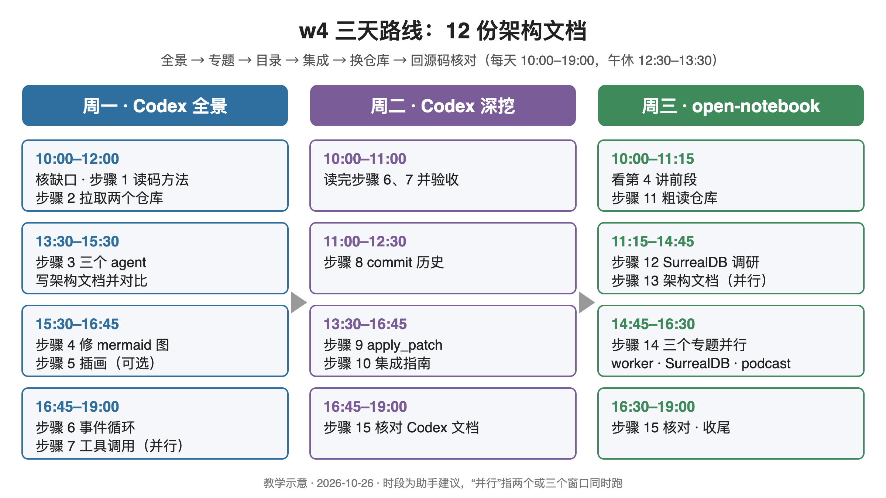

# w4 操作手册：用 AI 读懂 Codex 与 open-notebook，写出架构文档

> 手册类型：定制版

## 阅读说明

这本手册把陈天 AI 训练营第 4 周的 4 讲视频（合计约 2 小时 34 分）和讲者留下的 prompt、文档、git 记录，整理成你在周一到周三三天里可以照做的 15 个步骤。练习对象和课程完全一致：用 Claude Code 等编程智能体（coding agent，能自己读文件、跑命令、写文件的 AI 工具）去读两个陌生的大型开源仓库，一个是 Rust 写的 openai/codex，一个是 Python 加 Next.js 写的 lfnovo/open-notebook，最后产出 12 份架构文档。

- **先看哪里**：先看下面的三天路线图，再按[逐日时间表](#section-schedule)打开当天的步骤。讲者观点、案例卡、对比表、可套用的 prompt 模板、不做清单都在附录，正文用链接跳过去。
- **来源编号怎么读**：方括号里的 O1–O4 是第 1–4 讲的逐字稿，后面紧跟视频时间戳；O5–O14 是讲者的 prompt 记录、课程仓库 git 记录、课程侧手册和讲者产出的文档。点编号跳到文末来源表，来源表里点“回到正文”返回。
- **逐字稿是机器转写**：近音字很多，例如“Cloud Code”是 Claude Code，“serialdb / CeroDB”是 SurrealDB，“venders / vonders”是 vendors。本手册引用时已按上下文改正；时间戳都回逐字稿核过，但术语和数字仍建议回听视频。
- **数字的性质**：讲者文档的行数和 mermaid 图数是本手册在本机数出来的；“codex.rs 有 3267 行”“测试约 62 个”“API 路由 19 个”这类源码数字来自课程侧手册的核对，因为本机的两个子仓库还没拉下来，本手册没有复核，正文会逐处标明。
- **版本会漂移**：讲者录课在 2025 年 11 月下旬，用的是 Codex CLI 0.63、Claude Code 默认 Opus 4.5、Gemini 3。今天各家模型与命令行工具都已更新，你跑出来的文档长度、结构和质量会和讲者不同，这是正常的；本手册不承诺你得到同样的结果。
- **时间表是助手建议**：按你给的条件（周一到周三，每天 10:00–19:00）排出，午休 12:30–13:30 是未经确认的示例条件。
- **模板里的〔〕是虚构占位**：用之前换成你自己的仓库名、路径和问题。
- **和 video-mcp 的关系**：主线只练课程本身。把同样方法用到 video-mcp 的想法放在[附录 G｜课外扩展](#section-appendix-g)，不占用这三天。

<a id="section-roadmap"></a>
## 三天路线图

| 日期 | 这一天做什么 | 点开对应章节 |
|---|---|---|
| 周一：Codex 全景 | 核阻断缺口，拉取两个仓库；三个 agent 各写一份 Codex 架构文档并对比、修图；下午发起事件循环和工具调用两个专题 | [时间表](#section-schedule) · [步骤 1](#section-s1) · [步骤 2](#section-s2) · [步骤 3](#section-s3) · [步骤 4](#section-s4) · [步骤 5](#section-s5) · [步骤 6](#section-s6) · [步骤 7](#section-s7) |
| 周二：Codex 深挖 | 读完两个专题；挖 commit 历史；按目录深挖 apply_patch 并写集成指南；对 Codex 系列文档做事实核对 | [步骤 6](#section-s6) · [步骤 7](#section-s7) · [步骤 8](#section-s8) · [步骤 9](#section-s9) · [步骤 10](#section-s10) · [步骤 15](#section-s15) |
| 周三：换一个仓库 | open-notebook 粗读；用 Gemini 调研 SurrealDB；写架构文档；并行追问 worker、SurrealDB、podcast 三个专题；核对并收尾 | [步骤 11](#section-s11) · [步骤 12](#section-s12) · [步骤 13](#section-s13) · [步骤 14](#section-s14) · [步骤 15](#section-s15) |

这三天先不做：把 Codex 或 open-notebook 跑起来、`cargo test` 和 apply_patch 集成的实机验证、Claude Code 打包代码的逆向分析、把方法搬到 video-mcp。以后再看：[附录 F｜存疑与未核清单](#section-appendix-f)里的待核数字，和[附录 G｜课外扩展](#section-appendix-g)。

<a id="section-conditions"></a>
## 本次条件（定制版）

| 项目 | 你的情况 |
|---|---|
| 你在做什么 | video-mcp：自动化短视频制作的 MCP server（Python、uv、FastMCP），代码目前只有 Hello |
| 这次要完成什么 | 跟着第 4 周课程，亲手用 AI 读懂 Codex 和 open-notebook，产出 12 份架构文档，掌握先看全景、再追专题、再深挖目录、最后谈集成的读码方法 |
| 可用时间 | 周一到周三，每天 10:00–19:00；午休 12:30–13:30 是未经确认的示例条件 |
| 工作目录 | 课程仓库 `/Users/ziye/Desktop/tyr/geektime-bootcamp-ai`，两个被分析的仓库作为子模块放在 `vendors/` 下，文档写到 `specs/w4/` |
| 工具与账号 | 未经确认的示例条件：Claude Code 可用；Gemini CLI、Codex CLI、NotebookLM 是否有账号待你核对（见下面 G2） |

### 条件不同时怎么调

- **只有 Claude Code 一个账号**：步骤 3 只跑 Claude 一家，然后把讲者留下的另外两份（`w4/specs/codex-arch-by-codex.md`、`codex-arch-by-gemini.md`）当作对照组来读，对比表照样填；步骤 1、5、12 里用 Gemini 的地方，改问 Claude 或你手边的任意聊天模型。
- **只有一天**：保留步骤 2、3、6、9、13，其余放到以后；这五步覆盖了全景、专题、目录深挖和换仓库四种读法。
- **想在自己的学习仓库里练，而不是课程仓库**：步骤 2 改用 `git submodule add` 从头建，命令在步骤 2 的补充说明里。
- **Claude Code 的上下文或用量额度紧**：每个专题都开新会话，prompt 里写全路径（步骤 9 的做法），不要在一个会话里连做五篇。

<a id="section-deliverables"></a>
## 三天要完成什么

| 产出 | 数量 | 在哪一步 |
|---|---|---|
| 两个被分析仓库就位并记下版本（`vendors/codex`、`vendors/open-notebook`） | 2 个子模块 | [步骤 2](#section-s2) |
| prompt 记录文件 `specs/w4/instructions.md` | 1 份，每个 prompt 先写进去再贴给 agent | [步骤 2](#section-s2)，之后每一步追加 |
| Codex 架构文档（Claude、Codex、Gemini 各一份） | 3 份 | [步骤 3](#section-s3) |
| 三家对比表 | 1 张 | [步骤 3](#section-s3) |
| mermaid 图全部能渲染 | 每份文档都检查 | [步骤 4](#section-s4) |
| Codex 专题文档：事件循环、工具调用、演进历史、apply_patch、apply_patch 集成 | 5 份 | [步骤 6](#section-s6)–[步骤 10](#section-s10) |
| open-notebook 架构文档 | 1 份 | [步骤 13](#section-s13) |
| open-notebook 专题文档：worker、SurrealDB、podcast | 3 份 | [步骤 14](#section-s14) |
| SurrealDB 调研（Gemini 产出） | 1 份 | [步骤 12](#section-s12) |
| 事实核对台账 `fact-check.csv` | 1 份，Codex 与 open-notebook 各至少 5 条 | [步骤 15](#section-s15) |
| 可选：NotebookLM 读码方法 slide deck、Nano Banana Pro 架构插画 | 各 1 份 | [步骤 1](#section-s1)、[步骤 5](#section-s5) |

主文档一共 12 份，和讲者 `w4/specs/` 下的 12 份一一对应。

<a id="section-gaps"></a>
## 动手前的阻断缺口

- **G1 两个子仓库还没拉下来**：本机 `git submodule status` 显示两行都以 `-` 开头，也就是 `vendors/codex`、`vendors/open-notebook` 只登记了版本、没有代码。不先执行步骤 2，后面每一步的 agent 都读不到源码。拉取需要联网，Codex 仓库历史很长，下载时间和占用空间本手册没有实测。
- **G2 agent 和模型账号**：步骤 3 要同时用 Claude Code、Gemini CLI、Codex CLI。讲者提醒，Gemini 3 只有 Pro 订阅或 Gemini API key、Vertex API key 用户能直接用，免费账号要排队[[O1](#source-o1) 00:12:31–00:14:00]。Codex CLI 需要 OpenAI 账号，NotebookLM 和 Gemini 需要 Google 账号。账号不全时按上面“条件不同时怎么调”处理，不影响主线。
- **G3 上下文额度**：上下文窗口（context window）是模型一次能“记住”的文字总量。架构文档一份上千行，同一个会话里连续追问几篇就可能用满。讲者每次追问前先看一眼还剩多少[[O2](#source-o2) 00:08:36–00:08:49]；你的订阅档位有多少额度、会不会中途限流，本手册无法替你确认。
- **G4 版本选择**：子模块默认拉到 `6eeaf46`（讲者第 3 讲用的版本），而第 1、2 讲讲者用的是更早的 `b519267`[[O6](#source-o6) git ls-tree]。想让行号对得上讲者文档，周一要先切到 `b519267`，周二深挖 apply_patch 前再切回来，命令在步骤 2 和步骤 9。

<a id="section-schedule"></a>
## 逐日时间表（助手建议）

这一章把 15 个步骤和 4 讲视频排进周一到周三的 10:00–19:00。每段写了用时和这一段结束时手上应有的东西；agent 写文档通常要几分钟到十几分钟，等待时间已经算进去，可用来看对应那段视频。



图注：教学示意，2026-10-26 依据本手册路线与课程 4 讲内容绘制；每个方块对应正文步骤编号，时间段是助手建议，不是课程要求。

### 周一：Codex 全景（工作 8 小时）

| 时段 | 用时 | 做什么 | 当段产物 |
|---|---|---|---|
| 10:00–10:30 | 30 分钟 | 逐条核 G1–G4；装好并登录三个命令行工具 | 缺口记录：哪些账号可用 |
| 10:30–11:10 | 40 分钟 | 看第 1 讲 00:00–00:08:41；可选做[步骤 1](#section-s1) | 读码三维度笔记；可选 slide deck |
| 11:10–12:00 | 50 分钟 | [步骤 2](#section-s2) 拉取两个仓库、切到 `b519267`、建 prompt 记录文件 | `vendors/` 两个子模块、`specs/w4/instructions.md` |
| 12:00–12:30 | 30 分钟 | 看第 1 讲 00:08:41–00:21:23 | 知道三家各自的表现 |
| 12:30–13:30 | 60 分钟 | 午休 | — |
| 13:30–14:30 | 60 分钟 | [步骤 3](#section-s3) 三个窗口同时跑同一个 prompt | 3 份 Codex 架构文档 |
| 14:30–15:30 | 60 分钟 | 对比阅读三份文档，同时看第 1 讲 00:21:23–00:36:14 | 对比表 |
| 15:30–16:15 | 45 分钟 | [步骤 4](#section-s4) 修 mermaid 图 | 3 份文档的图都能渲染 |
| 16:15–16:45 | 30 分钟 | 可选[步骤 5](#section-s5) 画架构插画；看第 2 讲 00:00–00:03:03 | 可选插画 |
| 16:45–17:15 | 30 分钟 | 看第 2 讲 00:03:03–00:10:48，列出自己的架构问题 | 问题清单 |
| 17:15–19:00 | 105 分钟 | [步骤 6](#section-s6)、[步骤 7](#section-s7) 两个窗口并行发起，先读事件循环文档 | `codex-event-loop.md`、`codex-tool-call.md` 初稿 |

### 周二：Codex 深挖（工作 8 小时）

| 时段 | 用时 | 做什么 | 当段产物 |
|---|---|---|---|
| 10:00–11:00 | 60 分钟 | 读工具调用文档，对照第 2 讲 00:14:19–00:29:51 验收步骤 6、7；修图 | 两份专题文档定稿 |
| 11:00–12:30 | 90 分钟 | [步骤 8](#section-s8) 挖 commit 历史；同时看第 2 讲 00:29:51–00:37:02 | `codex-changes-by-claude.md` |
| 12:30–13:30 | 60 分钟 | 午休 | — |
| 13:30–14:00 | 30 分钟 | 看第 3 讲 00:00–00:06:37；把 `vendors/codex` 切回 `6eeaf46` | 版本已切换 |
| 14:00–15:30 | 90 分钟 | [步骤 9](#section-s9) 新会话深挖 apply_patch，遇到不懂的概念另问 Gemini | `codex-apply-patch.md` |
| 15:30–16:45 | 75 分钟 | [步骤 10](#section-s10) 写集成指南；看第 3 讲 00:17:47–00:25:53 | `codex-apply-patch-integration.md` |
| 16:45–19:00 | 135 分钟 | [步骤 15](#section-s15) 的 Codex 部分：核路径、常量、数字 | `fact-check.csv` 中 Codex 至少 5 条 |

### 周三：open-notebook（工作 8 小时）

| 时段 | 用时 | 做什么 | 当段产物 |
|---|---|---|---|
| 10:00–10:30 | 30 分钟 | 看第 4 讲 00:00–00:13:03 | 知道讲者怎么挑项目、怎么粗读 |
| 10:30–11:15 | 45 分钟 | [步骤 11](#section-s11) 粗读 open-notebook 目录、`CLAUDE.md`、git log | 粗读笔记 |
| 11:15–12:30 | 75 分钟 | [步骤 12](#section-s12) 和[步骤 13](#section-s13) 并行：一边 Gemini 调研 SurrealDB，一边 Claude 写架构文档 | SurrealDB 调研、`open-notebook-arch-design.md` 初稿 |
| 12:30–13:30 | 60 分钟 | 午休 | — |
| 13:30–14:45 | 75 分钟 | 读架构文档，对照第 4 讲 00:13:03–00:31:24，记下想追问的点 | 追问清单 |
| 14:45–16:30 | 105 分钟 | [步骤 14](#section-s14) 三个窗口并行追问；看第 4 讲 00:31:24–00:54:36；修图 | 3 份专题文档 |
| 16:30–18:15 | 105 分钟 | [步骤 15](#section-s15) 的 open-notebook 部分 | `fact-check.csv` 中 open-notebook 至少 5 条 |
| 18:15–19:00 | 45 分钟 | 收尾：核对 12 份文档齐全、`instructions.md` 完整，写下三天里最有用的三条做法 | 交付清单全部打勾 |

合计：每天 8 小时工作加 1 小时午休，正好落在 10:00–19:00；看完 4 讲视频约 2 小时 34 分，已拆进各时段。依据：视频时长取自课程逐字稿索引[[O1](#source-o1) 时长 00:36:14、[O2](#source-o2) 00:37:02、[O3](#source-o3) 00:25:53、[O4](#source-o4) 00:54:36]；讲者说单篇文档“可能需要花个几分钟的时间才能完成”[[O3](#source-o3) 00:05:58–00:06:03]，阅读、修图和核对的时间是助手估计。

<a id="section-s1"></a>
## 步骤 1（可选）用 NotebookLM 建立读码方法

在动手之前，讲者先用 NotebookLM 研究“业界怎么读大型代码库”，得到一个三维度的框架，后面每一步都在用它。这一步做完，你应该能说清理解一个代码库要看哪三个方面。

**目标**：拿到一份讲清“静态结构、运行时行为、历史演进”三个维度的 slide deck 或笔记。

1. 在 NotebookLM 新建 notebook，添加来源时选 Deep Research，输入研究主题，让它检索并把找到的资料列成一组来源[[O1](#source-o1) 00:00:30–00:01:19]。讲者没有展示输入原文，可以用[附录 D 的模板 T10](#template-t10)。
2. 基于这组来源生成 Slide Deck，同时生成一张 Infographic[[O1](#source-o1) 00:01:19–00:01:27]。
3. 对照讲者的讲法核内容：静态结构是系统的“解剖图”，看组件、模块和相互关系[[O1](#source-o1) 00:02:05–00:02:21]；运行时行为必须把系统跑起来，看日志，甚至用 OpenTelemetry（一套采集程序运行指标和调用链路的开放标准）收集指标[[O1](#source-o1) 00:02:21–00:03:17]；历史演进回答“为什么是现在这个样子”[[O1](#source-o1) 00:03:17–00:03:59]。
4. 记下讲者对第三个维度的两个抓手：ADR（架构决策记录，一种记下“当时为什么这样设计、考虑过哪些备选”的短文档），讲者主张把它放进规格驱动开发（spec-driven development）的流程里，每改一次设计就补一份；以及 git 历史，有了 AI 之后它变得“弥足珍贵”[[O1](#source-o1) 00:05:11–00:06:17]。

**做完的标准**：你能用自己的话写出三个维度各看什么，并说出一个理由：为什么 ADR 应该跟着规格文档一起演进。

- [ ] 已生成 slide deck 或写下三维度笔记
- [ ] 能说出 ADR 和 git 历史各解决什么问题

### 补充说明与讲者做法

- 讲者说之后会把 slide deck 下载下来给大家[[O1](#source-o1) 00:06:23–00:06:27]，但课程仓库里没有这个文件。
- 讲者顺带提出一个写代码时就该想的问题：自己的代码怎样让 AI agent 能了解它的运行行为，行为数据存在哪里、agent 怎么分析[[O1](#source-o1) 00:02:50–00:03:17]。这三天只练第一和第三维度，第二维度需要把系统跑起来，不在本周范围。
- 没有 Deep Research 入口时，可以改用 Gemini 的 Deep Research 生成报告，再导入 NotebookLM（课程侧手册的补充做法[[O7](#source-o7) 步骤 1]）。

<a id="section-s2"></a>
## 步骤 2 准备工作区：拉取两个仓库并固定版本

这一步解决 G1：让 `vendors/` 下真正有代码，并把版本切到讲者录课时的那一个，后面引用的文件和行号才能对上。子模块（git submodule）是把另一个仓库按固定提交挂进当前仓库的 git 功能，讲者用它管理被分析的仓库。

**目标**：`vendors/codex` 停在 `b519267`、`vendors/open-notebook` 停在 `2084b04`，并建好 prompt 记录文件。

1. 在课程仓库根目录拉取两个子模块（命令见下）。讲者选 Codex 的理由是提交多、历史可研究，本身又是 coding agent；不选 Claude Code 是因为它闭源，拿到的只是打包处理过的代码[[O1](#source-o1) 00:06:27–00:07:49]。
2. 把 `vendors/codex` 切到 `b519267`。课程仓库当前登记的是 `6eeaf46`，那是讲者第 3 讲前升级的版本；第 1、2 讲生成文档时登记的是 `b519267`[[O6](#source-o6) 提交 5a95e04、889e948]。
3. 用 `git submodule status` 确认两行都不再以 `-` 开头，并把三个版本号抄进你的笔记：`b519267`、`6eeaf46`、`2084b04`[[O6](#source-o6) git ls-tree]。
4. 建 `specs/w4/instructions.md`。讲者的习惯是每个 prompt 先写进这个文件，再贴给 agent[[O1](#source-o1) 00:08:30–00:08:41、[O3](#source-o3) 00:02:15–00:02:23]；这份文件后来被移到了 `.chats/w4.md`[[O6](#source-o6) 提交 ed9819a]。

```bash
cd /Users/ziye/Desktop/tyr/geektime-bootcamp-ai
git submodule update --init vendors/codex vendors/open-notebook
git -C vendors/codex checkout b519267d05459095eccb9767c28550a2952d8a2f
git submodule status
mkdir -p specs/w4 && touch specs/w4/instructions.md
```

**做完的标准**：`git submodule status` 第一行是 `+b519267d…  vendors/codex`（加号表示你切到了和登记不同的版本，这里是有意为之），第二行是 ` 2084b04f…  vendors/open-notebook`；`ls vendors/codex/codex-rs` 能看到 `core`、`tui`、`cli`、`apply-patch` 等目录。

- [ ] 两个子模块都有代码
- [ ] `vendors/codex` 在 `b519267`
- [ ] `specs/w4/instructions.md` 已建好

### 补充说明与讲者做法

- **目录名的口误**：讲者口头说的是 vendors，但录第 1 讲时实际敲成了 `venders`，提交 `5a95e04` 里的路径和 prompt 都是 `./venders/codex`；第 4 讲他发现后让 Claude Code 修好，提交是 `4fcb20b`[[O4](#source-o4) 00:02:02–00:04:13、[O6](#source-o6) 提交 4fcb20b]。你照做时一律用 `vendors`。讲者文档 `codex-arch-by-codex.md` 第 1 行、`codex-arch-by-gemini.md` 第 5 行还留着 `venders`，读到不必奇怪。
- **想在自己的学习仓库从头建**：用讲者的原始做法 `git submodule add https://github.com/openai/codex vendors/codex`[[O1](#source-o1) 00:07:58–00:08:30]，open-notebook 同理（地址是 `https://github.com/lfnovo/open-notebook`），再按上面第 2 条切版本。
- **不要浅克隆**：步骤 8 要挖完整 commit 历史，`--depth 1` 会让它无从挖起（课程侧手册的提醒[[O7](#source-o7) 步骤 2]）。
- **版本校验**：课程侧手册称在 `b519267` 上 `wc -l vendors/codex/codex-rs/core/src/codex.rs` 输出 3267，讲者口头说这个文件“3000 多行”[[O2](#source-o2) 00:11:33–00:11:42、[O7](#source-o7) 步骤 2]。本手册没有复核，你跑出来不一致时先查是不是没切版本。

<a id="section-s3"></a>
## 步骤 3 三个 agent 用同一个 prompt 写架构文档，再对比

这是整周的起点：拿到一份 Codex 的全景架构文档，同时亲眼看到不同 agent 读同一个仓库的差距。做完后你手上有 3 份文档和 1 张对比表，并决定以哪份为主。

**目标**：三份 Codex 架构文档写完，并按同一张表打分，选出主参照。

1. 开三个终端窗口，都在仓库根目录，分别启动 Claude Code、Gemini CLI、Codex CLI，都用最新版；讲者当时 Codex CLI 是 0.63[[O1](#source-o1) 00:08:50–00:09:27]。Gemini 要先把 preview features 设成 true，再切到 Gemini 3 模型[[O1](#source-o1) 00:12:31–00:13:08]。
2. 三边贴同一个 prompt，只改输出文件名：`codex-arch-by-claude.md`、`codex-arch-by-codex.md`、`codex-arch-by-gemini.md`[[O1](#source-o1) 00:09:25–00:10:36、[O5](#source-o5) 第 5 行]。原文见下方。
3. 运行时观察它们怎么探索：Claude Code 先读目录结构再深入核心，Gemini 调用了一个叫 Codebase Investigator 的子工具[[O1](#source-o1) 00:10:48–00:11:14]。遇到权限确认时，讲者选了 allow always[[O1](#source-o1) 00:14:11–00:14:14]。
4. 三份都写完后逐份读，填[附录 D 的模板 T11](#template-t11)对比表。讲者的评价：Gemini 全程英文，除了一张图“对我理解这个代码库其实没有太大的帮助”[[O1](#source-o1) 00:14:58–00:17:55]；Codex 的图比 Gemini 好、流程梳理得更好，但“整个文档太简单了”[[O1](#source-o1) 00:18:05–00:20:49]；Claude 的结构最完整，用中文输入就用中文写，讲者说在语言上“这是满分，那两个都是零分”[[O1](#source-o1) 00:20:49–00:21:23]。
5. 以 Claude 版为主参照往下走，读完它应能对 Codex 有 high level 的了解[[O1](#source-o1) 00:35:19–00:35:50]。Codex 版“文件:符号”式的写法留着做事实核对（见[步骤 15](#section-s15)）。

讲者的 prompt 原文（`.chats/w4.md` 第 5 行；录课时路径是 `./venders/codex`，见提交 `5a95e04` 里的 `specs/w4/instructions.md`）：

```text
仔细阅读 ./vendors/codex 的代码，撰写一个详细的架构分析文档，如需图表，使用 mermaid chart。文档放在: ./specs/w4/codex-arch-by-codex.md
```

**做完的标准**：`specs/w4/` 下有 3 份 `codex-arch-by-*.md`；对比表每一列都填了，并写下一句“以哪份为主、为什么”。

- [ ] 3 份架构文档已生成
- [ ] 对比表已填
- [ ] 已选定主参照

### 补充说明与讲者做法

- **讲者没有写“用中文”**：Claude Code 看到中文输入就自动用中文写；讲者一开始以为 Codex 也是英文，后来更正说 Codex 用的也是中文，只有 Gemini 是英文[[O1](#source-o1) 00:11:34–00:12:21、00:34:24–00:34:37]。你想要中文就在 prompt 末尾加“用中文撰写”。
- **Claude 版里讲者特别看的几处**：Cargo workspace 目录树，每个 crate 是干什么的[[O1](#source-o1) 00:23:31–00:24:39]；`Codex` 结构体里的提交通道和事件通道[[O1](#source-o1) 00:25:40–00:26:12]；Actor 模型隔离可变状态、event sourcing（事件溯源：所有状态变化都记成事件，回放事件就能重建状态）[[O1](#source-o1) 00:32:21–00:33:28]。讲者说，agent 能把整个代码库梳理清楚，他就有理由相信它写代码的能力强[[O1](#source-o1) 00:30:21–00:30:47]。
- **讲者那三份的体量**（本机实数）：Claude 版 1183 行、13 张图；Codex 版 128 行、2 张图；Gemini 版 137 行、1 张图[[O8](#source-o8) 行数统计、[O9](#source-o9) 行数统计]。完整对比见[附录 C](#section-appendix-c)，案例经过见[案例卡 1](#case-1)。
- **Claude 版也会编细节**：课程侧手册核对发现，Claude 版附录里 `DEFAULT_MODEL = "o4-mini"`、`ApprovalPolicy::Suggest`、`SESSIONS_SUBDIR = "sessions/interactive"` 三个常量和源码对不上（文档第 1146–1152 行）[[O7](#source-o7) 步骤 3、[O8](#source-o8) 第 1143–1152 行]。所以“选它为主”不等于“信它全部”，具体值留到步骤 15 核。

<a id="section-s4"></a>
## 步骤 4 检查并修复 mermaid 图（每份文档都做）

mermaid 是一种用文本写流程图、时序图的语法，几乎每份文档都会用；模型写的图经常渲染不出来。讲者在第 1、2、4 讲都碰到了坏图。这一步做完，你手上每份文档的图都能正常显示。

**目标**：每份文档里的 mermaid 图都能在预览里渲染。

1. 在编辑器预览里逐张看图，标出“直接挂了”的那几张[[O1](#source-o1) 00:15:22–00:15:30]。
2. 先试讲者的手工修法：删掉节点文字里的括号、斜杠等特殊字符，图就能出来[[O1](#source-o1) 00:15:34–00:16:24]；Codex 版的图也有错，同样手工修[[O1](#source-o1) 00:18:25–00:18:36]。
3. 图多、手修费劲时，让 agent 修，把报错原样贴给它（[附录 D 的模板 T8](#template-t8)）。讲者在第 4 讲让 Claude 修 worker 文档的图，修完后开头那张“还是不对”，需要再修一轮[[O4](#source-o4) 00:35:06–00:35:09、00:39:19–00:39:37]。
4. 修完再整体看一遍，确认没有改动图的意思：节点和箭头还是原来那几个。

**做完的标准**：每份文档在预览里没有报错的图；修过的图节点和连线与原意一致。

- [ ] 3 份架构文档的图都能渲染
- [ ] 之后每生成一份文档都重复这一步

### 补充说明与讲者做法

- 第 2 讲讲者在事件循环文档里也说“这块这个有问题，或者我手工给它改一下吧”[[O2](#source-o2) 00:18:11–00:18:28]。
- 课程侧手册补充了一个批量检查办法：`npx -y -p @mermaid-js/mermaid-cli mmdc -i <文档>.md -o /tmp/mmd/out.md`，有语法错误会报 Parse error；还给了第二种修法，把节点文字加引号，写成 `A["TUI (ratatui)"]`[[O7](#source-o7) 步骤 3]。本手册没有在本机运行这条命令。
- 修图的完整经过见[案例卡 2](#case-2)。

<a id="section-s5"></a>
## 步骤 5（可选）把架构文档画成一张插画

这是第 2 讲开头的小插曲：把文档交给图像模型，换一种方式检查自己有没有看懂分层。时间紧可以跳过，讲者自己也说这节课的重点不是画图。

**目标**：得到一张分层和文档流程图大体一致的架构插画。

1. 把步骤 3 选定的主文档交给 Gemini，让它调用 Nano Banana Pro 画图[[O2](#source-o2) 00:00:36–00:01:06]。
2. 讲者想要的画面是“一群鸭子在一个池塘里面工作”[[O2](#source-o2) 00:01:06–00:01:25]；他没有展示 prompt 原文，可以用[附录 D 的模板 T12](#template-t12)。
3. 对照文档核分层：不同入口（终端、CLI、IDE）发事件，事件循环管会话、认证、对话，后端客户端调 OpenAI API 并经 SSE 返回，工具执行有策略、沙箱和审批[[O2](#source-o2) 00:01:25–00:02:34]。

**做完的标准**：图上每一层都能在文档里找到对应的组件名；对不上的地方记下来，作为步骤 6、7 的问题。

- [ ] 插画已生成，或决定跳过

### 补充说明与讲者做法

- 讲者提醒，今天的重点是怎样看待一个软件系统的架构，以及怎样让 coding agent 帮我们阅读和学习它，而不是怎么用 Nano Banana 画图[[O2](#source-o2) 00:02:34–00:03:03]。

<a id="section-s6"></a>
## 步骤 6 带着问题深挖：事件循环

有了全景，下一步是挑一个最核心的子系统追问到底。讲者挑的是事件循环：用户发起一个任务后，Codex 怎样一轮轮调用模型和工具，又怎样判断任务结束。做完后你应能画出它的三层循环。

**目标**：得到 `codex-event-loop.md`，并能说清“什么时候任务算完成”。

1. 先列问题，再提问。讲者的架构提问清单：结构和模式（单体还是微服务、高内聚低耦合、同步还是异步）、质量属性（扩展性、可用性、性能、安全性）、数据架构（用什么存储、一致性怎么处理）、可观测性、配置管理、成本（例如有没有省 token 的工作，compact 怎么做）[[O2](#source-o2) 00:03:38–00:05:26]。他的说法是：新时代读代码，是带着一个又一个问题让 agent 梳理背后的逻辑[[O2](#source-o2) 00:04:10–00:04:44]。
2. 在步骤 3 的 Claude Code 会话里继续之前，先看一眼 context 还剩多少，够用再接着问[[O2](#source-o2) 00:08:29–00:08:49]。课程侧手册补充：Claude Code 里可以用 `/context` 查看[[O7](#source-o7) 步骤 5]。
3. 贴下面的 prompt。讲者是边口述边改写定的稿[[O2](#source-o2) 00:06:14–00:08:13、[O5](#source-o5) 第 13 行]。
4. 看 agent 读了哪些文件，就知道核心在哪里：这次它主要读 `codex.rs`，讲者打开对照，3000 多行，里面有 `Codex`、`Session`、`TurnContext`、`run_turn`、`process_response_item`，后面 800 多行是测试[[O2](#source-o2) 00:10:48–00:14:19]。
5. 读文档时核三件事：关键概念表（Submission、Event、Session、Task、Turn、Tool Call，一个 task 里可能有几十甚至上百个 turn）[[O2](#source-o2) 00:15:12–00:15:55]；三层循环 submission loop、task loop、turn loop[[O2](#source-o2) 00:16:49–00:17:07]；完成条件：模型不再要求调用工具、没有待回传的结果时任务结束，所以 coding agent 一旦不再调用工具，要么任务完成，要么失败了[[O2](#source-o2) 00:20:08–00:20:45]。

```text
帮我梳理 codex 代码处理事件循环的部分，详细解读当用户发起一个任务后，codex 是如何分解处理这个任务，并不断自我迭代，最终完成整个任务。这个过程中发生了什么，codex 如何决定任务完成还是未完成需要继续迭代。如果需要，可以用 mermaid chart 来辅助说明。写入 ./specs/w4/codex-event-loop.md
```

**做完的标准**：你能不看文档，口头走一遍“修复 bug 并运行测试”这个例子的 4 个 turn：读文件、打补丁、跑测试、模型看到测试通过后不再调工具，任务结束[[O2](#source-o2) 00:20:45–00:22:11]。

- [ ] `codex-event-loop.md` 已生成并修好图
- [ ] 能说出三层循环和完成条件

### 补充说明与讲者做法

- 讲者版 1347 行、12 张图[[O10](#source-o10) 行数统计]。文档第 36–45 行是关键概念表，代码里判断完成的是 `responses.is_empty()`[[O10](#source-o10) 第 36–45、668 行]。
- 课程侧手册称在 `b519267` 上 `grep -nE 'async fn submission_loop|fn run_task|async fn run_turn|async fn try_run_turn|responses.is_empty' vendors/codex/codex-rs/core/src/codex.rs` 能对上文档“关键代码位置”表的行号 1381、1905、1987、2023、2161[[O7](#source-o7) 步骤 5]。本手册未复核，作为步骤 15 的第一条核对项。
- 写到一半 context 不够：开新会话，prompt 里写全路径（步骤 9 的做法）。

<a id="section-s7"></a>
## 步骤 7 并行深挖：工具调用

事件循环发起后，不必干等。讲者另开一个窗口，同时追问工具调用：Codex 怎么知道有哪些工具、怎么选、怎么执行、怎么判断成功。这一步和步骤 6 并行，做完后多一份专题文档。

**目标**：得到 `codex-tool-call.md`，并能讲出一次工具调用从注册到返回的路径。

1. 另开一个 Claude Code 窗口，和步骤 6 同时跑[[O2](#source-o2) 00:08:59–00:09:22]。两个窗口的输出文件名必须不同，否则会互相覆盖。
2. 贴下面的 prompt，同样是讲者口述改写后定稿的[[O2](#source-o2) 00:09:22–00:10:48、[O5](#source-o5) 第 17 行]。
3. 读文档时对照讲者口述的主线：注册层把工具注册进系统，定义层是工具配置，构造层生成工具规格，路由器把调用分发给各个 handler，需要时请用户审批，在沙箱里执行，最后把结果一路返回[[O2](#source-o2) 00:23:03–00:26:32]。
4. 核“能否并行”这张表：`read_file`、`list_dir`、`grep_files` 可以并行，`shell`、`apply_patch` 不行；讲者解释 shell 本质上可以并行，但命令之间有时会冲突[[O2](#source-o2) 00:24:49–00:25:11、00:28:04–00:28:28]。
5. 读到文末的常见问题和调试方法，讲者认为这部分“也很有用”[[O2](#source-o2) 00:29:44–00:29:51]。

```text
帮我梳理 codex 代码处理工具调用的部分，详细解读 codex 是如何知道有哪些工具可以调用，如何选择工具，如何调用工具，如何处理工具的返回结果，如何决定工具调用是否成功等等。如果需要，可以用 mermaid chart 来辅助说明。写入 ./specs/w4/codex-tool-call.md
```

**做完的标准**：你能说出一个 MCP 工具从发现到被调用的过程（每个 MCP server 起一个子进程，工具注册后才能分发）[[O2](#source-o2) 00:27:26–00:27:50]，并指出哪类工具不能并行、为什么。

- [ ] `codex-tool-call.md` 已生成并修好图
- [ ] 能讲出注册、路由、审批、沙箱、返回五段

### 补充说明与讲者做法

- 讲者版 2290 行、14 张图[[O10](#source-o10) 行数统计]；第 286–292 行能看到 `read_file`、`list_dir`、`grep_files` 用 `push_spec_with_parallel_support(..., true)` 注册[[O10](#source-o10) 第 286–292 行]。
- 课程侧手册发现讲者版章节编号混乱（`## 11. 总结` 下面出现 `### 10.2`），文末还有第二个“总结”，建议让 agent 统一重编号[[O7](#source-o7) 步骤 6]。
- 讲者在 `.chats/w4.md` 里的原始记录把这段 prompt 记了两遍，内容相同，不是两个不同的 prompt[[O6](#source-o6) 提交 5a95e04 的 instructions.md]。

<a id="section-s8"></a>
## 步骤 8 挖 commit 历史，写演进文档

这一步对应读码三维度里的“历史演进”。人看 commit 历史只能对最近一段留个印象，分类、提炼很难；交给 agent 可以一次梳理完。做完后你会有一份讲清 Codex 四个阶段的演进文档。

**目标**：得到 `codex-changes-by-claude.md`，并知道它的统计数字是什么口径。

1. 贴下面的 prompt[[O5](#source-o5) 第 9 行]。讲者的理由：以前靠人看只能看最近的提交，怎么分类、怎么提炼，人脑很难做到[[O2](#source-o2) 00:30:28–00:31:15]。
2. 观察 agent 的动作：看 git log、看 tag、grep feature、rust、mcp、initial 等关键词、看 CHANGELOG，然后识别里程碑、梳理架构变化、写文档[[O2](#source-o2) 00:31:15–00:32:31]。
3. 读文档时找三样东西：总提交数（讲者读到“8900 多个”）[[O2](#source-o2) 00:32:43–00:32:48]；从 TypeScript 转向 Rust 的时间点和原因：TypeScript 依赖 Node.js 运行时，想要零依赖的独立可执行文件、更好的性能、更低的内存[[O2](#source-o2) 00:33:11–00:33:15、00:35:15–00:35:44]；之后几个阶段各加了什么功能。
4. 预览时如果编辑器卡死，换一种方式看。讲者打开这份文档时把预览“搞挂了”[[O2](#source-o2) 00:34:15–00:35:15]。

```text
查看 repo 的所有 commit history，梳理其代码变更的脉络，必要时辅以 mermaid chart。 写入 ./specs/w4/codex-changes-by-claude.md
```

**做完的标准**：文档开头写明分析了多少提交、从哪天开始；你在笔记里写下这个数字的统计口径（只算主分支，还是所有分支）。

- [ ] `codex-changes-by-claude.md` 已生成
- [ ] 已注明提交数的口径

### 补充说明与讲者做法

- 讲者版 1860 行、18 张图，开头写“分析范围: 8934 个提交，从 2025-04-16 至今”[[O11](#source-o11) 第 7 行]。
- 课程侧手册称：在 `b519267` 上 `git -C vendors/codex rev-list --count HEAD` 是 2129，“8934”是把所有远程分支算进去的 `--all` 口径[[O7](#source-o7) 步骤 7]。本手册未复核，作为步骤 15 的核对项。
- 讲者收尾时说：先有高层架构，再按兴趣逐个子系统深入，对安全感兴趣就围绕安全发问，对界面感兴趣也一样[[O2](#source-o2) 00:35:55–00:36:32]。经过见[案例卡 3](#case-3)。

<a id="section-s9"></a>
## 步骤 9 新会话按目录深挖：apply_patch

第 3 讲换了一种读法：不再从全景往下拆，而是看到某个目录感兴趣，就让 agent 把这个目录讲透。讲者选的是 Codex 修改文件用的 apply_patch 工具。做完后你应能讲出它的补丁格式、实现和安全检查。

**目标**：在新会话里得到 `codex-apply-patch.md`。

1. 先把版本切回 `6eeaf46`（讲者写这两篇前升级到了这个版本）[[O6](#source-o6) 提交 889e948、b1caea4]，再自己扫一眼 `codex-rs/apply-patch`：用了 tree-sitter 和 similar，有几个源文件，还有一个像是工具 prompt 的 md 文件[[O3](#source-o3) 00:01:09–00:02:12]。
2. **开一个新的 Claude Code 窗口**，prompt 里把路径写全，避免它做无谓的搜索[[O3](#source-o3) 00:04:08–00:04:25]。讲者当时的默认模型已经是 Opus 4.5[[O3](#source-o3) 00:04:25–00:04:44]。prompt 原文见下方[[O5](#source-o5) 第 21 行]。
3. 运行中按 Ctrl-O 看它调用了哪些工具，按 Ctrl-T 看 todo 列表；它会先并行读好几个文件，读够了才列 todo 再写[[O3](#source-o3) 00:05:13–00:06:23]。
4. 中途看到它读了一个 `.lark` 文件，讲者就去问 Gemini“帮我阅读并理解这个文件”，得知这是一份 EBNF 形式的语法定义：Begin/End Patch 标记，Add、Delete、Update 三种 hunk（补丁里的一段改动），Update 最复杂[[O3](#source-o3) 00:06:37–00:09:49]。遇到不懂的就另问别的模型，这是讲者反复强调的“多个工具混用”[[O3](#source-o3) 00:08:05–00:08:38]。
5. 读文档时核：自定义补丁格式比传统 unified diff 更适合模型生成；安全检查分三档，安全就自动批准，不安全就拒绝，中间地带问用户[[O3](#source-o3) 00:10:14–00:11:28]；`apply_patch_tool_instructions.md` 是给模型看的使用说明，会被编译进常量、嵌入 prompt[[O3](#source-o3) 00:11:51–00:12:14]；Freeform 形态用 Lark 语法约束输出，Function 形态用 JSON schema，这解释了为什么要提供几种格式[[O3](#source-o3) 00:16:12–00:17:03]。

```bash
git -C vendors/codex checkout 6eeaf46ac136f6ea0352641a5daea5006195e09f
```

```text
帮我梳理 ./vendors/codex 的 apply_patch 工具，详细解读 apply_patch 工具的原理，如何使用，如何实现，如何测试等等。以及 apply_patch 工具的代码是如何跟 codex 其他部分集成的，另外我注意到 apply_patch_tool_instructions.md 文件，这个文件是做什么的，如何跟 apply_patch crate 打交道。如果需要，可以用 mermaid chart 来辅助说明。写入 ./specs/w4/codex-apply-patch.md
```

**做完的标准**：你能写出一个最小的补丁例子（Begin Patch、Add File、End Patch），并说出 instructions.md 是怎么进到模型 prompt 里的。

- [ ] `vendors/codex` 已切回 `6eeaf46`
- [ ] 新会话、全路径 prompt 已运行
- [ ] 至少用 Ctrl-O 看过一次工具调用
- [ ] 不懂的概念已另问别的模型

### 补充说明与讲者做法

- 讲者口述时输出名没带 `codex-` 前缀，事后说应该加上，和其他文件保持一致[[O3](#source-o3) 00:10:00–00:10:14]。
- 讲者版 738 行、5 张图；文档第 475–476 行写 `APPLY_PATCH_TOOL_INSTRUCTIONS` 通过 `include_str!` 引入[[O12](#source-o12) 第 475–476 行]。
- **测试数量要复核**：文档第 563 行写“约 200+ 测试用例”，讲者也照着说了[[O3](#source-o3) 00:16:38–00:16:54、[O12](#source-o12) 第 563 行]；课程侧手册数出 crate 内约 62 个 `#[test]`[[O7](#source-o7) 步骤 8]，本手册未复核。
- 讲者说，即便没有 Rust 经验，看完这份文档也能了解 apply_patch 怎么运作[[O3](#source-o3) 00:17:29–00:17:55]。多工具混用的经过见[案例卡 4](#case-4)。

<a id="section-s10"></a>
## 步骤 10 从“看懂”到“拿来用”：apply_patch 集成指南

读懂别人的代码之后，常常想把它抽出来用在自己的系统里。讲者在同一个会话里接着问集成方法。做完后你会得到一份分层次的集成指南，并能判断自己需要哪一层。

**目标**：得到 `codex-apply-patch-integration.md`，并为自己的场景选定集成层次。

1. 在步骤 9 的会话里接着贴下面的 prompt[[O3](#source-o3) 00:17:55–00:18:41、[O5](#source-o5) 第 25 行]。
2. 记下讲者的思路：apply_patch 是独立的 crate（Rust 的包），比较好抽；如果是某个目录下的某个文件，也可以让 Claude Code 帮你抽，很多执行层面的工作都可以交给它[[O3](#source-o3) 00:18:41–00:19:32]。
3. 读四个集成层次：L1 直接引用 crate，L2 编成二进制从命令行调用，L3 作为 LLM 工具接入，L4 完整 agent；讲者认为后两层比较麻烦[[O3](#source-o3) 00:19:46–00:20:49]。
4. 对每层核文档给出的东西：L1 有添加依赖和基本用法，也可以先解析成参数再逐个处理 hunk[[O3](#source-o3) 00:20:49–00:21:57]；L2 附了 Python 调用示例[[O3](#source-o3) 00:21:57–00:22:22]；L3 有自己的安全检查、工具说明，以及 OpenAI 和 Anthropic 两种工具定义[[O3](#source-o3) 00:22:22–00:23:10]。

```text
如果我要把 apply_patch 工具集成到我自己的项目中，我需要做哪些工作，如何做等等。如果需要，可以用 mermaid chart 来辅助说明。写入 ./specs/w4/codex-apply-patch-integration.md
```

**做完的标准**：你写下一句判断：“如果我要用，选 L〔几〕，理由是〔……〕”。讲者的判断是大部分时候 L1 或 L2 就够了[[O3](#source-o3) 00:24:02–00:24:09]。

- [ ] `codex-apply-patch-integration.md` 已生成
- [ ] 已写下自己会选哪一层

### 补充说明与讲者做法

- 讲者把读别人的代码分成两个层次：先弄懂怎么实现、架构和接口，再弄懂怎么拿来用[[O3](#source-o3) 00:23:10–00:23:47]。
- 讲者版 1039 行、3 张图，第 37–40 行是四层对照表[[O12](#source-o12) 第 37–40 行]。
- 课程侧手册提醒：把 crate 拷出来单独编译会失败，因为原 `Cargo.toml` 用的是 workspace 继承写法，要改成具体版本号；本手册没有实际编译，这三天也不做[[O7](#source-o7) 步骤 9]。
- 讲者建议有兴趣可以继续逐个目录生成文档，比如 `arg0` 这个 crate、app-server protocol、file search[[O3](#source-o3) 00:24:13–00:25:06]。

<a id="section-s11"></a>
## 步骤 11 换一个陌生仓库：open-notebook 粗读

第 4 讲换成一个不同语言、不同领域的热门项目，检验这套方法是否通用。讲者先自己扫一遍，再交给 agent。做完后你应知道 open-notebook 是什么、目录怎么分、项目自己有没有给 AI 的说明。

**目标**：写一页粗读笔记：项目做什么、主要目录、给 AI 的说明文件、是不是 AI 参与写的。

1. 了解讲者怎么挑项目：在 GitHub Trending 切到 This Month，看到 “Open Source Implementation of Notebook LM”，先去官网看它能做什么，对 Podcast Generator 最好奇[[O4](#source-o4) 00:00:14–00:01:27]。
2. 确认 `vendors/open-notebook` 已在步骤 2 拉下来。讲者是用 `git submodule add` 加进来的，随后发现 codex 放错在 `venders`，就直接让 Claude Code 修：改 `.gitmodules`、改 git config、跑 `git submodule sync`、删旧目录，再让它提交[[O4](#source-o4) 00:01:38–00:04:13]。他认为这类事交给 LLM 比人做方便，它写的 commit message 也更详尽[[O4](#source-o4) 00:03:06–00:04:13]。
3. 自己粗扫目录：`api/`（Python）、`commands/`、`frontend/`、`migrations/`（SurrealQL）、`prompts/`（Jinja 模板），以及 `open_notebook/` 下的 domain、graphs、plugins[[O4](#source-o4) 00:04:13–00:04:41、00:08:54–00:09:59]。
4. 读项目自带的 `CLAUDE.md`：它要求开新功能前先读 `docs/index.md`；再看 `git log`，提交里有 Co-Authored-By Claude，说明这个项目很大程度上是 AI 参与写的[[O4](#source-o4) 00:09:59–00:10:51]。

```bash
cat vendors/open-notebook/CLAUDE.md
git -C vendors/open-notebook log --oneline -20
```

**做完的标准**：笔记里有四行：一句话说项目是什么，主要目录各放什么，`CLAUDE.md` 要求了什么，git log 里看到了什么。

- [ ] `vendors/open-notebook` 有代码，版本 `2084b04`
- [ ] 粗读笔记四行已写

### 补充说明与讲者做法

- 讲者扫到 `docs/` 下每个目录都有 index，文档写得像人写的，他也说不准[[O4](#source-o4) 00:11:00–00:12:20]。
- 课程侧手册补充的版本校验：`grep '^version' vendors/open-notebook/pyproject.toml` 应输出 `version = "1.2.2"`；三个进程（API、worker、前端）的出处是 `supervisord.conf`[[O7](#source-o7) 步骤 10]。本手册未复核。
- submodule 路径修复的经过见[案例卡 5](#case-5)。

<a id="section-s12"></a>
## 步骤 12 顺带学新技术：用 Gemini 调研 SurrealDB

粗读时撞见一个不熟的数据库 SurrealDB。讲者没有跳过，而是马上让 Gemini 讲清楚，再出一份调研文档，和下一步的架构文档并行跑。做完后你对 SurrealDB 的设计和取舍有基本判断。

**目标**：拿到一份 SurrealDB 调研，并记下它的许可证限制。

1. 先问 Gemini SurrealQL 是什么。讲者得到的要点：长得像 SQL，能同时操作文档和图；用箭头沿关系查找；支持嵌套查询，可以内嵌 JavaScript 函数[[O4](#source-o4) 00:04:41–00:07:30]。
2. 看它的许可证：讲者看到是 Business Source License（源码公开但商用受限的许可证），说 2029 年之前公司项目用它可能不太好[[O4](#source-o4) 00:05:21–00:05:52]。
3. 让 Gemini 出调研文档，prompt 是讲者口述的（[附录 D 的模板 T7](#template-t7)），交给 Deep Research 去做[[O4](#source-o4) 00:07:34–00:08:30]。
4. 读调研时核这些点：多模型（文档、图、关系、向量）统一在键值存储之上；计算存储分离；解析器、执行器、存储层，引擎有 RocksDB、TiKV，2.0 起用自家的 SurrealKV；record link 和图遍历；无模式和强模式可切换，原生支持 HNSW 向量索引；用户案例和与 Postgres 的对比[[O4](#source-o4) 00:14:10–00:21:53]。

**做完的标准**：你能用三句话回答：SurrealDB 和 Postgres 最大的区别是什么，它的风险在哪里，商用前要先看什么。

- [ ] SurrealDB 调研已生成
- [ ] 已记下许可证限制

### 补充说明与讲者做法

- 讲者的观点：不能只关心代码，代码里用到的新技术也要去了解，下一个项目也许就能用上[[O4](#source-o4) 00:08:30–00:08:54、00:54:05–00:54:18]。
- 讲者读调研时对每次事务提交都强制 fsync 表示担心，拿 MongoDB 早期的做法类比[[O4](#source-o4) 00:17:44–00:18:09]。
- 逐字稿把“Deep Research”之后的工具识别得不清楚，调研究竟用的是 Gemini 的哪个入口无法确认（见[附录 F](#section-appendix-f)）。

<a id="section-s13"></a>
## 步骤 13 写 open-notebook 的架构文档

这一步复用步骤 3 的同一个 prompt 模板，只换仓库名和文件名，检验它对一个 Python 加 Next.js 项目是否同样有效。做完后你会有 open-notebook 的全景文档，并攒下一批想追问的问题。

**目标**：得到 `open-notebook-arch-design.md`，并从中挑出 3 个追问点。

1. 贴下面的 prompt，和 Codex 那次是同一个模板[[O4](#source-o4) 00:13:03–00:14:10、[O5](#source-o5) 第 29 行]。
2. 读技术栈：前端 Next.js，后端 FastAPI，用 LangGraph 做工作流、LangChain 编排模型调用、Esperanto 统一多家模型接口，数据库 SurrealDB；前端用 React Query 取数据、Zustand 管客户端状态[[O4](#source-o4) 00:22:05–00:24:11]。
3. 读分层和数据模型：API、Service、Domain、Data Access 四层；Notebook 包含 Source、Note，还有 EpisodeProfile、SpeakerProfile、ChatSession 等[[O4](#source-o4) 00:24:27–00:25:26]。
4. 读后台任务和数据流：提交一个 source 后会提交 `vectorize_source` 命令写进 SurrealDB，worker 轮询取走执行，接口先返回 202 Accepted[[O4](#source-o4) 00:27:04–00:27:56]；再看上传、抽取、向量化和对话处理的流程，以及用到的设计模式[[O4](#source-o4) 00:29:56–00:31:13]。
5. 把读完产生的疑问写进 `instructions.md`，作为下一步的 prompt：SurrealDB 和 worker 怎么交互、项目怎么用 SurrealDB、podcast 怎么生成[[O4](#source-o4) 00:27:56–00:28:14、00:33:04–00:33:30]。

```text
仔细阅读 ./vendors/open-notebook 的代码，撰写一个详细的架构分析文档，如需图表，使用 mermaid chart。文档放在: ./specs/w4/open-notebook-arch-design.md
```

**做完的标准**：文档里的版本号和 `pyproject.toml` 一致；`instructions.md` 里新增了 3 条追问。

- [ ] `open-notebook-arch-design.md` 已生成并修好图
- [ ] 3 条追问已写进 `instructions.md`

### 补充说明与讲者做法

- 讲者版 977 行、15 张图，开头写版本 1.2.2[[O13](#source-o13) 第 7 行]。
- **路由数要复核**：讲者读到“它有 22 个 API 的 Route”，文档总览图写的是“22+ API Routers”[[O4](#source-o4) 00:22:39–00:22:42、[O13](#source-o13) 第 44 行]；课程侧手册数出 `api/routers` 下是 19 个[[O7](#source-o7) 步骤 12]，本手册未复核。
- 讲者建议：像 React Query、Zustand 这类大家默认会用的技术选型，可以直接写进你自己项目的 `CLAUDE.md`，让 agent 照着用[[O4](#source-o4) 00:23:54–00:24:11]。

<a id="section-s14"></a>
## 步骤 14 并行追问三个专题：worker、SurrealDB、podcast

最后一步把读文档时冒出来的三个疑问同时丢给三个窗口。讲者的感受是：到这里还没读过一行 Python 代码，对整个思路已经很清楚了。做完后你会有 3 份专题文档。

**目标**：得到 worker、SurrealDB、podcast 三份专题文档，图都能渲染。

1. 同一个仓库开三个窗口，分别贴下面三个 prompt；讲者说同时在一个仓库里做不同的事完全可以[[O4](#source-o4) 00:35:49–00:36:04、[O5](#source-o5) 第 31、37、41 行]。worker 那条，讲者还附了一张架构文档里的截图[[O4](#source-o4) 00:28:14–00:29:08]。
2. 读 worker 文档：`surreal-commands` 是受 Celery 启发、用 SurrealDB 当后端的命令队列；worker 是独立进程，轮询待处理命令，每次取 5 条，成功改为 completed，暂时性错误按固定间隔或指数退避加随机抖动重试，彻底失败改为 failed；命令表有状态、输入、结果、重试次数等字段[[O4](#source-o4) 00:33:30–00:38:39]。
3. 读 SurrealDB 文档：通过 WebSocket 连接；表用 SCHEMAFULL 定义，`VALUE $before OR time::now()` 自动管理时间戳；用 `TYPE RELATION` 定义图的边，用 `->`、`<-` 做正向和反向遍历；BM25 全文搜索和 HNSW 向量搜索[[O4](#source-o4) 00:41:14–00:48:53]。
4. 读 podcast 文档：支持 1–4 位说话人（Google NotebookLM 是两人）；EpisodeProfile、SpeakerProfile、PodcastEpisode 三个模型；生成流程是提交命令，worker 执行，先生成大纲，再生成逐字稿，分段 TTS（文本转语音）后合并音频[[O4](#source-o4) 00:48:53–00:52:13]。
5. worker 文档里有图挂了，讲者让 Claude 修，修完开头那张还是不对；按[步骤 4](#section-s4)再修一轮[[O4](#source-o4) 00:35:06–00:35:09、00:39:19–00:39:37]。

```text
帮我详细介绍 surrealdb 跟 worker 之间是如何交互的，撰写 ./specs/w4/open-notebook-worker.md
```

```text
帮我详细介绍 open-notebook 如何使用 Surrealdb，如何定义存放在 surrealdb 中的数据，如何定义图结构，app 和 surrealdb 如何交互，撰写 ./specs/w4/open-notebook-surrealdb.md
```

```text
帮我详细介绍 open-notebook 如何生成 podcast，如何使用数据库中的数据，如何定义 podcast 的结构，如何生成 podcast，撰写 ./specs/w4/open-notebook-podcast.md
```

**做完的标准**：三份文档齐全、图能渲染；你能不看代码讲出“上传一个 source 到生成一期 podcast”中间经过了哪些命令和表。

- [ ] `open-notebook-worker.md` 已生成并修好图
- [ ] `open-notebook-surrealdb.md` 已生成
- [ ] `open-notebook-podcast.md` 已生成

### 补充说明与讲者做法

- 讲者版行数和图数：worker 874 行、15 张图，SurrealDB 1116 行、7 张图，podcast 915 行、7 张图[[O14](#source-o14) 行数统计]。worker 文档第 376、592 行能看到 `LIMIT 5`；podcast 文档第 5 行写支持 1–4 位说话人[[O14](#source-o14) worker 第 376、592 行，podcast 第 5 行]。
- **SurrealDB 版本的疑点**：文档写服务端是 1.x，讲者也觉得“有点奇怪”，因为 2.x 改动很大[[O4](#source-o4) 00:41:46–00:42:05、[O14](#source-o14) surrealdb 第 16 行]。课程侧手册的解释是模型把 Python 客户端 `surrealdb>=1.0.4` 当成了服务端版本，`docker-compose.dev.yml` 里用的镜像是 `surrealdb/surrealdb:v2`[[O7](#source-o7) 步骤 13]，本手册未复核。
- 讲者说的那句“到目前为止，我并没有看他 Python 的代码是如何实现的，但是我对他的整个思路已经有一个很清晰的认识了”[[O4](#source-o4) 00:52:13–00:52:42]，正是这一周想让你体会的。

<a id="section-s15"></a>
## 步骤 15 回到源码核对事实

前面 14 步都在“让 agent 读、自己读文档”。这一步反过来：抽出文档里的具体路径、常量和数字，回到源码一条条核。讲者自己就在 SurrealDB 版本上起过疑，课程侧手册也查出了几处对不上的地方。做完后你会有一份事实核对台账，知道这些文档哪里可信、哪里要改。

**目标**：`fact-check.csv` 里 Codex 和 open-notebook 各至少 5 条核对记录，并把核出的错误改回文档。

1. 用[附录 D 的模板 T13](#template-t13)建台账，从本手册已标“未复核”的条目开始：`codex.rs` 行数、事件循环关键函数行号、提交数口径、apply_patch 测试数、open-notebook 路由数、SurrealDB 版本、Claude 版附录三个常量[[O7](#source-o7) 步骤 3–13]。
2. 核文档里引用的文件路径是否存在：把 `git ls-tree -r --name-only HEAD` 的输出和文档里出现的路径对照（命令见下，来自课程侧手册[[O7](#source-o7) 步骤 3]）。
3. 核数字时写清命令和口径，例如“`--all` 统计所有分支”和“只算 HEAD”不能混用[[O7](#source-o7) 步骤 7]。讲者的做法是读到觉得奇怪的数字就停下来[[O4](#source-o4) 00:41:46–00:42:05]。
4. 把对不上的条目交给 agent 修正文档，用[附录 D 的模板 T9](#template-t9)，要求它列出“文档写法、源码实际、源码位置”三栏再改。
5. 回头更新步骤 3 的对比表：哪家文档的路径和常量更准，对你下次选主参照有什么影响。

```bash
git -C vendors/codex ls-tree -r --name-only HEAD > /tmp/codex-files.txt
grep -oE '`[A-Za-z0-9_./-]+\.(rs|py|md|toml|lark)`' specs/w4/codex-arch-by-claude.md | tr -d '`' | sort -u \
  | while read -r p; do grep -qE "(^|/)${p#./}\$" /tmp/codex-files.txt || echo "MISSING $p"; done
git -C vendors/codex rev-list --count HEAD
ls vendors/open-notebook/api/routers | grep -v __init__ | wc -l
```

**做完的标准**：台账至少 10 行，每行的“状态”是一致、不一致或无法核之一，“依据”列写了命令或源码位置；不一致的条目已在对应文档里改正或加注。

- [ ] Codex 部分至少 5 条
- [ ] open-notebook 部分至少 5 条
- [ ] 不一致的条目已回写文档

### 补充说明与讲者做法

- 注意版本：行号类条目要在对应版本上核。事件循环、工具调用、架构文档在 `b519267` 上写成，apply_patch 两篇在 `6eeaf46` 上写成（见[步骤 2](#section-s2)、[步骤 9](#section-s9)）。
- 课程侧手册在讲者版本上做过一轮这样的核对，结论摘要见[案例卡 6](#case-6)；那些结论本手册没有复核，你的核对结果以自己跑出的为准。
- 为什么要做这一步，见[附录 E 的不做清单](#section-appendix-e)第 2 条。

<a id="section-appendix-a"></a>
## 附录 A｜讲者的关键观点

这里集中放讲者在 4 讲里说过的方法论观点，方便你在写自己的 prompt 时回看。每条都标了讲次和时间。

| 观点 | 出处 |
|---|---|
| 理解代码库有三个维度：静态结构（解剖图）、运行时行为（跑起来看日志和 OpenTelemetry 指标）、历史演进（为什么是现在这样） | [[O1](#source-o1) 00:02:05–00:03:59] |
| 写代码时就该想：怎样让 AI agent 了解代码的运行行为，行为数据存在哪里、agent 怎么分析 | [[O1](#source-o1) 00:02:50–00:03:17] |
| ADR 应放进规格驱动开发：设计每改一次就记一份，系统的演进就是这些文档的累积 | [[O1](#source-o1) 00:05:11–00:05:49] |
| git 历史藏着大量信息，有了 AI 之后变得弥足珍贵 | [[O1](#source-o1) 00:05:49–00:06:17] |
| agent 能把整个代码库梳理清楚，就有理由相信它写代码的能力强 | [[O1](#source-o1) 00:30:21–00:30:47] |
| 从 Codex 学到的设计：Actor 模型隔离可变状态；event sourcing 回放事件重建状态 | [[O1](#source-o1) 00:32:21–00:33:28] |
| 看架构要问：结构和模式、质量属性、数据架构、可观测性、配置管理、成本 | [[O2](#source-o2) 00:03:38–00:05:26] |
| 新时代读代码，是带着一个又一个问题让 agent 梳理背后的逻辑，而不是一行行看 | [[O2](#source-o2) 00:04:10–00:04:44、[O3](#source-o3) 00:14:05–00:14:33] |
| coding agent 本质上是不停调用工具往下走；不再调用工具，就是任务完成或失败 | [[O2](#source-o2) 00:20:18–00:20:45] |
| 先拿到高层架构，再按兴趣逐个子系统深入，比如安全、界面 | [[O2](#source-o2) 00:35:55–00:36:32] |
| 另一种读法：对某个目录感兴趣，就让 agent 把这个目录讲透 | [[O3](#source-o3) 00:01:09–00:01:37] |
| 新会话里要把路径写全，避免 agent 做无谓的处理 | [[O3](#source-o3) 00:04:08–00:04:25] |
| 多个工具混用：一边让 Claude Code 写文档，一边用 Gemini、ChatGPT 补不懂的知识 | [[O3](#source-o3) 00:08:05–00:08:38] |
| 读别人的代码分两层：先懂实现、架构、接口，再懂怎么拿来用 | [[O3](#source-o3) 00:23:10–00:23:47] |
| 执行层面的活（抽代码、修 submodule、写 commit message）都可以交给 LLM | [[O3](#source-o3) 00:19:11–00:19:32、[O4](#source-o4) 00:03:06–00:04:13] |
| 读 agent 的产出会产生新疑问，把疑问继续丢给它产出文档 | [[O4](#source-o4) 00:33:04–00:33:30] |
| 代码库里引入的新概念、新技术也要去学 | [[O4](#source-o4) 00:08:30–00:08:54、00:53:45–00:54:18] |

<a id="section-appendix-b"></a>
## 附录 B｜6 张案例卡

这些都是课上真实发生的事，按“起点、做法、结果、可借鉴、来源”整理。结果是讲者当场的评价或课程材料里的记录，不代表你重跑一定得到同样结果。

#### 案例卡 1｜三个 agent 写同一份架构文档

- **起点**：同一个仓库（Codex，`b519267`），同一个 prompt，只改输出文件名；Claude Code、Gemini CLI（Gemini 3）、Codex CLI 0.63 三个窗口同时跑。
- **做法**：三份写完后，讲者先看最早完成的 Gemini 版，再看 Codex 版，最后看 Claude 版，边看边修图。
- **结果**：Gemini 版是英文，图直接挂了，修好后讲者说除了这张图“对我理解这个代码库其实没有太大的帮助”；Codex 版图更好、流程梳理得更好，但“整个文档太简单了”；Claude 版有作者、日期、版本和目录，全中文，讲者说在语言上“这是满分，那两个都是零分”，读完就对 Codex 有了 high level 的了解。三份分别是 137、128、1183 行。
- **可借鉴**：用同一个 prompt 横向比，比只看一家的结论更能看清差距；但“最详细”不等于“最准确”，见案例卡 6。
- **来源**：[[O1](#source-o1) 00:14:58–00:21:23、00:35:19–00:35:50、[O8](#source-o8) 行数统计、[O9](#source-o9) 行数统计]

#### 案例卡 2｜mermaid 图修了一次还是不对

- **起点**：模型生成的 mermaid 图经常渲染失败。
- **做法**：第 1 讲讲者手工删掉 Gemini 版节点文字里的括号等字符，图就出来了，Codex 版的图也同样手修；第 2 讲事件循环文档里有一张图，他也说“我手工给它改一下”；第 4 讲 worker 文档的图挂了，他让 Claude 修。
- **结果**：worker 文档修过一轮后，“这头也修复了”，但开头那张“还是不对”。课程侧手册称讲者最后提交的 12 份文档共 112 张图在 mermaid-cli 12.0.0 下都能渲染。
- **可借鉴**：每份文档生成后都要看图；让 agent 修时把报错贴给它，修完再整体看一遍。
- **来源**：[[O1](#source-o1) 00:15:22–00:16:24、00:18:25–00:18:36、[O2](#source-o2) 00:18:11–00:18:28、[O4](#source-o4) 00:35:06–00:39:37、[O7](#source-o7) 步骤 13]

#### 案例卡 3｜让 agent 读完整个 commit 历史

- **起点**：Codex 提交很多，人看只能对最近的提交留个印象。
- **做法**：一句 prompt 让 Claude Code 看所有 commit history；它看 git log、tag，grep 关键词，读 CHANGELOG，再识别里程碑。
- **结果**：文档 1860 行、18 张图，开头写 8934 个提交；讲者读到 TypeScript 转 Rust 的原因。打开这份大文档时编辑器预览被“搞挂了”。课程侧手册指出 8934 是所有分支的口径。
- **可借鉴**：历史类文档的数字一定要写口径；大文档换个方式看。
- **来源**：[[O2](#source-o2) 00:30:28–00:35:44、[O11](#source-o11) 第 7 行、[O7](#source-o7) 步骤 7]

#### 案例卡 4｜写文档的同时另开一个模型补知识

- **起点**：深挖 apply_patch 时，agent 读到一个陌生的 `.lark` 文件。
- **做法**：讲者没等文档写完，直接把文件拿去问 Gemini“帮我阅读并理解这个文件”。
- **结果**：Gemini 解释这是 EBNF 形式的补丁语法：Begin/End Patch、Add/Delete/Update 三种 hunk，并举了例子；讲者再读 Claude 写的文档时，Freeform 用 Lark 语法约束输出这一节就顺理成章了。
- **可借鉴**：主 agent 在写，你在等待时间里用另一个模型补背景知识。
- **来源**：[[O3](#source-o3) 00:06:37–00:09:49、00:16:12–00:16:38]

#### 案例卡 5｜把 submodule 路径修复交给 Claude Code

- **起点**：讲者第一次把目录敲成 `venders`，第 4 讲加 open-notebook 时才发现。
- **做法**：口头告诉 Claude Code“codex 的 submodule 应该放在 vendors 目录下，但现在弄错了，帮我修复”，再让它提交。
- **结果**：它改了 `.gitmodules` 和 git config，用了讲者自己都没用过的 `git submodule sync`，删了旧目录；提交 `4fcb20b chore: fix codex submodule path typo (venders -> vendors)` 至今在课程仓库里。
- **可借鉴**：需要好几条命令、容易出错的 git 杂活，交给 agent 并让它写 commit message。
- **来源**：[[O4](#source-o4) 00:02:02–00:04:13、[O6](#source-o6) 提交 4fcb20b]

#### 案例卡 6｜文档里的数字要回源码核

- **起点**：agent 写的文档读起来很完整，讲者和读者都容易照单全收。
- **做法**：讲者读 SurrealDB 文档时对“服务端 1.x”起疑；课程侧手册在讲者版本上逐项核了路径、常量和数字。
- **结果**：课程侧手册的结论（本手册未复核）：Claude 版附录 4 个常量有 3 个和源码不符；apply_patch“约 200+ 测试”实数约 62 个；open-notebook“22+ API Routers”实数 19 个；SurrealDB 服务端镜像其实是 v2；而 Codex 版引用的 35 个文件路径全部存在。
- **可借鉴**：最详细的文档也会编具体值；“文件:符号”式写法更容易核。
- **来源**：[[O4](#source-o4) 00:41:46–00:42:05、[O7](#source-o7) 步骤 3、8、12、13、附录 C]

<a id="section-appendix-c"></a>
## 附录 C｜三份 Codex 架构文档对比

这张表帮你在步骤 3 对照自己的结果。行数和图数是本手册在本机数的；“引用路径全部存在”“常量对不上”来自课程侧手册在 `b519267` 上的核对，本手册未复核。

| 维度 | Claude 版 | Codex 版 | Gemini 版 |
|---|---|---|---|
| 语言 | 中文 | 中文 | 英文 |
| 行数 / mermaid 图 | 1183 / 13 | 128 / 2 | 137 / 1 |
| 开头元信息 | 作者、日期、版本、代码库，加目录 | 只有一句范围说明 | Date、Author、Scope |
| 写法 | 讲解加代码片段、设计模式、安全机制、数据流 | 几乎每个论断带文件位置，没有讲解 | 推测多，常用 likely、seems |
| 讲者评价 | 结构最好，图“更加赏心悦目”，语言“满分” | 图和流程比 Gemini 好，但“太简单了” | 除了一张图帮助不大 |
| 课程侧手册的核对 | 附录 4 个常量 3 个不符 | 35 个路径全部存在，通道有界/无界写对了 | 称 app-server 用 axum，实际没有这个依赖 |

依据：[[O8](#source-o8) 第 3–8、1143–1152 行、[O9](#source-o9) codex 版第 1–3、46 行，gemini 版第 1–5 行、[O1](#source-o1) 00:17:41–00:21:23、00:22:31–00:22:43、[O7](#source-o7) 附录 C]。

讲者的工作流是以 Claude 版为主文档，再靠专题追问补深度。更稳的用法是：用 Claude 版建立整体印象，用 Codex 版那种“文件:符号”的风格做核对（课程侧手册的建议）。

<a id="section-appendix-d"></a>
## 附录 D｜可套用模板

模板 T1–T7 是讲者原文，只把具体名字换成〔〕占位；T8–T13 是本手册或课程侧手册的补充，讲者没有演示。所有〔〕里的内容都是虚构占位，用前换成你自己的。

<a id="template-t1"></a>
#### 模板 T1：全景架构（讲者原文，`.chats/w4.md` 第 5、29 行）

```text
仔细阅读 ./vendors/〔仓库名〕 的代码，撰写一个详细的架构分析文档，如需图表，使用 mermaid chart。文档放在: ./specs/〔周次〕/〔仓库名〕-arch-by-〔agent 名〕.md
```

<a id="template-t2"></a>
#### 模板 T2：子系统专题（讲者原文，第 13、17 行）

```text
帮我梳理 〔仓库名〕 代码处理 〔子系统〕 的部分，详细解读 〔问题 1〕，〔问题 2〕，〔问题 3〕 等等。如果需要，可以用 mermaid chart 来辅助说明。写入 ./specs/〔周次〕/〔仓库名〕-〔主题〕.md
```

<a id="template-t3"></a>
#### 模板 T3：按目录深挖（讲者原文，第 21 行）

```text
帮我梳理 ./vendors/〔仓库名〕 的 〔模块〕 工具，详细解读 〔模块〕 的原理，如何使用，如何实现，如何测试等等。以及 〔模块〕 的代码是如何跟 〔仓库名〕 其他部分集成的，另外我注意到 〔某个文件〕 文件，这个文件是做什么的，如何跟 〔模块〕 打交道。如果需要，可以用 mermaid chart 来辅助说明。写入 ./specs/〔周次〕/〔仓库名〕-〔模块〕.md
```

<a id="template-t4"></a>
#### 模板 T4：集成到自己的项目（讲者原文，第 25 行）

```text
如果我要把 〔模块〕 集成到我自己的项目中，我需要做哪些工作，如何做等等。如果需要，可以用 mermaid chart 来辅助说明。写入 ./specs/〔周次〕/〔仓库名〕-〔模块〕-integration.md
```

<a id="template-t5"></a>
#### 模板 T5：历史演进（讲者原文，第 9 行）

```text
查看 repo 的所有 commit history，梳理其代码变更的脉络，必要时辅以 mermaid chart。 写入 ./specs/〔周次〕/〔仓库名〕-changes-by-〔agent 名〕.md
```

<a id="template-t6"></a>
#### 模板 T6：读完文档后追问（讲者原文，第 31、37、41 行）

```text
帮我详细介绍 〔仓库名〕 如何 〔做某件事〕，如何 〔子问题 1〕，如何 〔子问题 2〕，撰写 ./specs/〔周次〕/〔仓库名〕-〔主题〕.md
```

<a id="template-t7"></a>
#### 模板 T7：旁路学新技术（讲者口述，第 4 讲 00:07:34–00:08:24）

```text
帮我详细介绍一下 〔技术名〕，包括它的设计思路、架构、主要的应用场景、目前使用它的著名项目或者公司，以及它和 〔你熟悉的替代品〕 的对比。
```

<a id="template-t8"></a>
#### 模板 T8：修 mermaid 图（补充）

```text
./specs/〔周次〕/〔文件名〕.md 里有 mermaid 图渲染失败，报错如下：〔粘贴报错原文〕。
请逐张检查所有 mermaid 代码块：节点文字含括号、斜杠、引号等特殊字符时用 ["..."] 包起来，subgraph 标题用引号。修完后不要改动图的节点和连线。
```

<a id="template-t9"></a>
#### 模板 T9：事实自查（补充）

```text
请对照 ./vendors/〔仓库名〕 的源码，逐条核对 ./specs/〔周次〕/〔文件名〕.md 中所有具体的文件路径、行号、常量值、数量统计，列出不一致的条目（文档写法 / 源码实际 / 源码位置），然后修正文档。统计类数字写清口径和命令。
```

<a id="template-t10"></a>
#### 模板 T10：NotebookLM 研究主题（补充，讲者未展示原文）

```text
研究业界阅读和理解大型代码库的最佳实践：如何梳理系统架构（静态结构）、如何观察运行时行为（日志、OpenTelemetry 指标）、如何理解历史演进（ADR、git history），以及 AI coding agent 在这些环节能起什么作用。
```

<a id="template-t11"></a>
#### 模板 T11：三家架构文档对比表（补充，对应 `templates/three-agent-compare.csv`）

| 维度 | Claude | Codex | Gemini |
|---|---|---|---|
| 语言 | 〔中文〕 | 〔……〕 | 〔……〕 |
| 行数 / 图数 | 〔……〕 | 〔……〕 | 〔……〕 |
| 有无元信息和目录 | 〔……〕 | 〔……〕 | 〔……〕 |
| 引用了多少个源码路径 | 〔……〕 | 〔……〕 | 〔……〕 |
| 坏图几张、怎么修的 | 〔……〕 | 〔……〕 | 〔……〕 |
| 读完能回答的问题 | 〔……〕 | 〔……〕 | 〔……〕 |
| 我的评价 | 〔……〕 | 〔……〕 | 〔……〕 |

表中〔〕均为虚构占位。CSV 版本在本手册目录的 `templates/three-agent-compare.csv`，可以直接复制到你的 `specs/w4/` 下填写。

<a id="template-t12"></a>
#### 模板 T12：架构插画（补充，讲者只口述了画面）

```text
根据附件这份 〔仓库名〕 架构文档，画一张信息图：〔一群鸭子在池塘里分工工作〕，用池塘的分区表示架构层次（从上到下依次是〔入口层〕、〔事件循环〕、〔后端客户端〕、〔工具执行〕）。每个区域标上中文组件名。
```

<a id="template-t13"></a>
#### 模板 T13：事实核对台账（补充，对应 `templates/fact-check.csv`）

| 文档 | 文档写法 | 源码实际 | 依据（命令或源码位置） | 版本 | 状态 |
|---|---|---|---|---|---|
| 〔codex-arch-by-claude.md 第 1146 行〕 | 〔DEFAULT_MODEL = "o4-mini"〕 | 〔……〕 | 〔grep -n DEFAULT_MODEL …〕 | 〔b519267〕 | 〔一致 / 不一致 / 无法核〕 |

表中〔〕均为虚构占位，示例行只演示格式，不是核对结论。CSV 版本在本手册目录的 `templates/fact-check.csv`。

<a id="section-appendix-e"></a>
## 附录 E｜不做什么

这些做法看起来省事，但课上的材料说明它们会让结果变差。每条都给了替代做法。

| 不做 | 依据 | 改为 |
|---|---|---|
| 只看一个模型写的文档就下结论 | 同一个 prompt，三家的完整度和语言差别很大，讲者给了从“零分”到“满分”的评价[[O1](#source-o1) 00:17:41–00:21:23] | 同 prompt 至少两家对比；只有一个账号时，拿讲者留下的另外两份当对照（[步骤 3](#section-s3)） |
| 不读源码就信文档里的具体值 | 讲者对 SurrealDB 版本起疑；课程侧手册核出常量、测试数、路由数都有出入[[O4](#source-o4) 00:41:46–00:42:05、[O7](#source-o7) 步骤 3、8、12、13] | 每份文档抽路径、常量、数字回源码核（[步骤 15](#section-s15)） |
| 把整个仓库一次性塞给模型，一口气问所有问题 | 讲者的方法是带着一个又一个问题去问，每个问题出一份文档[[O2](#source-o2) 00:04:10–00:04:44]；上下文有限，追问前先看剩余[[O2](#source-o2) 00:08:29–00:08:49] | 一问一文档；先全景，再专题、再目录 |
| 新会话里只写模块名、不写路径 | 讲者专门提醒新会话要写全路径，避免无谓的搜索[[O3](#source-o3) 00:04:08–00:04:25] | prompt 里写 `./vendors/〔仓库〕/〔目录〕` |
| 几个窗口写同一个输出文件 | 并行是讲者的常规做法[[O2](#source-o2) 00:08:59–00:09:22、[O4](#source-o4) 00:35:49–00:36:04]，同名输出会互相覆盖 | 每个窗口一个文件名 |
| 用浅克隆拉 Codex | 步骤 8 要挖完整历史[[O7](#source-o7) 步骤 2] | 用 `git submodule update --init` 拉完整历史 |
| 看到新技术就绕过去 | 讲者认为代码里的新技术也要学，下一个项目也许用得上[[O4](#source-o4) 00:08:30–00:08:54] | 开一个旁路窗口用模板 T7 调研 |

<a id="section-appendix-f"></a>
## 附录 F｜存疑与未核清单

这里列出本手册无法确认或没有复核的事项，以后有条件时再补。

| 事项 | 状况 |
|---|---|
| 源码类数字：`codex.rs` 3267 行、关键函数行号、`rev-list` 2129、测试约 62 个、路由 19 个、`pyproject.toml` 1.2.2、compose 镜像 v2、三个常量不符 | 全部出自课程侧手册；本机子模块未初始化，本手册未复核，留给你在步骤 15 核 |
| `b519267` 的提交日期和说明 | 提交号已从课程仓库 git 记录核实；日期和说明（2025-11-22，“Account for encrypted reasoning for auto compaction”）出自课程侧手册，未复核 |
| NotebookLM Deep Research 的输入原文 | 讲者未展示，模板 T10 是补充 |
| Nano Banana Pro 的 prompt | 讲者只口述了画面，模板 T12 是补充 |
| 修 mermaid、修 submodule 路径的 prompt | 讲者手工修或口头让 Claude 修，没有展示原文 |
| SurrealDB 调研用的具体入口 | 逐字稿只听到“Deep Research”，是 Gemini 的哪个入口无法确认 |
| Gemini CLI 打开 preview features、切模型的具体命令 | 讲者只说“把 preview feature 设成 true”，具体菜单以你本机版本为准 |
| 讲者用的 Gemini CLI、Claude Code 版本号 | 逐字稿只提到 Codex CLI 0.63、Claude Code 默认 Opus 4.5 |
| 文档日期和提交日期 | 讲者文档头部写 2025-11-23，提交在 2025-11-28；版本以 git 记录的子模块指针为准 |
| `w4/specs/claude-code-analysis/` 两份文档 | 视频没有演示；内容是对打包后的 Claude Code 做逆向分析的设计，这三天不做 |

<a id="section-appendix-g"></a>
## 附录 G｜课外扩展：把同一方法用到 video-mcp

这一节是课外扩展，不属于这三天的主线，也不计入时间表。等课程练完，再考虑把先全景、再专题、再目录、最后集成的读法用在 video-mcp 上。

video-mcp 要处理两类内容，整体流程一样：召回、取素材转成文本稿、拆解、复刻。区别在“转文本稿”这一段：**视频**走 ASR（语音识别）出逐字稿，**图文**走正文抽取加图片 OCR（图片文字识别）。迁移时两类都要覆盖，不要只读视频那一侧。

- **放在哪里**：按 ai-tools 的项目规范，参考仓库以 git submodule 放进 video-mcp 的 `vendors/〔仓库名〕`，读码产出写成 `docs/research/study-〔主题〕.md`，并更新 `docs/index.md`。
- **全景**：对 MCP 的 Python SDK（FastMCP 就在里面）或你选定的〔参考仓库〕用模板 T1，弄清工具怎么注册、怎么被调用。
- **专题**：用模板 T2 分别追问两条链路。视频侧，例如“〔参考仓库〕 如何把一段视频转成带时间戳的逐字稿，如何切分段落，失败如何重试”；图文侧，例如“〔参考仓库〕 如何抽取图文帖子的正文，如何对配图做 OCR，并把正文和图片文字合并成一份文本稿”。
- **目录深挖与集成**：看到某个 ASR 或 OCR 模块想直接用时，用模板 T3、T4，像 apply_patch 那样判断该选 L1（当库用）还是 L2（当命令行用）。
- **追问拆解与复刻**：两类内容到了“拆解”“复刻”阶段输入都是文本稿，可以用模板 T6 追问同一个问题，例如“〔参考仓库〕 如何把一份文本稿拆成结构、钩子和节奏”，再分别看视频和图文在复刻时多出来的步骤（视频要配音和剪辑，图文要排版和配图）。
- **长任务的参考**：open-notebook 先提交命令、再由 worker 轮询执行、最后写回状态的做法（[步骤 14](#section-s14)）和 podcast 的分段 TTS 再合并，可以作为 video-mcp 处理长视频转写、批量图片 OCR 的设计参考；是否采用要在 video-mcp 的 spec 里另行决定。

以上〔〕都是虚构占位，仓库选择和具体问题以你自己的调研为准。

<a id="section-sources"></a>
## 来源、缺口与验证范围

核对日期：2026-10-26。本手册只用本地材料，没有联网检索；原始材料的副本和 SHA-256 记在本目录 `_raw/` 与 `_raw/source-manifest.json`。课程仓库指 `/Users/ziye/Desktop/tyr/geektime-bootcamp-ai`。本手册没有运行任何 agent、没有拉取子模块、没有执行 Codex 或 open-notebook；真实试用状态：未测试。

| 编号 | 来源与日期 | 本手册怎么用、缺口与核对状态 |
|---|---|---|
| <a id="source-o1"></a>O1 | 第 1 讲逐字稿《利用 AI 工具理解大型代码库》，时长 00:36:14；课程仓库 `w4/transcripts/1. 利用 AI 工具理解大型代码库.md`，本地 MLX Whisper 自动转写 | 全文已读。用于：读码三维度、ADR、选 Codex 的理由、submodule、三个 agent 对比与讲者评价、修图、Gemini 账号限制。缺口：机器转写，近音字已按上下文改正；所有引用时间戳已回原文核对。[回到正文](#section-gaps) |
| <a id="source-o2"></a>O2 | 第 2 讲逐字稿《利用 AI 学习大型代码库中的架构设计并生成文档（一）》，时长 00:37:02；同目录 `2. ….md` | 全文已读。用于：Nano Banana 插画、架构提问清单、先看 context、事件循环、工具调用、commit 历史。缺口：同上。[回到正文](#section-gaps) |
| <a id="source-o3"></a>O3 | 第 3 讲逐字稿《利用 AI 学习大型代码库中的架构设计并生成文档（二）》，时长 00:25:53；同目录 `3. ….md` | 全文已读。用于：按目录深挖、新会话写全路径、Ctrl-O 与 Ctrl-T、问 Gemini 读 `.lark`、apply_patch 与集成层次。缺口：同上。[回到正文](#section-schedule) |
| <a id="source-o4"></a>O4 | 第 4 讲逐字稿《系统架构文档生成实践》，时长 00:54:36；同目录 `4. ….md` | 全文已读。用于：GitHub Trending 选项目、修 submodule 路径、SurrealDB 调研与许可证、open-notebook 架构和三个专题、修图、1.x 疑点。缺口：同上；调研工具名识别不清。[回到正文](#section-schedule) |
| <a id="source-o5"></a>O5 | 讲者 prompt 记录：课程仓库 `.chats/w4.md`（41 行） | 全文已读。用于：12 个 prompt 原文和行号。缺口：worker 那条原文带一张截图，截图不在仓库；修图、修路径的 prompt 未记录。[回到正文](#section-s3) |
| <a id="source-o6"></a>O6 | 课程仓库 git 记录：`.gitmodules`、`git ls-tree`、提交 5a95e04、889e948、b1caea4、4fcb20b、efea632、ed9819a（2025-11-28 至 2025-12-20）；导出在 `_raw/git-evidence.txt` | 只读命令导出。用于：子模块地址与版本（`b519267`、`6eeaf46`、`2084b04`）、`venders` 口误与修复、instructions 文件迁移。核实结论：`git submodule update --init` 默认得到 `6eeaf46`，不是 `b519267`。缺口：子模块未初始化，提交说明和日期只能看课程仓库这一侧。[回到正文](#section-gaps) |
| <a id="source-o7"></a>O7 | 课程侧 13 步手册：课程仓库 `w4/manual.md`（841 行） | 全文已读，作为本手册的骨架。用于：13 步顺序、补充命令（mmdc、路径核对、`rev-list`）、源码数字核对结论、多模型对比。缺口：它标“已核对”的源码数字本手册无法复核，正文逐处标“未复核”；它的出处写成 `transcript.txt` 行号，本手册改用 `.md` 逐字稿时间戳。[回到正文](#section-s1) |
| <a id="source-o8"></a>O8 | 讲者产出 `w4/specs/codex-arch-by-claude.md`（1183 行、13 张图，文档日期 2025-11-23） | 全文浏览，引用段落已读。Codex 全景的主参照。用于：元信息、结构、附录常量。缺口：常量是否正确依赖课程侧手册的核对。[回到正文](#section-s3) |
| <a id="source-o9"></a>O9 | 讲者产出 `w4/specs/codex-arch-by-codex.md`（128 行、2 张图）与 `codex-arch-by-gemini.md`（137 行、1 张图） | 全文已读。只作对照组，不作主参照（讲者评价前者“太简单”，后者帮助不大）。用于：三家对比表。[回到正文](#section-s3) |
| <a id="source-o10"></a>O10 | 讲者产出 `codex-event-loop.md`（1347 行、12 张图）与 `codex-tool-call.md`（2290 行、14 张图） | 引用段落已读。用于：关键概念表、完成条件、并行工具注册。缺口：行号对源码的对应未复核。[回到正文](#section-s6) |
| <a id="source-o11"></a>O11 | 讲者产出 `codex-changes-by-claude.md`（1860 行、18 张图） | 引用段落已读。用于：提交数与阶段。缺口：8934 的口径来自课程侧手册。[回到正文](#section-s8) |
| <a id="source-o12"></a>O12 | 讲者产出 `codex-apply-patch.md`（738 行、5 张图）与 `codex-apply-patch-integration.md`（1039 行、3 张图） | 引用段落已读。用于：`include_str!`、测试数、四层集成表。缺口：测试实数未复核；集成示例未编译。[回到正文](#section-s9) |
| <a id="source-o13"></a>O13 | 讲者产出 `open-notebook-arch-design.md`（977 行、15 张图） | 引用段落已读。用于：版本号、路由数。缺口：路由实数未复核。[回到正文](#section-s13) |
| <a id="source-o14"></a>O14 | 讲者产出 `open-notebook-worker.md`（874 行、15 张图）、`open-notebook-surrealdb.md`（1116 行、7 张图）、`open-notebook-podcast.md`（915 行、7 张图） | 引用段落已读。用于：`LIMIT 5`、SurrealDB 1.x 疑点、说话人数。缺口：服务端版本以 compose 文件为准，未复核。[回到正文](#section-s14) |

验证范围：文件检查脚本、网页与 PDF 导出的结果另记在 `file-check.json`、`artifact-check.json`；内容核对记在 `review.json`。真实使用者按本手册走完三天的试用尚未进行。
