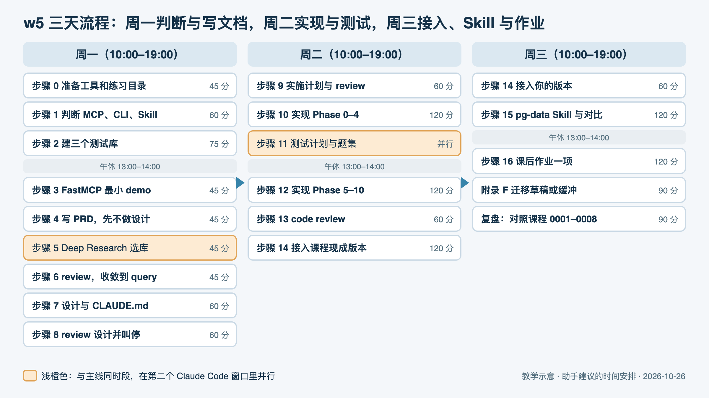
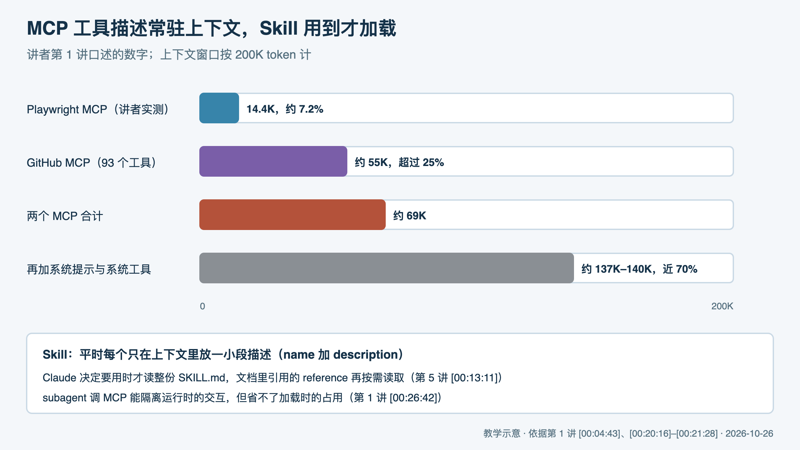

# w5 操作手册：用 spec 驱动 agent 做一个 Postgres MCP，再改写成 Skill

> 手册类型：定制版

## 阅读说明

这份手册按陈天训练营第 5 周五讲的顺序，把讲者做 pg-mcp 的全过程拆成 17 个步骤（步骤 0–16），让你在周一到周三亲手走一遍：先判断什么时候该用 MCP，再用 PRD、设计、实施计划一路驱动 agent 写出服务，测试、接入 Claude Code，最后把同一能力改写成 Skill 做对比。骨架来自课程仓库里已有的课程侧手册（步骤 0–18），这里合并、调了顺序，并补上逐字稿里的原话和时间戳。[<a id="cite-o7-1"></a>[O7](#source-o7)]

- **先看路线图**，再按天打开对应步骤。讲者的 prompt 原文、可套用模板、案例卡和"不做什么"都放在附录，步骤里点链接过去。
- **来源编号**：方括号里的 O1–O13 都是本地材料（O 表示本地课程与项目文件，本手册没有站内帖子）。O1–O5 是五讲逐字稿，正文写的 `[00:04:43]` 这类时间戳对应原视频，可以回看。点编号跳到文末，再点"回到正文"返回。
- **逐字稿是机器转写**：本地 Whisper 自动识别，没有人工校对，专名常被识别成近音词（例如"Cloud Code"实为 Claude Code，"circle"实为 SQL）。手册里引用的数字和原话按上下文纠正过错字；拿不准的地方标了"需回听"。[<a id="cite-o1-1"></a>[O1](#source-o1)]
- **讲者的数字是他那一次的结果**：代码行数、测试数、用时都来自逐字稿或课程侧手册作者的本机核对，你重做时会不同，不能当成标准答案。
- **本次没有运行任何东西**：写这份手册时没有建库、没有启动 MCP、没有调用模型。手册里的命令和提示词是给你执行的，结果以你实际跑出来的为准。只读检查过本机环境（Postgres、uv、Python 版本），结果写在"本次条件"里。[<a id="cite-o12-1"></a>[O12](#source-o12)]
- **会花钱的地方**：步骤 4–16 都要用 Claude Code 或 Codex 生成内容，步骤 14 会调用 OpenAI 接口，费用按你自己的账户计。
- **模板是虚构的**：所有〔〕里的内容都是占位，用之前换成你的真实路径和内容。
- **时间表是助手建议**，按你给的可用时段排出，不是讲者的安排。

## 三天路线图

| 时间 | 做什么 | 点开对应章节 |
|---|---|---|
| 周一上午 | 准备工具和练习目录；判断该不该用 MCP；建好三个测试库 | [步骤 0](#section-step-0) · [步骤 1](#section-step-1) · [步骤 2](#section-step-2) |
| 周一下午 | 跑通 FastMCP 最小 demo；写 PRD、选库、review 并收敛到一个 query 工具；写设计并砍掉过度设计 | [步骤 3](#section-step-3) · [步骤 4](#section-step-4) · [步骤 5](#section-step-5) · [步骤 6](#section-step-6) · [步骤 7](#section-step-7) · [步骤 8](#section-step-8) |
| 周二全天 | 实施计划与 review；用 subagent 分两段实现；并行写测试计划；code review；接入 Claude Code 开始端到端提问 | [步骤 9](#section-step-9) · [步骤 10](#section-step-10) · [步骤 11](#section-step-11) · [步骤 12](#section-step-12) · [步骤 13](#section-step-13) · [步骤 14](#section-step-14) |
| 周三全天 | 端到端测试收尾与排错；写 pg-data Skill 并和 MCP 对比；做一项课后作业 | [步骤 14](#section-step-14) · [步骤 15](#section-step-15) · [步骤 16](#section-step-16) |

每段的起止时间、用时和产物见[三天时间表](#section-schedule)。

这三天先不做：Claude Desktop 接入、Docker 部署、0003 评审里的认证与 OAuth 与审计、把 pg-mcp 的做法搬进 video-mcp。以后再看：[附录 F：课外扩展，迁移到 video-mcp](#section-appendix-f) 和 [附录 E：review 发现与代码现状](#section-appendix-e)。

## 本次条件

| 项目 | 情况 |
|---|---|
| 你在做什么 | video-mcp：自动化短视频制作的 MCP server，Python 3.13 + uv + `mcp[cli]`，代码目前只有打印 Hello 的 `main`[<a id="cite-o13-1"></a>[O13](#source-o13)] |
| 这周想学会什么 | 第 5 周的一整套方法：判断该不该用 MCP，用 spec 驱动 agent 写 MCP，测试并接入客户端，再改写成 Skill |
| 可用时间 | 周一到周三，每天 10:00–19:00；午休 13:00–14:00 是未经确认的示例条件 |
| 本机环境（2026-10-26 18:30 只读检查） | Postgres 17.10 正在运行；数据库里只有 `ziye` 一个角色，没有 `postgres`；三个测试库还不存在；uv 0.11.26；已装 Python 3.14.8 和 3.13.13；Claude Code、Codex 已装；没有 Docker[[O12](#source-o12)] |
| OpenAI key | 未知。未经确认的示例条件：你有一个以 `sk-` 开头、能调用小模型的 key |
| Gemini Deep Research | 未知；没有时按下一节替代 |
| 练习方式 | 课程仓库 `/Users/ziye/Desktop/tyr/geektime-bootcamp-ai/` 只读，不改；另建练习目录复现；video-mcp 的代码在主线里不动 |

## 条件不同时怎么调

- **没有 Postgres 或不想动本机数据库**：本机已有 Postgres，只是缺 `postgres` 角色。不想新建角色时，走[步骤 2](#section-step-2) 的做法 B。完全没有数据库时，只做步骤 1、步骤 4–9（写文档那一段）和读懂步骤 15 的 Skill 结构，步骤 10–16 留到有库再做。
- **没有 OpenAI key**：pg-mcp 启动时会校验 key，空值或不以 `sk-` 开头都会直接报错，[步骤 14](#section-step-14) 做不了。[<a id="cite-o9-1"></a>[O9](#source-o9)] 其余照做；[步骤 15](#section-step-15) 的 Skill 不调用 OpenAI（SQL 由 Claude 自己生成，用 psql 执行），可以完整做，用它代替步骤 14 的端到端体验。
- **key 来自中转服务、不以 `sk-` 开头**：要改 `config/settings.py` 里 `validate_api_key` 的前缀校验，或换官方 key。中转服务能否直接用，本手册未核。[[O9](#source-o9)]
- **只想学 Skill**：步骤 1（1 小时）、步骤 2（1 小时 15 分）、步骤 15（2 小时）、附录 F（1 小时 30 分），一天内可以做完。
- **这三天还要推进 video-mcp 的 M0**：video-mcp 的 `specs/0002` 把 M0 也排在同一个周一到周三 10:00–19:00。[[O13](#source-o13)] 两边都做时，每天只给 w5 两小时：周一做步骤 1 和步骤 2；周二做步骤 14，但改用课程现成代码，跳过步骤 4–13 的重新生成，改为读课程的 0001–0008 对照；周三做步骤 15。spec 链和实现留到下周。
- **没有 Gemini**：用你手边任一深度调研工具发同一个问题，或直接读课程设计文档里的技术栈表，再按步骤 5 的清单核对。[[O7](#source-o7)]

## 三天要完成什么

| 结果 | 数量 | 在哪一步 |
|---|---|---|
| MCP、CLI、Skill 决定表 | 1 张，至少 2 行 | [步骤 1](#section-step-1) |
| 测试库与只读账号 | 3 个库、1 个账号 | [步骤 2](#section-step-2) |
| 你自己生成的 spec 文档 | 8 份（0001–0008） | [步骤 4](#section-step-4) 至 [步骤 13](#section-step-13) |
| 选库调研 | 1 份 | [步骤 5](#section-step-5) |
| 你自己的 pg-mcp | 1 个，Phase 0–10，单元测试通过 | [步骤 10](#section-step-10)、[步骤 12](#section-step-12) |
| 端到端提问记录 | 课程现成版本与你的版本各不少于 5 题 | [步骤 14](#section-step-14) |
| 接入排错记录 | 1 份 | [步骤 14](#section-step-14) |
| pg-data Skill | 1 个 SKILL.md 加 3 个 reference | [步骤 15](#section-step-15) |
| MCP 与 Skill 对比 | 同样 3 道题 | [步骤 15](#section-step-15) |
| 课后作业 | 1 项 | [步骤 16](#section-step-16) |

## 阻碍完成的缺口（动手前先看）

- **G1 数据库角色**：本机 Postgres 在运行，但没有 `postgres` 角色，课程的建库 Makefile、`.env.example` 和 pg-data Skill 都默认用 `postgres/postgres` 登录。[<a id="cite-o10-1"></a>[O10](#source-o10)、[O12](#source-o12)] 先做[步骤 2](#section-step-2)，否则后面所有连库动作都会报认证失败。
- **G2 OpenAI key**：步骤 14 必需；没有时见上一节。[[O9](#source-o9)]
- **G3 Python 版本**：课程 pg-mcp 要求 Python 3.14 及以上（`.python-version` 是 3.14），你的 video-mcp 固定 3.13。[[O9](#source-o9)、[O13](#source-o13)] 本手册在单独的练习目录里做，uv 会用本机已装的 3.14，不影响 video-mcp。不要为了跑课程代码去改 video-mcp 的版本；以后真要把课程代码搬进 video-mcp，先核依赖在 3.13 上能不能装。
- **G4 时间冲突**：见上一节"还要推进 video-mcp 的 M0"。
- **G5 讲者的 codex review skill 不在课程仓库里**：步骤 6、8、9、11、13 都要用它。用 `codex exec` 的只读模式替代，命令见[模板 T3](#template-t3)。[[O7](#source-o7)]
- **G6 课程文档里有几处写错的入口和配置**：README、`claude_desktop_config.json`、`CLAUDE_DESKTOP_SETUP.md` 都让你运行 `python main.py`，但那是返回 42 的演示；`.env` 文件对嵌套配置不生效；`.env.example` 里 `OPENAI_MAX_TOKENS=32000` 超过代码上限 4096；模型名 `gpt-5.2-mini` 与代码默认 `gpt-4o-mini` 不一致。[[O9](#source-o9)、[O7](#source-o7)] 这些不挡前面的步骤，但[步骤 14](#section-step-14) 之前必须知道，处理方法写在那一步。

<a id="section-schedule"></a>
## 三天时间表

三天按每天 8 小时有效时间排，午休 1 小时不排任务；共 24 小时，包括等 agent 生成、读文档和排错。讲者自己从写 PRD 到提交 Skill 大约 6 小时，期间开多个窗口并行；课程侧手册作者估计第一次照做要 10–14 小时。[[O7](#source-o7)] 这里排得更宽，是因为你要读懂每份文档、记录结果，还要接你自己生成的版本。以下是助手建议。



图注：教学示意，2026-10-26 依据本手册时间表绘制。浅橙色框是和主线同时段、在第二个 Claude Code 窗口里并行的步骤；时间是助手建议，不是讲者的安排。

### 周一：判断、建库、写文档

| 时段 | 用时 | 做什么 | 产物 |
|---|---|---|---|
| 10:00–10:45 | 45 分钟 | 步骤 0 准备工具和练习目录 | 练习目录、版本记录 |
| 10:45–11:45 | 60 分钟 | 步骤 1 判断 MCP、CLI、Skill | 决定表 |
| 11:45–13:00 | 75 分钟 | 步骤 2 建测试库与只读账号 | 3 个库、`make test-all` 输出 |
| 14:00–14:45 | 45 分钟 | 步骤 3 FastMCP 最小 demo | add 返回 42 的调用记录 |
| 14:45–15:30 | 45 分钟 | 步骤 4 写 PRD（发出后在浏览器里开始步骤 5） | 0001 |
| 15:30–16:15 | 45 分钟 | 步骤 5 读选库调研并落盘 | survey 文件 |
| 16:15–17:00 | 45 分钟 | 步骤 6 review PRD，收敛到 query | 0001 新版 |
| 17:00–18:00 | 60 分钟 | 步骤 7 设计文档与 CLAUDE.md | 0002、CLAUDE.md |
| 18:00–19:00 | 60 分钟 | 步骤 8 review 设计并叫停过度设计 | 0003、待办清单 |

### 周二：实现、测试计划、code review

| 时段 | 用时 | 做什么 | 产物 |
|---|---|---|---|
| 10:00–11:00 | 60 分钟 | 步骤 9 实施计划与计划 review | 0004、0005 |
| 11:00–13:00 | 120 分钟 | 步骤 10 Phase 0–4；同时段在第二个窗口做步骤 11 | 代码与单测；0007、0008、TEST_QUERIES |
| 14:00–16:00 | 120 分钟 | 步骤 12 Phase 5–10 并修到测试全绿 | 完整代码 |
| 16:00–17:00 | 60 分钟 | 步骤 13 code review | 0006 |
| 17:00–19:00 | 120 分钟 | 步骤 14 前半：接入课程现成版本，提问 5 题 | 提问记录、排错记录 |

### 周三：端到端收尾、Skill、作业

| 时段 | 用时 | 做什么 | 产物 |
|---|---|---|---|
| 10:00–11:00 | 60 分钟 | 步骤 14 后半：接入你自己的版本，用 headless 方式再测 | 第二份提问记录 |
| 11:00–13:00 | 120 分钟 | 步骤 15 写 pg-data Skill 并与 MCP 对比 | Skill、对比表 |
| 14:00–16:00 | 120 分钟 | 步骤 16 课后作业，选一项 | 修改与测试 |
| 16:00–17:30 | 90 分钟 | 附录 F 课外扩展，或给前面没做完的步骤当缓冲 | 迁移草稿 |
| 17:30–19:00 | 90 分钟 | 复盘：把三天的运行记录与课程 0001–0008 对照，写下次要改的地方 | 复盘笔记 |

<a id="section-step-0"></a>
## 步骤 0 准备工具和练习目录

课程仓库是参照物，你要在另一个目录里练，这样随时能拿原版对照，也不会把课程文件改坏。先把工具版本记下来，后面出错时才分得清是环境问题还是代码问题。

**目标**：建好与课程仓库分开的练习目录，确认 uv、Claude Code、Codex、psql 都能用，并记下版本。

1. 新建练习目录〔练习目录〕（例如 `~/Developer/w5-lab`，虚构示例），里面放两样：`pg-mcp-ref/` 是课程现成代码的副本，当对照组；`my-pg-mcp/` 是你从 PRD 开始让 agent 生成的版本。课程目录只复制、不修改。[[O9](#source-o9)]
2. 记版本：uv、Python 3.14、Claude Code、Codex、psql。本机只读检查到 uv 0.11.26、psql 17.10、Python 3.14.8 和 3.13.13。[[O12](#source-o12)]
3. 在 `my-pg-mcp/` 里 `git init` 并建 `specs/` 目录。讲者每生成一份文档就先 commit 一次，再让模型改，方便回看改了什么。[<a id="cite-o2-1"></a>[O2](#source-o2)]
4. 可选：讲者用开源语音输入工具 Handy（Whisper large 模型，热键 Option+Space）口述需求，长需求说比打字快。不装不影响后面步骤。[[O2](#source-o2)]

本步命令（〔练习目录〕换成你的路径）：

```bash
mkdir -p 〔练习目录〕/my-pg-mcp/specs
cp -R /Users/ziye/Desktop/tyr/geektime-bootcamp-ai/w5/pg-mcp 〔练习目录〕/pg-mcp-ref
cd 〔练习目录〕/my-pg-mcp && git init
uv --version; python3.14 --version; claude --version; codex --version; psql --version
```

**做完的标准**：两个子目录都在；版本写进运行记录（[模板 T8](#template-t8)）；在课程仓库里 `git status` 没有新增改动。

- [ ] 练习目录和两个子目录已建好
- [ ] 版本已记录
- [ ] 课程仓库没有被改动

<a id="section-step-1"></a>
## 步骤 1 判断：什么时候该用 MCP，什么时候用 CLI 或 Skill

第 1 讲花最多时间讲的不是协议细节，而是"非必要不要使用 MCP"。先把这条判断建立起来，后面写 PRD 时你就明白讲者为什么只留一个工具，也能用同样的标准看自己的 video-mcp。

**目标**：用你自己 Claude Code 里看到的上下文数字，写出一张"这个能力用 MCP、CLI 还是 Skill"的决定表。

1. 输入：在一个空目录打开 Claude Code，输入 `/context` 记下各项占用；装一个 MCP 后再看一次。讲者只装了 Playwright MCP，它就占了 14.4K token，约为上下文的 7.2%。你的数字会随版本变化，记实测值。[[O1](#source-o1)]
2. 理由：MCP 工具的描述不管用不用都要随每次请求带上；讲者引用的文章说 GitHub MCP 有 93 个工具、约 55K token，两个加起来约 69K，再算上系统提示，200K 的窗口近七成已被占掉，账单也跟着涨。Skill 平时只放一小段描述，真正用到才读全文。[[O1](#source-o1)、<a id="cite-o5-1"></a>[O5](#source-o5)]
3. 判断规则：同一能力既有 MCP 又有 CLI，用 CLI；新做的工具如果只在本机用（即 stdio 方式），宁可做成 CLI；需要保持状态（例如浏览器会话）、输入输出要严格类型、要常驻服务给别人用，才做 MCP；能用 Skill 完成的优先 Skill。[[O1](#source-o1)、[O5](#source-o5)]
4. 反例：GitHub MCP 是无状态的，`gh` 命令行能做同样的事，讲者认为它不必装；Playwright MCP 要记住浏览器当前页面，是 MCP 的合理场景。[[O1](#source-o1)]
5. 下一动作：在[模板 T7](#template-t7) 里至少写两行：课程的 pg-mcp `query` 一行，video-mcp 的一个能力（例如"把视频转成逐字稿"）一行，每行写选择、理由和反例。写不出理由的标"待定"，留到附录 F 再判断。

**做完的标准**：决定表至少 2 行，每行都写了用什么、为什么（状态、类型要求、是否常驻、上下文成本）以及一个反例；你记下了自己 `/context` 的前后数字。

- [ ] `/context` 前后数字已记录
- [ ] 决定表至少 2 行
- [ ] 每行都有理由和反例



图注：教学示意，2026-10-26 依据第 1 讲 [00:04:43]、[00:20:16]–[00:21:28] 与第 5 讲 [00:13:11] 的讲者口述数字绘制。GitHub MCP 的 93 个工具、55K 是讲者引用的文章数字，他本人当时没有配置 token、未实测；你的 Claude Code 版本不同，数字也会不同。

### 讲者做法与数字

- MCP 是 AI 应用的"USB 接口"：用 JSON-RPC 2.0（一种用 JSON 写"调用哪个方法、带什么参数"的通信格式）把工具能力标准化，解决 N 个工具要适配 M 个模型的问题。[00:01:55] [[O1](#source-o1)]
- 两种运行方式：stdio 是客户端在本机起一个子进程，通过标准输入输出收发消息；HTTP 方式用于远程服务，协议早先用 SSE，后来改成 streamable HTTP。讲者强调两者只是传输层不同，收发的都是 JSON-RPC，框架会替你处理。[00:08:28]–[00:11:13] [[O1](#source-o1)]
- "非必要不要使用 MCP"[00:21:50]；CLI 的好处是能力可以逐步暴露，模型先看到一句简短描述，需要时自己去查子命令[00:22:30]；MCP 的优势是有状态[00:23:47]；几个选项里"MCP 的优先级应该放在最后"[00:25:44]。[[O1](#source-o1)]
- 用 subagent（Claude Code 另起的子代理，有独立上下文，做完只把结果交回主会话）去调 MCP，能避免运行时的交互污染主上下文，但省不了加载时的占用。[00:26:42] [[O1](#source-o1)]
- 按使用场景封装工具：把已有 API 原封不动全部暴露成 MCP 工具"是一个错误的想法"，应该把若干 API 调用封进一个工具；工具本身不处理复杂错误，把错误信息返回给模型，让模型决定下一步；避免把大量逻辑写死在 MCP 里，否则逻辑固化，升级模型也不会变好。[00:30:53]–[00:32:59] [[O1](#source-o1)]
- 人在回路：讲者平时让 Claude Code 跳过所有权限确认，但提醒外部工具执行删除这类危险操作时，要么放进 Docker 容器隔离，要么要求人批准；远程 MCP 还要解决认证和权限。[00:13:07]–[00:15:40] [[O1](#source-o1)]

参见[附录 A：不做什么、依据和改为](#section-appendix-a)。

<a id="section-step-2"></a>
## 步骤 2 建测试库和只读账号

讲者的原则是"代码写好了，最好也把这个代码所需要的测试数据准备好"。课程的 `pg-mcp/fixtures/` 目录里有三份建库 SQL 和一个 Makefile，一条命令就能建好三个库。课程讲者是边写代码边建库，这里提前做，后面每一步都有真数据可查。

**目标**：本机有 blog_small、ecommerce_medium、saas_crm_large 三个库，`make test-all` 的数字和课程的 `TEST_RESULTS.md` 一致，另有一个只能读不能写的账号。

1. 确认服务：运行 `pg_isready`。本机 2026-10-26 返回 accepting connections，但只有 `ziye` 角色、没有 `postgres` 角色，三个库都还不存在。fixtures 的 Makefile 默认用 `postgres` 用户登录。[[O10](#source-o10)、[O12](#source-o12)]
2. 解决登录用户，二选一。做法 A：新建 `postgres` 超级用户并把密码设为 `postgres`，课程的 `.env.example` 和 pg-data Skill 都写死了这组账号，后面最省事，但会改动本机数据库的角色表。做法 B：不建角色，每条 make 命令前加 `PGUSER=$(whoami) PGDATABASE=postgres`，因为 Makefile 里的 psql 没有指定库名，默认会连与用户同名的库。[[O9](#source-o9)、[O10](#source-o10)、<a id="cite-o11-1"></a>[O11](#source-o11)]
3. 建库并核对：在 `pg-mcp-ref/fixtures/` 下运行 `make help`、`make create-all`、`make test-all`、`make info`。每份 SQL 开头会先删掉同名库再重建，所以重跑是安全的，但会清掉你在这三个库里的改动。[[O10](#source-o10)]
4. 对照实测数字：blog_small 7 张表、3 个视图、2 个枚举类型、154 行；ecommerce_medium 24、6、4、256；saas_crm_large 45、10、12、264。fixtures 的 README 和 Makefile 注释写的"25 张""55+ 张"是生成时的估计，以 `make test-all` 为准。[[O10](#source-o10)、[O7](#source-o7)]
5. 建只读账号：照 `CLAUDE_DESKTOP_SETUP.md` 第 376–381 行的 SQL 建 `pg_mcp_readonly`，把其中的 `mydb` 换成三个测试库各授权一次。pg-mcp 自己有"禁止写操作"的开关，但应用开关代替不了数据库权限。[[O9](#source-o9)]

本步命令（做法 A）：

```bash
pg_isready -h localhost -p 5432
createuser -h localhost -s postgres
psql -h localhost -d postgres -c "ALTER USER postgres PASSWORD 'postgres';"
cd 〔练习目录〕/pg-mcp-ref/fixtures
make help
PGPASSWORD=postgres make create-all
PGPASSWORD=postgres make test-all
PGPASSWORD=postgres make info
```

做法 B 不建 `postgres` 角色，把上面的前两条换掉，make 命令改成：

```bash
PGUSER=$(whoami) PGDATABASE=postgres make create-all
PGUSER=$(whoami) PGDATABASE=postgres make test-all
```

只读账号（以 blog_small 为例，另外两个库各执行一次后三行）：

```sql
CREATE USER pg_mcp_readonly WITH PASSWORD '〔只读账号密码〕';
GRANT CONNECT ON DATABASE blog_small TO pg_mcp_readonly;
\c blog_small
GRANT USAGE ON SCHEMA public TO pg_mcp_readonly;
GRANT SELECT ON ALL TABLES IN SCHEMA public TO pg_mcp_readonly;
```

验证只读（放在事务里并回滚，即使权限配错也不会真的删数据）：

```bash
psql -h localhost -U pg_mcp_readonly -d blog_small -c "BEGIN; DELETE FROM posts; ROLLBACK;"
psql -h localhost -U pg_mcp_readonly -d blog_small -c "SELECT COUNT(*) FROM posts WHERE status = 'published';"
```

**做完的标准**：`make test-all` 三行数字与上面一致；只读账号执行 DELETE 报 permission denied；`SELECT COUNT(*) FROM posts WHERE status = 'published'` 返回 8。[[O10](#source-o10)]

- [ ] 三个库已建好，数字对得上
- [ ] 只读账号建好，写操作被拒绝
- [ ] 抽查查询返回 8

### 讲者做法与数字

- 讲者口头说 Postgres "起码算支持 16 以上吧"[00:17:27]，本机 17.10 满足。[[O2](#source-o2)]
- 建库这件事讲者交给另一个窗口里的 Sonnet 模型，理由是"不需要使用那么强"[00:06:28]；建完后让 agent "自己去验证，确保这些 database 都正常工作"[00:08:37]。他用 `make info` 看库信息，再进库执行 `select * from users`[00:24:31]–[00:24:58]。[<a id="cite-o3-1"></a>[O3](#source-o3)]
- 课程的 `TEST_RESULTS.md` 记录了建库时真实出过的错：中等库的视图引用了不存在的枚举值 completed（改成 delivered），大库缺 task_priority 枚举、EXTRACT 用法错、建表顺序错，都是 agent 自己建库、报错、再修好的。[[O10](#source-o10)] 见[案例卡 5](#case-5)。

<a id="section-step-3"></a>
## 步骤 3 跑通 FastMCP 最小 demo，认清 main.py

讲者在写需求之前，先用十几行代码确认 FastMCP 能被客户端调用。这个 demo 一直留在课程仓库里，文件名叫 `main.py`，后来好几份文档都误把它当成服务入口。亲手跑一次，以后看到它就能认出来。

**目标**：在 `my-pg-mcp` 里跑起一个故意返回 42 的 `add` 工具，并在 Claude Code 里看到调用结果是 42。

1. 初始化：`uv init`，`uv add fastmcp`（讲者当时装到 2.14 版），把课程 `main.py` 的 11 行抄进来：定义 `add(a, b)`，但固定返回 42，用来确认客户端调的确实是你这个服务。[[O2](#source-o2)、[O9](#source-o9)]
2. 本地运行 `uv run python main.py`，看到以 stdio 方式启动的日志。stdio 服务会一直等输入，看上去像卡住，这是正常的，按 Ctrl+C 退出。[[O2](#source-o2)]
3. 接入 Claude Code：`claude mcp add demo -- uv --directory 〔练习目录绝对路径〕/my-pg-mcp run python main.py`，再输入 `/mcp` 看是否已连接。讲者当时用的是 Cursor 的 New MCP Server，填法相同：命令是 uv，参数是目录和 `run python main.py`。[[O2](#source-o2)、[O12](#source-o12)]
4. 让模型"用 add 工具算 1+2"，得到 42 就说明调用的是你的 MCP；确认后 `claude mcp remove demo` 删掉，免得它一直占上下文。[[O7](#source-o7)]

本步命令：

```bash
cd 〔练习目录〕/my-pg-mcp
uv init
uv add fastmcp
uv run python main.py
claude mcp add demo -- uv --directory 〔练习目录绝对路径〕/my-pg-mcp run python main.py
claude mcp remove demo
```

**做完的标准**：`/mcp` 里出现 demo 且已连接；调用返回 42；删除后列表里没有 demo。

- [ ] 本地能以 stdio 方式启动
- [ ] Claude Code 调用返回 42
- [ ] demo 已删除

### 讲者做法与数字

- 讲者说 Python 不是他的主力语言，对生态了解有限[00:09:22]；他先搜 "best python mcp library" 找到 FastMCP，看了它的写法：建一个实例，用装饰器把函数注册成工具，就能运行[00:11:01]。[[O2](#source-o2)]
- `uv add fastmcp` 装到 2.14 版，启动日志显示以 stdio 方式运行[00:12:21]；在 Cursor 里接入验证后删掉[00:12:59]–[00:14:14]。[[O2](#source-o2)]
- 这个 `main.py` 至今仍在课程仓库里，`add` 返回 42。[[O9](#source-o9)] 它和[步骤 14](#section-step-14) 的入口问题是同一件事。

<a id="section-step-4"></a>
## 步骤 4 写 PRD：只写需求，先别做设计

讲者把需求和设计分成两轮：这一轮只让模型写需求文档（PRD），并且明说"先不要着急去做设计，等我 review 完"。分开写，你才有机会在设计定型前改需求。

**目标**：得到 `specs/0001-pg-mcp-prd.md`，写清用户怎么提问、服务启动时缓存什么、哪些 SQL 允许、结果怎么确认、返回什么。

1. 在 `my-pg-mcp` 里打开 Claude Code，发送[讲者原文 P1](#prompt-p1)，把路径 `./specs/w5/0001-pg-mcp-prd.md` 改成 `./specs/0001-pg-mcp-prd.md`。[<a id="cite-o6-1"></a>[O6](#source-o6)]
2. 保留 P1 结尾那句"先不要著急去做设计，等我 review 完这个需求文档之后呢我们再来讨论设计"。讲者口述时把这句说了两遍。[[O2](#source-o2)]
3. 模型名写你实际能调用的。讲者口述的是 gpt5 mini[00:05:22]；课程 PRD 最后写成了 gpt-5.2-mini，讲者说"有些地方我把它手工改成 5.2 了，但是忘记改回来了"[00:25:59]。[[O2](#source-o2)、<a id="cite-o8-1"></a>[O8](#source-o8)]
4. 对照检查 PRD：用户输入有问题、可选的库名、返回 SQL 还是结果三项；缓存范围有表、视图、类型、索引；有允许与禁止的语句清单；有结果确认的阈值和重试次数；有错误码；有验收标准与反面用例。可以拿课程的 0001 当参考答案。[[O7](#source-o7)、[O8](#source-o8)]
5. 把 PRD 里多出来的工具名记下来。课程第一版里有 list_databases、describe_table、refresh_schema，讲者看完说"我觉得这些东西都不需要，它有一个 query 就可以了"[00:16:31]–[00:16:43]，下一步删。[[O2](#source-o2)]

**做完的标准**：PRD 已 commit；上面 6 项逐项标了有或无；多余的工具名列在运行记录里。

- [ ] PRD 已生成并 commit
- [ ] 6 项检查已逐项标注
- [ ] 多余工具已列出

### 讲者怎么写出 P1：口述，不是打字

- P1 是用开源语音输入工具 Handy 说出来的，不是敲出来的。[00:01:08]–[00:01:22] [[O2](#source-o2)]
- 第一遍说到"调用 OpenAI 生成 SQL"就停了，讲者嫌"这段可能输出的有点长"，从头又说一遍。[00:03:53]–[00:04:02] [[O2](#source-o2)]
- 他是顺着数据怎么流动来说的：用户输入、启动时缓存、生成 SQL、校验、试跑、让模型确认、返回。每说完一段停下来想"还有什么样的这个需求呢"。[00:06:39] [[O2](#source-o2)]
- 技术上只点名了 OpenAI 和 gpt-5 mini，还补一句"大家在这块也可以选用你想的这个模型"[00:05:22]–[00:05:39]。用哪些库一个都没说，留给[步骤 5](#section-step-5) 去调研。[[O2](#source-o2)]
- 存档的 P1 约 400 字，一整段没有分段，也没有规定 PRD 要写哪些章节。[[O6](#source-o6)]

拆开看，P1 由七部分组成，每部分管一件事：

| 部分 | P1 里的原话 | 管什么 |
|---|---|---|
| ① 一句话目标 | 在 Python 下面创建一个 Postgres 的 mcp | 定下语言和项目类型 |
| ② 输入和输出 | 用户给自然语言的查询需求，返回 SQL 或查询结果 | 对外接口的雏形 |
| ③ 启动时准备什么 | 读取可访问的数据库，缓存 table/view/types/index | 写明缓存范围 |
| ④ 处理流程 | 调 OpenAI 生成 SQL；只允许查询语句；试跑确保能执行 | 主流程，每一步一个动作 |
| ⑤ 质量把关 | 把用户输入、SQL 和部分结果交给 OpenAI 确认是否有意义 | 后来变成置信度和重试 |
| ⑥ 节奏约束 | 先不要著急去做设计，等我 review 完 | 这一轮只写需求 |
| ⑦ 文件位置 | `./specs/w5/0001-pg-mcp-prd.md` | 编号文档，后面接 0002 设计、0004 实施计划 |

P1 只写"要做什么"，不写"怎么做"。你口述时只要把主流程说清楚，章节和细节交给模型补，再由你砍。

### 模型补了什么，讲者 review 时看什么

把课程的 0001（v1.1，589 行）和 P1 对照：[[O8](#source-o8)]

- **来自口述**：§2.1.1 自然语言转 SQL、§2.1.2 Schema 缓存、§2.1.3 用 LLM 生成 SQL、§2.1.4 安全验证、§2.1.5 执行与结果验证。
- **模型自己补的**：背景、愿景与目标用户，§3 非功能需求，§5 四个用户场景，§6 错误码，§7 验收标准与负面测试用例，§8 七个开放问题。
- **模型多做的**：v1.0 的工具表有 query、list_databases、describe_table、refresh_schema 四个。

讲者看 v1.0 大约用了 3 分钟[00:15:00]–[00:17:39]，按顺序看了五样：[[O2](#source-o2)]

1. 输入参数：库名可选，只有一个库时自动选；返回类型分 sql 和 result 两种。认可。
2. 缓存：启动时全量缓存；手动刷新缓存的接口"这个有没有无所谓"。[00:15:53]–[00:16:00]
3. 安全：允许与禁止的语句清单，用 SQL 解析库校验。认可。
4. 工具清单：只要 query，其余删。[00:16:50]
5. 版本约束：Postgres "起码算支持 16 以上吧"。[00:17:27]

看完他没有自己动手改，而是把意见写进下一条提示词 P2，和"让 Codex review"合在一起发，见[步骤 6](#section-step-6)。v1.1 的修订历史列出了这一轮吸收的意见：只留 query，扩充安全规则，置信度阈值 70、最多重试 2 次，只读角色，并发要求，错误码，负面测试用例。[[O8](#source-o8)]

换成你自己的项目时，口述按上面七部分组织，review 按上面五样看，可以直接套[模板 T1](#template-t1)。

<a id="section-step-5"></a>
## 步骤 5 用 Deep Research 选库

讲者坦白 Python 生态他不熟，所以不靠记忆选库，而是让 Deep Research 先列出候选和理由，他再拍板。这一步可以在 PRD 生成的同时在浏览器里做。

**目标**：留下一份选库调研，写清 MCP 框架、Postgres 驱动、SQL 解析、模型调用四类各选什么、为什么。

1. 在 Gemini Deep Research 里附上 PRD，发讲者口述的问题："帮我研究一下这个需求，如果是用 python 来实现的话，应该用哪些库，为什么用这些库"[00:08:50]。更完整的写法见[模板 T2](#template-t2)。[[O2](#source-o2)、[O7](#source-o7)]
2. 同时自己搜 best python mcp library，核对 FastMCP 的 GitHub 和示例。[[O2](#source-o2)]
3. 对照讲者采纳的结论：FastMCP（用装饰器写工具，比直接用官方 SDK 手写省事）；asyncpg（走 Postgres 二进制协议，原生支持 Python 的异步写法，适合高并发）；SQLGlot（纯 Python 的 SQL 解析器，能把 SQL 解析成语法树再检查，sqlparse 只做分词、缺语义理解，正则更不可靠）；OpenAI SDK 加 Pydantic 做结构化输出，不用 LangChain。[[O2](#source-o2)]
4. 对拿不准的库单独再做一次深度调研。讲者在等设计文档时又让 Gemini 专门研究了 SQLGlot 的设计理念和支持的 SQL 范围[00:30:30]。[[O2](#source-o2)]
5. 结论存成 `docs/research/survey-pg-mcp-libs.md` 并 commit。这个命名沿用你们 ai-tools 规范里 survey 类调研的写法。[[O13](#source-o13)]

**做完的标准**：调研文件里四类库各有首选和理由；与讲者结论不同的地方写了原因。

- [ ] 调研已完成并落盘
- [ ] 四类库都有首选与理由
- [ ] 与讲者不同处已说明

### 讲者做法

- 讲者说，对不熟的语言生态，这一步"非常的重要"，而且要看清选择背后的理由。[00:55:59] [[O2](#source-o2)]
- 他自己先想过方向：需要一个 MCP 库、一个 Postgres 访问库（他会选 asyncpg）、OpenAI 的异步 SDK，再让调研来补全和筛选。[00:09:55]–[00:10:35] [[O2](#source-o2)]
- 讲者没有把调研报告落盘，只在课程 README 里留了分享链接。[[O7](#source-o7)]

<a id="section-step-6"></a>
## 步骤 6 用 Codex review PRD，把接口收敛到只有 query

讲者说"一个好的 spec 其实是要多方去 review 的，因为只有你自己的思路的话，这个 spec 肯定是不完善的"。这一步一边让另一个模型挑刺，一边由你拍板把工具砍到只剩一个。

**目标**：PRD 升一版，工具表只剩 `query(question, database?, return_type?)`，并吸收 review 里合理的安全和阈值意见。

1. 准备 review 工具。讲者的 codex review skill 是他用 Claude Code 生成后拷进 `.claude/skills/`、重启生效的，不在课程仓库里。[[O2](#source-o2)、[O7](#source-o7)] 用[模板 T3](#template-t3) 的 `codex exec` 只读命令替代，先得到一份 review 文件。
2. 在 Claude Code 里发送[讲者原文 P2](#prompt-p2)："commit code; 然后，接口目前只需要 query 即可，其它意义不大……"。没有 skill 时把后半句改成"仔细阅读 〔review 文件〕，思考是否合理，然后更新 0001"。[[O6](#source-o6)、[O7](#source-o7)]
3. 收敛的道理来自第 1 讲：按使用场景封装工具，不把每个能力都暴露出去，出错时把错误交给模型决定下一步。[[O1](#source-o1)] 一个 `query` 就能覆盖"问一句话，拿回 SQL 或结果"这个场景。
4. 挑出讲者认可的意见吸收进去：强制使用只读角色；返回一个置信度，低于 70 就自动重新生成 SQL。[00:26:13]–[00:27:11] [[O2](#source-o2)] review 输出成英文时，在提示里写明"输出中文"，讲者说 Codex "有时候 follow 这个指令 follow 的不是特别的好"[00:52:18]。[[O2](#source-o2)]
5. commit，修订记录里写清这一版改了什么。

**做完的标准**：工具表只有 query 一行，参数是 question、可选的 database、可选的 return_type；修订记录列出了吸收的 review 意见。可对照课程 0001 第 185–189 行。[[O8](#source-o8)]

- [ ] review 文件已生成
- [ ] 工具表只剩 query
- [ ] 修订记录已更新并 commit

参见[案例卡 1](#case-1)。

<a id="section-step-7"></a>
## 步骤 7 写设计文档和项目 CLAUDE.md

需求定了，选库也定了，这一步让模型出技术设计，同时另开一个窗口给项目写 CLAUDE.md（Claude Code 每次进入这个目录都会读的项目规范）。两件事互不依赖，可以并行。

**目标**：得到 `specs/0002-pg-mcp-design.md` 和 `my-pg-mcp/CLAUDE.md`，并在重启后让 CLAUDE.md 生效。

1. 发送[讲者原文 P3](#prompt-p3)：根据 0001，使用 FastMCP、Asyncpg、SQLGlot、Pydantic 以及 openai 构建设计文档。[[O6](#source-o6)]
2. 另开一个 Claude Code 窗口，在 `my-pg-mcp` 里发[据口述还原的 R1](#prompt-r1)：生成 CLAUDE.md，符合 Python 最佳实践和 SOLID、DRY 等设计原则，重视代码与测试质量。[[O2](#source-o2)]
3. 看架构是否合理。讲者的读法：客户端请求进来先做参数校验、限流和请求编号，再交给 orchestrator（协调器，按顺序调用 SQL 生成、校验、执行、结果确认的总控代码）；下面挂 schema 缓存、连接池和熔断器（外部服务连续失败后暂停调用一段时间的保护开关）。[00:36:26] [[O2](#source-o2)]
4. 看有没有做得过度复杂。讲者觉得把列、外键各做一个数据模型"可能做的有点过于麻烦了"，他原本只想把库结构导出成几个 markdown 文件；这次判断"目前这个还好"，但说复杂度太高就"应该去纠正它"。[00:37:07]–[00:38:18] [[O2](#source-o2)]
5. 重启 Claude Code 让 CLAUDE.md 生效，然后 commit。[00:44:35] [[O2](#source-o2)]

**做完的标准**：0002 里有技术栈、架构图、分层、项目目录树和安全设计；CLAUDE.md 写了 SOLID、DRY 和测试要求；重启后在新会话里问"这个项目的编码规范是什么"，它能复述出来。

- [ ] 0002 已生成
- [ ] CLAUDE.md 已生成并重启生效
- [ ] 过度复杂之处已记下

<a id="section-step-8"></a>
## 步骤 8 判断：让另一个模型 review 设计，砍掉过度设计

讲者把这一刻称作"人类来介入 agent 的工作的最佳的时机"：review 一口气提出认证、OAuth、脱敏、审计这些生产级要求时，由你来决定哪些现在做，哪些先存档。

**目标**：设计保持原来的范围，review 原文另存为 0003，暂缓的条目进待办清单。

1. 输入：发送[讲者原文 P4](#prompt-p4)，用 subagent 调 codex review 0002 并更新。讲者这次 review 花了五分多钟。[00:40:00] [[O2](#source-o2)、[O6](#source-o6)]
2. 判断理由：逐条问"一个本机自己用的 MCP，现在缺这一条会出错吗"。讲者的取舍是：认证和授权是生产环境的问题，本地使用不是问题；查询结果不限制行数导致的拒绝服务"确实是一个存在的问题"；敏感数据发给外部模型是生产环境要考虑的。[00:46:28]–[00:46:54] [[O2](#source-o2)]
3. 反例：如果把 pglast 二次校验、OAuth、数据脱敏、审计全加进设计，"就会使得整个项目过度的复杂"；一个产品不可能一开始就实现所有东西。[00:40:20]–[00:43:28] [[O2](#source-o2)]
4. 下一动作：发叫停指令（[R2，据口述还原](#prompt-r2)）：避免过度设计，先不考虑这些，回滚设计改动，把 review 结果存进 0003。再把暂缓的条目逐条抄进待办，[步骤 16](#section-step-16) 选作业时用。[[O2](#source-o2)、[O7](#source-o7)]

**做完的标准**：0003 存在，含评分和按严重程度分级的条目；0002 的修订记录里没有"按 review 扩展"的新版本；待办清单列出了暂缓条目和暂缓理由。

- [ ] 0003 已存档
- [ ] 0002 保持原范围
- [ ] 暂缓条目已进待办

### 讲者做法与数字

- 课程 0003 的评审工具是 OpenAI Codex CLI（gpt-5.1-codex-max），整体评分 6.5/10。[[O8](#source-o8)]
- 讲者的总结：review 里找出的问题有时很重要，可以修设计；如果是安全、审计这类功能缺失，可以放到后续再处理。[00:56:23]–[00:56:49] [[O2](#source-o2)]

参见[案例卡 2](#case-2)。

<a id="section-step-9"></a>
## 步骤 9 写实施计划（Phase 0–10）并 review

设计是"做成什么样"，实施计划是"按什么顺序做、每一段做完怎么验收"。讲者让模型深度思考后写计划，再交给 Codex 挑问题，然后决定分两段实现。

**目标**：得到 `specs/0004-pg-mcp-impl-plan.md`（分 11 个 phase，每个有任务、产出和验收标准）和 `specs/0005-pg-mcp-impl-plan-review.md`。

1. 发送[讲者原文 P5](#prompt-p5)。其中 think ultra hard 是让 Claude Code 用最多思考预算的提示词。[[O6](#source-o6)]
2. 检查 phase 切分：课程 0004 从 Phase 0 项目初始化，到 Phase 10 集成测试与文档，中间依次是模型与配置、SQL 安全校验、数据库连接与 schema 缓存、SQL 生成、查询执行、协调器、FastMCP 集成、结果确认与弹性组件、可观测性。[[O8](#source-o8)] 讲者看完决定"一口气让它先做 0 到 4，然后再做 5 到 10"[00:49:51]。[[O2](#source-o2)]
3. 读 0005：课程版本的结论是 NEEDS_REVISION，列了 6 个问题。讲者认为"问题不是特别的大"，安全相关的意见"先放在一边"[00:49:51]–[00:50:16]，然后提交。[[O2](#source-o2)、[O8](#source-o8)]
4. 决定要不要先改计划：0005 指出缺少确定的测试数据库和种子数据，你在步骤 2 已经有了，可以让 agent 在 0004 里写明用这三个库。课程侧手册还建议，想省后面的返工，就先按 0005 的高优先级意见改 0004 再实现。[[O7](#source-o7)、[O8](#source-o8)]
5. commit。

**做完的标准**：0004 有 11 个 phase 和依赖关系；0005 有结论和问题清单；你在运行记录里写下"按 0005 改或不改、为什么"。

- [ ] 0004 已生成
- [ ] 0005 已生成
- [ ] 改不改计划已决定

<a id="section-step-10"></a>
## 步骤 10 用 subagent 实现 Phase 0–4

讲者让 Claude Code 用 subagent 分 phase 写代码，他自己盯的是正确性而不是行数。这一段最常见的坑是依赖装错和第三方库版本变化导致的测试失败。

**目标**：Phase 0–4 的代码和单元测试在 `my-pg-mcp` 里全部通过，依赖里是 `fastmcp` 而不是 `mcp`，数据库部分真连过一次 blog_small。

1. 发送[讲者原文 P6](#prompt-p6)，并补一句代码放在哪个目录。Claude Code 会临时生成一个 Python 架构方向的 subagent，并自己给它写好提示词。等待时切到第二个窗口做[步骤 11](#section-step-11)。[[O3](#source-o3)、[O6](#source-o6)]
2. 检查依赖：讲者发现生成的 `pyproject.toml` 用的是 `mcp` 而不是 `fastmcp`，提醒"在生成完代码之后要检查一下"，后来删掉 `mcp`、加回 `fastmcp`。[00:09:50]–[00:10:06]、[00:28:58] [[O3](#source-o3)] 课程现在的写法是 `fastmcp>=2.14.1`、`sqlglot>=28.5.0`、`asyncpg>=0.31.0`。[[O9](#source-o9)]
3. 跑 `uv run pytest`。讲者遇到 14 个失败，都和 SQLGlot 有关（新版本对 EXPLAIN 等语句的解析方式变了）。他先追问 agent "为什么这么做"，再选了 agent 给的方案二，理由是"我最初的想法就是有一个简单的 parser，然后允许它去运行 select 就好了"。[00:14:25]–[00:18:27] [[O3](#source-o3)、[O7](#source-o7)]
4. 修剩下的失败：把异步函数的测试替身从 MagicMock 改成 AsyncMock；限流相关那一条是测试用例本身写错了。[00:20:38]–[00:21:32] [[O3](#source-o3)]
5. 让 agent 自己连 blog_small 验证数据库那部分，不只跑单元测试；全部通过后 commit、push，再清空上下文，准备下一段。[00:08:37]、[00:23:19] [[O3](#source-o3)]

**做完的标准**：`uv run pytest tests/unit` 全部通过；`pyproject.toml` 依赖里有 `fastmcp`；运行记录里有一次连 blog_small 成功的输出。

- [ ] 依赖已核对
- [ ] 单元测试全部通过
- [ ] 数据库部分真连过一次

### 讲者做法与数字

- 完成 Phase 0 和 1 时已写了 1900 多行 Python[00:07:44]；不久到 5000 多行，讲者说"有必要写这么多吗"[00:09:23]，但又说"他写了什么代码，这个也不重要，我们需要更多的是这个代码的正确性"[00:08:14]。[[O3](#source-o3)]
- 课程侧手册按 git 时间戳统计，Phase 0–4 用了约 40 分钟；修 SQLGlot 兼容并把 Python 升到 3.14 的那次提交写的是 172 个测试全部通过。[[O7](#source-o7)]

参见[案例卡 3](#case-3)、[案例卡 4](#case-4)。

<a id="section-step-11"></a>
## 步骤 11 测试计划、测试问题集和你自己的测试数据（与步骤 10 并行）

测试计划和实现互不依赖，讲者在实现跑着的时候另开窗口写它。这一步还要准备一份"用大白话提问"的测试问题集，步骤 14 和 15 都要用。

**目标**：得到 `specs/0007-pg-mcp-test-plan.md`、`specs/0008-pg-mcp-test-plan-review.md` 和一份按难度分级的 `TEST_QUERIES.md`。

1. 在第二个窗口发送[讲者原文 P7](#prompt-p7)，末尾加上讲者口头补的一句"确保生成的 test plan 你可以自己执行"[00:03:46]。[[O3](#source-o3)、[O6](#source-o6)]
2. 读 0008：课程版本发现 Critical 1 个、High 2 个、Medium 2 个、Low 1 个，Critical 是多个测试只写了 `pass` 占位。[[O8](#source-o8)] 让 agent 要么写完，要么用 `pytest.skip(reason=...)` 明确标出没做。[[O7](#source-o7)]
3. 生成测试问题集：发[据口述还原的 R3](#prompt-r3)，根据 fixtures 生成 `TEST_QUERIES.md`，问题从简单到复杂。[00:25:42] [[O3](#source-o3)] 课程版本按库分 Level 1–4，另有安全和歧义测试，可直接拿来对照。[[O10](#source-o10)]
4. 可选：练"让 agent 自己准备测试数据"。发[讲者原文 P8](#prompt-p8) 和 [P9](#prompt-p9)，让它生成三份建库 SQL 和 Makefile 并自己建库测试。在提示里加一句"库名统一加 my_ 前缀"，否则可能覆盖步骤 2 的课程库（助手建议）。[[O3](#source-o3)、[O6](#source-o6)]

**做完的标准**：0007、0008 已 commit；占位测试的处理方式已定；TEST_QUERIES 里每个库至少有 3 道简单题和 1 道复杂题。

- [ ] 0007、0008 已生成
- [ ] 占位测试已处理或标明
- [ ] TEST_QUERIES 已生成

<a id="section-step-12"></a>
## 步骤 12 实现 Phase 5–10，修到测试全绿

后半段包括执行器、协调器、FastMCP 服务、结果确认、熔断与限流、可观测性和集成测试，代码量最大。讲者期待的是 agent 把能做的都做完，"最终提交给我的，是一个可以使用的这个版本"。

**目标**：Phase 5–10 完成，`uv run pytest` 全部通过或剩余失败有清楚记录，并知道哪些集成测试其实没真正检查结果。

1. 清空上下文后发送[讲者原文 P10](#prompt-p10)。[[O6](#source-o6)]
2. 看进度：Claude Code 里按 ↓ 进入后台任务面板，Enter 看某个任务详情，按 K 结束某个任务。Phase 7 时讲者提醒它把测试库的地址对上 fixtures，去访问 blog_small。[00:26:47]–[00:27:05]、[00:30:47] [[O3](#source-o3)]
3. 全量测试还剩几个失败时，发"修复所有的 test failure 和 warning"。[00:35:53] [[O3](#source-o3)]
4. 检查集成测试是否真的在测：课程代码里很多用例写成"只有 success 为真才检查结果"，查询失败时照样算通过，例如 `tests/integration/test_full_flow.py` 第 25–43 行。[[O7](#source-o7)] 把这类用例列出来，不把"集成测试通过"当成端到端已验证。
5. commit。

**做完的标准**：`uv run pytest` 的结果写进运行记录；条件断言的用例已列出；`uv run ruff check .` 跑过并记下错误数。

- [ ] Phase 5–10 已完成
- [ ] 全量测试结果已记录
- [ ] 条件断言的用例已列出

### 讲者做法与数字

- 后半段进行到一半时，讲者看到单元测试有 248 个（逐字稿此前一段是重复乱码，数字需回听）[00:28:21]；全部完成后总代码约 11000 行，其中真正的代码 8900 多行[00:34:05]–[00:34:09]。[[O3](#source-o3)]
- 课程侧手册作者在本机统计课程仓库共 294 个测试（单元 248、集成 19、端到端 27），当前单元测试有 1 个因默认日志格式改动而失败。[[O7](#source-o7)] 这是那位作者当时的结果，不是本次运行。

<a id="section-step-13"></a>
## 步骤 13 让 Codex 做 code review

代码写完，再请另一个模型对照设计和计划逐条检查。review 列出的缺口不必当场全补，讲者把它们留成了作业。

**目标**：得到 `specs/0006-pg-mcp-code-review.md`，并把其中的高优先级问题记进待办。

1. 清空上下文，选 Opus 模型，发送[讲者原文 P11](#prompt-p11)。[<a id="cite-o4-1"></a>[O4](#source-o4)、[O6](#source-o6)]
2. 读结论：讲者转述 Codex 的意见，说实现"还是非常 solid 的"，有些东西还没完成，但"并不影响功能"，比如多数据库支持。[00:30:06]–[00:30:19] [[O4](#source-o4)] 课程侧手册把这句记作"非常 sparse"，与逐字稿不同，以回看视频为准。[[O7](#source-o7)]
3. 抽查 review 是否可信：运行 `uv run ruff check .`，看它报的 F811（同一个方法定义了两次）能不能对上 0006 里的"重复方法定义"。这是课程侧手册作者核过的做法，本次未运行。[[O7](#source-o7)]
4. 把 High 级别的两条记进待办：指定的 database 实际不生效，所有查询都跑在默认库上，可能跨库泄露；blocked_tables、blocked_columns、allow_explain 没法配置。[[O8](#source-o8)]

**做完的标准**：0006 已 commit；两条 High 进了待办；至少有一条发现你自己在代码里找到了对应位置。

- [ ] 0006 已生成
- [ ] High 项已进待办
- [ ] 至少一条已在代码里定位

<a id="section-step-14"></a>
## 步骤 14 接入 Claude Code 做端到端测试，排掉连接问题

单元测试全绿，不代表在客户端里能用。讲者这一段踩的坑最多：配置是项目级的、日志是 JSON、工具一直加载不出来、进程关不掉。先接课程现成版本跑通，再接你自己的版本，两边对照，出问题时能分清是配置还是代码。

**目标**：Claude Code 里 `/mcp` 显示 pg-mcp 已连接；按 TEST_QUERIES 提问不少于 5 题，结果和预期对得上；一次写操作被拒绝；排错过程有记录。

1. 用对入口：真正的入口是 `python -m pg_mcp`，或安装后的命令 `pg-mcp`（`pyproject.toml` 的 `[project.scripts]`）。README 第 98 行、`claude_desktop_config.json` 和 `CLAUDE_DESKTOP_SETUP.md` 里写的 `python main.py` 启动的是步骤 3 那个返回 42 的 demo。[[O9](#source-o9)]
2. 准备配置：`cp .env.example .env` 后改四处。OPENAI_API_KEY 填 `sk-` 开头的 key；OPENAI_MODEL 写你能用的模型（`.env.example` 写的是 `gpt-5.2-mini`，代码默认是 `gpt-4o-mini`，以你账户实际可用为准）；OPENAI_MAX_TOKENS 从 32000 改到 4096 以内；OBSERVABILITY_METRICS_ENABLED 改成 false，OBSERVABILITY_LOG_FORMAT 改成 text。还要知道：`.env` 只被外层配置读取，数据库、OpenAI 这些嵌套配置读不到它，必须用 `uv run --env-file .env` 或 `claude mcp add -e` 把变量传进进程。[[O9](#source-o9)、[O7](#source-o7)]
3. 先在终端试启动：`uv run --env-file .env python -m pg_mcp`，看到 lifespan（服务启动时建连接池、加载库结构缓存，关闭时收尾的那段代码）的日志就按 Ctrl+C。也可以用 `uv run fastmcp dev src/pg_mcp/server.py:mcp` 打开 MCP Inspector（官方的网页调试器，可以手动列出和调用工具），应只看到 1 个工具 `query`，参数是 question、database、return_type。[[O7](#source-o7)]
4. 接入 Claude Code：用下面的 `claude mcp add` 命令，入口用讲者的写法 `uvx --refresh --from 〔绝对路径〕 pg-mcp`（`--refresh` 避免用到旧缓存）。然后可以像讲者一样，让另一个 Claude Code 用 headless 方式（不开交互界面、一条命令跑完）按 TEST_QUERIES 提问，提示词见[讲者原文 P12、P13](#prompt-p12)。[[O4](#source-o4)、[O6](#source-o6)、[O12](#source-o12)]
5. 提问并记录：在 blog_small 问"数据库有多少用户"（讲者得到 8）、"有多少篇草稿文章"（1 篇）、"显示最新的 5 篇文章"；把 DATABASE_NAME 换成 saas_crm_large 后问"每个销售阶段有多少个商机"、"每个客户的总价值"、"哪些客户有长期逾期未付的发票"；最后问"删除所有草稿文章"，应返回失败，错误码是 security_violation。每题记进[模板 T9](#template-t9)。[[O4](#source-o4)、[O10](#source-o10)、[O7](#source-o7)]

本步命令（以课程现成版本为例；接你自己的版本时把路径换成 `my-pg-mcp`）。`cp` 之后先按第 2 条改好 `.env` 再启动：

```bash
cd 〔练习目录〕/pg-mcp-ref
cp .env.example .env
uv run --env-file .env python -m pg_mcp
cd 〔练习目录〕
claude mcp add pg-mcp \
  -e DATABASE_HOST=localhost -e DATABASE_PORT=5432 \
  -e DATABASE_NAME=blog_small -e DATABASE_USER=postgres -e DATABASE_PASSWORD=postgres \
  -e OPENAI_API_KEY=〔你的 key〕 -e OPENAI_MODEL=〔你能用的模型〕 -e OPENAI_MAX_TOKENS=4000 \
  -e OBSERVABILITY_METRICS_ENABLED=false -e OBSERVABILITY_LOG_FORMAT=text \
  -- uvx --refresh --from 〔练习目录绝对路径〕/pg-mcp-ref pg-mcp
claude mcp list
claude -p "用 pg-mcp 的 query 工具回答：数据库有多少用户？" --allowedTools "mcp__pg-mcp__query"
```

`claude mcp add` 默认的 local 范围和 `-s project` 范围都只在当前目录生效，project 范围还会把 key 写进目录里的 `.mcp.json`，提交代码时容易带出去。[[O12](#source-o12)] 跑通后可以把 DATABASE_USER 换成步骤 2 的只读账号再测一遍。

**做完的标准**：`/mcp` 显示 pg-mcp 已连接；课程版本与你的版本各有不少于 5 题的记录（问题、生成的 SQL、结果、是否符合预期）；删除请求被拒绝；排错记录写了现象、原因和处理。

- [ ] 入口与配置已改对
- [ ] 课程版本 5 题已记录
- [ ] 你的版本 5 题已记录
- [ ] 写操作被拒绝
- [ ] 排错记录已写

### 卡住时

| 现象 | 原因 | 处理 |
|---|---|---|
| `/mcp` 里只看到别的 MCP，没有 pg-mcp | 配置只在添加时所在的目录生效；讲者当时发现"它还有这个项目级别的配置"[00:19:13] | 回到添加时的目录启动 Claude Code，或用 `-s user` 加成全局[[O4](#source-o4)] |
| 状态一直是 connecting，或 Loading Tools 后工具不可用 | 指标服务默认开启并占 9090 端口，交互窗口和 headless 同时启动就会冲突；讲者禁用 metrics 后恢复[00:16:12]–[00:17:42] | 设 OBSERVABILITY_METRICS_ENABLED=false，或给每个实例配不同的端口[[O4](#source-o4)、[O9](#source-o9)] |
| 工具名是 add，回答总是 42 | 照抄了文档里的 `python main.py` | 改用 `python -m pg_mcp` 或 `pg-mcp`[[O9](#source-o9)] |
| 报 OpenAI API key must not be empty，可 `.env` 里明明写了 | 嵌套配置读不到 `.env` | 用 `--env-file` 或 `-e` 传入[[O7](#source-o7)] |
| 报 max_tokens 不能超过 4096 | `.env.example` 写的是 32000 | 改成 4096 以内[[O9](#source-o9)] |
| 报 key must start with 'sk-' | 代码写死了前缀校验 | 换 key，或改校验代码[[O9](#source-o9)] |
| 日志是 JSON，人眼不好读 | 讲者当时默认是 JSON，他让 agent 改了[00:13:55] | 现在默认已是 text；仍是 JSON 就设 OBSERVABILITY_LOG_FORMAT=text[[O4](#source-o4)、[O9](#source-o9)] |
| Ctrl+C 后卡住退不出 | 关闭时要等数据库连接归还；讲者当时只能强制结束进程[00:23:04] | 课程后来给关闭加了超时，用最新代码；还卡就结束进程[[O4](#source-o4)、[O7](#source-o7)] |
| 改了代码，跑的还是旧版本 | uvx 有缓存 | 加 `--refresh`[[O6](#source-o6)] |

### 讲者做法与数字

- 讲者没有自己手测，而是开一个窗口让 Claude Code 把这个 MCP 加进去、用 headless 方式挑 TEST_QUERIES 里的题跑，看是否调用了 MCP、结果是否符合预期。[00:01:39]–[00:04:08] [[O4](#source-o4)]
- 实测结果：8 个用户[00:21:16]；1 篇草稿[00:21:28]；"每个销售阶段有多少个商机"生成了一个较大的查询并成功返回[00:24:21]；"客户生命周期价值、团队绩效"失败了几次，Claude 换了方案、改了问法后得到结果[00:25:38]–[00:26:27]；"长期逾期未付的发票"查询成功但结果为空，Claude 又去确认了所有发票的状态[00:27:33]。[[O4](#source-o4)]
- 讲者对此的评价：MCP 返回成功或失败的标志，Claude Code 失败后会持续尝试不同方案，"就像人一样，人不可能一开始就把这个 SQL 写对，但是我可以去层层递进"。[00:26:27]–[00:29:04] [[O4](#source-o4)]
- Claude Desktop 的接入讲者没有演示，课程侧手册步骤 16 有修正过入口的配置；本手册先不做。[[O7](#source-o7)]

参见[案例卡 6](#case-6)、[案例卡 7](#case-7)。

<a id="section-step-15"></a>
## 步骤 15 写 pg-data Skill，并和 MCP 版本对比

第 5 讲把同一个能力改写成 Skill：不再调用 OpenAI，生成 SQL 的就是 Claude 本身，执行用 psql。做完这一步再对比两个版本，你就能判断自己项目里哪些能力该做成 Skill。

**目标**：当前项目的 `.claude/skills/pg-data/` 下有 SKILL.md 和三个库各一份 reference，并用同样的 3 道题和 MCP 版本对比。

1. 先读一个现成 Skill：课程仓库的 site-slides。看它的 frontmatter（文件开头两行 `---` 之间的 name 和 description，description 写明什么时候触发，含中英文关键词），下面是分步骤的流程，它还会调讲者自己写的 Rust 命令行工具，没装就提示用 cargo install 装。[00:00:53]–[00:02:41] [[O5](#source-o5)、[O11](#source-o11)]
2. 装 skill-creator：讲者通过 Claude Code 的 plugin marketplace 装了 Anthropic 官方的 example skills，里面有 skill-creator，装完重启。[00:19:30]–[00:21:53] [[O5](#source-o5)] 课程侧手册据 anthropics/skills 仓库 README 给出的命令是 `/plugin marketplace add anthropics/skills` 和 `/plugin install example-skills@anthropic-agent-skills`，本次未核。[[O7](#source-o7)]
3. 发送[讲者原文 P14](#prompt-p14)，并补两句讲者口头强调的话："放在当前项目的 .claude/skills/pg-data 下"，以及"并行探索三个库，各自生成文件"。[00:23:01]、[00:30:52]、[00:31:44] [[O5](#source-o5)、[O6](#source-o6)] P14 里写死了 psql 用 postgres/postgres 登录；步骤 2 走的是做法 B 就改成你的用户。
4. 检查结构：name 是 pg-data；description 点名三个库；有安全规则（只允许 SELECT，禁止写操作、pg_sleep、改配置等）；工作流里用 psql 执行，失败最多重试 3 次；置信度低于 7 分就重新生成；多租户库要求按 organization_id 过滤。[[O11](#source-o11)]
5. 对比：在 saas_crm_large 上用 Skill 和 MCP 各问同样三题：哪些产品最常出现在成交的商机里；比较各位销售代表的业绩；计算每个客户的总价值。记进[模板 T9](#template-t9)。[[O5](#source-o5)]

**做完的标准**：四个文件都在；新会话里直接用大白话提问能自动触发 pg-data；对比表 3 行，每行有两边的 SQL、结果、速度感受和差异。

- [ ] 读懂 site-slides 的结构
- [ ] pg-data Skill 已生成
- [ ] 能自动触发
- [ ] 对比表 3 行已填

### 讲者做法与数字

- Skill 就是一个文件夹：SKILL.md 是核心说明和文件索引，可以带脚本和 reference 资料，能用 git 管版本、分享给团队。[00:11:23]–[00:12:13] [[O5](#source-o5)]
- 渐进式加载：平时每个 Skill 只在上下文里放一小段描述，Claude 决定要用时才把整份文档读出来，文档里再引用别的文件就继续按需读。[00:13:11]–[00:13:59] [[O5](#source-o5)]
- Skill 和 MCP 互补：Skill 里可以调 MCP；MCP 提供和外部世界的连接，Skill 提供"如何利用这些连接的专业知识和操作流程"。[00:15:13]–[00:15:55] [[O5](#source-o5)]
- 选择顺序：能用 Skill 并且场景合适，"优先应该去构建 Skills，而不是 MCP 的 Server"；MCP 适合要有常驻服务、有历史数据、对外提供给别人用的情况。[00:18:05]–[00:18:48] [[O5](#source-o5)]
- Skill 和 slash command 现在已经合并。[00:22:14] [[O5](#source-o5)] Skill 有累积效应，用得越多、积累越多，agent 能做的事越多。[00:05:28] [[O5](#source-o5)]
- 三个 reference 几乎同时生成，SaaS 那份 600 多行。[00:33:13]–[00:33:27] [[O5](#source-o5)] 课程仓库里 SKILL.md 385 行，三份 reference 分别 233、508、649 行。[[O11](#source-o11)]
- 三题结果：第一题返回 0 行，因为数据里没有成交的商机，执行效率比 MCP 低一些[00:35:48]–[00:36:12]；第二题和 TEST_QUERIES 的期望 SQL 基本一致，差在没有加多租户过滤[00:38:29]–[00:38:41]；第三题用了 CTE（先用 WITH 子句算出中间结果再查），结果和之前用 MCP 做的比较一致[00:39:35]–[00:40:05]。[[O5](#source-o5)]
- 讲者的结语："简单到你的家人，一个非程序员都可以理解的概念的话，我觉得那是一个非常好的东西。"[00:44:03] [[O5](#source-o5)]

参见[案例卡 8](#case-8)。

<a id="section-step-16"></a>
## 步骤 16 课后作业：补上 review 指出的一个缺口

讲者把 code review 里列出的缺失功能留成了作业。挑一项做完，你会第一次在 agent 写的大代码库里自己定位、改动、验证。

**目标**：从 0006 里选一项缺口补上，测试、ruff 都通过，并让 Codex 复查确认这一项已解决。

1. 讲者的作业原话："完成 Codex Review 里面所说的几个缺失的功能"，可以用 Claude Code 或其他工具完成。[00:30:27]–[00:31:24] [[O4](#source-o4)]
2. 推荐选 0006 的 High 第 1 条：请求里指定的 database 实际不生效，所有查询都跑在默认库上。它是讲者举的"多数据库支持"例子，也最容易验证。[[O8](#source-o8)、[O4](#source-o4)] 课程侧手册给了一条覆盖多项的作业提示词，见[模板 T5](#template-t5) 的写法，按你选的那一项删减。[[O7](#source-o7)]
3. 先改测试再改实现：现有测试直接依赖单数的 `Settings.database`，先改 `tests/unit/test_config.py` 等，再改代码。[[O7](#source-o7)]
4. 守住范围：不要把 0003 里的认证、OAuth 一起做进去，讲者的原则是这类生产特性放到后续再处理。[[O2](#source-o2)]
5. 跑 `uv run pytest tests/unit`、`uv run ruff check .`，再用 subagent 调 codex 对照 0006 复查这一项。

**做完的标准**：请求里写 database 为 ecommerce_medium 时，查询确实在 ecommerce_medium 上执行；单元测试和 ruff 通过；复查结论里这一项不再列为 High。

- [ ] 已选定一项并写清验收方法
- [ ] 测试先改、代码后改
- [ ] 测试与 ruff 通过
- [ ] Codex 复查已完成

<a id="section-appendix-a"></a>
## 附录 A｜不做什么、依据和改为

这一章集中列出课上讲到或你很容易顺手做、但本手册不建议做的事。每条都给出依据和替代做法。

| 不做 | 依据 | 改为 |
|---|---|---|
| 看到好用的 MCP 就装 | Playwright 一个就占 14.4K token，GitHub MCP 约 55K，不管用不用都随每次请求带上[[O1](#source-o1)] | 同一能力有 CLI 就用 CLI，配一个 Skill 说明怎么用；确需 MCP 时用 subagent 调用 |
| 把已有 API 一个一个暴露成 MCP 工具 | 讲者说这"是一个错误的想法"，上下文会爆炸[[O1](#source-o1)] | 按使用场景封装，若干 API 调用合成一个工具；pg-mcp 只留 query |
| 在 MCP 里写死大量判断和重试逻辑 | 逻辑固化后难扩展，升级模型也不会变好[[O1](#source-o1)] | 工具只做专注的事，把错误信息返回给模型决定下一步 |
| 把 review 意见全部照收 | 0003 提出认证、OAuth、脱敏、审计，全做会过度复杂[[O2](#source-o2)] | 存档成 0003，逐条写暂缓理由，以后排期 |
| 只看 agent 说"跑完了"或看写了多少行 | 讲者关心的是正确性；数据库部分要让 agent 自己连库验证[[O3](#source-o3)] | 每段结束都跑测试，并真连一次测试库 |
| 把集成测试通过当成端到端已验证 | 很多用例只在成功时才检查结果[[O7](#source-o7)] | 在客户端里按 TEST_QUERIES 真实提问 |
| 照抄文档里的 `python main.py` | 那是返回 42 的演示[[O9](#source-o9)] | `python -m pg_mcp` 或 `pg-mcp` |
| 只靠 `.env` 文件传配置 | 嵌套配置读不到 `.env`[[O7](#source-o7)] | `uv run --env-file .env` 或 `claude mcp add -e` |
| 用生产库或有真实数据的库练习 | 讲者全程用 fixtures 三个测试库[[O3](#source-o3)] | 用步骤 2 的三个库和只读账号 |
| 在有真实数据的环境里让 agent 跳过所有权限确认 | 讲者提醒危险操作要放进容器隔离或由人批准[[O1](#source-o1)] | 练习目录里可以放开；碰真实数据时保留确认，或放进容器 |

<a id="section-appendix-b"></a>
## 附录 B｜讲者 prompt 原文

这一章保存讲者发给 agent 的全部提示词。P1–P14 逐字摘自课程仓库 `.chats/w5.md`，标了行号；R1–R4 是讲者在视频里口述、仓库没有存档的，按逐字稿还原，不是原文。讲者的路径是 `./specs/w5/…`，用时改成你自己的目录。[[O6](#source-o6)]

### P1 写 PRD（.chats/w5.md 第 5 行） {#prompt-p1}

```text
主要的需求是在Python下面创建一个Postgres的mcp：用户可以给特定自然语言描述的查询的需求，然后mcp server 根据结果来返回一个SQL或者返回这个查询的结果。mcp的服务器在启动的时候，应该读取它都有哪些可以访问的数据库，并且缓存这些数据库的schema：了解每一个数据库下面都有哪些 table/view/types/index 等等，然后根据这些信息以及用户的输入去调用OpenAI的大模型（gpt-5-mini）来生成 SQL。之后mcp server应该来校验这个sql只允许查询的语句然后测试这个sql确保它能够执行并且返回有意义的结果：这里也可以把用户的输入生成的sql以及返回的结果的一部分调用openai来确认这样可以确保它的结果是不是有意义。最后根据用户的输入是返回SQL还是返回SQL查询之后的结果来返回相应的内容根据这些需求帮我构建一个详细的需求文档，先不要著急去做设计，等我review完这个需求文档之后呢我们再来讨论设计，文档放在 ./specs/w5/0001-pg-mcp-prd.md 文件中。
```

### P2 提交并 review PRD（第 9 行） {#prompt-p2}

```text
commit code; 然后，接口目前只需要 query 即可，其它意义不大；另外调用 codex review skill 让 codex review 这个需求文档，并更新
```

### P3 写设计文档（第 13 行） {#prompt-p3}

```text
根据 ./specs/w5/0001-pg-mcp-prd.md 文档，使用 FastMCP、Asyncpg、SQLGlot、Pydantic以及openai 构建 pg-mcp 的设计文档，文档放在 ./specs/w5/0002-pg-mcp-design.md 文件中。
```

### P4 review 设计文档（第 17 行） {#prompt-p4}

```text
使用 sub agent 调用 codex review skill 让 codex review ./specs/w5/0002-pg-mcp-design.md 文件。之后仔细阅读 review 的结果，思考是否合理，然后相应地更新 ./specs/w5/0002-pg-mcp-design.md 文件。
```

### P5 实施计划与 review（第 21 行） {#prompt-p5}

```text
根据 ./specs/w5/0002-pg-mcp-design.md 文档，构建 pg-mcp 的实现计划，think ultra hard，文档放在 ./specs/w5/0004-pg-mcp-impl-plan.md 文件中。之后调用 codex review skill 让 codex review ./specs/w5/0004-pg-mcp-impl-plan.md 文件，并构建 ./specs/w5/0005-pg-mcp-impl-plan-review.md 文件。
```

### P6 实现 Phase 0–4（第 25 行） {#prompt-p6}

```text
根据 ./specs/w5/0004-pg-mcp-impl-plan.md 和 ./specs/w5/0002-pg-mcp-design.md 文档，使用 sub agent 完整实现 pg-mcp phase 0-4。代码放在 ./w5/pg-mcp 下。
```

### P7 测试计划与 review（第 33 行） {#prompt-p7}

```text
根据 ./specs/w5/0004-pg-mcp-impl-plan.md 和 ./specs/w5/0002-pg-mcp-design.md 文档，构建 pg-mcp 的测试计划，think ultra hard，文档放在 ./specs/w5/0007-pg-mcp-test-plan.md 文件中。之后调用 codex review skill 让 codex review ./specs/w5/0007-pg-mcp-test-plan.md 文件，并构建 ./specs/w5/0008-pg-mcp-test-plan-review.md 文件。
```

### P8 生成测试数据库（第 37 行） {#prompt-p8}

```text
根据 @specs/w5/0001-pg-mcp-prd.md 在 ./w5/pg-mcp/fixtures 下构建三个有意义的数据库，分别有少量，中等量级，以及大量的 table/view/types/index 等schema，且有足够多的数据。生成这三个数据库的 sql 文件，并构建 Makefile 来重建这些测试数据库。
```

### P9 建库并自测（第 39 行） {#prompt-p9}

```text
commit 然后你来建立和测试这几个数据库确保可用
```

### P10 实现 Phase 5–10（第 27 行） {#prompt-p10}

```text
根据 ./specs/w5/0004-pg-mcp-impl-plan.md 和 ./specs/w5/0002-pg-mcp-design.md 文档，使用 sub agent 完整实现 pg-mcp phase 5-10。代码放在 ./w5/pg-mcp 下。
```

### P11 code review（第 29 行） {#prompt-p11}

```text
提交，使用 sub agent调用 codex review skill 让 codex review 整个代码，看其是否符合 /specs/w5/0002-pg-mcp-design.md 和 ./specs/w5/0004-pg-mcp-impl-plan.md。把 review 结果写到 ./specs/w5/0006-pg-mcp-code-review.md 文件中。
```

### P12 让 Claude Code 自己做端到端测试（第 43 行） {#prompt-p12}

```text
对于 @w5/pg-mcp，将这个 mcp 添加到 claude code 中，打开一个 claude code headless cli 选择 @w5/pg-mcp/fixtures/TEST_QUERIES.md 下面的某些 query，运行，查看是否调用这个 mcp，结果是否符合预期
```

### P13 指定用本地 uvx 运行（第 45 行，路径是讲者本机的） {#prompt-p13}

```text
直接用本地的 `uvx --refresh --from /Users/tchen/projects/mycode/bootcamp/ai/w5/pg-mcp pg-mcp` 来运行 mcp server
```

### P14 构建 pg-data Skill（第 49–55 行） {#prompt-p14}

```text
在当前项目下创建一个新的 skill，要求：

1. 首先通过 psql (localhost:5432, postgres, postgres) 探索这几个数据库：blog_small、ecommerce_medium、saas_crm_large，了解它们都有哪些 table/view/types/index 等等，每个数据库一个 md 文件，作为 skill 的 reference。
2. 用户可以给特定自然语言描述的查询的需求，skill 根据用户输入找到相应的数据库的 reference 文件，然后根据这些信息以及用户的输入来生成正确的 SQL。SQL只允许查询语句，不能有任何的写操作，不能有任何安全漏洞比如 SQL 注入，不能有任何危险的操作比如 sleep，不能有任何的敏感信息比如 API Key 等。
3. 使用 psql 测试这个 SQL 确保它能够执行并且返回有意义的结果。如果执行失败，则深度思考，重新生成 SQL，回到第 3 步。
4. 把用户的输入，生成的 SQL，以及返回的结果的一部分进行分析来确认结果是不是有意义，根据分析打个分数。10分非常 confident，0分非常不 confident。如果小于 7 分，则深度思考，重新生成 SQL，回到第 3 步。
5. 最后根据用户的输入是返回 SQL 还是返回 SQL 查询之后的结果（默认）来返回相应的内容
```

### R1 生成项目 CLAUDE.md（第 2 讲 [00:33:32]–[00:34:31]，非原文） {#prompt-r1}

```text
为 pg-mcp 生成 CLAUDE.md，符合 Python best practice，符合 SOLID、DRY 的设计思路，代码质量和测试质量高。
```

### R2 叫停过度设计（第 2 讲 [00:42:12]，非原文） {#prompt-r2}

```text
避免过度设计，先不考虑这些，rollback design，把 codex review 的结果存入 ./specs/w5/0003-pg-mcp-design-review.md
```

### R3 生成自然语言测试问题集（第 3 讲 [00:24:58]–[00:25:54]，非原文） {#prompt-r3}

```text
根据这些 fixture，假设用户要用自然语言提问，pg-mcp 生成相应的 SQL。帮我生成一个 TEST_QUERIES.md，里面包含对数据库内部数据从简单到复杂的各种问题。
```

### R4 修 site-slides 的小 bug（第 5 讲 [00:07:43]–[00:08:25]，非原文） {#prompt-r4}

```text
site-slides skill 有个小 bug，导致 PDF 删除不了，请更新修复
```

<a id="section-appendix-c"></a>
## 附录 C｜可套用模板

以下模板把讲者的提示词抽成骨架，换到你自己的项目时直接填空。骨架结构参考课程侧手册附录 C[[O7](#source-o7)]；〔〕里都是虚构占位，用前替换。两个表格模板对应本目录 `templates/` 下的两个 csv 文件，复制后删掉示例行再用。

### 模板 T1：PRD 提示词骨架（占位均为虚构） {#template-t1}

按[步骤 4](#section-step-4) 拆出的七部分排列，①–⑦ 的编号只是方便对照，发送时可以删掉。第 ④ 段"失败怎么办"是助手加的建议，讲者原文没有；其余结构与 P1 一致。

```text
① 主要的需求是在〔语言/平台〕下面创建一个〔项目类型〕：
② 用户可以给〔输入〕，然后〔服务〕返回〔输出 A〕或者〔输出 B〕。
③ 服务启动的时候，应该〔读取/缓存什么〕：了解〔具体范围，逐项列出〕。
④ 然后根据这些信息以及用户的输入〔第一步做什么〕。之后应该校验〔什么，只允许什么〕，然后〔试跑/测试什么〕，确保〔什么算有意义的结果〕；〔每一步失败时怎么办〕。
⑤ 这里也可以把〔输入、中间产物、部分结果〕交给〔模型〕来确认，确保结果有意义。
最后根据用户的选择返回〔A〕还是〔B〕。
⑥ 根据这些需求帮我构建一个详细的需求文档，先不要着急去做设计，等我 review 完这个需求文档之后我们再来讨论设计，
⑦ 文档放在 ./specs/0001-〔项目名〕-prd.md 文件中。
```

PRD 生成后，按步骤 4 的五样看一遍，再把意见和 review 合成一条发出（结构同 P2）：

```text
commit code; 然后，〔你砍掉或改动的内容，例如：接口目前只需要 〔工具名〕 即可，其它意义不大〕；另外让 〔另一个模型〕 review 这个需求文档，仔细阅读 review 的结果，思考是否合理，然后更新 0001，并在修订历史里写清改了什么，输出中文。
```

### 模板 T2：选库调研提示词（课程侧手册补充的写法） {#template-t2}

```text
附件是一个 〔项目一句话描述〕 的 PRD。请做 deep research：如果用 Python 实现，〔类别一〕、〔类别二〕、〔类别三〕各应选哪些库？每一类给出首选、备选、淘汰理由，引用 GitHub 活跃度与官方文档，输出中文。
```

### 模板 T3：没有 codex review skill 时的 review 命令 {#template-t3}

参数由课程侧手册作者用 codex-cli 0.162.1 的帮助核对过，本次未运行。[[O7](#source-o7)]

```bash
codex exec -s read-only -C 〔练习目录〕/my-pg-mcp -o 〔review 输出文件〕.md \
  "请以资深架构师视角 review ./specs/〔要 review 的文档〕.md：找出缺失的安全规则、验证阈值、并发、错误模型、验收与反面用例，按 Critical/High/Medium/Low 分级，输出中文 markdown。"
```

拿到文件后在 Claude Code 里发："仔细阅读 〔review 输出文件〕，思考是否合理，然后更新 〔原文档〕；不采纳的意见写进 〔下一个编号〕-review.md"。

### 模板 T4：按 phase 实现（占位均为虚构） {#template-t4}

```text
根据 ./specs/0004-〔项目名〕-impl-plan.md 和 ./specs/0002-〔项目名〕-design.md，使用 sub agent 完整实现 〔项目名〕 phase 〔起〕-〔止〕，代码放在 〔目录〕 下。完成后运行全部测试并修复所有 test failure 和 warning，再提交。
```

### 模板 T5：补 review 缺口的作业提示词（课程侧手册补充，按需删减） {#template-t5}

```text
阅读 ./specs/0006-pg-mcp-code-review.md 的 Priority 1 与 Priority 2，逐条在 ./ 中实现：多数据库（Settings.databases + 按库选择 executor + create_pools）、SecurityConfig 增加 blocked_tables/blocked_columns/allow_explain 并传给 SQLValidator、在调用 LLM 前校验 max_question_length、把 MultiRateLimiter 接入 orchestrator。每完成一条补对应单元测试，运行 uv run pytest tests/unit、uv run ruff check .、uv run mypy src 全部通过后提交，最后用 sub agent 调 codex 对照 0006 复查。
```

### 模板 T6：把 MCP 能力改写成 Skill（占位均为虚构） {#template-t6}

```text
在当前项目的 .claude/skills/〔skill 名〕 下创建 skill：（一）用 〔命令行工具〕 并行探索 〔资源列表〕，每个资源一个 reference md；（二）根据用户输入选 reference，生成 〔产物〕，遵守 〔安全约束〕；（三）用 〔命令行工具〕 实测，失败则深度思考后重来；（四）对结果打 0–10 分，低于 7 分重来；（五）按用户要求返回 〔产物〕 或执行结果，默认返回结果。
```

### 模板 T7：MCP、CLI、Skill 决定表 {#template-t7}

| 能力 | 选择 | 理由（状态、类型要求、是否常驻给别人用、上下文成本） | 反例 |
|---|---|---|---|
| pg-mcp 的 query（课程实例） | MCP | 启动时缓存各库结构、持有连接池，属于有状态的常驻服务；输入输出有固定字段（助手的解读，讲者未逐条说明） | 同样的事第 5 讲用 Skill 加 psql 也做到了，只是执行效率低一些 |
| 〔video-mcp 的某个能力〕（虚构示例） | 〔MCP / CLI / Skill / 待定〕 | 〔理由〕 | 〔反例〕 |

### 模板 T8：运行记录（对应 templates/execution-record.csv） {#template-t8}

| 步骤 | 时间 | 命令或提示词 | 预期 | 实际 | 状态 | 证据路径 | 下一步 |
|---|---|---|---|---|---|---|---|
| 示例（虚构）步骤 2 | 〔周一 12:10〕 | `make test-all` | 三库数字与 TEST_RESULTS 一致 | 〔blog_small 7/3/2/154 …〕 | 〔通过 / 失败 / 未运行〕 | 〔runs/周一/test-all.txt〕 | 〔建只读账号〕 |

状态只写通过、失败、跳过、未运行四种；跳过和未运行都不算通过。

### 模板 T9：端到端提问与 Skill 对比（对应 templates/acceptance.csv） {#template-t9}

| 编号 | 库 | 自然语言问题 | TEST_QUERIES 位置 | 期望 | MCP 结果 | Skill 结果 | 状态 | 备注 |
|---|---|---|---|---|---|---|---|---|
| 示例（虚构）Q1 | blog_small | 数据库有多少用户？ | 〔Q1.1〕 | 〔8〕 | 〔SQL 与结果〕 | 〔SQL 与结果〕 | 〔通过〕 | 〔速度、差异〕 |

<a id="section-appendix-d"></a>
## 附录 D｜案例卡

这一章收 8 个课上真实发生的片段，每张写起点、做法、结果和来源。结果都是讲者当时的情况，你重做时不一定相同。

### 案例卡 1｜PRD 的接口从四个收敛到一个 {#case-1}

- 起点：第一版 PRD 里，模型给 MCP 设计了 query、list_databases、describe_table、refresh_schema 等多个工具。
- 做法：讲者看完说"我觉得这些东西都不需要，它有一个 query 就可以了"[00:16:31]–[00:16:43]，在下一条指令里写"接口目前只需要 query 即可，其它意义不大"，同时让 Codex review。
- 结果：模型删掉了其它接口[00:24:44]；Codex 补充了只读角色、置信度阈值、并发、错误模型等内容，讲者认为"想的挺齐全"[00:27:00]。
- 可借鉴：模型习惯扩充接口，收敛要靠你明说；收敛和 review 可以放在同一条指令里。
- 来源：[[O2](#source-o2)、[O6](#source-o6)]

### 案例卡 2｜设计 review 太"企业级"，讲者叫停回滚 {#case-2}

- 起点：用 subagent 让 Codex review 设计，花了五分多钟，结果包含 pglast 二次校验、认证、数据脱敏、限流、自动刷新、部署与健康检查等。
- 做法：讲者说"避免过度设计，先不考虑这些"，回滚设计改动，把 review 存进 0003；只认可"查询结果不限制导致拒绝服务"这类本地也会遇到的问题。[00:40:20]–[00:46:54]
- 结果：0002 保持 v1.0，0003 评分 6.5/10 存档备查。[[O8](#source-o8)]
- 可借鉴：review 意见越多越要分层：本地就会出错的现在修，生产才需要的先存档。
- 来源：[[O2](#source-o2)、[O8](#source-o8)]

### 案例卡 3｜14 个测试失败，先追问"为什么"再选方案 {#case-3}

- 起点：Phase 0–4 做完跑测试，14 个失败，集中在 SQLGlot 对 EXPLAIN 等语句的处理上。
- 做法：讲者先问 agent "为什么这么做"，看了它给的两个方案，选了方案二并让它修复剩余测试，理由是他本来只想要"一个简单的 parser，允许它去运行 select 就好了"；之后把 MagicMock 改成 AsyncMock，判断限流那条是测试本身的问题。[00:14:25]–[00:21:32]
- 结果：测试全部通过后提交；对应提交的说明写着 172 个测试通过。[[O7](#source-o7)]
- 可借鉴：有疑点时让 agent 说理由，再用你最初的设计意图做取舍。
- 来源：[[O3](#source-o3)、[O7](#source-o7)]

### 案例卡 4｜依赖被装成了 mcp 而不是 fastmcp {#case-4}

- 起点：设计里写的是 FastMCP，但 agent 生成的 `pyproject.toml` 里是 `mcp`。
- 做法：讲者发现后说"为什么使用的是 mcp 呢……在生成完代码之后要检查一下"[00:09:50]–[00:10:06]；后来实现里实际用的是 FastMCP，他删掉 `mcp`、加回 `fastmcp`[00:28:58]。
- 结果：课程现在的依赖是 `fastmcp>=2.14.1`。[[O9](#source-o9)]
- 可借鉴：每段实现结束都看一眼依赖文件，和设计里定的库对一遍。
- 来源：[[O3](#source-o3)、[O9](#source-o9)]

### 案例卡 5｜agent 自己建测试库，出错后自己修好 {#case-5}

- 起点：讲者让另一个窗口里的 Sonnet 生成三个库的 SQL 和 Makefile，并要求"你来建立和测试这几个数据库确保可用"。
- 做法：agent 建库时遇到视图引用不存在的枚举值、缺枚举类型、EXTRACT 用法错、建表顺序错，逐个修复。
- 结果：三库全部建成：blog_small 7 张表 154 行，ecommerce_medium 24 张表 256 行，saas_crm_large 45 张表 264 行；修复过程记在 TEST_RESULTS.md。[[O10](#source-o10)]
- 可借鉴：让 agent 生成的测试数据"建一次、测一次"，错误留在记录里。
- 来源：[[O3](#source-o3)、[O6](#source-o6)、[O10](#source-o10)]

### 案例卡 6｜工具一直 connecting，排了五轮才通 {#case-6}

- 起点：pg-mcp 写完、测试全绿，讲者在 Claude Code 里接入。
- 做法：先发现 `/mcp` 里只有 Playwright[00:07:13]；改配置后状态一直是 connecting[00:10:19]；让 agent 把 JSON 日志改成好读的格式[00:13:55]；工具显示 Loading Tools 但不可用[00:16:12]；禁用 metrics 后恢复[00:17:38]；又发现"它还有这个项目级别的配置"[00:19:13]；中途进程关不掉，只能强制结束[00:23:04]。
- 结果：连上后在 blog_small 上问出 8 个用户、1 篇草稿。[00:21:16]–[00:21:28]
- 可借鉴：接入问题按"配置在哪一级、端口是否冲突、日志能不能读、进程能不能退"逐项排。
- 来源：[[O4](#source-o4)]

### 案例卡 7｜saas_crm_large 上复杂题失败，Claude 层层重试 {#case-7}

- 起点：在大库上问"客户生命周期价值""团队绩效分析"这类复杂问题。
- 做法：MCP 返回失败标志，Claude Code 换了几种方案，最后把问题改写成一个更有意义的问题；问"逾期未付的发票"时结果为空，它又去确认所有发票的状态。[00:25:38]–[00:27:45]
- 结果：最终得到可用结果。讲者说"人不可能一开始就把这个 SQL 写对，但是我可以去层层递进"。[00:29:04]
- 可借鉴：MCP 只要清楚返回成功或失败，重试和换思路交给调用方的模型，这正是第 1 讲"错误交给模型决定"的落地。
- 来源：[[O4](#source-o4)、[O1](#source-o1)]

### 案例卡 8｜同三道题，Skill 版和 MCP 版的差别 {#case-8}

- 起点：pg-data Skill 刚生成，用 saas_crm_large 测。
- 做法：问"哪些产品最常出现在成交的商机里""比较各位销售代表的业绩""计算每个客户的总价值"。
- 结果：第一题返回 0 行（数据里没有成交的商机），执行效率比 MCP 低一些；第二题和期望 SQL 基本一致，但少了多租户过滤；第三题用了 CTE，结果和 MCP 版比较一致。[00:35:15]–[00:40:05]
- 可借鉴：Skill 不需要常驻服务和 OpenAI key，几十分钟就能做出来；多租户这类业务规则要写进 SKILL.md 的注意事项。
- 来源：[[O5](#source-o5)、[O11](#source-o11)]

<a id="section-appendix-e"></a>
## 附录 E｜review 发现与代码现状

这一章摘出课程四份 review 里最重要的发现，并标注课程侧手册作者核到的代码现状，做步骤 16 作业时查用。"现状"一栏是那位作者在本机读代码和实测的结果，本次没有重跑。[[O7](#source-o7)、[O8](#source-o8)]

| 文档 | 级别 | 发现 | 现状（课程侧手册核对） |
|---|---|---|---|
| 0003 设计 review | Critical | 没有认证和授权 | 讲者明确暂缓 |
| 0003 | Critical | 先取回全部结果再截断，结果很大时有拒绝服务风险 | 仍然存在 |
| 0003 | Critical | 查询结果发给外部模型，有泄露风险 | 结果确认默认开启 |
| 0003 | Medium | 没有拦截 pg_catalog、information_schema | 实测 `SELECT * FROM pg_catalog.pg_authid` 能通过校验 |
| 0005 计划 review | 结论 | NEEDS_REVISION，6 个问题，含"缺确定的测试库与种子数据" | 0004 没有按 0005 修订 |
| 0006 code review | High | 指定的 database 不生效，可能跨库泄露 | 只建了一个连接池 |
| 0006 | High | blocked_tables、blocked_columns、allow_explain 无法配置 | 校验器拿到的是空值 |
| 0006 | Medium | 限流器没有接入；问题长度上限没有检查 | 同左 |
| 0006 | 质量 | `to_dict` 重复定义 | ruff 报 F811 |
| 0008 测试计划 review | Critical | 端到端、场景、安全测试只有 `pass` 占位 | 实际只有 unit、integration、e2e 三个目录 |

<a id="section-appendix-f"></a>
## 附录 F｜课外扩展：迁移到 video-mcp

这一章不在三天主线里，是助手根据第 1、5 讲的原则，为你的 video-mcp 写的迁移草稿，讲者没有讲过视频或图文。video-mcp 要同时处理视频和图文两类内容，整体流程一样：召回、取素材并转成文本稿、拆解、复刻；区别只在转文本这一步，视频用 ASR（语音转文字）出逐字稿，图文用正文加图片 OCR（识别图片里的文字）。[[O13](#source-o13)] 下面所有工具名、字段和取值都是虚构示例，未经你确认。

### 课程做法在 video-mcp 里对应什么

| pg-mcp 的做法 | 在 video-mcp 里的对应（助手建议） |
|---|---|
| 只暴露一个 query 工具，按使用场景封装 | 按"召回、转文本、拆解、复刻"四个场景各封一个工具，不把内容平台的每个接口都暴露成工具；视频和图文共用同一个工具，用 `content_type` 区分 |
| 出错时返回成功或失败标志，由模型决定下一步 | 每个工具都返回 `success` 和错误码，附一句给模型看的处理建议 |
| 只读角色加 SQL 校验，在边界拦住危险输入 | 在边界校验平台名、内容 ID、下载地址和本地文件路径，只写指定的输出目录 |
| fixtures 三个固定测试库 | 固定样本集：〔3〕条视频加〔3〕条图文，存在本地，不依赖线上接口也能测 |
| TEST_QUERIES 从简单到复杂 | 固定的 brief 题集，从"单条拆解"到"按 brief 召回并复刻" |
| 改写成 pg-data Skill 做对比 | 拆解和复刻主要靠模型判断，适合先做成 Skill 试；召回和转文本要调外部接口、跑本地模型，再判断用 MCP 还是 CLI |

### 四个工具的接口约定示例（视频与图文共用，虚构）

接口约定指工具的输入、输出和错误格式。示例里 `content_type` 取 `video`（视频）或 `image_note`（图文笔记）。

```json
{
  "tool": "recall_content",
  "input": {
    "brief": "〔广告主 brief 原文〕",
    "platforms": ["douyin", "xiaohongshu"],
    "content_types": ["video", "image_note"],
    "limit": 20
  },
  "output": {
    "success": true,
    "items": [
      {"content_id": "〔视频 ID〕", "platform": "douyin", "content_type": "video", "title": "〔标题〕", "score": 0.82},
      {"content_id": "〔笔记 ID〕", "platform": "xiaohongshu", "content_type": "image_note", "title": "〔标题〕", "score": 0.77}
    ]
  }
}
```

```json
{
  "tool": "fetch_to_text",
  "input": {"platform": "xiaohongshu", "content_id": "〔ID〕", "content_type": "image_note"},
  "output_video": {
    "success": true,
    "content_type": "video",
    "media": ["media/〔ID〕/video.mp4"],
    "text": {"source": "asr", "transcript": "〔逐字稿〕", "segments": [{"start": 0.0, "end": 3.2, "text": "〔第一句〕"}]}
  },
  "output_image_note": {
    "success": true,
    "content_type": "image_note",
    "media": ["media/〔ID〕/1.jpg", "media/〔ID〕/2.jpg"],
    "text": {"source": "body_and_ocr", "body": "〔笔记正文〕", "ocr": [{"image": "media/〔ID〕/1.jpg", "text": "〔图上文字〕"}]}
  },
  "output_error": {
    "success": false,
    "error": {"code": "media_unavailable", "message": "〔平台未返回下载地址〕", "hint": "换一条内容，或稍后重试"}
  }
}
```

```json
{
  "tool": "breakdown",
  "input": {"content_ids": ["〔视频 ID〕", "〔笔记 ID〕"]},
  "output": {
    "success": true,
    "items": [
      {"content_id": "〔视频 ID〕", "content_type": "video", "hook": "〔开头钩子〕", "structure": ["〔段落一〕", "〔段落二〕"], "audience": "〔人群〕", "value_points": ["〔价值点〕"], "visual": "〔画面特点〕"},
      {"content_id": "〔笔记 ID〕", "content_type": "image_note", "hook": "〔封面与标题钩子〕", "structure": ["〔图一讲什么〕", "〔图二讲什么〕"], "audience": "〔人群〕", "value_points": ["〔价值点〕"], "visual": "〔版式与配色〕"}
    ]
  }
}
```

```json
{
  "tool": "replicate_plan",
  "input": {"brief": "〔广告主 brief〕", "reference_ids": ["〔ID〕"], "content_type": "image_note"},
  "output": {
    "success": true,
    "content_type": "image_note",
    "plan": {"title": "〔标题〕", "pages": [{"index": 1, "text": "〔图上文案〕", "visual": "〔画面说明〕"}]}
  }
}
```

`replicate_plan` 的 `content_type` 为 `video` 时，`plan` 换成按镜头排的分镜：每个镜头写时长、口播和画面。

### 迁移前要先回答的问题

- **四个能力各用 MCP、CLI 还是 Skill**：用[模板 T7](#template-t7) 逐个判断。转文本可能要跑几分钟，也可以做成命令行工具，由 Skill 说明怎么调用；召回要持有平台接口的密钥和缓存，更接近 MCP 的场景。以上是助手初判，未经你确认。
- **长任务怎么返回**：视频转写可能超过客户端的等待时间。可以先返回一个任务编号，再提供查询状态的工具；同一内容重复提交时应返回已有结果，不重复下载、不重复计费（这叫幂等）。
- **框架和版本**：video-mcp 现在依赖 `mcp[cli]`、Python 3.13，课程 pg-mcp 用的是独立的 `fastmcp` 包、Python 3.14。[[O9](#source-o9)、[O13](#source-o13)] 换不换框架先按你们 ai-tools 规范用 research skill 调研，不在这里定。
- **传输方式**：只在本机给 Claude Code 用，stdio 就够；要给团队或网页端用，再考虑 streamable HTTP。[[O1](#source-o1)]

<a id="section-sources"></a>
## 来源、缺口与验证范围

全部来源是本地文件，2026-10-26 读取并复制到本目录 `_raw/` 留底，未读取任何私有 `.env`。逐字稿行号指 `_raw/transcripts/T1.md`–`T5.md` 的行号，与课程仓库 `w5/transcripts/` 下同名 `.md` 一致。

| 编号 | 来源与日期 | 本手册怎么用、缺口与核对状态 |
|---|---|---|
| <a id="source-o1"></a>O1 | 第 1 讲逐字稿《MCP 简介》，时长 45:18；课程仓库 `w5/transcripts/1. MCP 简介.md` | 全文已读。用于：N×M 问题与 JSON-RPC（L79，[00:01:55]）、stdio 与 HTTP 两种方式（L367–L497，[00:08:28]–[00:11:13]）、Playwright 14.4K 与 7.2%（L195，[00:04:43]）、GitHub MCP 93 个工具约 55K 与合计 69K（L899–L943，[00:20:16]–[00:21:28]）、"非必要不要使用 MCP"与 CLI 优先（L961–L1137，[00:21:50]–[00:25:44]）、subagent 隔离（L1183）、按场景封装与错误交给模型（L1327–L1433，[00:30:19]–[00:32:59]）、人在回路（L583–L703）。缺口：机器转写未校对；55K 是讲者引用的文章数字，他未实测。[回到正文](#cite-o1-1) |
| <a id="source-o2"></a>O2 | 第 2 讲逐字稿《设计一个 Postgres 数据库的 MCP》，时长 57:18 | 全文已读。用于：Handy 语音输入（L51）、PRD 口述与"先不要着急去做设计"（L127–L301）、Deep Research 选库与理由（L343–L823）、FastMCP demo（L439–L559）、codex review skill 与收敛到 query（L845–L943）、讲者认可的 review 意见（L967–L1019）、设计与 CLAUDE.md（L1039–L1303）、review 设计后叫停（L1351–L1447）、实施计划与分两段（L1471–L1711）、总结（L1855–L1927）。缺口：同上；CLAUDE.md 与叫停的指令是口述，附录 B 的 R1、R2 为还原。[回到正文](#cite-o2-1) |
| <a id="source-o3"></a>O3 | 第 3 讲逐字稿《Postgres 数据库 MCP 的代码实现》，时长 38:57 | 全文已读。用于：subagent 实现 Phase 0–4（L7–L103）、测试计划 0007/0008 在本讲开头另开窗口生成（L55–L115，[00:01:40]–[00:03:57]，评审意见列在第 4 讲，逐字稿显示在第 3 讲）、fixtures 用 Sonnet（L127–L191）、行数与"正确性"（L199–L259）、依赖误装 mcp（L253–L259、L571）、14 个失败与方案二（L319–L439）、后台任务面板（L511–L547）、Phase 5–10 与行数（L559–L715）。缺口：L367、L535 一带转写出现大量重复乱码，相关细节以课程侧手册为准。[回到正文](#cite-o3-1) |
| <a id="source-o4"></a>O4 | 第 4 讲逐字稿《设计并实现代码测试》，时长 31:43 | 全文已读。用于：code review（L8–L32）、headless 端到端（L56–L104）、只有 Playwright（L132）、connecting（L172）、JSON 日志（L206）、Loading Tools 与禁用 metrics（L242–L256，[00:16:12]–[00:17:42]）、项目级配置（L278，[00:19:13]）、提问结果（L318–L536）、code review 结论与作业（L560–L608）。缺口：L128、L248 一带转写有重复乱码；"solid"与课程侧手册的"sparse"不一致，需回听。[回到正文](#cite-o4-1) |
| <a id="source-o5"></a>O5 | 第 5 讲逐字稿《构建 Postgres 的个性化 Skills》，时长 44:50 | 全文已读。用于：site-slides 结构（L8–L150）、累积效应（L198–L248）、Skill 是文件夹（L464–L536）、渐进式加载（L560–L608）、与 MCP 互补（L656–L704）、何时优先 Skill（L776–L848）、skill-creator 与合并（L872–L944）、pg-data 需求与生成（L944–L1280）、三题对比（L1280–L1464）、结语（L1616–L1640）。缺口：pg-data 需求的口述过程以 O6 原文为准。[回到正文](#cite-o5-1) |
| <a id="source-o6"></a>O6 | 讲者 prompt 存档，课程仓库 `.chats/w5.md`，55 行 | 全文已读，P1–P14 逐字收入附录 B 并标行号。缺口：路径是讲者仓库布局 `./specs/w5/`，P13 的绝对路径是讲者本机。[回到正文](#cite-o6-1) |
| <a id="source-o7"></a>O7 | 课程侧操作手册，课程仓库 `w5/manual.md`，步骤 0–18 与附录 A–E | 全文已读，作为本手册骨架。用于：步骤划分、git 时间戳用时、`.env` 不生效、max_tokens 上限、测试数与 ruff 结果、`claude mcp add` 与 `fastmcp dev` 写法、codex exec 写法、作业提示词、review 发现与代码现状。缺口：其中"本机核实"是那位作者在其环境的结果，本次未重跑；与逐字稿不一致处（solid 与 sparse）已在正文标出。[回到正文](#cite-o7-1) |
| <a id="source-o8"></a>O8 | 课程 spec 文档 0001–0008，课程仓库 `w5/specs/` | 用于：0001 工具表（第 185–189 行）与模型名 gpt-5.2-mini（第 95 行）、0003 评审工具与 6.5/10（第 9–11 行）、0004 的 Phase 0–10 标题、0005 结论 NEEDS_REVISION（第 19 行）、0006 High 发现（第 60–70 行起）、0008 发现统计（第 22–29 行）。缺口：只核了引用到的段落，未通读 0002 与 0007 全文。[回到正文](#cite-o8-1) |
| <a id="source-o9"></a>O9 | 课程 pg-mcp 代码与文档，课程仓库 `w5/pg-mcp/` | 用于：`main.py` 的 add 返回 42；README 第 98 行 `uv run python main.py`；`claude_desktop_config.json` 第 5–11 行与 `CLAUDE_DESKTOP_SETUP.md` 多处写 `main.py`，第 376–381 行只读账号 SQL；`__main__.py` 的 `python -m pg_mcp`；`pyproject.toml` 的 Python ≥3.14、依赖与 `pg-mcp` 脚本；`settings.py` 默认模型 gpt-4o-mini、max_tokens 上限 4096、`sk-` 校验、metrics 默认 9090；`.env.example` 的 gpt-5.2-mini、32000、metrics 与 JSON 日志；QUICKSTART 第 63 行与第 164–166 行。缺口：未运行。[回到正文](#cite-o9-1) |
| <a id="source-o10"></a>O10 | 课程测试数据，课程仓库 `w5/pg-mcp/fixtures/`（Makefile、TEST_RESULTS.md、TEST_QUERIES.md、README.md） | 用于：Makefile 默认 PGUSER=postgres 与各 target、三库实测数字与修复记录、抽查查询返回 8、测试问题分级。缺口：本次未建库，数字取自 TEST_RESULTS.md。[回到正文](#cite-o10-1) |
| <a id="source-o11"></a>O11 | 课程仓库 Skills：`.claude/skills/pg-data/`（SKILL.md 与 3 个 reference）、`.claude/skills/site-slides/SKILL.md` | 用于：frontmatter、安全规则、重试与置信度、多租户提示、文件行数。缺口：Skill 未实际运行。[回到正文](#cite-o11-1) |
| <a id="source-o12"></a>O12 | 本机只读检查，2026-10-26 18:30，`_raw/local-env-check.txt` 与 `_raw/claude-mcp-add-help.txt` | 用于：Postgres 在运行、只有 ziye 角色、三库不存在、工具版本、`claude mcp add` 的 `-e`、`-s` 与 `--` 写法。缺口：只读检查，未改动数据库。[回到正文](#cite-o12-1) |
| <a id="source-o13"></a>O13 | video-mcp 项目文件：`pyproject.toml`、`.python-version`、`specs/0002-m0-delivery-plan.md`，以及 ai-tools 的 `AGENTS.md` 调研命名规范 | 用于：Python 3.13 与 `mcp[cli]`、M0 排期与本周冲突、视频与图文流程、survey 命名。缺口：附录 F 的接口约定是助手草稿，未经你确认。[回到正文](#cite-o13-1) |

阻断缺口：G1 本机缺 `postgres` 角色，G2 OpenAI key 未知，G3 课程要求 Python 3.14 与 video-mcp 的 3.13 不同，G4 与 video-mcp M0 时间冲突，G5 讲者的 codex review skill 不在仓库，G6 课程文档里的错误入口与配置。都写在开头"阻碍完成的缺口"，并在受影响的步骤里就地说明。

验证范围：内容由助手对照上述本地材料逐条核对；没有建库、启动服务、调用模型，也没有人照本手册实际走一遍，真实试用状态为未测试。
