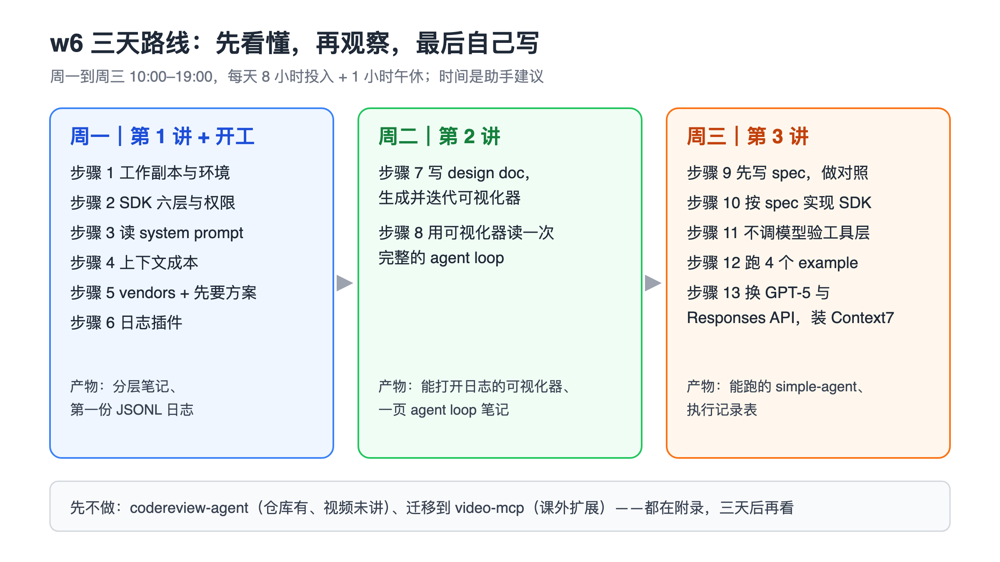
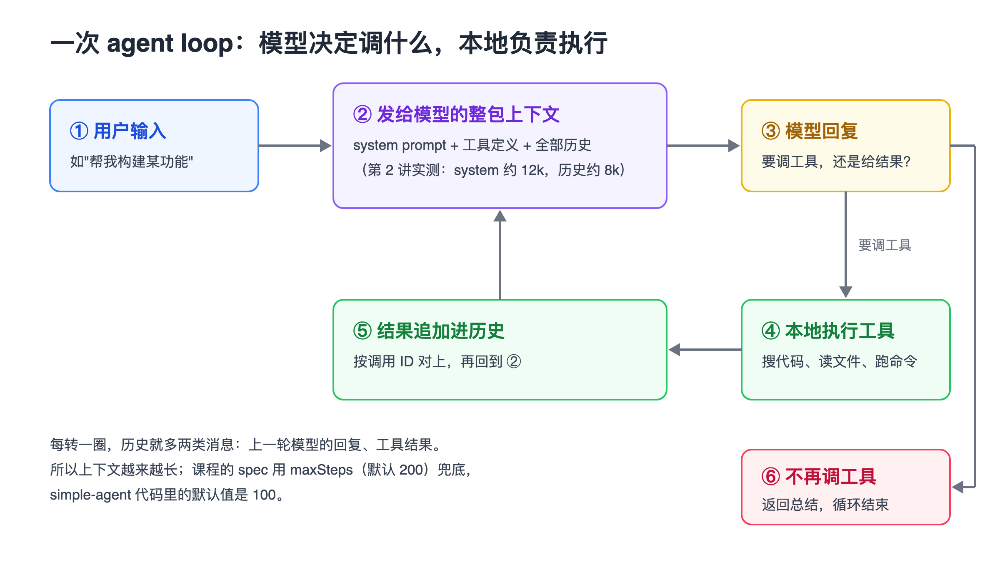

# w6 操作手册：读懂 Agent、看清 Coding Agent 的调用链、自己写一个 Agent

> 手册类型：定制版

<a id="section-intro"></a>
## 阅读说明

这份手册按陈天 AI 训练营第 6 周的三讲视频编排：第 1 讲讲 Agent 的结构和 Codex / OpenCode 的提示词，第 2 讲用 OpenCode 插件抓下每一轮发给模型的完整内容并做成可视化工具，第 3 讲先写设计文档（spec），再让 Claude Code 写出一个最小的 Agent SDK（`simple-agent`）。主线 13 个步骤都能在视频里找到对应时间点；视频没讲、只在仓库里有的 `codereview-agent` 放在附录，并标明“仓库有、视频未讲”。

- **先看路线图**，再按天打开对应步骤。讲者原话、数字、案例卡、提示词模板、不做清单都在附录，正文用链接跳过去。
- **来源编号**：方括号里的 O1–O3 是三讲逐字稿，O4 是课程目录里已有的课程手册，O5–O8 是课程代码与 spec，O9 是本次核实记录。点编号跳到文末，再点“回到正文”返回。逐字稿是机器转写，错字多；本手册引用提示词时按上下文改了错字，并给出讲次、时间和行号，方便回查。
- **数字的性质**：12k、81.7k、200 步这类数字是讲者在录课时屏幕上看到或口头说的，不是你环境里的保证值；模型名（gpt-5-mini、gpt-5-codex）是课程代码里写死的历史配置。
- **跑过和没跑过的要分开看**：本次只在临时副本里跑了不调模型的部分（安装、测试、类型检查、工具直调、缺 key 报错），结果写在本次核实记录 [[O9](#source-o9)]。所有调用模型的步骤本次都没跑，手册不承诺你会得到和讲者一样的输出。
- **模板里的〔〕是虚构占位**，用之前换成你自己的内容。
- **几个反复出现的词**：agent loop 指“模型决定调哪个工具、本地执行、把结果连同历史再发给模型”这样一圈圈转下去的过程；spec 指写代码前的设计文档；system prompt 是每次请求最前面那段角色和规则说明；token 是模型计费的文字单位；hook 指“某件事发生前后，让外部代码插进来处理”的扩展点；MCP 是让 agent 接入外部工具服务的标准协议；JSONL 是每行一个 JSON 对象的文本文件。

<a id="section-roadmap"></a>
## 3 天路线图

| 天 | 这一天做什么 | 点开对应章节 |
| --- | --- | --- |
| 周一：第 1 讲 + 开工 | 建工作副本、装环境；按六层拆 Agent SDK；读 Codex / OpenCode 的提示词；想清上下文成本；建观察项目、做日志插件 | [步骤 1 环境](#section-step1) · [步骤 2 六层](#section-step2) · [步骤 3 提示词](#section-step3) · [步骤 4 上下文](#section-step4) · [步骤 5 vendors](#section-step5) · [步骤 6 插件](#section-step6) |
| 周二：第 2 讲 | 让 agent 写 design doc 并做出可视化器，按自己的草图迭代；用它读完一次完整的 agent loop | [步骤 7 可视化器](#section-step7) · [步骤 8 读 loop](#section-step8) |
| 周三：第 3 讲 | 先写 spec 并做有无参考源码的对照；按 spec 实现 SDK；不调模型验工具层；跑 4 个 example；换到 GPT-5 和 Responses API | [步骤 9 spec](#section-step9) · [步骤 10 实现](#section-step10) · [步骤 11 工具层](#section-step11) · [步骤 12 example](#section-step12) · [步骤 13 换 API](#section-step13) |

每段的用时和产物见 [三天时间表](#section-schedule)。



图注：教学示意，2026-10-26 依据本手册步骤与三讲逐字稿绘制。时间分配是助手建议，不是课程要求。

这三天先不做：`codereview-agent`（仓库有、视频未讲）、把方法迁移到 video-mcp（课外扩展）、补齐 spec 里设计了但代码没实现的权限和压缩。以后再看：[附录 A 不做 / 依据 / 改为](#section-appendix-a)、[附录 G codereview-agent](#section-appendix-g)、[附录 H 迁移到 video-mcp](#section-appendix-h)。

<a id="section-conditions"></a>
## 本次条件

| 项目 | 你的情况 |
| --- | --- |
| 在做什么 | video-mcp：自动化短视频制作的 MCP server，Python + uv + FastMCP，代码目前只有 Hello |
| 学这周的目的 | 跟陈天训练营学 w4–w6，把课程的方法（先读源码出方案、先写 spec、看清 agent loop）用到自己项目 |
| 可用时间 | 周一到周三，每天 10:00–19:00；时间表按每天 8 小时投入、1 小时午休排 |
| 本机环境 | macOS；Node v24.14.0、npm 11.9.0 已装；`opencode` 命令未找到（本次核实）[[O9](#source-o9)] |
| 写代码的助手 | 你在用 Claude Code；课程里讲者也用它写全部代码 [[O3](#source-o3)] |
| 未经确认的示例条件 | 有一个可用的 OpenAI API key 并有余额；工作副本放在 `~/w6-practice`；愿意让 Claude Code 在副本里改代码 |

### 条件不同时怎么调

- **没有 OpenAI API key**：步骤 1–11 都不调 OpenAI，照做；步骤 12、13 只读代码和课程手册里记下的输出，不运行。步骤 6 的 OpenCode 可以用 Claude 订阅登录，不需要 OpenAI key。
- **只想看调用链，不写 SDK**：做步骤 1–8，周三改为把步骤 8 的笔记对照 [附录 F](#section-appendix-f) 的 `simple-agent` 架构读一遍，跳过步骤 9–13。
- **OpenCode 装不上或不想装**：步骤 6 跳过“生成自己的日志”，直接用课程仓库自带的 13 个日志文件（`opencode-introspection/logs/`）做步骤 7、8。
- **不写 TypeScript**：课程代码是 TypeScript，你的项目是 Python。步骤 9 的 spec 方法、步骤 2 的六层结构、步骤 4 的上下文判断都与语言无关；步骤 10–13 仍建议在 TS 副本里跑一遍，看清 loop 后再按 [附录 H](#section-appendix-h) 用 Python 写 video-mcp 的设计。
- **只有一天**：周一做步骤 1–4，周二做步骤 8（用仓库日志）和步骤 9，剩下的放到以后。

### 三天要完成什么

| 结果 | 数量 | 在哪一步 |
| --- | --- | --- |
| 工作副本，依赖装好、测试通过 | 1 份 | [步骤 1](#section-step1) |
| Agent SDK 六层笔记（含权限做法的选择） | 1 页 | [步骤 2](#section-step2) |
| Codex / OpenCode 提示词阅读笔记 | 1 页 | [步骤 3](#section-step3) |
| 自己生成的 OpenCode 对话日志（JSONL） | 至少 2 个 | [步骤 6](#section-step6) |
| 能打开日志的可视化器 + 它的 design doc | 1 个 | [步骤 7](#section-step7) |
| 一次完整 agent loop 的逐轮笔记 | 1 页 | [步骤 8](#section-step8) |
| 自己写的 agent spec + 与无参考版本的对照笔记 | 1 份 spec + 1 页对照 | [步骤 9](#section-step9) |
| 按 spec 实现、测试通过的 SDK | 1 个 | [步骤 10](#section-step10) |
| 工具层直调结果（4 种输入） | 4 行 | [步骤 11](#section-step11) |
| 4 个 example 的运行记录 | 4 条 | [步骤 12](#section-step12) |
| 执行记录表 `templates/run-log.csv` 填好的行 | 每步至少 1 行 | 全程 |

### 阻碍完成的缺口（动手前先看）

- **G1 OpenAI API key 与余额**：步骤 12、13 必须有，环境变量名是 `OPENAI_API_KEY`，`simple-agent` 只从构造参数或这个环境变量读 key，不会自己读 `.env` 文件 [[O5](#source-o5)、[O9](#source-o9)]。没有 key 时运行 example 会报 `OpenAIError: Missing credentials`。先做步骤 1–11。
- **G2 Node ≥ 22**：两个 TS 项目的 `package.json` 都要求 `node >= 22`；本机是 v24.14.0，已满足 [[O5](#source-o5)]。换机器时先查 `node -v`。
- **G3 OpenCode 未安装**：本机没有 `opencode` 命令；npm 上 `opencode-ai` 当前版本是 1.19.4（2026-10-26 查询）[[O9](#source-o9)]。装好后第一次启动要配一个模型，讲者用 Claude 订阅，GPT 和 Gemini 用 API key [[O1](#source-o1)]。装不上就按上面“条件不同时怎么调”用仓库日志。
- **G4 网络**：`npm ci`、克隆 OpenCode 源码、`example:mcp` 用 `npx -y` 下载 filesystem MCP server，都要联网。
- **G5 Context7 API key（可选）**：步骤 13 装 Context7 前要先在它的网站生成 key，讲者没展示安装命令 [[O3](#source-o3)]。没有也不阻断，只是 agent 查最新文档会慢一些。
- **G6 Claude Code 额度**：步骤 5、7、9、10、13 都让 Claude Code 读大量源码、写上千行代码。课程里一个可视化器就写了约 2000 行 [[O2](#source-o2)]，额度紧的话步骤 7 只做第一版，不做视觉迭代。

<a id="section-schedule"></a>
## 三天时间表（助手建议）

把 13 个步骤排进周一到周三的 10:00–19:00。每段写了用时和要留下的产物；看视频的时间已经算在对应步骤里。三讲视频共约 3 小时 34 分钟（48:09 + 1:53:26 + 52:38）[[O4](#source-o4)]。

| 时间 | 做什么 | 用时 | 产物 |
| --- | --- | --- | --- |
| **周一** 10:00–10:40 | 步骤 1 建工作副本、`npm ci`、测试、装 OpenCode | 40 分钟 | 测试通过的副本；`run-log.csv` 第 1 行 |
| 10:40–11:30 | 看第 1 讲 00:00–12:45，做步骤 2 | 50 分钟 | 六层笔记 |
| 11:30–12:30 | 看第 1 讲 12:45–48:09，做步骤 3 | 60 分钟 | 提示词阅读笔记 |
| 12:30–13:30 | 午休 | 60 分钟 | |
| 13:30–14:00 | 步骤 4 上下文成本 | 30 分钟 | 会话安排规则 3 条 |
| 14:00–15:00 | 看第 2 讲 00:00–17:00，做步骤 5 | 60 分钟 | 观察项目骨架；agent 给出的方案 |
| 15:00–17:30 | 看第 2 讲 17:00–33:30，做步骤 6 | 150 分钟 | 插件 + 至少 2 个 JSONL |
| 17:30–19:00 | 补周一没做完的；把命令和结果补进 `run-log.csv` | 90 分钟 | 当天记录 |
| **周二** 10:00–12:30 | 看第 2 讲 33:30–1:02:30，做步骤 7 第一版 | 150 分钟 | design doc + 可视化器第一版 |
| 12:30–13:30 | 午休 | 60 分钟 | |
| 13:30–16:00 | 看第 2 讲 1:02:30–1:42:30，步骤 7 迭代 | 150 分钟 | 按草图重做的可视化器 |
| 16:00–18:00 | 看第 2 讲 1:42:30–1:53:26，做步骤 8 | 120 分钟 | 一页 agent loop 逐轮笔记 |
| 18:00–19:00 | 缓冲；记录 | 60 分钟 | 当天记录 |
| **周三** 10:00–11:00 | 看第 3 讲 00:00–10:00 与 19:00–31:40，做步骤 9 | 60 分钟 | 你的 spec 草稿 + 对照笔记 |
| 11:00–12:30 | 看第 3 讲 10:00–19:00，做步骤 10 | 90 分钟 | 测试通过的 SDK |
| 12:30–13:30 | 午休 | 60 分钟 | |
| 13:30–14:15 | 步骤 11 工具层直调 | 45 分钟 | 4 行直调结果 |
| 14:15–15:45 | 看第 3 讲 31:40–40:50，做步骤 12 | 90 分钟 | 4 个 example 的运行记录 |
| 15:45–17:00 | 看第 3 讲 40:50–52:38，做步骤 13 | 75 分钟 | 换成 Responses API 的版本；Context7 |
| 17:00–19:00 | 缓冲；三天复盘，决定下一步看 [附录 G](#section-appendix-g) 还是 [附录 H](#section-appendix-h) | 120 分钟 | 复盘 + 下一步清单 |

合计：三天各 8 小时投入，共 24 小时；课程侧手册估计照做需要 8–10 小时（不含看视频）[[O4](#source-o4)]，多出的时间留给等 agent 跑、排错和缓冲。每天 17:00 以后的缓冲段是有意留的：步骤 6、7 让 agent 读大仓库，讲者每次都要等几分钟 [[O2](#source-o2)]。

执行记录表：复制 `templates/run-log.csv`，每做完一步填一行（步骤、日期、用时、命令或提示词、预期、实际、状态、证据路径、下一步）。表头已经写好，没做的步骤状态写 `not_run`。

<a id="section-step1"></a>
## 步骤 1 建工作副本，装好环境

课程目录是只读材料，所有练习都在副本里做。这一步之后的命令都以 `~/w6-practice` 为起点。

**目标**：得到一份依赖装好、测试通过的 `~/w6-practice`，并装好 OpenCode。

1. 复制课程目录，排除视频（约 1.4 GB）、`node_modules` 和 `dist`：命令见下方“本步命令”第一段。保留 `simple-agent` 和 `codereview-agent` 的兄弟目录关系，后者用 `file:../simple-agent` 依赖前者 [[O8](#source-o8)]。
2. 在副本的 `simple-agent` 里装依赖并跑课程自带的检查：`npm ci`、`npm test`、`npm run typecheck`。仓库带的是 `package-lock.json`，用 npm；代码注释里写的 pnpm 不用照搬 [[O5](#source-o5)、[O9](#source-o9)]。
3. 准备 key：在 `simple-agent` 下建 `.env`，写一行 `OPENAI_API_KEY=〔你的 key〕`；运行 example 前用 `set -a; . ./.env; set +a` 把它导出到当前终端。确认 `.env` 不会被提交：课程仓库的 `.gitignore` 已经忽略 `.env` [[O5](#source-o5)、[O9](#source-o9)]。
4. 装 OpenCode：`npm i -g opencode-ai`，再 `opencode --version` 确认。第一次启动按提示连一个模型，输入 `hello` 能收到回复即可；首条消息慢是讲者也遇到的现象 [[O1](#source-o1)、[O4](#source-o4)]。
5. 把以上命令和结果记进 `templates/run-log.csv` 的第 1 行。

#### 本步命令

```bash
mkdir -p ~/w6-practice
rsync -a --exclude node_modules --exclude dist --exclude videos \
  /Users/ziye/Desktop/tyr/geektime-bootcamp-ai/w6/ ~/w6-practice/

cd ~/w6-practice/simple-agent
npm ci
npm test            # 期望：Test Files 1 passed，Tests 6 passed
npm run typecheck   # 期望：没有输出，退出码 0
```

`~/w6-practice/simple-agent/.env` 的内容（只放在本机，不提交）：

```bash
OPENAI_API_KEY=〔你的 OpenAI API key〕
```

```bash
npm i -g opencode-ai
opencode --version
```

**做完的标准**：`npm test` 显示 6 个测试通过，`npm run typecheck` 退出码为 0；`opencode --version` 能打印版本，`hello` 有回复；`.env` 存在且 `git status` 看不到它。

- [ ] 副本建在 `~/w6-practice`，没有改课程目录
- [ ] `npm test` 6 个通过，`typecheck` 通过
- [ ] `.env` 写好且被忽略
- [ ] OpenCode 能回复 `hello`

#### 讲者做法与数字

- 讲者用 OpenCode 时配了 Claude（订阅）、Gemini 和 GPT-5 Codex（API key），主力是 Claude；还推荐配合 oh-my-opencode 一起用，安装方式是把它的说明贴给 OpenCode 让它自己装（第 1 讲 14:49–16:26）[[O1](#source-o1)]。
- 本次在临时副本里核实：`npm test` 6 个通过、`typecheck` 退出码 0；不设 key 运行 `npm run example:basic` 报 `Missing credentials` [[O9](#source-o9)]。

<a id="section-step2"></a>
## 步骤 2 按六层拆 Agent SDK，定下权限做法

第 1 讲开头 12 分钟画了一张 Agent SDK 的结构图。这一步把它变成你自己的笔记，后面写 spec（步骤 9）和设计 video-mcp（附录 H）都要用。

**目标**：写出一页六层笔记，并为 video-mcp 选定一种权限做法。

1. 看第 1 讲 00:58–12:45，按讲者的顺序记下六层：接口层（建 agent 时指定模型、工具、MCP，怎样把中间过程流式交给你的应用）、agent loop（反复调工具直到完成或无法恢复）、session（每次调用一个独立会话，保存对话历史和上下文）、工具层（注册、执行、内建工具、MCP、skills）、权限和 hooks、LLM 抽象层（对接不同模型的 SDK）[[O1](#source-o1)]。
2. 记下讲者对“内建工具”的判断：内建工具的丰富程度决定 Agent SDK 的能力；外部工具主要是 MCP 和 skills，他认为 skills 被低估了 [[O1](#source-o1)]。
3. 写清权限的三种做法和代价：逐次审批（安全，但每次等你批准，几分钟的事被拉长）；yolo 模式（给 agent 和你同样的权限，可能误删文件或数据库）；sandbox（给最大权限，但只在一个隔离的“壳”里操作，云上给每个 agent 一个单独的 sandbox pod）[[O1](#source-o1)]。
4. 为 video-mcp 选一种并写一句理由。hook 在这里指“agent 做某件事之前或之后，让你的应用插进来决定允许还是拒绝”，也写进笔记 [[O1](#source-o1)]。

**做完的标准**：笔记里六层各有一句话说明；权限三种做法各写了代价；video-mcp 的选择写了理由，例如“生成文件只写到项目的 output 目录，所以选 sandbox 式目录限制”。

- [ ] 六层各有一句说明
- [ ] 三种权限做法各写了代价
- [ ] video-mcp 的权限选择和理由

#### 讲者做法与数字

- “画图很容易，做到 80% 非常简单，剩下的 20% 会耗费很多很多的精力”（第 1 讲 12:21–12:38）[[O1](#source-o1)]。
- 讲者说明这一周写的 SDK“完全是实验性质”，不具备产品级能力（第 1 讲 00:41–00:51）[[O1](#source-o1)]。
- 讲者原话见 [附录 C](#section-appendix-c)；“yolo 直接上生产”为什么不做见 [附录 A](#section-appendix-a)。

<a id="section-step3"></a>
## 步骤 3 读 Codex 和 OpenCode 的 system prompt 与工具描述

system prompt 是每次请求最前面那段“你是谁、该怎么做”的说明。读别人写好的提示词，是讲者理解 coding agent 的第一步。

**目标**：说清一次模型请求由哪几块拼成、工具结果怎么回到下一轮，并留下一页阅读笔记。

1. 先读课程仓库里现成的两份：`specs/prompts/codex.txt`（OpenCode 给 GPT / Codex 模型用的 system prompt）和 `specs/prompts/reviewer.txt`（review 命令的提示词）[[O7](#source-o7)]。想自己生成 Codex 那份分析文档，用 [模板 T1](#template-t1)，讲者让 agent 读 Codex 源码、用 ASCII 图写文档 [[O1](#source-o1)]。
2. 对照第 1 讲 19:33–21:49 记下拼装顺序：base instruction、developer instruction、用户输入、`AGENTS.md`、skill 说明，再加上对话历史。讲者的结论是 coding agent“没有什么神秘的”，就是尽可能多地拼上下文交给模型 [[O1](#source-o1)]。
3. 记下几个值得抄的写法：提示词里给 example（“千言万语不如给他一些 example”）；`update_plan` 规定同一时刻只有一个步骤是进行中；`apply_patch` 让模型只输出改动部分，因为输出 token 贵、每轮还有上限（讲者举例约 32K）[[O1](#source-o1)]。
4. 读 OpenCode 的提示词时，在指令里明确写“使用中文输出”。讲者提醒 OpenCode 不会跟随你的输入语言 [[O1](#source-o1)]。
5. 写下讲者对能力来源的估计：agent 的能力约 30–40% 来自 system prompt，约 60% 来自它能用的工具以及工具描述 [[O1](#source-o1)]。对 video-mcp，这意味着工具描述要和代码一起认真写。

**做完的标准**：笔记能回答三个问题：一次请求由哪几块拼成；工具结果怎样回到下一轮；为什么改代码用 patch 而不是整文件重写。并能在 `codex.txt` 里找到 Planning、AGENTS.md 相关段落。

- [ ] 读完 `codex.txt` 和 `reviewer.txt`
- [ ] 笔记回答了上面三个问题
- [ ] 记下“60% 来自工具及其描述”对 video-mcp 的含义

#### 讲者做法与数字

- 讲者的建议：用 Claude 系列模型写代码，用 Codex 做 review。他的解释是同一个模型审自己写的代码“遵循着同样的思路”，不容易找到问题（第 1 讲 34:26–35:17）[[O1](#source-o1)]。
- skills 目录在各工具里位置不同：Codex 只找自己的，Claude 只找 `.claude` 下的。讲者的办法是建一个公共 `.skills` 目录，再软链成各工具的 skills 目录（第 1 讲 41:53–42:29）[[O1](#source-o1)]。
- OpenCode 的 `todowrite` 工具描述一项就有 160 多行（第 1 讲 46:27–46:41）；讲者认为 LSP（编辑器用来查符号定义和引用的语言服务）查符号比 grep 高效（第 1 讲 18:01–19:12）[[O1](#source-o1)]。

<a id="section-step4"></a>
## 步骤 4 想清上下文成本，定下会话安排

agent 每转一圈都把整段历史再发一遍。这一步把讲者给的成本账算一遍，定出你自己用 Claude Code 时的规则。

**目标**：写出 3 条你自己的会话规则：什么时候继续、什么时候清空、什么时候开 subagent。

1. 输入：讲者截图里，一次探索性工作后 message 部分占了 81.7k token，每次交互都要把它发给模型；加上系统部分约 150K，其中 80%–90% 被缓存 [[O1](#source-o1)]。token 是模型计费的文字单位；prompt cache 指重复发送的前缀按低价计费。
2. 算账：讲者假设输入价每百万 token 5 美元，每次发 100 多 K，十次就约 1 个 million、5 美元；因为大部分内容命中缓存，实际约一百轮才花几美元 [[O1](#source-o1)]。只把这当量级参考，价格以你用的模型为准。
3. 判断：上下文快满时，agent 会做 autocompact（让模型把历史总结成短版，讲者举例 100K 压到 20K），这本身也是一次模型调用，也花钱 [[O1](#source-o1)]。
4. 写规则：下一个任务和当前无关时，清空当前上下文（clear）；任务之间有清楚的输入输出接口时，交给 subagent（只继承干净上下文、做完把结果交回来的子 agent）[[O1](#source-o1)]。反例：同一个功能的连续修改不该清空，否则 agent 要重新读一遍代码。

**做完的标准**：3 条规则写进你的笔记，每条带一个 video-mcp 场景，例如“写完 ASR 工具、转去写 OCR 工具前先 clear”。

- [ ] 记下 81.7k、80%–90% 缓存、autocompact 也花钱这三点
- [ ] 3 条规则各配一个 video-mcp 场景

#### 讲者做法与数字

- 81.7k 出现在第 1 讲 23:55–24:08，缓存与价格估算在 24:40–26:02，autocompact 和 clear / subagent 建议在 26:10–28:06 [[O1](#source-o1)]。
- 第 2 讲里讲者又看到同样的现象：上下文“不断膨胀”，到一定程度就要压缩（第 2 讲 05:56–06:05）[[O2](#source-o2)]。

<a id="section-step5"></a>
## 步骤 5 建观察项目，把 OpenCode 源码放进 vendors，先要方案

Claude Code 新版打包成二进制，很难拆开看；讲者改用开源的 OpenCode 当观察对象。文档不全时，把源码放进项目让模型自己读。

**目标**：建好一个空的观察项目，并拿到 agent 给出的“不改源码抓输入输出”的方案，不让它先写代码。

1. 建项目：`git init`，`.gitignore` 里写 `node_modules` 和 `vendors`，再建 `vendors/` 并克隆 OpenCode 源码（命令见下）。vendors 是“只给模型读、不提交”的参考源码目录 [[O2](#source-o2)]。
2. 拷一份 TypeScript 的 `CLAUDE.md` 进来：讲者从上一个项目拷了一份，“这样他写代码会更好一些”；课程副本里 `opencode-introspection/CLAUDE.md` 就是这一份 [[O2](#source-o2)、[O6](#source-o6)]。
3. 在项目里打开 Claude Code，发 [模板 T2](#template-t2)。关键是最后一句“先不要写代码，告诉我方案” [[O2](#source-o2)]。
4. 等 agent 给出方案，核对它点到了这几个 hook：`chat.message`、`experimental.chat.system.transform`（抓 system prompt）、`experimental.chat.messages.transform`（抓完整消息数组），以及 `event` 事件订阅 [[O2](#source-o2)]。

#### 本步命令

```bash
mkdir -p ~/w6-practice/my-introspection && cd ~/w6-practice/my-introspection
git init
printf 'node_modules\nvendors\n.env*\n' > .gitignore
mkdir -p vendors
git clone --depth 1 https://github.com/sst/opencode vendors/opencode
cp ~/w6-practice/opencode-introspection/CLAUDE.md .
git status   # 期望：看不到 vendors/
```

**做完的标准**：`git status` 不显示 `vendors/`；agent 的回复是方案而不是代码改动，方案里有上面 4 个 hook 名。

- [ ] `vendors/opencode` 有源码且被忽略
- [ ] 拿到方案，agent 没有动手改代码
- [ ] 方案里点名了 4 个 hook

#### 讲者做法与数字

- 讲者等了“差不多两分钟”拿到三个方案：一是插件系统（推荐），二是配置里的 experimental hook，三是打开最详细的 debug 日志（第 2 讲 15:26–16:59）[[O2](#source-o2)]。
- OpenCode 官方插件文档里没写 chat 相关的事件，讲者的结论是“这个文档不是特别的好”，以源码为准（第 2 讲 22:23–22:57）[[O2](#source-o2)]。
- 克隆地址是本次用 `git ls-remote` 确认能访问的 OpenCode 仓库，讲者没念地址 [[O9](#source-o9)]。

<a id="section-step6"></a>
## 步骤 6 实现并启用日志插件，生成自己的对话日志

这一步让 OpenCode 每转一圈就把“发给模型的完整输入”和“模型的完整输出”各写一行 JSON。JSONL 指每行一个 JSON 对象的文本文件，方便一行行读。

**目标**：在观察项目里启用 `log-conversation` 插件，并生成至少 2 个自己的日志文件。

1. 用方案一落地：发 [模板 T3](#template-t3)，要求一次完整对话写进同一个 JSONL、不同对话分文件，脚本放 `./plugins/log-conversation.ts`，输出到 `./logs` [[O2](#source-o2)]。
2. 如果第一版只按 session ID 命名文件，追问 [模板 T4](#template-t4)：再加一个短 ID，每次得到结果时换新 ID，“告诉我你的计划，先不要修改” [[O2](#source-o2)]。课程最终版的文件名是 `{sessionID}_{conversationID}.jsonl` [[O6](#source-o6)]。
3. 注册插件：项目根目录的 `opencode.json` 里写 `"plugin": ["./plugins/log-conversation.ts"]`，用相对路径。讲者结尾专门确认过可以用相对路径 [[O2](#source-o2)、[O6](#source-o6)]。插件不需要编译，也不用加依赖 [[O2](#source-o2)]。
4. 在观察项目目录里启动 `opencode`，先问一个简单问题（讲者问“当前有哪些 skills”），再给一个真实任务（讲者让它“更新 CLAUDE.md 使其更加符合 ts best practice”）；之后退出 OpenCode，避免继续写日志 [[O2](#source-o2)]。
5. 检查 `logs/`：新文件第一行 `type` 是 `turn_start`，里面有 `input.system` 和 `input.messages` [[O6](#source-o6)]。

#### 本步命令

```bash
cd ~/w6-practice/my-introspection
cat opencode.json          # 期望含 "plugin": ["./plugins/log-conversation.ts"]
opencode                   # 必须在这个目录启动；问两个问题后退出。插件把日志写到启动目录下的 logs/
ls -lt logs | head
head -c 400 "$(ls -t logs/*.jsonl | head -1)"
```

赶时间可以直接用课程版插件：把 `~/w6-practice/opencode-introspection/plugins/` 和 `opencode.json` 拷进观察项目，或者直接在 `~/w6-practice/opencode-introspection` 里启动 `opencode`。

**做完的标准**：`logs/` 里至少 2 个新文件；随便打开一个，能看到 `turn_start` 和 `turn_complete` 两种行；你能说出哪个文件是主任务、哪个是标题生成器。

- [ ] 插件写好并在 `opencode.json` 用相对路径注册
- [ ] 至少 2 个自己的 JSONL
- [ ] 区分出主任务日志和标题生成日志

#### 讲者做法与数字

- 一条消息生成了三四个日志文件。讲者打开后发现其中一个的 system 是“You are a title generator. You output ONLY a thread title”，另一些是后台 subagent（第 2 讲 32:56–34:06）[[O2](#source-o2)]。这是正常现象，见 [案例卡 5](#case-5)。
- 讲者结尾在另一个目录启动 OpenCode 输入 hello，新日志是空的，当时没查出原因，只提到内存吃紧（第 2 讲 1:52:06–1:52:39）[[O2](#source-o2)]，见 [案例卡 6](#case-6)。
- 课程仓库留下了 13 个日志文件，最大约 29 MB；没有 OpenCode 时可直接用它们 [[O4](#source-o4)、[O6](#source-o6)]。

<a id="section-step7"></a>
## 步骤 7 让 agent 写 design doc，做出日志可视化器并迭代

日志一行就是一整轮的输入，几十 KB 的 JSON 很难直接读。讲者的做法是：反正写代码已经很便宜，干脆让 agent 做一个看日志的前端。

**目标**：得到一份可视化器的 design doc 和一个能打开 JSONL、逐轮展示输入输出的 React 应用。

1. 准备样式：把你自己的 `design-tokens.css`、`global.css` 拷进 `visualizer/styles/`。design token 指一组统一命名的颜色、字号、间距变量。没有自己的，就用课程副本 `opencode-introspection/visualizer/styles/` 下的 [[O2](#source-o2)、[O6](#source-o6)]。
2. 发 [模板 T5](#template-t5)：读 `./logs` 分析结构，写 design doc 放 `./specs`，再完整实现一个 React 应用放 `./visualizer`。文件名一字不差地写，并写明“使用中文输出”[[O2](#source-o2)]。
3. 依赖装成旧版本时，追加“使用 npm-check-updates 把所有依赖升级到最新版本，react 升级到 19”[[O2](#source-o2)、[O4](#source-o4)]。依赖被装到项目根目录时，告诉它“依赖应加到 visualizer 内部的 package.json”[[O2](#source-o2)]。
4. 迭代：先画一张布局草图（左侧日志列表可收起；右侧依次是 system prompt、对话历史、工具调用；底部状态栏显示 token），贴给 agent 按图重做；再逐条提需求，每做完一轮让它 `commit the code`。讲者提过的需求清单见 [模板 T6](#template-t6) [[O2](#source-o2)、[O4](#source-o4)]。

#### 本步命令

```bash
cd ~/w6-practice/my-introspection/visualizer   # 或课程版 ~/w6-practice/opencode-introspection/visualizer
npm install
npm run dev     # 终端会打印本地地址，用浏览器打开后选择 logs/ 下的 .jsonl
```

**做完的标准**：`specs/` 下有 design doc；浏览器里选中一个日志后能看到 `Turn x / N`，能切换轮次，每轮能看到 system prompt、历史消息和工具调用。

- [ ] design doc 写好（中文）
- [ ] 可视化器能打开自己生成的日志
- [ ] 至少按草图重做过一次布局

#### 讲者做法与数字

- 讲者把 `design-tokens.css` 写成了少一个 s 的 `design-token`，模型就“想当然”地自己生成了一套 token，讲者删掉重来（第 2 讲 45:42–48:15）[[O2](#source-o2)]。课程仓库里的 `visualizer-design.md` 第 174 行至今还写着 `design-token.css` [[O9](#source-o9)]。见 [案例卡 2](#case-2)。
- design doc 生成成了英文，讲者说忘了要求中文，“一定要强制告诉它”（第 2 讲 43:51–44:07）[[O2](#source-o2)]。
- 讲者感叹“这么简单一个任务已经写了 2000 行的代码”，并说没有 coding agent 时，看日志这种事“看一下就完事了”，现在构建代码成本非常低，值得做成工具（第 2 讲 1:01:43–1:02:14）[[O2](#source-o2)]。
- 整个项目讲者“几乎没有看它的代码，也没有去写一行代码”（第 2 讲 1:49:19–1:49:26）[[O2](#source-o2)]。

<a id="section-step8"></a>
## 步骤 8 用可视化器读懂一次完整的 agent loop

前两天做的工具，都是为了这一步：亲眼看到“用户输入、模型决定调工具、本地执行、结果连同历史再发给模型”这一圈怎么一轮轮转下去。

**目标**：对一个多轮日志写一页逐轮笔记，能指出每一轮比上一轮多了哪些消息。

1. 选日志：用你步骤 6 的真实任务日志；没有就用课程的 `logs/ses_474928783ffeKlsn6i84xg5TIe_0742ce00.jsonl`（改可视化器样式的任务，18 个 `turn_start`、19 个 `turn_complete`，有 bash / edit / todowrite）[[O4](#source-o4)、[O6](#source-o6)]。
2. 看第一轮：记下 system prompt 和对话历史各多大，确认 system 里包含你的 `CLAUDE.md` [[O2](#source-o2)]。
3. 看中间轮：记下哪些轮次 assistant 没有文字、只有工具调用；跟着 todo 列表看每一项怎样从进行中变成完成 [[O2](#source-o2)]。
4. 对比相邻两轮的 `input.messages`：新增的只有上一轮模型的回复和工具结果，这就是“上下文不断膨胀”[[O2](#source-o2)]。
5. 用一句话写出 agent loop，并对照下图检查有没有漏掉“结果连同全部历史再发回模型”这一环 [[O3](#source-o3)]。



图注：教学示意，2026-10-26 依据第 3 讲 00:14–03:24 的讲解与 `simple-agent` 代码绘制；12k / 8k 是第 2 讲讲者屏幕上的数，200 来自 spec 0001，100 来自 `simple-agent` 代码。不代表任何产品的内部实现。

**做完的标准**：笔记能指出任意一轮比上一轮多了哪几条消息；能说出主任务日志和标题生成日志的区别；最后一轮是 assistant 的总结。

- [ ] 记下第一轮 system 和历史的大小
- [ ] 找到至少 3 个只有工具调用的轮次
- [ ] 一句话写出 agent loop

#### 讲者做法与数字

- 讲者看到第一轮“system prompt 就有 12k，chat history 才 8k”（第 2 讲 1:12:13–1:12:19）；system prompt 默认展开后，看到了被注入的 `CLAUDE.md`，“很长 11K”（第 2 讲 1:46:11–1:46:45）[[O2](#source-o2)]。
- 中间轮“基本上这些都是 tool 的工作，assistant 就没有什么输出”，todo 一项项更新，最后 assistant 给出 final 结果（第 2 讲 1:47:28–1:47:55）[[O2](#source-o2)]。
- commit 那一轮依次是看 `git status`、再提交（第 2 讲 1:43:15–1:43:39）[[O2](#source-o2)]。

<a id="section-step9"></a>
## 步骤 9 先写 spec，再做有无参考源码的对照

第 3 讲讲者说，整个过程里最有价值的是 spec。spec 是动手写代码前的设计文档：数据结构、接口、主流程都定下来。这一步拿到一份 spec，并亲手看一次“读过参考源码”和“没读过”写出来的差别。

**目标**：得到一份 agent loop 的 spec，并写一页对照笔记，说出参考源码让 spec 好在哪里。

1. 拿到“读过源码”的版本：讲者在上一次 OpenCode 会话里让它研究 OpenCode 怎样构建 agent 核心，提炼出 spec，但“这个过程我就不跟大家演示了”[[O3](#source-o3)]。你可以直接用课程的 `specs/0001-simple-agent-design.md`，或在观察项目里用 [模板 T7](#template-t7) 自己生成一份（讲者未展示原文，T7 是课程侧手册补的）[[O4](#source-o4)、[O7](#source-o7)]。
2. 逐段 review 0001：消息内容分文本、工具调用、工具结果三种；工具有名字、描述、JSON Schema（描述参数结构的标准格式）和执行函数；session 记录历史、system prompt、模型和工具；loop 有最大步数 maxSteps，讲者举例 200 [[O3](#source-o3)、[O7](#source-o7)]。
3. 做对照实验：新开一个会话，进一个空目录（避免它读到已有项目），只贴 agent loop 示意图，发 [模板 T8](#template-t8)，让它直接写 spec [[O3](#source-o3)]。
4. 对照两份：讲者的结论是无参考版本“也还可以，但是不如”读过源码的版本；具体问题见下方“讲者做法与数字”和 [案例卡 3](#case-3) [[O3](#source-o3)]。
5. 判断你的 video-mcp 适合哪条路：知道有好的开源项目做过类似的事，就读它的源码出 spec；连参考都没有，先用 Gemini 做 deep research 出设计稿，再让 Claude Code 细化 [[O3](#source-o3)]。

**做完的标准**：手上有一份 spec（课程的 0001 或你自己生成的）；对照笔记至少写出 3 处差异；写下 video-mcp 选哪条路及理由。

- [ ] spec 读完并在关键段落做了批注
- [ ] 在空目录里生成了无参考版本
- [ ] 对照笔记写出至少 3 处差异
- [ ] 定下 video-mcp 的 spec 来源

#### 讲者做法与数字

- “最有价值的是什么？是这个 spec”；数据结构、接口、流程都清楚之后，“LM 来完成这个代码本身其实就只是工作量的问题”，所以要把大量时间花在把 spec 做好并认真 review 上（第 3 讲 19:03–24:34）[[O3](#source-o3)]。
- 对照版本的问题：消息有 `role` 字段，讲者说“这个定义不错”；但它用的是 Anthropic SDK，讲者的解释是生成它的是 Anthropic 的模型，会倾向用自家 SDK；`Registry` 下面挂 `Executor` 一次执行一大堆工具，“这个的设计就不那么好”；工具结果的 role 写成了 user，讲者说应该是 assistant 这边的事、“跟 user 没有关系”（第 3 讲 27:42–31:33）[[O3](#source-o3)]。课程把它存为 `specs/0002-simple-agent-design-backup.md`，里面确实是 `ToolManager` 类 [[O7](#source-o7)]。
- spec 0001 的 loop 写的是 `config.maxSteps ?? 200`；实际代码 `simple-agent` 的默认值是 100 [[O7](#source-o7)、[O9](#source-o9)]。
- `CLAUDE.md` 怎么写：针对一门语言写清工具链（用最新版）、async、类型设计和常用框架；写好一份后让 Claude 上网找 best practice 来打磨，再据此生成其他语言的版本（第 3 讲 24:57–26:43）[[O3](#source-o3)]。

<a id="section-step10"></a>
## 步骤 10 按 spec 让 Claude Code 实现 SDK，并跑通检查

有了 spec，实现就交给 agent。这一步在一个新目录里复现讲者的过程，再拿课程的成品对照。

**目标**：在 `~/w6-practice/my-agent` 里得到一个按 spec 实现、测试和类型检查都通过的 SDK。

1. 新建空目录 `~/w6-practice/my-agent`，把 `simple-agent/CLAUDE.md` 拷进来（讲者把上一个项目的 `CLAUDE.md` 拷了过来，两份内容相同）[[O3](#source-o3)、[O4](#source-o4)]。
2. 在该目录打开 Claude Code，发 [模板 T9](#template-t9)。spec 路径用 `@` 引用并写对相对路径：讲者第一次路径没找对，agent 往上找了两层才找到 [[O3](#source-o3)]。
3. 看 agent 的计划：依次是搭 TypeScript、核心类型、LLM、工具注册、执行器、agent、MCP、example、构建测试 [[O3](#source-o3)]。发现 openai 包版本旧时追加“确保所有依赖使用最新版本”[[O3](#source-o3)]。
4. 跑检查：`npm test`、`npm run typecheck`、`npm run lint`、`npm run build`（脚本名以你生成的 `package.json` 为准）；有格式问题让工具修 [[O3](#source-o3)、[O4](#source-o4)]。
5. 和课程成品对照：`~/w6-practice/simple-agent` 的结构、导出和测试是“标准答案”之一，差异记进对照笔记；额度不够时可直接以课程成品继续后面的步骤。

**做完的标准**：`my-agent` 的测试和类型检查通过；能指出它与课程 `simple-agent` 至少 2 处结构差异；`run-log.csv` 记下了提示词和结果。

- [ ] `my-agent` 测试通过
- [ ] 类型检查通过
- [ ] 与课程成品的差异写进对照笔记

#### 讲者做法与数字

- 讲者还自己在终端跑了 `npm install`“帮它加快进度”（第 3 讲 18:01–18:11）[[O3](#source-o3)]。
- 写完后讲者用代码统计工具看了一眼：约“2000 行的代码，那不算少了”（第 3 讲 48:32–48:39）[[O3](#source-o3)]。课程侧手册核实 src、tests、examples 合计约 2000 行 [[O4](#source-o4)]。
- 讲者最后提交时的信息是 `feature: support simple agent with typescript`（第 3 讲 49:15–49:21）[[O3](#source-o3)]。

<a id="section-step11"></a>
## 步骤 11 不调模型，先直接验证工具层

视频里讲者直接跑 example，出了问题很难分清是模型、工具还是循环的错。这一步是本手册补的：绕开模型，直接把一个工具调用交给执行器，看它对正常、出错、参数类型不对、工具不存在四种情况各返回什么。

**目标**：拿到四种输入的直调结果，并写清这套 SDK 在工具层“管了什么、没管什么”。

1. 在 `~/w6-practice/simple-agent` 下建 `probes/tool-probe.ts`，内容见下方“本步代码”。它只用 `ToolRegistry`（工具注册表）和 `ToolExecutor`（执行器），不需要 API key [[O5](#source-o5)、[O9](#source-o9)]。
2. 运行 `npx tsx probes/tool-probe.ts`（`tsx` 是项目自带的开发依赖），把 4 行输出贴进 `run-log.csv` [[O9](#source-o9)]。
3. 读结果：正常除法返回 `"2"`；除零时工具返回 `error`，执行器把它变成 `isError: true`；找不到工具返回 `Tool not found`，不会抛异常中断循环 [[O5](#source-o5)、[O9](#source-o9)]。
4. 注意第 3 行：参数 `a` 传的是字符串 `"6"`，照样算出 `"2"`、没报错。`defineTool` 只把配置原样返回，不做运行时参数校验；类型标注只在编译期有效 [[O5](#source-o5)、[O9](#source-o9)]。想要校验，要么在 `execute` 里自己检查，要么用 `defineZodTool`，但它在 zod 4 下生成的参数结构是空的 `{"type":"object"}`，模型看不到参数（见 [附录 F](#section-appendix-f)）[[O9](#source-o9)]。

#### 本步代码

```ts
// ~/w6-practice/simple-agent/probes/tool-probe.ts
// 不调模型：直接用 ToolRegistry + ToolExecutor 跑一个工具，看正常、出错、找不到工具三种结果
import { defineTool, ToolExecutor, ToolRegistry } from "../src/index.ts"

const divide = defineTool<{ a: number; b: number }>({
  name: "divide",
  description: "Divide a by b",
  parameters: {
    type: "object",
    properties: { a: { type: "number" }, b: { type: "number" } },
    required: ["a", "b"],
  },
  execute: async ({ a, b }) =>
    b === 0 ? { output: "", error: "b must not be 0" } : { output: String(a / b) },
})

const registry = new ToolRegistry().register(divide)
const executor = new ToolExecutor(registry)
const ctx = { sessionId: "probe", messageId: "m1" }

const cases = [
  { type: "tool_call" as const, id: "call_1", name: "divide", arguments: { a: 6, b: 3 } },
  { type: "tool_call" as const, id: "call_2", name: "divide", arguments: { a: 1, b: 0 } },
  { type: "tool_call" as const, id: "call_3", name: "divide", arguments: { a: "6", b: 3 } },
  { type: "tool_call" as const, id: "call_4", name: "no_such_tool", arguments: {} },
]

for (const call of cases) {
  console.log(JSON.stringify(await executor.execute(call, ctx)))
}
```

```text
{"type":"tool_result","toolCallId":"call_1","result":"2","isError":false}
{"type":"tool_result","toolCallId":"call_2","result":"b must not be 0","isError":true}
{"type":"tool_result","toolCallId":"call_3","result":"2","isError":false}
{"type":"tool_result","toolCallId":"call_4","result":"Tool not found: no_such_tool","isError":true}
```

上面的输出是本次在临时副本里实际跑出的结果（2026-10-26，Node v24.14.0）[[O9](#source-o9)]。

**做完的标准**：你的 4 行输出与上面一致，或差异已记录；笔记写清两点：每条结果都带着原来的 `toolCallId`；参数类型不对时 SDK 不拦。

- [ ] 4 种输入都跑过
- [ ] 记下“defineTool 不做运行时校验”
- [ ] 想好 video-mcp 的工具在哪一层校验参数

#### 讲者做法与数字

- 视频里没有这一步；讲者展示的 `custom-tools` 示例里，天气和搜索都是“simulate 一下”的模拟数据（第 3 讲 32:52–33:21）[[O3](#source-o3)]。输出像真数据，不代表接了真接口。

<a id="section-step12"></a>
## 步骤 12 跑 4 个 example，包括 MCP

这一步第一次真正调用模型。四个 example 分别演示最简对话、自定义工具、MCP 工具和流式输出。MCP 是让 agent 接入外部工具服务的标准协议，你的 video-mcp 就是一个 MCP server。

**目标**：4 个 example 都跑通，并记下 MCP 示例里 agent 从报错中自己恢复的过程。

1. 导出 key 后依次运行仓库已有的四个脚本：`npm run example:basic`、`example:tools`、`example:mcp`、`example:streaming`（命令见下）[[O5](#source-o5)]。也可以像讲者那样让 agent 代跑：发 [模板 T10](#template-t10) [[O3](#source-o3)]。
2. 看 MCP 示例：先打印连上的工具数（讲者看到 14 个）；第一个任务列 `/tmp` 时报 access denied，因为 Mac 上 `/tmp` 实际是 `/private/tmp`；agent 接着问“我能列哪些目录”，发现是 `/private/tmp`，再列一次 [[O3](#source-o3)]。见 [案例卡 1](#case-1)。
3. 第二个任务写文件时，agent 反问“shall I proceed”。在 system prompt 里加一句 `Do not ask for confirmation before making changes.`，课程代码 `examples/mcp-integration.ts` 里已经有这一句 [[O3](#source-o3)、[O5](#source-o5)]。见 [案例卡 4](#case-4)。
4. 记录：每个 example 的输出要点写进 `run-log.csv`；MCP 示例结束时会生成 `/private/tmp/test.txt`，内容是 `Hello from Agent!` [[O3](#source-o3)、[O4](#source-o4)]。

#### 本步命令

```bash
cd ~/w6-practice/simple-agent
set -a; . ./.env; set +a      # 把 .env 里的 OPENAI_API_KEY 导出到当前终端
npm run example:basic
npm run example:tools
npm run example:mcp           # 首次会用 npx 下载 filesystem MCP server
npm run example:streaming
cat /private/tmp/test.txt
```

**做完的标准**：4 个脚本都正常结束；MCP 示例的输出里能找到 access denied 之后又成功列出目录的那几行；`/private/tmp/test.txt` 存在。

- [ ] basic、tools、streaming 跑通
- [ ] mcp 跑通，记下了自我恢复的过程
- [ ] system prompt 里有“不要询问确认”

#### 讲者做法与数字

- “这是 mcp 的 14 个工具”（第 3 讲 36:07）；Mac 下 `/tmp` 是 `/private/tmp`，所以“access denied”（第 3 讲 36:50–36:58）[[O3](#source-o3)]。
- 讲者加的那句原话是“do not ask for confirmation”（第 3 讲 39:40）[[O3](#source-o3)]。
- streaming 示例等了很久才结束（第 3 讲 46:53–47:23）[[O3](#source-o3)]；课程侧手册推测是推理模型首个 token 慢 [[O4](#source-o4)]。
- 缺 key 时的报错本次已核实：`OpenAIError: Missing credentials` [[O9](#source-o9)]。

<a id="section-step13"></a>
## 步骤 13 从 gpt-4o 换到 GPT-5 和 Responses API，装 Context7

agent 写的代码常常用旧版本的库和旧模型名。讲者遇到的正是这种情况：example 里全是 gpt-4o，换成 gpt-5-mini 就报错。

**目标**：让 SDK 改用 OpenAI 的 Responses API（OpenAI 较新的接口：消息字段叫 `input`，工具调用用 `call_id` 对应结果），4 个 example 重新跑通；再给 Claude Code 装上 Context7。

1. 先提交一次当前代码，再把模型名改成 gpt-5-mini，确认出现 LLM error [[O3](#source-o3)]。
2. 发 [模板 T11](#template-t11)：“OpenAI 最新 model 是 GPT-5 及以上，不要用 GPT-4o；GPT-5 使用 responses API，请查阅并更新代码”[[O3](#source-o3)]。
3. 核对改动：调用改成 `responses.create`，消息从 `messages` 变成 `input`，工具调用的 ID 改用 `call_id`；课程最终代码的默认模型是 `gpt-5-mini` [[O3](#source-o3)、[O5](#source-o5)]。确认 `grep -rn "gpt-4o" src examples` 没有输出 [[O4](#source-o4)]。
4. 让 agent 重新运行所有 example（同步骤 12）[[O3](#source-o3)]。
5. 给 Claude Code 装 Context7 MCP：先在 Context7 网站生成 API key，再按它文档里的命令添加；装好后在 Claude Code 里用 `/mcp` 能看到它 [[O3](#source-o3)、[O4](#source-o4)]。Context7 的作用是让 agent 直接查到库的最新文档。

**做完的标准**：`grep -rn "gpt-4o" src examples` 无输出；4 个 example 重新跑通；Claude Code 的 `/mcp` 列表里有 context7（没有 key 时这一项标 `not_run`）。

- [ ] 改为 Responses API，`call_id` 对应正确
- [ ] 4 个 example 重新跑通
- [ ] Context7 装好或标明未装原因

#### 讲者做法与数字

- 讲者看到 agent 改动后的反应是“改动这么大的吗”（第 3 讲 44:57–45:02），跑 example 时又报了一个看不懂的错，讲者随后发现是 ID 字段被改成了 call ID（逐字稿转写成“code ID”，第 3 讲 46:07–46:24）[[O3](#source-o3)]。
- 讲者说 agent 靠 web search 找到 Responses API 的用法，“花的时间还是有点长”；装了 Context7 就能“一步到位”找到最新文档；即使没有，“只是慢一点，可能中间会多几个 turn”（第 3 讲 50:50–52:19）[[O3](#source-o3)]。见 [案例卡 7](#case-7)。
- GPT-5 不接受某些旧参数，讲者只说“有一些 parameter 已经不支持了”（第 3 讲 43:15）[[O3](#source-o3)]；课程代码只在显式配置时才传 `temperature` [[O5](#source-o5)]。

<a id="section-appendix-a"></a>
## 附录 A｜不做 / 依据 / 改为

这一章列出三天里刻意不做的事和以后再看的内容。每条都写了依据和替代做法，动手前遇到类似冲动时来查。

| 不做 | 依据 | 改为 |
| --- | --- | --- |
| 在课程目录里直接装依赖、改代码 | 课程目录是只读材料；改了就没法对照原版 | 在 `~/w6-practice` 副本里做（[步骤 1](#section-step1)）|
| 让 agent 读完源码直接动手 | 讲者两次都先要“先不要写代码，告诉我方案”[[O2](#source-o2)] | 先拿方案，确认后再说“可以，请构建”（[模板 T2](#template-t2)、[模板 T4](#template-t4)）|
| 把 yolo 模式直接用在有重要数据的环境 | 讲者举例 agent 可能误删文件、目录或数据库里的重要信息 [[O1](#source-o1)] | 本机练习用副本；video-mcp 写文件只限定目录，按 sandbox 思路设计（[步骤 2](#section-step2)）|
| 靠 autocompact 撑长会话 | autocompact 本身是一次模型调用，也花钱 [[O1](#source-o1)] | 无关任务 clear，有清楚接口的任务交给 subagent（[步骤 4](#section-step4)）|
| 提示词里凭印象写文件名 | 少一个 s 就让模型自造了一套 design token [[O2](#source-o2)] | 文件名复制粘贴，生成后核对它用的是不是你的文件（[案例卡 2](#case-2)）|
| 不写 spec 就让 agent 实现 | 讲者认为 spec 最有价值，数据结构和接口清楚后实现只是工作量 [[O3](#source-o3)] | 先写 spec 并 review（[步骤 9](#section-step9)）|
| 跑 example 出错就改提示词 | 工具层错误和模型错误混在一起难分 | 先不调模型直调工具（[步骤 11](#section-step11)）|
| 用 `node --env-file` 等自拼命令跑示例 | 仓库已有 `example:*` 脚本 [[O5](#source-o5)] | `set -a; . ./.env; set +a` 后用 `npm run example:*`（[步骤 12](#section-step12)）|
| 把 spec 里写了的能力当成代码已有 | 权限检查、上下文压缩、重试等 spec 有、代码没有 [[O4](#source-o4)] | 用之前查 [附录 F](#section-appendix-f) |

**以后再看**：

- `codereview-agent`：仓库有、视频未讲，见 [附录 G](#section-appendix-g)。
- 把方法迁移到 video-mcp：课外扩展，见 [附录 H](#section-appendix-h)。
- Claude Code 的 JavaScript 逆向：讲者展示过别人对 1.0 版的逆向和自己的尝试，新版已是二进制，难度很高 [[O2](#source-o2)]；与本周主线无关。

<a id="section-appendix-b"></a>
## 附录 B｜案例卡

这一章收的都是课上真实发生的事。每张卡写起点、做法、结果、可借鉴之处和来源；结果是讲者在视频里看到或说的，不是你环境里的保证。

<a id="case-1"></a>
### 案例卡 1｜/tmp 报 access denied，agent 自己找到 /private/tmp

- **起点**：第 3 讲跑 `example:mcp`，filesystem MCP server 允许的目录写的是 `/tmp`，任务是“列出 /tmp 下的文件”。
- **做法**：没有人工干预。agent 先列 `/tmp`，报 access denied；接着调用“列出允许的目录”工具，发现是 `/private/tmp`，再列一次。
- **结果**：任务完成。讲者解释“在 Mac 下面，/tmp 实际上是 /private/tmp”（第 3 讲 36:50–38:18）。
- **可借鉴**：工具出错时把错误原文交回给模型，模型常能自己换路；你的 video-mcp 工具报错信息要写清原因，例如“路径不在允许目录内，允许的目录是 …”。
- **来源**：[[O3](#source-o3)]

<a id="case-2"></a>
### 案例卡 2｜design-tokens 少写一个 s，结果整体跑偏

- **起点**：第 2 讲让 agent 用 `visualizer/styles` 下的 `design-tokens.css` 做可视化器。
- **做法**：讲者口述时把文件名说成了 `design-token`。
- **结果**：模型“自己想当然地去生成了一套 Design Token”，讲者删掉重来，并总结“一个微小的错误就会导致整个结果有问题”（第 2 讲 45:42–48:15）。课程仓库 `visualizer-design.md` 第 174 行至今还是 `design-token.css`。
- **可借鉴**：路径和文件名复制粘贴，不手打；生成后检查它引用的是不是你的文件。
- **来源**：[[O2](#source-o2)、[O9](#source-o9)]

<a id="case-3"></a>
### 案例卡 3｜读过 OpenCode 源码的 spec 与凭空写的 spec

- **起点**：讲者已有一份从 OpenCode 源码提炼的 spec（0001），想知道“不知道怎么写 spec 时，质量会受多大影响”。
- **做法**：新开会话、换到空目录、只贴 agent loop 示意图，要求“think ultra hard”写一份 TypeScript 设计，中文输出。
- **结果**：讲者评价“也还可以，但是不如”0001：用了 Anthropic SDK，`Registry` 下挂 `Executor` 一次执行全部工具的设计“不那么好”，工具结果的 role 写错（第 3 讲 19:03–31:33）。课程把它存为 0002 备份。
- **可借鉴**：有好的开源项目可参考时，先让 agent 读它的源码再写 spec；没有时先 deep research 出稿。
- **来源**：[[O3](#source-o3)、[O7](#source-o7)]

<a id="case-4"></a>
### 案例卡 4｜agent 反复问“shall I proceed”

- **起点**：MCP 示例第二个任务要写文件。
- **做法**：讲者在示例的 system prompt 里加了“do not ask for confirmation”。
- **结果**：agent 不再停下来问，直接在 `/private/tmp` 下写出 `test.txt`，内容 `Hello from Agent!`（第 3 讲 38:33–40:44）。
- **可借鉴**：无人值守的流程要在 system prompt 里明确“不要询问确认”，同时用目录限制兜住风险，两件事一起做。
- **来源**：[[O3](#source-o3)、[O5](#source-o5)]

<a id="case-5"></a>
### 案例卡 5｜问一句话，日志里出来三四个文件

- **起点**：第 2 讲刚启用插件，在 OpenCode 里给了一个真实任务。
- **做法**：讲者打开 `logs/` 逐个看。
- **结果**：有的文件 system 是“You are a title generator”，有的是后台 subagent，主任务只是其中一个（第 2 讲 32:56–34:06）。
- **可借鉴**：分析日志前先按 system 第一句分类；可视化器里只显示 1 个 turn 的文件多半就是这类辅助调用。
- **来源**：[[O2](#source-o2)]

<a id="case-6"></a>
### 案例卡 6｜结尾生成了一个空日志，没查出原因

- **起点**：第 2 讲结尾，讲者想验证 `opencode.json` 里能不能用相对路径，改成相对路径后再启动 OpenCode，输入 hello。
- **做法**：看 `logs/` 下新生成的文件。
- **结果**：“是有一个新的 log，为什么是空的呢”，讲者提到内存已经忙不过来，没有继续排查（第 2 讲 1:51:18–1:53:00）。
- **可借鉴**：遇到空日志先确认是在项目目录启动的、插件路径对；课程侧手册的建议是重启后再试，并确认 `chat.message` 和 `messages.transform` 都触发了 [[O4](#source-o4)]。
- **来源**：[[O2](#source-o2)]

<a id="case-7"></a>
### 案例卡 7｜web search 找 Responses API 慢，Context7 一步到位

- **起点**：第 3 讲 example 里默认模型是 gpt-4o，改成 gpt-5-mini 报错。
- **做法**：讲者让 agent“请查阅并更新代码”，agent 用 web search 找到 Responses API 的用法并改了代码。
- **结果**：改完 4 个 example 都跑通，但“花的时间还是有点长”；讲者推荐装 Context7，它有“40 多 k”的使用量（第 3 讲 42:28–52:19）。
- **可借鉴**：让 agent 写依赖较新的代码前，先给它能查最新文档的工具。
- **来源**：[[O3](#source-o3)]

<a id="section-appendix-c"></a>
## 附录 C｜讲者观点与原话位置

这一章按讲次列出讲者的判断，方便回看视频。位置写成“讲次 时间（逐字稿行号）”。

| 观点 | 位置 |
| --- | --- |
| Agent SDK 六层：接口层、agent loop、session、工具层（注册、执行、内建工具、MCP、skills）、权限和 hooks、LLM 抽象层 | 第 1 讲 00:58–12:04（31–507 行）[[O1](#source-o1)] |
| 内建工具的丰富程度决定 Agent SDK 的能力；skills 目前被低估 | 第 1 讲 05:23–07:00（217–289 行）[[O1](#source-o1)] |
| Agent 和对话式模型最大的区别是能访问外部世界，所以需要权限和 hooks | 第 1 讲 07:04–07:48（293–325 行）[[O1](#source-o1)] |
| 逐次审批拉长时间；yolo 有误删风险；更好的是给最大权限但放进 sandbox | 第 1 讲 08:30–10:59（347–467 行）[[O1](#source-o1)] |
| 做到 80% 简单，剩下 20% 最耗精力 | 第 1 讲 12:21–12:38（519–529 行）[[O1](#source-o1)] |
| coding agent 没什么神秘的，就是尽可能多地拼上下文交给模型 | 第 1 讲 20:44–21:09（815–827 行）[[O1](#source-o1)] |
| 一次探索后 message 占 81.7k token，每次交互都发；大部分被缓存 | 第 1 讲 23:55–26:02（955–1051 行）[[O1](#source-o1)] |
| autocompact 也花钱；无关任务 clear，接口清楚时用 subagent | 第 1 讲 26:10–28:06（1053–1147 行）[[O1](#source-o1)] |
| apply_patch 存在的原因：输出 token 贵且每轮有上限 | 第 1 讲 29:36–30:41（1227–1269 行）[[O1](#source-o1)] |
| 千言万语不如给他一些 example | 第 1 讲 31:35–32:07（1299–1321 行）[[O1](#source-o1)] |
| 用 Claude 写，用 Codex review | 第 1 讲 34:26–35:17（1431–1473 行）[[O1](#source-o1)] |
| agent 能力约 30–40% 来自 system prompt，60% 来自工具及其描述 | 第 1 讲 36:07–36:26（1495–1511 行）[[O1](#source-o1)] |
| 建公共 skills 目录，再软链到各工具 | 第 1 讲 41:53–42:29（1707–1733 行）[[O1](#source-o1)] |
| OpenCode 不跟随输入语言，要明确要求中文 | 第 1 讲 43:04–43:31（1753–1765 行）[[O1](#source-o1)] |
| Claude Code 新版是二进制，难逆向，改用开源的 OpenCode | 第 2 讲 01:38–03:00、11:09–11:36（63–107、423–449 行）[[O2](#source-o2)] |
| 文档不全时，把源码放进项目让模型读 | 第 2 讲 12:18–12:42（475–491 行）[[O2](#source-o2)] |
| 输出要中文就“一定要强制告诉它” | 第 2 讲 43:51–44:07（1239–1247 行）[[O2](#source-o2)] |
| 一个微小的拼写错误就会让结果整体出问题，要注意提示词质量 | 第 2 讲 47:28–48:10（1285–1309 行）[[O2](#source-o2)] |
| 构建代码的成本已经很低，看日志这种事也值得做成工具 | 第 2 讲 1:01:51–1:02:14（1455–1467 行）[[O2](#source-o2)] |
| 第一轮 system prompt 12k、历史 8k | 第 2 讲 1:12:13–1:12:19（1637–1643 行）[[O2](#source-o2)] |
| 整个项目几乎没看代码、没写一行代码 | 第 2 讲 1:49:19–1:49:26（2223–2229 行）[[O2](#source-o2)] |
| spec 最有价值；接口清楚后实现只是工作量；大量时间花在 spec 上 | 第 3 讲 19:03–24:34（509–673 行）[[O3](#source-o3)] |
| 不会做时：Gemini deep research 出稿，或读好的开源项目源码出设计 | 第 3 讲 22:38–23:57（605–651 行）[[O3](#source-o3)] |
| OpenAI 的 API 几乎所有厂商都兼容，所以用 OpenAI | 第 3 讲 10:09–10:19（333–339 行）[[O3](#source-o3)] |
| 模型倾向用自家 SDK | 第 3 讲 29:17–29:29（897–907 行）[[O3](#source-o3)] |
| 依赖版本旧用 Context7；没有它只是慢一点 | 第 3 讲 50:35–52:19（1387–1449 行）[[O3](#source-o3)] |

<a id="section-appendix-d"></a>
## 附录 D｜可套用的提示词模板

这一章是从讲者的提示词改写的模板。〔〕里是虚构占位，换成你的内容再用；讲者原话的位置写在每个模板标题下。

<a id="template-t1"></a>
### 模板 T1｜读源码写提示词分析文档（第 1 讲 19:45–19:57）

```text
查看 〔./vendors/项目名〕 的实现，找出所有 system prompt 和工具调用相关的 prompt，
撰写文档介绍，放在 〔./specs〕 下面，使用 ASCII 图表帮助理解。使用中文输出。
```

逐字稿里讲者说的目录是 `.learnings`（机器转写，可能有误）；放哪个目录按你的项目习惯 [[O1](#source-o1)]。

<a id="template-t2"></a>
### 模板 T2｜先要方案，不写代码（第 2 讲 13:31–14:53）

```text
查看 ./vendors/〔项目名〕 源码，了解如何最方便地〔要达到的目标，例如：获得每次发给 LLM 的完整输入输出〕。
最好是有 hook、plugin 之类的扩展点，避免我直接修改源码。先不要写代码，告诉我方案。
```

<a id="template-t3"></a>
### 模板 T3｜定方案后落地（第 2 讲 17:12–20:46）

```text
使用方案〔一〕。注意：一次完整的对话（用户输入、agent 多轮工具调用、最后得到完整结果）放在同一个 jsonl 里，
新的内容 append 进去；不同的对话使用不同的 jsonl。请捕获 system prompt，请捕获每个 turn 发到 LLM 的完整输入和完整输出。
脚本放在 ./plugins/log-conversation.ts 中，然后部署，确保代码的正确性，输出内容放在 ./logs 下。
```

<a id="template-t4"></a>
### 模板 T4｜追加约束，先看计划（第 2 讲 25:39–27:14）

```text
〔指出问题，例如：如果用 session ID，一个 session 里多次对话都放一个文件〕。
〔新约束，例如：再加一个简单的 ID，比如 UUID 前几位，每次得到结果时换新 ID〕。告诉我你的计划，先不要修改。
```

确认计划后回复“可以，请构建”[[O2](#source-o2)]。

<a id="template-t5"></a>
### 模板 T5｜从数据到可视化（第 2 讲 34:35–41:26）

```text
读取当前 ./logs 下的文件，每行就是一个 json，分析其 schema。帮我构建一个前端可视化 app：
用户打开一个 jsonl 文件后，可以在一个页面中很好地分别展示不同 turn 的输入输出。
注意使用 scrollbar 来控制区域长度，文字内容使用 markdown 来渲染。
使用 ./visualizer/styles 下的 〔design-tokens.css〕 和 〔global.css〕（文件名照抄，不要手打）。
构建一个 react app 放在 ./visualizer 下。根据这些需求撰写一个 design doc 放在 ./specs 下，然后完整实现。使用中文输出。
```

<a id="template-t6"></a>
### 模板 T6｜可视化器迭代需求清单（第 2 讲 48:20–1:46:04）

```text
按附图重做布局：左侧日志列表（可收起，显示标题和概要），右侧依次是 System Prompt（可折叠）、
Chat History、Tool History，底部 Status Bar 显示 token；可以在同一个 jsonl 的不同 turn 之间切换。
不要过滤 tool 调用，tool 作为和 user、assistant 平级的单独 section，有自己的图标和颜色。
Tool History 也按时间倒序，最新的在最上面。
edit 工具的 old_string 和 new_string 用 diff 形式展示，只在 edit 下使用。
todowrite 的 input 和 output 展示成 todo 列表。
切换 turn 时自动展开最新的 tool，tool 和 chat history 都滚到最上面；system prompt 默认全部展开。
只用 〔design-tokens.css〕 里的颜色变量。
```

讲者是逐条分多次发的，每做完一轮再说 `commit the code`；布局那条讲者没念完整，这里的写法来自课程侧手册 [[O4](#source-o4)]。

<a id="template-t7"></a>
### 模板 T7｜从开源源码提炼 spec（讲者未展示，课程侧手册补写）

```text
阅读 ./vendors/〔开源项目〕 中 〔session、tool、mcp〕 相关源码，提炼它构建 〔agent 核心〕 的方式，
撰写一份"简单但完整"的 〔TypeScript〕 设计文档：核心数据结构、模块接口、主流程伪代码、扩展点、
从原项目借鉴的设计原则、建议的文件结构。使用中文，放在 ./specs/〔0001-名称〕.md。
```

<a id="template-t8"></a>
### 模板 T8｜对照实验：无参考直接写 spec（第 3 讲 20:04–21:22）

```text
帮我构建一个实验性质的、简单但完整的 simple agent，可以完成多步的 agent loop，如图。
think ultra hard。构建一个 TypeScript 的 design 放在 ./agent-design.md，使用中文输出。
```

在空目录、新会话里发，并贴上 agent loop 示意图 [[O3](#source-o3)]。

<a id="template-t9"></a>
### 模板 T9｜按 spec 实现（第 3 讲 10:53–13:55）

```text
基于 @〔../specs/0001-simple-agent-design.md〕，使用 〔OpenAI〕 构建一个简单的 agent SDK，提供 agent 循环和 agent 的核心功能，
用户可以很方便地为 agent 添加自定义工具和 MCP。完成构建后确保所有实现都符合 design spec，
并提供几个简单的 example 来展示如何使用，要包含至少一个使用 MCP 的例子。
```

课程仓库的会话记录里也留有一版同义的提示词 [[O8](#source-o8)]。

<a id="template-t10"></a>
### 模板 T10｜端到端验证（第 3 讲 31:44–31:57）

```text
测试所有 example，确保它们都正常运行，我已经配置好 〔OpenAI API key〕 了。
```

<a id="template-t11"></a>
### 模板 T11｜依赖与 API 纠偏（第 3 讲 17:16、42:28–43:03；第 2 讲 59:56–1:01:17）

```text
确保所有依赖使用最新版本。
出错了，请修复。〔OpenAI〕 最新 model 是 〔GPT-5〕 及以上，不要用 〔GPT-4o〕；〔GPT-5〕 使用 〔responses API〕，请查阅并更新代码。
使用 npm-check-updates 把所有依赖升级到最新版本，〔react 升级到 19〕。
```

<a id="section-appendix-e"></a>
## 附录 E｜执行记录表怎么填

这一章说明 `templates/run-log.csv` 的用法。三天里每做完一步填一行，复盘时按状态筛出没做完的。

| 列 | 填什么 | 例子（虚构） |
| --- | --- | --- |
| step | 步骤编号 | 〔步骤 11〕 |
| date | 日期 | 〔周三〕 |
| time_used_min | 实际用时（分钟） | 〔40〕 |
| command_or_prompt | 命令，或提示词模板编号 | 〔npx tsx probes/tool-probe.ts〕 |
| expected | 预期结果 | 〔4 行，第 2、4 行 isError 为 true〕 |
| actual | 实际结果 | 〔与预期一致〕 |
| status | `done`、`failed`、`not_run` 之一 | 〔done〕 |
| evidence_path | 截图、日志或笔记的路径 | 〔notes/step11.md〕 |
| next_action | 下一步要做什么 | 〔步骤 12〕 |

<a id="section-appendix-f"></a>
## 附录 F｜simple-agent 速览，以及 spec 有、代码没有的部分

这一章供步骤 10–13 查用：课程成品 `simple-agent` 的主流程，以及它和 spec 0001 的差距。除注明“本次核实”的两条外，其余来自课程侧手册 2026-10-26 的核实，本次未复跑 [[O4](#source-o4)]。

**主流程**（`src/agent/agent.ts`）：把用户消息加入 session；在步数小于 maxSteps（默认 100）时循环；每轮调模型、把模型回复加入历史；没有工具调用就结束；有就用执行器并行执行全部调用（`Promise.all`），把结果作为 `tool` 角色消息加入历史，进入下一轮 [[O4](#source-o4)、[O5](#source-o5)]。

| spec 0001 写了 | 代码现状 |
| --- | --- |
| 权限管理：允许、拒绝、询问，默认拒绝 | 未实现；执行器有 `onBeforeExecute` 钩子，但 `Agent` 构造执行器时没传，外部接不进来 [[O4](#source-o4)] |
| 重复调用检测（防止原地打转） | 未实现，只有 maxSteps 兜底 [[O4](#source-o4)] |
| 上下文过长时自动压缩 | 未实现，历史只增不减 [[O4](#source-o4)] |
| 指数退避重试 | 未实现，只靠 openai SDK 自带重试 [[O4](#source-o4)] |
| 取消请求 | 只声明了 `abortSignal` 类型，没传给接口 [[O4](#source-o4)] |
| MCP 支持 http 传输 | 只有 stdio 和 sse [[O4](#source-o4)] |
| maxSteps 默认 200 | 代码默认 100（本次核实）[[O9](#source-o9)] |

**代码里另外发现的问题**：

- 模型恰好在第 maxSteps 步给出最终答案时，循环结束后仍会报“超过最大步数”[[O4](#source-o4)]。
- `defineZodTool` 按 zod 3 的内部字段判断类型，在 zod 4 下参数结构是空的 `{"type":"object"}`（本次核实）[[O9](#source-o9)]。
- `defineTool` 不做运行时参数校验，字符串 `"6"` 能当数字用（本次核实，见 [步骤 11](#section-step11)）[[O9](#source-o9)]。

<a id="section-appendix-g"></a>
## 附录 G｜仓库有、视频未讲：codereview-agent

三讲视频都没有讲 `codereview-agent`。这一章只根据课程仓库里的代码、spec 0003 和仓库的会话记录整理，不冒充课程内容；做完主线、想看“在 SDK 上做一个领域 agent”时再看。

**它是什么**：基于 `simple-agent` 的代码审查命令行工具。spec 0003 的原则是业务逻辑（理解请求、选工具、分析、输出格式）全写在 system prompt `prompts/system.md` 里，代码只提供只读工具、安全检查和会话管理 [[O7](#source-o7)、[O8](#source-o8)]。

**仓库会话记录里的做法顺序**（`.chats/w6.md`）[[O8](#source-o8)]：

- 先基于 `specs/prompts/codex.txt` 和 `reviewer.txt` 写 system prompt，要求“不要提到不存在的工具”。
- 再根据 system prompt 和 `simple-agent` 代码写设计文档 0003，工具是 read file、write file、git、gh。
- 再按 0003 写代码，依赖 `simple-agent`，写完按几个场景运行测试。
- 最后用 Codex review skill 审查代码，结果写进 0004（课程目录里没有这份文件）。这与讲者“用 Claude 写、用 Codex review”的观点一致 [[O1](#source-o1)]。

**怎么跑**（未在本次运行；需要 key，审 PR 还需 `gh auth login`）：

```bash
cd ~/w6-practice/simple-agent && npm run build      # codereview-agent 依赖 simple-agent 的 dist/
cd ~/w6-practice/codereview-agent && npm install
npm run start -- --help
cd 〔要审查的 git 仓库〕
npx tsx ~/w6-practice/codereview-agent/src/cli.ts "帮我 review 当前的改动"
```

**课程侧手册核实到的风险**：`git` 和 `gh` 工具用字符串拼命令，会经过 shell，传入 `status ; echo INJECTED` 时输出里出现了 `INJECTED`；`npm run lint` 当前失败，`npm test` 没有测试文件 [[O4](#source-o4)]。在有密钥的真实仓库上试跑前先修这些。

<a id="section-appendix-h"></a>
## 附录 H｜课外扩展：迁移到 video-mcp

这一章不是课程内容，是把 w6 的方法套到你的项目上的建议。video-mcp 要同时处理视频和图文两类内容，整体流程一样，分四段：召回、取素材转文本稿、拆解、复刻。区别只在第二段：视频用 ASR（语音识别）出逐字稿，图文用正文加图片 OCR（图片文字识别）。

**按 w6 的方法排顺序**：

- 先写 spec（[步骤 9](#section-step9)）：按项目规范放在 video-mcp 的 `specs/` 下，编号 `NNNN-<kebab-case>.md`。spec 里先定数据结构：一条素材记录同时能装视频和图文，字段例如〔来源链接、类型（video / post）、文本稿、图片文字、拆解结果〕。
- 再定工具和描述（[步骤 3](#section-step3)）：讲者说 agent 能力约 60% 来自工具及其描述，每个工具的说明写清输入、输出和出错时返回什么（[案例卡 1](#case-1)）。
- 权限按 sandbox 思路（[步骤 2](#section-step2)）：下载和生成的文件只写进项目指定目录。
- 工具先不经模型直调验证（[步骤 11](#section-step11)），再接进 agent。

**四段在两类内容上的对应**（工具名为虚构示例）：

| 阶段 | 视频 | 图文 |
| --- | --- | --- |
| 召回 | 〔search_items〕 按关键词找候选视频 | 同一个工具，类型参数选 post |
| 取素材转文本稿 | 〔fetch_transcript〕 下载音频后做 ASR，得到带时间戳的逐字稿 | 〔fetch_post_text〕 取正文，再对每张图做 OCR，合并成一份文本稿 |
| 拆解 | 〔breakdown〕 对文本稿拆结构：开头钩子、段落、结尾 | 同一个工具，输入是图文的文本稿 |
| 复刻 | 〔replicate_draft〕 按拆解结果写新脚本 | 同一个工具，输出图文草稿 |

**从 simple-agent 带过来的教训**：spec 里写的权限、压缩、重试不等于代码有（[附录 F](#section-appendix-f)）；video-mcp 的工具要在执行前自己校验参数（[步骤 11](#section-step11)）；同名工具来自不同服务时，`simple-agent` 的注册表按名字存，会互相覆盖 [[O5](#source-o5)]，给工具起名时带上前缀。

**语言**：课程是 TypeScript，video-mcp 是 Python + FastMCP。迁移的是方法和结构，不是代码；Python 侧依赖按项目规范先查最新版本再加。

<a id="section-sources"></a>
## 来源、缺口与验证范围

核对日期 2026-10-26。O1–O3 是课程逐字稿，O4–O8 是课程目录里的本地文件，O9 是本次在临时副本里的核实记录。全部材料只读，原文副本保存在本手册目录的 `_raw/` 下。本次没有调用任何付费模型，没有运行 OpenCode、可视化器和 4 个 example；这些步骤的结果都来自讲者视频或课程侧手册。

| 编号 | 来源与日期 | 怎么用、缺口与核对状态 |
| --- | --- | --- |
| <a id="source-o1"></a>O1 | 第 1 讲逐字稿《1. 深入认识 Agent》，视频 48:09；本地机器转写（MLX Whisper），`w6/transcripts/1. 深入认识 Agent.md` | 全文已读。用于步骤 1–4、附录 C：六层结构（31–507 行）、权限三种做法（347–467 行，yolo 在 369 行）、81.7k 与缓存（955–1051 行）、autocompact 与 subagent（1053–1147 行）、给 example（1315 行）、Claude 写 Codex 审（1471 行）、60% 来自工具（1505 行）、skills 软链（1731 行）、中文输出（1753–1765 行）。缺口：机器转写错字多，引文已按上下文改正，数字未回听视频。[回到正文](#section-conditions) |
| <a id="source-o2"></a>O2 | 第 2 讲逐字稿《2. 理解 Coding Agent 的调用链路》，视频 1:53:26；`w6/transcripts/2. 理解 Coding Agent 的调用链路.md` | 全文已读。用于步骤 4–8、案例卡 2、5、6：vendors 克隆（451–491 行）、先不要写代码（541 行）、hook 名（567–589 行）、插件落地与追问（609–859 行）、中文输出（1247 行）、design token 拼错（1273–1309 行）、12k / 8k（1639–1643 行）、相对路径（2269–2271 行）、空日志（2273–2285 行）。缺口：约 20 段为转写乱码（重复字），讲者口述的提示词有缺字，补全处参考 O4。[回到正文](#section-conditions) |
| <a id="source-o3"></a>O3 | 第 3 讲逐字稿《3. 构建一个简单的 Agent》，视频 52:38；`w6/transcripts/3. 构建一个简单的 Agent.md` | 全文已读。用于步骤 8–13、案例卡 1、3、4、7：maxSteps 200（263 行）、实现提示词（357–423 行）、spec 最有价值（509–673 行）、对照实验（517–1005 行）、/private/tmp（1145–1191 行）、do not ask for confirmation（1205 行）、换 GPT-5 和 Responses API（1249–1311 行）、Context7（1393–1449 行）。缺口：同上，机器转写。[回到正文](#section-conditions) |
| <a id="source-o4"></a>O4 | 课程侧手册 `w6/manual.md`（A0–A8、B1–B8、C1–C7 与附录，2026-10-26 编写） | 全文已读。用作本手册的骨架核对：主线吸收 A、B 两段，C 段放进附录 G；吸收其“讲者观点”和“prompt 模板”附录。它标为已核实的命令结果（日志统计、lint 失败、注入复现、maxSteps 差一错误等）本次未全部复跑，正文已标明。它引用的逐字稿行号对应另一份 `transcript.txt`，本手册改用带时间戳的 `.md` 行号。[回到正文](#section-schedule) |
| <a id="source-o5"></a>O5 | 课程代码 `w6/simple-agent/`：`package.json`、`src/index.ts`、`src/tool/registry.ts`、`src/tool/executor.ts`、`src/llm/client.ts`、`src/agent/agent.ts`、`examples/*.ts` | 已读。用于脚本名、Node 版本要求、key 读取方式、工具层行为、Responses API 改动后的代码、默认模型。本次在副本里跑了测试、类型检查和工具直调，见 O9。[回到正文](#section-conditions) |
| <a id="source-o6"></a>O6 | 课程代码 `w6/opencode-introspection/`：`opencode.json`、`plugins/log-conversation.ts`、`visualizer/`、`logs/`（13 个文件）、`specs/visualizer-design.md` | 已读插件、配置、可视化器 `package.json` 和 design doc；日志只列了文件名，统计数字引用 O4。本次未运行 OpenCode 和可视化器。[回到正文](#section-step5) |
| <a id="source-o7"></a>O7 | 课程 spec `w6/specs/`：`0001-simple-agent-design.md`、`0002-simple-agent-design-backup.md`、`0003-codereview-agent-design.md`、`prompts/codex.txt`、`prompts/reviewer.txt` | 0001、0002 读了结构与 loop 段落（含 `maxSteps ?? 200`、`ToolManager`）；0003 与两份提示词读了章节结构。用于步骤 3、9 与附录 G。[回到正文](#section-step3) |
| <a id="source-o8"></a>O8 | 课程代码 `w6/codereview-agent/` 与仓库会话记录 `.chats/w6.md` | 会话记录全文已读，用于附录 G 的做法顺序和模板 T9 的对照；codereview-agent 代码读了 `package.json`、`src/agent.ts`、`src/cli.ts`。视频未讲这部分。[回到正文](#section-step1) |
| <a id="source-o9"></a>O9 | 本次核实记录 `_raw/verify/verify-log.md`（2026-10-26，助手在会话临时目录的副本中执行；macOS，Node v24.14.0，npm 11.9.0） | 实际执行：`npm ci`、`npm test`（6 通过）、`typecheck`（退出码 0）、工具直调 4 例、`defineZodTool` 参数结构、缺 key 报错、`.env` 导出、`which opencode`（未找到）、`npm view opencode-ai version`（1.19.4）、`git ls-remote` OpenCode 仓库。未执行：任何模型调用、OpenCode、可视化器、MCP 示例。这不是真实新手试用。[回到正文](#section-intro) |
