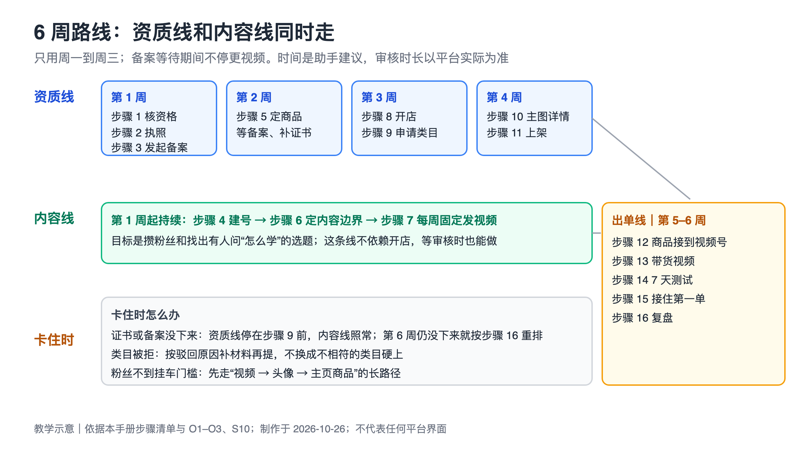
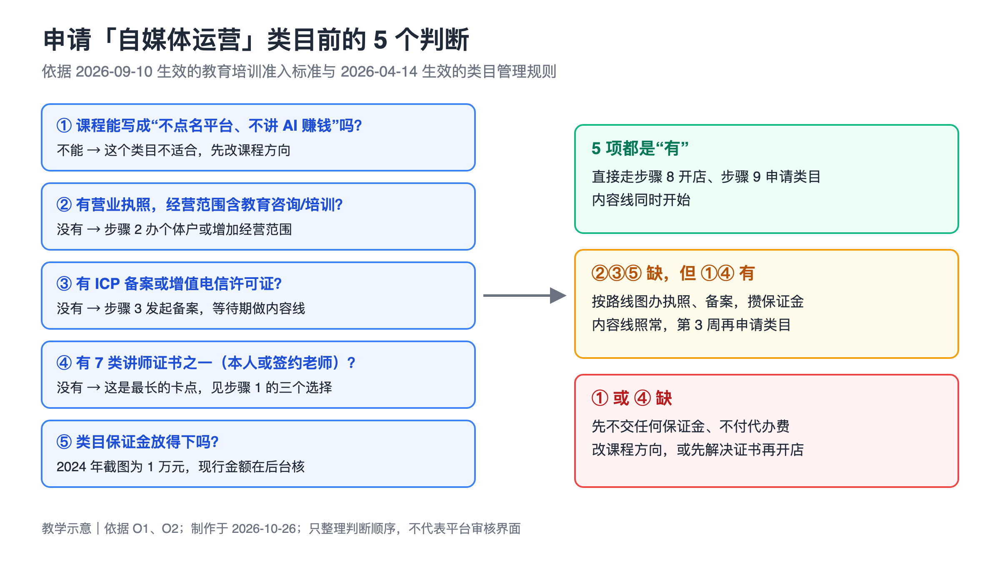
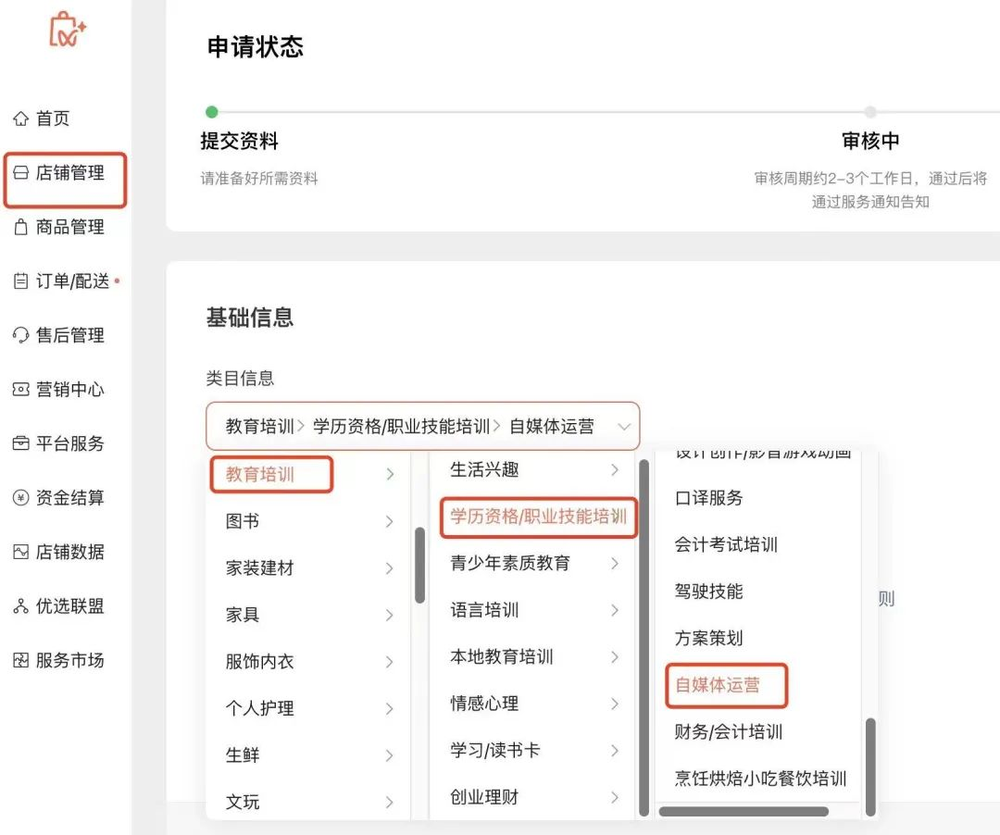
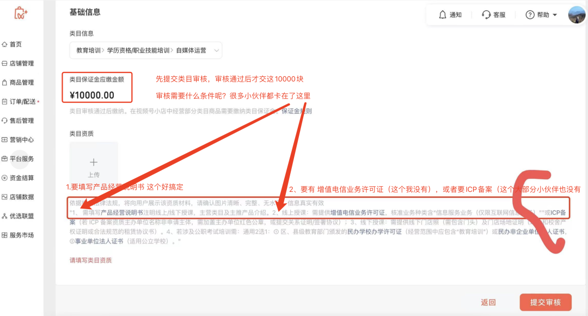
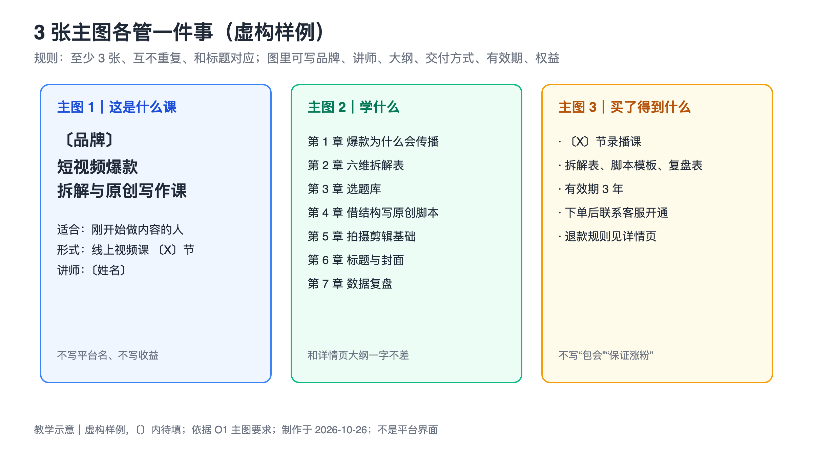
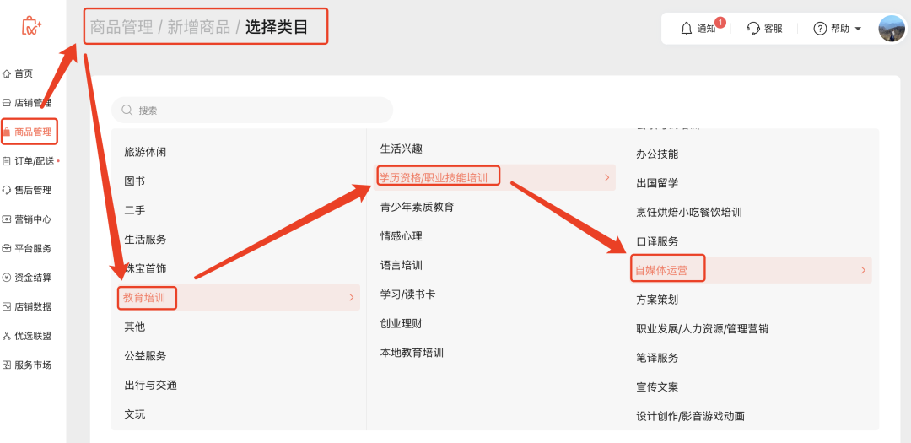
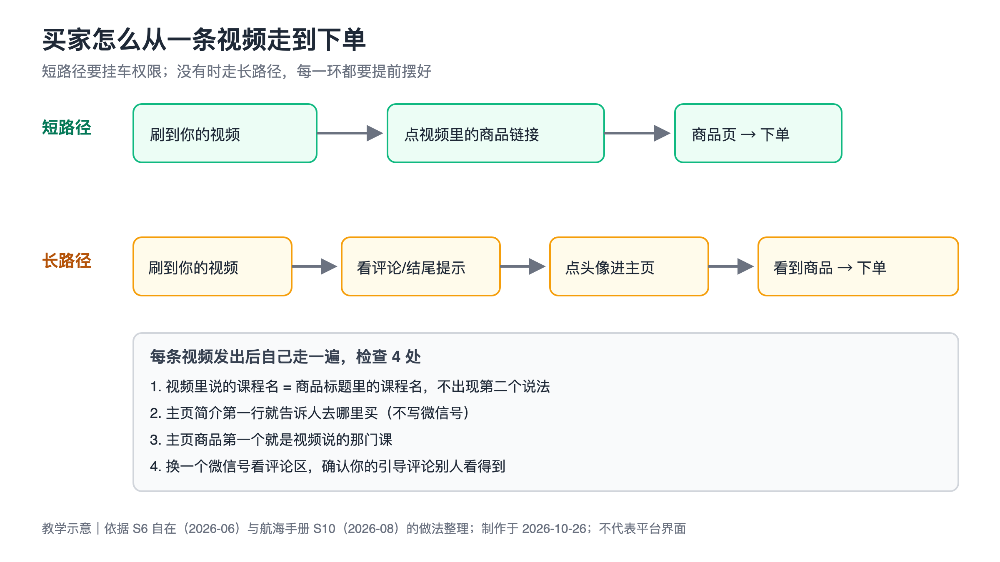
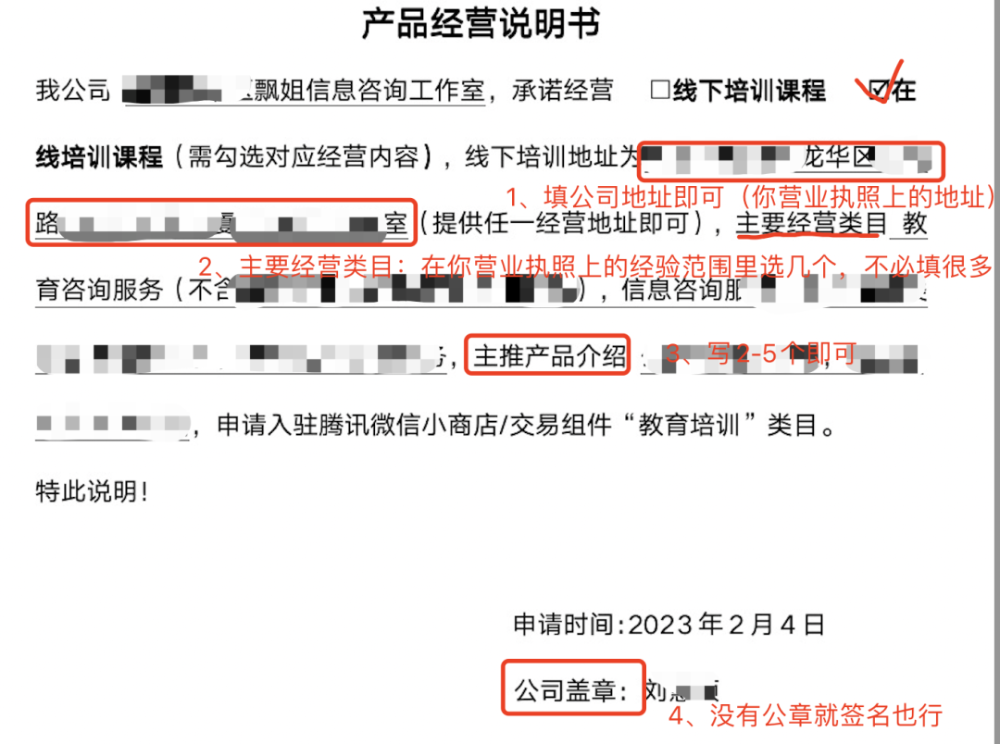

# 视频号小店从 0 到 1：开店、上架、发视频到出第一单

> 手册类型：定制版

## 阅读说明

这本手册写给你：一个人做 AI 工具和内容、只有周一到周三有空，想在微信小店卖一门“有点类似自媒体培训”的课，用视频号把人带过来，接住第一单。主骨架是飘姐的飞书文档《视频号小店开通全流程！》[[S1](#source-s1)]，类目和商品要求按 2026 年现行的微信小店教育培训规则更新 [[O1](#source-o1)、[O2](#source-o2)]，发视频和出单的做法来自生财站内帖子和 2026 年 8 月航海手册《AI 视频带货》[[S10](#source-s10)]。

- **先看下面的路线图**，再按步骤往下做。规则摘录、案例卡、模板、不做清单都在附录，正文用链接跳过去。
- **规则会变，而且这条路卡在资质上。** 2026 年的规则要求自媒体运营类目有讲师证书、ICP 备案、经营范围对得上，课程还不能点名具体平台、不能教 AI 赚钱 [[O1](#source-o1)、[O2](#source-o2)]。这些在[步骤 1](#section-step1) 先核清，再花钱。规则查询日期都是 2026-10-26，提交前以后台当时显示为准。
- **数字的性质。** 飘姐的 1 万元类目保证金是 2024 年截图里的金额，不是现行金额（下文不再重复，见 G4）；帖子里的单量、播放、佣金都是作者自述，大多是图书带货或虚拟资料的口径，不能当成你卖课的目标线。
- **不承诺出单。** 6 周的目标是把一单走通：商品上架、有人从视频点进来、你把课交付出去。做完所有步骤也可能没有人买，[步骤 16](#section-step16) 写了这种情况怎么判断。
- **示例是虚构的。** 正文里的“短视频爆款拆解与原创写作课”、99 元、〔品牌〕〔讲师〕这些都是为了演示怎么填而设的“未经确认的示例条件”，模板里的〔〕全部要换成你自己的。
- **有些做法不采用。** 素材里出现过养号买号、改写别人爆款过查重、删帖躲审核、用谐音躲评论屏蔽、私信刷屏等做法，本手册一律不写进步骤，理由和替代办法见[附录 D](#section-appendix-d)。
- **编号怎么读。** “步骤 1”是要动手的操作或判断；方括号里的 O1 是官方页面，S1–S9 是站内帖子或文档，S10 是生财航海手册。点一下跳到文末，文末“回到正文”跳回来。T1–T12 是附录 C 的模板。
- **几个反复出现的词**：类目是小店里商品的分类，卖课要申请“教育培训”下的具体类目；挂车是在视频里直接放商品链接；橱窗是你视频号主页上的商品列表；ICP 备案是网站在工信部系统的登记，这里只用它的备案号当资质；客服激活是买家下单后由你发开课方式的交付方式。更多见[附录 E 术语表](#section-appendix-e)。

## 6 周路线图

两条线同时走：资质线（执照、备案、证书、开店、类目、上架）等审核的时间长，内容线（建号、每周发视频）不依赖开店，先做起来；第 5–6 周两条线汇合成出单线。每周只用周一到周三。

| 阶段 | 这一阶段做什么 | 点开对应章节 |
| --- | --- | --- |
| 第 1 周：核资格、起两条线 | 用 5 个判断决定走不走；办或核执照；发起 ICP 备案；建好视频号；定第一个商品；写发布前自查表；发出第一批视频 | [步骤 1 核资格](#section-step1) · [步骤 2 执照](#section-step2) · [步骤 3 备案](#section-step3) · [步骤 4 建号](#section-step4) · [步骤 5 定商品](#section-step5) · [步骤 6 内容边界](#section-step6) · [步骤 7 每周发视频](#section-step7) |
| 第 2 周：录课、等审核 | 录出课程本体；内容线第 2 批；跟进执照和备案 | [步骤 5 定商品](#section-step5) · [步骤 7 每周发视频](#section-step7) |
| 第 3 周：开店、申请类目 | 用执照开店；证书、备案齐了就申请自媒体运营类目并准备保证金 | [步骤 8 开店](#section-step8) · [步骤 9 申请类目](#section-step9) |
| 第 4 周：做商品页、上架 | 做 3 张主图和详情页；填参数、选交付方式、写售后；提交审核 | [步骤 10 主图详情](#section-step10) · [步骤 11 上架](#section-step11) |
| 第 5–6 周：出单线 | 把商品接到视频号；写带货视频；跑一轮 7 天测试；接住并交付第一单；复盘决定下一步 | [步骤 12 接到视频号](#section-step12) · [步骤 13 带货视频](#section-step13) · [步骤 14 7 天测试](#section-step14) · [步骤 15 第一单](#section-step15) · [步骤 16 复盘](#section-step16) |

每天的用时和产物见[18 天时间表](#section-schedule)。

图注：教学示意，2026-10-26 依据本手册步骤清单与 O1–O3、S10 绘制；时间分配是助手建议，审核时长以平台实际为准，不代表任何平台界面。

这 6 周先不做：投流、直播卖课、开第二个视频号、推客分销和找达人带货、私域社群；以后再看[附录 F 以后再看](#section-appendix-f)。用 video-mcp 给自己做拆解素材是课外扩展，见[附录 G](#section-appendix-g)。

## 本次条件

| 项目 | 你的情况 |
| --- | --- |
| 在做什么 | 一个人做 AI 工具和内容；当前项目 video-mcp（brief → 召回爆款参考 → 转文本稿 → 拆解 → 复刻方案），代码目前只有骨架 |
| 想卖什么 | 你自己说的“复刻爆款工具”，有点类似自媒体培训 |
| 可用时间 | 周一到周三，每天 10:00–19:00，午休 13:00–14:00；时间表按每天 7 小时排，留 1 小时缓冲 |
| 未经确认的示例条件 | ① 第一个商品是通用的“短视频爆款拆解与原创写作”线上视频课，配拆解表、脚本模板、复盘表；video-mcp 只当你自己做内容的工具，不作为商品 ② 主体是个体工商户（新办或已有）③ 视频号从 0 粉开始 ④ 课程放在小鹅通或同类课程平台，按“客服激活”交付 ⑤ 售价 99 元 |
| 还不知道、会改变路线的 | 有没有个体户执照、经营范围是否含教育咨询；有没有 ICP 备案；有没有 7 类讲师证书之一；视频号现有粉丝；类目保证金预算。见下方阻断缺口 |

为什么第一个商品不是“工具”：教育培训类目的教学形式里有“题库/软件”，但写明是以软件为主体的商品，并且“线上教辅/题库/AI 教辅”类目“不支持个体工商户类型的店铺入驻”，还要软件著作权和教育移动应用备案 [[O1](#source-o1)、[O2](#source-o2)]。video-mcp 现在只有骨架，先卖课、工具当课里的配套资料更现实。这是助手建议，你要卖工具本身就先回到[步骤 1](#section-step1) 重新判断类目。

### 条件不同时怎么调

- **每周不到 3 天**：步骤不删，6 周拉长到 9 周；内容线每周至少发 3 条，资质线照常推进（等审核不占你的时间）。
- **已有个体户执照且经营范围含教育咨询**：跳过[步骤 2](#section-step2) 的办理部分，只核范围；第 1 周省出的时间给录课。
- **没有任何一类讲师证书**：这是最长的卡点。资质线停在[步骤 9](#section-step9) 前，按[步骤 1](#section-step1) 的三个选择处理；内容线、录课、主图详情照做，证书一到就能连着上架。
- **视频号已有 1000 个以上粉丝**：[步骤 12](#section-step12) 可以直接试挂车（短路径），但仍按长路径把主页和橱窗摆好。
- **只想先验证有没有人要**：先做步骤 4、6、7，每周发视频并记下“怎么学”“有没有课”这类评论，第 3 周再决定要不要花钱办资质。
- **想卖工具或 AI 赚钱方向的课**：不适合教育培训类目（AI 赚钱类课程暂不开放，AI 教辅不收个体户）[[O1](#source-o1)、[O2](#source-o2)]，先改方向。

### 6 周要完成什么

| 结果 | 数量 | 在哪一步 |
| --- | --- | --- |
| 资格自查表和走 / 等 / 换的决定 | 1 张 | [步骤 1](#section-step1) |
| 经营范围含教育咨询的营业执照 | 1 份 | [步骤 2](#section-step2) |
| ICP 备案号截图（或增值电信许可证） | 1 份 | [步骤 3](#section-step3) |
| 资料设置好的视频号 | 1 个 | [步骤 4](#section-step4) |
| 商品定义卡、课程大纲、录好的课程 | 1 张、1 份、7 节左右 | [步骤 5](#section-step5) |
| 发布前自查表 | 1 张 | [步骤 6](#section-step6) |
| 发出的视频 | 第 1–4 周每周 7 条，共约 28 条 | [步骤 7](#section-step7) |
| 开通的微信小店 | 1 家 | [步骤 8](#section-step8) |
| 通过审核的自媒体运营类目 | 1 个 | [步骤 9](#section-step9) |
| 主图、详情图、详情文案 | 3 张以上、1 张以上、1 份 | [步骤 10](#section-step10) |
| 审核通过的课程商品 | 1 个 | [步骤 11](#section-step11) |
| 视频 → 主页 → 商品的购买路径 | 1 条，走查过 | [步骤 12](#section-step12) |
| 带货视频 | 7 条起，再做 5 条变体 | [步骤 13](#section-step13)、[步骤 14](#section-step14) |
| 7 天测试记录 | 1 张 | [步骤 14](#section-step14) |
| 第一单交付记录 | 1 份（有单时） | [步骤 15](#section-step15) |
| 复盘表和下一步决定 | 1 张 | [步骤 16](#section-step16) |

### 阻断缺口（动手前先看）

- **G1 讲师证书**：自媒体运营类目要求至少 1 位老师有 7 类证书之一，外加证书拥有者和店铺主体的合作协议或劳动合同 [[O2](#source-o2)]。影响[步骤 9](#section-step9)。缺了可以先做内容线、录课、主图详情；证书怎么补见[步骤 1](#section-step1)。你本人就是个体户经营者时，是否还要协议，规则没写，提交前问平台客服。
- **G2 ICP 备案**：要能在备案查询网站查到真实、最新的备案 [[O2](#source-o2)]。影响[步骤 9](#section-step9)。办理时长本手册未核，所以第 1 周就发起。
- **G3 执照经营范围**：要“涵盖所申请的类目业务范围（教育咨询，教育培训等）”[[O2](#source-o2)]。影响[步骤 8](#section-step8)、[步骤 9](#section-step9)。
- **G4 类目保证金现行金额**：2024 年截图是 1 万元 [[S1](#source-s1)]，现行额度表本次没读到 [[O1](#source-o1)]。影响[步骤 9](#section-step9) 的现金准备。在后台提交类目时会显示应缴金额，先审核后缴纳。
- **G5 自家商品接到自己视频号的条件**：带货者短视频挂车要 1000 个有效粉丝，橱窗 0 粉可开，个体户开橱窗的保证金写的是 500–2000 元 [[S10](#source-s10)]；这些是航海手册对“带货者”的转述，店主在自己视频号放自家商品是否同样适用，本次没读到官方原文。影响[步骤 12](#section-step12)、[步骤 13](#section-step13)。

## 18 天时间表（助手建议）

只排周一到周三。每天 7 小时，10:00–13:00 和 14:00–18:00，18:00–19:00 留作缓冲或回评论。视频在周三前做完，用视频号助手网页端定时发到周四到周日 [[S10](#source-s10)]，这样不在线的日子也有更新。

| 天 | 用时 | 做什么 | 对应步骤 | 当天产物 |
| --- | --- | --- | --- | --- |
| 第 1 周周一 | 7 小时 | 读完本手册开头和附录 A（1 小时）；填资格自查表（2 小时）；核执照或开始办理（2 小时）；建号、设置资料（2 小时） | 步骤 1 · 步骤 2 · 步骤 4 | T1 表、执照办理记录、视频号 |
| 第 1 周周二 | 7 小时 | 买域名和服务器；已有执照就当天提交 ICP 备案，新办执照的等执照到手再提交（3 小时）；写商品定义卡和课程大纲（4 小时） | 步骤 3 · 步骤 5 | 域名、服务器、备案提交记录（已有执照时）、T2、T7 |
| 第 1 周周三 | 7 小时 | 写发布前自查表（2 小时）；写、拍、剪第 1 批 7 条视频并定时（5 小时） | 步骤 6 · 步骤 7 | T9、7 条已定时视频 |
| 第 2 周周一 | 7 小时 | 看上周数据（1 小时）；录第 1–2 节课（5 小时）；跟进执照和证书，执照到手就提交 ICP 备案（1 小时） | 步骤 7 · 步骤 5 · 步骤 3 | 数据记录、2 节课、备案提交记录 |
| 第 2 周周二 | 7 小时 | 录第 3–5 节课（6 小时）；回评论（1 小时） | 步骤 5 | 3 节课 |
| 第 2 周周三 | 7 小时 | 第 2 批 7 条视频（6 小时）；定时（1 小时） | 步骤 7 | 7 条已定时视频 |
| 第 3 周周一 | 7 小时 | 用执照开店（2 小时）；录第 6–7 节课（5 小时） | 步骤 8 · 步骤 5 | 店铺提交记录、2 节课 |
| 第 3 周周二 | 7 小时 | 备案和证书齐了就申请类目（2 小时）；剪课、上传到课程平台（4 小时）；1 小时缓冲 | 步骤 9 · 步骤 5 | 类目提交记录、课程平台上的完整课 |
| 第 3 周周三 | 7 小时 | 看数据（1 小时）；第 3 批 7 条视频（6 小时） | 步骤 7 | 7 条已定时视频 |
| 第 4 周周一 | 7 小时 | 做 3 张主图、详情图、详情文案（6 小时）；1 小时缓冲 | 步骤 10 | 主图、详情图、文案 |
| 第 4 周周二 | 7 小时 | 填商品参数、交付和售后，提交审核（3 小时）；接好课程平台和客服话术（3 小时）；1 小时缓冲 | 步骤 11 | 提交审核的商品、T11 |
| 第 4 周周三 | 7 小时 | 看数据（1 小时）；第 4 批 7 条视频（6 小时） | 步骤 7 | 7 条已定时视频 |
| 第 5 周周一 | 7 小时 | 把商品放进橱窗、改主页简介、走一遍购买路径（2 小时）；写 7 条带货视频脚本（5 小时） | 步骤 12 · 步骤 13 | 购买路径走查记录、7 条脚本 |
| 第 5 周周二 | 7 小时 | 拍剪 7 条带货视频（6 小时）；按自查表过一遍（1 小时） | 步骤 13 | 7 条成片 |
| 第 5 周周三 | 7 小时 | 发第 1 条并逐日定时到下周二；开始 7 天测试；准备客服和交付话术；回评论私信 | 步骤 14 · 步骤 15 | 测试表第 1 天、T11 |
| 第 6 周周一 | 7 小时 | 看前 5 天数据找“种子视频”，做 5 条变体（5 小时）；接单、交付（2 小时） | 步骤 14 · 步骤 15 | 种子视频、5 条变体 |
| 第 6 周周二 | 7 小时 | 变体定时；回评论私信；交付有单的买家；记录交付问题 | 步骤 14 · 步骤 15 | 交付记录 |
| 第 6 周周三 | 7 小时 | 7 天复盘；第一单复盘；决定继续、调整还是停 | 步骤 14 · 步骤 16 | T12 复盘表、下一步决定 |

合计 18 天 × 7 小时 = 126 小时，在你 18 天 × 8 小时 = 144 小时的可用时间内。审核、备案、证书考试的等待时间不占你的工作时间，但决定第 3–4 周能不能按时开店上架；没按时下来，就按路线图下面的“卡住时”处理：内容线照常，资质线停在卡住的那一步，第 6 周周三按[步骤 16](#section-step16) 重排。

**讲师证书 6 周内拿不到时的排法**（助手建议）：第 3 周周二不申请类目，这 2 小时改成录课；第 4 周照做主图、详情和商品资料，存在本地文件夹（类目没批时后台选不到自媒体运营，没法在后台存草稿）；第 5–6 周的“带货视频”改成内容视频，结尾问“想要这张拆解表的在评论区说一声”，把评论里的需求数记进 T12，作为证书下来后要不要继续的依据；不交保证金、不付代办费。

## 步骤 1 核 5 项硬条件，决定走不走

教育培训类目在 2026 年收紧了：老规则里“填一份产品经营说明书 + ICP 备案”就能过 [[S1](#source-s1)、[S3](#source-s3)]，现在还要讲师证书、承诺函、经营范围，课程内容也有两条红线 [[O1](#source-o1)、[O2](#source-o2)]。这一步不花钱，只判断。做完你会知道：直接走、先补材料再走，还是改方向。

图注：教学示意，2026-10-26 依据 O1（2026-04-14 生效）与 O2（2026-09-10 生效）整理判断顺序；不代表平台审核界面。保证金金额见 G4。

**目标**：用 5 个判断得出一个可执行的决定，并知道每个缺口要花多少时间和钱。

1. **判断课程方向。** 输入：你想卖的课的大纲。按两条红线逐章检查：不能是教你运营某个具体平台账号的课（视频号、抖音、小红书、淘宝等），只允许“不指向具体平台”的通用课；也不能教用 AI 创业、副业、赚钱、获客、变现 [[O1](#source-o1)]。反例：“视频号从 0 到 1000 粉”“用 AI 做短视频月入过万”都不行；“短视频选题、结构与脚本写作”可以。写不成通用课，就停在这里改方向。
2. **判断执照和经营范围。** 拿出营业执照，看经营范围里有没有“教育咨询”或“教育培训”一类的字样 [[O2](#source-o2)]。没有执照或范围不含，转[步骤 2](#section-step2)。只想用个人身份开店的：个人能不能申请教育培训，规则原文没写 [[O2](#source-o2)]，本手册按个体户写。
3. **判断 ICP 备案。** 有没有以你店铺主体名义、能在备案查询网站查到的 ICP 备案，或含“信息服务业务（仅限互联网信息服务）”的增值电信许可证 [[O2](#source-o2)]。没有，转[步骤 3](#section-step3)，第 1 周就发起。
4. **判断讲师证书。** 对照[附录 A 的 7 类证书原文](#section-appendix-a)逐条看自己有没有：相关专业本科、全媒体运营师、互联网公司运营主管以上就职证明、大型媒体作品参与制作人、高校特聘讲师、互联网营销师（中级）、培训机构授权讲师 [[O2](#source-o2)]。没有时有三个选择，写下你选哪个：
   - 自己去考一类（例如互联网营销师中级、全媒体运营师），考试周期和费用本手册未核；
   - 和一位持证老师签合作协议，让对方作为课程老师；
   - 换一个不要证书、但和课程内容真正对得上的类目（例如“生活兴趣 > 摄影摄像”不需要老师个人证书 [[O2](#source-o2)]）；只有课程真是摄影摄像内容才行，不能为了绕开证书挂错类目。
5. **判断保证金和总投入。** 把下面几笔写进 T1：类目保证金（金额见 [G4](#section-gaps)，现行金额在后台提交类目时会显示）、ICP 备案的域名和服务器费用（站内一位作者写的是域名 8 元、服务器 99 元，代办约 150 元 [[S4](#source-s4)]）、个体户代办费（站内两位作者写的是 100–200 元、100–300 元 [[S1](#source-s1)、[S2](#source-s2)]）。保证金放不下，先不申请类目（开店本身不交类目保证金），内容线照做。

**做完的标准**：T1 表 5 行都有“有 / 没有 / 不确定”和下一步动作，并在表底写下一个决定：直接走、先补哪几项再走（写清预计哪周能补齐），或改方向。

- [ ] 课程大纲逐章过了两条红线
- [ ] 核了执照经营范围
- [ ] 核了 ICP 备案
- [ ] 对照 7 类证书，选好补证书的办法
- [ ] 算出总投入，写下决定

**飘姐当时怎么做的（2024）**：她用个体户执照开店，“我只能选择自媒体运营这个类目”，类目审核要填产品经营说明书、要有增值电信许可证或 ICP 备案，“不到一天的时间，微信就收到通过的通知”，通过后交 1 万元类目保证金 [[S1](#source-s1)]。那时还没有讲师证书这一条，她的“一天通过”和金额都不能当成你的预期。

参见附录：[模板 T1 资格自查表](#template-t1)、[附录 A 规则摘录](#section-appendix-a)。

## 步骤 2 办好或核对个体户执照

执照是开店和申请类目共同的前提，而且经营范围要和教育培训对得上。这一步做完，你手里有一张能用来开店、经营范围写对了的执照照片。

**目标**：拿到一张经营范围含“教育咨询”一类业务的个体工商户营业执照。

1. 已有执照：拍清楚正本或电子执照，逐字核经营范围。准入标准要求经营范围“涵盖所申请的类目业务范围（教育咨询，教育培训等）”[[O2](#source-o2)]。蘑菇 2025 年开店时的经营范围包含“网络销售”“信息技术服务”或“教育”相关内容 [[S2](#source-s2)]。
2. 没有执照：到当地市场监管部门办理个体工商户登记（线下窗口或当地政务服务的线上入口，具体入口本手册未核）。飘姐建议在当地自己办，网上代办“价格 100–200 不等”[[S1](#source-s1)]。
3. 填经营范围时把教育咨询、信息技术服务、网络销售一类写进去；已有执照但范围不含的，办理经营范围变更。哪些表述能写进去，以当地登记机关给的规范用语为准。
4. 执照上的名称、地址、经营者要和你之后开店用的实名微信号、身份证一致；产品经营说明书里也要用执照上的地址 [[S1](#source-s1)]。

**做完的标准**：执照照片存好，经营范围里能指出对应“教育咨询 / 教育培训”的那几个字。

- [ ] 执照到手（或变更完成）
- [ ] 经营范围核过
- [ ] 执照照片存到资质文件夹

参见附录：[模板 T1 资格自查表](#template-t1)。

## 步骤 3 发起 ICP 备案

ICP 备案是最容易被忽略的卡点：飘姐截图里标注了“这个大部分小伙伴也没有”[[S1](#source-s1)]。备案要等审核，所以第 1 周就发起，等待期做内容线。做完你手里有备案号和查询截图。

**目标**：以店铺主体名义拿到一个能在备案查询网站查到的 ICP 备案号。

1. 先查是否已有：在工信部的 ICP 备案查询网站用单位名称或域名查，准入标准要求能查到“最新且真实的资质”[[O2](#source-o2)]。
2. 没有就准备：一个域名和一台服务器（站内作者写的是域名 8 元、服务器 99 元 [[S4](#source-s4)]），备案主体用你的个体户执照。执照还没下来时，先买好域名和服务器，执照到手当天再提交（助手建议）。
3. 通过你买服务器的云服务商提供的备案入口提交（具体流程以服务商页面为准，本手册未读其官方说明）；不想自己办，站内作者写淘宝代办“大约是 150 元左右”[[S4](#source-s4)]。
4. 备案下来后截一张查询结果图：截图要“正置、完整、清晰（需包含完整官方抬头和备案信息）”，不能用造假或已注销的资质 [[O2](#source-o2)]。
5. 如果你有关联主体已有备案：桑桑 2025 年写的是“icp 备案如有关联主体可相互授权”[[S3](#source-s3)]；飘姐 2024 年截图里的提示是主办单位不是申请主体时需要盖章或提交关系证明 [[S1](#source-s1)]。这条在 2026 准入标准原文里没写，按后台提示办。

**做完的标准**：有备案号，有一张完整的官方查询截图，主体名称和执照一致。

- [ ] 查过是否已有备案
- [ ] 买好域名和服务器
- [ ] 提交备案并记下提交日期
- [ ] 备案通过后存好查询截图

参见附录：[模板 T1 资格自查表](#template-t1)、[附录 H 仍需核对的问题](#section-appendix-h)。

## 步骤 4 建视频号、设置主页

视频号是你的流量来源，也是买家看到商品的地方。这一步只做账号本身，开店和挂商品在后面。做完你有一个能发视频、主页资料写清楚的号。

**目标**：建好视频号，名字、头像、简介和之后的店铺统一，隐私设置按自己的需要选好。

1. 手机微信里进“发现 → 视频号 → 右上角人像 → 发表视频”，按提示填资料并勾选同意《微信视频号运营规范》[[S10](#source-s10)]。
2. 起名和头像：名字一年只能改 5 次，想好再定 [[S10](#source-s10)]。刘智行的做法是让小店的头像和名称与视频号一致 [[S5](#source-s5)]，买家从视频点到店铺时认得出是同一个人。
3. 写简介：最好 3 行，多了会被折叠；不要放微信号 [[S10](#source-s10)]。视频号运营规范禁止通过个人签名等方式引流到个人联系方式 [[O5](#source-o5)]。第一行先写你讲什么、给谁看，等商品上架后再改成购买提示（[步骤 12](#section-step12)）。
4. 打开网页版视频号助手 `https://channels.weixin.qq.com/`，扫码登录，之后发视频、定时、管评论都在电脑上做 [[S10](#source-s10)]。
5. 隐私：航海手册的做法是关闭“在个人名片上展示视频号”，“谁可以看我的视频号内容”选“公开，但不推荐给朋友”[[S10](#source-s10)]。这是给不想让熟人看到的人用的，你按自己情况选。

**做完的标准**：视频号主页有固定名字、头像和 3 行以内的简介；电脑上能登录视频号助手。

- [ ] 视频号建好
- [ ] 名字、头像定好，和以后的店铺统一
- [ ] 简介 3 行以内，没有微信号
- [ ] 网页端视频号助手能登录

参见附录：[模板 T10 主页简介](#template-t10)。

## 步骤 5 定第一个商品并做出课程本体

这一步决定你卖什么，而且要把课真正做出来，否则上架后没东西交付。商品定义同时要满足类目规则：通用、不点名平台、不讲 AI 赚钱、价格不低于 5 元 [[O1](#source-o1)]。做完你有一张商品定义卡、一份课程大纲和录好的课。

**目标**：定下课程的范围、价格、交付方式，并在第 3 周前录完、上传到课程平台。

1. 写商品定义卡 T2：给谁（例如刚开始做短视频内容的人）、学完能做什么（能用拆解表拆一条视频的结构，写出自己的脚本）、形式（线上视频课 + 拆解表、脚本模板、复盘表）、价格。蘑菇卖虚拟资料时把 19.9–99 元当“新手友好”区间，自己定价 49.9 元 [[S2](#source-s2)]；示例条件定 99 元，价格不得低于 5 元 [[O1](#source-o1)]。
2. 写课程大纲 T7：类目规则建议详情里写讲师介绍、课程大纲目录、履约形式、面向人群、学完收获、学习资料、课程有效期、课程权益、退款 [[O1](#source-o1)]，大纲先按这几项写，之后主图和详情页直接用。官方还提供了一份《课程大纲模板》，链接见[附录 A](#section-appendix-a)。
3. 再过一遍红线：每章标题和示例都不写具体平台名，不承诺涨粉、收入或“保过”“包过”[[O1](#source-o1)]。示例视频用你自己做的视频，或取得授权的素材；不在课里整段放别人的视频和文案（见[附录 D](#section-appendix-d)）。
4. 选交付方式：纯线上课按类目规则选“客服激活”，“自动发货”是给含光盘、书籍等实体商品的 [[O1](#source-o1)]。课放在小鹅通或同类平台，买家下单后由你发开通方式。桑桑 2025 年用小鹅通专业版和小店绑定、下单后自动开课 [[S3](#source-s3)]，那是另一种接法，和 2026 规则的“客服激活”写法有出入，上架时以后台选项为准（见[步骤 11](#section-step11)）。
5. 录课：按大纲录 7 节左右，每节 10–15 分钟（助手建议），录完上传到课程平台并设成需要开通才能看。

**做完的标准**：T2、T7 写完；课程平台上有完整的一套课，你用另一个账号能看到“未开通”状态。

- [ ] T2 商品定义卡
- [ ] T7 课程大纲
- [ ] 红线复查过
- [ ] 交付方式选定
- [ ] 课程录完并上传

参见附录：[模板 T2 商品定义卡](#template-t2)、[模板 T7 课程大纲](#template-t7)、[案例卡 3 桑桑](#case-3)。

## 步骤 6 定内容边界，写发布前自查表

账号违规的代价比想象中大：自在在爆款期发了一条违规视频，账号被警告、掉了一次橱窗权限，爆款还在跑但订单直接归零 [[S6](#source-s6)]；些些怡搬运剪辑的视频“发了 10 条就被清算了”[[S7](#source-s7)]。这一步在发第一条视频前，把规则写成一张每次发布都过一遍的表。

**目标**：写出一张 10 项以内的发布前自查表，之后每条视频发之前都过一遍。

1. 从视频号运营规范里挑出和你相关的条款写进表：不搬运、不批量发同质化内容；不用混剪拼接误导人；不在视频、评论、签名里引流到个人联系方式；不用夸张、诱惑性词汇；用新技术生成或合成的非真实音视频要显著标识 [[O5](#source-o5)]。
2. 加上课程类目的两条：视频里不点名具体平台教运营、不讲 AI 赚钱 [[O1](#source-o1)]。这两条规则管的是课程，视频是课程的广告，讲法保持一致更稳妥（助手建议）。
3. 加上一条原创线：可以学对标视频的选题、结构和节奏，不照着别人的文案改写，不用别人的原声和画面（见[附录 D](#section-appendix-d)）。
4. 加一条敏感词：些些怡踩过“医疗敏感词”的坑，“心理医生、中度抑郁”这类词在教育内容里不能出现 [[S7](#source-s7)]。你的课不涉及这些，示例里也别用病症、诊断类的词；她用“意境暗示”去躲审核的办法本手册不采（见[附录 D](#section-appendix-d)）。
5. 把表存成手机备忘录或打印出来，放在剪辑软件旁边（助手建议）。

**做完的标准**：T9 表写好；拿你最近想发的一条视频过一遍，每项都能答“是 / 否”。

- [ ] 运营规范条款写进表
- [ ] 类目两条红线写进表
- [ ] 原创线和敏感词写进表
- [ ] 用一条视频试过一遍

参见附录：[模板 T9 发布前自查表](#template-t9)、[附录 D 不做 / 依据 / 改为](#section-appendix-d)。

## 步骤 7 起号：每周固定发视频

内容线不依赖开店，从第 1 周就开始，等执照、备案、证书的同时攒粉丝、找出有人问“怎么学”的选题。做完每一周，你手里有 7 条已定时的视频和一张数据记录。

**目标**：第 1–4 周每周做 7 条内容视频，定时发到一周里的每一天，每周看一次数据。

1. 选题：围绕课程内容拆成小题，例如“一条视频开头 3 秒怎么写”“拆一条视频的 6 个维度”（助手建议）。每条都过 T9 自查表。
2. 形式：蘑菇试过把图文直接搬到视频号，“每条的观看量只有个位数”，改成视频后流量才上来，她的经验是“30–60 秒的短视频效果最好”[[S2](#source-s2)]。不想露脸，可以参考些些怡的“大字报”（5 秒翻一页）或动画配音 [[S7](#source-s7)]。
3. 发布：在视频号助手网页端上传，写描述、加话题（“话题很重要”），用定时发布排到周四到周日；网页端和 App 发效果一样 [[S10](#source-s10)]。
4. 数据：每周一看上一批的播放、完播率、3 秒播放率、评论。航海手册给的合格线是完播率大于 20%、3 秒播放率大于 30%；转发的作用“远远大于点赞”，评论要回 [[S10](#source-s10)]。这是图书带货口径，你先拿来对比自己每周的变化。
5. 记下每条评论里“怎么学”“有没有课”“这个表在哪”一类的问题，这些是之后带货视频的选题（助手建议）。

**做完的标准**：每周 7 条视频已定时；数据记录表里有每条的播放、完播率和评论里的问题。

- [ ] 第 1 周 7 条
- [ ] 第 2 周 7 条
- [ ] 第 3 周 7 条
- [ ] 第 4 周 7 条
- [ ] 每周一看数据并记录

**发多少条**：素材里作者的频率是“每天发 5 条左右”[[S2](#source-s2)]、图书带货“每天建议发布 10 条左右”[[S10](#source-s10)]，都是有现成商品、全职做的口径。你一周只有 3 天，每天 1 条是助手按你的时间排的建议；时间多了再加，不要为了数量做同质化内容（运营规范禁止批量同质化 [[O5](#source-o5)]）。

**新号的播放怎么看**：自在借夏俊虎的说法，个位数到几十先查账号违规原因，100–400 正常，500–1000 进入推荐池 [[S6](#source-s6)]；航海手册说新号有“10–15 天左右的保护期”[[S10](#source-s10)]。这些是作者经验，不是平台规则。

参见附录：[模板 T8 视频脚本结构](#template-t8)、[案例卡 2 蘑菇](#case-2)、[案例卡 6 些些怡](#case-6)。

## 步骤 8 用个体户执照开微信小店

有了执照就可以开店。飘姐 2024 年写的是开店的几步走完后，“上传商品前必须先选择你要做的类目”，她的类目申请截图在“店铺管理”里 [[S1](#source-s1)]；官方开店指引也把“对应的类目资质”列在开店材料里 [[O3](#source-o3)]，所以开店页面要你选类目时，就把[步骤 9](#section-step9) 的材料一起备好。做完你有一家审核通过的店。

**目标**：用个体户执照开通微信小店，名称和头像与视频号统一。

1. 准备材料：营业执照、经营者身份证、一个实名认证过的微信号 [[O3](#source-o3)]。
2. 选一个入口：手机上打开“微信小店助手”App 选“入驻小店”后点“开店”，或在微信里搜“微信小店开店”点“前往”；电脑上用浏览器打开微信小店，扫码后“申请开店”[[O3](#source-o3)]。蘑菇 2025 年是从视频号进的：视频号“我 → 右上角 … → 设置 → 创作者服务 → 视频号店铺”[[S2](#source-s2)]。
3. 按页面提示填店铺信息、上传执照、绑定结算银行卡后提交 [[S2](#source-s2)]。店铺名称和头像跟视频号保持一致 [[S5](#source-s5)]。
4. 等审核：官方写的是正常 1–3 个工作日 [[O3](#source-o3)]；蘑菇说开店和商品审核“一次就通过了”[[S2](#source-s2)]。被驳回就按驳回原因补材料再提。

**做完的标准**：小店审核通过，能登录商家后台看到“店铺管理”和“商品管理”。

- [ ] 材料备齐
- [ ] 提交开店
- [ ] 审核通过

**不用再做的**：飘姐 2024 年的流程里有视频号认证、企业微信、企业号与视频号绑定这几步 [[S1](#source-s1)]，2025 年的开店指引里没有列为开店材料 [[O3](#source-o3)]，本手册不把它们放进主线；后台要求时再按提示做。

参见附录：[案例卡 1 飘姐](#case-1)、[案例卡 4 刘智行](#case-4)。

## 步骤 9 申请自媒体运营类目、准备保证金

这是整条路线最卡的一步：证书、备案、执照、承诺函都要在这里交。做完你的店能上架“教育培训 > 学历资格/职业技能培训 > 自媒体运营”下的商品。

**目标**：一次提交齐材料，类目审核通过，按后台显示的金额缴纳类目保证金。

1. 进类目申请：飘姐 2024 年登录 `https://channels.weixin.qq.com/` 后，在商家后台左侧“店铺管理”的类目申请页里，依次选“教育培训 → 学历资格/职业技能培训 → 自媒体运营”，页面上写着“审核周期约 2–3 个工作日”[[S1](#source-s1)]。界面可能已变，以后台为准。
2. 备齐 4 样：《教育培训类目承诺函》（个体户可以用经营者签名加手印）、ICP 备案截图或增值电信许可证、营业执照、一位老师的类目证书和该老师与店铺主体的合作协议或劳动合同 [[O2](#source-o2)]。
3. 产品经营说明书：2026 准入标准原文没有列这一项 [[O2](#source-o2)]，但 2025 年桑桑和 2024 年飘姐都提到要填 [[S1](#source-s1)、[S3](#source-s3)]。先按 T3 备一份，后台要就传。
4. 提交审核，记下日期。飘姐截图上的提示是“先提交类目审核，审核通过后才交”保证金 [[S1](#source-s1)]。
5. 交保证金：后台会显示应缴金额。保证金规则写明：类目保证金和浮动保证金取高的那个，不叠加；上月成交 5 万元以下时浮动保证金为 0；扫码支付单笔不超过 5 万元；首次缴纳满 30 个自然日后才能申请全额退 [[O4](#source-o4)]。

图注：真实界面截图，来自 S1 飘姐飞书文档第 6 节（2024 年前后），红框是原作者标注。证明当时类目在“店铺管理”里申请、审核周期约 2–3 个工作日；2026 年界面和时长可能已变，以后台为准。

图注：真实界面截图，来自 S1 飘姐飞书文档第 6 节（2024 年前后），红字是原作者标注。截图中的金额和资质要求都是当时的，2026 年要求以 O2 和后台为准（G4）。

**做完的标准**：类目状态显示审核通过，保证金已缴纳，后台“新增商品”能选到自媒体运营。

- [ ] 承诺函签好
- [ ] ICP 截图、执照、证书、协议备齐
- [ ] 产品经营说明书备好
- [ ] 提交并通过
- [ ] 保证金按后台金额缴纳

**卡住时**：证书或备案没下来，就停在这一步之前，不要先交保证金或付代办费；内容线、录课、主图详情照做。站内有人靠帮人开类目收费 1000–2000 元 [[S4](#source-s4)]，代办不能替你补上你没有的证书。

参见附录：[模板 T3 产品经营说明书要素](#template-t3)、[附录 A 规则摘录](#section-appendix-a)、[案例卡 1 飘姐](#case-1)。

## 步骤 10 做主图和详情页

主图和详情页既要让人看懂，也要过类目审核：至少 3 张主图、互不重复、和标题对应；至少 1 张详情图 [[O1](#source-o1)]。做完你有一套可以直接上传的图和文案。

图注：教学示意，虚构样例，〔〕内待填；2026-10-26 依据 O1 主图要求绘制，不是平台界面，课程名和章节都是示例。

**目标**：做出 3 张主图、1 张以上详情图和一份详情文案，内容和标题、大纲完全对得上。

1. 先定标题：类目规则要求标题按“品牌 + 讲师 + 适用人群 + 教学领域 + 履约方式”写，5 个字以上 [[O1](#source-o1)]。用 T4 填。
2. 做 3 张主图，各管一件事：这是什么课、学什么、买了得到什么。图里可以写品牌、讲师介绍、课程大纲目录、履约形式、课程有效期、课程权益 [[O1](#source-o1)]。蘑菇的做法是每个商品准备 3–5 张展示图 [[S2](#source-s2)]。
3. 做详情图：蘑菇“把资料的完整目录都做成了图片放到详情介绍里”[[S2](#source-s2)]。你可以把 T7 大纲做成一张长图，放在详情第一张。
4. 写详情文案，按规则建议的 9 项逐项写：讲师介绍、课程大纲、履约形式、面向人群、学完收获、学习资料、课程有效期、课程权益、退款和客诉 [[O1](#source-o1)]。用 T6 填。
5. 用 T9 自查表过一遍：不写平台名、不写收益、不写“包会”“保证涨粉”“保过”[[O1](#source-o1)、[O5](#source-o5)]。

**做完的标准**：标题、3 张主图、详情图、详情文案放在一个文件夹里，主图 2 的章节名和详情页大纲一字不差。

- [ ] 标题按 5 要素写好
- [ ] 3 张主图
- [ ] 详情长图
- [ ] 详情文案 9 项
- [ ] 自查表过一遍

参见附录：[模板 T4 标题](#template-t4)、[模板 T5 主图文案](#template-t5)、[模板 T6 详情页](#template-t6)、[案例卡 2 蘑菇](#case-2)。

## 步骤 11 上架商品，接好交付

上架时最容易出问题的是参数和交付方式：参数填错会驳回，交付没接好买家付了钱看不到课。做完你有一个审核通过的商品，买家下单后你知道怎么在几分钟内给他开通。

**目标**：填完商品参数、交付方式和售后说明，商品审核通过，交付流程自己演练过一遍。

1. 进“商品管理 → 新增商品 → 选择类目”，选你申请通过的自媒体运营，再编辑商品 [[S1](#source-s1)]。上传步骤 10 的标题、主图、详情。
2. 填参数：类目规则列了适用年龄、发货方式、学习平台、课程形式（预约 / 随到随学 / 定时）、课程有效期（3–10 年）、总课时、学习资料类型、主要教学形式、单节时长、学科 [[O1](#source-o1)]。教学形式选“线上视频课”[[O1](#source-o1)]。这组参数来自网页抽取的转述，以后台实际字段为准。
3. 选发货方式“客服激活”：买家下单后联系商家客服，按客服指引完成激活 [[O1](#source-o1)]。设好常见问题的自动回复（蘑菇的做法 [[S2](#source-s2)]），把“下单后怎么开通、什么时间开通”写成第一条。你只在周一到周三在线，就在详情页和自动回复里写明开通时段，例如“周一至周三 10:00–19:00 内 1 小时开通，其余时间下单的在下周一上午开通”（助手建议），让买家下单前就知道。
4. 写售后：教培类目的退换货以你详情页写的为准，法律另有规定的从其规定 [[O1](#source-o1)]。把“开通前 / 开通后”分别怎么退写清楚。蘑菇卖虚拟资料设的是“不支持退款”，但对问题订单灵活处理 [[S2](#source-s2)]；课程不同于资料，你按 T6 的退款段写明规则，不要只写一句“不退”。
5. 演练交付：不要自己或让朋友下单测试（本手册把这类订单归为“刷单、补单、自己或朋友下单”一类不采用的做法，见[附录 D](#section-appendix-d)）。用课程平台给自己的另一个账号手动开通一次，计时、截图，写进 T11。

图注：真实界面截图，来自 S1 飘姐飞书文档第 7 节“在视频号上架商品”（2024 年前后），红框和箭头是原作者标注。只证明当时上架时的类目层级；2026 年界面可能已变，以后台为准。

**做完的标准**：商品显示审核通过；详情页和自动回复写明开通时段；T11 里写好开通步骤，你手动开通一次用时在 5 分钟以内（助手建议的线）。

- [ ] 商品信息上传
- [ ] 参数填完
- [ ] 发货方式选客服激活，自动回复设好
- [ ] 售后规则写清
- [ ] 交付演练过一次

**另一种接法**：桑桑 2025 年把小鹅通专业版授权绑定到小店，买家用购课手机号登录小鹅通小程序就能看课，她说这样“可以极大程度上降低学员的退费率”[[S3](#source-s3)]。2026 规则把“自动发货”写成给实体商品用 [[O1](#source-o1)]，你要用自动开课，先在后台和小鹅通的绑定页确认现在还支持、该选哪种发货方式。小鹅通专业版价格本手册未核。

参见附录：[模板 T6 详情页](#template-t6)、[模板 T11 客服激活与答疑话术](#template-t11)、[案例卡 3 桑桑](#case-3)。

## 步骤 12 把商品接到视频号

商品上架不等于有人能从视频找到它。新号没有挂车权限时，买家只能走“视频 → 头像 → 主页 → 商品”的长路径，每一环都要提前摆好。做完你有一条自己走查过的购买路径。

图注：教学示意，2026-10-26 依据 S6 自在（2026-06）与航海手册 S10（2026-08）的做法整理；不代表平台界面。挂车门槛是航海手册对带货者的转述，店主自家商品是否同样适用未核（G5）。

**目标**：让商品出现在你视频号主页的第一位，主页简介告诉人去哪买，自己从一条视频走到商品页一次。

1. 把商品放进橱窗：直播前的橱窗管理路径是“创作者中心 → 带货中心 → 橱窗管理”[[O6](#source-o6)]；航海手册写的入口是“微信 → 发现 → 视频号 → 右上角头像 → 创作者中心 → 带货中心”，橱窗 0 粉也可以开 [[S10](#source-s10)]。航海手册还写到，从 2025 年 5 月起，首次开通视频号橱窗的个人带货者可享“0 保证金带货权益”，近 30 天成交超过 5 万元或违规就终止 [[S10](#source-s10)]；它写的对象是个人带货者，个体户店主是否适用未核。开橱窗如要缴保证金，以页面显示为准：站内另一篇写的是“视频号橱窗 100 元起……以平台最新规则为准”[[S9](#source-s9)]，个体户的金额见 G5。
2. 把视频号和小店关联起来：刘智行写的是开店后要绑定视频号和公众号 [[S5](#source-s5)]，飘姐 2024 年要做企业号和视频号绑定 [[S1](#source-s1)]；具体在哪绑、2026 年还要不要，本次没读到官方说明，按后台提示做（见[附录 H](#section-appendix-h)）。然后把课程放在橱窗第一个。自在的复盘是“23 天 80% 的订单来自橱窗”，他每条视频发完都会检查“橱窗爆款是否在第一屏置顶”[[S6](#source-s6)]。
3. 改简介：第一行写“视频同款，在👇🏻下面【商品】购买”这类提示，不放微信号 [[S10](#source-s10)、[S6](#source-s6)]。
4. 判断能不能挂车：带货者短视频挂车要有效粉丝 1000 以上，直播挂车 100 以上 [[S10](#source-s10)]；另一位作者也是这样写的 [[S8](#source-s8)]。不到门槛就走长路径；自在的说法是把“刷视频 - 直接下单”换成“刷视频，点头像，进橱窗，下单”[[S6](#source-s6)]。
5. 走查：用另一个微信号从一条视频点头像、进主页、看到商品、点进商品页，截图存好。

**做完的标准**：另一个微信号能从视频走到商品页；商品在橱窗第一位；简介第一行是购买提示。

- [ ] 视频号和小店关联，商品进橱窗
- [ ] 课程排第一
- [ ] 简介改成购买提示
- [ ] 确认能不能挂车
- [ ] 换号走查一次

**公众号也能挂**：飘姐写到“公众号只要跟视频号绑定了，你的公众号页面就会出现视频号小店窗口”[[S1](#source-s1)]；刘智行把小店、服务号、视频号分工联动 [[S5](#source-s5)]。这些不是本次必需，放在[附录 F](#section-appendix-f)。

参见附录：[模板 T10 主页简介与评论引导](#template-t10)、[案例卡 5 自在](#case-5)。

## 步骤 13 写带货视频并发布

带货视频和前 4 周的内容视频不同：每一条都要把人带到商品页。自在的总结是“工具解决产能，素材解决播放，引导解决订单。这三件事要分开看”[[S6](#source-s6)]。做完你有 7 条带货视频，全部过了自查表并定时。

**目标**：写、拍、剪 7 条带货视频，每条都有开头钩子、一个能马上用的干货和一个去主页买的引导。

1. 选题从步骤 7 的评论里来：别人问过“怎么学”“表在哪”的那几条，改成“用课程里的拆解表拆一条视频”。些些怡的观察是，真正会付费的人“是来拿一个立竿见影能马上解决问题的方案的”[[S7](#source-s7)]。
2. 按 T8 写脚本：开头 3 秒的钩子、一个具体干货、结尾说“完整的拆解表和 7 节课在主页商品里”。视频里说的课程名和商品标题一字不差 [[S6](#source-s6)]。
3. 节奏：蘑菇用“一条挂车视频，一条纯内容视频”交替 [[S2](#source-s2)]。你在测试周可以带货视频和内容视频隔天交替。
4. 每条发之前过 T9；用 AI 生成画面或配音的要标识 [[O5](#source-o5)]；视频里不点名平台、不讲收益 [[O1](#source-o1)]。
5. 没挂车时，评论区引导要做好；引导类评论有时会被屏蔽，航海手册的做法是用另一个号去看一下评论是否显示 [[S10](#source-s10)]。被屏蔽了就改写成更平实的说法，不用谐音或符号去躲（见[附录 D](#section-appendix-d)）。

**做完的标准**：7 条带货视频定时完毕，每条的脚本都标出钩子、干货、引导三段，自查表都打过勾。

- [ ] 7 个选题来自真实评论
- [ ] 7 条脚本
- [ ] 拍剪完成
- [ ] 每条过自查表
- [ ] 定时发布

参见附录：[模板 T8 视频脚本结构](#template-t8)、[模板 T10 评论引导](#template-t10)、[案例卡 5 自在](#case-5)。

## 步骤 14 跑一轮 7 天测试

第一单之前，最重要的是知道问题出在哪一环：没人看、看了不点、点了不买。这一步按自在的 7 天闭环改成你的节奏（周三开始，下周二结束，周三复盘）。做完你有一张 7 天测试记录和一个“继续 / 调整”的判断。

**目标**：连续 7 天每天发至少 1 条带货视频，找出数据最好的一条做变体，按数据判断卡在哪一环。

1. 第 1 天（第 5 周周三）：确认主页、简介、橱窗都摆好，发第 1 条，其余定时到下周二 [[S6](#source-s6)]。
2. 第 2–5 天：自在在这几天测素材，第 4 天找“完播率、商品点击率最高的视频”[[S6](#source-s6)]。你周四到周日不在线，就在第 6 周周一一次看完前 5 天数据，挑出种子视频。
3. 第 6 周周一、周二：基于种子视频做 5–10 条变体 [[S6](#source-s6)]（你的时间按 5 条排），换开头、换例子，不换核心干货。
4. 用口诀判断卡在哪：“播放低看开头 3 秒；播放高点击低看钩子；点击高订单低看商品橱窗；订单高播放低保留定时复发”[[S6](#source-s6)]。逐条写进 T12。
5. 第 6 周周三复盘：自在的线是“7 天总订单 ≥ 5 单可以继续第二周；如果 0 单，先别加号、先回头看评论引导、橱窗承接”，并且“请把第一本书测够 10 条视频再判断”[[S6](#source-s6)]。

**做完的标准**：T12 记录了 7 天每条视频的播放、完播率、商品点击、订单；写下卡在哪一环和下一周要改的一处。

- [ ] 7 天每天有发布
- [ ] 找出种子视频
- [ ] 做出 5 条变体
- [ ] 用口诀写下卡点
- [ ] 复盘

**自在的数字只当参考**：他在图书带货里的自述是“无购物车情况下万播放订单 1.25–1.50 单算正常；商品点击率接近 7.5% 算不错；早上 6–10 点贡献了我 52.4% 的订单”，23 天发 40 条、1390 单、佣金 50042 元 [[S6](#source-s6)]。图书几十元、冲动购买，你的课 99 元、要先信任你，这些线不能直接拿来判断你的课。

参见附录：[模板 T12 7 天测试记录与复盘表](#template-t12)、[案例卡 5 自在](#case-5)。

## 步骤 15 接住并交付第一单

“客服激活”意味着第一单的体验全在你手上：买家付完钱找不到人、迟迟没开通，就容易退款（助手判断）。你周四到周日不在线，而测试周的视频会在这几天发出去，这是本手册最大的时间冲突，下面第 1 条给了两种处理。做完你有一份第一单的交付记录，知道哪里要改。

**目标**：第一位买家下单后尽快开通课程，回答第一个问题，记下全过程。

1. 打开商家 App 的消息提醒。测试周（第 5 周周三到第 6 周周二）二选一，写进 T11（助手建议）：① 周四到周日每天抽 10 分钟看消息、开通（超出你平时的可用时间，只在测试周做）；② 不抽时间，严格按详情页写的开通时段处理，并接受有人因此退款。单量起来后再考虑[自动开课](#section-step11)。
2. 有单后按 T11 发开通说明、在课程平台给买家开通，截图留存。桑桑说下单后第一时间能看到课程，能明显降低退费 [[S3](#source-s3)]。
3. 回私信要一条条认真回，不复制粘贴刷屏：些些怡一天回了 19 条私信后被禁言 7 天，她的建议是话术要变换、一天不超过 20 条，最好“留钩子等客户来主动找你”[[S7](#source-s7)]。
4. 不把买家引到个人微信成交或答疑（运营规范禁止引流到个人联系方式 [[O5](#source-o5)]）；答疑放在课程平台或小店客服里。
5. 遇到退款，按你详情页写的规则处理；不用红包、返现换好评或换撤销退款（见[附录 D](#section-appendix-d)）。

**做完的标准**：交付记录里有下单时间、开通时间、买家的第一个问题和你的回答；没有单时这一步记“未发生”，不编记录。

- [ ] 消息提醒打开，周四到周日的处理方式选定
- [ ] 第一单按 T11 开通
- [ ] 私信逐条回复，话术不重复、不刷屏
- [ ] 答疑留在平台内
- [ ] 交付记录写好

参见附录：[模板 T11 客服激活与答疑话术](#template-t11)、[案例卡 6 些些怡](#case-6)。

## 步骤 16 复盘，决定下一步

6 周结束时，不管有没有单，都要做一个明确的决定，而不是“再等等”。做完你有一张复盘表和第 7 周起的计划。

**目标**：根据资质线、内容线、出单线各自走到哪，决定继续、调整还是停。

1. 输入：T1 资格自查表（资质线进度）、步骤 7 的数据记录（内容线）、T12（出单线）、第一单交付记录。
2. 资质线没走完（证书、备案、类目还卡着）：写下卡在哪、预计哪天解决；内容线照常，下一个 6 周的前 2 周只做资质和视频（助手建议）。
3. 出单线 0 单：按自在的说法先别加号，回头看评论引导和橱窗承接 [[S6](#source-s6)]；再看测够了没有（他的线是 10 条 [[S6](#source-s6)]）。用口诀定位一个最弱的环节，下一轮只改这一处。
4. 有单：把第一单交付记录里的问题改进 T11、详情页和课程，下一轮把带货视频加到每周 7 条以上。航海手册也提醒播放长期在 0–200 的号可以考虑换号 [[S10](#source-s10)]，但换号前先排除违规和内容问题。
5. 写下第 7 周起每周三天的安排，或者写下停止的理由（助手建议）。

**做完的标准**：T12 复盘表底部写着一个决定（继续 / 调整哪一处 / 停）和理由。

- [ ] 三条线进度写清
- [ ] 找出最弱的一环
- [ ] 写下决定和理由
- [ ] 第 7 周起的安排

参见附录：[模板 T12 复盘表](#template-t12)、[附录 F 以后再看](#section-appendix-f)。

## 附录 A｜规则摘录（查询 2026-10-26）

这一节把影响路线的平台规则原文集中放在一起，正文只引编号。都读的是官方现行页面；网页抽取可能有遗漏，关键数字提交前在后台再核一次。

| 规则 | 原文或要点 | 适用范围与日期 | 影响步骤 | 来源 |
| --- | --- | --- | --- | --- |
| 不点名平台 | “禁止以运营具体平台账号（包括但不限于视频号、抖音、小红书、淘宝等互联网社交或电商平台）为教学内容的针对性自媒体运营、电商运营、直播运营、带货运营及变现等教学。仅允许不指向具体平台的直播、短视频及自媒体相关的全平台通用型运营课程。” | 教育培训类目；修订 2026-04-07，生效 2026-04-14 | 1、5、6、10 | O1 |
| 不讲 AI 赚钱 | “教育培训类目下暂不开放售卖涉及教授使用AI开展商业活动或营利（包括但不限于：使用AI创业、提升营业额、开展副业、赚钱、获客、变现等）的课程” | 同上 | 1、5、10 | O1 |
| 价格下限 | “禁止发布5元以下（含成交价）或不合理的低价商品” | 同上 | 5 | O1 |
| 主图与详情图 | “商品需提供三张（含三张）以上与商品标题对应一致的商品图片，商品主图不允许重复。”“商品详情图需提供一张（含一张）以上的商品图片。” | 同上 | 10 | O1 |
| 详情建议项 | “讲师介绍、课程大纲目录、履约形式、面向人群、学完收获、学习资料、课程有效期、课程权益、退款/客诉等” | 同上 | 5、10 | O1 |
| 发货方式 | “客服激活：用户购买后联系商家客服，根据客服指引完成课程激活；自动发货：商品内主要包含光盘、书籍等实体商品辅助教学，需要实体发货时选择。” | 同上 | 5、11、15 | O1 |
| 售后与承诺 | “教培类目的退换货具体以商家详情页为准，但法律法规另有规定的，依照法律法规执行。”禁止“「保过」、「包过」、「不过全额退款」等明示或暗示的保证性承诺” | 同上 | 10、11 | O1 |
| 通用材料 | 《教育培训类目承诺函》（个体商户可提供“经营者的签名+手印”）；增值电信许可证或 ICP 备案二选一；执照经营范围涵盖“教育咨询，教育培训等” | 教育培训准入；修订 2026-08-31，生效 2026-09-10 | 1、2、3、9 | O2 |
| 讲师证书 | “至少1个老师的类目相关个人证书，以及证书拥有者和入驻主体的合作协议或劳动合同” | 自媒体运营等三级类目；同上 | 1、9 | O2 |
| 不收个体户的类目 | 线上教辅 / 题库 / AI 教辅：“该类目不支持个体工商户类型的店铺入驻” | 同上 | 条件 | O2 |
| 保证金 | 类目与浮动保证金“以金额更高者为准”；浮动按上月成交额：5 万以下 0 元、5–10 万 3000 元、10–50 万 5000 元、50 万以上 30000 元；全额退需“首次充值缴纳保证金满30个自然日后”等 8 项条件 | 微信小店；发布 2025-01-02，生效 2025-01-09 | 9 | O4 |
| 开店 | 材料：营业执照、经营者身份证、实名微信号、类目资质；“正常审核时效为1-3个工作日” | 微信小店；2025-01-15 | 8 | O3 |
| 视频内容 | 对“利用新技术生成或合成的非真实音视频内容进行显著标识”；禁止抄袭、搬运；禁止“批量发布同质化内容”；禁止通过“视频、评论、个人签名等方式引流到个人联系方式”；禁止“使用与实际内容不符的夸张、诱惑性词汇作描述” | 视频号；页面日期 2021-10-08 | 6、7、13、15 | O5 |
| 挂车门槛（转述） | “短视频挂车：有效粉丝≥1000；直播挂车：有效粉丝≥100”；橱窗“0 粉也可以开通”；橱窗保证金“个人 / 达人：100 元（可退）；企业 / 个体工商户：500-2000 元（可退）” | 航海手册对带货者的说明，2026-08；不是官方原文 | 12、13 | S10 |

**自媒体运营类目可接受的 7 类证书**（O2 原文）：

1. 本科及以上电子商务、市场营销、媒体与广告、影视制作、编导相关专业学历，海外院校毕业以教育部留学服务中心认证通过的本科及以上学历为准；
2. 全媒体运营师（人社部/国家广电总局的广播影视人才交流中心（绿本））；
3. 在互联网/电商平台就职过电商运营/产品经理/产品运营/新媒体运营等类目相关岗位主管及以上职级的就职证明；
4. 上星卫视以上大型媒体或主流视频类网站官方合作作品参与制作人，需提供官网作品和参与制作人的证明材料；
5. 高校互联网运营/电子商务相关院系特聘讲师/教授/研究员；
6. 互联网营销师（中级）；
7. 培训机构授权讲师证明（如：行业内知名机构海绵学堂、点金手、红人星球、银河商学）。

**官方资料链接**：《微信小店-入驻指引》`https://store.weixin.qq.com/chengzhang/guide`；《课程大纲模板》`https://docs.qq.com/slide/DQnhocmVBaHdYS01S`；《小店类目保证金额度》`https://docs.qq.com/sheet/DQmtBcndqdHpScFpJ`（本次只读到表名，表内金额未读到）[[O1](#source-o1)]。

## 附录 B｜六张案例卡

这一节放 6 个起点和做法不同的真实案例，覆盖自媒体课开店、虚拟资料、课程交付、微信生态联动、短视频出单、合规踩坑。结果都是作者自述，口径各不相同。

### 案例 1｜飘姐：用个体户开自媒体运营类目（2024）

- 起点：个体户执照，想在视频号小店卖课。
- 做法：当地办个体户；只能选自媒体运营类目；填产品经营说明书，补 ICP 备案；类目审核通过后交 1 万元类目保证金；上架课程。
- 结果（自述）：类目“不到一天的时间”通过，之后交类目保证金。
- 可借鉴：产品经营说明书的填法（见下图）、先审核后交保证金、ICP 是常见卡点。时间已过去两年，2026 年多了讲师证书要求。
- 来源：[[S1](#source-s1)]

图注：真实文件截图，来自 S1 飘姐飞书文档，申请时间 2023-02-04，打码与红字标注是原作者所做。2026 准入标准未列此项，只作为后台要求时的填法参考。

### 案例 2｜蘑菇：从 0 在视频号卖虚拟资料（2025）

- 起点：从小红书转来，2 月开始做，两个号。
- 做法：从视频号创作者服务开店，类目选教育培训；每个商品 3–5 张图，完整目录做成详情图；定价 49.9 元；30–60 秒视频，挂车和纯内容交替，每天约 5 条；小号 100 粉开橱窗，1000 粉挂车；开分佣、在联盟广场邀请达人。
- 结果（自述）：开店和商品审核一次通过；收益“只有 1000+”；搜索也带来精准流量。
- 可借鉴：目录做详情图、交替节奏、图文要改成视频。她提到“3 月初的新规里，AI、线下培训、副业等教程不能上架”，和 2026 规则方向一致。
- 来源：[[S2](#source-s2)]

### 案例 3｜桑桑：小店下单，自动开课（2025）

- 起点：做知识付费，用视频号直播卖课。
- 做法：用小鹅通专业版授权绑定小店；两边主体不必相同；学员用购课手机号登录小鹅通小程序看课。
- 结果（自述）：学员下单后第一时间看到课程，“可以极大程度上降低学员的退费率”。
- 可借鉴：交付要快。2026 规则把纯线上课的发货写成“客服激活”，用自动开课前先确认后台选项。
- 来源：[[S3](#source-s3)]

### 案例 4｜刘智行：微信生态垂直小店（2025）

- 起点：做公众号垂直内容，个人 0 押金开店。
- 做法：店铺头像名称和公众号、视频号一致；小店负责交易、小程序做营销、服务号做私域、视频号做公域引流和直播。
- 结果（自述）：10 个矩阵号垂直小店“总计收入 6 万+”；2025-03-16 交 100 元押金，流水约 10 万后补交 400 元。
- 可借鉴：名称一致、各渠道分工。他用批量下载对标号爆文再改写的做法本手册不采（见附录 D）。
- 来源：[[S5](#source-s5)]

### 案例 5｜自在：视频号图书带货 23 天（2026）

- 起点：加入生财不到一年，做图书带货。
- 做法：每条视频发完自己走一遍购买路径；新号走“视频 → 头像 → 橱窗”长路径；7 天闭环：搭基础、测素材、找种子、做变体、复盘；用口诀定位卡点；爆款期新视频先过合规检查。
- 结果（自述）：2026-05-09 至 05-31 共 23 天，发 40 条，总播放约 900 万，1390 单，GMV 118265 元，佣金 50042 元；80% 订单来自橱窗。一次违规让爆款期订单归零。
- 可借鉴：购买路径自查、7 天闭环、口诀、合规先行。他用抖音爆款逐字稿改写和“去重”的提示词本手册不采。
- 来源：[[S6](#source-s6)]

### 案例 6｜些些怡：视频号高客单的合规踩坑（2026）

- 起点：新手，用视频号做高客单家长类流量。
- 做法与踩坑：一天回 19 条私信被禁言 7 天；搬运小红书视频发了 10 条被清算（全平台比对）；多次违规进入严格审核池。后来改成留钩子让人主动来问，用大字报、动画配音做内容。
- 结果（自述）：结论是“别跟平台对着干。合规看起来贵，其实性价比最高”。
- 可借鉴：私信节奏、钩子设计、搬运的后果。她提到的买号、删帖躲审核、暗示躲敏感词、洗稿等做法本手册不采。
- 来源：[[S7](#source-s7)]

## 附录 C｜可套用的模板（〔〕内为虚构占位）

这一节的 12 个模板和正文步骤一一对应，〔〕里的内容都是虚构的，用之前换成你自己的。

### 模板 T1：资格自查表（步骤 1）

| 判断 | 有 / 没有 / 不确定 | 证据 | 没有时的动作 | 预计哪周补齐 | 花费 |
| --- | --- | --- | --- | --- | --- |
| ① 课程能写成通用、不讲 AI 赚钱 | 〔〕 | 〔大纲文件〕 | 改大纲 | 〔〕 | 0 |
| ② 执照经营范围含教育咨询 | 〔〕 | 〔执照照片〕 | 步骤 2 | 〔〕 | 〔代办费〕 |
| ③ ICP 备案或增值电信许可证 | 〔〕 | 〔查询截图〕 | 步骤 3 | 〔〕 | 〔域名 + 服务器〕 |
| ④ 7 类讲师证书之一 | 〔〕 | 〔证书名〕 | 考证 / 签约老师 / 换类目 | 〔〕 | 〔〕 |
| ⑤ 类目保证金放得下 | 〔〕 | 〔后台显示金额〕 | 先只做内容线 | 〔〕 | 〔〕 |

决定：〔直接走 / 先补 ②③④ 再走，预计第 〔X〕 周申请类目 / 改方向〕

### 模板 T2：商品定义卡（步骤 5）

- 课程名：〔短视频爆款拆解与原创写作课〕
- 给谁：〔刚开始做短视频内容、不知道怎么写脚本的人〕
- 学完能做：〔用拆解表拆一条视频的结构；写出一条自己的脚本〕
- 形式：线上视频课 〔7〕 节 + 〔拆解表、脚本模板、复盘表〕
- 价格：〔99〕 元（不低于 5 元）
- 交付：客服激活，课程在〔课程平台〕
- 有效期：〔3 年〕
- 不讲：任何具体平台的账号运营；用 AI 赚钱、变现
- 退款：〔开通前可全额退；开通后按详情页规则〕

### 模板 T3：产品经营说明书要素（步骤 9，后台要求时用）

按飘姐 2023 年样例的结构 [[S1](#source-s1)]：

> 我〔执照上的名称〕，承诺经营 ☐线下培训课程 ☑在线培训课程，经营地址为〔执照上的地址〕，主要经营类目〔从执照经营范围里选几个，如教育咨询服务〕，主推产品介绍〔2–5 个课程名〕，申请入驻微信小店“教育培训”类目。特此说明！
> 申请时间：〔日期〕　盖章 / 经营者签名：〔〕

### 模板 T4：商品标题（步骤 10）

品牌 + 讲师 + 适用人群 + 教学领域 + 履约方式 [[O1](#source-o1)]：

〔品牌〕〔讲师名〕 短视频新手 爆款拆解与原创脚本写作 线上视频课

### 模板 T5：3 张主图文案（步骤 10）

- 主图 1｜这是什么课：〔品牌〕；〔课程名〕；适合〔人群〕；线上视频课〔X〕节；讲师〔姓名〕
- 主图 2｜学什么：第 1–7 章标题，和 T7 一字不差
- 主图 3｜买了得到什么：〔X〕节录播课；拆解表、脚本模板、复盘表；有效期〔3 年〕；下单后联系客服开通；退款规则见详情页

每张都不写平台名、收益、“包会”“保证涨粉”。

### 模板 T6：详情页文案（步骤 10、11）

1. 讲师介绍：〔你做过什么内容、做了多久；证书名称〕
2. 课程大纲：〔T7 全文，或大纲长图〕
3. 履约形式：线上视频课，下单后联系客服开通；开通时段〔周一至周三 10:00–19:00，1 小时内；其余时间下单的在下周一上午〕；在〔课程平台〕观看
4. 面向人群：〔〕；不适合：〔想学具体平台运营技巧或变现方法的人〕
5. 学完收获：〔能做的事，不写收入和粉丝数〕
6. 学习资料：〔拆解表、脚本模板、复盘表，格式〕
7. 课程有效期：〔3 年〕
8. 课程权益：〔答疑方式与期限，放在平台内〕
9. 退款 / 客诉：〔开通前：全额退款；开通后：〔X〕天内且观看不超过〔X〕节可退……〕；客诉联系小店客服

### 模板 T7：课程大纲（步骤 5）

| 章 | 标题 | 时长 | 配套资料 |
| --- | --- | --- | --- |
| 1 | 〔一条视频为什么会被看完〕 | 〔12 分钟〕 | — |
| 2 | 〔六维拆解表怎么用〕 | 〔15 分钟〕 | 拆解表 |
| 3 | 〔建自己的选题库〕 | 〔12 分钟〕 | 选题表 |
| 4 | 〔借结构写原创脚本〕 | 〔15 分钟〕 | 脚本模板 |
| 5 | 〔拍摄和剪辑的最低配置〕 | 〔12 分钟〕 | — |
| 6 | 〔标题和封面〕 | 〔10 分钟〕 | — |
| 7 | 〔用数据复盘一条视频〕 | 〔12 分钟〕 | 复盘表 |

示例全部用你自己的作品或已获授权的素材。

### 模板 T8：视频脚本结构（步骤 7、13）

| 段 | 时长 | 内容 | 例子（虚构） |
| --- | --- | --- | --- |
| 钩子 | 0–3 秒 | 说出一个具体问题 | 〔“你的视频总在第 3 秒被划走？”〕 |
| 干货 | 3–40 秒 | 一个马上能用的方法 | 〔“开头先说结果，再说过程，拿这条来对比”〕 |
| 引导 | 最后 5 秒 | 内容视频：请人评论；带货视频：去主页商品 | 〔“完整的拆解表和 7 节课在主页商品里”〕 |

### 模板 T9：发布前自查表（步骤 6，每条都过）

- [ ] 内容是我自己的，没有搬运、没有照着别人文案改写 [[O5](#source-o5)]
- [ ] 和最近发过的视频不是同质化的换皮 [[O5](#source-o5)]
- [ ] 用 AI 生成或合成的画面、声音已标识 [[O5](#source-o5)]
- [ ] 视频、描述、评论里没有微信号、电话、二维码 [[O5](#source-o5)]
- [ ] 没有夸张、诱惑性词汇；没有“包会”“保证涨粉”“月入” [[O1](#source-o1)、[O5](#source-o5)]
- [ ] 没有点名某个平台教运营；没有讲用 AI 赚钱 [[O1](#source-o1)]
- [ ] 说的课程名和商品标题一致（带货视频）
- [ ] 混剪拼接不会让人误解 [[O5](#source-o5)]
- [ ] 没有医疗、心理诊断类的敏感词 [[S7](#source-s7)]

### 模板 T10：主页简介与评论引导（步骤 4、12、13）

简介（3 行以内，不放微信号）[[S10](#source-s10)]：

> 视频同款拆解表和课程，在👇🏻下面【商品】购买
> 〔每周拆一条短视频的结构〕
> 〔你的一句话身份〕

置顶评论（没有挂车时）：

> 〔视频里用的拆解表和 7 节课在主页商品里，点头像就能看到〕

### 模板 T11：客服激活与答疑话术（步骤 11、15）

- 自动回复第一条：〔感谢购买！请发送下单手机号。开通时段是周一至周三 10:00–19:00，1 小时内开通；其余时间下单的，下周一上午开通。〕
- 测试周周四到周日的处理：〔① 每天 10 分钟 / ② 按开通时段〕
- 开通后：〔已开通。打开〔课程平台〕用下单手机号登录即可观看；拆解表在第 2 节附件。学习中有问题在课程评论区留言，我每周一至周三回复。〕
- 常见问题：〔看不到课程怎么办 / 能下载吗 / 有效期多久 / 怎么退款〕
- 开通步骤（演练记录）：〔登录后台 → 找到学员 → 输入手机号 → 开通〕，用时〔X〕分钟

### 模板 T12：7 天测试记录与复盘表（步骤 14、16）

| 天 | 视频 | 播放 | 完播率 | 商品点击 | 订单 | 卡在哪（口诀） |
| --- | --- | --- | --- | --- | --- | --- |
| 1 | 〔〕 | 〔〕 | 〔〕 | 〔〕 | 〔〕 | 〔〕 |
| … | | | | | | |
| 7 | 〔〕 | 〔〕 | 〔〕 | 〔〕 | 〔〕 | 〔〕 |

复盘：种子视频是〔〕；最弱的一环是〔播放 / 点击 / 下单〕；下周只改〔一处〕；资质线进度〔〕；决定〔继续 / 调整 / 停〕，理由〔〕。

## 附录 D｜不做 / 依据 / 改为

这一节列出素材里出现过、本手册不采用的做法。判断依据是平台规则和项目的不采用清单；没有读到官方处罚条款的，不写具体处罚。

| 不做 | 依据 | 改为 |
| --- | --- | --- |
| 从别人爆款提取逐字稿后“轻量改写、保留爆点、过查重”（S6）；批量下载对标号爆文再模仿改写（S5）；AI 洗稿、“叠被子去重”（S7） | 视频号禁止抄袭、搬运和批量同质化 [[O5](#source-o5)]；用别人的东西还躲原创检测 | 学对标的选题、结构、节奏，用自己的经历和一手材料写；起步会慢一些 |
| 搬运其他平台的视频随便剪一下再发（S7 踩过） | 搬运禁止 [[O5](#source-o5)]；作者说全平台比对后被清算 | 自己拍，或用大字报、动画配音做原创 |
| 买满月号、注销重来、副卡多号、养号模拟真人（S7、S10） | 躲平台检测 | 一个号做好；播放长期很低先查违规和内容 |
| 流量过 3 万主动删帖躲人工审核；“意境暗示”躲敏感词（S7） | 躲审核 | 发之前过 T9，爆款期也一样 [[S6](#source-s6)] |
| 用谐音字或符号隔开躲评论屏蔽（S10） | 躲平台识别 | 被屏蔽就改写成平实说法，或改用主页简介引导 |
| 自己或朋友下单测试、冲销量 | 项目不采用清单里“刷单、补单、自己或朋友下单”一类（助手判断；本次未读到微信小店对应的官方处罚条款） | 在课程平台给自己另一个账号手动开通，演练交付 |
| 简介、评论、私信里放微信号，把人拉到个人微信成交 | 禁止引流到个人联系方式 [[O5](#source-o5)] | 交易在小店，答疑在课程平台或小店客服 |
| 私信复制粘贴刷屏（S7 一天 19 条被禁言） | 作者踩坑经验 | 话术变换，一天不超过 20 条；留钩子让人主动来问 [[S7](#source-s7)] |
| 课程或视频写“保过”“包会”“保证涨粉”“月入过万” | 禁止保证性承诺、夸张诱惑性描述 [[O1](#source-o1)、[O5](#source-o5)] | 写清学完能做的具体事 |
| 为了绕开证书挂到不相符的类目 | 商品应具备相应资质，超范围要补资质 [[O2](#source-o2)] | 补证书、签约持证老师，或课程本身换方向 |
| 用返现、红包换好评或换撤销退款 | 坑买家 | 先把开通、答疑、退款做完，再不带条件地请对方评价 |

## 附录 E｜术语表

这一节解释正文里第一次出现时只简单带过的词。

| 术语 | 白话解释 |
| --- | --- |
| 微信小店 | 微信里的自营店铺，你自己上架、发货、售后 |
| 类目 | 商品分类；卖课要申请“教育培训”下的具体三级类目，并交对应资质 |
| 类目保证金 | 开通某些类目要押在平台的钱，满足条件可退 |
| 浮动保证金 | 按上月成交额算的保证金，和类目保证金取高的那个 |
| ICP 备案 | 网站在工信部系统的登记，这里只用它的备案号当资质 |
| 增值电信许可证 | 经营互联网信息服务的许可证，可代替 ICP 备案 |
| 承诺函 | 平台给的格式文件，以店铺主体名义签署 |
| 橱窗 | 视频号主页上的商品列表 |
| 挂车 | 在视频里直接放商品链接，买家点了就进商品页 |
| 有效粉丝 | 平台认定的真实关注者，挂车门槛按这个算 |
| 客服激活 | 买家下单后联系客服，由客服开通课程 |
| 完播率 | 看完整条视频的人占播放的比例 |
| 3 秒播放率 | 看过前 3 秒的人占播放的比例 |
| 种子视频 | 测试期数据最好、拿来做变体的那条 |
| 视频号助手 | 电脑网页版的视频号后台，能定时发布、管评论 |

## 附录 F｜以后再看

这一节列出 6 周里先不做的事，以及什么情况下才需要。

| 内容 | 什么情况下才需要 | 出处 |
| --- | --- | --- |
| 投流 | 自然流量已能稳定出单，想放大时 | 本次未读相关资料 |
| 直播卖课 | 有 100 以上有效粉丝、能稳定在线时；小店商品不会自动进直播间，每场要自己选 | [[O6](#source-o6)、[S10](#source-s10)] |
| 第二个视频号 | 第一个号跑通、时间多出来时；不用养号买号 | [[S2](#source-s2)] |
| 分佣、联盟找达人带货 | 商品有稳定成交、详情页和交付都顺了 | [[S2](#source-s2)] |
| 公众号、服务号联动 | 已有公众号，想多一个入口 | [[S1](#source-s1)、[S5](#source-s5)] |
| 小鹅通自动开课 | 单量多到客服激活忙不过来时，先确认后台还支持 | [[S3](#source-s3)] |
| 第二门课、更高价的课 | 第一门课有了真实反馈 | — |
| 卖工具本身 | video-mcp 能稳定给别人用，且找到合适类目时；AI 教辅类目不收个体户 | [[O2](#source-o2)] |

## 附录 G｜课外扩展：用 video-mcp 给自己做拆解素材

这一节是助手推演的扩展，不来自任何素材：怎么用你在做的 video-mcp 给自己的内容线提速。video-mcp 现在只有骨架，下面的工具名是虚构示例；视频和图文是同一套流程，用内容类型参数区分。

| 阶段 | 视频 | 图文 |
| --- | --- | --- |
| 召回 | 〔search_items〕按选题关键词找参考视频 | 同一个工具，类型选图文 |
| 转文本稿 | 〔fetch_transcript〕取音频做语音识别，得到带时间的逐字稿 | 〔fetch_post_text〕取正文，再识别图片里的文字，合成一份文本稿 |
| 拆解 | 〔breakdown〕拆出钩子、段落、结尾、节奏，填进 T7 第 2 章的拆解表 | 同一个工具，输入图文文本稿 |
| 写自己的 | 〔replicate_draft〕只输出结构建议和选题角度，正文由你写 | 同上，输出图文结构建议 |

边界：拆解结果只用来学结构、选题和节奏；输出不能是“改写后的别人的稿子”（见[附录 D](#section-appendix-d)）；取数要遵守各平台的规则，具体规则在 video-mcp 的 spec 里另行调研。课程里不讲“用 AI 工具赚钱”，video-mcp 可以作为“提高拆解效率的工具”出现在课程资料里，提交前对照 O1 再核一次措辞。

## 附录 H｜仍需核对的问题

这一节是还没核清、可能改变你的安排的问题，在受影响步骤之前都已提示。

| 问题 | 影响步骤 | 怎么核 |
| --- | --- | --- |
| G1 本人是个体户经营者又是持证老师时，是否还要合作协议 | 9 | 提交前问微信小店客服 |
| G2 ICP 备案办理时长 | 3、9 | 看云服务商备案页面的说明，提交后记下实际用时 |
| G3 经营范围的规范用语 | 2 | 当地登记机关 |
| G4 自媒体运营类目现行保证金金额 | 1、9 | 后台提交类目时显示；或读《小店类目保证金额度》表 |
| G5 店主在自己视频号放自家商品：挂车粉丝门槛、橱窗保证金、0 保证金权益是否适用 | 12、13 | 带货中心页面显示；读到官方原文后更新 |
| 小店怎么关联自己的视频号（2026 年的入口） | 12 | 小店后台提示；读到官方说明后补成步骤 |
| 个人（非个体户）店能否申请教育培训 | 1、2 | 规则原文未写，问客服 |
| 商品参数的后台实际字段 | 11 | 上架时以后台为准；本手册参数来自网页抽取转述 |
| 小鹅通与小店绑定后该选哪种发货方式、专业版价格 | 5、11 | 后台和小鹅通绑定页 |
| 互联网营销师（中级）、全媒体运营师的考试周期和费用 | 1 | 对应发证机构官网 |
| 视频号运营规范页面日期是 2021-10-08，是否有更新版 | 6 | 视频号后台规则中心 |

## 来源、缺口与核对范围

核对日期 2026-10-26。O 是官方页面，读的都是现行页面，抽取工具可能有遗漏；S1–S9 是生财站内帖子和用户指定的飞书文档，S10 是生财航海手册。站内数字均为作者自述。原文摘录和 SHA-256 保存在本手册目录的 `_raw/`。本手册没有人照着做过，真实试用状态是 not_tested。

| 编号 | 来源与日期 | 怎么用、缺口与核对状态 |
| --- | --- | --- |
| O1 | 《微信小店「一级类目-教育培训」类目管理规则》，修订 2026-04-07，生效 2026-04-14，腾讯微信小店运营团队；`https://store.weixin.qq.com/chengzhang/webdoc/wiki/2196/36368116a120727a/growth_center_rule_for_store` | 现行页面已读。用于步骤 1、5、6、10、11 与附录 A：平台限定、AI 变现禁令、5 元下限、标题格式、主图与详情图、详情建议项、教学形式、发货方式、售后。缺口：标题格式与参数项是抽取工具的英文转述；保证金额度表内数据未读到。[回到正文](#section-intro) |
| O2 | 《微信小店「一级类目-教育培训」准入标准》，修订 2026-08-31，生效 2026-09-10；`https://store.weixin.qq.com/chengzhang/webdoc/wiki/2174/a0c9c99a581c2a37/growth_center_rule_for_store` | 现行页面已读。用于步骤 1、2、3、9 与附录 A：承诺函、ICP / 增值电信、经营范围、7 类证书原文、摄影摄像免证书、AI 教辅不收个体户。缺口：个人店能否申请、证书拥有者即经营者时是否仍要协议，原文未写。[回到正文](#section-intro) |
| O3 | 《微信小店「开店」流程指引》，2025-01-15，微信小店运营团队；`https://store.weixin.qq.com/chengzhang/webdoc/wiki/1959/c9ee93403a7920ba/growth_center_manual_for_store` | 现行页面已读。用于步骤 8：三个入口、材料、1–3 个工作日。缺口：个人主体未单列。[回到正文](#section-step8) |
| O4 | 《微信小店保证金管理规则》，发布 2025-01-02，生效 2025-01-09；`https://store.weixin.qq.com/chengzhang/webdoc/wiki/7185/e42b46ba18e5b830/growth_center_rule_for_store` | 现行页面已读。用于步骤 9 与附录 A：取高规则、浮动档位、缴纳方式、退保条件。缺口：各类目金额在额度表，未读到。[回到正文](#section-step9) |
| O5 | 《微信视频号运营规范》，页面日期 2021-10-08；`https://store.weixin.qq.com/chengzhang/webdoc/wiki/1027/365538cc1fb2bf3a/growth_center_rule_for_finder` | 现行页面已读。用于步骤 4、6、7、10、13、15，附录 A、C、D：AI 合成标识、搬运与同质化、混剪误导、引流到个人联系方式、夸张描述。缺口：页面日期较旧，未见修订记录。[回到正文](#section-step4) |
| O6 | 《微信小店：视频号「商品橱窗」使用指南》，页面日期 2022-07-28；`https://store.weixin.qq.com/chengzhang/webdoc/wiki/632/cd46e09cd128337b/growth_center_manual_for_finder` | 现行页面已读。用于步骤 12、附录 F：橱窗管理路径、直播选品。缺口：未写粉丝门槛与保证金。[回到正文](#section-step12) |
| S1 | 飘姐《视频号小店开通全流程！》飞书文档（2024 年前后），`https://n1m808krg0e.feishu.cn/docx/RWjsdAd7eo5H7ExMYn7cAUW3ndh`；站内转载：罗罗《视频号小店开通全流程：从认证到上架商品的实操经验分享》2024-04-09，`https://scys.com/articleDetail/xq_topic/1522421442522412` | 用户指定的主骨架，飞书全文已读，4 张截图已下载核对。用于步骤 1–3、8–12，案例卡 1，模板 T3；4 张截图中 3 张用于正文（类目申请、保证金页、上架类目），1 张用于案例卡（产品经营说明书）。缺口：2024 年的界面与规则；认证、企业微信等步骤 2026 开店指引未列；保证金金额见 G4。[回到正文](#section-intro) |
| S2 | 蘑菇《从0-1在视频号卖虚拟资料的实操分享》2025-04-03，精华；`https://scys.com/articleDetail/xq_topic/1524252818188552` | 全文已读。用于步骤 1、2、5、7、8、10、11、13，案例卡 2，附录 F：开店路径、经营范围、3–5 张图、目录做详情图、定价区间、交替节奏、分佣。缺口：“不支持退款”的做法与 2026 售后要求需对照；作者数字自述。[回到正文](#section-step1) |
| S3 | 神奇的桑桑《视频号知识付费运营的一个小方法【微信小店下单，自动开课】》2025-03-14；`https://scys.com/articleDetail/xq_topic/2858118154154451` | 全文已读。用于步骤 1、3、5、9、11、15，案例卡 3：老规则、小鹅通绑定、自动开课。缺口：小鹅通价格未读；自动发货与 2026 O1 写法有出入。[回到正文](#section-step1) |
| S4 | 小夏《现在有人靠帮人开微信小店类目，收费1000-2000》2026-09-29；`https://scys.com/articleDetail/xq_topic/45548584855488818` | 全文已读。用于步骤 1、3、9：承诺函、ICP 代办约 150 元、域名 8 元与服务器 99 元、代开类目收费。缺口：费用是作者当时所见，未核。[回到正文](#section-step1) |
| S5 | 刘智行《从0到1做微信生态垂直小店：全域垂直内容+IP带货全攻略（万字实操版）》2025-11-22，精华；`https://scys.com/articleDetail/xq_topic/82811852828115112` | 全文已读。用于步骤 4、8、12，案例卡 4，附录 D、F：名称一致、渠道分工。不采：批量模仿爆文的提示词。[回到正文](#section-step4) |
| S6 | 自在《加入生财不到一年，我的视频号图书带货23天5万佣金的复盘》2026-06-04，精华；`https://scys.com/articleDetail/xq_topic/82255282582818482` | 全文已读。用于步骤 6、7、12–14、16，案例卡 5，附录 D：购买路径自查、7 天闭环、口诀、参考线、合规。缺口：图书带货口径；不采：改写与去重提示词。[回到正文](#section-step6) |
| S7 | 些些怡《新手怎么用视频号做高客单流量？从0-1踩坑的合规指南》2026-04-14，精华；`https://scys.com/articleDetail/xq_topic/82255511485258522` | 读到全文截断处（约 3 万字）。用于步骤 6、7、13、15，案例卡 6，附录 D：私信频率、搬运被清算、钩子、内容形式。不采：买号、删帖躲审、暗示躲敏感词、洗稿。[回到正文](#section-step6) |
| S8 | J森《超适合新人接触AI变现的项目——AI树苗种子带货》2026-03-31，精华（只读到站内搜索摘要，无原文链接） | 用于步骤 12：0 粉开橱窗、1000 粉短视频挂车、100 粉直播。缺口：未读全文。[回到正文](#section-step12) |
| S9 | 杨爽@生财有术《8 月航海报名开启倒计时》2026-07-21，精华（只读到站内搜索摘要，无原文链接） | 用于步骤 12：视频号橱窗保证金“100 元起”，以平台最新规则为准。缺口：未读全文。[回到正文](#section-step12) |
| S10 | 生财航海手册《AI 视频带货丨实战手册丨2026 年 8 月航海》（activityId 10095），关卡 1「手机与账号准备」、关卡 4「视频号内容发布与运营」、关卡 5「数据复盘」 | 三节全文已读。用于步骤 4、7、12–14、16，附录 A、C、D、F：建号、资料设置、网页端定时、隐私、橱窗条件与保证金、挂车门槛、合格线。缺口：图书带货口径，面向带货者；截图未下载；不采：多号养号、谐音躲屏蔽。[回到正文](#section-intro) |
