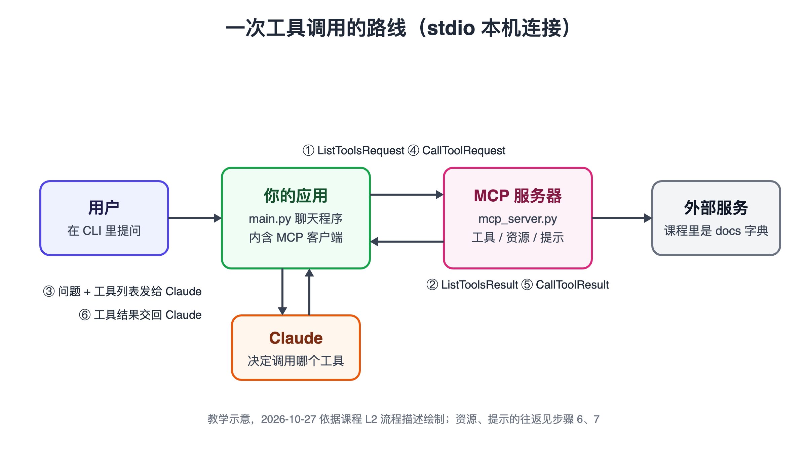
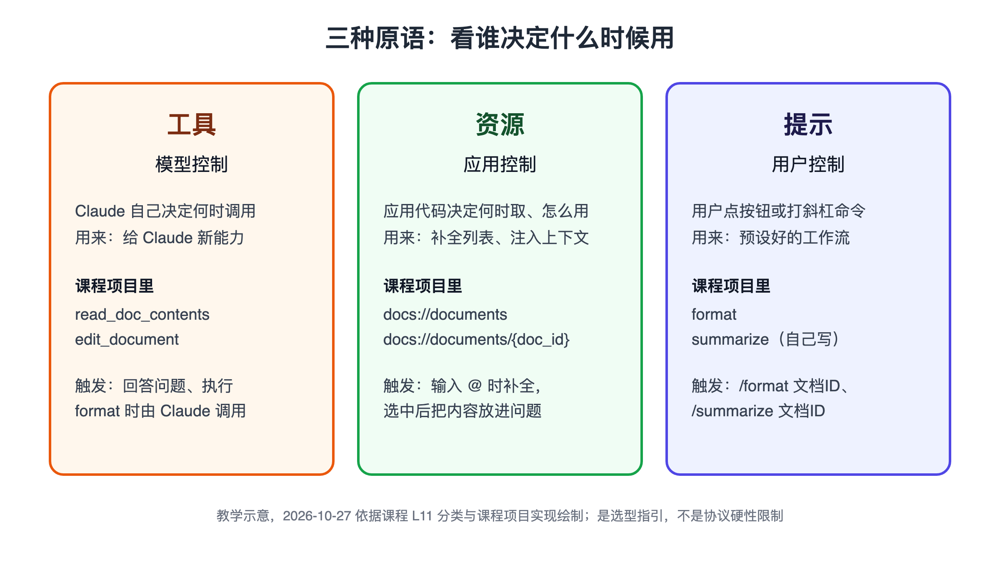

# MCP 入门实战手册：用 Python 写出自己的 MCP 服务器与客户端

> 手册类型：定制版

## 阅读说明

- 依据：Claude Academy 中文课程《模型上下文协议简介》的 10 个内容页（2026-10-27 读取），课程附带的起步项目 `cli_project.zip` 与完整版 `cli_project_COMPLETE.zip`，MCP Python SDK v2 迁移指南，以及 2026-10-27 在本机跑过的两套验证（SDK 1.8.0 与 2.3.0）。课程正文是转述，不是原文；要看原话，点来源编号里的课程链接。
- 先看路线图，再按步骤做。每一步都是“改一个文件 → 跑一条命令 → 看到一个结果”。代码以课程项目里的待补位置为准，本手册只写要求、命令和验收，不贴整段答案；卡住时对照完整版 `cli_project_COMPLETE`。
- 版本有时效：课程项目锁的是 SDK 第 1 版（`mcp[cli]>=1.8.0,<2`），而 2026-10-27 PyPI 上的最新版是 2.3.0，video-mcp 用的也是 2.3.0。主线全部在课程项目里按 v1 做；换到 2.x 要改的地方集中在[附录 E](#section-appendix-e)。
- 数字口径：文中的版本号、行号、返回值都来自课程项目文件或 2026-10-27 本机实测（O14），不是课程讲者的现场数据。
- 不承诺结果：本手册给的是一天的动作目标，验收看命令输出，不看“理解了没有”。
- 示例是虚构的：用〔〕标出的路径、名字都要换成自己的。
- 来源编号：方括号里的 O1、O2 等，点击跳到文末；文末“回到正文”返回。O14 是本机实测记录，不是官方材料。

## 一天路线图

| 时段（10/28 周三） | 这一段做什么 | 点开对应章节 |
|---|---|---|
| 上午前半 | 弄清 MCP 解决什么问题；把课程项目跑起来，认清 6 个待补位置 | [步骤 1](#section-step-1) 概念 · [步骤 2](#section-step-2) 项目 |
| 上午后半 | 写两个工具，用 Inspector 逐个测 | [步骤 3](#section-step-3) 工具 · [步骤 4](#section-step-4) Inspector |
| 下午前半 | 写客户端，让 Claude 通过客户端调用工具；加资源，做 @ 提及 | [步骤 5](#section-step-5) 客户端 · [步骤 6](#section-step-6) 资源 |
| 下午后半 | 加提示，做 / 命令；用“谁控制”给三种原语（服务器能提供的三类东西：工具、资源、提示）分工 | [步骤 7](#section-step-7) 提示 · [步骤 8](#section-step-8) 选原语 |

逐段用时见[时间表](#section-schedule)。

这一阶段先不做 HTTP 传输、远程部署、授权和把课程代码搬进 video-mcp；以后再看[附录 F](#section-appendix-f)，搬迁步骤见[附录 E](#section-appendix-e)。

## 本次条件

| 项目 | 条件 |
|---|---|
| 身份 | 一个人做 AI 工具和内容，在跟陈天训练营和邓明 Agent 课程 |
| 当前项目 | video-mcp：Python + uv + `mcp[cli]>=2.3.0`，代码只有骨架；2026-10-27 决定只做工具层 |
| 本机环境 | uv 0.11.26、Node v24.14.0、npx 11.9.0（2026-10-27 已核） |
| 可用时间 | 周一到周三 10:00–19:00，午休 13:00–14:00；本手册排在 10/28 周三一天 |
| Anthropic API key | 未确认；只影响步骤 5–7 的聊天验证 |
| 阅读偏好 | 先看结论和路线图；要能照着做的命令、路径；术语要解释 |
| 不作为目标 | 背下 SDK 的全部接口；把课程项目改造成产品 |

### 条件不同时怎么调

- 时间更少（只有半天）：只做步骤 1–5，验收到“聊天里 Claude 调用了 `read_doc_contents`”为止；资源和提示放到下一个周一。
- 没有 API key：步骤 3–7 的服务器部分照做，用 Inspector 验收；客户端部分用 `uv run mcp_client.py` 打印结果来验收，跳过 `uv run main.py`。拿到 key 后补跑步骤 5–7 的聊天验收即可。
- 只想学写服务器（video-mcp 只做工具层，客户端由 Claude Code 充当）：做步骤 1–4、步骤 6 和步骤 7 的服务器部分、步骤 8；客户端部分读一遍知道原理即可。
- 想直接用 SDK 2.x 学：不建议在课程项目里升级，先按 v1 做完，再照[附录 E](#section-appendix-e) 单独搬一份。

### 一天要完成什么

| 结果 | 数量 | 在哪一步 |
|---|---|---|
| 可运行的课程项目（依赖装好、.env 填好） | 1 个 | [步骤 2](#section-step-2) |
| 服务器工具：读文档、编辑文档 | 2 个 | [步骤 3](#section-step-3) |
| Inspector 测试记录：正常读、先改后读、读不存在的文档 | 3 次 | [步骤 4](#section-step-4) |
| 客户端方法：`list_tools`、`call_tool`、`read_resource`、`list_prompts`、`get_prompt` | 5 个 | [步骤 5](#section-step-5)–[步骤 7](#section-step-7) |
| 服务器资源：文档列表、单篇文档 | 2 个 | [步骤 6](#section-step-6) |
| 服务器提示：`format`、自己写的 `summarize` | 2 个 | [步骤 7](#section-step-7) |
| 原语分工表（课程项目 + 你自己的一个功能） | 1 张 | [步骤 8](#section-step-8) |

### 阻碍完成的缺口（动手前先看）

- G1 Anthropic API key：`main.py` 启动时会检查 `ANTHROPIC_API_KEY` 不为空，空着直接退出（`main.py:20-23`）[[O11](#source-o11)]。影响步骤 5–7 的聊天验收；缺了可以先用 Inspector 验收服务器，在 `mcp_client.py` 的 `main()` 里调用客户端方法并打印来验收客户端（步骤 5–7 都写了做法）。
- G2 SDK 版本：课程代码在 2.3.0 上第一行 import 就报 `ModuleNotFoundError`[[O14](#source-o14)]。影响所有步骤；做法是课程项目只用它自带的 `uv.lock`（实装 1.8.0），不要 `uv add mcp` 或改 `pyproject.toml`。
- G3 Inspector 首次启动要联网下载：`mcp dev` 通过 npx 拉取 `@modelcontextprotocol/inspector`（2026-10-27 拉到的是 2.12.0）[[O14](#source-o14)]。影响步骤 4、6、7 的 Inspector 验收；断网时改用 `uv run mcp_client.py` 打印结果。

## 时间表

| 时段 | 要做的事 | 用时 | 当段产物 |
|---|---|---|---|
| 10:00–10:30 | [步骤 1](#section-step-1) 读 L1、L2，画出一次工具调用的路线 | 30 分钟 | 一句话说清 MCP 和 tool use 的区别 |
| 10:30–11:00 | [步骤 2](#section-step-2) 解压、装依赖、填 .env、读待补位置 | 30 分钟 | 能启动的项目 |
| 11:00–12:00 | [步骤 3](#section-step-3) 写两个工具 | 60 分钟 | `mcp_server.py` 里 2 个工具 |
| 12:00–13:00 | [步骤 4](#section-step-4) Inspector 测三种情况 | 60 分钟 | 3 次测试结果 |
| 14:00–15:00 | [步骤 5](#section-step-5) 客户端两个方法 + 聊天验收 | 60 分钟 | Claude 调到你的工具 |
| 15:00–16:15 | [步骤 6](#section-step-6) 资源两端 + @ 提及 | 75 分钟 | 2 个资源、`read_resource` |
| 16:15–17:45 | [步骤 7](#section-step-7) 提示两端 + 自己写 summarize | 90 分钟 | 2 个提示、/ 命令可用 |
| 17:45–18:30 | [步骤 8](#section-step-8) 分工表 + 对照完整版 | 45 分钟 | 分工表 |
| 18:30–19:00 | 缓冲；有余力读[附录 E](#section-appendix-e) | 30 分钟 | — |

时间安排是助手建议，合计 8 小时，正好是 10/28 扣掉午休后的可用时间；步骤 7 留得最长，因为 summarize 提示要自己写、自己测。

## 步骤 1 先弄清 MCP 替你省掉了什么

课程第一课和第二课只讲概念，但后面每一步都在补这张图里的一段。先把“一次工具调用要经过谁”画清楚，后面写代码时就知道自己在补哪一段。

**目标**：能用课程的 GitHub 例子，说出没有 MCP 时要自己写什么、有了 MCP 之后谁来写。

1. 读 L1。课程的例子是：做一个能回答用户 GitHub 问题（L2 用的是“我有哪些仓库”）的聊天应用，没有 MCP 就得自己为 GitHub 的大量功能写工具定义和调用代码，还要长期维护；有了 MCP，这些交给一个专门的 GitHub MCP 服务器，你的应用只负责连上它[[O1](#source-o1)]。
2. 记住 L1 结尾三个问答的结论：MCP 服务器谁都能写，常见的是服务商官方出；和直接调 API 的区别是工具定义已经写好；MCP 不等于 tool use，tool use 讲的是 Claude 怎么调用工具，MCP 讲的是工具由谁来实现[[O1](#source-o1)]。
3. 读 L2，认两对消息：`ListToolsRequest/Result`（问服务器有哪些工具）和 `CallToolRequest/Result`（让服务器带参数跑一个工具）。客户端和服务器之间的“线路”可以是同一台机器上的标准输入输出（stdio），也可以是 HTTP、WebSocket，课程项目用的是 stdio[[O2](#source-o2)]。
4. 对着下图，把 L2 的 12 步流转压成一句话：应用先向 MCP 服务器要工具列表，连同用户问题发给 Claude；Claude 决定用哪个工具，应用再让 MCP 客户端去执行，结果交回 Claude 写最终回答[[O2](#source-o2)]。

图注：教学示意，2026-10-27 依据课程 L2 的流程描述绘制[[O2](#source-o2)]。只画 stdio 本机连接的情况；“你的应用”在课程项目里就是 `main.py` 启动的 CLI 聊天程序。

**做完的标准**：不看课程，能在纸上画出“应用、Claude、MCP 客户端、MCP 服务器、外部服务”五个方框和两次 MCP 往返，并说出 MCP 与 tool use 的区别。

- [ ] 能说出 ListTools 和 CallTool 分别在流程的哪一步发生
- [ ] 能说出课程项目用的是哪种传输（stdio）

**补充说明**：课程页面配有讲者视频，本手册没有转写；正文已覆盖每课的操作，想看讲者演示时再打开课程页。图里省略了最后一段“应用把 Claude 的回答显示给用户”。

参见附录：[术语表](#section-appendix-d)。

## 步骤 2 把课程项目跑起来，认清 6 个待补位置

整门课都在补同一个小项目：一个命令行聊天程序，自带一个内存里的“文档库”MCP 服务器。先让它能启动，再看清每个待补位置属于后面哪一步。

**目标**：项目依赖装好、`.env` 填好，并能说出 `mcp_server.py` 与 `mcp_client.py` 里每个待补位置对应的课次。

1. 从课程 L3 页面的下载链接拿到 `cli_project.zip`，解压到一个不在其他仓库里的目录，例如〔`~/code/mcp-course/cli_project`〕[[O3](#source-o3)]。完整版 `cli_project_COMPLETE.zip` 也一起下好，单独解压，只用来对答案。
2. 在项目目录运行 `uv sync`。项目自带 `uv.lock`，2026-10-27 实装的是 `mcp` 1.8.0 和 `anthropic` 0.51.0；课程 README 写的是 `uv venv` + `uv pip install -e .`，那种装法不读 `uv.lock`，只按 `pyproject.toml` 的范围取版本；用 `uv sync` 才能保证装的是 1.8.0。两种都不要升级到 2.x（见 G2）[[O11](#source-o11)、[O14](#source-o14)]。
3. 打开 `.env`：`CLAUDE_MODEL` 已预设为 `claude-haiku-4-5`，`USE_UV=1` 表示用 uv 启动服务器；把自己的 key 填进 `ANTHROPIC_API_KEY`。`.env` 已在项目的 `.gitignore` 里，不要把它复制进别的仓库[[O11](#source-o11)]。
4. 打开 `mcp_server.py`，6 个待补位置依次是：读文档工具、编辑文档工具、返回全部文档 ID 的资源、返回单篇内容的资源、改写成 Markdown 的提示、总结文档的提示。文档就存在同一文件的 `docs` 字典里，键是文档 ID（如 `report.pdf`），值是一句话内容[[O11](#source-o11)]。
5. 打开 `mcp_client.py`，5 个方法（`list_tools`、`call_tool`、`list_prompts`、`get_prompt`、`read_resource`）都只返回空值；文件底部的 `main()`（`mcp_client.py:79-85`）是留给你自测的入口，里面只有 `pass`，默认用 `uv run mcp_server.py` 启动服务器[[O11](#source-o11)]。

**做完的标准**：`uv sync` 无报错；`.env` 三个变量都有值；你在待补位置旁边标出了步骤号（3、3、6、6、7、7）。

- [ ] 依赖装好，`uv pip list` 里 `mcp` 是 1.x
- [ ] 完整版已解压在另一个目录，没有覆盖起步项目

**项目自带的约定**：聊天里输入 `@文档ID` 会把文档内容带进问题，输入 `/` 会列出服务器提供的命令；`uv run main.py 〔另一个服务器.py〕` 还能再挂上别的 MCP 服务器[[O11](#source-o11)]。这些功能要等步骤 5–7 补完客户端才会生效；@ 和 / 的处理在 `core/cli_chat.py:21-63`，补全列表在 `core/cli.py:179-197`。

参见附录：[不做 / 依据 / 改为](#section-appendix-a)。

## 步骤 3 用装饰器写两个工具

这一章开始写服务器。SDK 的装饰器会根据函数签名自动生成 JSON schema（描述参数名、类型、说明的一段 JSON，Claude 靠它知道该怎么传参），你只写 Python 函数和描述。

**目标**：在 `mcp_server.py` 里写出 `read_doc_contents` 和 `edit_document` 两个工具。

1. 确认文件顶部已有 `mcp = FastMCP("DocumentMCP", log_level="ERROR")`，并补一行 `from pydantic import Field`。`Field` 是数据校验库 pydantic 提供的参数说明写法，这里用来给每个参数写描述[[O3](#source-o3)]。
2. 写读文档工具：用 `@mcp.tool(name="read_doc_contents", description=...)` 装饰一个函数，参数 `doc_id: str = Field(description=...)`；ID 不在 `docs` 里就抛 `ValueError`，否则返回内容[[O3](#source-o3)、[O12](#source-o12)]。
3. 写编辑工具 `edit_document`：三个参数 `doc_id`、`old_str`、`new_str`，做一次查找替换后写回 `docs`；`old_str` 的描述里写明“必须逐字匹配，包括空白”，这句话是写给 Claude 看的[[O3](#source-o3)、[O12](#source-o12)]。
4. 描述写成完整的一句话，说清工具做什么、参数是什么。Claude 只能靠名字和描述决定什么时候调用它[[O3](#source-o3)]。
5. 先不跑聊天，直接进步骤 4 用 Inspector 测；Inspector 不需要 API key[[O4](#source-o4)、[O14](#source-o14)]。

**做完的标准**：`mcp_server.py` 里有两个带描述的工具，每个参数都用 `Field` 写了描述，不存在的 ID 会抛错而不是返回空字符串。

- [ ] 两个工具的 `name` 与课程一致（`cli_chat` 等代码不依赖工具名，但对答案时方便）
- [ ] 编辑工具改的是 `docs` 字典本身

**实测**：用完整版的服务器在 SDK 1.8.0 上调用，`read_doc_contents` 读 `report.pdf` 返回原句；`edit_document` 把 `20m` 换成 `25m` 后返回内容为空、`isError` 为 false；读不存在的 `nope.md` 时 `isError` 为 true，错误文本里带着你抛出的那句话[[O14](#source-o14)]。

参见附录：[案例 3](#section-appendix-b)。

## 步骤 4 用 Inspector 测工具，不接聊天程序

Inspector 是 SDK 自带的浏览器调试页面，能单独连上你的服务器，列出工具、填参数、看返回。以后每加一个功能，都先在这里测通再接客户端。

**目标**：在 Inspector 里完成三次测试：正常读、先改后读、读一个不存在的 ID。

1. 在项目目录运行 `uv run mcp dev mcp_server.py`。终端会打印一个 `http://127.0.0.1:6274?...` 开头的地址并自动打开浏览器；第一次运行要等 npx 下载 Inspector（见 G3）[[O4](#source-o4)、[O14](#source-o14)]。
2. 点 Connect，状态从 Disconnected 变成 Connected 后，进 Tools 页点 List Tools，应看到你写的两个工具和参数说明[[O4](#source-o4)]。
3. 选 `read_doc_contents`，`doc_id` 填 `deposition.md`，点 Run Tool，核对返回的是字典里那句话[[O4](#source-o4)]。
4. 选 `edit_document` 改 `report.pdf` 里的一个词，再用读工具读一次，确认改动还在。Inspector 在多次调用之间保留服务器状态，所以能这样串着测[[O4](#source-o4)]。
5. 用读工具读一个不存在的 ID，确认界面显示的是错误而不是空结果；在 1.8.0 上错误文本里能看到你抛出的那句话[[O14](#source-o14)]。测完在终端按 Ctrl+C 停掉。以后改了 `mcp_server.py`，都要停掉重开 `mcp dev` 才能看到新代码。

**做完的标准**：三次测试的结果都和预期一致，且你能说出“先改后读”为什么在 Inspector 里成立。

- [ ] List Tools 能看到两个工具
- [ ] 先改后读，读到的是改过的内容
- [ ] 不存在的 ID 返回错误

**说明**：课程提醒 Inspector 界面在持续改版，按钮位置可能和课程视频不同，但连接、列出、运行这三个动作不变[[O4](#source-o4)]。本手册只核过 2.12.0 能启动并给出地址，界面按钮未逐个核对[[O14](#source-o14)]。

## 步骤 5 写客户端，让 Claude 调到你的工具

服务器测通后，补客户端这一侧。课程说明：真实项目里一般只写客户端或只写服务器，这门课两边都写，是为了看清它们怎么配合[[O5](#source-o5)]。

**目标**：补全 `list_tools` 和 `call_tool`，先用脚本自测，再在聊天里让 Claude 读出 `report.pdf`。

1. 看懂 `MCPClient` 的结构：`connect()` 用 `StdioServerParameters` 启动服务器进程，再建一个 SDK 的 `ClientSession`；`AsyncExitStack` 负责退出时关掉连接和子进程。这个封装就是为了不漏清理[[O5](#source-o5)、[O11](#source-o11)]。
2. `list_tools`：调用 `self.session().list_tools()`，返回结果里的 `tools` 列表[[O5](#source-o5)、[O12](#source-o12)]。
3. `call_tool`：把工具名和 Claude 给的参数原样交给 `self.session().call_tool(...)`，返回结果对象[[O5](#source-o5)、[O12](#source-o12)]。
4. 在文件底部 `main()` 的 `async with` 里调用一次 `list_tools()` 并打印，运行 `uv run mcp_client.py`，应看到两个工具的名字、描述和输入 schema[[O5](#source-o5)]。
5. 有 key 时运行 `uv run main.py`，问“report.pdf 里写了什么”。幕后顺序是：应用取工具列表 → 连同问题发给 Claude → Claude 选 `read_doc_contents` → 应用通过客户端执行 → 结果交回 Claude 作答[[O5](#source-o5)]。

**做完的标准**：`uv run mcp_client.py` 打印出两个工具；有 key 时，Claude 的回答里出现 report.pdf 的那句话。

- [ ] 自测脚本打印出工具定义
- [ ] 聊天里 Claude 调用了你的工具（没有 key 时标“待补”）

**补充说明**：`core/tools.py` 已经写好了“把 MCP 工具转成 Claude 能用的格式、执行后把结果交回”的逻辑，你只补客户端的两个方法；想看清 Claude 那一侧怎么接，读这个文件即可[[O11](#source-o11)]。

## 步骤 6 加资源，做 @ 提及

工具是让 Claude 去做事；资源是让你的应用自己取数据。课程的场景是 `@文档名`：输入时要补全文档列表，选中后直接把内容放进问题，省掉一次工具调用[[O6](#source-o6)]。

**目标**：服务器有两个资源（文档列表、单篇文档），客户端能按 MIME 类型（说明数据格式的标签，如 `application/json`）读出来，聊天里 @ 提及可用。

1. 写直接资源：`@mcp.resource("docs://documents", mime_type="application/json")`，返回全部文档 ID 的列表。直接资源的 URI 固定、不带参数；返回 Python 列表即可，SDK 会自动序列化[[O6](#source-o6)、[O12](#source-o12)]。
2. 写模板资源：URI 写成 `docs://documents/{doc_id}`，`mime_type="text/plain"`，函数参数名和花括号里的名字一致，SDK 解析 URI 后按关键字参数传入[[O6](#source-o6)、[O12](#source-o12)]。
3. 用 `uv run mcp dev mcp_server.py` 测：直接资源在 Resources 栏，模板资源在 Resource Templates 栏[[O6](#source-o6)]。
4. 补客户端 `read_resource`：用 `AnyUrl(uri)` 发请求，取 `contents` 的第一个元素；MIME 是 `application/json` 就 `json.loads` 后返回，否则返回文本。需要的 import 是 `json` 和 `from pydantic import AnyUrl`[[O7](#source-o7)、[O12](#source-o12)]。没有 key 时，在 `main()` 里分别读 `docs://documents` 和 `docs://documents/report.pdf` 并打印：前者应是 Python 列表，后者应是字符串[[O14](#source-o14)]。
5. 重启 `uv run main.py`（补全列表只在启动时取一次），输入 `@`，应弹出文档补全；选一篇提问，Claude 不需要再调读文档工具就能回答[[O7](#source-o7)]。`@文档ID` 前后要留空格，例如 `@report.pdf 里写了什么`：程序按空格切词、要求和文档 ID 完全相等，连着汉字或中文标点就匹配不上，内容不会注入，Claude 会改用读文档工具（`core/cli_chat.py:35-49`）[[O11](#source-o11)]。

**做完的标准**：Inspector 两栏各看到一个资源；`main()` 自测打印出列表和正文；有 key 时，聊天里 @ 补全列出 6 篇文档。

- [ ] 读 `docs://documents` 得到列表而不是字符串
- [ ] 读 `docs://documents/report.pdf` 得到正文

**实测**：在 SDK 1.8.0 上，模板资源的列表项里 `mimeType` 显示为空，实际读取时返回 `text/plain`[[O14](#source-o14)]。在 1.8.0 的 Inspector 里看到模板资源没标类型，不是你写错了；2.3.0 的表现见[附录 E2](#section-appendix-e)。

## 步骤 7 加提示，做 / 命令，自己补上 summarize

提示是服务器作者预先写好、测过的指令模板。用户自己也能让 Claude“把这篇改成 Markdown”，但作者写的专用提示能把边界情况处理好、结果更稳定[[O8](#source-o8)]。

**目标**：服务器有 `format` 和 `summarize` 两个提示，客户端能列出和取用，聊天里 `/format`、`/summarize` 可用。

1. 写 `format` 提示：`@mcp.prompt(name="format", description=...)`，参数 `doc_id`，返回消息列表（`from mcp.server.fastmcp.prompts import base`，用 `base.UserMessage(...)`）。指令内容自己写：要求把指定文档改写成 Markdown、用 `edit_document` 写回、不解释改动[[O8](#source-o8)、[O12](#source-o12)]。
2. 写 `summarize` 提示：起步项目的最后一个待补位置就是它，README 的用法示例也是 `/summarize deposition.md`，但完整版里**没有实现**（见[案例 1](#section-appendix-b)）[[O11](#source-o11)、[O12](#source-o12)]。照 `format` 的结构写，指令改成“读文档并总结”；参数必须叫 `doc_id`，因为客户端写死了这个参数名（`core/cli_chat.py:33`、`:58-60`）[[O11](#source-o11)]。要求清单见[模板 T2](#template-t2)。
3. 用 Inspector 的 Prompts 页测两个提示：填 `doc_id` 后看实际生成的消息，确认文档 ID 已插进去[[O8](#source-o8)]。
4. 补客户端：`list_prompts` 返回 `prompts` 列表；`get_prompt(prompt_name, args)` 把参数字典原样传过去，返回结果里的 `messages`。参数字典里的键会变成提示函数的关键字参数，例如 `{"doc_id": "plan.md"}`[[O9](#source-o9)、[O12](#source-o12)]。没有 key 时，在 `main()` 里打印 `list_prompts()` 和 `get_prompt("format", {"doc_id": "plan.md"})`：应看到 1 条 user 消息，内容里有 `plan.md`[[O14](#source-o14)]。
5. 重启 `uv run main.py`，输入 `/`，按 Tab 补全选 `format`，再选文档；预期 Claude 会读出内容后用 `edit_document` 写回（本手册未跑聊天，not_tested）[[O9](#source-o9)、[O11](#source-o11)]。`/命令` 后面必须带一个文档 ID：只输 `/format` 就回车会抛 `IndexError`，程序直接退出，因为主循环只捕获 Ctrl+C（`core/cli.py:199-210`）[[O11](#source-o11)]。

**做完的标准**：Inspector 的 Prompts 页能看到两个提示；`main()` 自测打印出 1 条含文档 ID 的消息；有 key 时，`/summarize 〔某篇文档〕` 返回一段总结，且没有改动文档。

- [ ] `format` 改写后，用读工具能读到 Markdown 版本
- [ ] `summarize` 的参数叫 `doc_id`

**实测**：完整版的 `format` 提示在 1.8.0 上返回 1 条 user 消息，且消息里包含传入的文档 ID[[O14](#source-o14)]。

## 步骤 8 按“谁控制”给三种原语分工，对照完整版收尾

前七步写了三种东西，课程最后一课把它们的区别归成一句：看谁决定什么时候用它[[O10](#source-o10)]。把这个判断用到课程项目和你自己的一个功能上，这门课就算学完了。

**目标**：填完一张分工表，说清课程项目里每个功能为什么是工具、资源或提示；再拿自己的一个功能做一次同样的判断。

1. 记住三条：工具由模型控制，Claude 决定何时调用；资源由应用控制，应用决定何时取、怎么用（补全列表、注入上下文）；提示由用户控制，用户通过斜杠命令或按钮触发[[O10](#source-o10)]。
2. 对照下图，把课程项目的 6 个功能填进[模板 T1](#template-t1) 的分工表，每行写清“谁触发”[[O10](#source-o10)、[O12](#source-o12)]。
3. 从你自己的项目里挑一个功能，按同样三问判断：要给 Claude 新能力 → 工具；应用要取数据放进界面或上下文 → 资源；要给用户一个预设工作流 → 提示[[O10](#source-o10)]。用 video-mcp 举例的话，见[附录 E](#section-appendix-e)。
4. 只对比两个改过的文件：`diff mcp_server.py 〔完整版目录〕/mcp_server.py`，`mcp_client.py` 同理（起步项目和完整版只差这两个文件）[[O12](#source-o12)]。预期会看到这些差异，都不算错：完整版留着全部待补注释和一段注释掉的旧方法（`mcp_client.py:47-68`），import 写在文件中间，`call_tool` 的参数少了 `: dict` 类型标注（`mcp_client.py:73-74`），函数名不同（如读工具的函数叫 `read_document`，资源函数叫 `list_docs`、`fetch_doc`），描述与提示措辞不同，以及完整版没有 `summarize`。
5. 回到步骤 1 的那张流程图，在旁边补上资源和提示各走哪条路：资源由应用在 Claude 之前取，提示由用户命令触发后再交给 Claude[[O7](#source-o7)、[O9](#source-o9)]。

图注：教学示意，2026-10-27 依据课程 L11 的分类和课程项目的实现绘制[[O10](#source-o10)、[O12](#source-o12)]。“谁控制”是课程给的选型指引，不是协议层面的硬性限制。

**做完的标准**：分工表 7 行都有“谁触发”，且你自己的那个功能写了判断理由。

- [ ] 能不看笔记说出三种原语各由谁控制
- [ ] 两个文件的 diff 差异都能归到上面几类

**补充说明**：课程用 Claude 自己的界面举例：提示对应用户一键触发的工作流按钮，资源对应“从 Google Drive 添加”这类由应用取数据的功能，工具则是 Claude 执行代码、做计算时在幕后调用的[[O10](#source-o10)]。

## 附录 A｜不做 / 依据 / 改为

| 不做 | 依据 | 改为 |
|---|---|---|
| 在课程项目里升级到 `mcp` 2.x | 课程代码在 2.3.0 上 import 即失败[[O14](#source-o14)] | 课程项目用自带锁文件；2.x 另起一份，照附录 E 改 |
| 直接复制完整版代码 | 完整版只用于对答案；`summarize` 它也没有[[O12](#source-o12)] | 先按步骤要求自己写，卡住再看完整版对应函数 |
| 写完服务器就接聊天程序调试 | 课程把 Inspector 放在客户端之前[[O4](#source-o4)] | 每加一个功能先在 Inspector 测通 |
| 工具里找不到文档时返回空字符串 | 课程做法是抛 `ValueError`，客户端能看到错误[[O3](#source-o3)、[O14](#source-o14)] | 抛带上下文的异常 |
| 把所有功能都写成工具 | L11：资源和提示由应用、用户控制，适合不同场景[[O10](#source-o10)] | 按“谁控制”分工 |
| 把 `.env` 复制进其他仓库 | key 只放 `.env`，并确保它在 `.gitignore` 里 | 每个项目单独一份 `.env` |

## 附录 B｜案例卡

以下三张卡都是 2026-10-27 制作本手册时在本机真实遇到的情况，不是课程讲者的案例。

### 案例 1｜完整版缺了一个待补位置

- 起点：起步项目 `mcp_server.py` 有 6 个待补位置，README 的用法示例是 `/summarize deposition.md`。
- 做法：用 `diff -r` 对比起步项目和完整版。
- 结果：完整版实现了 5 个，`summarize` 提示没有实现，待补注释还留在文件里；客户端文件里旧的待补桩也以注释形式保留[[O12](#source-o12)]。
- 可借鉴：参考答案不一定完整，对答案前先 diff 一遍；没写完的部分正好留给自己练习（步骤 7）。
- 来源：[[O11](#source-o11)、[O12](#source-o12)]

### 案例 2｜课程代码在最新 SDK 上第一行就失败

- 起点：video-mcp 锁的是 `mcp[cli]>=2.3.0`，想直接拿课程写法用。
- 做法：在 2.3.0 环境里运行完整版服务器。
- 结果：`ModuleNotFoundError: No module named 'mcp.server.fastmcp'`，报错信息直接给出新类名 `MCPServer` 和迁移指南地址；改 3 行（2 行 import、1 行创建服务器对象）后服务器跑通，客户端还要改字段名和 URI 类型[[O13](#source-o13)、[O14](#source-o14)]。
- 可借鉴：课程项目保持 v1；搬到 video-mcp 时按附录 E 逐项改，并用同一个验证脚本跑一遍。
- 来源：[[O13](#source-o13)、[O14](#source-o14)]

### 案例 3｜同一个错误，两版返回的信息不同

- 起点：读不存在的文档 `nope.md`。
- 做法：分别在 1.8.0 和 2.3.0 上调用读文档工具。
- 结果：两版都返回 `isError`/`is_error` 为 true；1.8.0 的错误文本带着 `ValueError` 里那句话，2.3.0 只说执行出错，具体原因只在服务器日志里[[O14](#source-o14)]。
- 可借鉴：在 2.x 上写工具时，不能指望 Claude 从错误文本里看到原因；需要让 Claude 知道的原因，查迁移指南里的错误处理写法再决定怎么返回[[O13](#source-o13)]。
- 来源：[[O14](#source-o14)]

## 附录 C｜模板（占位均为虚构）

### 模板 T1：原语分工表

| 功能 | 做成 | 谁触发 | 在课程项目里怎么触发 |
|---|---|---|---|
| 读文档 | 工具 | Claude | 回答问题时自己决定调用 |
| 编辑文档 | 工具 | Claude | 执行 format 提示时调用 |
| 文档 ID 列表 | 资源 | 应用 | 输入 @ 时取来做补全 |
| 单篇文档内容 | 资源 | 应用 | @ 选中后注入问题 |
| 改写成 Markdown | 提示 | 用户 | `/format 〔文档ID〕` |
| 总结文档 | 提示 | 用户 | `/summarize 〔文档ID〕` |
| 〔你自己的一个功能〕 | 〔工具/资源/提示〕 | 〔谁〕 | 〔理由〕 |

### 模板 T2：summarize 提示的要求清单

写之前先填这张清单，再写成提示函数：

- 名称：`summarize`；描述：〔一句话说清它做什么〕
- 参数：必须叫 `doc_id`，客户端写死了这个名字（`core/cli_chat.py:33`）；`Field` 描述写清是文档 ID
- 指令要包含：要总结的文档 ID（用标签包起来便于识别）；先用读文档工具取内容；总结的长度与形式〔例：3 条要点〕；明确“不要修改文档”
- 验收：Inspector 的 Prompts 页里，消息包含传入的文档 ID；聊天里 `/summarize 〔report.pdf〕` 返回总结，读工具读到的原文没变

## 附录 D｜术语表

| 术语 | 白话解释 |
|---|---|
| MCP（Model Context Protocol） | 让 AI 应用和外部工具、数据之间用统一格式对话的协议 |
| MCP 服务器 | 把某个外部服务包装成一组标准工具、资源、提示的程序；课程里是 `mcp_server.py` |
| MCP 客户端 | 你的应用里负责连服务器、收发消息的那部分；课程里是 `mcp_client.py` 的 `MCPClient` |
| tool use（工具使用） | Claude 在回答中决定调用某个工具、给出参数的机制；MCP 负责把工具提供出来 |
| 原语 | MCP 服务器能提供的三类东西：工具、资源、提示 |
| stdio | 标准输入输出；客户端把服务器当子进程启动，用管道收发消息 |
| JSON schema | 描述参数结构的 JSON；SDK 根据函数签名自动生成 |
| URI 模板 | 带 `{参数}` 的资源地址，如 `docs://documents/{doc_id}` |
| MIME 类型 | 告诉对方数据是什么格式，如 `application/json`、`text/plain` |
| Inspector | SDK 自带的浏览器调试页，用 `mcp dev` 启动 |
| FastMCP / MCPServer | SDK 里写服务器用的高层类；v1 叫 FastMCP，v2 改名 MCPServer |

## 附录 E｜扩展：把同一套写法搬到 video-mcp（SDK 2.3.0）

这一节是课外扩展，课程没有讲。依据是 SDK v2 迁移指南和 2026-10-27 在本机用 2.3.0 跑通的同一套验证[[O13](#source-o13)、[O14](#source-o14)]。

### E1 服务器要改的 3 行

| v1（课程） | v2（video-mcp） |
|---|---|
| `from mcp.server.fastmcp import FastMCP` | `from mcp.server.mcpserver import MCPServer` |
| `mcp = FastMCP("DocumentMCP", log_level="ERROR")` | `mcp = MCPServer("DocumentMCP", log_level="ERROR")` |
| `from mcp.server.fastmcp.prompts import base` | `from mcp.server.mcpserver.prompts import base` |

`@mcp.tool()`、`@mcp.resource()`、`@mcp.prompt()` 三个装饰器的写法不变[[O13](#source-o13)]。只改这 3 行后，课程服务器在 2.3.0 上通过了全部验证项[[O14](#source-o14)]。

### E2 客户端要改的地方

- 返回对象的字段从驼峰改成下划线：`inputSchema` → `input_schema`，`isError` → `is_error`，`mimeType` → `mime_type`，`uriTemplate` → `uri_template`，`resourceTemplates` → `resource_templates`，`serverInfo` → `server_info`，`protocolVersion` → `protocol_version`[[O13](#source-o13)、[O14](#source-o14)]。
- `read_resource` 直接传字符串 URI，不再包 `AnyUrl`；传 `AnyUrl` 会报参数校验错误（Input should be a valid string）[[O13](#source-o13)、[O14](#source-o14)]。
- 课程项目里要改的位置：`mcp_client.py:9`（删 `AnyUrl` import）、`:87`（`AnyUrl(uri)` 改成 `uri`）、`:91`（`mimeType`）；`core/tools.py:19`（`inputSchema`）、`:92` 和 `:102`（`isError`）。课程客户端的 `from mcp import ClientSession, StdioServerParameters, types` 在 2.3.0 仍可用[[O14](#source-o14)]。
- 同一组验证在 2.3.0 上的其他差异：模板资源在列表里直接标 `text/plain`；`format` 提示同样返回 1 条含文档 ID 的 user 消息[[O14](#source-o14)]。
- 握手协议版本从 `2024-11-05` 变成 `2025-11-25`，不用手动处理[[O14](#source-o14)]。
- 工具报错时 2.3.0 返回的文本不带异常原因（见[案例 3](#section-appendix-b)）[[O14](#source-o14)]。

### E3 video-mcp 里三种原语怎么分（视频与图文并列）

2026-10-27 的范围决定是：video-mcp 只做工具层，编排交给 Claude Code，拆解标准、brief 模板这类经验写进 skill[[O15](#source-o15)]。所以在 video-mcp 里：

| 功能 | 视频 | 图文 | 做成 | 理由 |
|---|---|---|---|---|
| 召回爆款参考 | 按 brief 搜视频笔记 | 按 brief 搜图文笔记 | 工具 | Claude 决定何时搜、搜什么；用 `content_type` 区分两类 |
| 取素材转文本稿 | 下载 + 语音转写 | 取正文 + 图片文字 | 工具 | 同上 |
| 已取回的文本稿 | `〔transcripts://{note_id}〕` | 同一个 URI 模板 | 可选资源 | 只有在要做 @ 引用式界面时才需要；Claude Code 直接读文件也能拿到 |
| 拆解、复刻的做法 | 同一套标准 | 同一套标准 | skill，不做成提示 | 范围决定把经验放进 skill；提示原语留到有自己的界面再考虑 |

表中 URI 是虚构示例。动手前先按 video-mcp 的 specs 走 spec → impl 流程，本表只用来练习步骤 8 的判断[[O15](#source-o15)]。

## 附录 F｜以后再看

| 内容 | 什么情况下才需要 | 出处 |
|---|---|---|
| HTTP / WebSocket 传输 | 服务器要部署到远程、给多个客户端用时 | L2 只提到可以这样连，没有实操[[O2](#source-o2)] |
| Claude Code 里注册自己的 MCP 服务器 | 想在日常编码中直接用 video-mcp 的工具时 | 课程未讲，属于 video-mcp M0 之后的事 |
| 迁移指南全文（授权、httpx 替换等） | 用到远程服务器、OAuth 时 | [[O13](#source-o13)] |
| 课程视频 | 想看讲者现场演示时 | 每课页面都有，本手册未转写 |
| 课程测验 L10 | 想拿徽章时 | 页面需交互，本手册未读到题目 |

## 来源、缺口与核对范围

课程页面于 2026-10-27 用浏览器读取正文，无需登录；课程原文没有保存进本项目，正文是转述。O1–O10 的正文都已读完，页面视频都没看，下面各条只写不同的部分。课程代码包经用户同意后下载，SHA-256 记在 `edit/_raw/sha256.json`。本机实测脚本与日志在 `edit/_raw/verify/`。

### O1 Claude Academy《模型上下文协议简介》L1 介绍 MCP

<https://academy.claude.com/zh-CN/courses/introduction-to-model-context-protocol/introducing-mcp> ，2026-10-27 读取。怎么用：步骤 1 的 GitHub 例子与三个问答。缺口与核对状态：无其他缺口。

[回到正文](#md-cite-o1-1)

### O2 同课程 L2 MCP clients

<https://academy.claude.com/zh-CN/courses/introduction-to-model-context-protocol/mcp-clients> ，2026-10-27 读取。怎么用：传输方式、两对消息、12 步流转（步骤 1 与配图）。缺口与核对状态：无其他缺口。

[回到正文](#md-cite-o2-1)

### O3 同课程 L3 使用 MCP 定义工具

<https://academy.claude.com/zh-CN/courses/introduction-to-model-context-protocol/defining-tools-with-mcp> ，2026-10-27 读取。怎么用：项目下载与安装、`FastMCP` 初始化、两个工具的要求。缺口与核对状态：代码与完整版逐行一致性未比对，以完整版文件为准。

[回到正文](#md-cite-o3-1)

### O4 同课程 L4 服务器检查器

<https://academy.claude.com/zh-CN/courses/introduction-to-model-context-protocol/the-server-inspector> ，2026-10-27 读取。怎么用：Inspector 启动命令、默认地址、Connect → List Tools → Run Tool 的顺序。缺口与核对状态：Inspector 2.12.0 界面未逐个核对按钮。

[回到正文](#md-cite-o4-1)

### O5 同课程 L5 实现客户端

<https://academy.claude.com/zh-CN/courses/introduction-to-model-context-protocol/implementing-a-client> ，2026-10-27 读取。怎么用：客户端结构、`list_tools` / `call_tool`、自测与聊天验收。缺口与核对状态：聊天验收需要 API key，本手册制作时未跑 `main.py`。

[回到正文](#md-cite-o5-1)

### O6 同课程 L6 定义资源

<https://academy.claude.com/zh-CN/courses/introduction-to-model-context-protocol/defining-resources> ，2026-10-27 读取。怎么用：直接资源与模板资源、`mime_type`、Inspector 两栏。缺口与核对状态：无其他缺口。

[回到正文](#md-cite-o6-1)

### O7 同课程 L7 访问资源

<https://academy.claude.com/zh-CN/courses/introduction-to-model-context-protocol/accessing-resources> ，2026-10-27 读取。怎么用：客户端 `read_resource` 的处理逻辑与 @ 提及体验。缺口与核对状态：@ 补全界面未实测。

[回到正文](#md-cite-o7-1)

### O8 同课程 L8 定义提示

<https://academy.claude.com/zh-CN/courses/introduction-to-model-context-protocol/defining-prompts> ，2026-10-27 读取。怎么用：为什么要提示、`format` 例子、Inspector 测提示。缺口与核对状态：课程中的提示原文未搬进本手册，读者自己写。

[回到正文](#md-cite-o8-1)

### O9 同课程 L9 客户端中的提示

<https://academy.claude.com/zh-CN/courses/introduction-to-model-context-protocol/prompts-in-the-client> ，2026-10-27 读取。怎么用：`list_prompts` / `get_prompt` 与参数插值、/ 命令体验。缺口与核对状态：/ 命令界面未实测。

[回到正文](#md-cite-o9-1)

### O10 同课程 L11 MCP 回顾

<https://academy.claude.com/zh-CN/courses/introduction-to-model-context-protocol/mcp-review> ，2026-10-27 读取。怎么用：三种原语各由谁控制、选型三问（步骤 8 与配图）。缺口与核对状态：无其他缺口。

[回到正文](#md-cite-o10-1)

### O11 课程起步项目 cli_project.zip

课程 L3 页面下载区，<https://academy.claude.com/assets/v1/cli_project-nrz6nj8y.zip> ，2026-10-27 下载，SHA-256 `48b0d24c…1533`。怎么用：README、`pyproject.toml`、`.env`、`main.py`、`mcp_server.py` 与 `mcp_client.py` 的待补位置、`core/cli_chat.py` 的 @ 与 / 处理。缺口与核对状态：文件已逐个读过；`uv sync` 已跑通。

[回到正文](#md-cite-o11-1)

### O12 课程完整版 cli_project_COMPLETE.zip

<https://academy.claude.com/assets/v1/cli_project_COMPLETE-m9tg5c08.zip> ，2026-10-27 下载，SHA-256 `55fbcf99…243c`。怎么用：对答案；与起步项目的差异只在 `mcp_server.py` 和 `mcp_client.py`。缺口与核对状态：已 diff；`summarize` 提示未实现（`mcp_server.py` 第 20 行的待补注释仍在）。

[回到正文](#md-cite-o12-1)

### O13 MCP Python SDK v2 迁移指南与 PyPI 版本

<https://py.sdk.modelcontextprotocol.io/v2/migration/> ，2026-10-27 读取前半部分；<https://pypi.org/project/mcp/> 当日最新版 2.3.0。怎么用：附录 E 的类名、import 路径、字段命名、URI 类型变化。缺口与核对状态：指南只读了前半部分（授权、httpx 等未读）；列出的改动已用 O14 实测。

[回到正文](#md-cite-o13-1)

### O14 本机实测记录（2026-10-27）

`edit/_raw/verify/`：`run-v1-mcp1.8.0.log`（完整版服务器在 1.8.0 上列出并调用全部原语）、`run-v2-mcp2.3.0.log`（改 3 行后在 2.3.0 上同样通过）、`run-v2-anyurl.log`（2.3.0 拒收 `AnyUrl`；课程客户端的 import 仍可用）、`run-v1-code-on-mcp2.3.0.log`（未改时的报错）、`inspector-start.log`（`uv run mcp dev` 在 1.8.0 环境启动 Inspector 2.12.0 的输出，令牌已删）、三个验证脚本（含 `check_anyurl_v2.py`）与 `server_v2.py`。怎么用：步骤 2–7 的“实测”段、G2 G3、案例 2 3、附录 E。缺口与核对状态：没有 API key，未跑 CLI 聊天；Inspector 只核到启动。

[回到正文](#md-cite-o14-1)

### O15 video-mcp 仓库与 2026-10-27 范围决定

`ai-tools/video-mcp/pyproject.toml`（`mcp[cli]>=2.3.0`）、`src/video_mcp/__init__.py`（仅打印 Hello）、`specs/index.md`；范围决定“只做工具层”来自 2026-10-27 的会话，尚未写进仓库。怎么用：本次条件、附录 E3。缺口与核对状态：文件已读；范围决定没有仓库内出处，需要时补进 specs。

[回到正文](#md-cite-o15-1)
