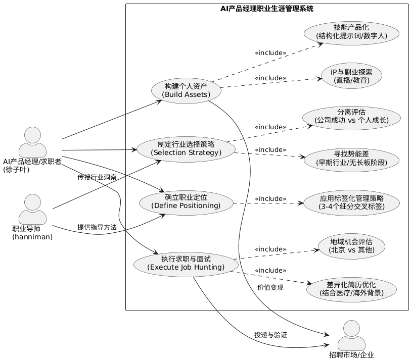
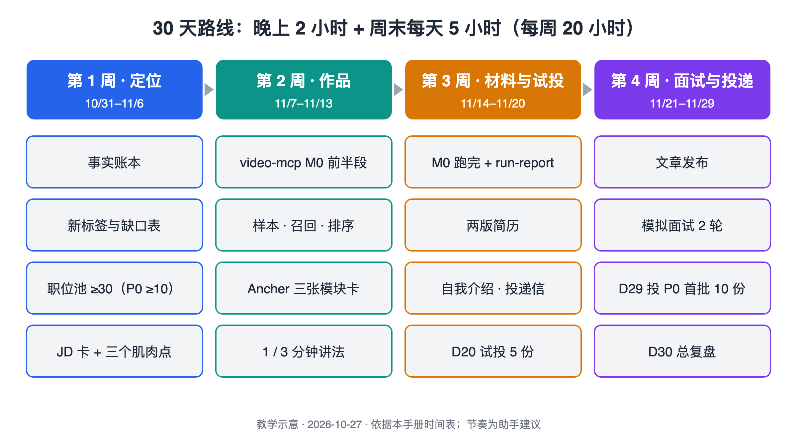
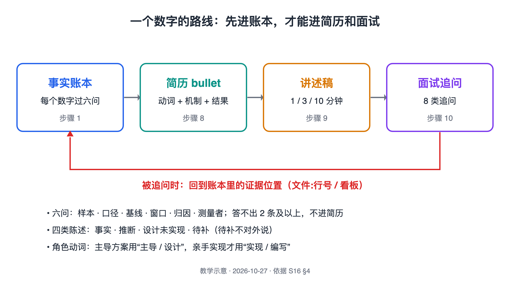
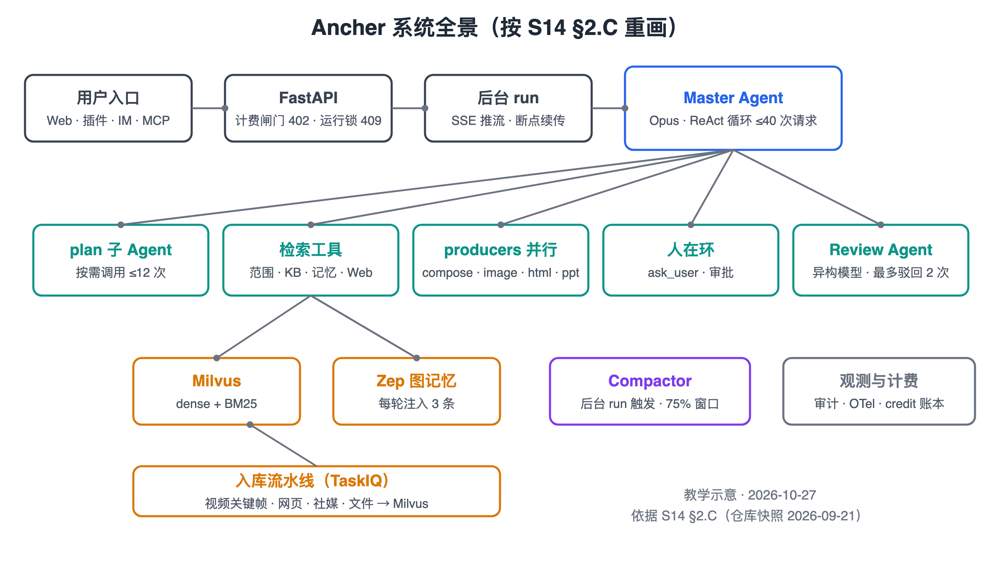

# AI 产品经理转 Agent 产品工程师：30 天求职实战手册

> 手册类型：定制版

<a id="section-intro"></a>
## 阅读说明

这本手册只服务一件事：用 30 天的晚上和周末，把你从“AI 产品经理求职者”改装成“Agent 产品工程师（产品 + 工程混合岗）候选人”，第 3 周开始试投，第 30 天投出第一批最想去的岗位。

流程不是新发明的，沿用你 2025-12 跟导师做的那套《输出与表达》求职 SOP：盘点资产、定标签 → 选赛道、建职位池 → 技能与输出 → 简历与面试[<a id="cite-s1-1"></a>[S1](#source-s1)]。这次换的是内容：标签从“AI 评测、直播电商”换成“Agent 方案、上下文与检索、MCP”；作品从提示词和公众号换成 Ancher 与 video-mcp；面试从“讲产品思路”换成“扛得住工程追问”。

- **数字的性质。** 手册里出现的数字分四类：你简历和项目材料里的数字（每个都要先过[步骤 1](#section-step1) 的资格审查才能用）；导师、课程、社群成员的经验和自述（例如 Sean 一篇文章带来 12 个内推[<a id="cite-s7-1"></a>[S7](#source-s7)]，是本人自述，没有核对）；你自己做过的调研结论（例如 Kimi 18 个岗位的匹配排序，原文就写明“是排序，不是通过率”[<a id="cite-s10-1"></a>[S10](#source-s10)]）；本手册给你排的时间和数量，都是助手建议。
- **岗位信息有时效。** 职位池里的岗位来自抓取当天的官网（Kimi 是 2026-09-26，生财 FDE 招聘页见附录），岗位会下线、改要求。投递前打开原链接再看一眼。
- **不承诺结果。** 手册给的是 30 天的动作目标（账本、职位池、两个项目的讲法、简历、文章、投递数），不是面试数或 offer 预测。你之前用算法选岗时就得出过“放弃纯 Agent 工程岗”的结论[<a id="cite-s10-2"></a>[S10](#source-s10)]，这次方向更激进，第 3 周的试投就是用来检验它的。
- **模板是虚构的。** 附录模板里用〔〕标出的人名、公司、数字都是占位，换成你自己的真实内容再用。
- **来源编号。** 方括号里的 S1、S2 是来源编号，点击跳到文末；文末每条有“回到正文”。S 是你自己的材料和课程资料（标到文件与行号），O 是招聘方官方页面。



图注：你 2025-12 在《输出与表达》里画的“AI 产品经理职业生涯管理系统”用例图（PlantUML 导出，来自 S1 附件 0001）。这本手册保留这四个用例和顺序，只把每个用例里的内容换成 Agent 方向；“IP 与副业探索”这次不做，放进[以后再看](#section-later)。

<a id="section-route"></a>
## 30 天路线图

| 阶段 | 本阶段做什么 | 点开对应章节 |
|---|---|---|
| 第 1 周（D1–D7，10/31–11/6）：定位 | 把所有数字和时间线对齐成一张事实账本；换标签、更新能力自评；建 30 条以上的职位池并定 P0–P3；给 P0 岗位做 JD 拆解卡，选出三个“肌肉点”；开始补 Ancher 的业务数字 | [时间表](#section-schedule) · [步骤 1 事实账本](#section-step1) · [步骤 2 标签](#section-step2) · [步骤 3 职位池](#section-step3) · [步骤 4 JD 拆解](#section-step4) · [步骤 5 Ancher](#section-step5) |
| 第 2 周（D8–D14，11/7–11/13）：作品 | 两个周末日跑 video-mcp M0 的前半段（样本、契约、召回、排序）；晚上做 Ancher 的模块卡和 1 分钟、3 分钟讲法 | [步骤 5 Ancher](#section-step5) · [步骤 6 video-mcp M0](#section-step6) |
| 第 3 周（D15–D21，11/14–11/20）：材料与试投 | 周末跑完 M0 后半段并写 run-report、提交代码；写两版简历、自我介绍和投递信；第 20 天试投 5 份 P1/P2；列文章提纲 | [步骤 6 video-mcp M0](#section-step6) · [步骤 7 文章](#section-step7) · [步骤 8 简历](#section-step8) · [步骤 9 讲述稿](#section-step9) · [步骤 11 投递](#section-step11) |
| 第 4 周与收尾（D22–D30，11/21–11/29）：面试与投递 | 发出文章；用模拟面试官练两轮；处理试投反馈；第 29 天投出 P0 首批 10 份；第 30 天总复盘 | [步骤 7 文章](#section-step7) · [步骤 10 技术面](#section-step10) · [步骤 11 投递](#section-step11) · [步骤 12 复盘](#section-step12) |



图注：教学示意，2026-10-27 依据本手册时间表绘制。节奏是助手建议，按“工作日晚 2 小时、周末每天 5 小时”排出；时间不同时按[条件不同时怎么调](#section-adjust)缩放。

这 30 天先不做：薪资谈判与 offer 选择、专家交流与一手情报、个人 IP 与副业、AI 产品经理岗兜底、编码笔试专项训练；以后再看[附录 F：以后再看](#section-later)。

<a id="section-conditions"></a>
## 本次条件

| 项目 | 条件（2026-10-27 确认） |
|---|---|
| 目标岗位 | Agent 产品工程师（产品 + 工程混合），含 FDE、AI 解决方案类；纯 Agent 工程岗少量试投（P2） |
| 时间线 | 30 天内开始投递 |
| 可用时间 | 只有晚上和周末。本手册按工作日晚 2 小时、周末每天 5 小时排，合计每周 20 小时（**未经确认的示例条件**） |
| 作品集 | Ancher：已上线的多 Agent 知识库，你主导 Agent 方案、工程团队实现[<a id="cite-s14-1"></a>[S14](#source-s14)]；video-mcp：你自己写代码的 MCP 项目，目前只有骨架 |
| 过往背景 | TikTok 东南亚 AI 策略产品（AI 直播诊断）、磨铁直播电商、口笔译；英语专八 / 雅思 7.0、日语 N2；人大计算机在职硕士[<a id="cite-s3-1"></a>[S3](#source-s3)] |
| 起始日 | D1 = 2026-10-31（周六），D30 = 2026-11-29（周日）（**未经确认的示例条件**） |
| 不作为硬指标 | 面试数、offer 数、薪资 |

<a id="section-adjust"></a>
### 条件不同时怎么调

- **时间更少（每周只有 10 小时）：** 保留步骤 1、3、5、8、9、11；video-mcp 只跑到“召回 + 排序 + 文本稿”（M0 前半段）并提交代码，run-report 只写这一段；文章推到第二个月；P0 投递顺延到第 5 周。
- **video-mcp 的输入凑不齐（TikHub Key、真实 brief 等，见 [G4](#section-gaps)）：** 第 2 周的两个周末改做 Ancher 的 eval 小集（[步骤 5](#section-step5) 的“卡住时的备选”），作为“你自己动手做的工程证据”；video-mcp 在简历里写成“在建”，不写成果。
- **Ancher 的业务数字拿不到：** 简历和讲述里只写可核实的工程事实（30 个 Agent、5,669 个提交、35 条 query 校准阈值、成本核算 1.26）[<a id="cite-s14-2"></a>[S14](#source-s14)]，不写“用户量”；被问到时说“数据归公司，我能讲口径”。
- **想主攻纯 Agent 工程岗：** 在第 2–3 周每晚加 1 小时写代码（video-mcp 的工具和测试），并把[附录 F](#section-later) 里的编码笔试准备提前；简历用工程岗版。你自己的算法分析里，这类岗位的硬缺口是 Python 深度（要求 3 / 你 1）和 infra（2 / 0）[<a id="cite-s10-3"></a>[S10](#source-s10)]，30 天补不平，只能用 video-mcp 的提交记录证明“在补”。
- **只想先投一家（例如 Kimi 或生财）：** 步骤 3 只做这一家，步骤 4 的 JD 拆解卡做满这家的全部 P0/P1 岗位；你已有 Kimi 公司整体调研可直接用[<a id="cite-s11-1"></a>[S11](#source-s11)]。

<a id="section-goals"></a>
## 30 天要完成什么

| 结果 | 数量 | 在哪一步 |
|---|---|---|
| 事实账本（每个对外数字的出处与资格） | 1 张 | [步骤 1](#section-step1) |
| 新标签组合与能力缺口表 | 1 套 | [步骤 2](#section-step2) |
| 职位池（含 P0–P3 与跟进字段） | ≥ 30 条，其中 P0 ≥ 10 | [步骤 3](#section-step3) |
| JD 拆解卡 + 三个肌肉点 | P0 每岗 1 张；肌肉点 3 个 | [步骤 4](#section-step4) |
| Ancher 项目卡、模块卡、1/3/10 分钟讲法 | 1 + 3 + 3 | [步骤 5](#section-step5) |
| video-mcp M0：可复现的运行目录、run-report、提交历史 | 1 次完整运行 | [步骤 6](#section-step6) |
| 求职导向技术文章 | 1 篇（已发布） | [步骤 7](#section-step7) |
| 简历 | 2 版（混合岗 / 工程岗） | [步骤 8](#section-step8) |
| 自我介绍、投递信、反问清单 | 各 1 份 | [步骤 9](#section-step9) |
| 模拟面试记录 | 2 轮 | [步骤 10](#section-step10) |
| 投递 | 试投 5 份 + P0 首批 10 份 | [步骤 11](#section-step11) |
| 复盘 | 每次反馈 1 条 + 第 30 天总复盘 | [步骤 12](#section-step12) |

<a id="section-gaps"></a>
## 阻断缺口（动手前先看）

- **G1 Ancher 没有业务数字。** 材料里只有看板定义（DAU/MAU、留存、COGS、毛利），没有数值[<a id="cite-s14-3"></a>[S14](#source-s14)、<a id="cite-s15-1"></a>[S15](#source-s15)]。影响[步骤 5](#section-step5)、[步骤 8](#section-step8)。缺了也可以先做：模块卡、讲述稿，用工程事实撑。
- **G2 你在 Ancher 的时间线和职位名称没写清。** vita-api 仓库 2025-08-27 启动，2026-03-20 改名 Ancher[<a id="cite-s15-2"></a>[S15](#source-s15)]；简历 V21 的 TikTok 经历写到 2025.10，而且 V21 里还没有 Ancher 这段[<a id="cite-s3-2"></a>[S3](#source-s3)]。哪些决策由你提出，底稿也标着【待确认】[<a id="cite-s15-3"></a>[S15](#source-s15)]。影响[步骤 1](#section-step1)、[步骤 8](#section-step8)。D1 先把这一行写进事实账本，再动简历。
- **G3 旧材料的数字和时间线互相打架。** 工程面试官一定会顺着这些追问。影响步骤 1、8、9；缺了也可以先做职位池（步骤 3），它不依赖这些数字。已发现的有[<a id="cite-s3-3"></a>[S3](#source-s3)、<a id="cite-s4-1"></a>[S4](#source-s4)、<a id="cite-s5-1"></a>[S5](#source-s5)]：
  - 工作年限：V20 写 4 年，V21 写 8 年。
  - TikTok 截止时间：V20 写 2025.11，V21 写 2025.10。
  - 人大在职硕士：V20 写 2024.07–2026.07，V21 写 2024.07–2025.07。
  - 郭德纲直播项目归属：V20 放在“字节｜TikTok”一节下（番茄小说），V21 放在磨铁；自我介绍又说“过去 4 年在字节跳动番茄小说”。
  - 诊断响应时间：项目介绍写“30 分钟 → 30 秒（提升 100 倍）”，必答题写“30 分钟 → 2 分钟”；而简历的“提效近 100 倍”和这两个算法都对不上（30 分钟到 30 秒是 60 倍，到 2 分钟是 15 倍）。
  - 双高直播间渗透率：V20 写“提升 20%”，V21 没有数字。
  - 面试答题说直播诊断“用 RAG 架构”，简历和项目介绍里都没说诊断用了 RAG（项目介绍的技能表只写了“理解原理”）。
- **G4 video-mcp 的 M0 交付方案又不在仓库里了。** `specs/index.md` 还列着 `0002-m0-delivery-plan.md`，但 2026-10-27 核对 `specs/` 只有 `0001` 和 `index.md`，`main` 分支没有任何提交，查不到历史[<a id="cite-s19-1"></a>[S19](#source-s19)]。上一本手册留着完整快照（SHA-256 `9c90136e…2c9e`）。M0 开工还需要你先给齐 6 项输入（TikHub Key 和余额、真实 brief、选爆款的 few-shot、复刻路线、配音 Key、小程序原型）[<a id="cite-s19-2"></a>[S19](#source-s19)]。影响[步骤 6](#section-step6)。缺了可以先做：Ancher 的 eval 小集（[步骤 5](#section-step5) 的“卡住时的备选”）。
- **G5 没有任何真实面试记录。** 历史资料里只有“结合实际面试反馈持续迭代”这类占位句。本手册的面试部分都没经过真实面试检验，第 3 周试投后才有第一批反馈。缺了也可以先做：用 P9 模拟面试官练（[步骤 10](#section-step10)）。
- **G6 面试多在工作日白天，你只有晚上和周末。** 第 3 周试投后，面试邀约可能落在工作日白天。投递前先想好：能不能请假或调休、能不能主动提出晚上或线上面试（助手建议，未经你确认）。影响[步骤 11](#section-step11)。缺了也可以先做：投递信里写明可面试的时段。

<a id="section-schedule"></a>
## 30 天时间表

这一章把 12 个步骤排进晚上和周末。做完后，你每天打开这张表就知道今晚做什么、做多久、交出什么。

### 每周固定节奏

| 时段 | 用时 | 放什么 |
|---|---|---|
| 周一到周五晚上 | 每晚 2 小时 | 写、改、填表：账本、JD 卡、模块卡、简历、讲述稿、投递 |
| 周六、周日 | 每天 5 小时 | 需要整块时间的事：职位池广度搜索、video-mcp 开发、文章、模拟面试 |

一周合计：5 × 2 + 2 × 5 = 20 小时；30 天共 20 个工作日晚上和 10 个周末日，合计 20 × 2 + 10 × 5 = 90 小时。

### 30 天日程（第 1 天定在周六）

| 天 | 要做的事 | 用时 | 当天产物 |
|---|---|---|---|
| D1（10/31 六） | [步骤 1](#section-step1) 事实账本（3 小时）；[步骤 2](#section-step2) 标签与自评（2 小时） | 5 小时 | 账本 v1；标签表；缺口表 |
| D2（11/1 日） | [步骤 3](#section-step3) 职位池：导入 Kimi 18 岗、生财 FDE、OpenAI 东南亚岗位，再广度搜索 | 5 小时 | 职位池 ≥ 30 条 |
| D3（一） | 步骤 3：定 P0–P3，挑 3 家做深度验证 | 2 小时 | P0 ≥ 10 条 |
| D4（二） | [步骤 4](#section-step4) JD 拆解卡（先做 5 张） | 2 小时 | 5 张卡 |
| D5（三） | 步骤 4：补完 P0 的卡，选三个肌肉点 | 2 小时 | 肌肉点 3 个 |
| D6（四） | [步骤 5](#section-step5) 补 Ancher 业务数字与时间线（1 小时）；[步骤 6](#section-step6) 关闭 G4：放回 0002、核 6 项输入（1 小时） | 2 小时 | G1、G2、G4 关闭或写明拿不到 |
| D7（五） | 步骤 5：L5 上下文模块卡 | 2 小时 | 模块卡 1 |
| D8（11/7 六） | [步骤 6](#section-step6) M0：真实样本、契约与停止条件、brief 规范化、扩词 | 5 小时 | `fixtures/`、契约、`keywords.json`、第 1 个提交 |
| D9（日） | 步骤 6 M0：多路召回、去重排序、Top 20 下载与转写、对照 few-shot | 5 小时 | `candidates.jsonl`、`ranked.json`、`transcripts/` |
| D10（一） | 步骤 6 M0：图文轨的正文与图中文字（OCR） | 2 小时 | 图文文本稿 |
| D11（二） | 步骤 5：L6 检索模块卡 | 2 小时 | 模块卡 2 |
| D12（三） | 步骤 5：L3 运行模块卡 + 1 分钟版 | 2 小时 | 模块卡 3；1 分钟稿 |
| D13（四） | 步骤 6 M0：写拆解提示词，先跑 5 条 | 2 小时 | 拆解试跑结果 |
| D14（五） | 步骤 5：3 分钟版 | 2 小时 | 3 分钟稿 |
| D15（11/14 六） | 步骤 6 M0：拆解全部 Top N、Top 5 总结、画廊、人工抽查 | 5 小时 | `dissect/`、`summary.md`、`gallery/` |
| D16（日） | 步骤 6 M0：复刻方案（2 小时）、run-report（1.5 小时）、README 与提交（1.5 小时）；本轮不出成片 | 5 小时 | `replicate/plan.md`、`run-report.md`；可公开的仓库 |
| D17（一） | [步骤 8](#section-step8) 简历混合岗版 | 2 小时 | 简历 A |
| D18（二） | 步骤 8：工程岗版 + 一致性审查 | 2 小时 | 简历 B |
| D19（三） | [步骤 9](#section-step9) 自我介绍、投递信、反问清单 | 2 小时 | 3 份稿 |
| D20（四） | [步骤 11](#section-step11) 试投 5 份（P1/P2） | 2 小时 | 跟进表 5 行 |
| D21（五） | [步骤 7](#section-step7) 文章提纲 | 2 小时 | 提纲 |
| D22（11/21 六） | 步骤 7：写完并发布 | 5 小时 | 文章 1 篇 |
| D23（日） | [步骤 10](#section-step10) 模拟面试 1（Ancher 全程）并改稿 | 5 小时 | 模拟记录 1 |
| D24（一） | 步骤 10：检索类追问预答 | 2 小时 | 预答表 |
| D25（二） | 步骤 10：评估类追问预答 | 2 小时 | 预答表 |
| D26（三） | 步骤 10：模拟面试 2（video-mcp + 行为面） | 2 小时 | 模拟记录 2 |
| D27（四） | [步骤 12](#section-step12) 处理试投反馈 | 2 小时 | 复盘 + 改稿 |
| D28（五） | 步骤 11：P0 逐家定制投递信 | 2 小时 | 10 份投递信 |
| D29（11/28 六） | 步骤 11：投出 P0 首批 10 份 | 5 小时 | 跟进表 15 行 |
| D30（日） | 步骤 12：总复盘，定第二个月计划 | 5 小时 | 总复盘表 |

依据与假设：时间预算是本手册的示例条件；video-mcp 的 M0 原方案是“周一到周三、每天 10:00–19:00”，第三天下午用 3.5 小时出成片、1.5 小时整理成品包[<a id="cite-s19-3"></a>[S19](#source-s19)]。这里拆进第 2、3 周的四个周末日和两个晚上（5 + 5 + 2 + 2 + 5 + 5 = 24 小时），和 0002 的分配相比有四处变化：第一天的活约 8 小时，这里 D8–D9 给 10 小时，多出的 2 小时用于 M0 手册步骤 2–3 的契约与 brief 规范化；图文轨的文本稿另给 D10 2 小时（0002 的硬验收只写了视频）；第二天的拆解与画廊约 8 小时，这里压到 D13 + D15 共 7 小时；第三天上午的复刻方案 2 小时保留，下午的成片 3.5 小时和成品包 1.5 小时**本轮不做**，换成 run-report 1.5 小时（0002 原为 1 小时）、README 与提交 1.5 小时，因为求职要看的是可复现的运行和报告，不是一条成片。这个取舍是助手建议，未经你确认；想要成片，还需要一个约 5 小时的周末时段，本表没有空余，只能挤占第 4 周的模拟面试；试投放在第 20 天，是为了在 P0 投递前先拿到一轮市场反馈，对应你 SOP 里“在面试中测试市场对标签的反馈”这一步[<a id="cite-s1-2"></a>[S1](#source-s1)]。实际起始日不是周六时，把 5 小时的事挪回周末即可。

<a id="section-step1"></a>
## 步骤 1 统一事实账本：先让每个数字有出身

工程面试官的追问链比 PM 面试深得多，一个说不清来源的数字就足以让整段经历失去可信度。你手上的旧材料里已经有 7 处说法互相打架（[G3](#section-gaps)），所以第一件事不是改简历，而是把所有对外会说的事实收进一张表。做完后，后面所有材料（简历、自我介绍、讲述稿、投递信）都只能从这张表里取数。

**目标**：得到一张事实账本，每个数字、日期、职位和“我做了什么”都写明出处和能不能对外说。

1. 把 V20、V21 简历，自我介绍、项目介绍、Reach out，以及 Ancher 底稿里的每个数字和时间段逐条抄进账本（[模板 T1](#template-t1)）[<a id="cite-s3-4"></a>[S3](#source-s3)、<a id="cite-s5-2"></a>[S5](#source-s5)、<a id="cite-s15-4"></a>[S15](#source-s15)]。
2. 对每个数字跑一遍“数字资格六问”：样本、口径、基线、窗口、归因、测量者；答不出 2 条及以上的，不能写进简历，面试里只能说“观察到……，没有做严格对照”[<a id="cite-s16-1"></a>[S16](#source-s16)]。
3. 逐条处理 [G3](#section-gaps) 列出的冲突：每处选一个你能拿出证据的版本，另一个版本在所有材料里删掉；拿不出证据的（例如“诊断用 RAG 架构”），在面试答题里改掉[<a id="cite-s4-2"></a>[S4](#source-s4)、<a id="cite-s5-3"></a>[S5](#source-s5)]。
4. 写清 Ancher 这一行：入职时间、职位名称、汇报对象、你提出过的具体决策（去掉图编排、审稿循环、缓存分层、计费倍率中，哪些是你提的），以及和 TikTok 时间段的先后关系（[G2](#section-gaps)）[<a id="cite-s15-5"></a>[S15](#source-s15)]。
5. 每条陈述标上四类之一：事实（附证据位置）、推断、设计未实现、待补；“待补”的一律不对外说[<a id="cite-s16-2"></a>[S16](#source-s16)]。

**做完的标准**：账本里每一行都有出处和类别；G3 的每一条冲突都已定版；Ancher 的时间线和职位名称已写，或明确写“待你向公司确认”。

- [ ] 旧材料里的数字全部入账
- [ ] 每个数字过了六问
- [ ] G3 的冲突逐条定版
- [ ] Ancher 时间线、职位、决策归属已写



图注：教学示意，2026-10-27 依据 S16 §4（四类陈述、数字资格审查、角色动词）绘制，说明为什么账本要先于简历。

**你的材料里已经有的做法**：Ancher 的面试稿已经按这个规矩写过一遍：业务数字标【待补】，没有对照实验的“召回率提升”一律不写，改成“阈值经 35 条 query 实验确定”这种可核实的说法[<a id="cite-s14-4"></a>[S14](#source-s14)]。

参见附录：[模板 T1 事实账本](#template-t1)。

<a id="section-step2"></a>
## 步骤 2 重定标签与能力自评

上一轮你给自己打的标签是“直播（P1）、出海（P2）、北京（P2）、AI 评测（P0）”[<a id="cite-s1-3"></a>[S1](#source-s1)]，那是给 AI 产品经理岗用的。这次目标换成混合岗，标签要换成面试官一眼能对上 JD 的 Agent 方向词，并且每个标签背后都要有账本里的证据。做完后，你有一组 3–4 个标签和一张“要求强度 vs 你的证据”的缺口表。

**目标**：定下 3–4 个新标签，并标出每个标签当前最弱的证据。

1. 沿用 SOP 的标签表格式（专业 / 差异化经历 / 地理位置 / AI 四列，P0–P2 排序），把 AI 列从“提示词、Workflow、AI 评测”换成 Agent 方向的词（[模板 T2](#template-t2)）[<a id="cite-s1-4"></a>[S1](#source-s1)]。
2. 标签要“前沿且有交叉”，不要单一化：SOP 的原话是标签必须聚焦于前沿且有交叉的细分领域，目标是在细分标签下成为专家，而非通用型人才[<a id="cite-s1-5"></a>[S1](#source-s1)]。助手建议的组合是“Agent 方案与上下文工程（P0）＋ 电商 / 内容场景（P1）＋ 东南亚与英日双语（P1）＋ 会写代码的产品人（P2，靠 video-mcp 撑）”，以你的判断为准。
3. 打开你 2026-09-26 做的 24 维证据矩阵，只更新这次新增的证据：Ancher 那一行（shipped_agent_system、context_memory_engineering、multi_agent_orchestration 等）和 video-mcp（tool_use_mcp_harness 当时写着“没有找到自建 MCP server”）[<a id="cite-s10-4"></a>[S10](#source-s10)]。
4. 按“要求 ≥ 2 且你 ≤ 要求 − 2”数硬缺口，分别对混合岗（例如 Kimi 的 Agent 产品工程师）和纯工程岗（Agent Engineer）各算一次；当时的结果是混合岗硬缺口 0–1 个，纯工程岗 2 个（Python 深度 3/1、infra 2/0）[<a id="cite-s10-5"></a>[S10](#source-s10)]。
5. 每个标签写一句“证据是什么”，证据只能从步骤 1 的账本里取；没有证据的标签降一级或删掉（助手建议，沿用方法论“数字要有资格才能出场”的规矩[<a id="cite-s16-3"></a>[S16](#source-s16)]）。

**做完的标准**：标签表定稿；缺口表写明哪 2–3 项要靠这 30 天补（例如 MCP 自建、Python 深度），哪些不补、面试时怎么说。

- [ ] 3–4 个标签，各有一句证据
- [ ] 证据矩阵更新了 Ancher 和 video-mcp
- [ ] 混合岗、工程岗的硬缺口各数一次

**你当时怎么做的**：2026-09 的分析里，“能亲手搭 Agent 的产品人”（因子 X2：上下文工程、Prompt、Tool use/MCP、Coding Agent、已上线 Agent、全栈原型）是数据里真实存在的一个岗位维度，Kimi 的“Agent 产品工程师”“Kimi Work 产品工程师”都落在这个方向上[<a id="cite-s10-6"></a>[S10](#source-s10)]。这次的标签就是往 X2 上靠。

参见附录：[模板 T2 标签表](#template-t2)。

<a id="section-step3"></a>
## 步骤 3 建职位池，定 P0–P3

职位池决定了后面每一步给谁准备。你上一轮的 SOP 已经有完整的 mapping 方法（广度搜索 → 汇总 → 深度验证 → 输出 job pool），Kimi 那份职位池也已经按“Agent 产品岗 / 产品工程师”为 P0 排好了[<a id="cite-s1-6"></a>[S1](#source-s1)、<a id="cite-s9-1"></a>[S9](#source-s9)]。这一步要补的是：把 P0–P3 的定义写死，并把生财 FDE、OpenAI 覆盖东南亚的岗位一起放进来。

**目标**：在跟进表里有 30 条以上岗位，其中 P0 不少于 10 条，每条都写了优先级理由。

1. 先把 P0–P3 定义写进跟进表的备注（模板原文写着“优先级定义待补充”）[<a id="cite-s6-1"></a>[S6](#source-s6)]。助手建议沿用 Kimi 职位池的口径：P0 = Agent 方向的产品岗 / 产品工程师 / FDE；P1 = 其他 AI 产品岗、评测岗、解决方案岗；P2 = Agent 工程研发岗（试投用）；P3 = 算法研究、PMO、名称带 Agent 但实际偏离的岗位[<a id="cite-s9-2"></a>[S9](#source-s9)]。
2. 导入你已有的三批：Kimi 18 岗（P0 五个：Vertical Domain Owner、Kimi Work 产品工程师、AI Product Innovation Explorer、AI Native 产品经理、Agent 产品工程师 multi-agent 方向）[<a id="cite-s9-3"></a>[S9](#source-s9)]；生财 FDE 十个方向里和你最贴的“AI 产品”“电商”“短视频直播”“组织提效”[<a id="cite-s12-1"></a>[S12](#source-s12)]；OpenAI 覆盖东南亚的岗位（[附录 E](#section-appx-pool)）[<a id="cite-o1-1"></a>[O1](#source-o1)]。
3. 广度搜索补足到 30 条：照 SOP 的搜索句式在微信、知乎搜“某某领域公司汇总”“一文读懂 xx”“行业图谱”，在 IT 桔子看 AIGC 板块；把搜到的文章交给 AI 汇总，原 prompt 是“请读取以下文章并根据对个人发展最有利的选择，列出未来发展前景3～5个最好的aigc/llm+细分领域，以及相应的top3～5的公司，最好标注出类型（如创业公司/ 大厂等），并给出你的逻辑依据”[<a id="cite-s1-7"></a>[S1](#source-s1)]。用这句时把“aigc/llm+细分领域”换成“Agent 应用 / Agent 基础设施”。
4. 对 P0 里的公司做深度验证：查基本面（天眼查等）、排名与融资轮次、创始人背景、业内口碑，再搜有没有混合岗；有就标 P0/P1，没有就标“内推”，策略是写文章或找人内推[<a id="cite-s1-8"></a>[S1](#source-s1)]。
5. 每条填齐跟进表的关键列（来源、城市、职位名称、优先级、任职要求详情、JD 链接），“其他信息”一栏留给面试时问的三件事：职位需求背景、职位已 open 多久与没通过的原因、办公地址[<a id="cite-s6-2"></a>[S6](#source-s6)]。

**做完的标准**：跟进表 ≥ 30 行；不算 OpenAI 冲刺岗，P0 仍 ≥ 10 行；每行有优先级理由和原始 JD 链接；P1/P2 至少 5 条留给试投。

- [ ] P0–P3 定义写进备注
- [ ] Kimi、生财 FDE、OpenAI 三批已导入
- [ ] 广度搜索补到 30 条
- [ ] P0 公司做过深度验证

**补充说明**：

- 生财 FDE 招聘写明“三种人都要”：某个场景很强、特别会用 AI、两端都强；投递时要写“简历｜你选的方向（懂业务 / 会 AI / 两端都会）｜你最硬的一个成果”[<a id="cite-s12-2"></a>[S12](#source-s12)]。这三件事在[步骤 9](#section-step9) 的投递信里直接用。
- 你已有 Kimi 的公司整体调研，里面推断 P0 岗位负责人最关心的四个问题，其中一条是“候选人能否亲手搭 harness 或原型并现场演示（KIMI-002、005 明确要求）”[<a id="cite-s11-2"></a>[S11](#source-s11)]，这也是 video-mcp 必须跑通的原因。

参见附录：[模板 T3 职位池行与 P0–P3](#template-t3) · [附录 E 职位池样例](#section-appx-pool)。

<a id="section-step4"></a>
## 步骤 4 拆 JD，选三个“肌肉点”

导师讲面试速成时，第一步就是做 JD 分析：一个职位大概 4–6 个 tag，最核心的 2–3 个；第二步是针对这些 tag 准备几个能“秀肌肉”的点[<a id="cite-s2-1"></a>[S2](#source-s2)]。你在 SOP 里也给自己记过一句：“我现在少 mapping，也就是少 3 个认知差 / 信息差”[<a id="cite-s1-9"></a>[S1](#source-s1)]。这一步把这两件事补上。

**目标**：每个 P0 岗位一张 JD 拆解卡；全局选出 3 个肌肉点，每个都能讲 2 层追问。

1. 对每个 P0 岗位抄出任职要求原文，圈出 4–6 个 tag，标出最核心的 2–3 个（[模板 T4](#template-t4)）[<a id="cite-s2-2"></a>[S2](#source-s2)]。
2. 每个核心 tag 对到账本里的一条证据；对不上的记成缺口，并在卡上写“面试时怎么说”[<a id="cite-s16-4"></a>[S16](#source-s16)]。
3. 选三个肌肉点：要么是认知点，要么是信息差，总之是面试官可能不知道的东西[<a id="cite-s2-3"></a>[S2](#source-s2)]。助手建议从你已有的材料里选：Ancher 的“编排本身是最大成本项、每扣 $1 模型成本约 $1.26”；compaction 时“资源 ID 由代码生成清单，不让摘要模型碰”；video-mcp 跑出来的一个真实数字（第 3 周后补）[<a id="cite-s14-5"></a>[S14](#source-s14)]。
4. 每个肌肉点准备 2 层追问的回答；导师的提醒是“他会追问你，他会深挖你，所以你要多准备几个”，实在接不住就坦白来源，别慌[<a id="cite-s2-4"></a>[S2](#source-s2)]。
5. 有图或视频的（Ancher 架构图、video-mcp 画廊截图），提前存进手机，面试时可以现场展示[<a id="cite-s2-5"></a>[S2](#source-s2)]。

**做完的标准**：P0 每岗一张卡；3 个肌肉点各有一段 3 句话的讲法和 2 层追问回答。

- [ ] P0 岗位 JD 卡全部做完
- [ ] 3 个肌肉点定稿
- [ ] 每个肌肉点的 2 层追问写好
- [ ] 图和截图存进手机

**补充说明**：导师的说法是，常规面试者被动地被追问项目经历；准备好三个点，就能“有意识去引导这个对话”，横向对比会比其他人好很多[<a id="cite-s2-6"></a>[S2](#source-s2)]。自我介绍里的“留扣”（[步骤 9](#section-step9)）就是把面试官引到这三个点上。

参见附录：[模板 T4 JD 拆解卡](#template-t4)。

<a id="section-step5"></a>
## 步骤 5 Ancher：补数字、做模块卡、定角色口径

Ancher 是你分量最重的项目：已上线、有付费档位、30 个 Agent、12 万行 Python，你 2026-10-02 用方法论给它打过分，约 8.5 / 10，结论是“补上业务数字之后，可以作为主项目”[<a id="cite-s14-6"></a>[S14](#source-s14)]。逆向拆解和面试稿已经写好，这一步不重写，而是把它变成你自己讲得出口、扛得住追问的东西。

**目标**：补上业务数字（或写明拿不到），做出 L3、L5、L6 三张模块卡，并练熟“方案是我主导、实现是团队”的口径。

1. 关闭 [G1](#section-gaps)：从 Grafana 业务看板或 PostHog 取注册用户、付费用户、日活或调用量，至少给量级（前提是你仍有看板权限，没有就请团队给一个可对外说的量级）；拿不到就在账本里写“拿不到，原因……”，并按[条件不同时怎么调](#section-adjust)的写法走[<a id="cite-s14-7"></a>[S14](#source-s14)]。
2. 按方法论的模块卡格式（8 类追问：定义、必要性、机制细节、失败与异常、数据与评估、边界与反直觉、跨模块联动、演进与开放），给 L5 上下文、L6 检索、L3 运行各做一张卡；每格 1–3 句加一个证据位置[<a id="cite-s16-5"></a>[S16](#source-s16)]。原材料在 Ancher 面试稿的 §2.D 和 §5 Q&A 里都有[<a id="cite-s14-8"></a>[S14](#source-s14)]。
3. 精读面试稿点名的三份设计文档：`docs/RETRIEVAL_INDEX.md`、`docs/MAIN_AGENT_PROMPT_CACHING.md`、`compactor/` 的设计说明；面试官会追问到“阈值 0.1 怎么来的”“compaction 切点为什么要往前挪”这一层[<a id="cite-s14-9"></a>[S14](#source-s14)]。
4. 准备两个故事：运行故事（意图 → 发现缺数据 → 调工具或追问 → 输出 → 用户纠正 → 第二轮有什么不同）和失败故事（异常信号 → 快照 → 首错 → 修复 → 回归）[<a id="cite-s16-6"></a>[S16](#source-s16)]。Ancher 面试稿里的运行故事是按代码推演的示意，讲时要说明；失败故事用真实的成本核算（[案例 5](#section-appx-b)）[<a id="cite-s14-10"></a>[S14](#source-s14)]。
5. 固定角色口径：被问“代码是你写的吗”，回答“Agent 方案和关键取舍是我主导的，实现由工程团队完成，我负责验收和效果”；简历 bullet 的开头动词用主导、设计、定义、推动，不用“实现、编写”；“负责”只用在角色描述里（例如“产品负责人”），不当 bullet 的开头动词，因为方法论把它列为弱动词[<a id="cite-s14-11"></a>[S14](#source-s14)、<a id="cite-s16-7"></a>[S16](#source-s16)]。

**做完的标准**：账本里 Ancher 有业务数字或“拿不到”的说明；三张模块卡写满；两个故事各写成 5–6 句；1 分钟版能脱稿讲完（约 250 字）。

- [ ] G1 已关闭或写明原因
- [ ] L5、L6、L3 三张模块卡
- [ ] 三份设计文档读完
- [ ] 1 分钟版、3 分钟版能脱稿



图注：教学示意，2026-10-27 按 S14 §2.C 的 mermaid 架构图重画，组件与数字（≤40 次请求、≤12 次 plan、最多驳回 2 次、75% 触发）均出自该文档的代码核对；用于面试时手画，不代表 Ancher 线上实时状态。

**卡住时的备选**（[G4](#section-gaps) 卡住时改做这条，属于计划，不是已有成果）：按面试稿 Q12 的计划，从被 Review 驳回、被用户重新生成的会话里抽 20–50 条 Bad Case，建一个离线 eval 小集；这是 Ancher 目前“没有离线 eval 集”这一高风险盲点的补法[<a id="cite-s14-12"></a>[S14](#source-s14)]。

**面试稿里已经写好的**：


- 1 分钟版、3 分钟版结构、10 分钟版顺序、简历三版（一行 / 3 条 / 6 条）、17 道 Q&A 和每题雷区，都在 Ancher 面试稿里，直接练[<a id="cite-s14-13"></a>[S14](#source-s14)]。
- 盲点表把“L5/L6 实现细节”“L6 检索原理”“L8 没有离线 eval 集”都标成高风险[<a id="cite-s14-14"></a>[S14](#source-s14)]；方法论统计的追问密度也是检索最高（173 个节点），其次是执行核心（122）和评估反馈（103）[<a id="cite-s16-8"></a>[S16](#source-s16)]。所以三张卡先做 L5、L6、L3，评估放到[步骤 10](#section-step10) 用预答补。

参见附录：[模板 T5 模块卡](#template-t5) · [附录 C 的 P0、P3 提示词](#template-p0)。

<a id="section-step6"></a>
## 步骤 6 video-mcp：跑通 M0，留下提交和 run-report

Ancher 证明你能主导 Agent 方案，但实现是团队写的；纯工程岗和部分混合岗会问“你自己能写到什么程度”。video-mcp 是你唯一能写“我实现”的项目，可它现在只有一个打印 Hello 的入口，`main` 分支连第一个提交都没有[<a id="cite-s18-1"></a>[S18](#source-s18)、<a id="cite-s19-4"></a>[S19](#source-s19)]。怎么做 M0 已经有一整本手册，这一步只管两件和求职有关的事：按晚上和周末重排，以及把运行结果变成能放进作品集的东西。

**目标**：在第 2–3 周的四个周末日和两个晚上里，跑通一次 M0，仓库有连续的提交历史、README 和 `run-report.md`。

1. 开工前（D6）关闭 [G4](#section-gaps)：把上一集快照里的 `0002-m0-delivery-plan.md` 放回 `specs/`，并把 0002 §3 的 6 项输入逐项给齐或写明替代（例如没有素材、也没有数字人 Key，就只交复刻方案不交成片）[<a id="cite-s19-5"></a>[S19](#source-s19)]。
2. 按 M0 手册的 9 个步骤执行，时间改成：D8 做步骤 1–3（样本、契约、brief）和扩词，D9 做召回、排序、视频转写，D10 补图文轨文本稿，D13 和 D15 做拆解与画廊，D16 做复刻方案、验收和 run-report[<a id="cite-s18-2"></a>[S18](#source-s18)]。视频和图文两条轨道走同一套流程，不要只做视频[<a id="cite-s18-3"></a>[S18](#source-s18)]。本轮不出成片和成品包（0002 §4 第三天下午的两段）[<a id="cite-s19-6"></a>[S19](#source-s19)]。
3. 每完成一段就提交一次（第一次提交放在 D8），提交信息写清这一段做了什么（助手建议：面试官看得到的是提交历史，课程仓库 pg-mcp、simple-agent 就因为提交作者是讲师而不能算你的作品）。
4. 在 README 首屏写三样东西：一句话说明（brief → 召回爆款 → 文本稿 → 拆解 → 复刻方案）、一张流程图、一次真实运行的数字（候选条数、Top N、端到端耗时、花费），数字只从 `run-report.md` 取[<a id="cite-s19-7"></a>[S19](#source-s19)]。
5. `run-report.md` 按 0002 §5 写全：每个环节的耗时、成本、成功率、哪些环节靠人工、M1 待办；没测到的写“未测”，不填目标值[<a id="cite-s19-8"></a>[S19](#source-s19)]。

**做完的标准**：仓库 `git log` 有不少于 6 个按阶段的提交；README 首屏有流程图和真实数字；`run-report.md` 写完，没跑通的环节和“本轮不做成片”都如实写明。

- [ ] 0002 已放回，6 项输入已核
- [ ] M0 九步跑完（视频 + 图文）
- [ ] 提交历史按阶段留下
- [ ] README 与 run-report 写完

**补充说明**：

- 0002 的“≥ 200 条候选”“Top 20”“60 秒视频端到端中位数 ≤ 20 秒”“抽查 5 条至少 4 条拆得对”都是验收**目标**，不是结果；简历里只写你实际跑出来的数[<a id="cite-s18-4"></a>[S18](#source-s18)]。
- 跑完后，video-mcp 在讲述里用“我实现”的动词；但要记得 w4–w6 课程仓库里的 pg-mcp、simple-agent 是讲师的代码，不能算你的作品，除非你重做并留下自己的提交。

参见：[video-mcp M0 三天实战手册](#source-s18)（上一集成品，按它执行）。

<a id="section-step7"></a>
## 步骤 7 写一篇求职导向的技术文章

你 SOP 里的“输出”是这次最值得保留的东西：社群里的 Sean 写了一篇 7000 字的文章，团长帮推之后，27 人加微信、18 人沟通求职意向、12 个内推、5 个面试（本人自述）[<a id="cite-s7-2"></a>[S7](#source-s7)]。但这次的文章不是行业通识，而是能证明 JD 里某几条要求的技术复盘。

**目标**：第 22 天发出一篇文章，直接对应 P0 岗位 JD 里的 2–3 个核心 tag。

1. 先回答 SOP 里“什么叫直接导向求职”的三问：你要用这篇文章证明自己符合 JD 里的哪几个要求点？怎么证明（场景、用户、指标、数据）？预期得出什么面试官都不知道的“非共识认知”？[<a id="cite-s1-10"></a>[S1](#source-s1)]
2. 选题：助手建议用 video-mcp 的 M0 复盘（真实 brief 跑一遍，视频和图文各自的耗时、成本、失败和首错），这是你自己的项目，没有保密问题；Ancher 的成本核算故事更有分量，但涉及公司数据，写之前先征得团队同意[<a id="cite-s14-15"></a>[S14](#source-s14)]。你选题池里的“Google UCP 协议深度解读（与 MCP / Agent2Agent 的关系）”可作为备选[<a id="cite-s8-1"></a>[S8](#source-s8)]。
3. 结构借用 SOP“黑客级竞品调研”的第二层写法：信息源升级（官方文档、GitHub 提交）、逆向工程（黑盒到白盒、分析网络请求、挖掘核心技术决策）、技术架构拆解（系统架构图、核心选型、成本与性能）、行业对比（技术路线与取舍）；第一层“功能概览”只写一段，SOP 原话是“到这里只是背景板，不是决策依据，大多数 PM 停在这里”[<a id="cite-s1-11"></a>[S1](#source-s1)]。
4. 降低预期：SOP 摘的建议是“我们并不是那种评测机构，我们是产品经理”“不是要‘特别好’，而是‘有亮点’”[<a id="cite-s1-12"></a>[S1](#source-s1)]。这次把“产品经理”换成“做 Agent 的人”，写清楚自己的取舍就够。
5. 发布在你能控制的位置（公众号、即刻、GitHub README 链接），把链接加进简历和投递信；有条件的话请导师或社群帮推，Sean 那篇的效果来自团长在多个渠道帮推[<a id="cite-s7-3"></a>[S7](#source-s7)]。

**做完的标准**：文章已发布、可公开访问；开头三段内能看出它对应 JD 的哪几条；文中每个数字都能在 run-report 或账本里找到。

- [ ] 三问写完
- [ ] 选题定（如用 Ancher，已获同意）
- [ ] 初稿、配图完成
- [ ] 已发布并加进简历

**SOP 里的另一个例子**：一位大学生团员从“医疗+AI”开始，一步步研究到康复机器人、外骨骼机器人、下肢康复外骨骼，再到具体公司，每一步都写一篇文章[<a id="cite-s1-13"></a>[S1](#source-s1)]。30 天里你只写一篇，这条“一步一篇”的路线放进[以后再看](#section-later)。

参见附录：[模板 T7 文章提纲](#template-t7)。

<a id="section-step8"></a>
## 步骤 8 改写简历：混合岗版和工程岗版

V21 简历的意向岗位还写着“AI 产品经理 | Prompt Engineer | 直播电商产品”，AI 实践项目是 n8n、Coze、提示词，里面还没有 Ancher[<a id="cite-s3-5"></a>[S3](#source-s3)]。这一步按两类岗位各写一版，同一个事实在两版里说法一致，只换排序和动词重心。

**目标**：两版一页简历：A 版投混合岗 / FDE，B 版投纯 Agent 工程岗。

1. 顶部写一句定位和两个最硬的案例；案例按“业务问题 → 本人行动 → AI 应用 → 结果”组织，删掉纯工具罗列；未核实的数据标“待确认”，不混入已确认成果（这是你给生财 FDE 写 mock 简历时定的骨架）[<a id="cite-s13-1"></a>[S13](#source-s13)]。
2. Ancher 直接用面试稿里的简历三版改写：A 版用精简版 3 条（多 Agent 方案、上下文与检索、单位经济），B 版用展开版 6 条里偏工程的几条（编排演进、可靠性设计、上下文与检索、可观测与计费）[<a id="cite-s14-16"></a>[S14](#source-s14)]。
3. 每条 bullet = 强动词 + 机制 + 它消灭的失败或带来的价值 + 可核实的结果，每条不超过 60 字；不写无出处的百分比，不用“负责、参与”当开头动词；每条在你自己的稿子里附一句“面试官第一追问”[<a id="cite-s16-9"></a>[S16](#source-s16)]。
4. TikTok AI 直播诊断保留（$42 → $0.28、20 个白盒因子），但按步骤 1 定版的数字写；直播电商（GMV > 4000 万）在 A 版保留一行作为“懂业务”的证据，B 版压缩到一行[<a id="cite-s3-6"></a>[S3](#source-s3)]。
5. 写完跑一遍一致性审查：简历、讲述稿、Q&A 三份里有没有账本外的数字，同一件事说法是否一致，有没有把“设计未实现”写成已完成，动词和角色是否对得上（[附录 C 的 P10](#template-p10)）[<a id="cite-s16-10"></a>[S16](#source-s16)]。

**做完的标准**：两版简历各一页；每个数字都能在账本里找到；P10 审查的问题清单逐条处理过。

- [ ] A 版（混合岗）
- [ ] B 版（工程岗）
- [ ] 每条 bullet 有第一追问
- [ ] P10 一致性审查通过

**排版参考**：SOP 附的两份简历示例里，“项目挑战”那份视觉效果一般，但写项目“挑战”的方法值得学[<a id="cite-s1-14"></a>[S1](#source-s1)]。

参见附录：[模板 T6 简历条目](#template-t6)。

<a id="section-step9"></a>
## 步骤 9 自我介绍、讲述稿、投递信和反问清单

这一步把前面的东西压成面试和投递时说出口的话。导师给的自我介绍结构很简单：基本信息三句带过，重点讲你的优势怎么匹配这个岗位、能带来什么价值，最后有意识地“留扣”，引着面试官问到你准备好的肌肉点[<a id="cite-s2-7"></a>[S2](#source-s2)]。

**目标**：1 分钟自我介绍、Ancher 和 video-mcp 的讲述稿、投递信模板、反问清单各一份。

1. 重写自我介绍：旧版第二段是“过去 4 年在字节跳动番茄小说”，和账本不一致，必须换掉[<a id="cite-s5-4"></a>[S5](#source-s5)]；新版按“基本信息三句 → 匹配岗位的优势 → 留扣”写，不用“丰富经验、特别擅长”这类夸自己的形容词[<a id="cite-s2-8"></a>[S2](#source-s2)]（[模板 T8](#template-t8)）。
2. 讲述稿直接用 Ancher 面试稿的 1 分钟版、3 分钟版结构，按你在步骤 5 补的数字改；video-mcp 写一个 1 分钟版之前，先用方法论的 L0 六问判它是 Agent 还是“LLM 工作流”：6 问里有 3 个及以上“是”才叫 Agent，否则老实叫工作流，把亮点放在上下文、输出与人工验收、评估上[<a id="cite-s14-17"></a>[S14](#source-s14)、<a id="cite-s16-11"></a>[S16](#source-s16)]。M0 的流程是写死的（brief → 召回 → 文本稿 → 拆解 → 复刻）[<a id="cite-s19-9"></a>[S19](#source-s19)]，大概率属于后者，这不减分，说错才减分。
3. 投递信沿用你旧版 Reach out 的结构（学历一句 → 经历一段 → 代表项目一段 → 作品链接）[<a id="cite-s5-5"></a>[S5](#source-s5)]，把作品链接从三个飞书文档换成 Ancher 官网、video-mcp 仓库和文章；投生财 FDE 时第一行写“简历｜方向｜最硬的一个成果”[<a id="cite-s12-3"></a>[S12](#source-s12)]（[模板 T9](#template-t9)）。
4. 反问清单：先删掉四类不该问的（不痛不痒的福利与团队构成、过于宏观、八卦、让面试官为难的“贵司有什么问题”），再准备一两个有产品洞察的具体问题，并想好被反问“你觉得呢”时怎么答；可以加一个“对我有什么建议”，但先判断面试官愿不愿意被这样问[<a id="cite-s2-9"></a>[S2](#source-s2)]。Kimi 调研里已经写好三个可以问的问题[<a id="cite-s11-3"></a>[S11](#source-s11)]（[模板 T10](#template-t10)）。
5. 每份稿子大声读一遍、录音计时：自我介绍不超过 1 分钟，Ancher 1 分钟版约 250 字，3 分钟版约 800 字[<a id="cite-s16-12"></a>[S16](#source-s16)]。

**做完的标准**：四份稿子定稿；录音计时在范围内；所有数字和账本一致。

- [ ] 自我介绍（含留扣）
- [ ] Ancher 1/3 分钟、video-mcp 1 分钟
- [ ] 投递信模板
- [ ] 反问清单

参见附录：[模板 T8 自我介绍](#template-t8) · [模板 T9 投递信](#template-t9) · [模板 T10 反问清单](#template-t10)。

<a id="section-step10"></a>
## 步骤 10 技术面准备：8 类追问和模拟面试

方法论的第一条结论是：面试不考 Agent 知识，考的是“你的判断是否可信”，面试官用 45 分钟、十几层追问探你真实经验的边界[<a id="cite-s16-13"></a>[S16](#source-s16)]。你旧题库里的技术题只有“幻觉”“RAG 是什么”这种概念题，而且是 PM 口径[<a id="cite-s4-3"></a>[S4](#source-s4)]。这一步按工程追问的方式补。

**目标**：对 Ancher 的高风险模块写完 8 类追问的预答，并跑完两轮对抗式模拟面试。

1. 先补概念：用方法论的 8 类追问（定义、必要性、机制、失败、数据、边界、联动、演进）过一遍检索和评估两个模块；检索的课后面试题在 RAG 那份 PDF 里[<a id="cite-s16-14"></a>[S16](#source-s16)、<a id="cite-s17-1"></a>[S17](#source-s17)]。
2. 评估模块照实说：Ancher 有 Review Agent 回路（默认关闭，由 feature flag 按用户放量）和 live-LLM 测试，没有离线 eval 集；面试稿已经写好“下一步计划”四条（抽 Bad Case 作种子、定义成功、指标树、人工标注 50 条校准 Judge），背熟并讲清楚哪些已做、哪些是计划[<a id="cite-s14-18"></a>[S14](#source-s14)]。
3. 跑模拟面试 1（D23）：把全局约束和 P9“模拟面试官”提示词贴给一个 AI，附上 Ancher 事实账本，让它沿 8 类追问一直问到你答不上来；一旦你给出数字，它会用六问追问；结束后要它输出最强 3 个、最弱 3 个回答和要改的简历 bullet[<a id="cite-s16-15"></a>[S16](#source-s16)]。
4. 跑模拟面试 2（D26）：同样的方法问 video-mcp，再加行为面高频题（自我介绍、为什么转型、职业规划、优劣势、失败经历）；这几题在你旧题库的速查表里出现概率标为 80%–100%[<a id="cite-s4-4"></a>[S4](#source-s4)]。
5. 两轮的穿帮点回写到模块卡和账本：K（知识不熟）去学，I（实现不足）明说没做和计划，E（证据缺失）补测，X（表达问题）再练[<a id="cite-s16-16"></a>[S16](#source-s16)]。

**做完的标准**：检索、评估两个模块的预答写完；两轮模拟记录存档，每个穿帮点都归了类并有处置。

- [ ] 检索、评估预答
- [ ] 模拟面试 1（Ancher）
- [ ] 模拟面试 2（video-mcp + 行为面）
- [ ] 穿帮点归类并回写

**注意**：“为什么从 AI 产品经理转工程”是这次必被问的题，旧题库的回答是“为什么转型 AI 产品经理”，不能直接用[<a id="cite-s4-5"></a>[S4](#source-s4)]。建议的回答骨架：转的是工作方式，不是放弃产品；证据是 Ancher 的方案主导和 video-mcp 的亲手实现，配合事实账本里的时间线。这是助手建议，用你自己的话改写。

参见附录：[附录 C 的全局约束与 P9](#template-p9)。

<a id="section-step11"></a>
## 步骤 11 投递与跟进

投递分两批：第 20 天先试投 5 份 P1/P2，看市场对新标签的反应；第 29 天投 P0 首批 10 份。你 SOP 里“验证标签匹配度：在面试中测试市场对自己设定的‘3–4 个标签’的反馈”，就是第一批要做的事[<a id="cite-s1-15"></a>[S1](#source-s1)]。

**目标**：试投 5 份、P0 投 10 份，每份都记进跟进表，并按约定的时间跟进。

1. 每投一份，在跟进表里更新状态（“预计哪天投 / 等待简历反馈 / 准备一面”）和投递渠道；P0 每家用步骤 4 的 JD 卡定制投递信第一段[<a id="cite-s6-3"></a>[S6](#source-s6)]。
2. 投递渠道优先级：有内推的走内推；生财 FDE 直接发邮箱并按“三件事”写主题[<a id="cite-s12-4"></a>[S12](#source-s12)]；OpenAI 等外企走官网，英文简历用 A 版翻译（[附录 E](#section-appx-pool)）。
3. 面试结束时，如果气氛融洽，争取加面试官微信；当场没答好的问题，当晚回去补一份书面回答发过去，“不要过夜”[<a id="cite-s2-10"></a>[S2](#source-s2)]。
4. 面试中顺手问跟进表“其他信息”里的三个问题：职位需求背景、职位已 open 多久与没通过的原因、办公地址[<a id="cite-s6-4"></a>[S6](#source-s6)]。
5. 每份投递 7 天没有回音的，按跟进表状态决定是否换渠道（内推、直接联系团队负责人）；SOP 对没有合适岗位的公司也是“写文章 / 找人内推”两条路[<a id="cite-s1-16"></a>[S1](#source-s1)]，7 天这个时限是助手建议。

**做完的标准**：跟进表里至少 15 行有投递日期和当前状态；每场面试都有当晚补答或“无需补答”的记录。

- [ ] D20 试投 5 份
- [ ] D28 P0 投递信定制完
- [ ] D29 P0 投出 10 份
- [ ] 面试后当晚补答

**补充说明**：导师讲加微信的理由是“即使这次没有机会，也许之后有合适机会，别把门关死”[<a id="cite-s2-11"></a>[S2](#source-s2)]。投 OpenAI 等新加坡岗位时，新加坡与北京同为 UTC+8，面试时间不用换算时区，但仍可能落在工作日白天（见 [G6](#section-gaps)）。

<a id="section-step12"></a>
## 步骤 12 每次反馈后复盘，调整标签

SOP 第四阶段最后两步是“获取反馈迭代：根据面试官反馈动态调整职业定位标签”和“评估机会成本”[<a id="cite-s1-17"></a>[S1](#source-s1)]。你上一轮没留下任何真实面试记录（[G5](#section-gaps)），这一轮从第一份反馈开始就记。

**目标**：每次反馈（简历被拒、面试、补答）都留一条复盘，第 30 天汇总一次，决定第二个月的标签和投递方向。

1. 每次反馈当天填一行复盘表：岗位、轮次、被问到的题、答得好的、穿帮的、面试官原话（[模板 T11](#template-t11)）；这对应 SOP 里“获取反馈迭代”一步[<a id="cite-s1-18"></a>[S1](#source-s1)]，表格列是助手建议。
2. 面试结束前如果合适，问一句“基于我今天的表现，对我有什么建议”，导师的说法是不管过没过都要有收获[<a id="cite-s2-12"></a>[S2](#source-s2)]。
3. 穿帮点回到步骤 10 的 K/I/E/X 归类处理；同一个问题被问倒两次的，优先补[<a id="cite-s16-17"></a>[S16](#source-s16)]。
4. 第 27 天处理试投反馈：如果混合岗都没有回音、工程岗反而有，或者反过来，回到步骤 2 调标签和步骤 8 调简历排序；SOP 的原话是“根据面试官反馈动态调整职业定位标签”[<a id="cite-s1-19"></a>[S1](#source-s1)]。
5. 第 30 天总复盘：统计投递数、回复数、面试数（只记事实，不算“成功率”；你的算法选岗原文也强调排序不是通过率[<a id="cite-s10-7"></a>[S10](#source-s10)]），写下第二个月继续的两件事和要停掉的一件事（助手建议）。

**做完的标准**：每条反馈都有复盘行；第 30 天的总复盘写下了第二个月的标签、简历和投递调整。

- [ ] 复盘表随反馈更新
- [ ] D27 试投反馈已处理
- [ ] D30 总复盘

**补充说明**：你上一轮 SOP 在“面试与验证”下留了“规则”“输出”两个空节[<a id="cite-s1-20"></a>[S1](#source-s1)]，这一轮的复盘表就是来填它们的。

参见附录：[模板 T11 复盘表](#template-t11)。

<a id="section-appx-a"></a>
## 附录 A｜不做 / 依据 / 改为

这一章列出上一轮 SOP 和旧材料里，这次明确不照做的事。

| 不做 | 依据 | 改为 |
|---|---|---|
| 用“直播、出海、北京、AI 评测”当主标签 | 目标从 AI 产品经理换成混合岗[<a id="cite-s1-21"></a>[S1](#source-s1)] | Agent 方案、上下文工程等 X2 方向标签（步骤 2） |
| 投递信里放提示词、公众号、n8n 三个飞书链接 | 工程面试官要看的是仓库和可运行的东西[<a id="cite-s5-6"></a>[S5](#source-s5)] | Ancher 官网 + video-mcp 仓库 + 技术文章 |
| 说“诊断系统用了 RAG 架构” | 简历里没有，工程面试会深挖[<a id="cite-s4-6"></a>[S4](#source-s4)] | 按账本定版，删掉或说清楚实际做法 |
| 用编出来的参数（chunk 大小等）应付追问 | 方法论对课程原话的修正：编出来的参数一问就穿[<a id="cite-s16-18"></a>[S16](#source-s16)] | 讲真实方案；没做对照实验就直说 |
| 写“召回率提升 X%” | 仓库里没有对照数据[<a id="cite-s14-19"></a>[S14](#source-s14)] | “阈值经 35 条 query 实验确定” |
| 把 w4–w6 课程仓库当自己的作品 | 课程代码的作者是讲师 | 只写你自己重做并提交的部分 |
| 30 天内做专家交流、一手情报 | 时间不够，且不是投递的前置条件[<a id="cite-s1-22"></a>[S1](#source-s1)] | 放进以后再看 |
| 反问“贵司产品有什么问题” | 对方知道且改不了，问了对你没帮助[<a id="cite-s2-13"></a>[S2](#source-s2)] | 问有产品洞察的具体问题 |

<a id="section-appx-b"></a>
## 附录 B｜案例卡

这一章放真实发生过的事，供你在步骤 7、步骤 12 对照。能用的真实案例只有 5 个，不凑数。

### 案例 1｜Sean：一篇长文带来 12 个内推

- 起点：转型 AI 产品经理的社群成员。
- 做法：写《AI 视频生成的场景痛点及产品功能设想》（7000 字），团长在星球、朋友圈、即刻多个渠道帮推。
- 结果（本人自述）：27 人加微信（含中小公司 CEO/CTO、投资人、大厂总监）、18 人初步沟通求职意向、12 个内推、5 个面试。
- 可借鉴：文章要有人帮推；结果是“机会数”，不是 offer。
- 来源：[<a id="cite-s7-4"></a>[S7](#source-s7)]

### 案例 2｜大学生团员：一步一篇，从“医疗+AI”到具体公司

- 起点：大学生，从“医疗+AI”开始。
- 做法：依次研究康复机器人、康复外骨骼、柔性外骨骼、下肢康复外骨骼，再到具体公司，每一步都写一篇输出文章，共 6 篇。
- 结果：材料里未披露。
- 可借鉴：选一个细分方向逐层下钻；适合第二个月。
- 来源：[<a id="cite-s1-23"></a>[S1](#source-s1)]

### 案例 3｜你自己：2025-12 走完一轮 mapping

- 起点：AI 产品经理求职，方向 AI + 电商 + Agent。
- 做法：按 SOP 做标签表、广度搜索、潜在公司列表（AI agent / AIGC / LLM 三类）、深度验证、输出 job pool；选题池里定了“AI Shopping Agent 横评”。
- 结果：流程各步打了 ✅；没有留下投递和面试记录。
- 可借鉴：流程能跑通；这次缺的是“反馈记录”，所以步骤 12 从第一份反馈就记。
- 来源：[<a id="cite-s1-24"></a>[S1](#source-s1)]

### 案例 4｜你自己：算法选岗得出“放弃纯工程岗”

- 起点：2026-09-26，Kimi 官网 106 个在招岗位里筛出 18 个。
- 做法：18 岗 × 24 维要求矩阵、两版个人证据向量，SVD 提因子、KNN、3000 次扰动。
- 结果：主攻 AI Product Innovation Explorer；纯工程岗硬缺口是 Python 深度和 infra；原文强调“是排序，不是通过率”。
- 可借鉴：这次把纯工程岗放在 P2 试投，就是在检验这个结论；第 30 天复盘时回看。
- 来源：[<a id="cite-s10-8"></a>[S10](#source-s10)]

### 案例 5｜你自己：Ancher 单链路成本核算

- 起点：给企业客户报价，需要单链路真实成本，但前端 credit 是四舍五入值。
- 做法：在 dev1 只读查询，以 `credit_ledger.delta` 为准，用计费系统自己的规则关联运行记录；26 条模型运行对应 58 条计费流水，全部对上。
- 结果：全程扣 919.33 credits（约 $0.919），账内模型成本 $1.159，每扣 $1 模型成本约 $1.26；编排是最大成本项；推动企业客户单独定价（最终单价待补）。
- 可借鉴：这是“失败与发现”故事的现成素材，也是肌肉点候选；局限要主动说：单次样本、dev1 环境、不含 ASR 和存储费用。
- 来源：[<a id="cite-s14-20"></a>[S14](#source-s14)]

<a id="section-appx-c"></a>
## 附录 C｜模板与提示词（占位均为虚构）

这一章放能直接复制的表和提示词。〔〕里的内容都是虚构占位。

<a id="template-t1"></a>
### 模板 T1：事实账本

| 事实 | 对外说法 | 出处（文件:行号 / 看板） | 类别（事实 / 推断 / 设计未实现 / 待补） | 六问答上几问 | 能否进简历 |
|---|---|---|---|---|---|
| 〔诊断单次成本〕 | 〔$42 → $0.28〕 | 〔V20 简历 L27〕 | 〔事实〕 | 〔4 / 6〕 | 〔能〕 |
| 〔Ancher 付费用户〕 | 〔待补〕 | 〔PostHog 看板〕 | 〔待补〕 | 〔0 / 6〕 | 〔不能〕 |

<a id="template-t2"></a>
### 模板 T2：标签表

| | 专业 | 差异化经历 | 地理位置 | AI |
|---|---|---|---|---|
| 经历 | 〔直播电商、内容〕 | 〔东南亚、英日双语〕 | 〔北京 / 可远程〕 | 〔多 Agent 方案、上下文与检索、MCP、eval〕 |
| 标签 | 〔电商内容场景〕 | 〔东南亚〕 | 〔北京〕 | 〔Agent 方案与上下文工程〕 |
| 优先级 | 〔P1〕 | 〔P1〕 | 〔P2〕 | 〔P0〕 |

<a id="template-t3"></a>
### 模板 T3：职位池行与 P0–P3

P0–P3 定义（写进跟进表备注）：P0 = Agent 方向的产品岗 / 产品工程师 / FDE；P1 = 其他 AI 产品、评测、解决方案岗；P2 = Agent 工程研发岗（试投）；P3 = 算法研究、PMO、名不副实的岗位。

| JD来源 | JD编号 | 城市 | 公司 | 职位名称 | 优先级 | 当前状态 | 任职要求详情 | JD链接 | 其他信息 |
|---|---|---|---|---|---|---|---|---|---|
| 〔官网〕 | 〔X-001〕 | 〔北京〕 | 〔某公司〕 | 〔Agent 产品工程师〕 | 〔P0：混合岗，要求现场演示原型〕 | 〔预计 11/28 投〕 | 〔原文摘录〕 | 〔原始链接〕 | 〔需求背景？open 多久？地址？〕 |

<a id="template-t4"></a>
### 模板 T4：JD 拆解卡

| 项 | 内容 |
|---|---|
| 岗位 | 〔公司 · 职位 · JD 编号〕 |
| tag（4–6 个） | 〔multi-agent〕〔上下文工程〕〔现场演示原型〕〔任务完成率〕〔……〕 |
| 核心 tag（2–3 个） | 〔……〕 |
| 每个核心 tag 的证据 | 〔账本第 n 行〕 |
| 缺口与说法 | 〔没有 swarm 级编排；说法：……〕 |
| 准备秀的肌肉点 | 〔肌肉点 1 / 2 / 3 里选哪个〕 |

<a id="template-t5"></a>
### 模板 T5：模块卡（照 S16 §3 的格式）

每一格都要标状态：已实现 / 设计未实现 / 未做。面试里可以讲“设计未实现”，但要说成“下一步我会……”，不能说成“我们做了……”。

| 格 | 内容（1–3 句） | 证据位置（文件:行 / 截图 / 数据） | 状态 |
|---|---|---|---|
| 失败模式 | 〔这个模块要消灭的失败是……〕 | 〔……〕 | 〔已实现〕 |
| Q1 定义 | 〔在我的项目里，X 指的是……〕 | | |
| Q2 必要性 | 〔不用 X 会怎样；为什么不用替代方案 Y〕 | | |
| Q3 机制 | 〔字段、流程、Prompt 要点、阈值〕 | | |
| Q4 失败处理 | 〔X 自己出错时怎么办〕 | | |
| Q5 数据 | 〔指标 / 样本 / 基线 / 数值；或“未测，计划这样测：……”〕 | | |
| Q6 边界 | 〔什么时候不该用 X〕 | | |
| Q7 联动 | 〔X 出错影响下游哪个模块〕 | | |
| Q8 演进 | 〔模型变强后 X 怎么变〕 | | |
| 我的角色 | 〔主导方案 / 独立负责 / 亲手实现〕 | | |

<a id="template-t6"></a>
### 模板 T6：简历条目

```text
〔强动词：主导 / 设计 / 实现〕〔机制〕，〔防止了什么失败 / 带来什么价值〕，〔可核实的结果〕。
  └ 第一追问：〔……〕 → 回答要点：〔……〕
```

<a id="template-t7"></a>
### 模板 T7：文章提纲

```text
标题：〔一个具体结论，不是“浅谈”〕
0. 这篇对应 JD 的哪几点：〔tag 1〕〔tag 2〕
1. 场景与为什么需要 Agent（不确定性在哪里）
2. 架构与关键取舍（一张图 + 2–3 个取舍）
3. 一次真实运行：耗时、成本、失败与首错
4. 非共识认知：〔面试官大概率不知道的一条〕
5. 还没测的、下一步
```

<a id="template-t8"></a>
### 模板 T8：1 分钟自我介绍

```text
面试官您好，我是〔姓名〕。〔学历一句〕。〔最近一段工作一句〕。
我和这个岗位最匹配的是两点：一是〔Ancher：主导多 Agent 方案的一件具体事〕；二是〔video-mcp / TikTok：一件你亲手做成的事 + 一个账本里的数字〕。
〔留扣：在做〔某件事〕时我们踩过一个关于〔成本 / 上下文〕的坑，您感兴趣的话我可以细说。〕
```

<a id="template-t9"></a>
### 模板 T9：投递信

```text
主题：〔简历〕｜〔方向：两端都会〕｜〔最硬的一个成果〕
〔称呼〕您好，我是〔姓名〕。〔学历一句〕。
〔经历一段：TikTok / 直播电商，各一句，带账本数字〕
〔代表项目一段：Ancher 一句 + video-mcp 一句〕
作品：〔Ancher 官网〕〔video-mcp 仓库〕〔文章链接〕
```

<a id="template-t10"></a>
### 模板 T10：反问清单

- 不问：福利与团队构成；“AI 怎么做”这类宏观题；八卦；“贵司产品有什么问题”[<a id="cite-s2-14"></a>[S2](#source-s2)]。
- 可问（来自 Kimi 调研，换公司时改写）：这个岗位服务的指标是付费、留存，还是任务完成率？近两个季度哪一个是瓶颈？／几条产品线之间的共享层和边界是如何划定的？／算力分配到 C 端 Agent 和 API 之间时，谁来做取舍、依据什么？[<a id="cite-s11-4"></a>[S11](#source-s11)]
- 被反问“你觉得呢”时：〔准备好你的答案〕。
- 收尾：基于我今天的表现，对我有什么建议？（先判断面试官愿不愿意被这样问）

<a id="template-t11"></a>
### 模板 T11：复盘表

| 日期 | 公司 · 岗位 · 轮次 | 被问到的题 | 答得好的 | 穿帮点（K/I/E/X） | 面试官原话 | 当晚补答 | 下一步 |
|---|---|---|---|---|---|---|---|
| 〔11/24〕 | 〔某公司 · Agent 产品工程师 · 一面〕 | 〔……〕 | 〔……〕 | 〔检索阈值来源（E）〕 | 〔……〕 | 〔已发〕 | 〔补模块卡 L6〕 |

<a id="template-p0"></a>
### 提示词：全局约束 + P0 事实底稿 + P3 模块卡（原文，出自 S16 §7）

```text
你是一位既做过 Agent 工程、又当过 Agent 岗位面试官的资深工程师。
铁律：
1. 不编造。数字、用户量、指标、个人贡献、上线状态，只能来自【事实底稿】。没有就写「待补」，不要用"约""大概"来掩饰。
2. 每条陈述标注：【事实】(附证据指针) /【推断】/【设计未实现】/【待补】。
3. 角色与动词一致（§4.3）：主导方案用"主导/设计"，独立负责用"构建/交付"，亲手实现才用"实现/编写"。
4. 每个机制都要说出它防止的失败模式。说不出就不写。
5. 输出中文，结构化，先给结论。
```

```text
【输入】项目目录 / 代码 / spec / 截图 / 线上地址：{…}
【任务】只做事实盘点，不做包装。输出：
1. 项目卡：名称、一句话、用户、状态（构思/原型/本地可跑/内测/上线/有收入）、时间线、技术栈、规模
2. 贡献证据：git 作者统计、我写的 spec 或 prompt 原文、我做的决策记录
3. Agent 相关文件索引：入口、loop、工具、prompt、状态、检索、评估、trace（路径:行号）
4. 所有数字清单：每个数字附出处，以及 §4.2 的 6 问里能答上几问
5. 读不到或不能读的东西（密钥等，跳过）
```

```text
对 P2 中"已实现"的层，每层填一张 §3 的模块卡。
Q5 数据格必须过 §4.2 的数字资格审查。不合格就写"未测 + 测量计划"。
对"设计/未见"的层，只填 Q1、Q2、Q6、Q8，并标【设计未实现】。
```

<a id="template-p9"></a>
### 提示词：P9 模拟面试官（原文，出自 S16 §7）

```text
你是一位挑剔的 Agent 岗面试官，手上有模拟面试导图。规则：
- 每次只问一个问题。根据我的回答，沿 8 类追问（定义/必要性/机制/失败/数据/边界/联动/演进）往深处钻，直到我答不上来为止。
- 我一旦给出数字，立刻用 §4.2 的 6 问追问。
- 每个模块结束时给评分（0–5）和"穿帮点"。
- 全部结束后，输出：最强的 3 个回答、最弱的 3 个回答、需要修改的简历 bullet。
项目底稿：{…}
```

<a id="template-p10"></a>
### 提示词：P10 一致性审查（原文，出自 S16 §7）

```text
对照事实底稿，检查 简历 / 完整介绍 / Q&A 三份产出：
1. 有没有底稿里没有的数字或事实？
2. 同一件事在三份里的说法一致吗？（状态、规模、贡献）
3. 有没有把【设计未实现】写成已完成？
4. 简历动词和角色一致吗？（主导方案 vs 亲手实现）
逐条列出问题和修改建议。
```

<a id="section-appx-d"></a>
## 附录 D｜术语表

| 术语 | 白话解释 |
|---|---|
| Agent 产品工程师 / 混合岗 | 既定义产品、又能亲手搭 Agent 原型的人；面试同时问产品判断和工程实现 |
| FDE（Forward Deployed Engineer） | 进到客户或业务现场，亲手把 AI 方案做出来并推动用起来的人；生财的定义是“既懂 AI，也懂业务，能进入真实业务、亲手把 AI 用出结果的人”[<a id="cite-s12-5"></a>[S12](#source-s12)] |
| MCP | 让模型调用外部工具和数据的一种开放协议；video-mcp 就是把召回、转写、拆解做成 MCP 工具 |
| ReAct | 模型“想一步、调一次工具、看结果、再想下一步”的循环 |
| plan-as-tool | 把“做计划”做成 Agent 可以按需调用的一个工具，而不是固定的第一步（Ancher 的做法） |
| Compaction（上下文压缩） | 对话太长时，把早期内容压成摘要，腾出窗口 |
| RRF | 把几路检索结果按排名合并的方法 |
| eval 集 | 用来反复检验 Agent 好坏的一组固定样例和判分标准 |
| 肌肉点 | 导师的说法：面试前准备好的、面试官可能不知道的认知点或信息差 |
| 留扣 | 自我介绍里故意留一句“这里有个坑，您感兴趣可以细说”，引面试官追问 |
| P0–P3 | 职位池优先级，定义见[模板 T3](#template-t3) |
| L0–L9 | 方法论把一个 Agent 项目拆成的 10 层：L0 是否必须是 Agent，L1 输入，L2 意图，L3 运行，L4 工具，L5 状态与上下文，L6 检索，L7 输出与人在环，L8 评估，L9 可观测与成本 |
| harness | 包在模型外面、让它能调用工具、循环运行、记录过程的那层程序 |
| X1 / X2 | 你 2026-09 选岗算法里提出的两个岗位维度：X1 是“业务结果型 PM ↔ 硬核工程 / 研究”，X2 是“能亲手搭 Agent 的产品人” |
| 冲刺岗 | 方向对、但硬性要求（年限、代码）你目前证据够不上的岗位 |

<a id="section-appx-pool"></a>
## 附录 E｜职位池样例

这一章放已经调研过的岗位，导入跟进表时直接用。

### E1 Kimi（2026-09-26 抓取，18 岗，按你当时的优先级）

| 优先级 | 岗位 |
|---|---|
| P0 | Vertical Domain Owner, Kimi Agent；Kimi Work 产品工程师；AI Product Innovation Explorer；AI Native 产品经理（C端 / Agent方向）；Agent产品工程师（multi-agent 方向） |
| P1 | AI Taste Mentor；开放平台产品经理；AI C端产品经理；大模型Eval评测（工程方向/产品方向） |
| P2 | Agentic Commerce Engineer；Coding Agent 研发工程师｜Kimi Code；Agent Engineer / Agent 工程师；Agent Development Engineer |
| P3 | 资深后端研发工程师（Agent 业务场景方向）；Research Scientist / Engineer – Agentic RL/Infra 等 |

招聘人数、薪酬官网未披露[<a id="cite-s9-4"></a>[S9](#source-s9)]。你当时的匹配排序前三：AI Product Innovation Explorer、Vertical Domain Owner、开放平台产品经理；Kimi Work 产品工程师排第 4、Agent 产品工程师（multi-agent）排第 6，主要缺口分别是失败分析与可观测（要求 3 / 你 1）和 multi-agent 编排（要求 3 / 你 1）[<a id="cite-s10-9"></a>[S10](#source-s10)]。这次你把这两类混合岗当主攻，比当时的算法结论更进一步，靠的是当时没算进去的 Ancher 证据。

### E2 生财有术 FDE（十个方向）

教育培训、电商、个人 IP、内容获客、短视频直播、私域销售、组织提效、AI 产品、AI 基建、AI 设计；工作地点杭州，投递邮箱与“三件事”写法见原文[<a id="cite-s12-6"></a>[S12](#source-s12)]。和你最贴的是 AI 产品（入口：独立做过产品并上线，有用户或收入）、电商、短视频直播、组织提效。

### E3 OpenAI 覆盖东南亚的岗位

2026-10-27 00:48（北京时间）从 OpenAI 官方招聘接口抓取：在招 788 条，地点或描述覆盖东南亚的 36 条，**全部在新加坡**；印尼、马来西亚、泰国、越南、菲律宾为 0 条，东京、首尔、悉尼、印度的岗位没有一条在描述里写明覆盖东南亚[<a id="cite-o1-2"></a>[O1](#source-o1)]。除 2 条硬件岗外都未披露薪酬；P0 岗位在接口里都标为 Hybrid，正文多写每周 3 天到办公室，多数写明提供 relocation。

| 编号 | 优先级 | 岗位（发布日期） | 对你最关键的原文要求 | 你的优势 / 最大缺口 |
|---|---|---|---|---|
| OPENAI-003 | P0（冲刺，先投） | Applied AI Engineer, Startups (Mandarin-speaking)（2026-10-19） | “ability to speak Mandarin is a requirement”；“5+ years of experience as a software engineer, ML engineer or equivalent”；“Built and/or delivered prototypes on top of our API platform” | 普通话、Ancher 0→1 上线；缺正式工程年限和基于 OpenAI API 的原型 |
| OPENAI-004 | P0（冲刺） | Applied AI Engineer, Codex（2026-10-08） | “Ability to speak Mandarin is a requirement”；“active power user of AI coding tools and have deeply customized your own developer workflow”；“contributed technical guides, patterns, or examples publicly” | 普通话、长期重度使用 Claude Code / Codex 和自写 skill[<a id="cite-s10-10"></a>[S10](#source-s10)]；缺公开技术指南（步骤 7 的文章可以补一部分）和大型 workshop 经历 |
| OPENAI-002 | P0（冲刺） | Applied AI Engineer（2026-09-15） | “substantial personal contributions in code … not only program or stakeholder management”；“highly proficient in Python” | 职责写到 agents、retrieval、evals，和 Ancher 对口；但这句原文直接拦“只做方案”的背景，要靠 video-mcp 的提交证明 |
| OPENAI-005 | P0（冲刺） | Applied AI Architect（2026-08-31） | 岗位描述原话“CTO of your book of business”；要能做原型，要求云和分布式基础 | 方案与客户沟通强；缺 infra |
| OPENAI-001 | P0（冲刺） | Forward Deployed Engineer - Singapore（2026-04-21） | “5+ years of engineering or technical deployment experience that includes customer-facing work”；“Write and review production-grade code across frontend and backend using Python, JavaScript”；约 50% 出差 | 就是 FDE 本身；缺生产级全栈代码和工程年限 |
| OPENAI-006、008 | P0（资历过高） | Deployment Lead, FDE；Manager, AI Deployment Engineering (Southeast Asia) | 7 年以上技术交付领导经验 / 管理岗 | 暂不投；岗位存在说明东南亚团队在组建 |
| OPENAI-007 | P0（领域不符） | Applied AI Engineer, Cyber | 要求网络安全经验 | 不投 |
| OPENAI-009 | P1 | Solutions Engineer, Ads Solutions - Singapore（2026-08-28） | 偏广告测量与转化接口 | TikTok 经历可迁移 |
| OPENAI-015 | P1（非技术） | Strategy & Operations Lead — SEA & ANZ（2026-10-15） | 非技术岗 | 和 TikTok 东南亚策略经历对口，作退路 |
| OPENAI-010~014 | P1 | 支持工程类（Dedicated / AI / Senior Support Engineer 等） | 其中 2 条要求 8 年以上，1 条要求韩语 | 不优先 |
| OPENAI-016~036 | P2 / P3 | 硬件制造 5 条；销售、广告商务、人力等 16 条 | — | 不投 |

“冲刺”的意思：方向是 P0，但多数写了 5 年以上工程、解决方案或技术部署经验（Applied AI Engineer 没写年限，但要求“substantial personal contributions in code”；Architect 写的是“significant experience”），而且需驻新加坡，你目前的证据够不上，算 P0 时不要靠它们凑数。投 OpenAI 的顺序（助手建议）：Startups（普通话）→ Codex（普通话）→ Applied AI Engineer → Architect → FDE。这几个岗位共同卡在“亲手写代码的证据、Python / JS 熟练、5 年以上工程或技术部署经验”三条上，所以[步骤 6](#section-step6) 的 video-mcp 提交历史和[步骤 7](#section-step7) 的公开文章，对 OpenAI 尤其要紧；Startups 岗还要一个基于 OpenAI API 的原型，30 天内来不及就在投递信里写“在做”。每条岗位的完整要求与链接见本集 `edit/research/openai-sea-jd-pool.md`。

背景（第三方报道，非官方原文）：2026-05 报道的“OpenAI for Singapore”计划称将在新加坡建美国以外首个 Applied AI Lab、新增 200 多个技术岗位、重点招 FDE；2026-08 报道东南亚与澳大利亚区域负责人 10 月到任。OpenAI 官方博客原文本次未能打开，这两条只作背景[<a id="cite-s20-1"></a>[S20](#source-s20)]。

<a id="section-later"></a>
## 附录 F｜以后再看

| 内容 | 什么情况下才需要 | 出处 |
|---|---|---|
| 薪资与职级谈判 | 拿到面试进入终面或 offer 时；SOP 写的是“基于细分领域的稀缺性进行谈判” | [<a id="cite-s1-25"></a>[S1](#source-s1)] |
| 评估机会成本、offer 选择 | 同时有两个以上机会时 | [<a id="cite-s1-26"></a>[S1](#source-s1)] |
| 专家交流、获取一手情报 | 第二个月写第二篇文章时 | [<a id="cite-s1-27"></a>[S1](#source-s1)] |
| 一步一篇的系列输出 | 想把某个细分方向做深时（案例 2） | [<a id="cite-s1-28"></a>[S1](#source-s1)] |
| 个人 IP、副业资产化 | 求职稳定后 | [<a id="cite-s1-29"></a>[S1](#source-s1)] |
| AI 产品经理岗兜底 | 第 30 天复盘发现混合岗反馈很差时 | [<a id="cite-s10-11"></a>[S10](#source-s10)] |
| 编码笔试 / live coding 专项 | 纯工程岗进入技术面时；本手册素材不覆盖，需要另找材料 | — |
| AICV 作为第三个项目 | 被问“有没有你独立负责的项目”时；面试稿已写好 | 本机 `alphajob/docs/agent-rea/02-AICV-…` |
| 黑客级竞品调研第三层（战略洞察） | 投 Agent 产品负责人岗位时 | [<a id="cite-s1-30"></a>[S1](#source-s1)] |
| Ancher 离线 eval 集正式版 | 面试中评估类问题反复被问倒时 | [<a id="cite-s14-21"></a>[S14](#source-s14)] |

<a id="section-sources"></a>
## 来源、缺口与核对范围

行号以 `edit/_raw/` 快照为准，快照与原文件的 SHA-256 见 `edit/_raw/SHA256SUMS`；读取日期 2026-10-27。S 为你的本地材料与课程资料，O 为招聘方官方页面。

<a id="source-s1"></a>
### S1 输出与表达（你的求职 SOP，飞书知识库导出）

文件：`10-19 Alpha/alphajob/vendor/history/snapshots/2026-09-feishu-job-search-export/0001-输出与表达.md`（飞书版本 3622，2026-09-26 归档；附件 0001 为用例图）。

怎么用：全书主骨架；标签表 L281-299，赛道与 job pool L303-440，AI 汇总 prompt L368-370，深度验证 L402-432，求职导向输出 L617-643，选题 L698-782，黑客级竞品调研 L832-935，IP L937-955，面试与验证 L1001-1042。

缺口与核对状态：文内外链（石墨、知识星球、百度网盘、腾讯会议录音）未下载，手册不引用其内容；“面试与验证”下的规则、输出两节原文为空。[回到正文](#cite-s1-1)

<a id="source-s2"></a>
### S2 面试诀窍（导师口述转写，2026-05-06）

文件：`…/2026-05-ai-pm-job-search-kit/04 面试音频与转写/01 面试诀窍_20260506_01.txt`。

怎么用：JD 分析 L1-8，三个肌肉点 L9-76，反问 L77-216，加微信补答 L197-216，自我介绍 L226-276。

缺口与核对状态：语音转写，有错字（如“弹姿”“X8 体系”），引用时按上下文理解，未逐字核对音频。[回到正文](#cite-s2-1)

<a id="source-s3"></a>
### S3 简历 V20 / V21

文件：`…/2026-05-ai-pm-job-search-kit/01 简历模板与改写/03 徐子叶_CV_V20_20260506_05.md`、`04 徐子叶_CV_V21_简历改写版.md`。

怎么用：改写底稿；数字与时间线来源；V21 意向岗位与技能栏。

缺口与核对状态：V20 与 V21 年限不一致（4 年 / 8 年）；V21 无 Ancher 经历。[回到正文](#cite-s3-1)

<a id="source-s4"></a>
### S4 AI 产品经理面试问题整理（含必答、开放问题）

文件：`…/2026-09-feishu-job-search-export/0030-面试.md`、`面试/0034-必答问题.md`、`面试/0035-开放问题.md`。

怎么用：行为面高频题速查表（0030 L1570-1592）；诊断响应时间“30分钟 → 2分钟”（0034 L48）；“幻觉”“RAG”概念题（0030 L1419、L1486）；直播诊断“用 RAG 架构”的说法（0030 L1516）。

缺口与核对状态：题目为 AI 产品经理口径；速查表的“出现概率”没有统计口径，只作排序参考。[回到正文](#cite-s4-1)

<a id="source-s5"></a>
### S5 Reach out、自我介绍、项目介绍

文件：`…/2026-09-feishu-job-search-export/面试/0031-Reach out.md`、`0032-自我介绍.md`、`0033-项目介绍.md`。

怎么用：投递信与自我介绍的旧结构；数字冲突（0032 L26 “过去4年…番茄小说”；0033 L575、L590 “30分钟→30秒”，与 S4 中 0034 L48 的“30分钟→2分钟”不一致）。

缺口与核对状态：三份均为 AI 产品经理版本，需重写。[回到正文](#cite-s5-1)

<a id="source-s6"></a>
### S6 JD 跟进表模板

文件：`10-19 Alpha/alphajob/vendor/history/templates/job-search/jd-tracker.md`。

怎么用：职位池列结构；“其他信息”三问；优先级定义待补（本手册补上）。

缺口与核对状态：无。[回到正文](#cite-s6-1)

<a id="source-s7"></a>
### S7 团员分享：转型 AI 产品经理实践记录（@Sean）

文件：`…/2026-09-feishu-job-search-export/关联资料/0040-团员分享_转型AI产品经理实践记录_@Sean.md`（飞书版本 5），L7-10。

怎么用：案例 1；步骤 7 的“输出带来机会”。

缺口与核对状态：数字为本人自述，未核对；不代表普遍效果。[回到正文](#cite-s7-1)

<a id="source-s8"></a>
### S8 AI + 电商 + Agent 选题池

文件：`…/2026-09-feishu-job-search-export/关联资料/0043-AI + 电商 + Agent 选题池.md`。

怎么用：步骤 7 的备选选题（UCP 与 MCP / Agent2Agent）。

缺口与核对状态：选题写于 2026-01，UCP 现状未重核。[回到正文](#cite-s8-1)

<a id="source-s9"></a>
### S9 Kimi JD Pool

文件：`10-19 Alpha/alphajob/docs/0001-kimi-jd-pool.md`；数据来自 careers.kimi.com（Moka），2026-09-26 抓取。

怎么用：P0–P3 口径；附录 E1。

缺口与核对状态：招聘人数、薪酬未披露；岗位在 2026-10-27 是否仍在招未重核。[回到正文](#cite-s9-1)

<a id="source-s10"></a>
### S10 Kimi 岗位要求 × 个人证据矩阵：算法选岗

文件：`10-19 Alpha/alphajob/docs/0002-kimi-jd-algorithm.md`（2026-09-26）。

怎么用：结论表 L7-19；因子定义 L33-43；24 维证据 L56-89；18 岗结果 L93-116。

缺口与核对状态：Y 未用真实投递结果校准（原文第 7 节）；当时证据未含 Ancher。[回到正文](#cite-s10-1)

<a id="source-s11"></a>
### S11 Kimi 公司整体调研

文件：`10-19 Alpha/alphajob/docs/0003-kimi-overall-research.md`。

怎么用：§12 负责人关切与三个反问；§13.1 岗位需要的技术深度。

缺口与核对状态：负责人关切为推断，原文写明“面试时核验”。[回到正文](#cite-s11-1)

<a id="source-s12"></a>
### S12 生财有术 FDE 招聘

文件：`10-19 Alpha/alphajob/docs/生财有术-fde-招聘.md`（你保存的招聘原文）。

怎么用：FDE 定义、三种人、十个方向、投递“三件事”。

缺口与核对状态：原文未写发布日期；招聘是否仍开放未重核。[回到正文](#cite-s12-1)

<a id="source-s13"></a>
### S13 生财 FDE 项目约定（mock 简历骨架）

文件：`10-19 Alpha/alphajob/specs/0002-shengcai-fde-constitution.md` L18-64。

怎么用：步骤 8 的案例骨架与“待确认不混入已确认”的规矩。

缺口与核对状态：mock 简历本身未成稿。[回到正文](#cite-s13-1)

<a id="source-s14"></a>
### S14 Ancher（vita-api）：Agent 项目逆向拆解与面试呈现

文件：`10-19 Alpha/alphajob/docs/agent-rea/01-vita-api-Ancher-Agent逆向与面试呈现.md`（v2，2026-10-02；仓库快照 HEAD 2026-09-21）。

怎么用：角色口径 §0；项目卡与评分 §1；系统全景 §2.C；成本故事 §2.F；讲述版 §3；简历版 §4；Q&A §5；盲点 §6。

缺口与核对状态：业务数字【待补】；部分决策归属【待确认】（见 S15）；成本核算为单次样本。文中 vita-api 仓库里的文件路径（如 `docs/RETRIEVAL_INDEX.md`）出自该文档对仓库快照（2026-09-21）的核对，本集未重新打开仓库核实。[回到正文](#cite-s14-1)

<a id="source-s15"></a>
### S15 vita-api 项目萃取底稿 v0.2

文件：`10-19 Alpha/alphajob/projects/primary/vita-api/vita-api.md`（2026-10-02）。

怎么用：时间线（2025-08-27 启动、2026-03-20 改名 Ancher 等）、规模、角色与【待确认】项。

缺口与核对状态：仓库无业务数字；你与团队分工【待确认】。[回到正文](#cite-s15-1)

<a id="source-s16"></a>
### S16 Agent 面试项目：第一性原理、结构框架与 Prompt 体系

文件：`~/Desktop/tyr/jk-ai-agent/02-方法论-Agent面试项目第一性原理与Prompt体系.md`（2026-10-01，底稿为邓明 Agent 面试课）。

怎么用：结论 §0；8 类追问 §0.2；四类陈述、数字资格、角色动词 §4；叙事长度 §5；盲点分类 §6；提示词 §7（附录 C 原文照抄）。

缺口与核对状态：追问节点数为作者对导图的统计。[回到正文](#cite-s16-1)

<a id="source-s17"></a>
### S17 第四章课后面试题：检索与 RAG

文件：`~/Desktop/tyr/jk-ai-agent/第四章课后面试题｜检索与 RAG.pdf.pdf`。

怎么用：步骤 10 检索模块的练习题。

缺口与核对状态：本次只列入，未逐题转录。[回到正文](#cite-s17-1)

<a id="source-s18"></a>
### S18 video-mcp M0 三天实战手册（上一集成品）

文件：`00-09 System/roadmap/structure/2026-10-26-agent-course-m0/deliver/agent-project-manual.md`。

怎么用：步骤 6 的执行依据；本手册只重排时间，不重抄步骤。

缺口与核对状态：该手册按“周一到周三全天”写；`needs-review` 状态，尚未试用。[回到正文](#cite-s18-1)

<a id="source-s19"></a>
### S19 video-mcp M0 交付方案（0002 快照）与 specs

文件：本集 `edit/_raw/m0/0002-m0-delivery-plan.snapshot-2026-10-26.md`（SHA-256 `9c90136e…2c9e`，取自上一集 `_raw/delivery.md`）；`video-mcp/specs/0001-video-mcp.md`、`specs/index.md`。

怎么用：§3 开工前 6 项输入；§4 三天安排；§5 交付物；验收目标。

缺口与核对状态：2026-10-27 核对时 `specs/0002-m0-delivery-plan.md` 不在仓库，`main` 无提交（G4）。[回到正文](#cite-s19-1)

<a id="source-s20"></a>
### S20 OpenAI 新加坡与东南亚动态（第三方报道）

shopifreaks 2026-05-21 文章（“OpenAI for Singapore”、S$300M+、首个美国以外 Applied AI Lab、200+ 新加坡技术岗位、FDE 培训项目）；Bloomberg Government 2026-08-28（东南亚与澳大利亚区域负责人 2026-10 到任）。取得方式与链接见本集 `edit/_raw/openai/fetch-log-2026-10-27.md`。

怎么用：附录 E3 的背景一段。

缺口与核对状态：第三方报道，不是官方原文；OpenAI 官方博客打开返回 403，未核。[回到正文](#cite-s20-1)

<a id="source-o1"></a>
### O1 OpenAI 招聘页（覆盖东南亚的岗位）

来源：OpenAI 官方招聘接口 `https://api.ashbyhq.com/posting-api/job-board/openai?includeCompensation=true`，抓取时间 2026-10-26T16:48:54Z（北京时间 2026-10-27 00:48），原始响应存本集 `edit/_raw/openai/ashby-job-board-2026-10-27.json`（SHA-256 `cf622c9a…2b85`），整理稿 `edit/research/openai-sea-jd-pool.md`，抓取记录 `edit/_raw/openai/fetch-log-2026-10-27.md`。各岗位链接为接口返回的 `jobUrl`，例如 Applied AI Engineer, Startups (Mandarin-speaking)：https://jobs.ashbyhq.com/openai/502fcf97-75b2-4e54-9957-a29cee8eb1ca ；Applied AI Engineer, Codex：https://jobs.ashbyhq.com/openai/02ec1893-17df-420c-8d19-48eca8edd884 ；Forward Deployed Engineer - Singapore：https://jobs.ashbyhq.com/openai/4c078f82-93b9-427c-8fd8-95de198884b4 。

怎么用：附录 E3 与步骤 3 的 OpenAI 岗位导入；要求原文照录。

缺口与核对状态：`openai.com/careers/search/` 返回 403，未用；3 条岗位接口地点与正文不一致（韩语支持岗正文写 Tokyo 等），按原文照录。[回到正文](#cite-o1-1)
