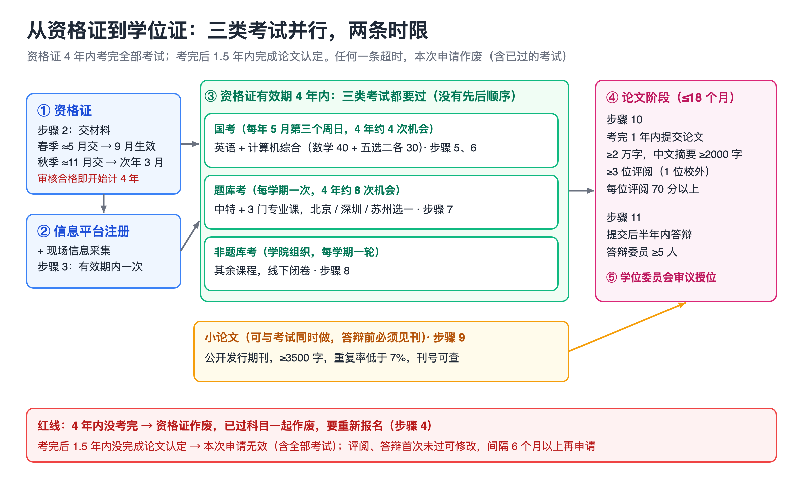
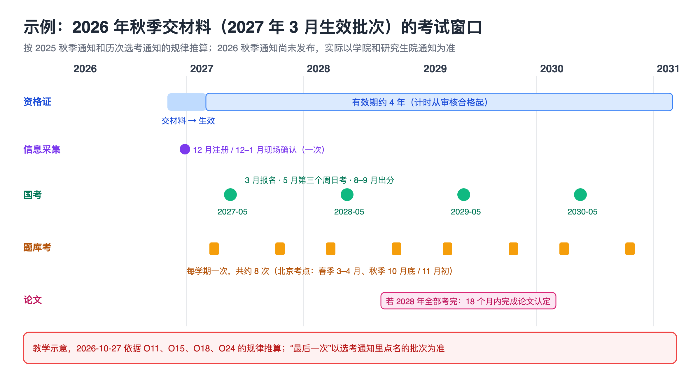

# 人大同等学力申硕（计算机）实战手册：从资格证到学位证

> 手册类型：通用版

<a id="section-intro"></a>
## 阅读说明

这本手册写给已经报读中国人民大学信息学院在职课程班、打算走同等学力申请工学硕士的人：从办资格证开始，到国考、校内题库考、非题库考、小论文，再到学位论文答辩、拿证。流程和时间以人大研究生院、信息学院和教育部教育考试院的现行文件为准 [[O3](#source-o3)、[O11](#source-o11)、[O4](#source-o4)]；各科复习资料指向学长整理的 RUC_CourseMaterials 仓库 [[S40](#source-s40)]；怎么复习、哪里容易卡住，来自通过者和没通过者的自述 [[S42](#source-s42)、[S1](#source-s1)]。

- **先看下面的路线图**，再按步骤往下做。案例卡、模板、仓库资料地图、费用表都在附录，正文用链接跳过去。
- **2026 年规则变了。** 人大 2026 年 1 月 26 日起施行新的工作办法（校政字〔2026〕13 号），旧的 2020—2021 学年 53 号文同时废止。最要紧的一条新规定：全部考试通过后 1.5 年内没完成论文认定，本次申请无效，**连已经通过的考试一起作废** [[O3](#source-o3)]。网上 2026 年以前的经验帖都没有这一条。
- **日期的性质。** 已发生的日期都来自官方通知（查询日期 2026-10-27）；2027 年及以后的日期是按往年规律推算的，正文都标了“推算”，以当年通知为准。
- **数字的性质。** 分数、复习时长、通过率传闻都是作者自述，不是统计。没有找到任何官方公布的通过率或拿证率 [[S20](#source-s20)]。
- **不承诺结果。** 这本手册给的是在时限内不漏步骤的做法，不预测能否通过。
- **示例是虚构的。** 模板里〔〕内的姓名、单位、期刊名都是占位，要换成自己的。
- **编号怎么读。** “步骤 1”是要动手的操作或判断；方括号里的 O 是官方页面或文件，S 是学员帖子、仓库文件和招生老师的说明。点一下跳到文末，文末“回到正文”跳回来。T1–T6 是附录 D 的模板，G1–G7 是下面的阻断缺口。
- **几个反复出现的词**：资格证是《同等学力人员申请硕士学位课程考试资格证》，没有它不能参加任何考试；国考是全国统一的外国语水平考试和学科综合水平考试；题库考是研究生院组织、从题库抽题的校内课程考试；非题库考是学院组织的其余课程考试；小论文是答辩前必须发表的一篇期刊论文；学位论文是最后答辩的那篇。更多见[附录 G 术语表](#section-appendix-g)。

<a id="section-roadmap"></a>
## 4 年路线图

三类考试没有先后顺序，可以同时考；论文阶段要等全部考试通过才开始 [[O11](#source-o11)]。下表按“2026 年秋季交资格证材料、2027 年 3 月生效”的批次排（推算），其他批次按[步骤 4](#section-step4) 自己排。

| 阶段 | 这一阶段做什么 | 点开对应章节 |
| --- | --- | --- |
| 现在（2026 年 10–11 月） | 认准官方联系人；问清本学期资格证办理时间；准备材料、交材料 | [步骤 1 认准渠道](#section-step1) · [步骤 2 办资格证](#section-step2) |
| 2026 年 12 月–2027 年 1 月 | 学信网信息平台注册；去现场做一次信息采集和确认 | [步骤 3 注册与现场确认](#section-step3) |
| 2027 年 1–3 月 | 资格证生效后缴清考试费；排好 4 年考试日历；3 月报国考 | [步骤 4 排日历](#section-step4) · [步骤 5 国考报名与英语](#section-step5) |
| 2027 年 3–5 月（第 1 年主攻） | 春季题库考（先考网络、软工）；5 月国考英语 + 综合；非题库跟着课程考 | [步骤 6 计算机综合](#section-step6) · [步骤 7 题库考](#section-step7) · [步骤 8 非题库考](#section-step8) |
| 2027 年下半年–2028 年 | 补考没过的科目；秋季题库考剩下的科目；投出并发表小论文 | [步骤 7 题库考](#section-step7) · [步骤 9 小论文](#section-step9) |
| 全部考完后 ≤18 个月 | 导师、开题、写作（≥2 万字）、送审、答辩、授位 | [步骤 10 学位论文](#section-step10) · [步骤 11 答辩与授位](#section-step11) |

每周怎么排时间见[时间表](#section-schedule)。



图注：教学示意，2026-10-27 依据 O3（2026-01-26 施行）、O11（2025-10-15）、O18 绘制；“4 年约 4 次国考、约 8 次题库考”是按往年通知推算的次数，不代表任何系统界面。

这一阶段先不做：考前押题班、在资格证生效前花钱买“真题答案”、提前联系期刊中介；以后再看[附录 F：没报班、凭论文申请、管科方向](#section-appendix-f)。

<a id="section-conditions"></a>
## 读者画像

本手册按以下读者画像编写。

| 项目 | 画像 |
| --- | --- |
| 进度 | 已报读人大信息学院在职课程培训班，计算机应用技术方向（大数据科学与工程方向差异单独标出） |
| 资格 | 已获学士学位满 3 年，工作满 3 年 [[O3](#source-o3)] |
| 工作 | 在职，课程班周末上课，平均每月 1–2 次 [[O32](#source-o32)] |
| 考点 | 校内考试选北京考点（中关村校区）；深圳、苏州的不同之处在对应步骤里写 |
| 可用时间（示例） | 工作日中午约 1 小时、晚上约 2.5 小时；周六、周日白天，有课的那天除外 |
| 外语 | 英语（信息学院统一填“英语”）[[O11](#source-o11)] |

<a id="section-adjust"></a>
### 条件不同时怎么调

- **每周能用的时间不到 8 小时**：国考两科拆成两年考，第 1 年考英语、第 2 年考综合；成绩保留年限没有核到官方原文（见 [G5](#section-gaps)），拆开考之前先问学院。题库考每次只报 2 门。
- **是大数据科学与工程方向**：课程表里没有“数据库管理系统原理与实现”“文本挖掘方法”，多了“云计算与大数据”“高级并行计算”[[O33](#source-o33)]。哪 4 门是题库考，以申硕系统里自己的培训计划为准（[G2](#section-gaps)）。
- **在深圳或苏州上课**：题库考、非题库考选对应考点，每人每次只能选一个考点 [[O15](#source-o15)]；现场信息采集也在当地做 [[O18](#source-o18)]。国考考点选人大（北京）或工作单位所在省 [[O20](#source-o20)]。
- **资格证已经生效一段时间**：先用[步骤 4](#section-step4) 数清还剩几次国考、几次题库考，把机会少的先排。
- **只想先完成一部分**（例如先把考试考完、论文以后再说）：考试和论文的时限是连着算的，考完后 1.5 年内必须完成论文认定 [[O3](#source-o3)]。可以把“最后一门考试”有意排在准备好写论文的那一年，但不能考完放着。
- **还没报班，或想凭发表的论文申请**：看[附录 F](#section-appendix-f)。

<a id="section-deliverables"></a>
## 要完成什么

| 结果 | 数量 | 在哪一步 |
| --- | --- | --- |
| 资格证 | 1 张（4 年有效） | [步骤 2](#section-step2) |
| 信息平台注册 + 现场信息采集 | 各 1 次（有效期内只做一次） | [步骤 3](#section-step3) |
| 4 年考试日历 | 1 张（T1） | [步骤 4](#section-step4) |
| 国考 | 2 科：英语、计算机科学与技术学科综合 | [步骤 5](#section-step5)、[步骤 6](#section-step6) |
| 题库考 | 4 门：中特 + 3 门专业课（计算机应用方向按学长整理是 DBMS、软件工程与方法、网络与通信） | [步骤 7](#section-step7) |
| 非题库考 | 其余课程，约 9–10 门（整理者自述，以培训计划为准） | [步骤 8](#section-step8) |
| 小论文 | 1 篇，公开发行期刊，官方要求 ≥3500 字（建议按 4000 字写） | [步骤 9](#section-step9) |
| 学位论文 | 1 篇，≥2 万字，中文摘要 ≥2000 字 | [步骤 10](#section-step10) |
| 评阅与答辩 | 评阅 ≥3 人且每人 70 分以上；答辩 1 次 | [步骤 11](#section-step11) |

<a id="section-gaps"></a>
## 阻断缺口（动手前先看）

- **G1 2026 年秋季资格证办理通知还没在官网出现，而往年的截止日已经很近。** 2026-10-27 查信息学院“招生信息”栏目，最新一条还是 2026-03-16 的国考报名通知 [[O14](#source-o14)]。往年秋季有三个节点：2025 年是照片 10 月 19 日前发邮箱、学院 10 月 24 日前在线审核、纸质材料 11 月 10 日前送达 [[O11](#source-o11)]；2024 年是照片 10 月 12 日前、学院审核 10 月 14–21 日、纸质材料 10 月 27 日前 [[O12](#source-o12)]。影响[步骤 2](#section-step2)。缺了可以先做：**今天**就打学院电话或关老师手机（15701018284）问本学期是否开办、三个节点各是哪天，通知可能只发在班级群；同时按 2025 年清单把学信网报告、复印件、照片准备好。错过本学期只能推到下一学期 [[O11](#source-o11)]。
- **G2 哪几门是题库考、哪几门是非题库考，官方公开页面没列。** 两条非官方线索一致：招生老师说题库考是“简章前四门课程”、非题库考是“简章第五门—最后一门课程”[[S50](#source-s50)]；学长整理的计算机应用方向题库 4 门是中特、DBMS、软件工程与方法、网络与通信 [[S41](#source-s41)、[S10](#source-s10)]，正好是 2026 年简章的前四门 [[O32](#source-o32)]。按同一说法推断，大数据方向是中特、云计算与大数据、软件工程与方法、网络与通信 [[O33](#source-o33)]，仓库里没有印证。影响[步骤 4](#section-step4)、[步骤 7](#section-step7)、[步骤 8](#section-step8)。缺了可以先做：登录申硕系统看自己的培训计划，或在班级群问班主任。
- **G3 培训班是否前置，新办法和学院细则说法不一。** 新办法规定不得把参加培训班作为申请的前置必备条件 [[O3](#source-o3)]，但信息学院的资格证通知把申请对象写成“在职课程班学员”[[O11](#source-o11)]。已报班的读者不受影响；没报班的看[附录 F](#section-appendix-f)。
- **G4 校内考试费、申硕费金额官网没写。** 招生老师给的数字是每门 250 元加 200 元办理费、申硕费 6500 元 [[S50](#source-s50)]，官方页面只写“登录系统查看金额”“按学校标准交纳”[[O37](#source-o37)、[O3](#source-o3)]。影响[步骤 4](#section-step4) 的预算，不影响步骤顺序。
- **G5 国考合格线和成绩保留年限没核到官方原文。** 学长和整理者都写“60 分及格、成绩保留 4 年”[[S41](#source-s41)]，也有帖子说 6 年 [[S33](#source-s33)]。官方只说有效期内要通过全部考试 [[O3](#source-o3)]。影响[步骤 5](#section-step5) 是否拆年考。缺了可以先做：按“资格证有效期内必须两科都过”来排，最稳。
- **G6 导师分配和开题流程没找到信息学院的公开文件。** 新办法只写了论文字数、评阅和答辩要求 [[O3](#source-o3)]。影响[步骤 10](#section-step10)。缺了可以先做：全部考试通过前一学期就向学院问清楚，主动联系导师 [[S31](#source-s31)]。
- **G7 招生简介里的联系方式和官网对不上。** 简介写“信息资源管理学院 211 室，010-62511461，张老师”[[S50](#source-s50)]；计算机方向属于信息学院，官网写的地址是信息楼 255，电话 010-82500758、010-62515875 [[O32](#source-o32)]。010-62511461 是信息资源管理学院官网页脚的学院电话，该院在职课程班的报名地址是 213A 室，专业只有档案学和数据管理 [[O16](#source-o16)]。影响[步骤 1](#section-step1)。缺了可以先做：所有材料、缴费都只走官网公布的渠道；先翻出缴费票据和入学登记表，看报的是哪个学院、哪个专业。

<a id="section-schedule"></a>
## 时间表（助手建议）

先算可用时间。按读者画像：工作日中午 1 小时 × 5 + 晚上 2.5 小时 × 5 = 17.5 小时；周末两天各按 7 小时算 14 小时，有课的周末减去 7.5 小时（课程班上课时间 9:00–16:30 [[S43](#source-s43)]）。每周可用约 24–31 小时。下面的排班满额约 20.5 小时，忙的周至少保留工作日晚上的 10 小时，留出加班、出差和休息。

**每周排班（考试季前 12 周用）**

| 时段 | 做什么 | 用时 | 当段产物 |
| --- | --- | --- | --- |
| 周一至周五 中午 | 背：英语单词与作文模板、中特名词解释、软工概念 | 5 × 40 分钟 ≈ 3.5 小时 | 背诵打卡 |
| 周一、三、五 晚上 | 计算机综合：数学（离散 + 组合）按章做题 | 3 × 2 小时 = 6 小时 | 错题本更新 |
| 周二、四 晚上 | 网络 / 软工：先题库考范围，再国考真题 | 2 × 2 小时 = 4 小时 | 每晚一套章节题 |
| 周六（无课） | 一套完整的国考真题限时模考（下午 14:30–17:30，和考试同一时段） | 3 小时 + 订正 1 小时 | 模考分数记进 T4 |
| 周日 | 英语真题一套 + 本周错题回看 | 3 小时 | 英语分数记进 T4 |

满额合计约 20.5 小时（3.5 + 6 + 4 + 4 + 3）；阶段表按每周 12–16 小时估算总量。

**到 2027 年 5 月国考的阶段安排（推算日期）**

| 时段 | 要做的事 | 用时 | 当段产物 |
| --- | --- | --- | --- |
| 2026-10-27 起的这一周 | 步骤 1、2：当天电话确认本学期是否办理和三个截止日；开学信网报告、发照片、填系统；请单位领导写评语盖章 | 约 4 小时 + 等盖章 | 按学院截止日送到的资格证材料 |
| 2026-11 至 12 月 | 选好国考五选二（T6）；把离散、组合教材第一遍过完；英语每天背词 | 每周 10–12 小时 | T6 决定表；数学笔记 |
| 2026-12 至 2027-01 | 步骤 3：信息平台注册、现场信息采集（北京往年在 12 月底的周末） | 半天现场 + 1 小时填表 | 签好的《资格确认表》 |
| 2027-01 至 02 | 网络、软工按题库考范围过一遍；数学按章刷题；英语开始做真题 | 每周 14–16 小时 | 每章错题 |
| 2027-02 底至 03 | 缴考试费、题库选考；国考信息平台更新、3 月中下旬 NEEA 报名缴费 | 各 1 小时 | 选考成功截图；国考缴费成功 |
| 2027-03 至 04 | 春季题库考（北京往年 3 月底或 4 月中）：先考网络、软工 | 考前 2 周每周 16 小时 | 题库考成绩 |
| 2027-04 至 05-16 | 国考冲刺：真题倒着刷、每周一套限时模考 | 每周 16–20 小时 | 模考分数 ≥60 分的稳定性 |
| 2027-05-16（推算） | 国考：上午英语、下午综合 | 1 天 | — |

时间安排是助手建议。合计到 2027 年 5 月约 26 周 × 12–16 小时 ≈ 310–420 小时，在每周可用的 24–31 小时之内。复习时长的参照：综合考过的两位分别写了“提前 4 个月开始准备”和“2 月份到 5 月份……总共就是 2 个多月”[[S2](#source-s2)、[S42](#source-s42)]。

<a id="section-step1"></a>
## 步骤 1 认准官方渠道，核对联系人和收款方

申硕这条路上第一个坑不是考试，是被冒名的机构和过时的联系方式。这一步不花钱，只核对。做完手里有一张官方联系人清单，以后所有材料、缴费、问题都只走这张清单。

**目标**：确认负责计算机方向申硕的学院、办公室和电话，排除冒名渠道。

1. **认准学院和专业。** 计算机应用技术、大数据科学与工程都属于**信息学院**，不属于信息资源管理学院；后者的在职课程班只有档案学和数据管理 [[O32](#source-o32)、[O16](#source-o16)]。招生简介里“信息资源管理学院 211 室、010-62511461”这组联系方式 [[S50](#source-s50)] 和官网对不上，见 [G7](#section-gaps)。翻出缴费票据和入学登记表核对：如果报的其实是信息资源管理学院的数据管理或档案学，学科和国考综合都不是计算机，本手册的步骤 6、附录 C 不适用，先找该院确认。
2. **记下官网公布的联系方式。** 信息学院培训部：北京市海淀区中关村大街 59 号中国人民大学信息楼 255；办公室电话 010-82500758、010-62515875；工作日 8:30–11:30、14:00–17:00 [[O32](#source-o32)]。资格证材料的收件人是信息楼 255 关老师，手机 15701018284 [[O11](#source-o11)]；培训部邮箱 training2025info@ruc.edu.cn [[O32](#source-o32)]。把这些抄进 [T5 的联系人栏](#template-t5)。
3. **核对收款方。** 培训费 38000 元，由学校财务处开票，通过学校电子收费系统或学校对公账户缴纳，没有报名费、审核费 [[O32](#source-o32)]。人大继续教育处声明：学校不委托任何校外机构或个人代理招生，严禁代收培训费 [[O38](#source-o38)]。收款方不是“中国人民大学”的，一律不付。
4. **记下两个网站和一个公众号。** 公众号是“中国人民大学信息学院”，菜单栏【课程培训】—【申硕系统】能进申硕系统 [[O11](#source-o11)]。 研究生院同等学力申硕系统 `https://tdxl.ruc.edu.cn/sswap/wall/login`（初始用户名身份证号，初始密码身份证号后六位）[[O11](#source-o11)]；全国同等学力人员申请硕士学位管理工作信息平台 `https://tdxl.chsi.com.cn` [[O20](#source-o20)]。学院通知发在信息学院官网“同等学力—招生信息”栏目 [[O14](#source-o14)] 和研究生院官网 [[O15](#source-o15)]。

**做完的标准**：T5 里写好了学院、办公室、电话、邮寄地址、两个系统网址，并且已登录过一次申硕系统、核对了自己的姓名、身份证号、专业。

- [ ] 确认自己的专业属于信息学院
- [ ] 抄下官网联系人和地址
- [ ] 核对过培训费收款方
- [ ] 登录过申硕系统并核对个人信息

**学长怎么说的**：“各位老师都很挺忙的，回复可能不是很快，打电话可能也不一定有人接，大家也需要多点耐心”[[S41](#source-s41)]。所以要问的事先写成邮件（T5），电话打不通时有书面记录。

参见附录：[模板 T5 发给学院的确认邮件](#template-t5)、[附录 A 不做清单](#section-appendix-a)。

<a id="section-step2"></a>
## 步骤 2 办理资格证

资格证是所有考试的入场券，4 年有效期从**材料审核合格**那天就开始算，不是从拿到证那天算 [[O11](#source-o11)]。一年只有春、秋两次办理窗口，错过就推半年。做完会拿到一个批次号（例如 2703 表示 2027 年 3 月生效）。



图注：教学示意，2026-10-27 依据 O11（2025-10-15）的批次规则和 O15、O18、O24 的往年时间推算；2026 年秋季办理通知尚未发布（G1），实际日期以学院和研究生院通知为准。

**目标**：在本学期截止日前交齐纸质材料，并让申硕系统显示“学院通过，待研究生院审核”。

1. **核对自己能报哪个批次。** 2025 年秋季的规则是：2023-03-01 前获学士学位（到 2026-03-01 满 3 年）且工作满 3 年的在职课程班学员，可以办 2026 年 3 月生效批次 [[O11](#source-o11)]。按这个规律推算，2026 年秋季办理的是 2027 年 3 月生效批次，要求 2024-03-01 前获学士学位；春季办理的批次 9 月生效 [[O13](#source-o13)]。办理时间和三个节点见 [G1](#section-gaps)，以学院当学期通知为准。
2. **准备材料（A4 纸）** [[O11](#source-o11)]：
   - 学信网《中国高等教育学位在线验证报告》（有效期选最长）；2008 年前的学位或部队院校学位要走学位认证，人工审核最长约 18 个工作日，要提前办。
   - 《教育部学历证书电子注册备案表》。
   - 学位证、学历证 1:1 复印件；身份证正反面复印在同一页。
   - 电子照片：白底，180×240 像素，`.jpg`，≤100KB，文件名“姓名+身份证号”；一寸白底纸质照片一张，与电子照同版。
   - 已发表的小论文（封面、目录、正文、封底页和知网学术不端检测报告），或者科研成果《承诺书》（还没发表的交这个）[[O34](#source-o34)]。
   清单见[模板 T2](#template-t2)。
3. **发照片、填系统。** 把电子照片发到学院邮箱 `infopx255@163.com`，邮件标题“年级+专业+姓名”，正文写姓名、身份证号、班级专业和“本人申请……生效批次同等学力申硕考试资格证资料审核”；同时在申硕系统完善信息，工作单位要写与公章完全一致的全称 [[O11](#source-o11)]。照片存成 png 或 jpeg 后缀系统不认 [[O11](#source-o11)]。
4. **打印两张表、找单位盖章。** 系统显示“学院通过，待研究生院审核”后，下载《申硕资格登记表》和《信息确认表》 [[O11](#source-o11)]：
   - 登记表贴纸质照片；主管领导手写评语，不少于 100 字；只能盖单位公章或人事部章；本人签名。
   - 信息确认表左下角写语种“英语”，本人签名。
   领导评语和盖章最花时间，第一天就去找单位。
5. **交材料。** 工作日 9:00–17:00 送到信息楼 255 关老师处（提前一天约入校），或用顺丰寄到“北京市海淀区中关村大街 59 号中国人民大学信息楼 255 办公室 关老师收”；同城闪送进不了校 [[O11](#source-o11)]。

**做完的标准**：申硕系统里资格申请状态是“学院通过，待研究生院审核”或之后的状态；纸质材料有寄件单号或当面交件记录；记下自己的批次号。

- [ ] 学信网两份报告已打印
- [ ] 照片已发邮箱，系统信息已填
- [ ] 两张表已签字盖章
- [ ] 材料已在截止日前送达
- [ ] 记下批次号（例如 2703）

**为什么不能拖**：“本学期错过申请考试资格证时间的申请人只能推后一个学期申请”；未办成资格证“无法开始任何考试”[[O11](#source-o11)]。

参见附录：[模板 T2 资格证材料清单](#template-t2)。

<a id="section-step3"></a>
## 步骤 3 信息平台注册，做一次现场信息采集

国考报名用的是教育部的全国信息平台，和人大的申硕系统是两套账号。现场信息采集在资格证有效期内只做一次，但不做的话国考、题库考、非题库考**都不能考**，而且资格证有效期照常走 [[O18](#source-o18)]。

**目标**：在全国信息平台提交学位申请，并在现场完成图像、指纹采集和《资格确认表》签字。

1. **注册全国信息平台。** 2025 年的通知从 12 月 19 日起开放注册，对象是已申请资格证（含 3 月生效批次）、学士学位已满 3 年、此前没采集过的学员 [[O17](#source-o17)]。网址 `https://tdxl.chsi.com.cn/tdxlsqxt/index.html`。账号默认是注册邮箱，以后缴费、选考、打印准考证、查成绩都在这里，账号密码要记牢 [[O17](#source-o17)]。
2. **上传照片、填信息、提交学位申请** [[O17](#source-o17)]：
   - 照片：蓝底，JPG，宽 390 × 高 567 像素，≤200K，三个月内正面免冠，数码相机拍、不修饰。**这张照片会用在学位证书上**，存好原图。
   - 前置学位按**学位证**填（获学位年月、证书编号、授予单位）；简历最多四行，最后工作单位与申硕系统一致。
   - 学位申请：学位授予单位所在地选北京市，学位授予单位选中国人民大学，学位类型选学术型学位，学科门类选**工学**；学科名称选“计算机科学与技术”，“是否按一级学科申请”选“否”；专业名称按自己的专业选（计算机应用技术 / 大数据科学与工程），“选错责任自付”；学号填资格证号（新批次还没生成编号的填批次号，例如 2603）；班级填“年级+专业”；院系选“131-信息学院”；工作单位写全称，与申硕系统一致。
   - 保存后在页面顶端【已申报学科信息】点**提交申请**，状态要显示“已提交”；没提交的，现场采集时系统读不到信息 [[O17](#source-o17)]。
3. **去现场采集。** 2025—2026 学年的时间：北京 2025-12-27、28，9:00–11:30、13:00–16:00，在中关村校区国学馆 109；深圳、苏州 2026-01-10、11，只有上午 9:00–11:30 [[O18](#source-o18)]。带二代身份证，穿深色衣服，本人到场。
4. **签好《资格确认表》。** 采集完打印《资格确认表》，抄写承诺文字、签名，在右下方补写资格证号（新批次写批次号，例如 2603）、学院（信息学院）、外语语种（英语），交给老师核对签字完整后才能离开 [[O18](#source-o18)]。到场前要在系统里提交好学位申请，现场不提供电脑 [[O18](#source-o18)]。

**做完的标准**：全国信息平台状态显示已通过学位授予单位资格审查（转入在册库）；手上有签好字的《资格确认表》照片或复印件。

- [ ] 信息平台注册并提交学位申请
- [ ] 蓝底照片原图另存
- [ ] 现场采集完成，《资格确认表》签好
- [ ] 平台状态转入在册库

参见附录：[附录 G 术语表](#section-appendix-g)（在册库、现场确认）。

<a id="section-step4"></a>
## 步骤 4 缴清考试费，数清机会，排好 4 年考试日历

这是一个判断步骤。资格证 4 年里，国考大约只有 4 次、题库考大约 8 次；排错一次就少一次机会。做完会有一张 T1 日历，写清每一科打算在哪一次考、没过的话补考排在哪一次。

**目标**：知道自己每类考试还剩几次机会，并定下每一科的首考和补考时间。

1. **先缴清全部考试费。** 2025 年 3 月及以后新申请资格证的人，要在申硕系统一次性缴清所有考试费，才能选考题库课和非题库课；每天 23:00–24:00 缴费系统维护 [[O37](#source-o37)]。金额只能登录“缴费状态”看到（[G4](#section-gaps)）。学院说考试费在每次开放题库选考时缴纳，没缴的不能选考 [[O11](#source-o11)]。
2. **数清国考次数。** 国考每年一次，在 5 月第三个周日 [[O10](#source-o10)]。从资格证生效后的第一个 5 月数起，到有效期届满前最后一个 5 月为止，通常是 4 次。旁证：2026 年 9 月的选考通知点名 2022 年 9 月、2023 年 3 月批次“已无参加……全国统一考试机会”[[O15](#source-o15)]。
3. **数清题库考次数。** 题库考每学期一次（春季 3–4 月，秋季 10–11 月）[[O19](#source-o19)、[O15](#source-o15)]，4 年约 8 次；研究生院会在选考通知里点名哪些批次是最后一次：2026 年 3 月的春季选考通知仍允许 2022 年 3 月批次选考 [[O19](#source-o19)]，所以 3 月生效批次的最后一次题库考可能是第 4 年后的那个春季，以通知点名为准 [[O15](#source-o15)、[O24](#source-o24)]。非题库考由学院组织 [[O31](#source-o31)]；招生老师说“一年排一轮”覆盖全部非题库科目、4 年共 4 次 [[S50](#source-s50)]，错过一门要等一年。
4. **排日历（判断）。** 输入：自己的批次、每周可用时间、本科专业基础。建议的排法（助手建议）：
   - 第 1 年春季题库考先考**网络与通信、软件工程与方法**，同一年 5 月国考综合也选这两门，三份复习合并 [[S42](#source-s42)]；
   - 中特、DBMS 放第 1 年秋季或第 2 年春季；
   - 国考英语和综合第 1 年都报；
   - 非题库考跟着课程上完就考，趁内容还热。
   反例：把 4 门题库考都压在最后一年——如果其中一门没过，只剩一次机会，而且帕丁顿的经历是“第一次申请时过了的这次反而挂了”[[S19](#source-s19)]。
5. **把作废红线写进日历。** 4 年内没过全部考试，资格证作废，本次申请结束 [[O3](#source-o3)]；资格证有效期内只考过一部分的人，作废后重新申请要从头考 [[S19](#source-s19)]。在 T1 最后一行写上“最后一次国考”和“最后一次题库考”的日期。

**做完的标准**：T1 填完：每一科有首考日期和备用补考日期，最后一次国考和题库考日期标红；申硕系统缴费状态显示已缴清。

- [ ] 考试费已缴清
- [ ] 数出国考剩几次、题库考剩几次
- [ ] T1 每一科都有首考和补考
- [ ] 最后一次机会的日期已标出

**学长怎么排的**：2023 年那位学长是“以国考为主，对于学校的考试的话，如果是跟我选择的科目一样的话，我会安排去考，如果不是的话，我不想花时间去复习”[[S42](#source-s42)]。整理者建议的学习顺序是“题库 4 门 → 非题库高学分 → 非题库低学分”[[S10](#source-s10)]。

参见附录：[模板 T1 四年考试日历](#template-t1)。

<a id="section-step5"></a>
## 步骤 5 国考报名与英语

国考报名分两段：先在全国信息平台更新在册信息，再到中国教育考试网报名缴费，两个截止日相差约 3 周，最容易漏掉第一段。英语是大多数人觉得相对好过的一科。

**目标**：在截止日前完成国考报名缴费，并把英语复习到真题稳定 60 分以上。

1. **3 月初：信息平台更新。** 2026 年要求 3 月 5 日 24:00 前在信息平台完成注册及在册信息更新，信息要和中国教育考试网完全一致，逾期不能改 [[O20](#source-o20)]。已做过现场采集、要改联系方式或工作所在地的，2026 年要在 1 月 12 日前联系学院 [[O17](#source-o17)]。
2. **3 月中下旬：NEEA 报名缴费。** 2026 年 3 月 16 日至 26 日 16:00 在 `https://tdxl.neea.edu.cn` 报名，选语种、学科和考点；考点选“中国人民大学（北京）”或工作单位所在省；人大的流程是先选考，学校审核（一般 5 个工作日内）通过后再缴费，每科 100 元，2026 年缴费截止 3 月 30 日 24:00，逾期报名无效 [[O20](#source-o20)]。
3. **5 月：准考证和考试。** 2026 年准考证 5 月 11–17 日下载；考试 5 月 17 日（周日），上午 9:00–11:30 外国语，下午 14:30–17:30 学科综合 [[O20](#source-o20)]。人大考点在中关村校区公共教学一楼、三楼 [[O21](#source-o21)]。2027 年按“5 月第三个周日”推算是 5 月 16 日，以 2027 年公告为准。
4. **英语怎么复习。** 难度普遍说在四级到六级之间 [[S41](#source-s41)]。共识做法：熟悉题型、背作文模板、多做往年阅读 [[S17](#source-s17)]；别漏“口语交际”和“短文完成”两个题型 [[S10](#source-s10)]。英语真题不在仓库里，仓库 README 给了一个截至 2023 年的网盘链接 [[S40](#source-s40)]；2024 年以后的真题要另找。
5. **8–9 月：查成绩。** 2026 年成绩 8 月 31 日开放查询，之后 10 个工作日内可申请复核 [[O22](#source-o22)、[O20](#source-o20)]。合格线见 [G5](#section-gaps)。

**做完的标准**：中国教育考试网报名状态为“已缴费”；考前一共做完至少 5 套英语真题，其中最后两周限时做的 2 套估分都过 60。

- [ ] 3 月初信息平台信息已更新
- [ ] NEEA 报名、审核、缴费完成
- [ ] 准考证已下载打印
- [ ] 英语真题至少做完 5 套

**学长怎么做的**：“英语的话，我没有复习过，就在考前做了 2 套历年的真题。真题客观题在 55 分左右”，最后考了 84 分；他平时用英语较多 [[S42](#source-s42)]。英语基础一般的人不要照搬“不复习”。

参见附录：[附录 C 仓库资料地图](#section-appendix-c)（英语一行）、[模板 T4 每周复习记录](#template-t4)。

<a id="section-step6"></a>
## 步骤 6 国考计算机综合：选两门，真题倒着刷

综合是公认最难的一科：劝退帖说数学“难度跟考研数学接近”[[S1](#source-s1)]，人大金融方向的作者说“我身边包括我自己都是第二年备考才通过”[[S17](#source-s17)]。这一步先做一个判断（五门里选哪两门），再按真题组织复习。

**目标**：选定两门专业课，按大纲和真题复习到模考稳定 60 分以上。

1. **看清试卷结构。** 数学基础（离散数学 + 组合数学）40 分必答；计算机系统结构、计算机网络、软件工程、人工智能原理、计算机图形学五门里选两门，每门 30 分；多答只按前面选的计分。范围见大纲 [[O39](#source-o39)]，分值写在真题卷首页“考生须知”和学长整理里 [[S41](#source-s41)]。学长给过一个目标拆分：数学 24 分、两门各 18 分，正好 60 分，“大家目标要定高一点点”[[S41](#source-s41)]。
2. **选两门（判断，填 T6）。** 输入：本科背景、工作内容、仓库资料厚薄、能否和题库考共用。多数人选**网络 + 软件工程**，理由是这两门人大有课、也是题库考科目，可以一起复习 [[S42](#source-s42)、[S2](#source-s2)]。反例：学长是算法工程师，选了人工智能，复习时“无数次想要放弃”，因为“连本像样的教材都没有……过往的考试都很 free style”，后来才找到马少平《人工智能》与近年考题匹配 [[S42](#source-s42)]。系统结构、图形学仓库资料最少（推断不建议自学者选）[[S44](#source-s44)]。
3. **定教材。** 离散数学用屈婉玲《离散数学》第 3 版、组合数学用卢开澄《组合数学》第 5 版（仓库自带）；网络用谢希仁《计算机网络》第 7 版，配《释疑与习题解答》；软工以大纲和真题题库为主 [[S42](#source-s42)、[S44](#source-s44)]。学长原话：“以书为主……不要去购买历年真题，很多都是错的”[[S42](#source-s42)]。
4. **真题倒着刷，按考点回课本。** 仓库里带答案的完整套卷有 2012–2014、2018–2025 共 11 套，另有 `E1 历年真题` 的 2004–2011、2017 年题和 2024 回忆版；2015、2016 缺 [[S44](#source-s44)]。先做近 5 年，错题按考点回到教材对应章节整理；“尽可能收集真题，一边刷题一边整理考点……再依据考点关联的课本内容系统整理知识点”[[S2](#source-s2)]。网络的计算题集中在运输层（发送窗口、信道利用率、拥塞控制）[[S42](#source-s42)]。
5. **考前一周只回看。** 考前一两天不刷新题，看错题和笔记，按网络分层把知识点从头过一遍；主观题“能多写就多写点……老师会给过程分的，千万不要空着”[[S42](#source-s42)]。

**做完的标准**：T6 写下两门选择和理由；最近三次限时模考（14:30–17:30）都 ≥60 分，或者已经决定把综合放到下一年并写进 T1。

- [ ] T6 选科已定
- [ ] 两本数学教材至少过一遍
- [ ] 近 5 年真题全做完并订正
- [ ] 三次限时模考记录在 T4

**真实的分数与起点**：学长 2023 年 2 月底才开始复习，综合考了 76 [[S42](#source-s42)]；西南交大考生“提前 4 个月”准备、主攻软工和网络，综合 76 [[S2](#source-s2)]；另一位第一次 22 分“战略放弃”、第二年重点补数学后 72 [[S4](#source-s4)]。都是作者自述。

参见附录：[附录 C 仓库资料地图](#section-appendix-c)、[模板 T6 国考选科决策表](#template-t6)、[案例卡 1、4、5](#section-appendix-b)。

<a id="section-step7"></a>
## 步骤 7 校内题库考 4 门

题库考是研究生院统一组织、从题库随机抽题的闭卷考试，比非题库考难一点 [[S41](#source-s41)]。网络和软工可以和国考一起复习，中特靠背。做完会有 4 门题库课的成绩。

**目标**：在选考期内报上名，按时到考点，4 门题库课都考到及格。

1. **盯选考通知。** 选考和缴费只开一周左右：2026 年秋季是 9 月 24 日 10:00 至 9 月 30 日 22:00，“逾期不予补报、不得修改报考信息”[[O15](#source-o15)]；2025-26 春季是 2026 年 3 月 7–11 日 [[O19](#source-o19)]。通知发在研究生院官网同等学力栏目 [[O15](#source-o15)]。
2. **选考点和科目。** 北京、深圳、苏州三个考点只能选一个 [[O15](#source-o15)]。北京考点 2026 年秋季考期是 10 月 31 日至 11 月 1 日，在中关村校区公共教学一楼，每天三场：9:00–11:00、13:00–15:00、16:00–18:00 [[O29](#source-o29)]。深圳 2026 年起改到宝安院区，苏州在仁爱路 158 号修远楼 [[O29](#source-o29)]。
3. **按科目准备。** 计算机应用方向的 4 门（学长整理，[G2](#section-gaps)）[[S41](#source-s41)]：
   - **网络与通信**：先看课程第 0 章《课程说明及应考要求》，再做仓库里 2018–2025 年的题库考回忆卷；题库考“主要是以前的自考题为主”，和国考网络“完全不太一样”[[S42](#source-s42)、[S44](#source-s44)]。
   - **软件工程与方法**：先看《题库考试题型 V4》（名词解释 4×5、简答 5×6、论述 1×20、计算分析 1×30）和《答题说明 V3》，再做题库与应用题集 [[S44](#source-s44)]。
   - **中特**：名词、简答、论述背题库整理和万能模板；农发院作者说“如果说有人校考没过，那大概率是中特……得和题目沾边”[[S15](#source-s15)]。
   - **DBMS**：仓库只有 PPT，没有备考资料；整理者说它“实际考数据仓库 + OLAP + 频繁模式 + 聚类”[[S44](#source-s44)、[S10](#source-s10)]，要向任课老师和同学要题库。
4. **考试当天。** 打印每门考试的纸质考试通知单（申硕系统首页“考试信息”下载，每科一张），带身份证、资格证；北京考点从东门步行入校；迟到 30 分钟不能进场，开考 60 分钟后才能交卷；手机、智能手表、智能眼镜放在座位周围就按违纪处理 [[O29](#source-o29)]。舞弊会被取消本次资格、三年内不受理申请 [[O3](#source-o3)]。
5. **查成绩、需要时复核。** 成绩在申硕系统查；对成绩有异议的，在公告给的期限内（2026 年春季为公布后约 6 天）把签字的复核申请表扫描件发给学院 [[O30](#source-o30)]。没过的科目排进 T1 的下一次；题库考缺考或补考每门 250 元（学长整理）[[S41](#source-s41)]。

**做完的标准**：申硕系统里 4 门题库课都显示及格成绩。

- [ ] 选考期内完成选考和缴费
- [ ] 每科考试通知单已打印
- [ ] 4 门题库课全部及格

**通过者怎么刷题**：莉娜Fighting 的做法是刷三遍，第一遍通刷、第二遍只刷标记的题、考前 1–2 周快速过一遍，“千万别空着，写满！”[[S15](#source-s15)]。深圳考点的一位作者说每门题库资料浏览 3 遍，一遍约 5–6 小时 [[S24](#source-s24)]。

参见附录：[附录 C 仓库资料地图](#section-appendix-c)（题库四行）、[模板 T1 四年考试日历](#template-t1)。

<a id="section-step8"></a>
## 步骤 8 校内非题库考

非题库考由信息学院自己组织，题目由任课老师出，一般按上课内容和往年题复习就能过 [[S41](#source-s41)]。门数多，难点在于别漏选考期。

**目标**：每学期在选考期内报上当学期能考的非题库课，全部及格。

1. **确认报名条件。** 资格证已生效、课程考试费已缴清的人才能选考 [[O31](#source-o31)]。
2. **在选考期选考。** 2024 年秋季的选考期是 11 月 28 日至 12 月 8 日，在申硕系统“网上选课”里选考点和科目，读完诚信应试须知后点“我承诺”；逾期不补报 [[O31](#source-o31)]。
3. **按时去考。** 2024 年秋季：线下笔试、闭卷，可用无存储功能的计算器；北京 12 月 28–29 日，深圳、苏州 2025 年 1 月 4–5 日；考场教室考前一周左右在班级群发布 [[O31](#source-o31)]。春季的非题库考时间没找到公开通知，跟着班级群走。招生老师说非题库考“一年排一轮”，每门也按 250 元扣考试费、补考由学院组织不收费 [[S50](#source-s50)]；错过选考期的科目可能要等一年，所以每学期都核一遍哪些课本学期能考。
4. **按课准备。** 组合数学、离散数学用仓库里的历年非题库试题和期末真题汇总；高级操作系统用 2024 年 12 月的自学笔记加 2018–2021 年真题；文本挖掘有 2024 年 12 月北京卷和 2025 年 1 月苏州卷 [[S44](#source-s44)]。离散、组合也是国考数学的内容，一份复习两用 [[S10](#source-s10)]。

**做完的标准**：申硕系统里本学期选考的非题库课都有及格成绩；没过的写进 T1 下一学期。

- [ ] 本学期选考完成
- [ ] 考场信息已从班级群确认
- [ ] 本学期非题库课全部及格

**开卷还是闭卷**：说法不一。信息学院 2024 年秋季的通知写的是闭卷 [[O31](#source-o31)]；学长整理说“开卷还是闭卷看老师”[[S41](#source-s41)]；其他学院有人说十几门开卷 [[S14](#source-s14)]。以每次选考通知为准，按闭卷准备。

参见附录：[附录 C 仓库资料地图](#section-appendix-c)（非题库三行）。

<a id="section-step9"></a>
## 步骤 9 发表小论文

小论文是答辩的前提：办资格证时没有发表的，交了承诺书，就必须在申请答辩前发出来，做不到就不能申请答辩、资格到期取消 [[O34](#source-o34)]。从投稿到见刊快则两三个月、慢则半年以上 [[S16](#source-s16)]，所以要和考试同时推进。

**目标**：在答辩前发表一篇符合信息学院要求的小论文，并拿到可提交的全套材料。

1. **记住硬要求。** 发表在公开发行的纸质期刊上；与申请专业相关；重复率低于 7%（知网学术不端检测）；正文不少于 3500 字（不含标点）；期刊号能在国家新闻出版署查到 [[O11](#source-o11)]。承诺书里写的是不少于 3000 字 [[O34](#source-o34)]，招生老师说的是“4000 字正文”[[S50](#source-s50)]；三处不一致，按 4000 字写最稳。
2. **定题目。** 从自己的工作或课程里挑一个计算机方向的小题目（例如一个系统的设计与实现、一个算法在业务数据上的应用）。仓库里有学术规范与论文写作课的 7 类论文大纲（数据分析、数据应用、系统算法、系统开发、实验研究、结构方程、案例研究），对号入座 [[S44](#source-s44)]。
3. **核验期刊（用 T3）。** 先在国家新闻出版署查刊号，再查知网能不能检索到这本期刊。农发院作者的教训是：学校最初说三大数据库都可以，她挑了便宜的，分到的导师只认知网，“最后加急又发了一篇知网的……花了两次钱”[[S16](#source-s16)]。有疑问先发邮件问学院（T5）。
4. **投稿、跟进到出刊。** “出刊才算数，录用通知不行”[[S16](#source-s16)]。拿到样刊后，按资格证材料的格式准备封面页、目录页、正文页、封底页和知网检测报告 [[O11](#source-o11)]。
5. **和同学一起推进。** 仓库作者说小论文流程是“和其他同学开周会时总结的”，包括怎么找指定类型期刊和投稿方式、怎么用国家新闻出版署官网查期刊 [[S40](#source-s40)]。

**做完的标准**：手上有已出刊的样刊或电子版，刊号可查、知网可检索，重复率报告 <7%，正文 ≥3500 字（按 4000 字准备）。

- [ ] 题目和类型已定
- [ ] T3 期刊核验表全部打勾
- [ ] 已出刊
- [ ] 四页材料 + 检测报告已备齐

**不要找中介代写。** 新办法规定弄虚作假的取消本次资格、三年内不再受理 [[O3](#source-o3)]；答辩时代写“很容易被发现”[[S18](#source-s18)]。

参见附录：[模板 T3 小论文期刊核验表](#template-t3)。

<a id="section-step10"></a>
## 步骤 10 学位论文：导师、开题、写作、送审

全部考试通过后，倒计时开始：1 年内提交学位论文，提交后半年内答辩，**1.5 年内**必须完成学位论文水平认定，否则本次申请无效，包括已通过的全部考试 [[O3](#source-o3)]。多位作者说论文是最难的一关：“开题、盲审、答辩关关难过”[[S25](#source-s25)]。

**目标**：在全部考试通过后 12 个月内交出一篇达到评阅要求的学位论文，并送出评阅。

1. **最后一次考试前就问清楚流程。** 导师怎么分配、开题什么时候、学院用什么写作规范，信息学院没有公开文件（[G6](#section-gaps)）。用 T5 发邮件问；学院在职课程班页面可以下载《工程硕士学位论文写作规范》[[O35](#source-o35)]。仓库作者提到要填“导师申请表”[[S40](#source-s40)]。
2. **主动联系导师。** “论文切记切记，主动和导师建联，别被动等待安排”[[S31](#source-s31)]。劝退帖的作者说过“还没老师带你”[[S1](#source-s1)]，所以联系导师这件事要自己推。
3. **按学校要求写。** 简体中文，不少于 2 万字；中文摘要不少于 2000 字，外文摘要是中文摘要的全文翻译；与别人合作的成果，只能用本人独立完成的部分，并附主持人书面意见或合作者证明 [[O3](#source-o3)]。参考文献要确认是否在 CCF 推荐目录里（仓库作者提到的做法）[[S40](#source-s40)]。
4. **自查重复率和实证。** 其他学院的作者说查重率不能超过 10%、只论证没有模型容易被毙 [[S18](#source-s18)]；信息学院的标准没核到，按更严的准备。
5. **留足送审时间。** 论文至少在答辩前两个月送评阅人；评阅人不少于 3 位副高以上专家，至少 1 位来自人大和本人单位以外，导师不能当评阅人；评阅人匿名 [[O3](#source-o3)]。**每位评阅人打分都在 70 分以上**、没有学术不端，才能进答辩 [[O3](#source-o3)]。

**做完的标准**：论文已提交学院并送出评阅，提交日期在全部考试通过后 12 个月以内。

- [ ] 记下“全部考试通过”的日期，算出 12 个月和 18 个月两个截止日
- [ ] 导师已确定
- [ ] 开题已完成（按学院要求）
- [ ] 论文 ≥2 万字、中文摘要 ≥2000 字
- [ ] 已送评阅

**其他学院的经历（作者自述）**：盲审“也要刷掉 15% 左右的人”[[S21](#source-s21)]；一位在职妈妈说“论文阶段整整耗时一年有余”[[S22](#source-s22)]。

参见附录：[模板 T5 发给学院的确认邮件](#template-t5)（第 4 问）、[附录 H 仍需核对的问题](#section-appendix-h)。

<a id="section-step11"></a>
## 步骤 11 答辩与授位

评阅全部 70 分以上之后进入答辩。两条规定要连起来读：答辩没通过，本次申请无效 [[O3](#source-o3)]；但评阅、答辩、学位评定分委员会、校学位评定委员会任何一关是**第一次**没过的，经同意可以修改论文后重新申请，再次答辩要在本次答辩 6 个月以后，并且仍要在有效期内 [[O3](#source-o3)]。也就是说只有一次补救机会，而且要算进 18 个月里。

**目标**：在提交论文后半年内通过答辩，并经学位评定委员会审议授位。

1. **核对答辩条件。** 评阅全部 70 分以上、没有学术不端 [[O3](#source-o3)]。申硕费在正式答辩前缴纳，招生老师说包含开题、辅导、评阅、答辩全过程，金额按答辩当年标准（[G4](#section-gaps)）[[S50](#source-s50)]。
2. **准备答辩。** 答辩委员会不少于 5 位副高以上专家，其中至少 3 位研究生导师、1 位校外专家；导师只能旁听；论文要在答辩前半个月送到委员手里 [[O3](#source-o3)]。其他学院的作者说陈述约 15 分钟，主答辩老师问 3 个核心问题，可以准备 15–20 分钟再回答 [[S23](#source-s23)]。
3. **答辩后修改定稿。** 按委员意见修改、定稿、在系统里申请并上传定稿 [[S22](#source-s22)]。
4. **授位。** 学位评定分委员会审核，报校学位评定委员会审议决定 [[O3](#source-o3)]；学位证书单独编号 [[O3](#source-o3)]。每年在哪几个月审议没核到，问学院。学信网可查，授予工学硕士学位 [[O17](#source-o17)、[S50](#source-s50)]。

**做完的标准**：答辩决议为通过；定稿已上传；收到学位授予通知或学位证书。

- [ ] 申硕费已缴
- [ ] 答辩通过
- [ ] 定稿已上传
- [ ] 拿到学位证书

**一个限制要提前知道**：同等学力只有学位证、没有研究生毕业证，报考要求“双证”的岗位不适用（评论者自述）[[S1](#source-s1)]。

参见附录：[附录 E 费用表](#section-appendix-e)（申硕费）。

<a id="section-appendix-a"></a>
## 附录 A｜不做 / 依据 / 改为

这些做法在帖子和招生环节里常见，本手册不采用。

| 不做 | 依据 | 改为 |
| --- | --- | --- |
| 通过校外机构或个人报名、缴费 | 人大不委托任何校外机构代理招生，严禁代收费用 [[O38](#source-o38)] | 只走信息学院官网公布的渠道（[步骤 1](#section-step1)） |
| 相信“1.5 年拿证” | 那是课程班学习时长，不是拿证时间；通过者普遍用了 4 年，也有 6 年 [[S26](#source-s26)、[S18](#source-s18)、[S20](#source-s20)] | 按[步骤 4](#section-step4) 排 4 年日历 |
| 花几千元买押题 | 作者所见：“有人花 2–3000 买押题，然后背诵，结果一地鸡毛”[[S3](#source-s3)] | 真题倒刷 + 回课本（[步骤 6](#section-step6)） |
| 买来路不明的“真题答案” | “很多都是错的，而且错得你根本区分不了”[[S42](#source-s42)] | 以教材为准，存疑的题去教材和习题解答里核 |
| 把题库考都压到最后一年 | 机会少，过了的科目也可能在重考时挂 [[S19](#source-s19)] | 第 1 年就开考（[步骤 4](#section-step4)） |
| 小论文只拿录用通知、或挑不上知网的期刊 | “出刊才算数”；导师只认知网时要重发 [[S16](#source-s16)] | 用 T3 核验，出刊后再提交 |
| 找人代写小论文或学位论文 | 弄虚作假取消资格、三年内不受理 [[O3](#source-o3)] | 自己写，和同学结组推进 |
| 只看考试、等全部考完再想论文 | 考完后 1.5 年内不完成认定，考试一起作废 [[O3](#source-o3)] | 最后一次考试前就问清导师和开题（[步骤 10](#section-step10)） |

<a id="section-appendix-b"></a>
## 附录 B｜案例卡

找到的公开个人帖里，能确认是人大信息学院计算机 / 大数据方向的很少，所以下面也收了国考计算机综合的外校考生和人大其他学院的学员，各自标明。全部是作者自述。卖资料账号的“20 分→79 分”帖叙事雷同，没有收录。

<a id="case-1"></a>
### 案例 1｜2023 年国考：英语 84、综合 76（人大计算机方向学长）

- **起点**：报了课程班，2023 年 2 月底才想起要考国考，在职，做算法工作 [[S42](#source-s42)]。
- **做法**：通勤看数学视频和书，零碎时间看网络，下班通勤看人工智能；一个月刷完视频，再一个月刷题，周末做真题；选网络 + 人工智能；“以书为主”。
- **结果（作者自述）**：英语 84，计算机综合 76。
- **可借鉴**：网络和题库考可以先考；人工智能资料难找，近年题参照马少平《人工智能》；考前只回看笔记。
- **来源**：[S42](#source-s42)

<a id="case-2"></a>
### 案例 2｜考了几十场都过了，最后只拿到结业证（人大信息学院）

- **起点**：人大信息学院同等学力申硕，周末到校上课 [[S1](#source-s1)]。
- **做法**：“大大小小几十场考试都过了”。
- **结果（作者自述）**：没拿到学位，拿了结业证，后来改读非全 MBA；认为综合卷数学接近考研难度，论文“跟全日制一样严格，还没老师带你”。
- **可借鉴**：考试过完不等于拿证，论文阶段要单独规划时间和导师关系。
- **来源**：[S1](#source-s1)

<a id="case-3"></a>
### 案例 3｜仓库整理者：考完进入论文阶段，资料留给后来人（人大计算机 / 大数据方向）

两个仓库的整理者没有公开分数，合成一张卡，只取能当做法用的部分。

- **起点**：RUC_CourseMaterials 的作者是人大同等学力学员，备考期间主要用学长 jasnei 仓库的资料 [[S40](#source-s40)]；Learning_at_ruc 由 jasnei 建仓、多人补充、burgeruser 合并整理 [[S10](#source-s10)]。
- **做法**：学习顺序“题库 4 门 → 非题库高学分 → 非题库低学分”，“先真题后课件”，同时备国考时数学与网络 / 软工章节复用 [[S10](#source-s10)]；和同学开周会推进小论文；学位论文参考文献核对 CCF 目录、填导师申请表 [[S40](#source-s40)]。
- **结果（作者自述）**：RUC_CourseMaterials 作者在 2026 年 9 月时已考完、处在学位论文阶段，“等我顺利拿到学位后会设置为公开状态”[[S40](#source-s40)]；Learning_at_ruc 写的冲刺时长是“合计冲刺约 45~55 天”[[S10](#source-s10)]。
- **可借鉴**：题库考优先；同学结组推进小论文；“计算题看懂 ≠ 会做”。
- **来源**：[S40](#source-s40)、[S10](#source-s10)

<a id="case-4"></a>
### 案例 4｜提前 4 个月，综合 76（西南交大，国考同卷）

- **起点**：通过机构报名西南交大，2024 年 5 月国考 [[S2](#source-s2)]。
- **做法**：提前 4 个月准备；“主要还是刷题……看书事倍功半”；收集近五年真题，边刷边整理考点，再回课本；主攻软工和网络。
- **结果（作者自述）**：综合 76。
- **可借鉴**：真题驱动；机构“付完钱不兑现”。
- **来源**：[S2](#source-s2)

<a id="case-5"></a>
### 案例 5｜第一次 22 分，第二次 72 分（学校未说明，国考同卷）

- **起点**：体制内，同时在考软考 [[S4](#source-s4)]。
- **做法**：2025 年综合当作看题，2026 年 3 月起重点学数学、巩固网络和软工；报了付费网课。
- **结果（作者自述）**：综合 22 → 72；英语 2025 年通过。
- **可借鉴**：有系统分析师等软考基础更轻松；第一次没准备好也可以先去熟悉题型，但要算进 4 次机会里。
- **来源**：[S4](#source-s4)

<a id="case-6"></a>
### 案例 6｜小论文花了两次钱（人大农业与农村发展学院）

- **起点**：人大农业与农村发展学院同等学力学员，在职；办资格证时还没有发表小论文 [[S14](#source-s14)、[S16](#source-s16)]。
- **做法**：题库考刷三遍、写满；小论文按 5000 字、独立作者写；最初挑了便宜的非知网期刊。
- **结果（作者自述）**：分到的导师只认知网，加急又发了一篇；2026 年 6 月拿到学位证。
- **可借鉴**：投稿前先问清导师和学院认哪些数据库；出刊才算数。
- **来源**：[S14](#source-s14)、[S15](#source-s15)、[S16](#source-s16)

<a id="case-7"></a>
### 案例 7｜5 战综合，资格证作废重来（人大公管类方向）

- **起点**：2020 年背了题库，裸考综合 46 分 [[S19](#source-s19)]。
- **做法**：2021 年英语过了；2023 年第一次申请的最后一次机会仍没过，资格证作废后重新申请；2024-11 至 2026-03 重考题库。
- **结果（作者自述）**：2025 年综合 53；2026 年综合通过；重考题库时一门第一次过了的反而挂了。
- **可借鉴**：作废后已过的科目要重考；综合不要拖到最后一两次。
- **来源**：[S19](#source-s19)

<a id="section-appendix-c"></a>
## 附录 C｜仓库资料地图

仓库是 RUC_CourseMaterials（2026-10-13 版本，commit 0da7d99），路径从仓库根目录算 [[S44](#source-s44)]。很多机构资料是“纯图版”，没有文字层；英语真题不在仓库里 [[S40](#source-s40)]。

| 考试 | 科目 | 先看这些 | 真题年份与缺口 |
| --- | --- | --- | --- |
| 国考 | 英语 | `03 计算机国考/E0 经验分享/00 英语-考试大纲（第六版）.pdf`（抽字乱码，要看图）；真题见 README 的网盘链接 | 仓库无真题；网盘截至 2023 |
| 国考 | 综合·数学 | `E4 淘宝课程/02 科目真题/a 数学基础/` 的离散、组合章节真题库；`E0/01 五月考试复习资料-最终版.pdf`；组合数学教材在 `02 专业科目/a 大数据与工程/01 组合数学/01 教材/` | 2012–2014、2018–2025 完整套卷（`E4 淘宝课程/03 空白试卷历年真题/`）；2004–2011、2017 年题和 2024 回忆版在 `03 计算机国考/E1 历年真题/`；缺 2015、2016 |
| 国考 | 综合·网络 | `03 计算机国考/c 网络原理/计算机网络03-24国考真题.pdf`、`00 计算机网络考试大纲与复习指南（第三版）.pdf` | 2003–2025 |
| 国考 | 综合·软工 | `03 计算机国考/d 软件工程/01 国考真题04-24.pdf`、`01 软件工程复习指南.pdf`、`00 软件工程（xmind）-总分30分.pdf` | 2004–2025 |
| 国考 | 综合·人工智能 | `03 计算机国考/b 人工智能/`、`E4/02 科目真题/d` | 有断档，缺 2020 |
| 国考 | 系统结构 / 图形学 | `03 计算机国考/e 系统图形/` | 资料最少，系统结构缺 2018–2020，图形学缺 2018–2021 |
| 题库 | 网络与通信 | `02 专业科目/a 大数据与工程/03 网络原理/02 PPT/第0章-课程说明及应考要求.pdf`；`03 备考/` 的题库考回忆卷 | 2018.10–2025.04；缺 2023–2024 |
| 题库 | 软件工程与方法 | `…/04 软件工程/03 备考/00《软件工程与方法》题库考试题型V4.pdf`、答题说明 V3、题库、应用题集 | 无单独年份卷 |
| 题库 | 中特 | `…/07 中国特色社会主义理论与实践/备考/` 的初筛重点、2024.04 冲刺版、万能模板 | 无原卷 |
| 题库 | DBMS（计算机应用方向） | `02 专业科目/b 计算机应用/02 数据库管理系统原理与实现/`（只有 PPT） | 无备考资料 |
| 非题库 | 组合 / 离散 | `…/01 组合数学/03 备考/01 组合数学非题库历年试题.pdf`；`…/02 离散数学/03 备考/00 汇总：期末考真题及答案.pdf` | 到 2022–2023；缺 2020 |
| 非题库 | 高级操作系统 | `…/06 高级操作系统/03 备考/高级操作系统自学笔记20241227.pdf` | 真题 2018–2021 |
| 非题库 | 文本挖掘 | `…/05 文本挖掘/` 的 2024-12 北京卷、2025-01 苏州卷 | — |
| 论文 | 小论文 / 学位论文 | `…/09 学术规范与论文写作/论文/` 的 7 类论文大纲；README“经验篇” | 无流程文件 |

两个方向的课程表 [[O32](#source-o32)、[O33](#source-o33)]：

| 计算机应用技术 | 大数据科学与工程 |
| --- | --- |
| 新时代中国特色社会主义理论与实践、数据库管理系统原理与实现、软件工程与方法、网络与通信、自然辩证法概论、语言基础（专业英语）、运筹学与优化理论、学术规范和论文写作、高级操作系统、海量数据挖掘、机器感知、离散数学、文本挖掘方法、组合数学 | 新时代中国特色社会主义理论与实践、云计算与大数据、软件工程与方法、网络与通信、自然辩证法概论、语言基础（专业英语）、运筹学与优化理论、学术规范和论文写作、高级操作系统、高级并行计算、海量数据挖掘、离散数学、机器感知、组合数学 |

<a id="section-appendix-d"></a>
## 附录 D｜可套用的模板（〔〕内为虚构占位）

<a id="template-t1"></a>
### T1 四年考试日历

批次：〔2703〕   材料审核合格日：〔2026-11-20〕   资格证生效：〔2027-03〕

最后一次国考：〔2030-05〕（标红）   最后一次题库考：〔2030 秋或 2031 春，以选考通知点名为准〕（标红）

| 科目 | 类型 | 首考 | 补考 1 | 补考 2 | 结果 |
|---|---|---|---|---|---|
| 英语 | 国考 | 2027-05 | 2028-05 | | |
| 计算机综合（网络+软工） | 国考 | 2027-05 | 2028-05 | 2029-05 | |
| 网络与通信 | 题库 | 2027 春 | 2027 秋 | | |
| 软件工程与方法 | 题库 | 2027 春 | 2027 秋 | | |
| 中特 | 题库 | 2027 秋 | 2028 春 | | |
| DBMS | 题库 | 2027 秋 | 2028 春 | | |
| 〔组合数学〕 | 非题库 | 〔课后当学期〕 | 〔下一轮，可能隔一年〕 | | |
| 小论文 | — | 投稿〔2027-09〕 | 出刊〔2028-03〕 | | |
| 全部考试通过日 | — | 〔　〕 → 12 个月：〔　〕 → 18 个月：〔　〕 | | | |


<a id="template-t2"></a>
### T2 资格证材料清单

```text
[ ] 学信网学位在线验证报告（有效期选最长）
[ ] 学历证书电子注册备案表
[ ] 学位证、学历证 1:1 复印件
[ ] 身份证正反面同页复印件
[ ] 电子照：白底 180×240、.jpg、≤100KB、文件名〔张三110108****1937〕.jpg → 已发 infopx255@163.com
[ ] 一寸白底纸质照（与电子照同版）
[ ] 小论文四页 + 检测报告，或《承诺书》
[ ] 《申硕资格登记表》：贴照片、领导手写评语 ≥100 字、单位公章 / 人事章、本人签名
[ ] 《信息确认表》：语种写“英语”、本人签名
[ ] 送达或顺丰单号：〔　〕   截止日：〔向学院确认〕
```

<a id="template-t3"></a>
### T3 小论文期刊核验表

```text
期刊名：〔某某计算机应用期刊〕
[ ] 国家新闻出版署可查到 CN 刊号：〔CN 11-XXXX/TP〕
[ ] 公开发行的纸质期刊
[ ] 知网可检索（导师 / 学院是否只认知网：〔已问，答复：　〕）
[ ] 内容与计算机专业相关
[ ] 正文 ≥3500 字（不含标点；按 4000 字准备）：〔　〕字
[ ] 知网学术不端检测重复率 <7%：〔　〕%
[ ] 已出刊（不是录用通知）：期号〔2027 年第 X 期〕
[ ] 封面页、目录页、正文页、封底页已扫描 / 复印
```

<a id="template-t4"></a>
### T4 每周复习记录

第〔12〕周（〔2027-03-08〕～〔03-14〕）   本周可用：〔18〕小时   实际：〔　〕小时

| 科目 | 计划 | 完成 | 分数 / 错题数 |
|---|---|---|---|
| 数学 | 组合第 3 章习题 | | |
| 网络 | 2023 国考真题 | | |
| 软工 | 题库简答 20 题 | | |
| 英语 | 2021 真题一套 | | |
| 模考 | 周六 14:30–17:30 综合 2024 卷 | | 〔　〕分 |

下周调整：〔　〕


<a id="template-t5"></a>
### T5 发给学院的确认邮件

```text
收件：training2025info@ruc.edu.cn（信息学院培训部，O32 公布）；电话 010-82500758、010-62515875；资格证事项可打关老师 15701018284
标题：〔26秋〕〔计算机应用技术〕〔张三〕——同等学力申硕问题确认

老师您好，我是〔2026 秋季北京班〕〔计算机应用技术〕学员〔张三〕，身份证号后四位〔1937〕。想确认：
1. 本学期资格证办理的通知何时发布，纸质材料截止日期是哪天？
2. 我的培训计划里，哪 4 门是题库考，其余哪些是非题库考？
3. 小论文认可的数据库范围（是否只认知网）？字数按 3500、3000 还是 4000？
4. 学位论文的导师分配和开题时间怎么安排？
5. 校内考试费和申硕费的标准？
谢谢老师！
〔张三〕〔手机〕
```

<a id="template-t6"></a>
### T6 国考五选二决策表

| 科目 | 本科 / 工作相关度（0–3） | 人大有课、能和题库考共用？ | 仓库资料厚度 | 选不选 |
|---|---|---|---|---|
| 计算机网络 | 〔2〕 | 是（网络与通信） | 厚 | |
| 软件工程 | 〔2〕 | 是（软件工程与方法） | 厚 | |
| 人工智能原理 | 〔1〕 | 否 | 中 | |
| 计算机系统结构 | 〔0〕 | 否 | 薄 | |
| 计算机图形学 | 〔0〕 | 否 | 薄 | |

决定：〔网络 + 软工〕   理由：〔　〕


<a id="section-appendix-e"></a>
## 附录 E｜费用表

| 项目 | 金额 | 什么时候交 | 核查状态 |
| --- | --- | --- | --- |
| 在职课程培训班培训费 | 38000 元 | 报名时，学校电子收费系统或对公账户 | 官方已核 [[O32](#source-o32)] |
| 国考报名考试费 | 100 元 / 科，两科 200 元 | 每年 3 月 NEEA 报名时 | 官方已核 [[O20](#source-o20)] |
| 校内课程考试费 | 招生老师说每门 250 元 + 200 元办理费，合计约 4000–4500 元 [[S50](#source-s50)] | 资格证后一次性缴清（2025-03 起的新批次）[[O37](#source-o37)] | 金额未核（G4） |
| 题库考补考 | 每门 250 元（学长整理）[[S41](#source-s41)] | 补考选考时 | 未核 |
| 非题库考补考 | 不收费（学长整理）[[S41](#source-s41)] | — | 未核 |
| 申硕费（论文评阅、答辩等） | 招生老师说 6500 元 [[S50](#source-s50)] | 正式答辩前 | 金额未核（G4） |
| 交通、住宿、资料、小论文版面费 | 自理 [[O32](#source-o32)] | — | — |

<a id="section-appendix-f"></a>
## 附录 F｜以后再看

- **还没报班、想直接申请**：新办法规定不得把参加培训班作为前置必备条件 [[O3](#source-o3)]，但信息学院细则（2023 版）的附加条件是“五年内参加过系统长程培训”或“近五年以独立或第一作者在人大认定的本专业期刊上发表 B 类及以上 1 篇或 C 类及以上 2 篇”[[O1](#source-o1)]。学院细则是否按新办法修订没看到（G3），要书面问学院。
- **管理科学与工程方向**：同属信息学院，但国考综合考的是管理科学与工程，不是计算机综合 [[S44](#source-s44)]。本手册的步骤 6 不适用。
- **国考在外地考**：可选工作单位所在省；考前一周去当地省级教育考试院官网看考试要求 [[O20](#source-o20)]。

<a id="section-appendix-g"></a>
## 附录 G｜术语表

| 词 | 意思 |
| --- | --- |
| 同等学力申硕 | 没读全日制研究生的人，通过考试和论文答辩申请硕士学位；只发学位证，不发毕业证 |
| 资格证 | 《同等学力人员申请硕士学位课程考试资格证》，所有考试的前提，4 年有效 |
| 批次号 | 资格证生效年月，例如 2603 = 2026 年 3 月生效 |
| 申硕系统 | 人大研究生院同等学力系统，缴考试费、选校内考试、查校内成绩 |
| 信息平台 | 学信网“全国同等学力人员申请硕士学位管理工作信息平台”，国考相关 |
| 现场确认 | 现场图像、指纹采集和《资格确认表》签字，资格证有效期内一次 |
| 在册库 | 信息平台里通过学位授予单位资格审查的人员名单，进了在册库才能报国考 |
| 国考 / 统考 | 同等学力人员申请硕士学位外国语水平和学科综合水平全国统一考试 |
| 题库考 | 研究生院组织、从题库随机抽题的校内课程考试 |
| 非题库考 | 学院组织的其余课程考试，题目由任课老师出 |
| 小论文 | 答辩前必须发表的一篇期刊论文 |
| 评阅 / 盲审 | 论文送 3 位以上专家匿名打分 |
| CN 刊号 | 国内统一连续出版物号，在国家新闻出版署可查 |

<a id="section-appendix-h"></a>
## 附录 H｜仍需核对的问题

| 问题 | 影响步骤 | 去哪核 |
| --- | --- | --- |
| 2026 年秋季资格证办理时间（G1） | 2 | 信息学院官网“招生信息”；班主任；T5 |
| 自己方向的题库 / 非题库名单（G2） | 4、7、8 | 申硕系统培训计划 |
| 校内考试费、申硕费金额（G4） | 4、11 | 申硕系统“缴费状态”；学院 |
| 国考合格线、单科成绩保留年限（G5） | 5、6 | 教育部教育考试院同等学力栏目；学院 |
| 导师分配、开题要求（G6） | 10 | 学院；T5 |
| 春季非题库考时间 | 8 | 班级群、学院通知 |
| 学位评定委员会每年审议月份 | 11 | 研究生院 |
| “全部考试通过”从哪天起算（最后一科考试日还是成绩公布日） | 10 | 学院 |

<a id="section-sources"></a>
## 来源、缺口与核对范围

核对日期 2026-10-27。O 是官方页面或文件，读的都是现行页面，快照和 SHA-256 保存在本手册目录的 `_raw/official/`；S 是学员帖子、仓库文件和招生老师给的简介，数字均为作者自述。小红书帖子是调研时读取的正文与评论，链接去掉了访问参数，直接打开可能需要登录。本手册没有人照着做过，真实试用状态是 not_tested。

| 编号 | 来源与日期 | 怎么用、缺口与核对状态 |
| --- | --- | --- |
| <a id="source-o1"></a>O1 | 信息学院《同等学力人员申请硕士学位资格认定实施细则（第二版）》，2023-03-27；`http://info.ruc.edu.cn/rcpy/tdxl/zsxx5/1902a0074d6449c296198e30fc60dff4.htm` | 全文已读。用于附录 F：附加条件（长程培训，或 B 类 1 篇 / C 类 2 篇）。缺口：引用的校级文件已被 O3 废止，未见新版细则。[回到正文](#section-appendix-f) |
| <a id="source-o3"></a>O3 | 《中国人民大学授予具有研究生毕业同等学力人员硕士学位工作办法》（校政字〔2026〕13 号），签发 2026-01-15，施行 2026-01-26；`https://grs.ruc.edu.cn/info/1094/2463.htm` | PDF 全文已读。用于阅读说明和步骤 2、4、7、9–11、附录 A、F：资格条件、4 年有效期、1 年 / 半年 / 1.5 年时限、2 万字、评阅 70 分、答辩 5 人、重新申请间隔 6 个月、培训班非前置、舞弊三年。缺口：未写费用金额与开题。[回到正文](#section-intro) |
| <a id="source-o4"></a>O4 | 教育部教育考试院《2026 年同等学力人员申请硕士学位外国语水平和学科综合水平全国统一考试报名公告》，2026-01-30；`https://tdxl.neea.edu.cn/html1/report/2601/94-1.htm` | 全文已读。用于阅读说明：2026 年国考照常举行及时间安排。[回到正文](#section-intro) |
| <a id="source-o10"></a>O10 | 教育部教育考试院同等学力“日程安排”；`https://tdxl.neea.edu.cn/html1/folder/2210/315-1.htm` | 全文已读。用于步骤 4：每年 5 月第三个周日。[回到正文](#section-step4) |
| <a id="source-o11"></a>O11 | 《中国人民大学信息学院 2025 年秋季学期同等学力人员申请硕士学位课程考试资格证办理通知》，2025-10-15；`http://info.ruc.edu.cn/rcpy/tdxl/zsxx5/45131099bd0b4dc6ba85efbcebe5f913.htm` | 全文已读。用于步骤 1、2、4、9 等：申请资格、材料、邮箱、两张表、交件地址、4 年起算、批次生效、小论文要求、考试费。缺口：2026 秋季版未发布（G1）。[回到正文](#section-intro) |
| <a id="source-o12"></a>O12 | 《信息学院 2024 年秋季学期同等学力人员申请硕士学位课程考试资格证办理通知》，2024-09-30；`http://info.ruc.edu.cn/rcpy/tdxl/zsxx5/f40fb7bdcff64c269ed936cc4158d443.htm` | 全文已读。用于 G1：2024 年照片 10 月 12 日前、纸质材料 10 月 27 日前送达。[回到正文](#section-gaps) |
| <a id="source-o13"></a>O13 | 《中国人民大学信息学院 2024 年春季学期同等学力人员申请硕士学位课程考试资格证办理通知》，2024-04-27；`http://info.ruc.edu.cn/rcpy/tdxl/zsxx5/e7cc26448d6e45588d0cd8a306940e7a.htm` | 全文已读。用于步骤 2：春季批次 9 月生效。[回到正文](#section-step2) |
| <a id="source-o14"></a>O14 | 信息学院同等学力“招生信息”栏目列表，2026-10-27 查询，最新条目 2026-03-16；`http://info.ruc.edu.cn/rcpy/tdxl/zsxx5/index.htm` | 列表已读。用于 G1、步骤 1。[回到正文](#section-gaps) |
| <a id="source-o15"></a>O15 | 研究生院《关于开展 2026-2027 学年秋季学期同等学力题库课程考试选考工作的通知》，2026-09-24；`https://grs.ruc.edu.cn/info/1068/3397.htm` | 全文已读。用于步骤 1、4、7 与读者画像：选考时间、三个考点只选一、最后机会批次。[回到正文](#section-adjust) |
| <a id="source-o16"></a>O16 | 信息资源管理学院在职课程班专业介绍页（页脚电话 010-62511461）；`https://irm.ruc.edu.cn/rcpy/tdxl/t_zyjs/index.htm` | 全文已读。用于 G7、步骤 1：该院在职课程班只有档案学（两个方向）和数据管理，报名地址 213A 室、010-62515519；010-62511461 是页脚学院电话。[回到正文](#section-gaps) |
| <a id="source-o17"></a>O17 | 《信息学院 2025-2026 学年关于全国同等学力人员申请硕士学位管理信息平台注册通知》，2025-12-22；`http://info.ruc.edu.cn/rcpy/tdxl/zsxx5/02df60bfa711486d91f1824f06741b3b.htm` | 全文已读。用于步骤 3、5、11：注册对象、蓝底照片、学位申请各字段、在册信息修改截止 1 月 12 日。[回到正文](#section-step3) |
| <a id="source-o18"></a>O18 | 《信息学院 2025-2026 学年同等学力信息采集及现场确认工作通知》，2025-12-22；`http://info.ruc.edu.cn/rcpy/tdxl/zsxx5/af683a06c47c4301b6ef877b66e2c0d9.htm` | 全文已读。用于步骤 3 与读者画像：时间地点、不采集不能考、《资格确认表》补写项。[回到正文](#section-adjust) |
| <a id="source-o19"></a>O19 | 研究生院《关于开展 2025-2026 学年春季学期同等学力题库课程考试选考工作的通知》，2026-03-06；`https://grs.ruc.edu.cn/info/1068/3323.htm` | 全文已读。用于步骤 4、7：春季选考时间；仍允许 2022 年 3 月批次选考（最后机会批次的推断依据）。[回到正文](#section-step4) |
| <a id="source-o20"></a>O20 | 信息学院转发《2026 年同等学力人员申请硕士学位外国语水平和学科综合水平全国统一考试报名通知》，2026-03-16；`http://info.ruc.edu.cn/rcpy/tdxl/zsxx5/b869ca5c669840b99f8447311854cf47.htm` | 全文已读。用于步骤 1、5、附录 E、F：信息平台截止、报名、考点、先选考后缴费、准考证、复核。[回到正文](#section-adjust) |
| <a id="source-o21"></a>O21 | 研究生院《2026 年同等学力全国统考中国人民大学考点公告》，2026-05-09；`https://grs.ruc.edu.cn/info/1068/3348.htm` | 全文已读。用于步骤 5：考场位置。[回到正文](#section-step5) |
| <a id="source-o22"></a>O22 | 教育部教育考试院《关于查询 2026 年同等学力申请硕士学位全国统考成绩的通知》，2026-08-28；`https://tdxl.neea.edu.cn/html1/report/2608/35-1.htm` | 全文已读。用于步骤 5：8 月 31 日开放查询。[回到正文](#section-step5) |
| <a id="source-o24"></a>O24 | 《2024-2025 学年春季学期同等学力考试费缴纳及题库课程考试选考通知》，2025-02-25；`http://info.ruc.edu.cn/rcpy/tdxl/zsxx5/6a7fbf7994114e3a8af2a5ab96570f38.htm` | 全文已读。用于步骤 4：最后机会批次的写法。[回到正文](#section-step4) |
| <a id="source-o29"></a>O29 | 研究生院《2026-2027 学年秋季学期同等学力人员申请硕士学位题库课程考试考点公告》，2026-10-16；`https://grs.ruc.edu.cn/info/1068/3404.htm` | 全文已读。用于步骤 7：考期、三场时间、考点地址、入场规则。[回到正文](#section-step7) |
| <a id="source-o30"></a>O30 | 研究生院《2025-2026 学年春季学期题库课程考试成绩查询公告》，2026-07-02；`https://grs.ruc.edu.cn/info/1068/3372.htm` | 全文已读。用于步骤 7：查成绩与复核。[回到正文](#section-step7) |
| <a id="source-o31"></a>O31 | 《2024 年秋季中国人民大学信息学院非题库课程考试选考通知》，2024-11-28；`http://info.ruc.edu.cn/rcpy/tdxl/zsxx5/33f2081610434fddb39b13a0d0560d19.htm` | 全文已读。用于步骤 4、8：报名条件、选考期、闭卷、考期。缺口：春季未见。[回到正文](#section-step4) |
| <a id="source-o32"></a>O32 | 《2026 年秋季中国人民大学信息学院计算机应用技术专业在职课程培训班招生简章》，2026-07-01；`http://info.ruc.edu.cn/rcpy/zzkcpxb/zsxx4/85547ff68b7e4d74a592fc78feeb4825.htm` | 全文已读。用于读者画像、G7、步骤 1、附录 C、E：上课方式、联系方式、培训费、课程表。[回到正文](#section-conditions) |
| <a id="source-o33"></a>O33 | 《2026 年秋季中国人民大学信息学院大数据科学与工程专业在职课程培训班招生简章》，2026-07-01；`http://info.ruc.edu.cn/rcpy/zzkcpxb/zsxx4/1031ba00b2eb46c1b05de93fd2bb2d93.htm` | 全文已读。用于读者画像调整和附录 C：大数据方向课程。[回到正文](#section-adjust) |
| <a id="source-o34"></a>O34 | 科研成果《承诺书》（O11 附件），2025-10；`http://info.ruc.edu.cn/docs/2025-10/b3e33c3ae38e4884beec6c8636f1bddd.docx` | 全文已读。用于步骤 2、9：≥3000 字、做不到不能申请答辩。[回到正文](#section-step2) |
| <a id="source-o35"></a>O35 | 信息学院在职课程培训班专业介绍页（论文写作规范下载）；`http://info.ruc.edu.cn/rcpy/zzkcpxb/zyjs4/index.htm` | 页面已读，列有《工程硕士学位论文写作规范（IT 管理类论文）》《（工程设计类论文）》两份下载；规范文件本身未读。用于步骤 10。[回到正文](#section-step10) |
| <a id="source-o37"></a>O37 | 《网上缴费及选考操作流程》（研究生院选考通知附件），2025-09；`http://info.ruc.edu.cn/docs/2025-09/c0272163be7148afa0393b0fa6510e5a.docx` | 全文已读。用于 G4、步骤 4、附录 E：一次性缴清、维护时段。缺口：金额只在系统里。[回到正文](#section-gaps) |
| <a id="source-o38"></a>O38 | 中国人民大学继续教育处《关于校外机构冒用我校名义开展教育培训活动的声明》，2023-03-03；`https://peixun.ruc.edu.cn/index/index/news_cont/id/448.html` | 全文已读。用于步骤 1、附录 A。[回到正文](#section-step1) |
| <a id="source-o39"></a>O39 | 国务院学位委员会办公室《同等学力人员申请硕士学位计算机科学与技术学科综合水平全国统一考试大纲（第三版）》，用户提供 PDF；NEEA 大纲列表条目 2023-02-17 | 全文已读（12 页）。用于步骤 6：数学基础与五门专业课范围。分值结构来自真题卷首页（S44）。[回到正文](#section-step6) |
| <a id="source-s1"></a>S1 | 小红薯658531B8《中国人大计算机在职研劝退》，小红书，2024-05-22，含评论 | 正文与评论已读。用于阅读说明、步骤 6、10、11，案例 2。作者自述，无分数与时间线。[回到正文](#section-intro) |
| <a id="source-s2"></a>S2 | 南波万《同等学力计算机科学与技术备考记录》，小红书，2024-05-20，含评论 | 已读。用于时间表、步骤 6，案例 4。西南交大考生，国考同卷。[回到正文](#section-schedule) |
| <a id="source-s3"></a>S3 | 同等学力计算机统考（账号）《25 年同等学力计算机统考结束总结》，小红书，2025-05-20 | 已读。用于附录 A：押题。账号有卖课倾向。[回到正文](#section-appendix-a) |
| <a id="source-s4"></a>S4 | 小红薯67F41CCC《同等学力计算机 单证申硕 软考 备考经验》，小红书，2026-09-01 | 已读。用于步骤 6，案例 5。学校未说明。[回到正文](#section-step6) |
| <a id="source-s10"></a>S10 | burgeruser（原 jasnei）《Learning_at_ruc》README，`https://github.com/burgeruser/Learning_at_ruc`；Gitee 镜像 `https://gitee.com/openvisions/Learning_at_ruc` | README 已读。用于 G2、步骤 4、5、8，案例 3。整理者自述，不是官方课程表。[回到正文](#section-gaps) |
| <a id="source-s14"></a>S14 | 莉娜Fighting《人大同硕完整时间线》，小红书，2026-07-20，含评论 | 已读。用于步骤 8，案例 6。人大农发院。[回到正文](#section-step8) |
| <a id="source-s15"></a>S15 | 莉娜Fighting《题库考试：刷，不要“学”》，小红书，2026-08-03 | 已读。用于步骤 7，案例 6。[回到正文](#section-step7) |
| <a id="source-s16"></a>S16 | 莉娜Fighting《人大同硕还要发小论文？》，小红书，2026-07-22 | 已读。用于步骤 9、附录 A，案例 6。[回到正文](#section-step9) |
| <a id="source-s17"></a>S17 | 小钰钰～《同等学力申硕纯干货分享》，小红书，2025-12-15 | 已读。用于步骤 5、6。人大金融学。[回到正文](#section-step5) |
| <a id="source-s18"></a>S18 | 小钰钰～《人大同等学力硕士通关秘籍｜我毕业啦》，小红书，2025-06-27 | 已读。用于步骤 9、10、附录 A：整整四年、查重与实证、代写易被发现。[回到正文](#section-step9) |
| <a id="source-s19"></a>S19 | 帕丁顿《5 战同等学力综合统考终于过了》，小红书，2026-08-31 | 已读。用于步骤 4、附录 A，案例 7。人大公管类。[回到正文](#section-step4) |
| <a id="source-s20"></a>S20 | 美好《同等学力申硕真的水吗？揭秘人大真实通过率》，小红书，2025-05-12，含评论 | 已读。用于阅读说明、附录 A：无官方通过率；拿证 6 年的评论。传闻性质。[回到正文](#section-intro) |
| <a id="source-s21"></a>S21 | 小红薯69787C1F《这就是为什么不让你申请人大同等学力申硕》，小红书，2024-08-13 | 已读。用于步骤 10：盲审刷人传闻。[回到正文](#section-step10) |
| <a id="source-s22"></a>S22 | 清欢《人大同等学力申硕｜答辩顺利上岸啦》，小红书，2025-12-06 | 已读。用于步骤 10、11。[回到正文](#section-step10) |
| <a id="source-s23"></a>S23 | 砚池公子《中国人民大学同等学力申硕答辩全流程》，小红书，2025-11-26 | 已读。用于步骤 11。人力资源方向。[回到正文](#section-step11) |
| <a id="source-s24"></a>S24 | 五哥成长记《2024 年 4 月人大题库考试分享总结》，小红书，2024-04-21 | 已读。用于步骤 7。技术经济及管理方向。[回到正文](#section-step7) |
| <a id="source-s25"></a>S25 | 麦啦啦啦琪琪《人大毕业｜同等学力终于毕业了》，小红书，2025-07-28 | 已读。用于步骤 10。[回到正文](#section-step10) |
| <a id="source-s26"></a>S26 | Leah-李公子《同等学力申硕四年整，终于等来这一天》，小红书，2026-05-23，含评论 | 已读。用于附录 A：1.5 年是课程时长。西北师大，非人大。[回到正文](#section-appendix-a) |
| <a id="source-s31"></a>S31 | 研小赵考研《人大学子｜同等学力申硕通关心得分享》，小红书，2026-07-29 | 已读。用于 G6、步骤 10。[回到正文](#section-gaps) |
| <a id="source-s33"></a>S33 | 欢喜《同等学力申硕｜人大 AI 方向保姆级科普》，小红书，2026-10-10 | 已读。用于 G5：“单科保留 6 年”的说法。营销性质。[回到正文](#section-gaps) |
| <a id="source-s40"></a>S40 | Flamindle《RUC_CourseMaterials》README，`https://github.com/Flamindle/RUC_CourseMaterials`，commit 0da7d99（2026-10-13） | 全文已读。用于阅读说明、步骤 5、9、10，案例 3，附录 C：资料来源、英语网盘、小论文周会、CCF、导师申请表。[回到正文](#section-intro) |
| <a id="source-s41"></a>S41 | 《关于 RUC 学习的一些问题集合》，仓库 `03 计算机国考/E0 经验分享/`，年份未标 | 全文已读。用于 G2、G5、步骤 1、5–8，附录 E：题库 4 门、补考费、60 分、目标拆分、老师联系。时效未知。[回到正文](#section-gaps) |
| <a id="source-s42"></a>S42 | 《学长--国考经验分享》（2023 年国考），仓库 `03 计算机国考/E0 经验分享/` | 全文已读。用于阅读说明、时间表、步骤 4–6、附录 A，案例 1。作者自述。[回到正文](#section-intro) |
| <a id="source-s43"></a>S43 | 信息学院 2026-2027 第一学期课表（260908 版），仓库 `01 学校安排/01 课程表/` | 已读。用于时间表：周末 9:00–16:30 上课。[回到正文](#section-schedule) |
| <a id="source-s44"></a>S44 | 助手对仓库的盘点（目录、科目、真题年份），2026-10-27 | 用于步骤 6–9、附录 C、F。“推断”处已在原盘点里标出。[回到正文](#section-step6) |
| <a id="source-s50"></a>S50 | 招生老师提供的《简介》（用户 2026-10-27 提供） | 全文已读。用于 G2、G4、G7、步骤 1、4、8、9、11、附录 E：联系方式（与官网冲突）、费用、题库为简章前四门、非题库一年一轮、小论文 4000 字。非官方。[回到正文](#section-gaps) |
