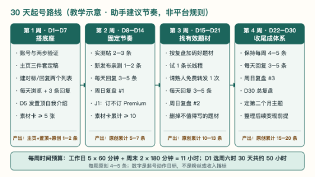
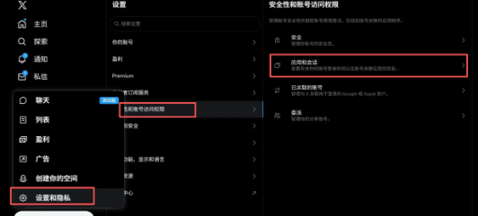
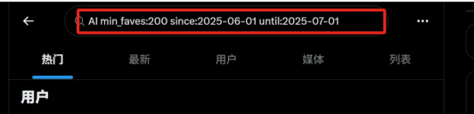
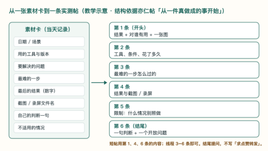
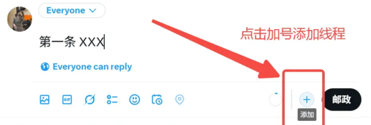
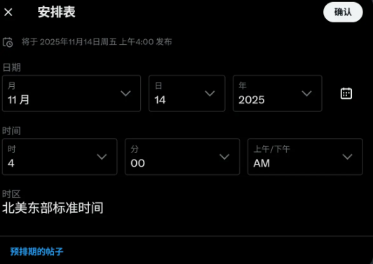
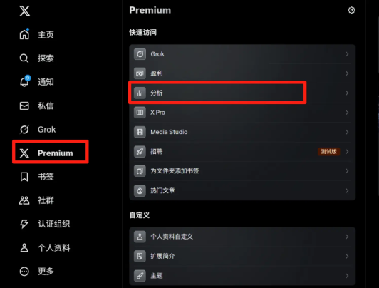
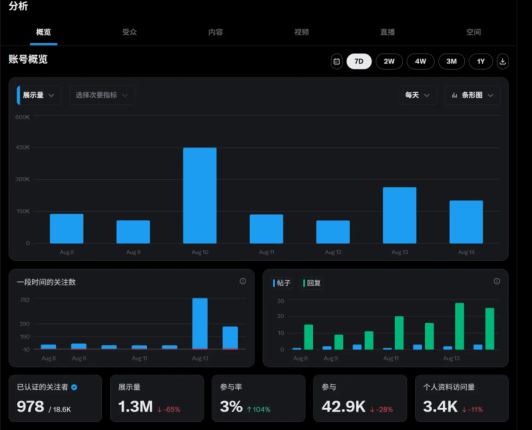
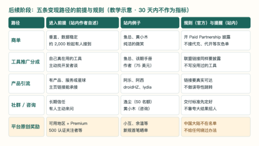

# X 中文 AI 自媒体：30 天起号实战手册

> 手册类型：通用版

<a id="section-intro"></a>
## 阅读说明

本版是原 fewshot 的内容重制版，制作于 2026-10-27。沿用原通用读者画像；平台规则、价格、资格和界面仍按原稿 2026-10-04／05 的核对记录呈现，本次未重新访问官方页面或站内原帖。订阅、申请奖励和商业合作前，先打开来源原页重新确认。


- 手册类型：通用版。依据：亦仁 2026-10-04 帖子【超级标19】 X 中文 AI 自媒体及其所附圈友复盘合集、2025 年 12 月 X 航海实战手册、11 篇站内复盘帖、1 个项目库词条、X 帮助中心页面。整理日期：2026-10-04；结构修订：2026-10-05。

- 先看下方路线图，再按周打开对应步骤；遇到规则、案例或写作示例时，点正文链接查附录。表格和模板供查用，不必从头到尾顺序读完。

- 数字是作者自述：书中每个粉丝、曝光、收入、分成数字，都来自本人在生财帖子或 X 上的自述，没有核对后台。亦仁帖也提醒：「愿意晒的，多半是拿得多的，这些数字要打个折看。」 <a id="md-cite-s1-1"></a>[[S1](#source-s1)]

- 规则有时效：平台规则以附录中标出的核对日期和版本为准。 原创内容奖励的「申诉失败后再申请」等待期，8 月版写 90 天，9 月版写 42 天<a id="md-cite-o1-1"></a>[[O1](#source-o1)]：规则变得很快，动手前再打开原页看一眼。

- 不承诺结果：本手册给的是 30 天的动作目标（主页、自我介绍、15–20 条原创、每天回复、每周复盘），不是粉丝或收入预测。合集里就有人 21 天只涨了 8 个粉<a id="md-cite-s1-2"></a>[[S1](#source-s1)]。

- 模板是虚构的：所有模板里的人名、工具、数字、链接都是虚构占位，用〔〕标出，发布前换成自己的真实经历。 截图有日期：真实界面截图来自 2025 年 11 月出品的 X 航海手册<a id="md-cite-s2-1"></a>[[S2](#source-s2)]，X 界面可能已改版；原创图一律标「教学示意」，不代表平台后台界面。

- 来源编号：方括号里的 S1、O1 是来源编号（S 为生财站内材料，O 为 X 官方页面），点击跳到文末，文末再点「回到正文」返回。

- 涉及其他会员：手册引用了多位会员的昵称和公开复盘，分享给社区以外的人之前请留意。

<a id="section-route"></a>
## 30 天路线图

|阶段|本阶段怎么做|点开对应章节|
|---|---|---|
|第 1 周：搭底座（D1–D7）|核访问与账号安全；完善主页、找对标；写并置顶自我介绍；开始记素材卡和认真回复。|[步骤 1](#section-step-1) 账号 · [步骤 2](#section-step-2) 安全 ·[步骤 3](#section-step-3) 主页 · [步骤 4](#section-step-4) 对标· [步骤 5](#section-step-5) 自我介绍 · [步骤 6](#section-step-6)素材 · [步骤 9](#section-step-9) 回复|
|第 2 周：稳定发布（D8–D14）|每周按日程发实测帖、新发布亲测帖与引用帖；持续回复，做第一次复盘，并在D14 判断Premium。|[详细日程](#section-schedule) · [步骤 7](#section-step-7) 实测 ·[步骤 8](#section-step-8) 新发布 · [步骤 9](#section-step-9) 回复 · [步骤 10](#section-step-10) 复盘 · [步骤 11](#section-step-11)订阅判断|
|第 3 周：找有效题材（D15–D21）|沿用发布和回复节奏，从复盘中挑有效题材，试一条长线程。|[步骤 6](#section-step-6) 素材 · [步骤 7](#section-step-7) 实测· [步骤 8](#section-step-8) 新发布 · [步骤 9](#section-step-9)回复 · [步骤 10](#section-step-10) 复盘|
|第 4 周与收尾（D22–D30）|继续发布、回复与复盘；D30 留下第二个月的两个主题和要停的一件事。|[详细日程](#section-schedule) · [步骤 7](#section-step-7) 实测 ·[步骤 8](#section-step-8) 新发布 · [步骤 9](#section-step-9) 回复 · [步骤 10](#section-step-10) 总复盘|


每天的用时与产物见 30 天路线与时间表。案例、全员对照、10 个模板、规则与后续变现路径集中在附录。

这一阶段先不做变现；以后再看：[M1 后续阶段](#section-appendix-f)中的商单、工具推广分成、产品引流、平台奖励；英文账号、视频、社群。

<a id="section-conditions"></a>
## 本手册按以下读者画像编写

|项目|画像|
|---|---|
|身份|生财圈友，日常重度使用AI：编程助手、写作、做小工具|
|X 现状|没有账号，或只有一个沉睡的旧号|
|30 天目标|完成起号：主页与自我介绍、15–20 条原创中文AI内容（来自自己真做成的事或新发布亲测）、每天认真回复同领域讨论、每周复盘|
|不作为硬指标|粉丝数、收入|
|内容与读者|用中文写AI；读者是出海创业者、独立开发者、产品经理和工程师|
|产品与变现|暂无自有产品；商单、产品引流、平台分成放在后续阶段（见 M1 后续阶段）|
|人手与时间|一个人；工作日约 1 小时，周末约 3 小时|
|现金投入|只考虑按需订阅 XPremium（见[步骤 11](#section-step-11)判断）|
|地区与身份|中国大陆；账号用真实身份|


### 条件不同时怎么调

- 已有活跃账号（发过内容、有几百粉）：[步骤 1](#section-step-1) 只做安全设置， [步骤 3](#section-step-3) 只改不重建；[步骤 5](#section-step-5) 仍然新写一条自我介绍并置顶。鱼总就是用一个沉睡 6 年、160 多粉的旧号，靠重新写的自我介绍起来的<a id="md-cite-s4-1"></a>[[S4](#source-s4)]。

- 时间更少（工作日只有 30 分钟）：保留每天回复和素材卡，原创降到每周 3 条，30 天目标降为 10–12 条；周日复盘不省。 时间更多（每天 3–4 小时，接近金尘马的投入<a id="md-cite-s5-1"></a>[[S5](#source-s5)]）：回复和原创都可以加量，但动作要分散在一天里，不集中在一个时段批量操作<a id="md-cite-s5-2"></a>[[S5](#source-s5)]。

- 已有自己的产品：M1 的「产品引流」可以提前到第 3 周，主页链接位放产品页；前两周仍只发不带推广链接的内容。鱼总的教训是刚发两篇就挂外链打广告，会被当成营销号<a id="md-cite-s3-1"></a>[[S3](#source-s3)]。

- 想做英文：本手册不覆盖。该期航海手册建议先做中文、上手后再做英文，并提醒直接把中文翻成英文效果会大打折扣 <a id="md-cite-s2-2"></a>[[S2](#source-s2)]。

- 身在原创内容奖励可用地区（名单含中国香港、中国台湾、日本、新加坡等<a id="md-cite-o1-2"></a>[[O1](#source-o1)]，且本人确实在当地）：M1 的平台奖励可以作为后续目标。中国大陆读者不适用，也不要用任何方式伪装所在地。

### 30 天要完成什么

|结果|数量|在哪一步|
|---|---|---|
|主页：头像、名字、简介、横幅、链接位|1 套|[步骤 3](#section-step-3) 主页|
|置顶自我介绍（线程）|1 条|[步骤 5](#section-step-5) 自我介绍|
|素材卡（记录真做成的AI事）|不少于 20 张|[步骤 6](#section-step-6) 素材库|
|原创：实测帖 + 新发布亲测或引用帖|15–20 条|[步骤 7](#section-step-7) 实测帖、[步骤 8](#section-step-8) 新发布|
|认真回复同领域讨论|每天 3–5 条，合计约 100条|[步骤 9](#section-step-9) 回复|
|复盘|每周日 1 次 + 第 30 天总复盘|[步骤 10](#section-step-10) 复盘|


### 阻碍完成的缺口（动手前先看）

- G1 访问条件：在中国大陆使用 X，需要读者自行解决访问条件。本手册不提供任何网络配置或绕过方法；该期航海手册也写明「需自行配置网络环境，手册不方便展开」<a id="md-cite-s2-3"></a>[[S2](#source-s2)]。请自行确认所在地的法律法规与合规要求。条件不具备时，可以先做不依赖 X 的部分：[步骤 6](#section-step-6) 的素材卡、[步骤 3](#section-step-3) 的简介草稿、[步骤 5](#section-step-5) 的自我介绍草稿。

- G2 平台奖励地区：X 原创内容奖励（Original Content Rewards）的可用国家和地区名单不含中国大陆（2026-09-22 存档版）<a id="md-cite-o1-3"></a>[[O1](#source-o1)]。本手册不提供任何绕过办法，30 天计划也不依赖平台奖励。

- G3 会员付款：官方只写「按地区定价，网页端起价每月 3 美元或每年 32 美元，另加税费和支付手续费」<a id="md-cite-o2-1"></a>[[O2](#source-o2)]。国内银行卡能不能付只有作者经验：该期手册写用国内 Visa/Master 卡可以完成支付，并提醒不要用 Apple 礼品卡，容易买到黑卡导致封号<a id="md-cite-s2-4"></a>[[S2](#source-s2)]。以订阅页实际为准；不要找人代开会员<a id="md-cite-s1-3"></a>[[S1](#source-s1)]。

<a id="section-schedule"></a>
## 30 天路线与时间表

以下日程为原手册的助手建议，D1 按周六安排。

这一章把 30 天的动作排进每天可用的时间。完成后应能按周找到当天动作、用时和产物。




图注：教学示意，2026-10-04 依据本手册日程绘制。节奏与数量是本手册的建议，不是平台规则；按本画像的时间条件（工作日 1 小时、周末 3 小时）排出，时间不同时按开头「条件不同时怎么调」缩放。

### 每周固定节奏（第 2 周起）

|日||安排|产出|
|---|---|---|---|
|周一|（60 分钟）|回复 20 分钟；从素材卡挑选题、补截图、写草稿40 分钟|本周 2 条实测帖的草稿|
|周二|（60 分钟）|一开始发实测短帖并守评论 40 分钟；回复 20 分钟|原创 1 条|
|周三|（60 分钟）|引用一条热门讨论，写自己的实测或经历并守评论40 分钟；回复 20 分钟|原创 1 条|
|周四|（60 分钟）|一开始发实测短帖并守评论 40 分钟；回复 20 分钟|原创 1 条|
|周五|（60 分钟）|回复 20 分钟；记素材卡、补草稿 40 分钟|素材卡 2–3 张|
|周六|（180 分钟）|选一个当周新发布亲手试90 分钟；写成线程并发出60 分钟；回复 30 分钟|原创 1 条（线程）|
|周日|（180 分钟）|复盘 45 分钟；写并发出（或定时）实测长帖 75分钟；回复 30 分钟；排下周 30 分钟|原创 1 条 + 复盘表|


一周合计：5 × 60 + 2 × 180 = 660 分钟（11 小时），原创 5 条。其中回复 160 分钟，写作与实测 425 分钟，复盘与排期 75 分钟。工作日这 1 小时若在晚上，正好落在该期手册列的中文用户活跃时段：工作日 21:00–23:00、周末 20:00–22:00<a id="md-cite-s2-5"></a>[[S2](#source-s2)]。

### 30 天日程（第 1 天定在周六）

|天|要做的事|用时|当天产物|
|---|---|---|---|
|D1（周六）|[步骤 1](#section-step-1) 账号与两步验证；[步骤 3](#section-step-3) 头像、名字、简介定稿；开始[步骤 4](#section-step-4)|180 分钟|可登录的账号、主页|
|D2（周日）|[步骤 4](#section-step-4) 建两个列表；[步骤 6](#section-step-6) 写 3 张素材卡；起草步骤5 自我介绍|180 分钟|列表、素材卡 3张、自我介绍初稿|
|D3（周一）|浏览与 3 条回复；改自我介绍|60 分钟|自我介绍二稿|
|D4（周二）|浏览与 3 条回复；把自我介绍发给 1–2 位熟人看，约好转发|60 分钟|定稿|
|D5（周三）|一开始发自我介绍并置顶，剩下的时间逐条回复|60 分钟|置顶帖|
|D6（周四）|发第 1 条实测短帖；回复|60 分钟|原创 1|
|D7（周五）|回复；素材卡补到5 张|60 分钟|素材卡不少于 5 张|
|D8–D14（周六至周五）|按周表执行；D9（日）复盘 1；D14 做[步骤 11](#section-step-11) 判断|11 小时|原创累计 6|


|天|要做的事|用时|当天产物|
|---|---|---|---|
|D15–D21（周六至周五）|按周表；D16（日）复盘 2；加码复盘里效果好的题材；试 1 条长线程|11 小时|原创累计 11|
|D22–D28（周六至周五）|按周表；D23（日）复盘 3|11 小时|原创累计 16|
|D29（周六）|新发布亲测线程|180 分钟|原创累计 17|
|D30（周日）|总复盘（见步骤10）；定第二个月的主题和要停掉的事|180 分钟|总复盘表|


按此排，30 天共 20 个工作日和 10 个周末日，合计约 50 小时；原创 17 条（不含自我介绍），在 15–20 条范围内。依据与假设：时间预算取自读者画像；第 1–4 天以浏览为主，参照该期手册「至少养 3 天」和阿乐「第三、四天开始发第一条」的说法<a id="md-cite-s2-6"></a><a id="md-cite-s7-1"></a>[[S2](#source-s2)、[S7](#source-s7)]；每周 5 条是为了 30 天达到 15–20 条的目标倒推出来的。实际起始日不是周六时，把需要 3 小时的事挪回周末即可。

<a id="section-step-1"></a>
## 步骤 1 注册或唤醒账号，开两步验证

这一章解决登录与账号安全的前置问题。完成后应有可登录、已开两步验证且授权应用可控的账号。

**目标**：得到一个用真实身份、已验证邮箱、已开两步验证、没有陌生授权应用的账号。

1. 确认 G1 访问条件后再开始。有旧号的先用原邮箱或手机号找回登录，不另注册新号；没有账号的在 x.com 用邮箱或 Google、 Apple 账号注册，填名字、邮箱、出生日期后到邮箱取验证码，注册时让选的兴趣主题和推荐关注可以全部跳过<a id="md-cite-s2-7"></a>[[S2](#source-s2)]。

2. 名字与出生日期如实填写，账号用真实身份<a id="md-cite-s1-4"></a>[[S1](#source-s1)]；设一个没在别处用过的强密码，弱密码和重复使用的密码是官方列出的盗号原因<a id="md-cite-o4-1"></a>[[O4](#source-o4)]。

3. 开两步验证：Settings and privacy（设置和隐私）→ Security and account access（安全性和账号访问权限）→ Security （安全）→ Two-factor authentication，三种方式里优先选认证器应用（Authentication app）；短信方式仅向 Premium 用户提供，且受地区与运营商限制，把备用码离线保存<a id="md-cite-o8-1"></a><a id="md-cite-s3-2"></a>[[O8](#source-o8)、[S3](#source-s3)]。

4. 在「安全性和账号访问权限」下的「应用和会话」检查已授权应用，删掉不认识的；以后只授权确实要用的工具。官方写明用户要为自己授权的第三方应用负责<a id="md-cite-o4-2"></a><a id="md-cite-s2-8"></a>[[O4](#source-o4)、[S2](#source-s2)]。

5. 前 3–4 天以浏览为主：每天刷 30–60 分钟同领域内容，对好内容点赞或加书签，对无关内容点「不感兴趣」，少量认真回复，关注分几天加，不一次关注几十个账号<a id="md-cite-s2-9"></a><a id="md-cite-s7-2"></a>[[S2](#source-s2)、[S7](#source-s7)]。

**做完的标准**：能用两步验证登录；「应用和会话」里没有不认识的授权；显示名是本人常用名；前 3 天没有集中在一个时段大量点赞、关注。




图注：真实界面截图，来自 2025 年 11 月 X 航海手册「爆款推文创作」 一节的「避开封号行为」<a id="md-cite-s2-10"></a>[[S2](#source-s2)]，用于说明授权应用的位置。中文界面、桌面网页版；X 可能已改版，找不到时按官方英文路径 Settings and privacy → Security and account access 查找<a id="md-cite-o8-2"></a>[[O8](#source-o8)]。

- [ ] 能用两步验证登录，备用码已离线保存

- [ ] 已删除不认识的授权应用

- [ ] 已建「同领域」浏览习惯，没有批量关注

### 补充说明

- 旧号的价值：鱼总的号沉睡 6 年、只有 160 多粉，之前的问题是没有主线、一上来就发广告和外链<a id="md-cite-s4-2"></a>[[S4](#source-s4)]；纯洁的微笑的号 2012 年注册，到 2025 年 8 月只有十几个粉<a id="md-cite-s12-1"></a>[[S12](#source-s12)]。旧号先清理与现在方向无关的旧帖再开始。

- 官方会做的验证：检测到可疑活动时，账号可能被锁定，要求补充手机号或完成验证<a id="md-cite-o4-3"></a>[[O4](#source-o4)]；订阅 Premium 时也要确认手机号 <a id="md-cite-o2-2"></a>[[O2](#source-o2)]。

多账号：官方允许一个人为不同用途开最多 10 个账号，但禁止用多个账号互相点赞、互相放大，或发几乎相同的内容<a id="md-cite-o4-4"></a>[[O4](#source-o4)]。 本手册只用一个主账号。 网络环境类建议本手册不采：原稿读到的材料里，该期航海手册、鱼总、慕容昕、启航都谈到 IP、节点、住宅 IP 或指纹浏览器<a id="md-cite-s2-11"></a><a id="md-cite-s3-3"></a><a id="md-cite-s6-1"></a><a id="md-cite-s9-1"></a>[[S2](#source-s2)、[S3](#source-s3)、[S6](#source-s6)、[S9](#source-s9)]。这类内容涉及访问方式和规避检测，超出本手册边界，一律不写。与账号直接相关、可以照做的只有两条：用真实身份，开两步验证。

<a id="section-step-2"></a>
## 步骤 2 账号安全与限流：不做什么，出了问题怎么办

这一章解决账号安全与异常处理。完成后应知道哪些互动方式要避开，以及受限时怎样自查。

**目标**：列出账号要停止的高风险动作，遇到限制时能区分自查与申诉。

1. 逐项看下面“不做／依据／改为”表，停止买号、批量互动和交换互动，保留自己的真实内容。[[S1](#source-s1)、[O4](#source-o4)]
2. 遇到异常时，先记录实际提示、发生时间和受影响功能，再按下方说明对照最近的操作；社区“隐形限流”叫法不等于官方诊断。[[S2](#source-s2)、[O4](#source-o4)]
3. 认为处理有误时使用平台申诉入口；下文的等待时长是作者经验，不作为恢复时限。[[S9](#source-s9)、[O4](#source-o4)]

**做完的标准**：留下明确的停止清单；若已受限，记下提示及下一次核查或申诉动作。

- [ ] 已按表排除高风险互动
- [ ] 异常处理记录能区分平台通知与作者经验

### 原稿读到的材料里出现过、本手册不采的做法

原稿阅读的材料中，下列做法有人写过：该期航海手册（「先发一条个人介绍推文」「爆款推文创作」「流量复盘与优化」三节）、鱼总、启航、纯洁的微笑都写过付费或发红包请人转发、互动、「加热」 <a id="md-cite-s2-12"></a><a id="md-cite-s4-3"></a><a id="md-cite-s9-2"></a><a id="md-cite-s12-2"></a>[[S2](#source-s2)、[S4](#source-s4)、[S9](#source-s9)、[S12](#source-s12)]；金尘马写过加入付费社群互相转发托举<a id="md-cite-s5-3"></a>[[S5](#source-s5)]；阿乐写过先买对方的产品再请对方转发<a id="md-cite-s7-3"></a>[[S7](#source-s7)]；黄小木写过「开火车」 （互关链）<a id="md-cite-s11-1"></a>[[S11](#source-s11)]；纯洁的微笑写过加入互关<a id="md-cite-s12-3"></a>[[S12](#source-s12)]；鱼总、启航、慕容昕写过静态 IP、住宅 IP 或指纹浏览器<a id="md-cite-s3-4"></a><a id="md-cite-s9-3"></a><a id="md-cite-s6-2"></a>[[S3](#source-s3)、[S9](#source-s9)、[S6](#source-s6)]；启航写过找人代开会员<a id="md-cite-s9-4"></a>[[S9](#source-s9)]；阿乐写过买成品号和做矩阵<a id="md-cite-s7-4"></a>[[S7](#source-s7)]。这只是原稿阅读范围内的情况，不代表站内多数人这样做。

|不做|依据|改为|
|---|---|---|
|互赞群、互关、开火车，发红包请人点赞评论转发|X 禁止协同交换互动，也禁止付钱或给好处请人刷数据<a id="md-cite-o4-5"></a>[[O4](#source-o4)]；亦仁帖列为不要做<a id="md-cite-s1-5"></a>[[S1](#source-s1)]|每天认真回复（[步骤 9](#section-step-9)）；只请真实认识的熟人免费转发（模板 T7）|
|付费请人转发、以购买换转发|属于上一条；若是商业合作还须披露<a id="md-cite-o4-6"></a><a id="md-cite-o3-1"></a>[[O4](#source-o4)、[O3](#source-o3)]|写值得转的内容，再礼貌请求|
|买号、找人代开会员、多个账号互相点赞|X 禁止交易、买卖账号，禁止用多个账号放大自己<a id="md-cite-o4-7"></a>[[O4](#source-o4)]；亦仁帖列为不要做<a id="md-cite-s1-6"></a>[[S1](#source-s1)]|自己注册、自己订阅；一个主账号|
|伪装所在地区，用住宅IP、指纹浏览器|亦仁帖列为不要做<a id="md-cite-s1-7"></a>[[S1](#source-s1)]；属于规避检测|用真实身份；本手册不提供网络方法（见开头G1）|
|搬运、翻译搬运、洗稿、让AI改写别人的爆款|官方把复制、轻微修改、聚合、跨平台搬运列为非原创<a id="md-cite-o1-4"></a>[[O1](#source-o1)]；亦仁帖列为不要做<a id="md-cite-s1-8"></a>[[S1](#source-s1)]|只写自己做成的事、自己的实测（[步骤 6](#section-step-6)–[步骤 8](#section-step-8)）|
|批量、重复、无关的回复和 @|官方禁止的内容垃圾行为<a id="md-cite-o4-8"></a>[[O4](#source-o4)]|每条回复都有新信息（模板 T6）|
|商单、联盟链接、受赠测评不标注|官方要求开启「PaidPartnership」披露<a id="md-cite-o3-2"></a>[[O3](#source-o3)]；启航提到不标注可能被封<a id="md-cite-s9-5"></a>[[S9](#source-s9)]|见 M1 后续阶段的模板T9|
|接代充、账号代开、API中转等灰色商单|亦仁帖提醒报价再高也不要接<a id="md-cite-s1-9"></a>[[S1](#source-s1)]|只接自己用过、合法合规的产品<a id="md-cite-s3-5"></a>[[S3](#source-s3)]|


### 被限制或被封时怎么办

- 先判断：官方的处罚方式包括把帖子排除出搜索结果、移出推荐和关注时间线、回复降权、暂时限制功能、锁号要求验证， 严重的会封号<a id="md-cite-o4-9"></a>[[O4](#source-o4)]。站内作者把这类情况叫作 Shadowban（隐形限流）或 Ghost ban，这是社区叫法，不是官方名称[[S6](#source-s6)、[S9](#source-s9)]。

- 对照常见原因：该期手册列过的可能原因有：未确认邮箱、没设头像、同一设备注册多个账号、多次用相同文字或图片回复、频繁 @ 未关注的用户被举报、操作过快、关注数远高于粉丝数<a id="md-cite-s2-13"></a>[[S2](#source-s2)]。启航转述的封号原因有商单未标注、恶意举报、频繁操作<a id="md-cite-s9-6"></a>[[S9](#source-s9)]。这些是作者经验，不是官方清单。 再处理（作者经验）：立刻停止批量操作，回看最近可能违规的帖子和回复，48 小时内不互动、不发帖<a id="md-cite-s2-14"></a>[[S2](#source-s2)]。启航开通蓝 V 后连续疯狂发帖、评论，被限制了差不多 12 天才恢复<a id="md-cite-s9-7"></a>[[S9](#source-s9)]。 申诉：官方页面写明认为处理有误可以提交申诉<a id="md-cite-o4-10"></a>[[O4](#source-o4)]。启航 2026 年 8 月 16 日被判「不真实的行为」封号，同一天有 20 多人几乎同时被封；他每次申诉的内容都不同，提交后退出账号等邮件，收到拒绝后隔 48 小时再申诉，第二次就解封了 <a id="md-cite-s9-8"></a>[[S9](#source-s9)]。合集也提到 2025 年底和 2026 年 8 月都有圈友被封、 靠申诉解封<a id="md-cite-s1-10"></a>[[S1](#source-s1)]。

<a id="section-step-3"></a>
## 步骤 3 主页三件套：让点进来的人 10 秒看懂

这一章解决主页定位与展示。完成后陌生人应能从头像、名称、简介和横幅看懂账号主题。

**目标**：主页让陌生人 10 秒内看懂「这人是谁、写什么、关注能得到什么」。

1. 头像用清晰的真人照片，该期手册认为真人脸照最容易被信任；不用 logo、风景照、马赛克或模糊图。显示名用「常用名 + 一个领域关键词」，各平台尽量统一<a id="md-cite-s2-15"></a><a id="md-cite-s4-4"></a><a id="md-cite-s7-5"></a>[[S2](#source-s2)、[S4](#source-s4)、[S7](#source-s7)]。

2. 简介按下面的模板 T1 写四件事：身份、证据、和读者的共同点、关注能得到什么；不写「热爱生活，随笔记录」这类话 <a id="md-cite-s2-16"></a><a id="md-cite-s4-5"></a>[[S2](#source-s2)、[S4](#source-s4)]。

3. 补横幅图；链接位暂无产品时放能展示作品的地方（例如代码仓库或博客），没有就先空着。名字、简介、头像、横幅齐全， 也是 X 变现资格的要求之一<a id="md-cite-o5-1"></a>[[O5](#source-o5)]。

4. 打算订阅 Premium 的，先把头像、显示名、用户名定稿再订： 官方写明订阅后改这三项会暂时失去蓝标，复核前不能再改 <a id="md-cite-o2-3"></a>[[O2](#source-o2)]。用户名（@ 后面那串）阿乐建议只改一次<a id="md-cite-s7-6"></a>[[S7](#source-s7)]。

**做完的标准**：请一位不认识这个账号的朋友看主页 10 秒，能说出 「是谁、写什么、对谁有用」三点。

- [ ] 头像、显示名、简介、横幅已定稿

- [ ] 简介写到了身份、证据、共同点、价值四件事

- [ ] 已请一位朋友做 10 秒测试

### 为什么主页要先做好

鱼总把涨粉拆成「曝光量 × 关注转化率」：曝光很大却不涨粉，多半是主页没承接住<a id="md-cite-s3-6"></a>[[S3](#source-s3)]。金尘马的建议是主页一定要有几条像样的代表性内容，否则别人从评论区点进来也很难关注<a id="md-cite-s5-4"></a>[[S5](#source-s5)]。纯洁的微笑总结的头两件事就是改头像、改简介，让新读者知道「我是谁、在哪个领域、关注我能学到什么」<a id="md-cite-s12-4"></a>[[S12](#source-s12)]。他还把别人关注一个账号的理由归成三类：觉得这人很牛、觉得这人有趣、觉得这人专业<a id="md-cite-s12-5"></a>[[S12](#source-s12)]。

另外，X 的《Authenticity》政策禁止用图库照片、盗用或 AI 生成的头像和抄来的简介去误导他人<a id="md-cite-o4-11"></a>[[O4](#source-o4)]，真人照片和自己写的简介本身就是最稳的做法。

### 先回答三个问题

鱼总的定位只问三件事：「你是谁、给谁看、凭啥关注你」；最后一问翻过来就是「能为哪群人持续解决什么问题」<a id="md-cite-s3-7"></a>[[S3](#source-s3)]。该期手册把账号分成专业类、资讯类、娱乐类：人群基数专业类最小，付费能力专业类最高，适合知识付费、咨询和自有产品<a id="md-cite-s2-17"></a>[[S2](#source-s2)]。本画像写实测和工作流，属于专业类。

想不清楚时，可以照慕容昕的做法跟 AI 多轮对话。她用过的提示词原文如下<a id="md-cite-s6-3"></a>[[S6](#source-s6)]：

我想做个实验。你想问我任何问题都行。我会尽可能真实、完整地回答。根据我的回答，你会问我另一个问题。我们会来回沟通，直到需要多久。我想挖掘内心深处的构造。谬误、局限、潜力、改进空间， 任何目前潜藏在我意识底下的事物。

参见 [模板 T1](#template-t1)。

<a id="section-step-4"></a>
## 步骤 4 找对标，建两个列表

这一章解决找谁学习、在哪里参与讨论。完成后应有可持续查看的对标与回复列表。

**目标**：有 10 个「对标」账号和 20–30 个「每天去回复」的同领域账号，分别放进两个列表。

1. 用三种方法找账号：刷推荐流时给高互动内容点赞或加书签， 让推荐学会偏好；用搜索指令找高赞帖；从已找到账号的关注列表里继续找<a id="md-cite-s2-18"></a><a id="md-cite-s6-4"></a>[[S2](#source-s2)、[S6](#source-s6)]。

2. 在搜索框输入指令： `AI min_faves:200 since:2026-09-01` 找点赞不少于 200 的帖， `from:` 账号名 `min_faves:100` 找某个账号的高赞帖<a id="md-cite-s2-19"></a>[[S2](#source-s2)]。官方的高级搜索面板也能按词、账号、日期筛选<a id="md-cite-o7-1"></a>[[O7](#source-o7)]； `min_faves` 这类指令来自该期手册，官方帮助页没有列出，失效时改用高级搜索面板。

3. 按标准挑对标：曝光超过 20 万的干货帖（近 3 个月）或资讯帖（2 天内），不找公众人物<a id="md-cite-s2-20"></a>[[S2](#source-s2)]；优先找粉丝不多却出过爆款、方向和自己接近的账号，金尘马叫它「低粉爆款号」 <a id="md-cite-s5-5"></a>[[S5](#source-s5)]。

4. 建两个列表：「对标」10 个，用来学选题和结构；「回复」20– 30 个，以粉丝 5,000–20,000 的中腰部账号为主<a id="md-cite-s2-21"></a>[[S2](#source-s2)]。新号分几天加关注，不一次加几十个，关注数也不要远超粉丝数 <a id="md-cite-s2-22"></a>[[S2](#source-s2)]。

**做完的标准**：两个列表建好；「对标」列表里每个账号旁写一句： 他的哪类帖子值得学、学什么（选题、结构还是节奏）。




图注：真实界面截图（已裁掉搜索结果中的其他账号信息），来自 2025 年 11 月 X 航海手册「账号注册」一节的「对标怎么找」<a id="md-cite-s2-23"></a>[[S2](#source-s2)]，用于说明指令输入的位置。指令为该期手册提供的写法，官方帮助页未列出<a id="md-cite-o7-2"></a>[[O7](#source-o7)]， 可能失效。

- [ ] 「对标」列表 10 个，每个写了学什么
- [ ] 「回复」列表 20–30 个，中腰部为主
- [ ] 关注分几天加完

### 学对标学什么，不学什么

可以学：选题方向、结构、发布节奏、哪类内容引来讨论。 不能学：照着别人的文案改写、把别人的帖子翻译搬运、让 AI 模仿某个博主的历史推文批量生成。X 把复制、轻微修改、聚合、跨平台搬运都列为非原创<a id="md-cite-o1-5"></a>[[O1](#source-o1)]，亦仁帖也把「搬运洗稿」 列为不要做<a id="md-cite-s1-11"></a>[[S1](#source-s1)]。该期航海手册和项目库里「下载对方历史推文让 AI 仿写文风」「用 AI 去重写对标内容」的做法，本手册不采 <a id="md-cite-s2-24"></a><a id="md-cite-s14-1"></a>[[S2](#source-s2)、[S14](#source-s14)]。

- 站内作者提到的中文 AI 账号：宝玉、玉伯、Orange AI、小互等<a id="md-cite-s1-12"></a><a id="md-cite-s5-6"></a>[[S1](#source-s1)、[S5](#source-s5)]。只作为找对标的起点，不代表本手册推荐。

<a id="section-step-5"></a>
## 步骤 5 写并置顶一条自我介绍

这一章解决第一条自我介绍的写法和发布。完成后应有一条能说明来时路、已置顶的内容。

**目标**：发出一条讲清「我是谁、做成过什么、在这里会分享什么」的线程，置顶，并守住发出后的第一个小时。

1. 先在纸上列出过去 2–3 年的关键节点：转折、做成的事、失败；挑 1 件最能证明能力的「真做成的事」放在开头[[S4](#source-s4)、[S7](#source-s7)]。

2. 按模板 T2 写 4–6 条线程：开头放最亮眼的结果和数字，中间讲经历和一次具体的失败，结尾说清在这里分享什么、提一个开放问题。可以口述给 AI 整理成稿，但内容只用自己的经历 <a id="md-cite-s4-6"></a><a id="md-cite-s2-25"></a>[[S4](#source-s4)、[S2](#source-s2)]。

3. 发出前请 1–2 位做过 X 的熟人或教练看一遍，按反馈删冗余、 把亮点前移<a id="md-cite-s4-7"></a>[[S4](#source-s4)]；想请熟人转发，提前打招呼，只请真实认识、确实认可内容的人，不付费、不发红包<a id="md-cite-s7-7"></a><a id="md-cite-o4-12"></a>[[S7](#source-s7)、[O4](#source-o4)]。

4. 在能留出整整 1 小时的时段发（工作日就在那 1 小时的开头发），发出后第一个小时逐条认真回复评论<a id="md-cite-s3-8"></a><a id="md-cite-s4-8"></a>[[S3](#source-s3)、[S4](#source-s4)]；然后把它置顶到主页<a id="md-cite-s2-26"></a>[[S2](#source-s2)]。官方《Authenticity》页在处罚说明里提到这项功能叫 pin to profile<a id="md-cite-o4-13"></a>[[O4](#source-o4)]；本手册没有取得置顶菜单的截图和官方路径，按实际界面操作。

5. 发出前逐字校对。编辑帖子是会员功能，订阅后发出 1 小时内可以有限次修改<a id="md-cite-o2-4"></a>[[O2](#source-o2)]；没有订阅就只能删了重发，行者也提醒过「之后只能删不能改」<a id="md-cite-s10-1"></a>[[S10](#source-s10)]。

**做完的标准**：置顶帖已发出；首小时内回复了全部有内容的评论；在复盘表里记下 24 小时浏览和新增关注数。

- [ ] 自我介绍发出并置顶

- [ ] 首小时逐条回复了评论

- [ ] 24 小时数据记进复盘表

### 站内作者的做法与数字

- 鱼总：第一版自我介绍用 ChatGPT 辅助生成，浏览 800 多； 他用 Grok 找了十几个中文圈表现最好的自我介绍，总结出共性 （真实、有情感、讲故事、有数据、结构清晰），拿一张白纸列出三年的关键节点，口述给 AI，要求「不要把它写成简历，请把它包装成一个有起承转合、能打动人心的成长故事」，打磨了四个半小时。发前请前辈把关、提前和朋友打好招呼，选在周三早上 8 点多发，首小时守着回复每条评论。第二版曝光 24 万，8 小时内关注者从 160 多涨到 1,300+<a id="md-cite-s4-9"></a>[[S4](#source-s4)]。 droidHZ：参考鱼总的自我介绍模板，10 小时内跑出 5.4 万浏览，涨粉近 500<a id="md-cite-s4-10"></a>[[S4](#source-s4)]。

- 黄小木：研究了圈友志辉的起号帖，写出自己的标签（大厂 T11、年薪百万、35 岁离职），又找了足够多的大 V 帮忙转发， 这一条涨粉 2,000+，完成冷启动<a id="md-cite-s11-2"></a>[[S11](#source-s11)]。他说认真写了「来时路」的圈友可以私信他，他会拉一把<a id="md-cite-s11-3"></a>[[S11](#source-s11)]。

- 阿乐：建议写一篇「来时路」，讲之前是什么样、干过什么、拿到过什么结果、踩过什么坑。踩坑要具体：哪一年、什么项目、亏了多少、错在哪一步、后来怎么改的<a id="md-cite-s7-8"></a>[[S7](#source-s7)]。 冰月的教练：花 8 小时打磨一条自我介绍，通过大 V 转发直接涨粉 700<a id="md-cite-s13-1"></a>[[S13](#source-s13)]。

- 该期手册的三种写法：写战绩；写故事找共情；写战绩 + 找共情 + 长线程。手册作者的 0 粉账号第一篇自我介绍拿到 1.2 万曝光，涨了 200 个左右精准粉丝<a id="md-cite-s2-27"></a>[[S2](#source-s2)]。慕容昕没有战绩可晒， 选了「写故事、找共情」，讲为什么来 X、想在这里分享什么 <a id="md-cite-s6-5"></a>[[S6](#source-s6)]。

参见 [模板 T2](#template-t2)。 参见 [模板 T7](#template-t7)。

<a id="section-step-6"></a>
## 步骤 6 建素材库：每天记一件 AI 做成的事

这一章解决每天写什么。完成后应持续积累有真实经历、结果和边界的素材卡。

**目标**：30 天积累至少 20 张素材卡，让 15–20 条原创都有真实来源，不靠临时硬憋。

1. 做 AI 相关的事时当场截图或录屏：工具界面、前后对比、报错和解决后的结果，文件按日期命名<a id="md-cite-s1-13"></a><a id="md-cite-s3-9"></a>[[S1](#source-s1)、[S3](#source-s3)]。

2. 当天花 5–10 分钟按模板 T3 填一张卡：工具与版本、要解决的问题、最难的一步、结果数字、自己的判断、不适用的情况 <a id="md-cite-s1-14"></a>[[S1](#source-s1)]。阿乐的要求是每一条素材都要有自己的判断在里面<a id="md-cite-s7-9"></a>[[S7](#source-s7)]。

3. 另外三个补充来源：自己的灵感笔记；日常生活和群聊里的观察；当周的新发布（只记「准备怎么亲测」）<a id="md-cite-s5-7"></a><a id="md-cite-s8-1"></a>[[S5](#source-s5)、[S8](#source-s8)]。不收集 「别人的爆文，准备改写」<a id="md-cite-o1-6"></a>[[O1](#source-o1)]。

4. 连续 3 天没有新卡片，当天就给自己安排一个 30 分钟的小实测，把它记成卡片。这是原手册的助手建议，非平台规则。[[S15](#source-s15)]

**做完的标准**：每张卡至少有 1 个截图或录屏、1 个可核的结果；第 7 天不少于 5 张，第 14 天不少于 10 张，第 30 天不少于 20 张。

- [ ] 素材卡第 7 天达到 5 张

- [ ] 素材卡第 14 天达到 10 张

- [ ] 素材卡第 30 天达到 20 张

### 选题从哪里来（站内作者的总结）

- 亦仁的起点：从一件真做成的事开始，写清用了什么工具、解决了什么问题、哪一步最难、结果怎样，有截图、有录屏，也有自己的判断<a id="md-cite-s1-15"></a>[[S1](#source-s1)]。

- 涨粉的内容集中在三类：金尘马回看自己的数据，真正涨粉的只有赚钱方法分享、AI 工具和技能干货、长文<a id="md-cite-s5-8"></a>[[S5](#source-s5)]。启航也认为工具教程类最容易涨粉：不用介绍工具多厉害，直接写解决问题的操作路径，越详细、越适合新人越好<a id="md-cite-s9-9"></a>[[S9](#source-s9)]。 解决具体问题：鱼总的 6 篇百万阅读长文，共同点是「解决一个具体、高频、有直接利益关联的问题」<a id="md-cite-s3-10"></a>[[S3](#source-s3)]。 生活就是素材：逸尘 3 月买了 Mac，写使用心得拿到 12 万曝光；他的观点是先丰富生活，再做自媒体<a id="md-cite-s8-2"></a>[[S8](#source-s8)]。

- 金尘马的其他来源：自己的灵感和笔记（有想法立刻记），生活场景和群聊<a id="md-cite-s5-9"></a>[[S5](#source-s5)]。他另有一个来源是把其他平台的热门内容拷下来让 AI 改写，本手册不采：它属于跨平台搬运或轻微修改 <a id="md-cite-o1-7"></a>[[O1](#source-o1)]。

参见 [模板 T3](#template-t3)。

<a id="section-step-7"></a>
## 步骤 7 发「真做成的事」实测帖（短帖与线程）

这一章解决怎样把真做成的事写成帖子。完成后应有可复现的短帖或线程，并完成发布检查。

**目标**：每周 2–3 条，把素材卡写成别人照着能复现的帖子。

1. 按下面的骨架写：短帖只写开头（结果 + 对谁有用 + 一张图） 和一句判断；线程写 3–6 条，再加工具条件、最难一步、限制 <a id="md-cite-s1-16"></a><a id="md-cite-s2-28"></a>[[S1](#source-s1)、[S2](#source-s2)]。

2. 普通帖单条最多 280 字，订阅会员可写到 25,000 字[[O6](#source-o6)、[O2](#source-o2)]。线程在发帖框写完第一条后点「＋」继续添加，全部写完点「Post all（全部发布）」<a id="md-cite-o6-1"></a><a id="md-cite-s2-29"></a>[[O6](#source-o6)、[S2](#source-s2)]。

3. 写清工具版本和日期，截图遮住隐私信息；每个关键步骤自己跑一遍，没跑通的步骤不写，照做会失败的地方写进「限制」 <a id="md-cite-s3-11"></a>[[S3](#source-s3)]。

4. 在那 1 小时的开头发，剩下的时间回复评论；当天要外出时， 用发帖框底部的日历图标定时，选好日期时间后点确认，并核对窗口里的时区<a id="md-cite-o6-2"></a><a id="md-cite-s2-30"></a>[[O6](#source-o6)、[S2](#source-s2)]。

5. 发由 AI 生成、表现武装冲突的视频，必须注明由 AI 生成（官方规定）<a id="md-cite-o1-8"></a><a id="md-cite-o5-2"></a>[[O1](#source-o1)、[O5](#source-o5)]；其他由 AI 生成的图片或视频，也建议在正文写明，行者的做法是主动加「Made with AI」标注<a id="md-cite-s10-2"></a>[[S10](#source-s10)]。

**做完的标准**：每条都有可核的结果（数字、截图、录屏之一）和至少一句适用边界；每周 2–3 条按计划发出，发出当天回完评论。




图注：教学示意，2026-10-04 绘制。结构依据亦仁帖「从一件真做成的事开始」<a id="md-cite-s1-17"></a>[[S1](#source-s1)]，并参考金尘马、鱼总对干货帖的要求<a id="md-cite-s5-10"></a><a id="md-cite-s3-12"></a>[[S5](#source-s5)、[S3](#source-s3)]；不是平台模板。该期手册说长线程一般 3–8 条<a id="md-cite-s2-31"></a>[[S2](#source-s2)]，本画像时间有限，按 3–6 条画。




图注：真实界面截图（已裁剪），来自 2025 年 11 月 X 航海手册「爆款推文创作」一节的「发布长线程的步骤」<a id="md-cite-s2-32"></a>[[S2](#source-s2)]。截图中发帖按钮显示为「邮政」，是浏览器翻译插件把 Post 误译所致；官方帮助页对线程的说明是点加号添加、写完点 Post all<a id="md-cite-o6-3"></a>[[O6](#source-o6)]。


图注：真实界面截图，来自 2025 年 11 月 X 航海手册「爆款推文创作」 一节的「发布推文」<a id="md-cite-s2-33"></a>[[S2](#source-s2)]，用于说明存档版的桌面定时发布入口；2026-10-05 现行页面读取结果未显示此桌面步骤，官方存档说明见<a id="md-cite-o6-4"></a>[[O6](#source-o6)]。




图注：真实界面截图，来源同上<a id="md-cite-s2-34"></a>[[S2](#source-s2)]。截图里的时区是北美东部时间，定时前要核对这里的时区，避免发布时间和预想差十几个小时。2026-09-24 存档版写定时帖和草稿在发帖框的 Unsent posts（未发送的帖子） 里；2026-10-05 现行页面读取结果未显示此桌面步骤<a id="md-cite-o6-5"></a>[[O6](#source-o6)]。

- [ ] 本周 2–3 条实测帖已发出

- [ ] 每条都有可核的结果和一句适用边界

- [ ] 定时帖已核对时区

### 写长内容时最容易踩的坑

鱼总的创作流程是「内容搜集 → 自己实操一遍 → AI 辅助写长文教程 → 人工校验修改 → 排版发布」，最关键的一环是自己实操一遍<a id="md-cite-s3-13"></a>[[S3](#source-s3)]。 他总结的两个坑<a id="md-cite-s3-14"></a>[[S3](#source-s3)]：

- 纯靠 AI 一键写，自己不跑通每一步：工具一改版、参数一变， 读者照着做卡住，评论区就成了翻车现场。 通篇无排版：一段话六七行不换行、没有加粗和序号，读者扫一眼就划走。排版是帮读者降低理解成本。

另一个常见翻车来自慕容昕：她想发一条长线程，因为不知道怎么串联，结果发成了两篇断开的帖子<a id="md-cite-s6-6"></a>[[S6](#source-s6)]。第一次发线程前，先在草稿里试一次。

金尘马的数据说明了内容类型的差别：一条搞抽象的帖子拿了 50 多万曝光，只涨 60 多个粉；一份「26 个爆火 Skills 清单」19 万曝光，涨粉 480 多<a id="md-cite-s5-11"></a>[[S5](#source-s5)]。行者开号后粉丝一直不涨，转折点是一条完整的 AI 视频制作教程（不是单纯晒作品），6.4 万曝光、涨粉 277<a id="md-cite-s10-3"></a>[[S10](#source-s10)]。

参见 [模板 T4](#template-t4)。

参见 [模板 T10](#template-t10)。

<a id="section-step-8"></a>
## 步骤 8 发新发布亲测帖与引用帖

这一章解决怎样借新发布与讨论切入。完成后应有带自身亲测和判断的原创或引用帖。

**目标**：每周 1–2 条，借新发布和热门讨论获得曝光，同时保持内容原创。

1. 在「对标」列表和 AI 公司官方账号里盯当周的新模型、新工具发布，挑一个和自己工作相关、30–120 分钟能试完的<a id="md-cite-s1-18"></a>[[S1](#source-s1)]。

2. 亲手试一遍，用中文讲清对谁有用、怎么用、有什么限制；用 「引用」（Quote）转发官方发布帖或热门讨论帖，在引用里写自己的实测和判断<a id="md-cite-s1-19"></a><a id="md-cite-s12-6"></a>[[S1](#source-s1)、[S12](#source-s12)]。

3. 也可以在热门帖下引用并提一个真实问题，或把一个主题拆成两半：一部分自己发，另一部分作为回复发在原帖下面[[S6](#source-s6)、[S12](#source-s12)]。普通转发也加一句自己的判断，否则别人只会记住原作者<a id="md-cite-s7-10"></a>[[S7](#source-s7)]。

4. 不复制、不翻译搬运、不「改几个字」：X 把复制、轻微修改、 聚合、跨平台搬运列为非原创；拆解新闻、给出自己的看法、 补充别人没有的背景，算原创<a id="md-cite-o1-9"></a>[[O1](#source-o1)]。

**做完的标准**：每条帖子里至少有一处只有亲自试过才写得出的细节（截图、耗时、报错、对比）；引用的原帖和官方来源写清楚。

- [ ] 本周 1–2 条新发布亲测或引用帖已发出

- [ ] 每条都有亲测细节

- [ ] 每条都写明原帖或官方来源

### 站内例子

- 慕容昕：作为公众号创作者，引用一条讨论，说出自己遇到的痛点并问有没有这样的工具。这条到了 7.1 万浏览，最终 11 万多，单条涨粉 50+；一位开发者圈友看到后很快开源了一个采集工具。她的总结是：「一个真诚的好问题，也能促成一次完美的价值共创。」<a id="md-cite-s6-7"></a>[[S6](#source-s6)]

- 纯洁的微笑：账号 3 个多月没有一篇阅读破 1,000。他刷到一位大 V 讨论「普通人如果从 0 开始，如何赚到 500 万」，结合自己从 0 起步的经历写了一条引用，单篇阅读 34 万，当天涨粉 500+<a id="md-cite-s12-7"></a>[[S12](#source-s12)]。

- 启航：把引用分成几种用法：给自己的原帖补充新观点、回答原帖里埋下的问题、给某个帖子导流<a id="md-cite-s9-10"></a>[[S9](#source-s9)]。

- 鱼总：向大 V 打招呼时用专业内容敲门，例如写一篇实操版再 @ 对方说「受您之前那篇文章启发，我做了一个实操版」 <a id="md-cite-s3-15"></a>[[S3](#source-s3)]。

### 两个限制

- 资讯类在起号阶段很难启动：行者建议先完成 0 到 1（约 500 粉）再发资讯<a id="md-cite-s10-4"></a>[[S10](#source-s10)]。所以新发布帖每周 1–2 条，不把账号做成资讯号。

- 热点要贴着自己的定位：行者写过两篇热点帖，数据很差，他总结原因是和粉丝画像不匹配、深度不够<a id="md-cite-s10-5"></a>[[S10](#source-s10)]。

- 参见 [模板 T5](#template-t5)。

<a id="section-step-9"></a>
## 步骤 9 每天认真回复同领域讨论

这一章解决新号怎样参与同领域讨论。完成后应能每天留下有补充、 有经历的认真回复。

**目标**：每天 3–5 条有内容的回复，让同领域的人先在评论区认识这个账号。

1. 每天从「回复」列表里挑 3–5 条刚发出不久、评论区还不拥挤的帖子，中腰部账号优先<a id="md-cite-s2-35"></a><a id="md-cite-s5-12"></a>[[S2](#source-s2)、[S5](#source-s5)]。亦仁的说法是：多认真回复大号，比闷头自己发更快被看见<a id="md-cite-s1-20"></a>[[S1](#source-s1)]。

2. 用模板 T6 的三种写法之一：补充信息或案例；提出追问；「认同 + 讲自己的经历 + 补一点观点」。不写「支持」「学到了」「太棒了」<a id="md-cite-s13-2"></a><a id="md-cite-s2-36"></a><a id="md-cite-s5-13"></a>[[S13](#source-s13)、[S2](#source-s2)、[S5](#source-s5)]。

3. 自己帖子下的评论当天逐条回，回复之间要有差异，不复制粘贴同一句话<a id="md-cite-s2-37"></a><a id="md-cite-o4-14"></a>[[S2](#source-s2)、[O4](#source-o4)]。

4. 把动作分散在一天里（例如午休 10 分钟、晚上 10 分钟），不在一个时段集中大量点赞、关注、评论<a id="md-cite-s5-14"></a>[[S5](#source-s5)]；不进互赞群，不发红包换互动<a id="md-cite-o4-15"></a><a id="md-cite-s1-21"></a>[[O4](#source-o4)、[S1](#source-s1)]。

**做完的标准**：每天 3–5 条回复，每条都有一句原帖里没有的信息或问题；周日复盘时能找出本周数据最好的一条回复。

- [ ] 今天的 3–5 条回复已完成

- [ ] 自己帖子下的评论已逐条回复

- [ ] 本周最好的一条回复已记进复盘表

### 为什么新号先回复

- 金尘马：起步时密集评论宝玉、玉伯等账号，互动了半个月、 十几条之后才慢慢进入对方视野，偶尔得到回复或转发；在大 V 热帖跑到一两万曝光时进去写高质量评论，评论本身就可能拿到十几万曝光<a id="md-cite-s5-15"></a>[[S5](#source-s5)]。

- 冰月：起初发帖阅读常常不到 100，后来发现有些评论的阅读量远高于自己发的文章。她在一篇爆款下用「认同 + 讲故事 + 提升」的结构留言，这条评论阅读过万、点赞 47、涨粉十几个；她的经验是至少认真评论 5 条以上，总有一条有结果 <a id="md-cite-s13-3"></a>[[S13](#source-s13)]。

- 启航：某条优质回复爆了之后，在主页发一条相关帖补充评论区的观点，涨粉效果更好，因为点进主页的人本来就对这个话题感兴趣<a id="md-cite-s9-11"></a>[[S9](#source-s9)]。

- 行者与阿乐：行者的高质量回复是「总结大 V 内容 + 个人观点」<a id="md-cite-s10-6"></a>[[S10](#source-s10)]；阿乐说的认真回复，是写出自己的补充、经验或反对意见<a id="md-cite-s7-11"></a>[[S7](#source-s7)]。

- 官方信息：X Premium 各档都包含「回复优先」（reply prioritization），Premium 档比 Basic 档更高<a id="md-cite-o2-5"></a>[[O2](#source-o2)]，回复是主要动作的读者可以把它作为[步骤 11](#section-step-11) 判断的考虑因素之一。

### 不能踩的线

X 的《Authenticity》政策明确不允许：批量、激进、大量不请自来的回复和 @；用与原帖无关的回复推广内容；反复发相同或几乎相同的内容；协同交换点赞、回复、转发、关注<a id="md-cite-o4-16"></a>[[O4](#source-o4)]。被判定后可能被限制可见范围，包括回复被降权<a id="md-cite-o4-17"></a>[[O4](#source-o4)]。

参见 [模板 T6](#template-t6)。

<a id="section-step-10"></a>
## 步骤 10 每周复盘

这一章解决每周如何用数据调整题材。完成后应有复盘表和下一周的保留、停止清单。

**目标**：每周日用 45 分钟，用数据决定下周多写什么、少写什么。

1. 收集本周每条原创和最好的 3 条回复的 24 小时浏览、点赞、 回复、书签、新增关注。没有会员时记每条帖子自己显示的浏览数（本手册未取得这一项的官方说明，以实际界面为准）；有会员的可以在「Premium → 分析」看每日曝光和关注变化，该期手册说这是 Premium 档的功能，官方会员页没有写明[[S2](#source-s2)、[O2](#source-o2)]。

2. 按「24 小时浏览 ÷ 发帖时粉丝数」给每条分档：低于 1 倍、1– 3 倍、3 倍以上，分档标准来自启航<a id="md-cite-s9-12"></a>[[S9](#source-s9)]。对应处理是本手册的建议：低于 1 倍的选题先放下；1–3 倍的换个角度再写一次；3 倍以上的同主题再写 1–2 条。

3. 区分「流量帖」和「涨粉帖」：看哪几条真正带来关注；曝光大却不涨粉，就回头改简介和置顶帖<a id="md-cite-s5-16"></a><a id="md-cite-s2-38"></a><a id="md-cite-s3-16"></a>[[S5](#source-s5)、[S2](#source-s2)、[S3](#source-s3)]。

4. 填模板 T8，从素材卡里排好下周 4–5 条，并写下下周要停掉的一件事<a id="md-cite-s7-12"></a><a id="md-cite-s4-11"></a>[[S7](#source-s7)、[S4](#source-s4)]。

**做完的标准**：有一张填完的周复盘表和下周排期；第 30 天再做一次总复盘，回答表格后面的三个问题。




图注：真实界面截图，来自 2025 年 11 月 X 航海手册「流量复盘与优化」 一节<a id="md-cite-s2-39"></a>[[S2](#source-s2)]，用于说明数据入口。该手册说开通会员后才能看账号每日数据；X 官方会员页未写明分析功能属于哪一档<a id="md-cite-o2-6"></a>[[O2](#source-o2)]，以实际界面为准。




图注：真实界面截图，来源同上<a id="md-cite-s2-40"></a>[[S2](#source-s2)]。截图中是航海手册作者自己账号的数据（含「已认证的关注者 978 / 18.6K」），只用来说明页面上能看到哪些指标，与读者的预期无关。

- [ ] 本周数据已收集

- [ ]
- [ ] 每条已按倍数分档
- [ ] 下周 4–5 条已排好，并写下要停掉的一件事

### 复盘时要记住的几条

- 低数据是常态：鱼总说没人看、没互动、没反馈才是新号的常态，爆款是偶然，先养成复盘的习惯<a id="md-cite-s4-12"></a>[[S4](#source-s4)]。该期手册的说法是前 10 条没人看，先发 20 条再说<a id="md-cite-s2-41"></a>[[S2](#source-s2)]；纯洁的微笑起号前 3 个多月没有一篇阅读破 1,000<a id="md-cite-s12-8"></a>[[S12](#source-s12)]。

- 好方向就写透：纯洁的微笑的经验是一个方向的话题好，就持续写，直到没流量或没素材为止<a id="md-cite-s12-9"></a>[[S12](#source-s12)]。

- 把结论喂回素材库：阿乐每周看一次数据，哪条好、哪条差、 跟上周比怎样，再把结论喂回素材库<a id="md-cite-s7-13"></a>[[S7](#source-s7)]。慕容昕还会让 Grok 分析自己这段时间的内容，给出调整方向<a id="md-cite-s6-8"></a>[[S6](#source-s6)]。

- 定期自查有没有被限制：用另一个账号（或请朋友）搜索 `from:` 用户名 ，搜不到可能被限制了<a id="md-cite-s2-42"></a><a id="md-cite-s6-9"></a>[[S2](#source-s2)、[S6](#source-s6)]。官方的处罚方式里确实包括把帖子排除出搜索结果<a id="md-cite-o4-18"></a>[[O4](#source-o4)]。 晒里程碑要克制：金尘马每涨 1,000 粉就引用上一条晒成果 <a id="md-cite-s5-17"></a>[[S5](#source-s5)]，适合偶尔为之；只讲怎么变现、教人拿收益的内容，在原创内容奖励里不算合格内容<a id="md-cite-o1-10"></a>[[O1](#source-o1)]。

参见 [模板 T8](#template-t8)。

<a id="section-step-11"></a>
## 步骤 11 判断：要不要订阅 X Premium

这一章解决 Premium 是否值得订阅。完成后应能按功能需求与预算做出自己的判断。

**目标**：根据真实功能需要决定订或不订，记录两条理由及复看日期。

1. 打开前两周复盘表，列出长帖、编辑与回复需求；核对下方功能表，表内价格和功能为原稿历史记录。[[O2](#source-o2)]
2. 用下文“怎样判断”检验需求，预算不足或节奏未形成时先不订；不要把会员当作流量保证。[[S1](#source-s1)、[S2](#source-s2)]
3. 确实要订时先去官方订阅页确认当前档位、价格与付款条件；主页身份信息先定稿，再按自己预算决定。[[O2](#source-o2)]

**做完的标准**：已记录订或不订、实际功能需求及下次复看日期。

- [ ] 已留下订或不订的决定
- [ ] 两条理由来自实际需要，并有下次复看日期

输入：前两周的复盘表；每周有几条想写超过 280 字的内容；是否经常需要发出后修改；回复在涨粉里占多大比重；当月预算。

官方信息<a id="md-cite-o2-7"></a>[[O2](#source-o2)]：

|档位|与本画像相关的功能|
|---|---|
|Basic|编辑帖子（发出后 1 小时内有限次修改）、长帖（最多 25,000 字）、回复优先、书签文件夹|
|Premium|以上全部 + 蓝标、更高的回复优先、可申请原创内容奖励（中国大陆不在可用名单<a id="md-cite-o1-11"></a>[[O1](#source-o1)]）、身份验证、MediaStudio|
|Premium+|以上全部 +SuperGrok、去广告（官方注明仍可能偶尔出现推广内容）、最高的回复优先、Articles 长文等|
|价格与要求|按地区定价，网页端起价每月 3 美元或每年 32 美元（另加税费和支付手续费）；订阅时要确认手机号；订阅后改头像、显示名、用户名会暂时失去蓝标|


### 怎样判断（本手册的建议）：

- 建议订：到第 14 天仍在按周表发帖，并且符合下面任意两条： 经常想写长帖；经常需要发后修改；回复是主要的曝光来源； 需要看每日数据复盘。先按月订，不合适就停，该期手册也建议按月开、试错成本低<a id="md-cite-s2-43"></a>[[S2](#source-s2)]。

- 暂不订：第 2 周还没形成节奏，或预算紧。帖子自己显示的浏览数足够完成本手册的复盘。

- 站内经验：鱼总认为 Premium 会给账号加分、提升分发优先级 <a id="md-cite-s3-17"></a>[[S3](#source-s3)]；纯洁的微笑把「要开蓝 V」列为他的四条做法之一 <a id="md-cite-s12-10"></a>[[S12](#source-s12)]。这些是作者经验，不是平台规则，本手册不把它当作订阅理由。

用一个反例检查：「订了会员就会有流量」。如果每周只发 1 条、几乎不回复，会员解决不了没有内容和互动的问题。亦仁说过「做得好的话，创作者收益能把 AI 的各种工具费用赚回来」，但也说「拿它当一份额外的奖励，别当成起步的前提」<a id="md-cite-s1-22"></a>[[S1](#source-s1)]；中国大陆读者目前拿不到平台奖励，更不能用「订了能把会费赚回来」作为理由。

复看日期建议设为第 30 天。

下一步：订了的，先确认[步骤 3](#section-step-3) 主页的头像、名字、用户名已定稿，复盘时加看分析页；没订的，继续用帖子浏览数复盘，第 30 天再判断一次。

<a id="section-appendix-a"></a>
## 附录 A｜方向依据：为什么是 X 中文 AI

这一章保存方向判断和快慢起步的证据。查看它可理解路线依据与作者自述结果的适用边界。

### 这件事的本质

亦仁两年前在超级标第一期写过：「AI 自媒体不是让你用 AI 做内容， 而是成为 AI 产品/新闻/资讯/场景等的一个渠道。」这一期他把方向收窄为：在 X 上用中文做 AI 内容<a id="md-cite-s1-23"></a>[[S1](#source-s1)]。

他看好的理由可以归成三句：最新的 AI 在 X 上发布；最想跟上 AI 的中文读者在 X 上看；最需要被看见的 AI 产品在 X 上找用户。能用中文把 AI 讲清楚、用明白的人站在这三者中间，可以同时拿到读者、 商单和自己产品的第一批用户<a id="md-cite-s1-24"></a>[[S1](#source-s1)]。

### 支撑判断的事实

|维度|帖子里的说法|怎么看待|
|---|---|---|
|平台|2026 年 1 月 X 公开推荐算法代码；4 月在全球上线Grok 自动翻译；9 月起新的创作者奖励只给原创|奖励规则已在官方页面核到<a id="md-cite-o1-12"></a>[[O1](#source-o1)]；算法与翻译是亦仁转述，本手册未逐一核原文|
|新人机会|公开的推荐代码里，5 万粉以内作者刚发出、还没被多少人看过的原创帖，有机会被放进推荐流靠前位置试一试|亦仁读代码后的转述，本手册未核代码|
|读者|出海创业者和独立开发者、产品经理和工程师、投资人、海外华人。阿乐的话：「他们看得懂你在说什么，而且他们有钱」|与本画像的目标读者一致|
|规模|中文AI账号里过 10 万粉的近 30 个；第三方统计中文AI前 100 名粉丝中位数 4 万出头|池子小：做到前排容易，做到很大要靠长期积累|
|站内热度|生财站内提到推特的精华帖：2024 年 13 篇，2025 年 39 篇，2026 年前九个月 37 篇|站内可参照的经验已经不少|
|会用AI的人|TokenRank 10 月 3 日有2,171 位圈友上榜，单日用量超过 10 亿 token 的有108 人|亦仁的判断：会用AI的人该开始对外表达了|


以上均出自<a id="md-cite-s1-25"></a>[[S1](#source-s1)]。

### 第一次反馈：快的和慢的都有

快的例子：鱼总沉睡 6 年的旧号，第一条自我介绍发出 8 小时涨粉 1,000 多，他也请了几位朋友帮忙转发；lydia 从 7 个粉丝起步，照着航海教练给的模板写了一条自我介绍、请老师帮忙转发，两天涨到 1,000 多粉；慕容昕用华为手机、零基础，航海实操第 5 天单条浏览 7.1 万<a id="md-cite-s1-26"></a>[[S1](#source-s1)]。

慢的例子：和光前两周发了 20 多条，总曝光不到 200，坚持两个月到 1,300 粉；有人 21 天只涨了 8 个粉；有人起初阅读常常不到 100<a id="md-cite-s1-27"></a>[[S1](#source-s1)]。行者 11 月中旬开号，到 12 月初只有 73 个粉丝<a id="md-cite-s10-7"></a>[[S10](#source-s10)]；冰月起初的帖子阅读量常常不到 100，最好的一条只有 1 个赞、2 个转发<a id="md-cite-s13-4"></a>[[S13](#source-s13)]。

对 30 天的合理预期：工作日 1 小时、周末 3 小时，能稳定完成的是动作（主页、置顶、15–20 条原创、约 100 条回复、4 次复盘）；粉丝和曝光的波动非常大，取决于选题、借力和运气。快速破圈的人往往有前置条件：鱼总冷启动时请了哥飞、小排老师等朋友帮忙<a id="md-cite-s3-18"></a>[[S3](#source-s3)]， 纯洁的微笑有 7、8 年自媒体经验<a id="md-cite-s12-11"></a>[[S12](#source-s12)]，行者原本就是拿过奖的 AI 视频创作者<a id="md-cite-s10-8"></a>[[S10](#source-s10)]。冰月的观察是：「很多涨粉快的大佬，其实在别的平台早已深耕多年。」<a id="md-cite-s13-5"></a>[[S13](#source-s13)]

### 亦仁的三条提醒

- 商单有起伏：跟着 AI 热点和品牌预算变化；代充、账号代开、 API 中转这类灰色商单，报价再高也不要接。 中推池子小：比英推小，做到前排容易，做到很大要靠长期积累。

注意账号安全：封号和限流都有人遇到，账号用真实身份，别用灰色手段。

以上出自<a id="md-cite-s1-28"></a>[[S1](#source-s1)]。同一帖还列了四件「不要做」：互赞群、搬运洗稿、伪装所在地区、找人代开会员<a id="md-cite-s1-29"></a>[[S1](#source-s1)]，[步骤 2](#section-step-2) 账号安全逐条展开。

<a id="section-appendix-b"></a>
## 附录 B｜8 张案例卡

这一章保存 8 个起点不同的案例卡。查阅时对照起点、做法和自述结果，不把案例当作结果保证。 以下案例按「起点、做法、结果（作者自述）、来源」整理。挑选标准是起点和路径各不相同，也包括起步很慢的人；数字都是作者自述，未核对后台。

<a id="case-1"></a>
### 案例卡 1｜鱼总：沉睡 6 年的旧号

起点：UI 出身、做了 8 年 App 和 SaaS 的产品经理，全职做出海工具；X 号沉睡 6 年，粉丝 160 多，之前一上来就发广告和外链。

做法：2025 年 9 月在生财 X 航海里重新起号；拆了十几个中文圈表现最好的自我介绍，用四个半小时打磨一条，请前辈把关、 提前约好朋友转发，首小时守着回复；之后写解决具体问题的长教程，主动找自己在用的工具谈推广分成。

结果（作者自述）：自我介绍曝光 24 万，8 小时内关注者从 160 多涨到 1,300+，第一个商单变现 131 元；12 个月后粉丝 6.3 万，6 篇长推文阅读过百万，X 相关收入累计 40 万元以上，商单单条 6,000–10,000 元。 可借鉴：旧号可以重来；自我介绍值得花一个完整的周末去打磨。

来源：<a id="md-cite-s4-13"></a><a id="md-cite-s3-19"></a><a id="md-cite-s1-30"></a>[[S4](#source-s4)、[S3](#source-s3)、[S1](#source-s1)]

<a id="case-2"></a>
### 案例卡 2｜金尘马：先评论，后原创

起点：8 年后端程序员，做过 3 个月公众号，X 从 0 粉开始；现在每天投入 3–4 小时。

做法：前期不急着大量发原创，先在宝玉、玉伯等账号下写高质量评论，半个月、十几条后进入对方视野；之后发赚钱方法、AI 工具和技能干货、长文。

结果（作者自述）：两个月从 0 到 1.2 万粉、1,400 万曝光，拿到 1,400 多美元创作者激励（旧规则）；现在每天约 15–20 条内容、50 条以上评论区回复。

可借鉴：时间只有他的三分之一时，回复要更挑对象；「流量帖」 和「涨粉帖」分开看。

来源：<a id="md-cite-s5-18"></a><a id="md-cite-s1-31"></a>[[S5](#source-s5)、[S1](#source-s1)]

<a id="case-3"></a>
### 案例卡 3｜慕容昕：时间最少的人

起点：每天工作 12 小时的食品大厂检验员，零基础、用华为手机，自称「超级 I 人」，2025 年 12 月航海学员。

做法：跟 AI 多轮对话理清定位；用下班后的碎片时间，在圈友的关注列表里找账号认真评论；严格执行「多互动、多引用」， 用一条引用帖说出自己的痛点、问有没有这样的工具。

结果（作者自述）：21 天里，从连浏览器都打不开到单条浏览破 11 万；那条引用帖单条涨粉 50+。

可借鉴：时间少时，真实的问题和认真的评论比硬写长文更划算。

来源：<a id="md-cite-s6-10"></a><a id="md-cite-s1-32"></a>[[S6](#source-s6)、[S1](#source-s1)]

<a id="case-4"></a>
### 案例卡 4｜行者：卡在 73 粉的那几周

起点：AI 视频创作者，作品拿过北京国际电影节 AIGC 奖；11 月 17 日开始运营 X，到 12 月初只有 73 粉，定位不清、今天发这个明天发那个。

做法：12 月 8 日发了一条用 AI 做视频的完整教程（不是单纯晒作品），也有群友帮他转发了一波；之后定位为「AI 视频硬核教程 + 优质作品」，内容约干货 60%、热点 30%、人设 10%，每天 2–3 条。

- 结果（作者自述）：那条教程 6.4 万曝光、涨粉 277，7 天后到 1,000 粉；4 个月到 1.8 万粉、总曝光 1,270 万，60 天开通分成，首月 296 美元，累计 1,182 美元（旧规则）。

- 可借鉴：前几周数据差不说明方向错，先找到一条「教程型」原创。

来源：<a id="md-cite-s10-9"></a><a id="md-cite-s1-33"></a>[[S10](#source-s10)、[S1](#source-s1)]

<a id="case-5"></a>
### 案例卡 5｜冰月：慢起步与评论区

- 起点：0 粉，参加 2025 年 12 月航海，发帖阅读常常不到 100，最好的一条只有 1 个赞、2 个转发。

- 做法：受教练启发，立刻写了自己的介绍帖；在爆款下用「认同 + 讲故事 + 提升」的结构认真评论，至少评论 5 条以上。 结果（作者自述）：一条评论阅读过万、点赞 47、转发 2、涨粉十几个。

- 可借鉴：冷启动期，评论可能比自己的帖子更早带来结果；先建立稳定输出的习惯。

来源：<a id="md-cite-s13-6"></a>[[S13](#source-s13)]

<a id="case-6"></a>
### 案例卡 6｜纯洁的微笑：引用热门话题

起点：7、8 年自媒体经验；X 号 2012 年注册，到 2025 年 8 月只有十几个粉，前 3 个多月没有一篇阅读破 1,000。

做法：改头像和简介；不发孤立帖，去引用热门话题，结合自己从 0 起步的经历写；一个方向有反馈就连续写。

结果（作者自述）：第一条引用帖阅读 34 万、当天涨粉 500+； 28 天从 100 粉到 1 万粉；第一笔平台分成 668 元，两个商单待结算，读者报名公司产品带来一万多收入。

可借鉴：引用是新号拿曝光的常用办法，前提是有自己的经历可写。他文中加入互关、发红包加热的做法本手册不采（见[步骤 2](#section-step-2)）。

来源：<a id="md-cite-s12-12"></a><a id="md-cite-s1-34"></a>[[S12](#source-s12)、[S1](#source-s1)]

<a id="case-7"></a>
### 案例卡 7｜阿乐：产品演示视频

起点：02 年，在杭州做 AI 获客，自己做了一个采集插件；X 运营两个月，涨了三四千粉。

做法：把插件运行过程录成一段演示视频发到 X，主页和帖子直接引导感兴趣的人联系。

结果（作者自述）：当天 100 人涌入、成交 5 单，第二天 300 人、30 多单；三天加微信 600 人，变现 1 万元，那时插件还没正式发售。

可借鉴：有了产品后，演示视频是最直接的引流形式；本画像可以先在素材卡里积累「别人在找的工具」。他文中买成品号、先买产品再请人转发的做法本手册不采（见[步骤 2](#section-step-2)）。

来源：<a id="md-cite-s7-14"></a><a id="md-cite-s1-35"></a>[[S7](#source-s7)、[S1](#source-s1)]

<a id="case-8"></a>
### 案例卡 8｜黄小木：程序员的半年

起点：程序员，大厂 T11、35 岁离职；3 月底在「做产品还是做流量」之间选了流量。

做法：4 月 2 日发「来时路」，请多位大 V 转发；录了一个讲怎么用 Skill 给 X 运营涨粉的视频；之后写 AI 小白教程，「坚持发，发点有用的」。

结果（作者自述）：来时路涨粉 2,000+，那个视频涨粉约 5,000，20 多天到万粉；半年 5.1 万粉，一个月拿过 3,000 美元创作者分成（旧规则），商单单条 500–800 美元，咨询标价 1000/h，并接触到企业客户。

可借鉴：把自己擅长讲清楚的东西做成固定栏目，他擅长的是 「和不懂技术的人讲技术」。他文中「开火车」的做法本手册不采（见[步骤 2](#section-step-2)）。 来源：<a id="md-cite-s11-4"></a><a id="md-cite-s1-36"></a>[[S11](#source-s11)、[S1](#source-s1)]

完整的 14 位圈友与 7 位博主数据见[附录 C](#section-appendix-c)：全员对照。

<a id="section-appendix-c"></a>
## 附录 C｜合集全员对照表

这一章完整保留 14 位圈友和 7 位博主的对照。按人物查起点与结果，再点来源标记返回依据。

亦仁帖所附的复盘合集列了 14 位圈友，另列了 7 位晒新规则首笔分成的中文 AI 博主（不全是圈友）。本手册对每个人的取舍如下。

|人|合集里的起点与结果（自述）|本手册怎么用|
|---|---|---|
|鱼总|旧号起步，12 个月 6.3 万粉，X 相关收入 40 万+|案例卡 1<a id="md-cite-s1-37"></a><a id="md-cite-s3-20"></a><a id="md-cite-s4-14"></a>[[S1](#source-s1)、[S3](#source-s3)、[S4](#source-s4)]|
|黄小木|约半年从 300 粉到 5.1 万粉，一个月分成 3,000 美元|案例卡 8<a id="md-cite-s1-38"></a><a id="md-cite-s11-5"></a>[[S1](#source-s1)、[S11](#source-s11)]|
|逸尘|06 年出生，一个半月涨粉8,000，八个月 5.4 万粉，付费社群首期 50 个名额两天满|正文[步骤 6](#section-step-6)、M1 引用<a id="md-cite-s1-39"></a><a id="md-cite-s8-3"></a>[[S1](#source-s1)、[S8](#source-s8)]|
|金尘马|两个月从 0 到 1.2 万粉|案例卡 2<a id="md-cite-s1-40"></a><a id="md-cite-s5-19"></a>[[S1](#source-s1)、[S5](#source-s5)]|
|行者|四个月从 73 粉到 1.8 万粉|案例卡 4<a id="md-cite-s1-41"></a><a id="md-cite-s10-10"></a>[[S1](#source-s1)、[S10](#source-s10)]|
|纯洁的微笑|28 天从 100 粉到 1 万粉|案例卡 6<a id="md-cite-s1-42"></a><a id="md-cite-s12-13"></a>[[S1](#source-s1)、[S12](#source-s12)]|
|阿西|两个多月从 0 到 1 万+，工具站付费用户与商单；该期航海教练，3 个月总曝光 2,300 万+，曾因限流中断 1 个月|M1 产品引流；原帖未读，用合集与航海手册的介绍<a id="md-cite-s1-43"></a><a id="md-cite-s2-44"></a>[[S1](#source-s1)、[S2](#source-s2)]|
|阿乐|插件视频三天加微信 600人、变现 1 万|案例卡 7<a id="md-cite-s1-44"></a><a id="md-cite-s7-15"></a>[[S1](#source-s1)、[S7](#source-s7)]|
|droidHZ|跟航海做的账号带来近 2万商单，网站累计收入破万美元；用鱼总的模板写自我介绍，10 小时 5.4 万浏览|M1 与[步骤 5](#section-step-5)；原帖未读<a id="md-cite-s1-45"></a><a id="md-cite-s4-15"></a>[[S1](#source-s1)、[S4](#source-s4)]|


|人|合集里的起点与结果（自述）|本手册怎么用|
|---|---|---|
|lydia|7 粉起步两天 1,054 粉，一天 62 人付费加入星球，后来接到几百美元商单|开头与M1；原帖未读<a id="md-cite-s1-46"></a>[[S1](#source-s1)]|
|小灰|程序员新号，正式运营 3天破 2,000 粉，一个月5,000 粉|未展开；原帖未读<a id="md-cite-s1-47"></a>[[S1](#source-s1)]|
|慕容昕|零基础，实操第 5 天单条7.1 万|案例卡 3<a id="md-cite-s1-48"></a><a id="md-cite-s6-11"></a>[[S1](#source-s1)、[S6](#source-s6)]|
|和光|前两周 20 多条曝光不到200，两个月 1,300 粉|开头「慢的例子」；原帖未读<a id="md-cite-s1-49"></a>[[S1](#source-s1)]|
|方馨|0 粉，15 天展示量超过1.4 万|未展开；原帖未读<a id="md-cite-s1-50"></a>[[S1](#source-s1)]|
|小互、王长富、余温、Darren、陈大黄、MJJ百科、苍何|新规则首笔分成 101–2,119 美元|M1 平台奖励单价参考<a id="md-cite-s1-51"></a>[[S1](#source-s1)]|


另有两位不在合集、但原稿读了原帖的作者：冰月（案例卡 5） <a id="md-cite-s13-7"></a>[[S13](#source-s13)]，以及启航（55 天涨粉 9,000+，经历限流和封号后申诉解封；用于[步骤 10](#section-step-10) 的分档标准和[步骤 2](#section-step-2)）<a id="md-cite-s9-13"></a>[[S9](#source-s9)]。

<a id="section-appendix-d"></a>
## 附录 D｜10 个可套用模板

这一章集中放写主页、发帖、回复、复盘和商单时用的示例。占位均为虚构，使用前逐项换成真实信息。

<a id="template-t1"></a>
### 模板 T1：简介四要素（占位均为虚构）

鱼总的简介拆成四个要素：亮身份、秀肌肉、找共鸣、给价值<a id="md-cite-s4-16"></a>[[S4](#source-s4)]。 照这个结构，换成自己的真实信息：

```text
〔8 年后端工程师〕｜每天用 AI 写代码、做小工具
做过〔3 个自用效率工具〕，把〔周报从 2 小时压到 15 分钟〕
〔下班后做副业的普通打工人〕
在这里分享：AI 工具实测、真实踩坑、能照着做的工作流
```

- 第 1 行写身份，用职业或年限，不用形容词。 第 2 行写证据，一个能核的结果，最好带数字。

- 第 3 行写共同点，让目标读者觉得「和我一样」。 第 4 行写价值，说清关注后能持续得到什么。

<a id="template-t2"></a>
### 模板 T2：自我介绍线程（4–6 条，占位均为虚构）

- `1/` 我是〔阿岚〕，〔 `8` 年后端〕。过去一年用 `AI` 做了〔 `5` 个自用小工具〕，其中〔周报助手〕把〔每周 `2` 小时〕压到〔 `15` 分钟〕。（配 `1` 张工具截图）

`2/` 〔 `2024` 年〕我还在〔大厂写业务代码〕，〔每天加班到 `10` 点， 却说不出自己做成了什么〕。

- `3/` 转折是〔第一次用 `AI` 编程助手，一个周末做完原本要两周的内部工具〕。从那以后〔每周给自己做一个小工具〕。

- `4/` 也踩过坑：〔 `2025` 年做了一个浏览器插件，花了 `3` 个周末，上线后只有 `2` 个人用，因为一开始没问别人要不要〕。现在我先〔把需求发出来问一圈〕再动手。

- `5/` 接下来在这里分享三类内容：〔 `AI` 编程工具实测〕〔真实工作流〕 〔踩坑与适用边界〕，每周 `4–5` 条。

- `6/` 如果也在〔用 `AI` 做小工具〕，评论区说说卡在哪一步，我挑几个写成实测。

写完对照三处自查：只看第 1 条，能不能让人想点开；有没有一次具体的失败或转折；结尾是开放问题，而不是「求点赞、关注、转发」。X 在原创内容奖励的持续资格里明确写了不要反复要求用户点赞、回复、收藏、关注、转发<a id="md-cite-o1-13"></a>[[O1](#source-o1)]，本画像虽不参与奖励，也不用这类结尾。

<a id="template-t3"></a>
### 模板 T3：素材卡（占位均为虚构）

|栏目|填写示例|
|---|---|
|日期与场景|〔2026-10-08，周会前整理上周工单〕|
|工具与版本|〔某AI编程助手 + 自写脚本，版本号〕|
|要解决的问题|〔120 条工单要按模块归类〕|
|最难的一步|〔模型把「支付」和「订单」混在一起，加了 5 条示例才稳定〕|
|结果（数字）|〔40 分钟变成 6 分钟；人工复核改了 7条〕|
|截图或录屏|〔20261008-工单归类-前后对比.png〕|
|我的判断|〔分类规则先写清，比换更强的模型更有用〕|
|不适用的情况|〔工单少于 20 条时不值得搭〕|
|可写成|〔实测短帖、线程，或回复某条讨论时引用〕|


<a id="template-t4"></a>
### 模板 T4：实测短帖与线程（占位均为虚构）

### 短帖：

- 用〔某 `AI` 编程助手〕把〔 `120` 条工单归类〕从〔 `40` 分钟〕压到〔 `6` 分钟〕。

- 关键不是换模型，是先写清〔分类规则 `+ 5` 条示例〕。

- 〔工单少于 `20` 条〕不值得搭。你们会怎么处理〔 `“` 支付 `”` 和 `“` 订单 `”` 混在一起〕的情况？

- （配 `1` 张前后对比截图）

线程（ `5` 条）：

- `1/` 结果 `+` 对谁有用 `+` 截图

- `2/` 工具、版本、我的条件（〔数据量、权限、花了多久〕）

- `3/` 最难的一步：〔模型混淆两个类别〕，我是怎么改的

- `4/` 最终结果：〔数字〕 `+` 〔录屏或截图〕

- `5/` 限制：〔什么情况别照做〕；一个开放问题

<a id="template-t5"></a>
### 模板 T5：新发布亲测帖（占位均为虚构）

- （引用官方发布帖） 〔某模型〕今天发布，我拿〔自己正在做的内部工具〕试了 `1` 小时：

- 能做到：〔把 `300` 行旧代码拆成 `4` 个模块，测试一次通过〕

- 做不到：〔中文注释里的业务术语会被改写，需要人工改回〕

- 适合谁：〔有现成测试的小项目〕；不适合：〔没有测试的老项目〕

- 截图是〔重构前后的目录对比〕。你们试的时候遇到同样的问题吗？

<a id="template-t6"></a>
### 模板 T6：回复三式（占位均为虚构）

补充式：

补一个数据：我用〔同一个工具〕处理〔 `800` 条中文工单〕时，〔准确率从 `82%` 到 `95%` 〕的关键是〔先给 `5` 条示例〕。你说的〔规则优先〕在中文场景同样成立。

### 追问式：

想请教一个细节：〔你提到的批量重命名〕，在〔文件名带中文和空格〕 时会不会出错？我上周卡在这里。

认同 `+` 经历 `+` 提升： 同意〔小步提交〕这点。我上个月用〔 `AI` 编程助手〕一次改 `20` 个文件，回滚花了半天；后来改成每次只让它动一个模块。再补一点： 〔提交信息让 `AI` 先写、自己再改〕，回看历史快很多。

<a id="template-t7"></a>
### 模板 T7：请熟人转发的私信（占位均为虚构）

- 〔老王〕好，我刚开始在 `X` 上写〔 `AI` 编程工具实测〕，今天发了第一条自我介绍：〔链接〕。

- 里面写了〔用 `AI` 做周报助手〕的过程，〔做独立开发的朋友〕可能用得上。

如果你觉得对你的读者有用，方便时帮忙转一下；觉得不合适也完全没关系，谢谢！

- 只发给真实认识、做 X 的熟人；不付费、不发红包、不进「互助群」交换转发。X 的《Authenticity》政策禁止协同交换互动，也禁止付钱或给好处请人刷数据<a id="md-cite-o4-19"></a>[[O4](#source-o4)]。

- 该期手册建议发出 1 天后再私信，带着曝光数据更有说服力； 请人转发时要给出推荐理由，内容要利他，不能是一篇纯推荐自己的内容<a id="md-cite-s2-45"></a>[[S2](#source-s2)]。

<a id="template-t8"></a>
### 模板 T8：周复盘表（占位均为虚构）

|帖子|类型|24 小时浏览|当时粉丝|倍数|新增关注|结论|
|---|---|---|---|---|---|---|
|〔工单归类实测〕|实测短帖|〔1,200〕|〔150〕|〔8.0〕|〔12〕|同主题再写 1 条|
|〔某模型亲测〕|新发布线程|〔300〕|〔150〕|〔2.0〕|〔2〕|换角度：写失败案例|
|〔回复某大 V〕|回复|〔3,500〕|〔150〕|—|〔9〕|在主页发一条展开版|


每周最后写三行：本周最好的一条为什么好；下周要多做的一件事； 下周要停掉的一件事。

- 第 30 天总复盘再回答三个问题：15–20 条原创里，哪类素材最容易写、读者也最买账；哪类可以停；第二个月只保留哪 2 个主题。

<a id="template-t9"></a>
### 模板 T9：商单合作前确认单（占位均为虚构）

- 〔品牌方〕您好，确认几点后就可以排期：

`1.` 内容由我用自己的口吻写成实测，我会先完整试用〔产品名〕〔 `3` 天〕；

`2.` 终稿确认后支持微调 `1` 次；

`3.` 平台数据受算法和热点影响，不承诺保底阅读量；

`4.` 发布时会开启 `X` 的「 `Paid Partnership` 」付费合作标注；

`5.` 报价〔金额〕，〔发布前付 `50%` 定金〕，发布后〔 `3` 个工作日〕内结清。

前三条来自鱼总接单前的「三条红线」<a id="md-cite-s3-21"></a>[[S3](#source-s3)]，第 4 条是官方要求 <a id="md-cite-o3-3"></a>[[O3](#source-o3)]，第 5 条参考该期手册「金额大的先付定金」的建议<a id="md-cite-s2-46"></a>[[S2](#source-s2)]。

<a id="template-t10"></a>
### 模板 T10：「口述，AI 整理」提示词

```text
下面是我今天做成的一件事的口述记录和截图说明。请帮我整理成一条中文 X 帖子：

只使用我提供的事实，不补充我没说过的数字、工具功能或结果；

不确定的地方用【待确认】标出。

结构：第一句写结果和对谁有用；中间写最难的一步怎么解决；最后写一个适用限制和一个开放问题。

不要使用 “ 求点赞、关注、转发 ” 之类的句子，不要夸张形容词。

单条不超过 280 字；如果内容装不下，拆成 3–5 条线程并编号。

口述记录：〔粘贴〕
```

AI 只做整理。发出前逐句核对：每个数字都能在素材卡里找到出处， 所有【待确认】都已补全或删掉。

<a id="section-appendix-e"></a>
## 附录 E｜规则核对与待核问题

这一章集中列出官方规则摘录和仍待核的点。操作前可按来源编号回到对应步骤核适用条件。

### 原稿规则核对记录（查询日期 2026-10-04，非本次复核）

|规则|适用与影响|证据|
|---|---|---|
|旧创作者分成 2026-08-07 停止新申请、09-07 结束；09-08 起逐步向旧版创作者分成的现有参与者开放原创内容奖励申请|全部创作者；影响M1|官方全文（2026-09-22存档）<a id="md-cite-o1-14"></a>[[O1](#source-o1)]|
|原创内容奖励资格：可用地区、18 岁、Premium、90 天 50 万认证首页展示、500 认证关注者、原创|申请者；影响M1|官方全文<a id="md-cite-o1-15"></a>[[O1](#source-o1)]|
|可用地区名单 120 个，不含中国大陆（8 月版 116个，9 月版新增巴西、格鲁吉亚、直布罗陀、哈萨克斯坦）|地区；影响开头G2、M1|官方全文两个版本对照<a id="md-cite-o1-16"></a>[[O1](#source-o1)]|
|不得反复要求用户点赞、回复、收藏、关注、转发；不得用工具刷数据|奖励参与者；影响步骤5、[步骤 7](#section-step-7) 模板措辞|官方全文<a id="md-cite-o1-17"></a>[[O1](#source-o1)]|
|复制、轻微修改、聚合、跨平台搬运不算原创；对新闻和事件给出自己的看法算原创|奖励合格内容；影响步骤4、[步骤 6](#section-step-6)–[步骤 8](#section-step-8)|官方全文<a id="md-cite-o1-18"></a>[[O1](#source-o1)]|
|Premium：编辑 1 小时、长帖 25,000 字、回复优先、订阅需确认手机号、改头像名字用户名暂失蓝标|订阅者；影响[步骤 3](#section-step-3)、[步骤 5](#section-step-5)、[步骤 11](#section-step-11)|官方全文（2026-10-03存档）<a id="md-cite-o2-8"></a>[[O2](#source-o2)]|


|规则|适用与影响|证据|
|---|---|---|
|付费合作（含联盟链接、折扣码、赠品）须开「PaidPartnership」披露；部分行业禁止|商单、分成；影响M1|官方全文（2026-09-06存档）<a id="md-cite-o3-4"></a>[[O3](#source-o3)]|
|禁止协同交换互动、付费刷数据、买卖账号、批量无关回复；处罚包括限制可见范围|全部账号；影响[步骤 1](#section-step-1)、[步骤 9](#section-step-9)、[步骤 2](#section-step-2)|官方全文（2026-09-23存档）<a id="md-cite-o4-20"></a>[[O4](#source-o4)]|
|变现资格要求完整资料（含横幅）、验证邮箱、两步验证、账号满 3 个月|参与变现者；影响步骤1、[步骤 3](#section-step-3)|官方全文（2026-08-24存档）<a id="md-cite-o5-3"></a>[[O5](#source-o5)]|
|定时发布入口（存档版）、线程「Post all」、单条280 字|发帖；影响[步骤 7](#section-step-7)|官方全文<a id="md-cite-o6-6"></a>[[O6](#source-o6)]|
|高级搜索按词、账号、日期筛选|搜索；影响[步骤 4](#section-step-4)|官方全文<a id="md-cite-o7-3"></a>[[O7](#source-o7)]|
|两步验证路径与三种方式；短信仅向Premium用户提供，且受地区与运营商限制|账号安全；影响[步骤 1](#section-step-1)|官方全文<a id="md-cite-o8-3"></a>[[O8](#source-o8)]|


### 待核问题

- G1 访问条件：本手册不提供，读者自行确认合规性。影响全部步骤。

- 会员付款方式：国内银行卡能否支付，只有作者经验<a id="md-cite-s2-47"></a>[[S2](#source-s2)]。影响[步骤 11](#section-step-11)。

- 分析页属于哪一档会员：官方会员页未写明<a id="md-cite-o2-9"></a>[[O2](#source-o2)]，该期手册说是 Premium 档<a id="md-cite-s2-48"></a>[[S2](#source-s2)]。影响[步骤 10](#section-step-10)。

- 搜索指令： `min_faves` 、 `since` 等写法来自航海手册<a id="md-cite-s2-49"></a>[[S2](#source-s2)]， 官方帮助页未列<a id="md-cite-o7-4"></a>[[O7](#source-o7)]。影响[步骤 4](#section-step-4)。 置顶的菜单位置：本手册未取得截图和官方路径，按实际界面操作。影响[步骤 5](#section-step-5)。

- 算法相关说法：小账号推荐通道、发布后首小时决定分发、互动权重、开蓝 V 提升分发等，均为站内作者转述或经验[[S1](#source-s1)、[S3](#source-s3)]，本手册未核开源代码，只作参考，不写成规则。 未读到的原文：lydia、阿西、droidHZ、小灰、和光、方馨的原帖，以及逸尘 3 月那篇放在外部飞书文档的正文，只用了合集或帖内转述<a id="md-cite-s1-52"></a><a id="md-cite-s8-4"></a>[[S1](#source-s1)、[S8](#source-s8)]。

<a id="section-appendix-f"></a>
## 附录 F｜M1 后续阶段：商单、工具推广分成、产品引流、平台奖励怎么走

这一章保存 30 天之后的变现路径。准备商单、推广或产品引流时再查对应条件与规则。

这一章不在 30 天指标里。先看清每条路的前提，30 天里只做一件事：把主页和内容做成「将来接得住这些机会」的样子。纯洁的微笑给自己定的目标是涨粉到 10,000 之前不主动考虑变现<a id="md-cite-s12-14"></a>[[S12](#source-s12)]。




图注：教学示意，2026-10-04 绘制。「进入前提」与「站内例子」来自作者自述<a id="md-cite-s1-53"></a><a id="md-cite-s3-22"></a><a id="md-cite-s11-6"></a><a id="md-cite-s12-15"></a>[[S1](#source-s1)、[S3](#source-s3)、[S11](#source-s11)、[S12](#source-s12)]；规则一列中「披露」「中国大陆不在名单」 已核官方<a id="md-cite-o3-5"></a><a id="md-cite-o1-19"></a>[[O3](#source-o3)、[O1](#source-o1)]，「不接灰色单」「不写没用过的工具」「交付标准先定好」是站内提醒<a id="md-cite-s1-54"></a><a id="md-cite-s3-23"></a>[[S1](#source-s1)、[S3](#source-s3)]。

### 收入结构：平台分成不是主要收入

- 鱼总 12 个月与 X 账号直接相关的收入超过 40 万元，其中商单约 55%–60%、工具推广分成约 30%–35%、平台奖励 5%– 10%<a id="md-cite-s1-55"></a><a id="md-cite-s3-24"></a>[[S1](#source-s1)、[S3](#source-s3)]。

- 逸尘在一百多万曝光的那段时间，商单收入一万多，平台分成六十多美元<a id="md-cite-s1-56"></a>[[S1](#source-s1)]。

- 余温拿到 1,230 美元新规则分成那天写的是：「原创收益也只是其中最小的一块」<a id="md-cite-s1-57"></a>[[S1](#source-s1)]。 黄小木说 9 月的创作者收益改版对他和几个朋友影响不大，主要打击的是纯泛流量的搬运号<a id="md-cite-s11-7"></a>[[S11](#source-s11)]。

### 商单

- 什么时候会有：该期手册说几千粉的账号就有机会接到商单 <a id="md-cite-s2-50"></a>[[S2](#source-s2)]；黄小木说 2,000 粉左右就可以接到<a id="md-cite-s11-8"></a>[[S11](#source-s11)]；纯洁的微笑说粉丝过 2,000 通常会被邀请进接商单群<a id="md-cite-s12-16"></a>[[S12](#source-s12)]。

- 报价：鱼总说报价跟粉丝数、账号垂直度、数据表现三个因素有关，他的单条报价 6,000–10,000 元，网易、百度、字节都找他合作过<a id="md-cite-s1-58"></a><a id="md-cite-s3-25"></a>[[S1](#source-s1)、[S3](#source-s3)]；黄小木现在单条 500–800 美元浮动 <a id="md-cite-s11-9"></a>[[S11](#source-s11)]；阿西说原来在别的平台合作的客户要求加发一条 X，报价随之翻了 2 到 3 倍<a id="md-cite-s1-59"></a>[[S1](#source-s1)]。该期手册提到常见报价方式有两种：按一条完整线程计价，或按转发一次计价<a id="md-cite-s2-51"></a>[[S2](#source-s2)]。

- 从哪来：该期手册建议在简介和帖子里写明接商单的方式，例如「商业合作 DM」（DM 指私信）<a id="md-cite-s2-52"></a>[[S2](#source-s2)]；鱼总组织的商单共享群累计接单超过 200 万；X 在 5 月推出了撮合品牌和创作者的功能，说要找头部之外的垂直创作者<a id="md-cite-s1-60"></a>[[S1](#source-s1)]。

- 怎么写：鱼总的办法是把广告写成干货，只接自己用过或认可的产品<a id="md-cite-s3-26"></a>[[S3](#source-s3)]；逸尘的办法是把产品特点和自己的经历、实际业务结合起来，让读者看到真用它提高了收入、降低了成本 <a id="md-cite-s8-5"></a>[[S8](#source-s8)]。

- 规则：商单帖必须在发帖时的内容披露（Content Disclosure） 设置里打开「Paid Partnership」标注；赠品、报酬、联盟佣金或折扣码、品牌大使协议都算付费合作。成人用品、酒、避孕用品、婚恋交友、药品、保健品、烟草、武器、减肥产品等类别不能做付费合作推广<a id="md-cite-o3-6"></a>[[O3](#source-o3)]。

- 避坑：尽量不接按效果付费的单，金额大的先收定金<a id="md-cite-s2-53"></a>[[S2](#source-s2)]；不接代充、账号代开、API 中转等灰色单<a id="md-cite-s1-61"></a>[[S1](#source-s1)]；不接自己没跑通的高风险项目<a id="md-cite-s3-27"></a>[[S3](#source-s3)]。

- 参见 [模板 T9](#template-t9)。

### 工具推广分成（联盟营销）

- 鱼总不等商家找上门，主动去找自己日常在用的工具和产品谈合作，一篇手机号教程单篇带来 1,000–2,000 美元的分成[[S1](#source-s1)、[S3](#source-s3)]。

- 该期航海手册作者给一个录屏工具做佣金推广，只发了 2 条推文，带来 75 美元佣金；选这个产品的理由是开发者本身是推特上的高粉大 V、多位独立开发者用过并给出好评、自己也试用过<a id="md-cite-s2-54"></a>[[S2](#source-s2)]。

- 联盟链接和折扣码同样属于付费合作，要开披露<a id="md-cite-o3-7"></a>[[O3](#source-o3)]。鱼总还提醒：新号刚发两篇就挂外链，容易被当成营销号<a id="md-cite-s3-28"></a>[[S3](#source-s3)]。

### 产品引流（本画像暂无产品）

- 阿乐：把自己做的采集插件录成一段运行视频发到 X，当天 100 人涌入、成交 5 单，三天加微信 600 人、变现 1 万元，那时插件还没正式发售<a id="md-cite-s1-62"></a><a id="md-cite-s7-16"></a>[[S1](#source-s1)、[S7](#source-s7)]。他早些年做 AI 出图时，一条介绍引来 100 多人听他讲，成交了 10 个代理<a id="md-cite-s7-17"></a>[[S7](#source-s7)]。 阿西、droidHZ、lydia、启航：阿西做 X 是为了给自己的出海工具站找用户，两个多月从 0 到万粉，X 带来了网站付费用户和商单；droidHZ 的账号给他带来接近 2 万元商单、网站累计收入破万美元；lydia 一天里有 62 人付费加入她的知识星球 <a id="md-cite-s1-63"></a>[[S1](#source-s1)]；启航从 X 引流到私域 100 多人，卖出 100 多份知识库 <a id="md-cite-s9-14"></a>[[S9](#source-s9)]。

- 头部账号的做法：Orange AI 做 ListenHub，玉伯做 YouMind；Manus 一个发布当天才注册的账号，靠一条 4 分钟演示视频拿到 248 万浏览<a id="md-cite-s1-64"></a>[[S1](#source-s1)]。

- 没有产品时：黄小木的说法是「你没产品就把自己当成产品」， 他做了一个个人网站挂在主页简介里<a id="md-cite-s11-10"></a>[[S11](#source-s11)]。慕容昕的例子说明，评论区里反复出现的「有没有这样的工具」本身就是产品线索<a id="md-cite-s6-12"></a>[[S6](#source-s6)]。30 天里能做的，是在素材卡上单独记下这类问题。 链接：亦仁转述 X 产品负责人 7 月公开说过，不用再把链接藏到评论区，帖子和主页可以直接放链接<a id="md-cite-s1-65"></a>[[S1](#source-s1)]。官方禁止把已有互动的帖子改成别的内容、把链接改到完全不同的页面<a id="md-cite-o4-21"></a>[[O4](#source-o4)]。

### 社群、咨询与企业客户

- 逸尘开了一个付费社群，首期 50 个名额两天不到就满了<a id="md-cite-s8-6"></a>[[S8](#source-s8)]。 黄小木给咨询标价「1000/h」（原文未写币种），还通过 X 认识的人脉接触到企业客户<a id="md-cite-s11-11"></a>[[S11](#source-s11)]。

- 鱼总不推荐做付费社群：交付重，达不到标准会伤害个人品牌 <a id="md-cite-s3-29"></a>[[S3](#source-s3)]。

- 该期手册认为专业类账号适合知识付费、一对一咨询和自有产品<a id="md-cite-s2-55"></a>[[S2](#source-s2)]，本画像属于这一类。

### 平台原创内容奖励（中国大陆读者目前不适用）

- 时间线：2026 年 8 月 7 日起不再接受旧版创作者分成（Revenue Sharing）的新申请，9 月 7 日旧计划结束，9 月 8 日起逐步向旧版创作者分成的现有参与者开放原创内容奖励 （Original Content Rewards）申请<a id="md-cite-o1-20"></a>[[O1](#source-o1)]。旧帖里的门槛和单价不能照用<a id="md-cite-s1-66"></a>[[S1](#source-s1)]。

- 资格：所在地在可用名单内；年满 18 岁；账号没有反复违规； 订阅 Premium、Premium+ 或 Premium Business；最近 90 天来自认证用户的首页时间线展示至少 50 万次（回复的展示不算）；至少 500 个认证关注者；持续发布原创内容<a id="md-cite-o1-21"></a>[[O1](#source-o1)]。

- 地区：2026-09-22 存档版名单有 120 个国家和地区，含中国香港、中国台湾、日本、新加坡、韩国、美国等，不含中国大陆<a id="md-cite-o1-22"></a>[[O1](#source-o1)]。本手册不提供任何绕过办法。

- 其他要点：合格展示指 Premium 用户（含 Basic 档）在首页时间线看到帖子至少 50% 的独立展示；被拒可以申诉一次，申诉不成功 42 天后可以再申请；每两周结算一次，最低 30 美元<a id="md-cite-o1-23"></a>[[O1](#source-o1)]。

- 单价参考（作者自述）：旧规则 100 万次曝光大约换 60–100 美元；新规则几位博主晒出的账单里，大约每 800–1,200 次认证曝光换 1 美元；新规则首笔从 4 万多粉博主的 101 美元到 12 万多粉博主的 2,119 美元不等<a id="md-cite-s1-67"></a>[[S1](#source-s1)]。

### 项目库参考区间

项目库「X 自媒体」词条写参考收入 2,000–5,000、每天约 90 分钟；「X 商单」1,200–5,300；「X affiliate 种草」500–50,000<a id="md-cite-s14-2"></a>[[S14](#source-s14)]。 这些是平台公开的参考区间，返回里没有统计时间、样本数和计算方法，单位与周期也没注明（按词条语境似为人民币每月，未核实）， 不能当作普通人的平均成绩。「X 自媒体」词条建议「用 AI 去重写」 对标内容，与官方原创规则冲突，本手册不采<a id="md-cite-s14-3"></a><a id="md-cite-o1-24"></a>[[S14](#source-s14)、[O1](#source-o1)]。


<a id="section-sources"></a>
## 来源、缺口与验证范围

本次直接读取并快照的是用户提供的 fewshot Markdown 与 PDF。下面 S1–S14、O1–O8 为原稿的来源登记，所述“已读／已核”均指原稿记录，不代表本次重新检索。链接从原 PDF 的超链接注释恢复，未猜测地址。

<a id="source-s1"></a>
### S1 站内帖子（主素材）：亦仁《【超级标19】X 中文AI自媒体》，2026-10-0414:20 发布；含所附飞书合集《X 中文AI自媒体：圈友复盘合集》（合集正文随帖子返回读到）

原稿登记：全文已读（帖子正文与合集）。用于：判断与提醒、圈友结果与账单、新规则门槛、「从哪里开始」、合集全员表。缺口与不采：数字为作者与圈友自述，未核后台；合集里每笔账单的原帖链接未随返回给出。

[原 PDF 保留链接 1](https://scys.com/articleDetail/xq_topic/45548581212525258)

[回到正文](#md-cite-s1-1)

<a id="source-s2"></a>
### S2 航海材料：《X（推特）自媒体丨实战手册丨2025年 12 月航海》，生财有术团队，2025 年 11 月出品；航海 8963（2025-12-03 至 2025-12-25）。读了「新手如何入门」「平台基本规格」「账号注册」「赛道定位」「先发一条个人介绍推文」「爆款推文创作」「搭建选题库」「流量复盘与优化」「变现途径」等节；无原文链接（原稿登记为返回未给出）

原稿登记：所列各节正文已读，本手册摘录用到的段落；7 张界面截图取自该手册。用于：账号包装、对标方法、搜索指令、自我介绍写法、线程与定时、限流自查、复盘入口、变现方式。缺口与不采：MCP未返回手册原文链接，只写定位文字；红包或付费转发、住宅IP、批量下载仿写等段落不采；旧分成门槛已过期；截图界面为2025 年 11 月版。

[回到正文](#md-cite-s2-1)

<a id="source-s3"></a>
### S3 站内帖子：鱼总丨AIGC《从 371 粉到 63000粉，变现 40 万＋》，2026-09-11

原稿登记：全文已读。用于：涨粉公式、定位三问、创作流程、两个写作坑、商单三条红线、联盟营销、收入结构。缺口与不采：IP配置段不采；Premium 加权为作者经验。

[原 PDF 保留链接 1](https://scys.com/articleDetail/xq_topic/14425582115155812)

[回到正文](#md-cite-s3-1)

<a id="source-s4"></a>
### S4 站内帖子：鱼总丨AIGC《8 小时涨粉 1200+，沉睡 6 年的推特「僵尸号」复活》，2025-09-25

原稿登记：全文已读。用于：简介四要素、自我介绍 V1 与 V2对比、打磨与发布过程、冷启动心态。缺口与不采：发红包请群友互动的段落不采。

[原 PDF 保留链接 1](https://scys.com/articleDetail/xq_topic/5124258881122514)

[回到正文](#md-cite-s4-1)

<a id="source-s5"></a>
### S5 站内帖子：金尘马《大厂程序员来 X 两个月，0 粉到 1.2 万粉》，2026-05-09

原稿登记：全文已读。用于：先评论后原创、评论质量、流量帖与涨粉帖、内容类型数据、素材来源。缺口与不采：付费社群互相转发托举、跨平台内容AI改写不采。

[原 PDF 保留链接 1](https://scys.com/articleDetail/xq_topic/22255845822558541)

[回到正文](#md-cite-s5-1)

<a id="source-s6"></a>
### S6 站内帖子：慕容昕《华为手机+超级I人+零基础：21 天单条 11 万》，2026-01-06

原稿登记：全文已读。用于：定位提示词、碎片时间评论、引用提问、线程翻车、限流自查。缺口与不采：网络环境、谷歌服务、指纹浏览器段落不采。

[原 PDF 保留链接 1](https://scys.com/articleDetail/xq_topic/55188185114542884)

[回到正文](#md-cite-s6-1)

<a id="source-s7"></a>
### S7 站内帖子：阿乐《3 天600 人加我微信、变现 1万》，2026-09-30

原稿登记：全文已读。用于：主页设置、新号节奏、来时路写法、认真回复与转发、素材判断、周复盘、产品演示视频。缺口与不采：买成品号、矩阵、以购买换转发不采；权重倍数表不采。

[原 PDF 保留链接 1](https://scys.com/articleDetail/xq_topic/45548581452212148)

[回到正文](#md-cite-s7-1)

<a id="source-s8"></a>
### S8 站内帖子：逸尘《二十那年……》，2026-09-15；另读同作者 2026-03-24帖可见部分

原稿登记：9 月帖全文已读。用于：生活即素材、商单结合真实经历、付费社群。缺口与不采：3 月帖正文在外部飞书文档，未读到；冒充身份对接客户一段不采。

[原 PDF 保留链接 1](https://scys.com/articleDetail/xq_topic/45548544585211858)

[回到正文](#md-cite-s8-1)

<a id="source-s9"></a>
### S9 站内帖子：启航《X 平台55 天涨粉 9000+，经历封号又解封》，2026-08-29

原稿登记：全文已读。用于：帖子表现分档、工具教程类选题、优质回复、引用用法、商单标注、限流与申诉经过。缺口与不采：代开会员、红包加热、住宅IP、境外收款等段落不采或不适用。

[原 PDF 保留链接 1](https://scys.com/articleDetail/xq_topic/55521155118255114)

[回到正文](#md-cite-s9-1)

<a id="source-s10"></a>
### S10 站内帖子：行者《4 个月1.8 万关注 + 1182 创作者分成》，2026-05-07

原稿登记：全文已读。用于：73 粉卡点、教程破局、内容配比、置顶帖、资讯起号难、AI标注。缺口与不采：旧分成门槛已过期。

[原 PDF 保留链接 1](https://scys.com/articleDetail/xq_topic/55522158522255844)

[回到正文](#md-cite-s10-1)

<a id="source-s11"></a>
### S11 站内帖子：黄小木《x 自媒体：半年 5 万粉，变现6 位数》，2026-10-04

原稿登记：全文已读。用于：来时路起号、视频涨粉、商单报价、咨询、把自己当产品。缺口与不采：「开火车」不采。

[原 PDF 保留链接 1](https://scys.com/articleDetail/xq_topic/82258281414185442)

[回到正文](#md-cite-s11-1)

<a id="source-s12"></a>
### S12 站内帖子：纯洁的微笑《28 天 X 平台涨粉到10000》，2025-12-16

原稿登记：全文已读。用于：改头像简介、引用热门帖、内容拆两半、关注理由、三类收入。缺口与不采：互关、红包加热不采。

[原 PDF 保留链接 1](https://scys.com/articleDetail/xq_topic/82811822451454812)

[回到正文](#md-cite-s12-1)

<a id="source-s13"></a>
### S13 站内帖子：冰月🌙《靠岸仪式小分享：从 0 开始，用行动积累能量》，2025-12-25

原稿登记：全文已读。用于：慢起步、评论结构「认同 + 讲故事 + 提升」。

[原 PDF 保留链接 1](https://scys.com/articleDetail/xq_topic/14588511814182482)

[回到正文](#md-cite-s13-1)

<a id="source-s14"></a>
### S14 项目库：生财项目库词条「X 自媒体」（2026-02-08 发布），另查「X 商单」「X affiliate 种草」等词条的收入区间；无原文链接（原稿登记为返回未给出）

原稿登记：词条详情已读。用于：平台参考收入区间与每日时长。缺口与不采：返回无原文链接，只写定位文字；无统计时间、样本数和计算方法；「用AI重写」不采。

[回到正文](#md-cite-s14-1)

<a id="source-o1"></a>
### O1 X 官方规则：X 帮助中心《OriginalContentRewards》；InternetArchive 存档 2026-09-22（另对照 2026-08-08存档）；；9 月存档；8 月存档

原稿登记：官方全文（存档快照）。用于：新旧计划时间线、资格、合格展示、原创定义、不合格内容、持续资格、申诉与再申请、可用地区。缺口与不采：原稿使用存档；存档之后页面可能有变。2026-10-05 现行页面核对后，已补新计划申请对象的限定。 

[原 PDF 保留链接 1](https://help.x.com/en/using-x/original-content-rewards)

[原 PDF 保留链接 2](https://web.archive.org/web/20260922191130/https://help.x.com/en/using-x/original-content-rewards)

[原 PDF 保留链接 3](https://web.archive.org/web/20260808035902/https://help.x.com/en/using-x/original-content-rewards)

[回到正文](#md-cite-o1-1)

<a id="source-o2"></a>
### O2 X 官方规则：X 帮助中心《About XPremium》；InternetArchive 存档2026-10-03；；存档

原稿登记：官方全文（存档快照）。用于：三档功能、编辑帖子、长帖、回复优先、价格、手机号确认、改资料失去蓝标。缺口与不采：价格按地区变化；未写分析功能属于哪一档。2026-10-05 现行页面核对一致。 

[原 PDF 保留链接 1](https://help.x.com/en/using-x/x-premium)

[原 PDF 保留链接 2](https://web.archive.org/web/20261003080203/https://help.x.com/en/using-x/x-premium)

[回到正文](#md-cite-o2-1)

<a id="source-o3"></a>
### O3 X 官方规则：X 帮助中心《PaidPartnershipsPolicy》；InternetArchive 存档 2026-09-06；；存档

原稿登记：官方全文（存档快照）。用于：付费合作的范围、PaidPartnership 披露、禁止行业。2026-10-05现行页面核对一致。

[原 PDF 保留链接 1](https://help.x.com/en/rules-and-policies/paid-partnerships-policy)

[原 PDF 保留链接 2](https://web.archive.org/web/20260906070904/https://help.x.com/en/rules-and-policies/paid-partnerships-policy)

[回到正文](#md-cite-o3-1)

<a id="source-o4"></a>
### O4 X 官方规则：X 帮助中心《Authenticity》（页内标April 2025）；InternetArchive 存档 2026-09-23；；存档

原稿登记：官方全文（存档快照）。用于：虚假身份、多账号、协同互动、付费刷量、买卖账号、垃圾回复、授权应用、盗号原因、处罚与申诉。2026-10-05 现行页面核对一致。 

[原 PDF 保留链接 1](https://help.x.com/en/rules-and-policies/authenticity)

[原 PDF 保留链接 2](https://web.archive.org/web/20260923091044/https://help.x.com/en/rules-and-policies/authenticity)

[回到正文](#md-cite-o4-1)

<a id="source-o5"></a>
### O5 X 官方规则：X 帮助中心《X'sCreatorMonetizationStandards》；InternetArchive 存档 2026-08-24；；存档

原稿登记：官方全文（存档快照）。用于：变现资格中的资料完整、邮箱验证、两步验证、账号满 3 个月；AI生成武装冲突内容须标注。缺口与不采：存档早于新奖励计划上线，展示量门槛等条款以O1 为准。2026-10-05 现行页面核对一致。 

[原 PDF 保留链接 1](https://help.x.com/en/rules-and-policies/content-monetization-standards)

[原 PDF 保留链接 2](https://web.archive.org/web/20260824022134/https://help.x.com/en/rules-and-policies/content-monetization-standards)

[回到正文](#md-cite-o5-1)

<a id="source-o6"></a>
### O6 X 官方规则：X 帮助中心《How to post》（存档2026-09-24）与《Howto create a thread》（存档 2026-09-04）；；存档；线程页；线程页存档

原稿登记：官方全文（存档快照）。用于：280 字、定时发布入口、未发送的帖子、线程添加与Post all。2026-10-05 现行页面可核 280字和线程操作；桌面定时发布入口与 Unsent posts在现行页面读取结果中未显示，仍据 2026-09-24存档。 

[原 PDF 保留链接 1](https://help.x.com/en/using-x/how-to-post)

[原 PDF 保留链接 2](https://web.archive.org/web/20260924054959/https://help.x.com/en/using-x/how-to-post)

[原 PDF 保留链接 3](https://help.x.com/en/using-x/create-a-thread)

[原 PDF 保留链接 4](https://web.archive.org/web/20260904012614/https://help.x.com/en/using-x/create-a-thread)

[回到正文](#md-cite-o6-1)

<a id="source-o7"></a>
### O7 X 官方规则：X 帮助中心《How to use advancedsearch》；InternetArchive 存档 2026-09-18；；存档

原稿登记：官方全文（存档快照）。用于：高级搜索可按词、账号、日期筛选。缺口与不采：页面未列 min_faves等指令。2026-10-05 现行页面核对一致。

[原 PDF 保留链接 1](https://help.x.com/en/using-x/x-advanced-search)

[原 PDF 保留链接 2](https://web.archive.org/web/20260918061839/https://help.x.com/en/using-x/x-advanced-search)

[回到正文](#md-cite-o7-1)

<a id="source-o8"></a>
### O8 X 官方规则：X 帮助中心《How to use two-factorauthentication》；InternetArchive 存档2026-09-17；；存档

原稿登记：官方全文（存档快照）。用于：两步验证的设置路径与三种方式、备用码。2026-10-05 现行页面核对后，已补短信验证的Premium 与地区、运营商限制。 

[原 PDF 保留链接 1](https://help.x.com/en/managing-your-account/two-factor-authentication)

[原 PDF 保留链接 2](https://web.archive.org/web/20260917043734/https://help.x.com/en/managing-your-account/two-factor-authentication)

[回到正文](#md-cite-o8-1)

<a id="source-s15"></a>
### S15 本次直接读取的 X 起号手册 fewshot

用户本地提供的《X 中文 AI 自媒体 30 天起号实战手册（通用版）》，结构修订 2026-10-05。用于保留原稿助手提出的日程、练习安排与执行建议；证据为本集私有 _raw/ 中的完整 Markdown 与 PDF 快照及 SHA-256。并非原始站内帖子。

[回到正文](#section-step-6)

本次验证范围：核对重制版与原 fewshot 的内容保留、来源映射、图片和文件导出；未核站内原始响应，未重新验证平台规则，未操作 X 账号。原稿的置顶菜单、会员分析档位、付款方式、搜索指令等缺口继续保留。真实 30 天试用：not_tested。
