# Karpathy 从零构建大语言模型实战手册

> 手册类型：定制版

<a id="section-intro"></a>
## 阅读说明

这本手册带你从一个数的导数出发，写出自动求导、字符语言模型、Transformer、BPE 分词器，再走到 GPT-2 124M 的训练与评估。课程主线是 Karpathy 的 9 节技术视频，原始逐字稿按课独立保留，英文自动字幕中的错词没有被静默改成另一句话。

先看路线图，再逐步动手。来源 O1–O9 对应 9 节课，每一步末尾都附了该课全部章节的时间定位，可直接打开对应片段；O10 以后是讲者官方代码。字幕负责定位讲解，代码负责确认屏幕上的符号和实现。所有课程结果、训练耗时、吞吐与成本都是讲者当时的实验，不是你这台电脑的保证。

手册提供可复现的操作与判断标准；缩小版检查只证明局部路径可运行。真实读者完整试用、GPT-2 全量训练分别记录，不能拿小实验代替。助手建议、学习时间估算和自行补写的记录工具均明确标出。模板中的〔〕是待你填写的占位，不是课程原话。

“原提示词”指作者实际输入给模型的文字，按用途放在对应步骤（[步骤 8](#prompt-p01)、[步骤 9](#prompt-p02)、[步骤 10](#prompt-p13)），来源、核对说明与对应截图就放在那条提示词下面；普通训练代码、补全上下文、分词器测试输入各有类别，不把它们改写成一套并不存在的聊天提示词。截图均须有来源和时间；逐字稿不能替代屏幕上未念出的文字。

### 术语与形状速查

主线会反复用到下面这些词。遇到不熟的符号，先查这里的含义和形状，再回到代码里的运算；各步骤还会再解释一次它在当前语境下的具体样子。

| 术语 | 这本手册中的意思 |
|---|---|
| token | 分词器分出的离散单元，不一定是字或词 |
| embedding | 用整数 ID 查表得到的可训练向量 |
| logits | softmax 之前的未归一化分数 |
| NLL/交叉熵 | 对真实目标概率取负对数并聚合；本文默认自然对数 |
| autograd | 沿计算图自动计算梯度 |
| batch | 同时处理的多个例子；GPT 中每个例子是一段序列 |
| B/T/C/V/H | 批大小/序列长度/通道数/词表大小/单头宽度；按上下文核含义 |
| train/val/test | 参数更新/配置选择/最终独立评估的数据划分 |
| residual | 将模块结果与原输入相加的路径 |
| causal mask | 禁止当前位置读取未来位置 |
| pre-norm | 残差分支先归一化再做注意力或MLP |
| BPE | 按训练得到的相邻对合并规则压缩字节序列 |
| merge rank | 编码时使用的合并优先级 |
| special token | 作为文档/对话等结构标记的预定义 ID |
| TF32/BF16 | 不同精度路径，适用硬件与操作不同 |
| gradient accumulation | 多个微批反传后才更新一次参数 |
| DDP | 多进程各持完整模型、分数据并同步梯度 |
| checkpoint | 模型及状态快照；保存哪些状态决定能否精确恢复 |
<a id="section-route"></a>
## 六阶段路线图

| 阶段 | 本阶段做什么 | 入口与产物 |
|---|---|---|
| 1：环境与梯度 | 建学习目录，写标量求导与计算图 | [步骤 1](#section-s1)、[步骤 2](#section-s2)：可验证的梯度 |
| 2：语言建模 | 用名字数据训练 bigram 和 MLP | [步骤 3](#section-s3)、[步骤 4](#section-s4)：采样与独立验证 loss |
| 3：稳定与加深 | 诊断激活，手写反传，构建层级模型 | [步骤 5](#section-s5)至[步骤 7](#section-s7)：梯度对照与 WaveNet 风格模型 |
| 4：手写 GPT | 从均匀聚合走到多头因果注意力 | [步骤 8](#section-s8)：Tiny Shakespeare 文本生成 |
| 5：分词器 | 从 UTF-8 字节实现 train / encode / decode | [步骤 9](#section-s9)：BPE、正则切分与往返测试 |
| 6：GPT-2 复现 | 验结构、测速度、扩训练、做评估 | [步骤 10](#section-s10)至[步骤 13](#section-s13)：可复核训练记录 |

这一阶段先不做：聊天微调、RLHF、RAG、上线产品；以后再看下面的范围与延伸。原课没有交付这些完整流程，不能把预训练模型当作 ChatGPT 成品。

### 这阶段先不做与后续延伸

主线完成的是预训练模型与分词器实验。下面区分课程预告、可选练习和真正需要另开任务的工作，避免读完后误判自己已经做完聊天系统。

| 先不做什么 | 依据 | 当前改为 |
|---|---|---|
| 一开始直接训练124M完整预算 | 结构/数据/梯度没核过，长跑会放大错误 | 单批次、短跑、再核费用 |
| 把课堂GPU耗时当本机承诺 | 硬件、精度、版本与预算不同 | 本机热身与稳态实测 |
| 用ChatGPT提示词代替训练实现 | 本课是权重与优化算法教程 | 对应步骤保留中英文输入与模板，训练实现照课做 |
| 把预训练模型称为聊天助手 | 第7/9课只解释后续微调 | 先评估续写、验证NLL与选择题 |
| 接上业务RAG或工具调用 | 不在9课实现范围 | 另开扩展，不改本课对象 |
| 仅凭架构名声称比基线强 | 第6课已有相近预算无改善案例 | 控制变量并保留失败结果 |
| 生成截图替代真实课程画面 | 截图要证明具体输入/输出与时间 | 实际视频抽帧，缺失项明确登记 |

可选后续：按第7课练习实现并行多头、算术任务、自有数据预训练后微调、读论文加入一个改动；按分词练习匹配 `cl100k_base`、探索 SentencePiece。SFT/RLHF、全量部署、更多模型尺寸和 llm.c 的优化需要单独资料与预算，不在本次实际训练验证范围内。
<a id="section-conditions"></a>
## 本次条件与完成结果

| 条件 | 对这次学习的影响 |
|---|---|
| 已有 Python、uv、AI 工具开发基础 | 省去通用编程入门，补张量形状、梯度与训练实验习惯 |
| 一个人学习，项目默认周一至周三每天 8 小时 | 按每周 24 小时安排建议日程；保持每次实验可恢复 |
| 偏好可照做的命令、原提示词与真实截图 | 保留原始材料、可复制代码与逐项验收，图下注明时间 |
| GPU 型号与云 GPU 预算尚未确认 | 先做 CPU 小实验；完整训练前核算力与费用，不默认启动付费资源 |

**条件不同时怎么调**：每周只有 6 小时，按同一顺序分四倍周数，不删第 5 课梯度练习；已经会反向传播，可先做步骤 6 的对照，再决定跳过哪些基础；只有普通电脑时，完成步骤 1–9 和 GPT-2 缩小结构实验，保留完整训练配置，不声称已复现训练质量。

| 做完后留下什么 | 数量/范围 | 所在位置 |
|---|---|---|
| 独立原始逐字稿 | 9 课，每课 Markdown + SRT | deliver/transcripts/ |
| 实验记录 | 每种模型/改动至少 1 条真实记录 | [步骤 1 的实验表](#section-s1) |
| 语言模型实现 | bigram、MLP、层级模型、字符 GPT、GPT-2 | 步骤 3–13 |
| 分词器 | train / encode / decode 与测试 | 步骤 9 |
| 原提示词及对应画面 | 按实际发现的条目逐条登记；步骤内含中英文与模板 | [步骤内提示词](#prompt-p01)（原文、译文、模板与截图同处） |
| 完整训练证明 | 仅在实际运行后填写 | loss、吞吐、预算、检查点与评估日志 |

### 动手前的缺口

G1：GPU 与预算未知，影响完整 GPT-2 训练；不阻碍前 9 步及小规模验证。先测每步耗时，再用“总步数 × 实测单步时间”估时。

G2：自动字幕可能把 tanh、BatchNorm、GPT、张量维数识别错。以对应代码和实际画面核对关键符号；不要把英文识别错词当作数学结论。

G3：基础模型只续写文本，不承诺问答能力。完整训练质量依赖数据、token 预算和评估口径，不能只看生成的一段流畅文字。

<a id="section-schedule"></a>
## 建议日程与实验节奏

下面是助手估算的 6 周学习安排，按项目默认每周 3 天、每天 8 小时，共 144 小时。包含约 18 小时 38 分钟视频和 125 小时 22 分钟阅读、编码、诊断与复盘；长训练的无人值守等待单列，不按视频时长推算。

| 周 | 周一：8 小时 | 周二：8 小时 | 周三：8 小时 |
|---|---|---|---|
| 1 | 环境 2h、微分与 Value 6h | 链式法则/反传 6h、对照 2h | bigram 计数 5h、采样与 NLL 3h |
| 2 | bigram 神经网络 4h、广播 4h | MLP 数据与前向 5h、单批次检查 3h | 学习率/切分 5h、验证与记录 3h |
| 3 | 初始化与饱和 4h、BatchNorm 4h | 激活/梯度图 4h、手写 CE 4h | 手写 BN/embedding 梯度 6h、对照 2h |
| 4 | 层级模型 5h、BN 维度修复 3h | 字符 GPT 数据/基线 4h、注意力 4h | 多头/残差/LayerNorm 5h、采样 3h |
| 5 | BPE 训练 4h、编解码 4h | 正则/特殊 token 4h、案例核对 4h | GPT-2 结构 5h、权重与单批次 3h |
| 6 | 速度逐项测量 5h、配置 3h | 梯度累积/DDP/数据 5h、短跑 3h | 验证/HellaSwag 4h、结果与归档 4h |

每个学习日先用 15 分钟回读上次记录，再完成表中的任务；结束前 30 分钟保存代码、参数、结果和下一步，这些时间计入表内。若某步未通过，使用下一时段继续排错；144 小时是计划预算，不是学会或跑完的保证。


<a id="section-s1"></a>
## 步骤 1 建立环境与课程工作目录

先把“视频里运行的文件”和“你自己的练习”分开。这样能反复从空白实现，又能随时对照作者代码，避免把所有版本覆盖成最后一次尝试。

**目标**：准备独立环境、数据和可恢复的实验目录。

<a id="symbols-first-look"></a>
### 先认符号：∂、xⁿ、tanh 分别是什么？

下面是助手根据你的提问整理的入门解释。先能读出来、指到具体数字，再继续后面的公式；不需要一开始就背求导规则。

#### ∂：读作“偏”，这次只检查一个旋钮

`∂z/∂x` 整体读作“z 对 x 的偏导数”。意思是：**其他输入先不动，只把 x 调大一点，看看 z 会改变多少。** 这里讨论的是当前位置的变化率，不是把 ∂ 当作一个普通数字做除法。

例如 `z=x+y`，当前 x=2、y=3，所以 z=5：

| 只改哪个输入 | 输出怎么变 | 变化比例 |
|---|---|---|
| x 从 2 变成 2.01，y 不动 | z 从 5 变成 5.01 | 0.01÷0.01=1 |
| y 从 3 变成 3.01，x 不动 | z 从 5 变成 5.01 | 0.01÷0.01=1 |

所以 `∂z/∂x=1` 和 `∂z/∂y=1`：两个旋钮分别轻推，屏幕都会等量变化。“偏”提醒你这次只检查其中一个旋钮。换个公式，导数可能就不同；导数为 1 不表示 z 的值为 1。在一般曲线上，小距离比较只是估计，偏导数描述距离趋近零时的变化率。

#### z=xⁿ：读作“z 等于 x 的 n 次方”

x 叫底数，右上角的 n 叫指数，z 是结果。**当 n 是正整数时，xⁿ 就是 n 个 x 连着相乘。**

| 写法 | x=2 时展开 | 结果 |
|---|---|---|
| x²，x 的平方 | 2×2 | 4 |
| x³，x 的立方 | 2×2×2 | 8 |
| x⁴，x 的四次方 | 2×2×2×2 | 16 |

**x³ 不是 x×3。** x=2 时，前者是 8，后者是 6。Python 用 `x ** 3` 表示 x³；`x * 3` 才是 x×3。

<a id="power-spatial"></a>
#### 空间转化：乘方是重复乘同一个底数，不是把同样的数排队相加

先画一个装着 1 的盒子，让它连续经过三道“乘以 2”的门：1、2、4、8。门数是指数 3，每道门的倍率是底数 2。换成四道门，就再从 8 变成 16。

也可以把 2² 想成边长为 2 的正方形，里面有 2×2=4 个单位小方格；把 2³ 想成三条边都为 2 的立方体，里面有 2×2×2=8 个单位小方块。计数例子用的是整数边长；正方形的面积单位与立方体的体积单位不同。

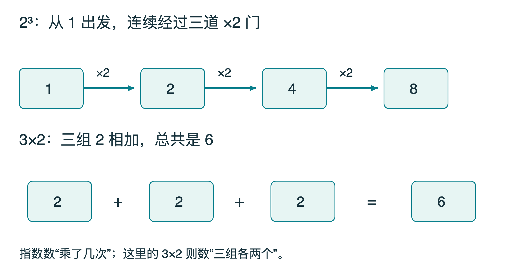

图注：助手绘制的教学示意，正整数指数示例；上方从 1 连续乘三次 2 得到 8，下方把三个 2 相加得到 6。帮助区分 2³ 与 3×2，不是实测图。

**读图自问：** 再加一道 ×2 门，会从 8 变成多少？16。下方只再添一组 2，又是多少？8。这两种“多加一个”的规则不同。这里的连续相乘只直接解释正整数指数；零、负数与小数指数要用相应的扩展定义。

#### 正切 tan：把角度变成“升高 ÷ 水平前进”的比例

先想一段直坡。你从左下角出发，沿坡到右上角。坡与水平地面的夹角叫 θ，θ 是希腊字母，常读作“西塔”。

**正切 tan 是一个根据角度算比例的函数。** 在下面这个直角三角形里，`tan(θ)=对边÷邻边=升高的高度÷水平前进的距离`。读作“西塔的正切”。这里先讨论 0° 到 90° 之间的锐角。

| 三角形里的名字 | 这张坡道图里的对应物 | 具体数字 |
|---|---|---|
| 角 θ | 坡面与水平地面之间的角 | 约 36.87° |
| 对边 | 对着 θ 的竖直高度 | 3 米 |
| 邻边 | 紧贴 θ 的水平直角边，不包括斜边 | 4 米 |
| 斜边 | 沿坡实际走的距离 | 5 米 |
| tan(θ) | 升高 ÷ 水平距离 | 3÷4=0.75，无单位 |

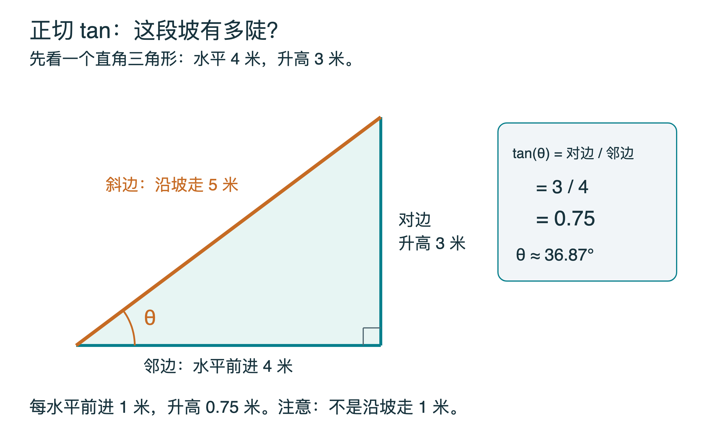

图注：助手绘制的 3–4–5 直角三角形教学示意；正切用竖直高度除以水平距离，不用斜坡长度作分母。θ 约 36.87°。

**像给小朋友讲：** 在这种笔直的坡上，每水平往前 1 米，会升高 0.75 米。数越大，坡越陡。这里“水平往前 1 米”不是沿坡走 1 米；两种距离不同。

**用手指读图：** 先指左下角的 θ，再指对面的竖边 3，最后指贴着角的水平边 4。用 3 除以 4。不要拿斜边 5 来除：3÷5 对应这里的正弦，不是正切。

**放大不改变比例：** 把整张图扩大两倍，高变 6、水平距离变 8，仍有 6÷8=0.75，坡角不变。正切描述的是角度对应的比例，不是三角形有多大。

**换一个坡试试：** 高 1、水平 1 时，角度是 45°，正切是 1。θ 越接近 90°，正切越大；恰好 90° 时分母为零，正切没有定义，不能把它当成一个普通的有限数。

**别把三个东西混起来：** θ 是角度，tan(θ) 是比例，θ 的大小通常不等于这个比例。上图不是“角度等于 0.75°”，而是“约 36.87° 的正切等于 0.75”。

**tan 与 tanh 是不同函数。** tan 叫正切，可用直角三角形理解；tanh 叫双曲正切，它的名字来自双曲函数。不要把 tanh(x) 当作图里这段坡的正切，也不要以为它就是 tan(x) 后面乘一个 h。理解网络时，可以先掌握下节的平滑压缩曲线，不必先掌握双曲线。

#### t=tanh(x)：读作“t 等于 x 的双曲正切”

`tanh` 是一个完整的函数名，叫“双曲正切函数”，不是 t、a、n、h 四个字母相乘。括号表示把 x 交给这个函数，左边的 t 是给输出起的名字。口头也常直接称它为“tanh 函数”。

**给小朋友讲：一台柔和的数字压缩器。** 把 x 送进去，机器按固定规则吐出 t。它把任意实数压到 −1 和 1 之间：负数的输出仍是负数，0 还是 0，正数的输出仍是正数。

| 输入 x | 输出 tanh(x)，约值 | 可以怎样理解 |
|---|---|---|
| −3 | −0.995 | 很靠近 −1 |
| −1 | −0.762 | 负数被压进范围 |
| 0 | 0 | 处在中间 |
| 1 | 0.762 | 正数被压进范围 |
| 3 | 0.995 | 很靠近 1 |

**它不是硬剪刀。** 不是“超过 1 就全部改成 1”；tanh(1) 本身也不是 1。它是一条平滑的 S 形曲线，中间变化明显，两端越来越平。对于有限实数输入，数学输出严格介于 −1 与 1 之间；计算机精度有限，极大输入有时会显示为 1 或 −1。

**空间转化：** 把 x 放在横轴，t 放在纵轴。从中间沿曲线向右走，曲线先上升较快，后来越来越靠近高度 1；向左则靠近 −1。[步骤 5 的曲线图](#spatial-s5) 展示的正是这条关系，旁边还标出变化率。

**网络为什么用它？** 神经元先算 `s=w1*x1+w2*x2+…+b`，再算 `t=tanh(s)`。例如先算出 s=1，就输出约 0.762。tanh 给计算加入非线性的弯曲；如果多层都只有线性变换与偏置，整体仍可合成一次这样的变换。它不是给模型装上“思想”。

```python
import math                      # 导入标准库里的数学函数
for x in [-3, -1, 0, 1, 3]:      # 依次取五个输入
    t = math.tanh(x)             # 算出双曲正切
    print(x, round(t, 3))        # 打印输入和保留三位小数的输出
```

**你实际做的事：** Python 标准库按同一个函数规则算五次，并打印输入与输出。这里没有训练参数，运行它也没有训练网络。

**停一下：** x 从 3 变成 4，输出会从约 0.995 变成 1.995 吗？不会；tanh(4) 约为 0.9993。两端越来越不容易变化，这就是后面解释梯度变小时要用到的直觉。

<a id="tanh-spatial"></a>
#### 双曲正切的空间转化：一张曲线图，先看懂输入怎样变成输出

**把它想成坡路，但要从侧面看。** 不是从天空俯瞰一条左右拐弯的 S 形公路，而是在旁边看路面从低处升到高处、然后逐渐变平。这里的高低是相对于图中零刻度，不是现实海拔。

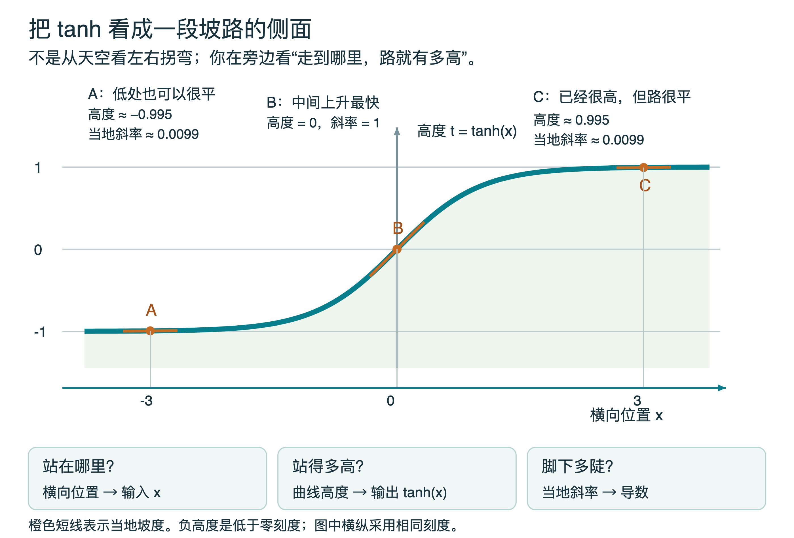

图注：助手绘制的数学侧视类比，横纵采用相同刻度。A、B、C 对应 x=-3、0、3；高度约为 -0.995、0、0.995，局部导数约为 0.0099、1、0.0099。橙色短线是各点的切线片段，示意当地坡度。

**用手指沿路走一遍：A 在低处，但路很平；B 高度在中间，坡最陡；C 已经很高，但路又变平了。** 因此，站得高与脚下陡是两件事。

| 你在问什么 | 数学上对应什么 | 看图哪里 |
|---|---|---|
| 我走到哪里了？ | 输入 x | 下方横向位置刻度 |
| 我站得多高？ | 输出 tanh(x) | 路面相对零线的高度 |
| 脚下的路有多陡？ | tanh 在此处的导数 | 橙色短线的斜率 |

**记住 C 点：输出已经接近 1，导数却接近 0。** 它帮助你区分“激活值大”和“局部梯度大”。图里的路只是数学类比，不代表真实地形。

**把它想成一条带高度的路线。** 横向位置是输入 x，曲线在那个位置的高度就是输出 t。想求 tanh(1)，先在横轴找到 1，向上走到曲线上，再水平看纵轴：高度约为 0.762。这不是沿曲线走了多远，也不是曲线的斜率。

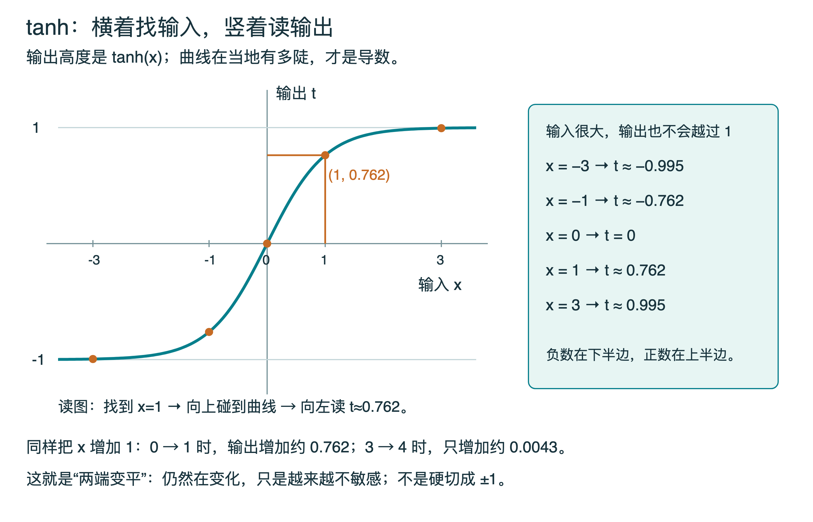

图注：助手绘制的 tanh 函数图，数值由标准数学函数计算并四舍五入。橙色折线示范 x=1 时怎样读出 t≈0.762；灰色水平线标出输出趋近的 ±1。

**看见三件事就够了。** 第一，中间穿过原点，所以输入 0 得到 0。第二，往右走时输出升高，但越来越靠近 1；往左则靠近 −1。第三，两端逐渐变平，所以继续改变输入，输出只改变很少。

| 做同样大小的输入变化 | 输出变化，约值 | 你在图上会看到什么 |
|---|---|---|
| x 从 0 变成 1 | 0 → 0.7616，增加 0.7616 | 中间上升明显 |
| x 从 3 变成 4 | 0.9951 → 0.9993，增加约 0.0043 | 右端已经很平 |

表中变化量由未四舍五入的数计算后再取约值。这是在比较两段长度为 1 的区间，不是直接把变化量叫作某一点的导数。**曲线高度告诉你输出是多少；当地的斜率才告诉你输入轻推一下时，输出有多敏感。**

**换成神经元的场景。** 前面加权求和得到一个数 s，tanh 把它映射成输出 t。若 s=1，t≈0.762；若 s=3，t≈0.995。反传时的局部导数是 `1-t*t`：s=0 时等于 1，s=3 时约 0.0099。因此“输出已经很大”和“梯度很大”不是一回事，两端输出接近 ±1 时，局部梯度反而很小。

**小练习：** 指出输入 −1 的位置，预测输出在 0 上面还是下面；答案是下面，约 −0.762。再指出输入 3 的位置：它的输出不是 3，也不是 1.5，而是约 0.995。

#### 想知道为什么名字里有“双曲”？再看另一张图

前面的 S 形线是“x 与 tanh(x) 的对应图”，**它本身不是双曲线**。名字来自下面这个几何关系：在 `U²−V²=1` 的右支双曲线上取一个点 P，它的坐标可以写成 `U=cosh(x)`、`V=sinh(x)`，那么 `tanh(x)=V/U`。

这里暂时把 cosh、sinh 当作“根据参数 x 确定点的横、纵坐标”的两个函数名字即可；不必为了运行神经网络先推导它们。U、V 是这张图的坐标；参数 x 决定点在哪里，**x 不是普通的三角形夹角，也不是这里的横坐标 U**。

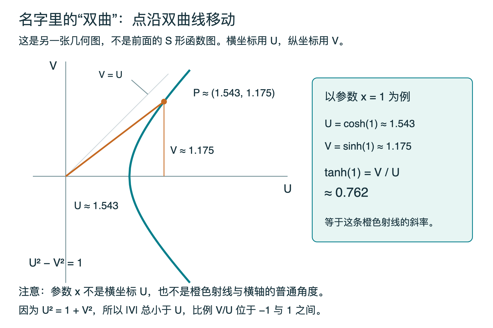

图注：助手绘制的单位双曲线右支示意。参数 x=1 时，P≈(1.543,1.175)，橙色射线斜率 V/U≈0.762，等于 tanh(1)。坐标轴与前一张函数图不同，不可混读。

**用手指读图：** 从原点指向 P；看它横向走了约 1.543，竖向升高约 1.175，两者相除约为 0.762。双曲线上满足 `U²=1+V²`，所以 U 比 |V| 大，`V/U` 不会越过 −1 或 1。点向右上移动时，射线逐渐靠近斜率为 1 的方向，但不会在有限参数处达到它。

**与正切的衔接：** 上一张坡道图的 tan(θ) 是按普通角度 θ 来算高/水平距离；这里 tanh(x) 用的是双曲参数 x。虽然最后都能表示成一个几何比值，它们对输入的解释不同，不能把 tanh(1) 当成 tan(1°)，也不能当成 tan(1 弧度)。


1. 下载或打开交付目录中的代码快照，记录对应提交。基础 6 课看 `nn-zero-to-hero/lectures/`；第 7 课看 ng-video-lecture 的 bigram.py/gpt.py，nanoGPT 用于进阶对照；分词看 minbpe；GPT-2 看 build-nanogpt。[[O10](#source-o10)、[O11](#source-o11)、[O12](#source-o12)、[O13](#source-o13)]
2. 使用下方助手提供的本地命令建环境，先执行 import 检查，不直接跑 200000 次训练。包版本以你实际安装结果保存。[[O1](#source-o1)、[O3](#source-o3)]
3. 在 makemore 笔记本运行目录放 `names.txt`；第 7 课使用 Tiny Shakespeare。先打印前几条、总量和字符集合，确认文件不是网页错误文本。[[O2](#source-o2)、[O7](#source-o7)、[O16](#source-o16)]
4. 每次实验记录 seed、数据切分、模型维数、步数、学习率、设备、训练与验证 loss。不要用换模型同时换数据的结果声称架构改进。[[O3](#source-o3)、[O6](#source-o6)]

下面是助手整理的安装入口，不是讲者原命令。先切到自己的学习目录，保持课程原始快照不变。

```bash
uv venv --python 3.11          # 用 Python 3.11 新建虚拟环境，生成 .venv 目录
source .venv/bin/activate      # 激活虚拟环境，之后装的包都进这里
uv pip install torch numpy matplotlib jupyterlab graphviz regex tiktoken transformers datasets tqdm requests   # 装课程要用的库：张量、绘图、笔记本、图、分词、模型与数据加载
python -c "import torch; print(torch.__version__); print('CUDA:', torch.cuda.is_available())"   # 自检：打印 torch 版本，并报告 CUDA（显卡加速）是否可用
uv pip freeze > requirements-installed.txt   # 把这次实际装上的版本存成清单，方便复现
jupyter lab                    # 启动 Jupyter，浏览器里打开笔记本界面
```

课程的 Python `graphviz`（图描述生成包）负责生成图描述；本地渲染还需要 Graphviz 的 `dot`（画图程序）。缺它时先用数值梯度对照，画图报错不代表自动求导错误。下载依赖失败时先记录具体包与错误，不改成另一门课。

**做完的标准**：能打开课程笔记本并导入 torch；能读到名字与 Shakespeare 数据；第一条实验记录写明设备和版本。

<a id="walkthrough-s1"></a>
### 白话说明：先给自己准备一张能反复使用的实验桌

你现在要做的是让代码、数据和运行环境都能找到彼此。终端负责启动程序；Jupyter 把程序分成一个个可单独运行的单元格。你在单元格里输入代码，按 Shift+Enter（运行并跳到下一格），结果显示在下面。它适合逐段观察数字如何变化。

**先看这些词指什么**：Python 是执行代码的语言；PyTorch 是做张量计算和自动求导的工具；Notebook 是把代码、文字和输出放在一起的 `.ipynb` 文件；kernel（内核）是正在运行这本 Notebook 的 Python 进程。关掉网页不等于清空 kernel；乱序执行单元格会让旧变量残留。

#### 操作 A：在自己的目录留一份练习副本

在终端执行下面命令。`cp -R` 复制官方代码，`cd` 改变当前工作目录。此处 `~/karpathy-learning` 是助手建议的练习目录；若你已经在这里做过练习，不再复制覆盖，直接进入已有目录。

```bash
mkdir -p ~/karpathy-learning        # 建学习目录（已存在也不报错）
cp -R /Users/ziye/Documents/wiki/system/roadmap/structure/2026-10-29-karpathy-llm-zero-to-hero/deliver/code ~/karpathy-learning/   # 把课程代码整份复制进学习目录
cd ~/karpathy-learning              # 进入学习目录
```

#### 操作 B：准备 Python，并确认用的是哪一个解释器

首次使用时执行原步骤的 `uv venv --python 3.11` 和安装命令。以后每次新开终端，进入学习目录后先执行 `source .venv/bin/activate`（在当前终端里激活虚拟环境）。然后运行：

```bash
python -c "import sys; print(sys.executable)"                               # 打印当前 Python 解释器路径，确认用的是 .venv 里那个
python -c "import torch; print(torch.__version__); print(torch.rand(2, 3))" # 打印 torch 版本和一个 2 行 3 列的随机数表
jupyter lab                                                                 # 启动 Notebook 界面
```

第一条应显示学习目录下 `.venv` 中的 Python；第二条应输出版本和一个 2 行 3 列的随机数表。数字每次可以不同。步骤 2 的教学脚本只用 Python 标准库，即使 PyTorch 尚未安装也可以先做。

#### 操作 C：确认数据和 Notebook 在同一层

在 Jupyter 左侧依次打开 `code/nn-zero-to-hero/lectures/makemore/`。这里有 `names.txt` 和五个课程笔记本。新建一个 Notebook，在第一格运行：

```python
from pathlib import Path                        # 用 pathlib 处理文件路径
print(Path.cwd())                               # 打印当前工作目录，先确认自己在哪
text = Path('names.txt').read_text()            # 读入 names.txt 全文
print(text.splitlines()[:5])                    # 打印前 5 行名字
print('名字条数：', len(text.splitlines()))       # 打印总行数，确认不是空文件或网页报错文本
```

**结果怎么看**：应看到若干名字和大于零的条数。`FileNotFoundError`（找不到文件的报错）通常表示当前目录不对；先看 `Path.cwd()`，不要反复安装库。`ModuleNotFoundError: torch`（找不到 torch 模块的报错）表示当前 kernel 的环境里没有 torch；在 Notebook 中查看 `sys.executable`，与终端输出比较。

**本步停在哪里**：保存这个 Notebook，记下 Python 路径与 PyTorch 版本。你不需要先理解神经网络；能启动代码、能读到数据就进入下一步。

**说明与衔接**：本段是助手基于本步骤课程与代码整理的动手导读；微型例子只解释相应局部机制。继续按下面原有课程讲解、截图与验收要求完成该步。

<a id="spatial-s1"></a>
### 空间转化：把步骤 1 摆到一张图里

把学习环境想成工作台：左边是你复制出来的代码与数据，中间是实际执行它们的 Python 环境，右边是输出、图和日志。Jupyter 像工作纸的编辑台，内核负责执行并记住变量。找到某个文件夹不等于已经选对 Python 环境；先确认路径和内核，再运行一格。

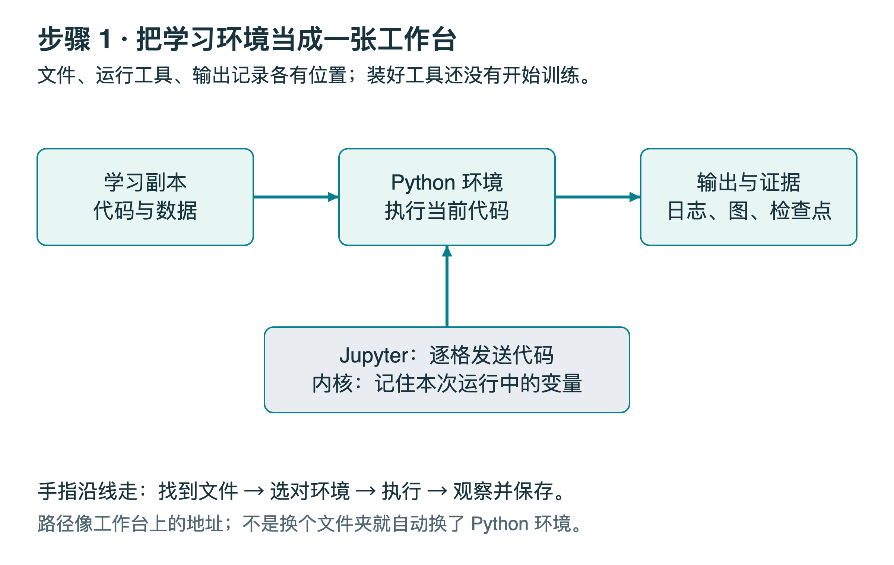

图注：助手绘制的教学示意，2026-11-09；帮助理解本步的计算关系与操作顺序。图中教学数字与简化结构不冒充课程截图、模型实测性能或完整实现。

**试着用手指读图：** 先指出输入或起点，再沿依赖找到中间处理，最后指出输出或结果记录。停在每一站，说出“这里放的是什么、对它做了什么、什么东西会改变”。如果遇到反向箭头，要说明它传回的是梯度，还是图中另有注明的流程。

**再用一句话检查自己：** 遮住正文，只看图，解释这一节与上一步相比新增加了什么；然后回到本步的小实验核对。会复述图并不代替实际运行和数值验收。


- [ ] 环境与数据已确认，未直接启动长训练。

本步末尾有可直接填写的实验表 T1–T3。

### Task（任务）｜本机环境准备

- [ ] 启动 Jupyter，并打开第 1 课练习笔记本。
- [ ] 运行环境与数据检查，确认输出通过。

### 本机 setup：两步直接照做

以下提示词由助手按本机实际目录整理，可复制给有本地终端能力的助手；不是讲者原提示词。也可以自行在终端执行对应命令。目录移动后，请替换命令与提示词中的完整路径。

#### Setup 1（准备工作 1）：启动 Jupyter，打开第一课练习

适用前提：本机的 practice 目录、.venv 环境和启动脚本已经准备好。日常学习从这里开始，无需重复运行上面的安装命令。

**复制给助手的准确提示词：**

```text
请在目录 /Users/ziye/Documents/wiki/system/roadmap/structure/2026-10-29-karpathy-llm-zero-to-hero/practice 中执行 ./start-jupyter.sh，启动 Jupyter Lab 并打开浏览器。如果这个练习目录的 Jupyter 已经运行，请复用已有服务。告诉我如何打开 experiments/01-micrograd/attempt-001.ipynb，并选择 Python (Karpathy practice)（Karpathy 练习环境）内核。不要运行训练单元格。
```

**自己在终端执行：**

```bash
cd "/Users/ziye/Documents/wiki/system/roadmap/structure/2026-10-29-karpathy-llm-zero-to-hero/practice"   # 进入练习目录
./start-jupyter.sh                                                                                        # 运行启动脚本，起 Jupyter 并打开浏览器
```

浏览器打开 Jupyter 后，在左侧依次打开 experiments → 01-micrograd → attempt-001.ipynb，选择 Python (Karpathy practice) 内核。启动命令会持续占用当前终端；保持它运行。浏览器未自动打开时，使用终端输出的本机链接。

#### Setup 2（准备工作 2）：激活环境，运行环境与数据检查

如果 Jupyter 正在前一个终端运行，请新开一个终端窗口或标签页执行以下命令。source（在当前终端里执行脚本的命令）只对当前终端生效，所以新终端需要重新激活环境。

**复制给助手的准确提示词：**

```text
请在目录 /Users/ziye/Documents/wiki/system/roadmap/structure/2026-10-29-karpathy-llm-zero-to-hero/practice 中依次执行 source .venv/bin/activate 和 python scripts/check_environment.py。检查依赖导入、CPU/MPS/CUDA 状态、names.txt 与 Tiny Shakespeare 的数据内容，并告诉我检查是否通过。如果报错，记录具体包名与错误后修复，再重新检查。不要启动模型训练。
```

**自己在终端执行：**

```bash
cd "/Users/ziye/Documents/wiki/system/roadmap/structure/2026-10-29-karpathy-llm-zero-to-hero/practice"   # 进入练习目录
source .venv/bin/activate          # 激活虚拟环境（只对当前终端生效）
python scripts/check_environment.py   # 跑环境与数据检查脚本，输出会写到 records/
```

做完的标准：命令退出码为 0，输出包含包版本、设备状态、数据预览、总量和字符集合；结果保存到 records/environment-check.json。2026-11-09 本机实测：CPU/MPS 检查通过，CUDA 为 false；名字共 32,033 个，Shakespeare 共 1,115,394 字符、65 种字符。dot 为 null 表示尚未安装系统 Graphviz 渲染程序，不代表 PyTorch 检查失败。

### 可以直接填写的实验表（T1–T3）

这些表把运行条件、结果和判断一起留下。它们是助手根据课程实验习惯制作的记录工具，不是讲者输入过的原提示词；〔〕只是填写占位。

### T1 实验卡

```text
实验编号：〔唯一编号〕
课程/时间点：〔第几课，HH:MM:SS〕
代码提交/文件：〔commit，文件〕
问题：〔只写这次要验证的一件事〕
数据与切分：〔数据版本，train/val/test〕
设备/框架版本：〔真实环境〕
seed：〔真实值〕
模型：〔上下文，embedding，层数，头数，参数量〕
训练：〔batch，梯度累积，token 预算，步数，学习率〕
只改了什么：〔对照变量〕
结果：〔train/val loss，评估正确数/总数，吞吐〕
样本文件/截图：〔路径与时间〕
判断：〔继续/停止/回退，理由〕
下一步：〔一个具体动作〕
```

### T2 形状与梯度检查

| 张量/参数 | 前向形状 | 反向形状 | 与参考最大差 | 判定与依据 |
|---|---|---|---|---|
| 〔名称〕 | 〔真实形状〕 | 〔真实形状〕 | 〔实测〕 | 〔容差/原因〕 |

### T3 吞吐与费用估算

| 项 | 填真实值 |
|---|---|
| 设备、卡数、dtype、B、T、A | 〔〕 |
| 热身次数、是否含编译/验证 | 〔〕 |
| 稳态 update 秒数 s | 〔〕 |
| token/update | B×T×A×W |
| tok/s | token/update ÷ s |
| 预计训练小时 | 目标 update 数 × s ÷ 3600 |
| 当前实际 GPU 单价与计费单位 | 〔查询日期与订单页面〕 |
| 预算上限/停止时间/停止方式 | 〔〕 |

另提供 CSV 空表，位于交付目录 `templates/`。不要把示例占位写成实际跑过的数据。

### 后面每一步末尾的排错表

从步骤 2 起，每一步末尾都有一张「卡住时按这个顺序查」的小表，按现象列出先查什么、修好后怎么验；它们和上面的实验表一样，是助手根据课程故障与代码整理的检查路径，不是讲者原话，同一个报错也不保证只有一个原因。

<a id="section-s2"></a>
## 步骤 2 从导数实现 micrograd

神经网络的训练可以拆成可求导的数学运算。这里先让一个小计算图的梯度完全可见，再把这些零件组成神经元和多层网络。

**目标**：实现标量 `Value`、图级反向传播和一次参数更新。

1. 从 `f(x)=3*x**2-4*x+5` 做有限差分：计算 `(f(x+h)-f(x))/h`，缩小 h 并与解析导数对照。随后对 `d=a*b+c` 分别扰动 a、b、c。定位第 1 课 00:08:08–00:19:09。[[O1](#source-o1)]
2. 给 `Value` 保存 `data`、`grad`、父节点与运算；先实现加法、乘法，再给每个运算保存局部 `_backward`。从输出梯度 1 开始，用链式法则向后传递。定位 00:19:09–01:17:32。[[O1](#source-o1)]
3. 用拓扑排序收集图，再逆序调用局部反传；测试 `a+a` 和 `a*a`，确认同一节点被多条路径使用时梯度累加，不能覆盖。定位 01:17:32–01:27:05。[[O1](#source-o1)]
4. 实现 tanh、幂、负数、减法与除法；再实现 Neuron、Layer、MLP、parameters。构造课程中的四组小样本，用平方误差训练。每轮重做前向、清梯度、反传、沿负梯度更新。与 PyTorch 的相同计算图逐个数对照。[[O1](#source-o1)、[O14](#source-o14)]

**做完的标准**：`a+a` 的导数为 2；乘法、tanh 的手算/自动/有限差分大致一致；四组样本 loss 经更新下降；能解释清梯度和拓扑顺序。

<a id="walkthrough-s2"></a>
### 白话说明：你正在造一台“会告诉你该拧哪个旋钮”的计算器

先不想大语言模型。想象一个公式里有一个可以调的数字 `w`：输入 2，希望输出 4，当前计算方式是 `预测值=w×2`。如果 w=0，就预测 0；如果 w=2，就预测 4。训练就是让程序根据误差，自动把 w 往合适的位置移动。

micrograd 处理这个过程中的关键问题：**最终误差变大或变小，与每个可调数字有什么关系？** 它先记住计算经过了哪些加法、乘法等操作，再沿着这些操作倒推导数。你将亲手实现这套记录和倒推机制。


#### 先坐下来：刚才电脑到底替你做了什么？

**先只记一句话：我们在做一个“猜错以后，知道该怎样调”的小机器。** 这一节还没有教电脑说话。我们先造一个很小的零件，日后训练更大的网络会用到同一种方法。

下面是助手编写的教学类比，不是课程里的真实机器。想象桌上放着一台玩具果汁机：你输入“2 杯”，机器有个可以转动的旋钮 `w`。我们人为规定它的显示屏显示 `2*w`，希望显示 4。现在旋钮在 0，屏幕便显示 0。问题是：**怎样让程序自己把旋钮往正确方向转一点？**

这里“杯子”只帮你记住输入，屏幕数字只是公式的结果；真实果汁机并不按这段程序工作。输入 2、希望得到的 4 都由我们给定，允许程序调整的只有旋钮 `w`。

| 你在屏幕上看到的动作 | 像在做什么 | 实际发生的事情 |
|---|---|---|
| 在 Jupyter 的格子里输入代码 | 给机器写一张工作纸 | 文字暂时放在编辑框里，还没有计算 |
| 按 Shift+Enter | 让机器照工作纸做一遍 | Python 执行这一格，结果显示在下面 |
| 出现 `8.3、8.03…` | 试着轻推旋钮，量屏幕变化 | 用小幅输入变化估计导数 |
| 执行 `class Value`，没有很多数字出现 | 按图纸造好一种“带记录卡的盒子” | 定义一种对象的行为，尚未训练网络 |
| 出现 `3、2、1` | 给三个旋钮分别贴上灵敏度标签 | 程序算出了最终结果对三个输入的导数 |
| 出现 `16 → 0.64` | 调了一下旋钮，离目标近了 | 一次参数更新后，重新计算的误差变小 |
| 出现 200 次训练和一条下降曲线 | 重复“猜、量差距、调一点” | 同一批四个样本反复参与参数更新 |

**你现在不用背完整代码。** 先看下面每一小节的故事，再看数字，最后才看代码。每节只需回答最后的一个小问题。任何一节还说不出来，就先停在那里，不用急着运行下一格。

#### 先翻译原步骤里那些看不懂的词

| 原文里的词 | 用具体东西理解 | 在本练习中长什么样 |
|---|---|---|
| 标量 | 单独一个数字 | `2.0`；还不是一整排或一整张表 |
| Value | 带着计算履历的小数字盒子 | 装着当前数值、梯度和产生它的运算 |
| data | 盒子里当前的数 | `a.data=2.0` |
| grad | 最终输出对这个数的局部敏感度 | `a.grad=3` 意味着 a 小幅增大 δ，输出约增加 3δ |
| 父节点 | 直接产生这个结果的输入盒子 | `d=a*b` 的父节点是 a、b |
| 前向传播 | 按公式从输入算出结果 | 先算乘积，再算加法，最后算误差 |
| loss | 衡量预测偏离目标的一个数 | `(预测值-目标值)**2`；越小越好 |
| `_backward` | 某一个运算自己的反传规则 | 乘法知道怎样把输出梯度分给两个输入 |
| `backward()` | 安排整张图反传的总调度 | 先排顺序，再逐个调用局部规则 |
| 参数 | 允许被训练改变的数字 | 权重 w 和偏置 b；输入数据和目标通常固定 |
| 学习率 | 每次沿梯度移动多少 | `w -= 0.1 * w.grad` 中的 0.1 |

这里的“影响”是数学上的局部变化率，不是道德责任或因果解释。梯度描述的是这次前向、这个参数位置下的关系。

#### 操作 A：先运行四行代码，亲眼看见“导数”

**给小朋友讲：轻轻推一下，看看动了多少。** 想象你沿着一小段斜坡往前挪。你想知道脚下有多陡，就量“往前挪的距离”和“升高的距离”。导数讲的正是这种当前位置的变化比例。

**把故事放回公式。** `f` 是一台按固定规则算数的机器；`x` 是送进去的数；`f(x)` 是吐出来的数。`**2` 表示自己乘自己，`*` 表示乘法。输入 2 时，机器算 `3*2*2-4*2+5=9`。输入 2.1 时，输出 9.83。我们只多输入了 0.1，输出却多了 0.83，所以这一小段的变化比例是 `0.83/0.1=8.3`。

`h` 就是“这次轻推多少”。有限差分是先实际试两次，再比较结果；解析导数则是根据公式推导出斜率。在这里，缩小轻推距离后，估计值靠近 8。**8 不是机器的输出：输出在 x=2 时是 9；8 是当前位置的变化比例。**

**你该操作什么：** 先只运行本小节这一格，找到输出里的第一列 h 和第二列斜率。不要先改整段代码。然后把输入 2 换成 3，观察结果靠近 14。

**停一下，自己说一句：** “我刚才轻推的是输入，观察的是输出改变了多少。”如果只能记住一个区别，就记住“结果”和“结果变化的快慢”是两件事。

在 Jupyter 新建 `my_micrograd.ipynb`，第一格输入下面代码。也可以保存为 `.py` 文件后在终端运行。这里不需要 torch。

```python
def f(x):                       # 定义要研究的函数
    return 3 * x ** 2 - 4 * x + 5   # 3x² − 4x + 5

for h in [0.1, 0.01, 0.001, 0.0001]:   # 依次取越来越小的步长 h
    print(h, (f(2 + h) - f(2)) / h)    # 打印 h 和 (f(2+h)−f(2))/h，即差分估计的斜率
```

**你在干什么**：先计算 x=2 的结果，再把 x 轻轻推大一点 h，比较输出变化了多少，最后除以推的距离。就像测量“向前走一厘米，坡面升高多少”。

**会看到什么**：结果约为 8.3、8.03、8.003、8.0003，越来越靠近 8。手算导数是 `f'(x)=6x-4`，在 x=2 时等于 8。最后一位有浮点误差属于正常现象，不要把 h 无限缩小。

**自己改一下**：把 `f(2 + h)` 和 `f(2)` 中的输入 `2` 改成 `3`，保留 `x ** 2` 的指数 `2`，结果应趋近 14。能解释这两组结果，就知道导数是“当前位置的斜率”，不是函数永远不变的属性。

#### 操作 B：把一个大公式拆成两道小工序

**给小朋友讲：算总价，先算一堆，再加一份。** 想象每份点心的价格是 a=2 元，买 b=3 份，再加固定包装费 c=4 元。先算点心钱 `u=a*b=6`，再算总价 `d=u+c=10`。字母只是给数字起的小名字，u 是中途的小票，d 是最后的小票。

**三个旋钮要分开试。** 只把每份价格加 0.01，三份的总价就加 0.03；只把包装费加 0.01，总价就加 0.01。于是 a 的灵敏度是 3，c 的灵敏度是 1。为了计算 b 的导数，我们把“份数”看成可以连续变化的数学量；现实里的整块点心不能买 0.01 块，所以类比只用于理解乘法。

**链式法则像两段放大器接在一起。** 第一段把 a 的微小变化放大 3 倍。如果最后又规定 `L=2*d`，第二段再放大 2 倍，那么 a 对 L 的变化比例就是 `3*2=6`。这不是把两个数字随便相乘，而是后一段接收了前一段已经发生的变化。

**你该操作什么：** 用纸写下“2×3=6，6+4=10”，再只把 2 改成 2.01。看到 10.03 就对了。先理解这个变化，再看下面的计算图。

**停一下：** 包装费增大一点时，为什么不乘 3？因为包装费走的是直接相加的那条路，不经过点心数量的乘法。

取 `a=2, b=3, c=4`，把 `d=a*b+c` 拆成：

```text
[a=2] ─┐
       × ── [u=6] ─┐
[b=3] ─┘           + ── [d=10]
            [c=4] ─┘
```

从 d 往回想：c 增加 0.01，d 也增加 0.01，因此 `∂d/∂c=1`。a 增加 0.01，乘上固定的 b=3 后，d 增加 0.03，因此 `∂d/∂a=3`。同理 `∂d/∂b=2`。这种只动一个输入、保持其他输入不变的导数叫偏导数。

再接一层 `L=2*d`，a 对 L 的影响变为 `3×2=6`。前一站的影响乘上后一站的影响，就是链式法则。你不需要一次对整个复杂公式求导，只要给每种小运算写好局部规则。

#### 操作 C：运行完整教学版，再回来看每个部件

**给小朋友讲：先拿到一整盒积木，再一块一块认识。** 下面的大段程序是一整套可以运行的积木。运行它，只证明这些积木能拼起来；不意味着你已经知道每块的用途。

**零基础的读法：** 暂时不要从第一行一路硬读到最后。先运行，认出五组输出：测斜率、算三个梯度、检查重复使用、调一个参数、训练一个小网络。然后按 D、E、F、G 的顺序回来看代码。一口气贴进去是为了得到可观察的对象，真正的理解发生在后面的逐块拆解。

**Jupyter 操作小抄：** 点进代码格，粘贴代码，按 Shift+Enter。格子左侧出现 `[*]` 表示还在运行；出现编号表示执行已结束，但仍要看下面是否有错误信息。输出通常显示在格子下方。单独执行后面的格子时，如果提示 `NameError`，可能是前面的定义格还没运行。定义 `class` 相当于先准备图纸，创建对象才是照图纸做盒子。

**停一下：** “把代码贴上去”和“运行代码”有什么区别？前者是写工作纸，后者是让 Python 照着做。

我已把下面完整代码保存到交付目录 `code/learning/step02_micrograd_walkthrough.py`。无需安装第三方库，在终端直接运行：

```bash
python3 /Users/ziye/Documents/wiki/system/roadmap/structure/2026-10-29-karpathy-llm-zero-to-hero/deliver/code/learning/step02_micrograd_walkthrough.py   # 直接运行教学脚本，它会依次打印五组对照结果
```

若步骤 1 已复制过代码，使用 `~/karpathy-learning/code/learning/step02_micrograd_walkthrough.py` 前先确认这次新增文件也已复制过去。上面的交付目录绝对路径始终指向本次文件。

下面是**助手编写的完整教学脚本**，用于拆解课程机制，不冒充作者原文件。可以复制整段保存成自己的 `.py` 文件。先看输出，再回到 `Value` 中按加法、乘法、反传顺序阅读。

```python
"""助手编写的教学版：纯 Python 标量求导与四样本训练，不是官方源码。"""
import math  # 数学函数：tanh 与乘方
import random  # 随机数：初始化权重

# ── 核心一：Value 保存一个数字、它的梯度，以及它由谁算出来 ──
class Value:  # 定义 Value 类

    def __init__(self, data, parents=(), op=""):  # 构造方法
        self.data = float(data)  # 保存这个节点的数值
        self.grad = 0.0  # 梯度初始为 0
        self.parents = parents  # 记下产生它的上游节点
        self.op = op  # 记下用了哪种运算
        self._backward = lambda: None  # 局部反传函数，默认为空

    def __add__(self, other):  # 定义 + 运算
        other = other if isinstance(other, Value) else Value(other)  # 右边是普通数字时先包成 Value
        out = Value(self.data + other.data, (self, other), "+")  # 建输出节点，并记住两个父节点

        def backward():  # 定义加法的局部反传
            self.grad += out.grad  # x 的梯度累加 z 的梯度
            other.grad += out.grad  # y 的梯度累加 z 的梯度
        out._backward = backward  # 把反传函数挂到输出节点上
        return out  # 返回输出节点

    def __mul__(self, other):  # 定义 * 运算
        other = other if isinstance(other, Value) else Value(other)  # 数字先包成 Value
        out = Value(self.data * other.data, (self, other), "*")  # 建输出节点

        def backward():  # 定义乘法的局部反传
            self.grad += other.data * out.grad  # x 的梯度 += y × 下游梯度
            other.grad += self.data * out.grad  # y 的梯度 += x × 下游梯度
        out._backward = backward  # 挂上反传
        return out  # 返回输出节点

    def __pow__(self, exponent):  # 定义 ** 运算
        assert isinstance(exponent, (int, float))  # 只支持整数或浮点指数
        out = Value(self.data ** exponent, (self,), f"**{exponent}")  # 建输出节点

        def backward():  # 定义乘方的局部反传
            if exponent != 0:  # 指数为 0 时导数为 0，跳过
                self.grad += exponent * self.data ** (exponent - 1) * out.grad  # 梯度 += n·x^(n−1)·下游梯度
        out._backward = backward  # 挂上反传
        return out  # 返回输出节点

    def tanh(self):  # 定义 tanh
        t = math.tanh(self.data)  # 先算出 tanh 的值 t
        out = Value(t, (self,), "tanh")  # 建输出节点

        def backward():  # 定义 tanh 的局部反传
            self.grad += (1 - t * t) * out.grad  # 梯度 += (1−t²)·下游梯度
        out._backward = backward  # 挂上反传
        return out  # 返回输出节点

    def __neg__(self):  # 取负：-a
        return self * -1  # 等于乘 −1

    def __sub__(self, other):  # 减法：a-b
        return self + (-other)  # 等于加上 b 的相反数

    def __rsub__(self, other):  # 反向减法：数字 - a
        return other + (-self)  # 等于 other + (−a)

    def __truediv__(self, other):  # 除法：a/b
        return self * other ** -1  # 等于乘 b 的 −1 次方

    def __rtruediv__(self, other):  # 反向除法：数字 / a
        return other * self ** -1  # 等于 other × a⁻¹

    __radd__ = __add__  # 数字 + Value 也走加法
    __rmul__ = __mul__  # 数字 × Value 也走乘法

    def backward(self):  # 定义 backward
        order, visited = [], set()  # 拓扑序表与已访问集合

        def visit(node):  # 递归收集所有上游节点
            if node not in visited:  # 没访问过才处理
                visited.add(node)  # 标记为已访问
                for parent in node.parents:  # 遍历它的全部上游
                    visit(parent)  # 递归上游
                order.append(node)  # 上游都排完，再把自己放进序列
        visit(self)  # 从输出节点开始收集整张图
        self.grad = 1.0  # 输出对自己的梯度记为 1
        for node in reversed(order):  # 按逆拓扑序逐个执行
            node._backward()  # 调用该节点的局部反传

# ── 核心二：一个神经元 = 若干权重 + 一个偏置 + tanh ──
class Neuron:  # 定义 Neuron
    def __init__(self, input_count):  # 构造：输入个数
        self.w = [Value(random.uniform(-1, 1)) for _ in range(input_count)]  # 每个输入一个 −1 到 1 的随机权重
        self.b = Value(0)  # 偏置从 0 开始

    def __call__(self, x):  # 前向：被调用时
        return sum((w * xi for w, xi in zip(self.w, x)), self.b).tanh()  # 加权和 Σwᵢxᵢ + b，再过 tanh

    def parameters(self):  # 返回参数列表
        return self.w + [self.b]  # 权重加偏置

# ── 核心三：一层 = 若干个神经元并排 ──
class Layer:  # 定义 Layer
    def __init__(self, input_count, output_count):  # 构造：输入维度、神经元个数
        self.neurons = [Neuron(input_count) for _ in range(output_count)]  # 建 output_count 个神经元

    def __call__(self, x):  # 前向
        return [neuron(x) for neuron in self.neurons]  # 每个神经元各算一个输出

    def parameters(self):  # 返回参数列表
        return [p for neuron in self.neurons for p in neuron.parameters()]  # 把各神经元参数摊平

# ── 核心四：多层感知机 = 若干层叠起来 ──
class MLP:  # 定义 MLP
    def __init__(self, input_count, widths):  # 构造：输入维度与各层宽度
        sizes = [input_count] + widths  # 尺寸表：输入 + 每层输出
        self.layers = [Layer(a, b) for a, b in zip(sizes, sizes[1:])]  # 相邻两项配对建层

    def __call__(self, x):  # 前向
        for layer in self.layers:  # 逐层往下传
            x = layer(x)  # 过一层
        return x[0] if len(x) == 1 else x  # 单输出时拆掉列表

    def parameters(self):  # 返回参数列表
        return [p for layer in self.layers for p in layer.parameters()]  # 各层参数汇总

# 五组对照：有限差分、计算图、重复节点、一次更新、四样本训练
def main():  # 定义 main
    print("1. 有限差分：目标导数为 8")  # 第 1 组标题：有限差分
    f = lambda x: 3 * x ** 2 - 4 * x + 5  # 被求导的函数 f(x)=3x²−4x+5
    for h in (0.1, 0.01, 0.001, 0.0001):  # 依次取四个步长 h
        print(h, (f(2 + h) - f(2)) / h)  # 打印差分估计 (f(2+h)−f(2))/h

    print("2. 计算图：d=2*3+4，梯度应为 3、2、1")  # 第 2 组标题：计算图
    a, b, c = Value(2), Value(3), Value(4)  # 三个输入节点
    d = a * b + c  # 先乘后加，得到输出 d
    d.backward()  # 从输出反传
    print(d.data, a.grad, b.grad, c.grad)  # 打印 d 与 a、b、c 的梯度（应为 10、3、2、1）

    print("3. 重复节点：a+a 和 a*a 分别建新图")  # 第 3 组标题：同一节点被用两次
    a = Value(3)  # 新建 a=3
    (a + a).backward()  # a+a 反传
    print("a+a:", a.grad)  # 应得 2
    a = Value(3)  # 重新新建 a=3
    (a * a).backward()  # a*a 反传
    print("a*a:", a.grad)  # 应得 2a=6

    print("4. 一个参数的一次更新")  # 第 4 组标题：一次参数更新
    w = Value(0)  # 参数 w 从 0 开始
    loss = (w * 2 - 4) ** 2  # 损失 (2w−4)²
    loss.backward()  # 反传
    before = loss.data  # 更新前的 loss
    w.data -= 0.1 * w.grad  # 沿负梯度走一步，学习率 0.1
    after = (w * 2 - 4) ** 2  # 更新后重新算 loss
    print("loss before/after:", before, after.data, "w:", w.data)  # 打印更新前后 loss 与 w

    print("5. 四样本小网络：200 次更新，打印重新计算的 loss")  # 第 5 组标题：四样本训练
    random.seed(42)  # 固定随机种子 42
    model = MLP(3, [4, 4, 1])  # 3 维输入，两个 4 宽隐层，1 个输出
    xs = [[2, 3, -1], [3, -1, 0.5], [0.5, 1, 1], [1, 1, -1]]  # 四组输入
    ys = [1, -1, -1, 1]  # 四个目标值

    def current_loss():  # 定义当前 loss
        return sum((model(x) - y) ** 2 for x, y in zip(xs, ys)) / len(xs)  # 四组平方误差取平均

    print("parameters:", len(model.parameters()))  # 打印参数量
    print("step 0:", current_loss().data)  # 打印第 0 步 loss
    for step in range(200):  # 训练 200 轮
        loss = current_loss()  # 每轮重新前向，建新计算图
        for p in model.parameters():  # 遍历所有参数
            p.grad = 0.0  # 清掉上一轮梯度
        loss.backward()  # 反向传播
        for p in model.parameters():  # 再遍历所有参数
            p.data -= 0.05 * p.grad  # 沿负梯度更新，学习率 0.05
        if (step + 1) % 50 == 0:  # 每 50 轮
            print("step", step + 1, "loss:", current_loss().data)  # 打印这一轮的 loss
    print("predictions:", [round(model(x).data, 4) for x in xs])  # 打印四个预测值
    print("targets:", ys)  # 打印目标值

if __name__ == "__main__":  # 作为脚本直接运行时
    main()  # 执行 main
```

#### 操作 D：读懂 Value 的四个零件

**给小朋友讲：普通数字只有号码；Value 数字还有一张来历卡。** 例如一个盒子正面写 6，背面写“我是 2 号盒子和 3 号盒子相乘得到的”。这样我们既能看答案，又能回头找到答案从哪里来。

| 盒子上的部件 | 一句话故事 | 代码里真正的含义 |
|---|---|---|
| `data` | 正面写当前数字 | 例如乘法结果 6 |
| `parents` | 背面记录输入盒子 | 保留 a、b 对象的引用；不是复制两份独立的 a、b |
| `op` | 记录刚才用了哪种工具 | `*` 或 `+` 等运算标记 |
| `grad` | 贴上“最终输出对我有多敏感”的标签 | 反传后保存最终标量输出对该节点的导数 |
| `_backward` | 每道工序的小纸条 | 知道拿到下游梯度后，如何给输入累加贡献 |
| `backward()` | 按正确次序分发小纸条的调度员 | 安排整张计算图的反向传播 |

**为什么要倒着走？** 先有最后的目标，才能知道中途每一站对这个目标的影响。对 `d=a*b+c`，先处理最后的加法，再处理前面的乘法。如果乘法还没收到来自后面的梯度就提前执行，会用到尚未收齐的信息。

**拓扑排序这四个字先不用怕。** 正向算数时，“材料必须先准备好，才能算成品”。排序先记下满足这个条件的顺序；反传再把顺序倒过来。不同支路之间可能有多种正确排列，关键是不能颠倒依赖。一个节点被几条下游路径使用时，要等这些贡献都传回来，再把它的梯度继续向前面的输入传。

**为什么最末端填 1？** 把最终输出自身增加 0.01，它自身当然增加 0.01，比值就是 1。因此 `d.grad=1` 是“d 对 d 的导数为 1”，并不是说 d 的值变成了 1。

**停一下：** 盒子上的 `data=10` 和 `grad=1` 可以同时存在吗？可以，一个记数值，一个记变化比例。

**第一件：保存数值。** `Value(2)` 创建一个盒子；`.data` 里面是 2，`.grad` 先设为 0，因为此时还没计算“最终输出受它影响多少”。

**第二件：运算时留履历。** `out=Value(self.data*other.data, (self, other), '*')` 做了三件事：算出新数字，记住输入盒子，标记这是一道乘法。普通 Python 数字算完就只留下结果；Value 还留下从哪里来的信息。

**第三件：给乘法写反传小纸条。** 内部 `backward` 函数记住 `self`、`other` 和 `out`，以后真正反传时再读取 `out.grad`。这种函数保留外层变量引用的写法叫闭包。`out._backward=backward` 只是在保存规则，没有马上执行。

**第四件：统一倒序调用。** 外面的 `backward()` 从输出追溯父节点，把“输入先、结果后”的顺序记在 order 里，再反过来执行。“从输出梯度 1 开始”表示输出对它自己的导数是 1，即 `dL/dL=1`；它不表示 loss 的数值为 1。

#### 操作 E：为什么同一个节点不能覆盖梯度

**给小朋友讲：同一个旋钮，连着两盏计数牌。** 两块牌都显示 a，总显示是 `a+a`。把旋钮从 3 调到 3.01，两块牌各多 0.01，总数就多 0.02。这是同一个旋钮被用了两次，不是两个互不相干的旋钮。

**`+=` 像往同一个篮子里继续放东西。** 第一条路贡献 1，第二条路再贡献 1，篮子里就有 2。`=` 则像把原来的东西倒掉再放新的，最后只剩 1。去重的是“这只盒子安排几次反传”，不能去掉同一个盒子参与运算的两份贡献。

**清梯度又是什么？** 这一轮收完所有路的贡献以后，就能更新参数。下一轮重新计算时，先把记录篮子倒空，才能收这一轮的新贡献。它不清空参数的 `data`，也不把学到的权重归零。

**你该观察什么：** `a=3` 时，`a+a` 的输出是 6、导数是 2；`a*a` 的输出是 9、导数是 6。两个实验各用一个新建的 a，避免把上次篮子里的记录混进来。

**停一下：** “一轮内部要累加”和“下一轮开始前要清空”为什么不矛盾？因为一个是收齐这一次的结果，一个是准备下一次。

把 a 看成同一个旋钮。`b=a+a` 用了两次这个旋钮。a 增大 0.01，左边贡献 0.01，右边再贡献 0.01，b 总共增加 0.02。因此梯度要把 1 和 1 加起来。

脚本分别用新 a 测 `a+a` 和 `a*a`。a=3 时，前者导数是 2，后者是 `2a=6`。拓扑遍历只访问 a 一次，但加法或乘法的局部规则仍向 a 累加两次。这是“节点不重复执行”和“贡献不能丢”的区别。

每轮训练前清空参数 `.grad`，是为了开始计算这一批的新梯度；一次反向传播内部使用 `+=`，是为了汇总同一参数的所有路径。两件事发生在不同层级，不矛盾。此教学实现不支持在同一旧计算图上直接反复调用 backward 来得到独立答案；练习中重建图最清楚。

#### 操作 F：用一个旋钮亲手跟踪一次训练

**给小朋友讲：猜一个数，差太远就转一下旋钮，再猜。** 我们要求输入 2 时得到 4，机器的规则是 `预测=2*w`。w=0 时预测 0，离 4 差了 4。把差平方，得到误差分数 16；正差和负差平方后都不会是负数。

**反传没有直接把答案 2 塞进旋钮。** 它只告诉我们：当前位置 `w.grad=-16`。这表示 w 很小幅增加时，误差在局部会下降。我们按照自己选的步长 0.1，把 w 从 0 调到 1.6。此时预测 3.2，离目标只差 0.8，新的平方误差是 0.64。

**为什么叫学习率？** 它像每次肯走多大的步子。方向对不代表步子越大越好。例如此处若用 1，w 一下变成 16，预测 32，误差反而变成 784。梯度是当前位置的指示，并不承诺任意距离都能降低误差。

**旧小票不会自己重印。** 原来的 `loss` 保存的是更新前算出的 16。旋钮改了以后，必须再做一次预测、再计算误差，才能得到 0.64。打印旧小票只会继续看到 16。

**停一下：** 我们让什么变了？只有允许训练的参数 w。输入 2、目标 4 没变；预测和误差因为重新计算才变。

| 时刻 | 具体计算 | 结果 |
|---|---|---|
| 当前参数 | w=0 | 旋钮还没调 |
| 前向预测 | `w*2` | 0 |
| 计算误差 | `(0-4)**2` | loss=16 |
| 反传 | `2*(w*2-4)*2` | w.grad=-16 |
| 更新 | `w = 0 - 0.1*(-16)` | w=1.6 |
| 重新前向 | `(1.6*2-4)**2` | 新 loss=0.64 |

负梯度意味着往增加 w 的方向移动会在局部降低 loss。因此减去负数，w 反而增大。学习率过大时可能跨过最优点；这次选 0.1 只是为了给你一个能手算的例子。

**这里的关键动作**：更新 w 以后重新计算 loss。旧的 loss 盒子还存着 16，它不会自动感知参数已经变了。训练循环每轮重新前向，就是为新参数生成新的计算图和新的误差。

#### 操作 G：把旋钮组成一个神经元，再组成网络

**给小朋友讲：一个小工位算一次，许多小工位接起来就能算复杂一点。** 一个神经元先收几个输入。每个输入都有一个“音量旋钮” w，决定这个输入乘多少；再加一个整体偏移 b。最后经过 tanh 这道弯曲处理。

**先看只有一个输入的工位。** 输入 x=2、权重 w=0.5、偏置 b=0，先得到 `0.5*2+0=1`；经过 tanh，输出约 0.7616。tanh 可以想象成把过大的数字压进 -1 到 1 之间的软弯道；它不是生硬截断，所以越靠两端，输出越不容易继续变化。导数 `1-tanh(x)**2` 描述这种局部变化率。这里 x 指 tanh 收到的输入。

**并排是层，串接是网络。** 一层里的多个工位各自看同一组输入，但有自己的权重；下一层接收上一层产生的一组输出。`MLP(3,[4,4,1])` 可以读成“先输入三个数，经过四个工位，再经过四个工位，最后经过一个工位”。画在纸上的位置只是帮助理解，不是脑细胞真的排在那里。

```text
一份样本里的 3 个数
          ↓ 每个工位都接收这一组输入
    [工位] [工位] [工位] [工位]   第一层，输出 4 个数
          ↓ 下一层接收这 4 个数
    [工位] [工位] [工位] [工位]   第二层，输出 4 个数
          ↓
                [工位]           最后一层，输出 1 个预测
```

**四组样本是四张练习卡。** 每张卡正面写三个输入数，背面写目标 +1 或 -1。这里网络逐张计算预测，把四张卡的平方误差取平均，然后统一调整所有 41 个参数。重复 200 轮表示反复练同四张卡，不是看了 200 份新资料。

**你该观察什么：** 先看 loss 是否总体变小，再看四个预测是否接近各自目标。即使都接近，也只说明会做这四张练习卡；还没有证明换一张没见过的卡也能答对。

**停一下：** `parameters()` 为什么不返回所有中间数字？因为只要收集允许调整的旋钮；中间数字是旋钮和输入共同算出的结果。

一个神经元计算 `tanh(w1*x1+w2*x2+...+b)`。各个 w 调节某个输入的分量，b 调节整体偏移；tanh 把线性结果经过一条弯曲函数，输出落在 -1 到 1 之间。其局部导数为 `1-tanh(x)**2`。

一层 Layer 是多个神经元并排接收同一组输入；MLP 把多层串起来，上一层的输出成为下一层的输入。`MLP(3,[4,4,1])` 表示 3 个输入，依次经过 4、4、1 个神经元。可训练数字共 `4*(3+1)+4*(4+1)+1*(4+1)=41` 个。

`parameters()` 把这 41 个权重和偏置收集成列表。训练循环遍历列表清梯度、更新数值；它不会把所有中间计算结果都当作可训练参数。

教学脚本用四组输入和 ±1 目标，计算四个平方误差的平均值，再做 200 次更新。本次实际运行中，初始平均 loss 约 1.3197，200 次更新后约 0.00685；四个预测约为 `[0.9467,-0.9026,-0.9269,0.9012]`。这是该小脚本的演示结果，说明它能拟合这四个点，尚不能证明泛化或语言能力。

#### 操作 H：拿 PyTorch 对一个小公式的答案

**给小朋友讲：自己算完，再请另一台计算器验算。** 你的 Value 是亲手做的小计算器；PyTorch 是现成的计算工具。我们给两边完全一样的 a、b、c 和公式，检查结果以及导数是否一致。

`torch.tensor(2.0, requires_grad=True)` 的意思是“准备一个值为 2 的数，并要求跟踪有关它的求导计算”。`d.backward()` 让 PyTorch 倒推梯度；`.item()` 只是把单个数取出来方便打印。

**不是看到没报错就算验证成功。** 对 `2*3+4`，必须看到结果 10，三个梯度 3、2、1；再换一组输入也要对应。对照一个公式能增加我们对这个机制的信心，但不能证明程序对所有公式都没有错误。

**停一下：** 两边的随机网络不一样时，为什么不能要求输出完全一样？因为参数不同，相当于旋钮位置不同，计算的就不是同一个具体函数。

完成步骤 1 的 torch 安装后，在新单元格执行：

```python
import torch                                        # 导入 PyTorch
a = torch.tensor(2.0, requires_grad=True)           # 输入 a，要求记录梯度
b = torch.tensor(3.0, requires_grad=True)           # 输入 b
c = torch.tensor(4.0, requires_grad=True)           # 输入 c
d = a * b + c                                       # 前向：d = a×b + c
d.backward()                                        # 反向：自动算出三个输入的梯度
print(d.item(), a.grad.item(), b.grad.item(), c.grad.item())   # 打印 d 与 a、b、c 的梯度
```

输出应约为 `10.0 3.0 2.0 1.0`，与教学版相同。再把输入换成 1.5、-2、0.3，先手算，后跑两套代码。对照的是同一个数学计算，不是随机初始化不同的两张网络。

#### 卡住时按症状找位置

| 现象 | 先检查什么 |
|---|---|
| 输出值对，但所有 grad 都是 0 | 是否调用输出的 `backward()`；输出种子梯度是否为1 |
| a+a 的梯度只有1 | 局部规则是否写成了赋值 `=`，或丢了一条贡献 |
| a*a 的梯度只得3 | 两个输入引用同一对象时，是否执行了两次累加 |
| 第一轮正常，下一轮梯度异常累加 | 新一轮前是否清参数梯度；是否复用了旧计算图 |
| 更新后打印的 loss 一直不变 | 是否只打印旧 loss，没有重新前向 |
| loss 爆大或变成非有限数 | 更新符号是否写反；学习率是否过大；数据是否异常 |
| 与官方 engine.py 找不到相同 tanh 方法 | 本脚本展示 tanh 教学版本，官方快照主要使用 ReLU；对照共同的加法、乘法、拓扑遍历机制 |

**今天可以先停在这里**：你能运行完整脚本，手算出 `3、2、1` 和更新后 loss=0.64，并说出“清梯度、反传、更新、重新前向”各自的作用。然后再尝试删去加法或乘法的反传实现，从空白补回来；最后继续课程笔记本中的其他运算与练习。

**说明与衔接**：本段是助手基于本步骤课程与代码整理的动手导读；微型例子只解释相应局部机制。继续按下面原有课程讲解、截图与验收要求完成该步。

<a id="spatial-s2"></a>
### 空间转化：把步骤 2 摆到一张图里

把公式摆在桌上：a、b 两个数字盒子先进入乘法站，得到 u；u 与 c 再进入加法站，得到 d。正向从左读到右，得到 10；反向先给最终 d 的梯度标 1，再往回传出 3、2、1。框中的 data 是数值，grad 是最终输出对该值的变化率；位置只是帮助看依赖，不是硬件里的真实坐标。

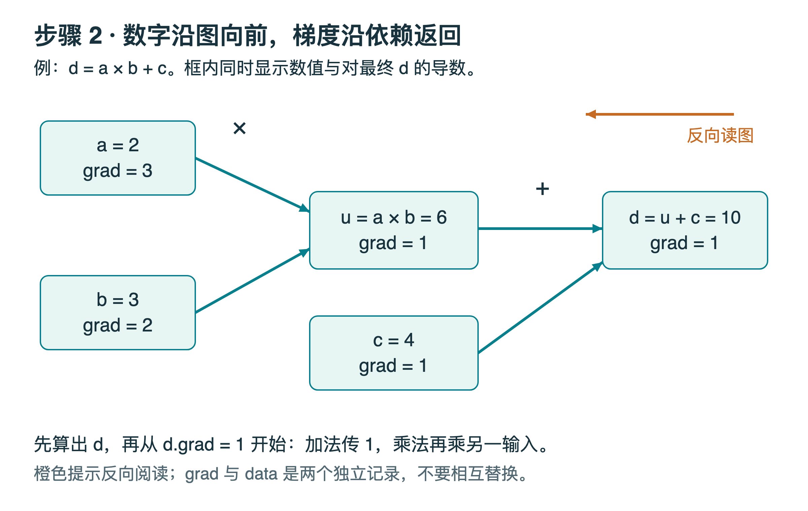

图注：助手绘制的教学示意，2026-11-09；帮助理解本步的计算关系与操作顺序。图中教学数字与简化结构不冒充课程截图、模型实测性能或完整实现。

**试着用手指读图：** 先指出输入或起点，再沿依赖找到中间处理，最后指出输出或结果记录。停在每一站，说出“这里放的是什么、对它做了什么、什么东西会改变”。如果遇到反向箭头，要说明它传回的是梯度，还是图中另有注明的流程。

**再用一句话检查自己：** 遮住正文，只看图，解释这一节与上一步相比新增加了什么；然后回到本步的小实验核对。会复述图并不代替实际运行和数值验收。


### 把链式法则落实到代码

设 `z=x*y`。来自下游的梯度是 `z.grad`，则 x 收到 `y.data*z.grad`，y 收到 `x.data*z.grad`。设 `z=x+y`，两个输入都收到 `z.grad`。局部导数只描述当前运算，乘上下游梯度后才是对最终 loss 的影响。

```python
# 教学核心片段；位于 Value 运算的 _backward 闭包内
self.grad += other.data * out.grad    # 自己对上游的贡献：另一个数 × 下游梯度
other.grad += self.data * out.grad    # 另一个数同理
```

当 `b=a+a` 时，a 的两条贡献都必须留下；导数应为 2。如果赋值写成 `=`，最后一次调用会抹掉前一次结果。拓扑遍历避免重复执行同一个节点，但不能删除数学上的两条贡献。

`tanh(x)` 的局部导数可写成 `1-tanh(x)**2`。用 exp、加法、除法拆开同一个 tanh 后，应得到相同结果；这说明不同计算图能实现同一函数。有限差分有数值误差，不要求所有 h 的结果完全相等。

### 真正的训练循环

```python
# 教学整理片段：parameters() 来自你自己的网络对象 n
for p in n.parameters():
    p.grad = 0.0                  # 1) 清空上一轮梯度
loss.backward()                   # 2) 反向传播，累加这一轮的梯度
for p in n.parameters():
    p.data += -0.05 * p.grad      # 3) 沿负梯度更新，0.05 是学习率
```

学习率 0.05 在此只是演示更新，不是所有任务的推荐值。不要在清梯度后忘记调用 backward，也不要在参数更新后拿旧 loss 冒充新 loss；更新后的结果必须重新前向计算。

课程最后对照 PyTorch 的 tensor 与 micrograd 标量对象，再到官方源码找 tanh 的反传。生产框架以张量为基础，不会真的用 Python 标量节点训练大模型。官方 micrograd 当前使用 ReLU 等实现，与视频临时写的 tanh 版本可能不同，先比数学行为，再比文件是否逐行相同。


- [ ] 保存梯度对照和训练前后 loss，没有只凭计算图截图判断正确。


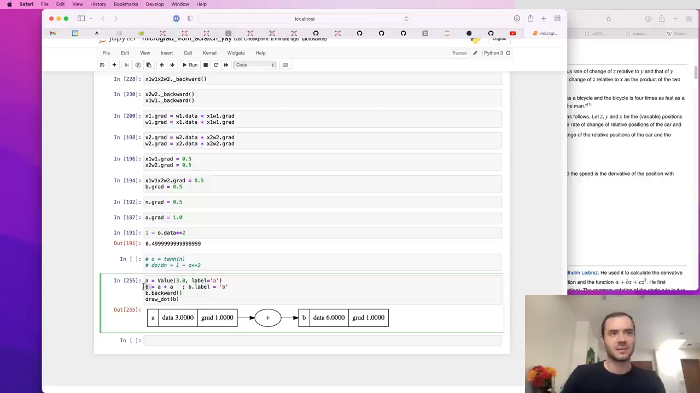

图注：真实课程截图，2026-10-29 提取，第1课 01:23:20；用于对照本节讲解，不替代代码和梯度核验。[[O1](#source-o1)]

### 卡住时按这个顺序查

按现象列出先查什么、修好后怎么验。这些路径来自课程故障与代码整理，同一个报错不保证只有一个原因；先定位影响的是数据、数学、状态还是系统性能，再回到上面的操作，不靠同时换五个参数碰运气。

| 现象 | 先查什么 | 修好后怎么验 |
|---|---|---|
| micrograd 的 a+a 梯度只有 1 | 局部反传是否累加 | a+a 导数 2，a*a 导数 2a |

### 课程里出现过的一个真实案例

**案例 1｜多路径反传**

- 起点与做法：a+a 只赋值梯度，改为累加
- 讲者当时的结果：修复单节点多次使用错误
- 可借鉴：最小反例优先
- 出处：第1课 01:22:28 [[O1](#source-o1)]

这是课程演示，数字不是你在自己机器上的复现结果。

### 原课练习（官方英文原文）

下面是作者在视频说明里给学习者的练习指令，保留英文原文，不冒充聊天提示词。建议先独立完成，再看对应代码；中文只用于说明它落在本步骤的哪一段。

#### 第 1 课原练习

[[O1](#source-o1)]

```text
you should now be able to complete the following google collab, good luck!:
https://colab.research.google.com/drive/1FPTx1RXtBfc4MaTkf7viZZD4U2F9gtKN?usp=sharing
```

**中文对照**：第 1 课没有列文字练习，作者只给了一个 Colab 链接——现在你应该能完成下面这个 Colab，祝好运。

### 本步对应的课程章节与时间定位

**第 1 课｜The spelled-out intro to neural networks and backpropagation: building micrograd**（手把手入门神经网络与反向传播：搭出 micrograd）

英文自动字幕约 24,352 词；[逐字稿](transcripts/01-VMj-3S1tku0.md)；[主线步骤](#section-s2)。

| 起点 | 原章节标题 | 视频定位 |
|---|---|---|
| 00:00:00 | intro（开场介绍） | [播放](https://www.youtube.com/watch?v=VMj-3S1tku0&t=0s) |
| 00:00:25 | micrograd overview（micrograd 概览） | [播放](https://www.youtube.com/watch?v=VMj-3S1tku0&t=25s) |
| 00:08:08 | derivative of a simple function with one input（单输入简单函数的导数） | [播放](https://www.youtube.com/watch?v=VMj-3S1tku0&t=488s) |
| 00:14:12 | derivative of a function with multiple inputs（多输入函数的导数） | [播放](https://www.youtube.com/watch?v=VMj-3S1tku0&t=852s) |
| 00:19:09 | starting the core Value object of micrograd and its visualization（开始写 micrograd 的核心 Value 对象及其可视化） | [播放](https://www.youtube.com/watch?v=VMj-3S1tku0&t=1149s) |
| 00:32:10 | manual backpropagation example #1: simple expression（手算反传例 1：简单表达式） | [播放](https://www.youtube.com/watch?v=VMj-3S1tku0&t=1930s) |
| 00:51:10 | preview of a single optimization step（预览一次优化步骤） | [播放](https://www.youtube.com/watch?v=VMj-3S1tku0&t=3070s) |
| 00:52:52 | manual backpropagation example #2: a neuron（手算反传例 2：一个神经元） | [播放](https://www.youtube.com/watch?v=VMj-3S1tku0&t=3172s) |
| 01:09:02 | implementing the backward function for each operation（为每种运算实现 backward） | [播放](https://www.youtube.com/watch?v=VMj-3S1tku0&t=4142s) |
| 01:17:32 | implementing the backward function for a whole expression graph（为整张表达式图实现 backward） | [播放](https://www.youtube.com/watch?v=VMj-3S1tku0&t=4652s) |
| 01:22:28 | fixing a backprop bug when one node is used multiple times（修一个反传 bug：同一节点被多次使用） | [播放](https://www.youtube.com/watch?v=VMj-3S1tku0&t=4948s) |
| 01:27:05 | breaking up a tanh, exercising with more operations（拆开 tanh，再练更多运算） | [播放](https://www.youtube.com/watch?v=VMj-3S1tku0&t=5225s) |
| 01:39:31 | doing the same thing but in PyTorch: comparison（换成 PyTorch 做同样的事并对照） | [播放](https://www.youtube.com/watch?v=VMj-3S1tku0&t=5971s) |
| 01:43:55 | building out a neural net library (multi-layer perceptron) in micrograd（在 micrograd 里搭神经网络库（多层感知机）） | [播放](https://www.youtube.com/watch?v=VMj-3S1tku0&t=6235s) |
| 01:51:04 | creating a tiny dataset, writing the loss function（造一个小数据集，写损失函数） | [播放](https://www.youtube.com/watch?v=VMj-3S1tku0&t=6664s) |
| 01:57:56 | collecting all of the parameters of the neural net（收集网络的全部参数） | [播放](https://www.youtube.com/watch?v=VMj-3S1tku0&t=7076s) |
| 02:01:12 | doing gradient descent optimization manually, training the network（手写梯度下降，训练网络） | [播放](https://www.youtube.com/watch?v=VMj-3S1tku0&t=7272s) |
| 02:14:03 | summary of what we learned, how to go towards modern neural nets（总结：我们学到了什么，怎样走向现代神经网络） | [播放](https://www.youtube.com/watch?v=VMj-3S1tku0&t=8043s) |
| 02:16:46 | walkthrough of the full code of micrograd on github（通读 GitHub 上 micrograd 的完整代码） | [播放](https://www.youtube.com/watch?v=VMj-3S1tku0&t=8206s) |
| 02:21:10 | real stuff: diving into PyTorch, finding their backward pass for tanh（实战：进 PyTorch 源码找 tanh 的反传） | [播放](https://www.youtube.com/watch?v=VMj-3S1tku0&t=8470s) |
| 02:24:39 | conclusion（结语） | [播放](https://www.youtube.com/watch?v=VMj-3S1tku0&t=8679s) |
| 02:25:20 | outtakes :)（花絮） | [播放](https://www.youtube.com/watch?v=VMj-3S1tku0&t=8720s) |

<a id="section-s3"></a>
## 步骤 3 用名字数据构建 bigram 语言模型

bigram 只根据前一个字符预测下一个字符。先用计数得到概率，再用一个神经网络学相同的关系，能把“训练、loss、采样”这三个概念连起来。

**目标**：得到可评估、可采样的字符级基线。

1. 读取 `names.txt`，按行拆名字，建立字符到整数的映射。用同一个 `.` 表示开始/结束，遍历 `'.'+w+'.'` 的相邻字符对。第 2 课 00:03:03–00:24:02。[[O2](#source-o2)]
2. 在 27×27 计数表 N 中累加 `N[ix1,ix2]`，做平滑后逐行归一化成 P。检查每行之和为 1；先看一行，确认行是当前字符、列是后继字符。[[O2](#source-o2)]
3. 从索引 0 开始按 `P[ix]` 采样下一个字符，遇到 0 结束；保存 20 个输出。再用真实字符对计算平均负对数似然，不能只凭生成的名字“像不像”判断。定位 00:24:02–01:02:57。[[O2](#source-o2)]
4. 把每个输入字符做 one-hot，与 27×27 权重 W 相乘得到 logits，softmax 后计算交叉熵，反传并更新 W；比较神经网络与计数法的结果，保留正则化强度。[[O2](#source-o2)]

**做完的标准**：概率各行和为 1；能解释 `-log(p)`；计数和神经网络两条路径都能生成名字；训练 loss 与相同数据口径的基线可比较。

<a id="walkthrough-s3"></a>
### 白话说明：先做一张“下一个字母接什么”的统计表

假设你只看一个名字的上一个字符，预测下一个字符。你先观察很多真实名字，把每种接法出现的次数记下来，再按比例抽签生成新名字。这就是最简单的字符语言模型。

**先打开**：学习副本里的 `code/nn-zero-to-hero/lectures/makemore/makemore_part1_bigrams.ipynb`。`names.txt` 应在同一目录。运行代码前把 Notebook 另存为自己的版本。

#### 先把这一步想成一个生活场景

想象你在玩名字接龙。你不知道接下来写什么，就翻一本记录簿：“以前看到 m 时，后面通常接什么？”本步先做这本记录簿，再让电脑按记录里的比例抽签。电脑没有理解名字的含义；它只学字符相邻的规律。

**怎么读这一节：** 先读每个操作前的故事与具体数字，再运行原有代码。代码成功只是程序完成了动作；能回答“停一下”的问题，才说明你知道它在做什么。下面的场景和小数字是助手编写的教学例子。

#### 先把关键词翻成看得见的东西

| 关键词 | 白话意思 | 本步的具体样子 |
|---|---|---|
| 字符 | 一个字母或符号 | emma 中有四个字符 |
| bigram | 相邻的两个字符 | e 后面接 m |
| 词表 | 所有允许使用的字符名单 | 26 个字母加点号，共 27 个 |
| 计数矩阵 N | 行列交叉的次数表 | 行是当前字符，列是下一个字符 |
| 概率 P | 这一行抽签时各选项的份额 | 一整行加起来等于 1 |
| 平滑 | 给每个选项先放一张基础签 | N+1 避免从未出现的接法概率为零 |
| one-hot | 只有一个位置亮着的指示牌 | 指出当前字符是哪一行 |
| logits / softmax | 先打分，再变成概率 | 分数可以为负，概率不能为负 |

#### 操作 A：只拿一个名字，列出模型看见的题目

**场景：把一条项链拆成相邻两颗珠子。** 在 emma 两端放点号，就像放“开始”和“结束”两块牌。窗口每次往右移一格，得到五道接龙题。这里不是把名字打乱，也不是列所有字符组合。

**你实际做的事：** `zip(chars, chars[1:])` 把原列表和右移一位的列表配对。先在纸上圈出 e→m、m→m，再去输出里找它们。

**停一下：** 为什么四个字母产生五对？因为还要学“怎样开始”和“何时结束”。

在新单元格运行：

```python
word = 'emma'                          # 一个例子名字
chars = ['.'] + list(word) + ['.']     # 前后各加一个点，表示开始与结束
print(list(zip(chars, chars[1:])))     # 两两配对，得到 (左, 右) 的相邻字符对
```

结果是 `('.', 'e'), ('e','m'), ('m','m'), ('m','a'), ('a','.')`。点号是开始/结束标记；`m,m` 是合法重复，不能删。每一对都相当于一道“看到左边，猜右边”的题。

#### 操作 B：把同样的记录方式用到整个文件

**场景：每种接法都有一个收票格。** 看到 m 后面接 a，就往“m 行、a 列”放一张票；所有名字都看完，再数票。假设某行只允许三种结尾，票数是 2、1、0；各加一后为 3、2、1，除以总数 6，概率变成 1/2、1/3、1/6。这个三选项例子只是为了手算，课程词表是 27 类。

**你实际做的事：** 第一个索引找行，第二个索引找列；`sum(dim=1, keepdim=True)` 对每一行求和并保留可广播的形状。

**停一下：** 为什么不是让整张表总和为 1？因为每一个“当前字符”都要有自己的一整套下一字符概率。

```python
from pathlib import Path
import torch                                     # 用张量存计数表
words = Path('names.txt').read_text().splitlines()   # 一行一个名字
letters = sorted(set(''.join(words)))            # 全部出现过的字符，去重并排序
stoi = {ch: i + 1 for i, ch in enumerate(letters)}   # 字符 → 编号（从 1 开始）
stoi['.'] = 0                                    # 点号固定编号 0，表示开始/结束
itos = {i: ch for ch, i in stoi.items()}         # 编号 → 字符，解码时用
V = len(stoi)                                    # 词表大小
N = torch.zeros((V, V), dtype=torch.int64)       # V×V 的计数表，行是当前字符，列是下一个字符
for word in words:                               # 遍历每个名字
    seq = ['.'] + list(word) + ['.']             # 前后补点，变成可切相邻对的序列
    for left, right in zip(seq, seq[1:]):        # 每次取相邻两个字符
        N[stoi[left], stoi[right]] += 1          # 在对应格子里记一票
P = (N + 1).float()                              # 加一平滑，并把整数转成小数
P = P / P.sum(dim=1, keepdim=True)               # 每一行各自归一化，得到概率
print(N.shape, P.sum(dim=1))                     # 打印表的形状与每行的和，检查归一化
```

每行之和应接近 1；行数等于词表大小。看 `P[stoi['m']]` 就是在问“m 后面各种字符的机会有多大”。如果维数正确但行和不对，先检查归一化方向。

#### 操作 C：按表抽签生成一个名字

**场景：按袋子里的签抽下一颗珠子。** 如果 m 这一袋里 a 的份额大，它容易被抽到，但不是每次一定抽到。抽到 a 后，下一轮换成 a 的袋子；抽到点号就收工。

**你实际做的事：** `multinomial` 按概率抽编号，`itos` 把编号翻回字符。seed 像固定一次抽签的起始状态，帮助复现；它没有把模型训练得更聪明。

**停一下：** 为什么同一张概率表可以生成不同名字？因为生成包含抽样，不是永远挑最大概率。

```python
g = torch.Generator().manual_seed(42)          # 固定随机种子，方便复现
ix, output = 0, []                             # 从点号（编号 0）开始，输出为空
for _ in range(30):                            # 最多生成 30 个字符
    ix = torch.multinomial(P[ix], 1, generator=g).item()   # 按当前字符那一行的概率抽下一个
    if ix == 0:                                # 抽到点号就表示名字结束
        break
    output.append(itos[ix])                    # 把编号换回字符
print(''.join(output))                         # 拼成一个名字打印出来
```

30 是助手设置的长度上限，防止异常实现一直生成。随机名字可能古怪；此模型只记得一个字符，输出怪并不自动表示程序错。重复运行并保存20个结果，同时计算真实字符对的平均 `-log(p)`。

#### 操作 D：再用神经网络重做同一件事

**场景：先用点票得到答案，再学会调整一块分数板。** 统计版直接把次数换成概率；神经网络版把每个格子的分数当作可调数字。one-hot 乘 W，相当于按当前字符取出 W 的一行；softmax 把这行分数变成概率。

**具体数字：** 正确答案概率是 0.1 时，负对数损失约 2.303；提高到 0.5 时约 0.693。正确答案被分到更多概率，惩罚就更小。

**停一下：** 这一步在调什么？神经网络版调 W 的分数，不是在改训练名单里的真实名字。

回到课程的 one-hot、权重矩阵 W、softmax 与 loss 单元格。每次先打印中间形状，确认 one-hot 乘 W 实际取出了对应行。这里开始用步骤 2 的“前向—算误差—反传—更新”，训练 W 里的数字。

**判断是否完成**：你可以从一对字符指到计数表的一个格子，再指到概率表的一个数；能生成名字，也能解释真实答案概率从0.1升到0.5时，损失为什么从约2.303降到0.693。训练集得分和独立验证得分分别记录。

#### 卡住时先找哪一站

| 看到的现象 | 先检查什么 |
|---|---|
| 所有行加在一起才等于 1 | 归一化维度错了；应分别检查每行 |
| 生成没有停下来 | 检查点号编号和结束分支；保留长度上限 |
| 名字很奇怪 | 先看概率/损失是否正确；只记一个字符本来就有限 |

**说明与衔接**：本段是助手基于本步骤课程与代码整理的动手导读；微型例子只解释相应局部机制。继续按下面原有课程讲解、截图与验收要求完成该步。

<a id="spatial-s3"></a>
### 空间转化：把步骤 3 摆到一张图里

把概率表画成棋盘：左侧行标签是“现在是谁”，上方列标签是“下一个是谁”。手指先停在 m 行，再横着看这一行的抽签份额。抽到 a 后，把手指移到 a 行，再抽一次。棋盘的上下位置没有字母意义，只是查表地址。

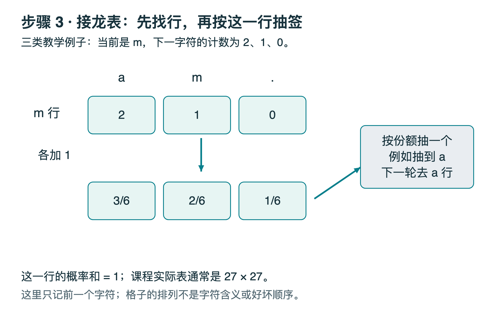

图注：助手绘制的教学示意，2026-11-09；帮助理解本步的计算关系与操作顺序。图中教学数字与简化结构不冒充课程截图、模型实测性能或完整实现。

**试着用手指读图：** 先指出输入或起点，再沿依赖找到中间处理，最后指出输出或结果记录。停在每一站，说出“这里放的是什么、对它做了什么、什么东西会改变”。如果遇到反向箭头，要说明它传回的是梯度，还是图中另有注明的流程。

**再用一句话检查自己：** 遮住正文，只看图，解释这一节与上一步相比新增加了什么；然后回到本步的小实验核对。会复述图并不代替实际运行和数值验收。


### 最容易错的是广播方向

```python
# N 为已累加好的计数矩阵；1 是本实验的加一平滑
P = (N + 1).float()                        # 每个格子加 1，避免零概率
P = P / P.sum(1, keepdim=True)             # 按行归一化：每行加起来是 1
assert torch.allclose(P.sum(1), torch.ones(P.shape[0]))   # 断言每行和都为 1
```

`P.sum(1)` 的形状是 `(27,)`，直接相除会按末尾维度广播，可能把本想做的逐行归一化变成按列缩放。`keepdim=True` 保留 `(27,1)` 才能明确逐行除。张量形状正确、程序没有报错，都不足以证明数学意思正确。

### 损失和零概率

单个真实下一个字符概率为 p，损失是 `-log(p)`；整批取平均。概率越接近 1 损失越小，p=0 会得到无穷大。加一平滑让未见过的字符对也有非零概率，但会改变原来概率的分配；平滑强度是取舍，不是“永远加一就最好”。

神经网络的 one-hot 输入乘 W，等价于取出 W 对应行。后续 embedding 的查表并不是全新魔法，而是相同索引思想的更紧凑实现。`W**2` 的惩罚会把 logits 拉向较平缓分布，与计数平滑的效果相似，但两者不等同于同一个算法。

### 采样时保留实验条件

同一个模型用不同随机种子会给不同名字。比较改动时固定采样数量、种子和最大长度；最大长度是防止自己的错误实现无限循环的助手建议。输出十个好名字并不能说明全体分布改善。


- [ ] 保存计数表、概率检查、模型参数和 20 个原始样本。

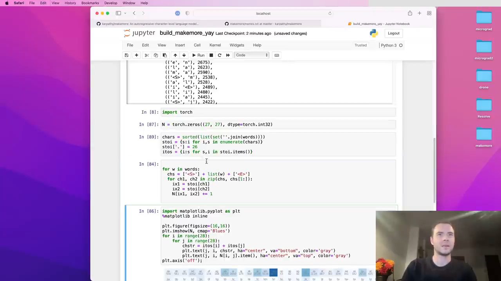

图注：真实课程截图，2026-10-29 提取，第2课 00:22:30；用于对照本节讲解，不替代代码和梯度核验。[[O2](#source-o2)]


<a id="intuition-s1"></a>
### 关键词拆解｜步骤 1：实验环境、数据、可复现性

这里先建立的是“实验台”，不是模型能力。环境是同一套工具和规则；数据是实验要观察的材料；可复现性是把配方写下来，让未来的自己能重做同一锅实验。

- **环境（environment）**：把 Python、PyTorch、依赖包和硬件看成厨房里的灶具、锅具与温度计。两台机器装了不同版本的 PyTorch，就像一个用烤箱、一个用平底锅；菜名相同，细节可能不同。记录版本是为了能解释差异，不是为了追求“版本越新越好”。
- **数据集（dataset）**：模型的练习册。名字数据每一行是一道题，字符是题目里的字母；错误文件或空文件相当于拿错练习册，后面得到的 loss 再漂亮也没有意义。
- **随机种子（seed）**：随机过程的起始编号，像洗牌前固定洗牌步骤。固定它能让两次实验更可比；它不会让模型变好，也不能保证不同硬件的每个浮点数完全一样。
- **训练记录（run log）**：实验配方卡，至少包含数据切分、模型形状、步数、学习率、种子、设备与代码版本。没有配方卡，只剩一句“我昨天跑出来挺好”，就无法定位结果来自哪项改变。

**小例子**：同一个模型 A 在 CPU 上跑 100 步、模型 B 在 GPU 上跑 100 步，若 B 的 loss 更低，不能立刻归因于 GPU；硬件通常改变速度，若计算路径相同，不应把它当成模型结构改进。先确认两者数据、初始化、批次和更新次数相同。

**本步交接物**：可读的数据、能导入的工具、记录实验条件的习惯。它们让步骤 2 的梯度差异可以追查。

<a id="intuition-s2"></a>
### 关键词拆解｜步骤 2：导数、计算图、链式法则、反向传播

把一个计算过程想成一条小型装配线：输入经过一连串工序，最后产出一个数。导数回答“某个输入轻轻动一下，最终产物会动多少”；反向传播则从最终结果往回分摊责任。

- **导数（derivative）**：局部斜率。若把 x 增加极小一点，输出 y 大约变化 `dy/dx × Δx`。坡很陡，轻推就会让高度变化很多；坡平，变化就少。
- **有限差分（finite difference）**：用两次实际测量估坡度：`(f(x+h)-f(x))/h`。它像用短尺量斜坡，不是精确真值；h 太大测到的是一段平均坡度，太小会被计算机舍入误差干扰。
- **计算图（computation graph）**：把公式拆成节点与连线。`d=a*b+c` 可画成 a、b 先进入乘法节点，再和 c 进入加法节点；每条边表示一个数如何参与下一个运算。
- **局部导数（local derivative）**：只看某一站的敏感度。例如乘法 `z=x*y`，固定 y 时 `dz/dx=y`。它还没考虑后面所有工序。
- **链式法则（chain rule）**：一连串工序的总影响等于沿路径把局部影响相乘。若 `x→u→loss`，则 `d(loss)/dx = d(loss)/du × du/dx`。像接力棒一站站传递比例。
- **反向传播（backpropagation）**：从 loss 节点向输入逆着图走，把上游收到的影响乘以本地斜率，再交给前一站。它是高效计算梯度的程序，不是另一种不同的导数。
- **拓扑顺序**：先保证一个节点的下游梯度都准备好了，再往它的父节点传。就像先结算所有下游账目，再汇总供应商应承担的份额。
- **梯度累加**：若同一个数被用两次，它收到两条影响，必须相加。`a+a` 对 a 的导数为 `1+1=2`；代码用 `+=` 正是把两张账单合并。
- **梯度下降（gradient descent）**：若梯度表示朝哪个方向 loss 上升，就沿相反方向挪一点。学习率是每次挪的步幅；过大容易跨过谷底，过小则进展慢。

**从公式到代码的微型追踪**：令 `a=2, b=3, c=4`，`d=a*b+c=10`。输出 d 对 a 的导数是 b，也就是 3；对 b 的导数是 a，也就是 2；对 c 是 1。若真实目标是 `L=2d`，上游给 d 的梯度为 2，因此 a 最终收到 `3×2=6`。这正是代码里的 `other.data * out.grad`。

**为什么拿 PyTorch 对答案**：micrograd 是透明的手工算盘，PyTorch 是成熟的自动计算器。二者对同一个小公式给出一致梯度，是对实现的一种交叉检查；不表示 micrograd 适合训练大模型。

**常见误解**：梯度不是“参数当前值”，也不是模型对错的标签；它是当前参数位置、当前批数据下，loss 对参数的局部敏感度。梯度为零可能表示局部平坦，也可能是实现断开或饱和，需结合前向和图结构检查。

<a id="intuition-s3"></a>
### 关键词拆解｜步骤 3：bigram、计数、概率、交叉熵、采样

bigram 是一张“只看前一个字符”的接龙规则表。它不懂整个名字，只知道在当前字符之后，训练数据里各个字符曾出现多少次。

- **字符级（character-level）**：把文本拆到单个字符。词表只有数据中出现的字符及开始/结束标记，结构简单，序列会比较长。
- **bigram（二元组）**：相邻两个字符构成一组。`la` 是一个字符对；模型用前一个字符预测后一个字符，所以记忆范围只有一步。
- **计数矩阵 N**：行代表当前字符，列代表下一个字符。`N[i,j]` 是训练名字中 i 后面出现 j 的次数。每行是一位“接龙主持人”的历史统计。
- **归一化概率 P**：把某一行的计数除以该行总数，让候选下一字符概率加起来为 1。行和为 1 是账目检查：所有可能选择的概率质量必须分完。
- **加一平滑（add-one smoothing）**：每个候选先假装至少见过一次，避免未见组合概率为零。像给从未发生过的接龙留一张极小的入场券；代价是把一部分概率从常见组合分走。
- **采样（sampling）**：按照概率抽签选择下一个字符。概率高不等于必选；同一个模型每次可生成不同名字。
- **负对数似然 / 交叉熵（NLL / cross-entropy）**：模型给真实后继的概率 p，付出 `-log(p)` 惩罚。给真实答案高概率，惩罚小；若给 0 概率，惩罚无穷大。批次平均就是整体“惊讶程度”的量化。
- **one-hot**：用长度为词表大小的向量标记一个字符，只有对应位置为 1。它像一排按钮只按下一个。乘以矩阵实际就是选出对应行。
- **logits 与 softmax**：logits 是归一化前的任意分数；softmax 把分数变成总和为 1 的概率。分数只表示相对偏好，不能直接当百分比。

**具象一行**：假设字符 `a` 后面在语料中出现 `b` 8 次、`c` 2 次，其他 25 种没出现。未平滑时概率分别是 0.8、0.2、其余 0；加一平滑后分母为 37，`b` 为 9/37，`c` 为 3/37，每个未见字符为 1/37。平滑确实避免了零，但也把原本 0.8 降低了。

**计数法与神经网络的关系**：计数法把表格直接数出来；神经网络把相同“当前字符→下一字符”的关系用参数学出来。后者能引出梯度训练，但在这个简单任务上不自动意味着更聪明。

<a id="intuition-s4"></a>
### 关键词拆解｜步骤 4：上下文窗口、embedding、MLP、minibatch、泛化

从只看前一字符，改成看前面几个字符。模型先把字符编号换成可学习的小坐标，再混合这些坐标，判断下一个字符。

- **上下文（context）**：预测当前位置时允许查看的前文。`block_size=3` 表示固定看最近三个字符，不代表模型懂得无限长历史。
- **滑动窗口（sliding window）**：每生成一个目标，窗口往前移一格。`... a b c d ...` 可组成 `...→a`、`..a→b`、`.ab→c`、`abc→d` 等监督样本。
- **embedding（嵌入向量）**：每个字符对应一串可训练数字。可想象把每个字母放到一张地图上，训练会调整坐标，使有用的字符关系更容易被后续网络利用。维度是坐标轴数，不是人类可直接命名的语义标签。
- **MLP（多层感知器）**：几层“加权混合 + 非线性变换”。它接收拼接好的上下文坐标，逐层变换，最后为每个候选字符打分。
- **激活函数 tanh**：把数压到 -1 到 1 的平滑弯曲函数，给网络非线性表达能力。若输入太大，输出靠近边界，斜率接近 0，梯度就难传。
- **logits**：输出层给 27 个字符各一个未归一化分数；softmax 转成概率后，交叉熵比较真实下一个字符。
- **minibatch（小批次）**：每次用一小组样本估算更新方向。像抽取一小叠练习题估算学生薄弱点；批越小波动通常越明显，批越大计算和内存压力越高。
- **过拟合一个批次（overfit one batch）**：先检查模型能不能记住一小份固定题目。它是管线自检：若都背不下来，先查标签、梯度和更新；背下来也不能证明它会做新题。
- **训练/验证/测试切分**：训练集用于更新参数；验证集用于挑方案；测试集尽量只在最后用于一次较公平的估计。名字为单位切分，避免同一个名字的不同窗口跑到训练和验证两边造成泄漏。
- **泛化（generalization）**：在没参与更新的名字上仍表现不错。训练 loss 下降只说明越来越会做练习册里的题，验证表现才开始回答能否处理新题。

**形状像传送带**：`Xb (N,3)` 是 N 道题、每道题 3 个字符编号；查表后为 `(N,3,D)`；把三段 D 维坐标排成一行成为 `(N,3D)`；隐层输出 `(N,H)`；最终 logits `(N,27)`。形状是一种接口契约，能检查数据有没有错位，但还要确认每一维代表的含义。

**典型判断**：训练 loss 持续降、验证 loss 先降后升，像学生越来越熟悉练习题，却开始把题目细节背死；可尝试减小模型、缩短训练或加入适当正则化，并以同一验证集比较。

### 卡住时按这个顺序查

按现象列出先查什么、修好后怎么验。这些路径来自课程故障与代码整理，同一个报错不保证只有一个原因；先定位影响的是数据、数学、状态还是系统性能，再回到上面的操作，不靠同时换五个参数碰运气。

| 现象 | 先查什么 | 修好后怎么验 |
|---|---|---|
| loss 每轮越来越奇怪 | 是否清梯度、是否重做前向 | 固定批次短跑并记录每步 |
| 概率行和不是 1 | sum 的维度与 keepdim | 各行和为 1，不只看总和 |

### 课程里出现过的一个真实案例

**案例 2｜零概率名字**

- 起点与做法：未见字符对带来 log(0)，加伪计数
- 讲者当时的结果：不再因零概率给无穷 NLL
- 可借鉴：平滑改变整体分布
- 出处：第2课 01:00:50 [[O2](#source-o2)]

这是课程演示，数字不是你在自己机器上的复现结果。

### 原课练习（官方英文原文）

下面是作者在视频说明里给学习者的练习指令，保留英文原文，不冒充聊天提示词。建议先独立完成，再看对应代码；中文只用于说明它落在本步骤的哪一段。

#### 第 2 课原练习

[[O2](#source-o2)]

```text
E01: train a trigram language model, i.e. take two characters as an input to predict the 3rd one. Feel free to use either counting or a neural net. Evaluate the loss; Did it improve over a bigram model?
E02: split up the dataset randomly into 80% train set, 10% dev set, 10% test set. Train the bigram and trigram models only on the training set. Evaluate them on dev and test splits. What can you see?
E03: use the dev set to tune the strength of smoothing (or regularization) for the trigram model - i.e. try many possibilities and see which one works best based on the dev set loss. What patterns can you see in the train and dev set loss as you tune this strength? Take the best setting of the smoothing and evaluate on the test set once and at the end. How good of a loss do you achieve?
E04: we saw that our 1-hot vectors merely select a row of W, so producing these vectors explicitly feels wasteful. Can you delete our use of F.one_hot in favor of simply indexing into rows of W?
E05: look up and use F.cross_entropy instead. You should achieve the same result. Can you think of why we'd prefer to use F.cross_entropy instead?
E06: meta-exercise! Think of a fun/interesting exercise and complete it.
```

**中文对照**

- E01：训练一个三元（trigram）语言模型，也就是用两个字符作输入预测第三个。计数法或神经网络都行。评估 loss——比 bigram 模型有改善吗？
- E02：把数据随机切成 80% 训练、10% 验证（dev）、10% 测试。bigram 和 trigram 只在训练集上训练，在 dev 和 test 上评估。你看到了什么？
- E03：用 dev 集调 trigram 的平滑（或正则化）强度——多试几种，看哪一种按 dev loss 最好。调这个强度时，训练集和 dev 集的 loss 各呈什么走势？取最优的平滑强度，最后只在测试集上评估一次。你能得到多好的 loss？
- E04：我们的 one-hot 向量其实只是选出 W 的一行，显式造这个向量显得浪费。你能删掉 F.one_hot，改成直接按行索引 W 吗？
- E05：查一下并改用 F.cross_entropy，结果应当相同。想一想：为什么我们更愿意用它？
- E06：元练习！想一个有趣的练习，并把它做完。

### 本步对应的课程章节与时间定位

**第 2 课｜The spelled-out intro to language modeling: building makemore**（手把手入门语言建模：搭出 makemore）

英文自动字幕约 19,445 词；[逐字稿](transcripts/02-PaCmpygFfXo.md)；[主线步骤](#section-s3)。

| 起点 | 原章节标题 | 视频定位 |
|---|---|---|
| 00:00:00 | intro（开场介绍） | [播放](https://www.youtube.com/watch?v=PaCmpygFfXo&t=0s) |
| 00:03:03 | reading and exploring the dataset（读取并探索数据集） | [播放](https://www.youtube.com/watch?v=PaCmpygFfXo&t=183s) |
| 00:06:24 | exploring the bigrams in the dataset（查看数据集里的字符对（bigram）） | [播放](https://www.youtube.com/watch?v=PaCmpygFfXo&t=384s) |
| 00:09:24 | counting bigrams in a python dictionary（用 Python 字典统计字符对） | [播放](https://www.youtube.com/watch?v=PaCmpygFfXo&t=564s) |
| 00:12:45 | counting bigrams in a 2D torch tensor ("training the model")（用二维 torch 张量统计字符对（“训练模型”）） | [播放](https://www.youtube.com/watch?v=PaCmpygFfXo&t=765s) |
| 00:18:19 | visualizing the bigram tensor（把字符对计数矩阵画出来） | [播放](https://www.youtube.com/watch?v=PaCmpygFfXo&t=1099s) |
| 00:20:54 | deleting spurious (S) and (E) tokens in favor of a single . token（去掉多余的开头/结束标记，统一用一个点号） | [播放](https://www.youtube.com/watch?v=PaCmpygFfXo&t=1254s) |
| 00:24:02 | sampling from the model（从模型里采样） | [播放](https://www.youtube.com/watch?v=PaCmpygFfXo&t=1442s) |
| 00:36:17 | efficiency! vectorized normalization of the rows, tensor broadcasting（效率：按行向量化归一化与张量广播） | [播放](https://www.youtube.com/watch?v=PaCmpygFfXo&t=2177s) |
| 00:50:14 | loss function (the negative log likelihood of the data under our model)（损失函数：模型下数据的负对数似然） | [播放](https://www.youtube.com/watch?v=PaCmpygFfXo&t=3014s) |
| 01:00:50 | model smoothing with fake counts（用假计数做模型平滑） | [播放](https://www.youtube.com/watch?v=PaCmpygFfXo&t=3650s) |
| 01:02:57 | PART 2: the neural network approach: intro（第二部分：神经网络做法（开场）） | [播放](https://www.youtube.com/watch?v=PaCmpygFfXo&t=3777s) |
| 01:05:26 | creating the bigram dataset for the neural net（为神经网络准备字符对数据集） | [播放](https://www.youtube.com/watch?v=PaCmpygFfXo&t=3926s) |
| 01:10:01 | feeding integers into neural nets? one-hot encodings（整数怎么喂给神经网络？独热编码） | [播放](https://www.youtube.com/watch?v=PaCmpygFfXo&t=4201s) |
| 01:13:53 | the "neural net": one linear layer of neurons implemented with matrix multiplication（“神经网络”：用矩阵乘实现的一层线性神经元） | [播放](https://www.youtube.com/watch?v=PaCmpygFfXo&t=4433s) |
| 01:18:46 | transforming neural net outputs into probabilities: the softmax（把输出变成概率：softmax） | [播放](https://www.youtube.com/watch?v=PaCmpygFfXo&t=4726s) |
| 01:26:17 | summary, preview to next steps, reference to micrograd（小结、预告下一步、回看 micrograd） | [播放](https://www.youtube.com/watch?v=PaCmpygFfXo&t=5177s) |
| 01:35:49 | vectorized loss（向量化损失） | [播放](https://www.youtube.com/watch?v=PaCmpygFfXo&t=5749s) |
| 01:38:36 | backward and update, in PyTorch（在 PyTorch 里反传与更新） | [播放](https://www.youtube.com/watch?v=PaCmpygFfXo&t=5916s) |
| 01:42:55 | putting everything together（把各部分拼起来） | [播放](https://www.youtube.com/watch?v=PaCmpygFfXo&t=6175s) |
| 01:47:49 | note 1: one-hot encoding really just selects a row of the next Linear layer's weight matrix（注 1：独热编码其实只是取出下一层权重矩阵的一行） | [播放](https://www.youtube.com/watch?v=PaCmpygFfXo&t=6469s) |
| 01:50:18 | note 2: model smoothing as regularization loss（注 2：模型平滑就是正则化损失） | [播放](https://www.youtube.com/watch?v=PaCmpygFfXo&t=6618s) |
| 01:54:31 | sampling from the neural net（从神经网络采样） | [播放](https://www.youtube.com/watch?v=PaCmpygFfXo&t=6871s) |
| 01:56:16 | conclusion（结语） | [播放](https://www.youtube.com/watch?v=PaCmpygFfXo&t=6976s) |


<a id="section-s4"></a>
## 步骤 4 从字符窗口训练 MLP

前一节只记住一个字符的后继。MLP 将多个历史字符映射成向量，再一起预测下一个字符；这里开始需要真正区分训练表现和对新数据的表现。

**目标**：实现固定上下文的 MLP，建立独立验证流程。

1. 在 `makemore_part2_mlp.ipynb` 中先只取少数名字，`block_size=3`。每个名字前补三个 0，每产生一个目标字符就把窗口左移一位；确认 X 是 `(N,3)`，Y 是 `(N,)`。定位第 3 课 00:09:03。[[O3](#source-o3)、[O10](#source-o10)]
2. 建 embedding 表 C，先用 2 维便于观察。`C[X]` 得到 `(N,3,2)`，拼成 `(N,6)` 后接隐层、tanh 和输出层，输出 27 个 logits。逐层写出形状。[[O3](#source-o3)]
3. 先在一个固定小批次上反复训练，确认 loss 可以明显降下去；再用随机 minibatch 训练全集。每轮清梯度后再 backward，更新后重新前向。学习率从小范围试起，观察太小、适中与发散三种情况。[[O3](#source-o3)]
4. 按名字打乱后分 80%/10%/10%，再分别展开字符窗口。训练集调参数，验证集选配置，测试集留到最后；增加隐层或 embedding 后只比较相同切分下的验证 loss。[[O3](#source-o3)]

**做完的标准**：能打印每层形状；能降低固定批次 loss；能在未参与更新的名字上计算验证 loss；生成 20 个名字并登记全部参数。

<a id="walkthrough-s4"></a>
### 白话说明：让模型同时看前三个字母，再决定接什么

上一步只看一个字母，能利用的信息太少。这里让三个历史字符共同参与预测。embedding 是给字符配一组可调整的数字；MLP 把三组数字混合后给下一个字符打分。

**先打开**：`code/nn-zero-to-hero/lectures/makemore/makemore_part2_mlp.ipynb`。继续使用同目录 `names.txt`。

#### 先把这一步想成一个生活场景

上一步像只听到一个字就猜下一字。现在给机器一张能看见前三个字符的观察卡。每个字符先换成一张数字名牌，再把三张名牌交给一个小网络一起判断。名牌不是人工写好的“元音”“辅音”标签，而是会随训练改变的数字。

**怎么读这一节：** 先读每个操作前的故事与具体数字，再运行原有代码。代码成功只是程序完成了动作；能回答“停一下”的问题，才说明你知道它在做什么。下面的场景和小数字是助手编写的教学例子。

#### 先把关键词翻成看得见的东西

| 关键词 | 白话意思 | 本步的具体样子 |
|---|---|---|
| 上下文窗口 | 每次允许看的历史范围 | 本练习看前三个字符 |
| embedding C | 字符编号到数字名牌的查找表 | 27 行，每行 D 个可调数字 |
| 维度 D | 一张名牌上写几个数 | D=2 就写两个数 |
| batch / B | 同时处理几张练习卡 | B=4 表示四条样本 |
| reshape / 拼接 | 把名牌排成一长条 | 3 张两格名牌变成 6 格 |
| 隐藏层 H | 中间加工后的数字个数 | 示例每条变成 100 个数 |
| 验证集 | 不参与参数更新的新练习卡 | 用来选配置 |

#### 操作 A：手工展开 emma，先检查输入和答案是否错位

**场景：拿一块能露出三个位置的纸板，沿名字滑动。** 开头没有历史，就用三个点号补齐；看到 ... 猜 e，看到 ..e 猜 m。正确答案永远在窗口的后面，不能先放到输入里。

**你实际做的事：** X 保存观察卡，Y 保存背面的答案。先把前五行编号翻成字符，确认纸板位置。只看形状相同无法发现答案错位。

**停一下：** 输入 emm 时，为什么答案是 a，而不是最后那个 m？因为任务是猜还没看到的下一个字符。

```text
输入 ...，答案 e
输入 ..e，答案 m
输入 .em，答案 m
输入 emm，答案 a
输入 mma，答案 .
```

点号编码为0。构建数据后打印前五行 X 和 Y，并把整数翻回字符核对。不要只看形状；X 与 Y 错位一格，模型也能运行，但它学的是错误任务。

#### 操作 B：运行一个只看形状的小实验

**场景：每个字母取一张两格名牌。** 假设 e 的名牌是 [0.2,-0.1]，m 的是 [0.7,0.4]，那么 emm 查表后得到三张名牌，再排成 [0.2,-0.1,0.7,0.4,0.7,0.4]。这些数字是教学假设，正负数本身不代表好坏。

**你实际做的事：** `(4,3,2)` 读成“四张卡、每张三个字符、每个字符两个数”；`(4,6)` 是每张卡合并成六个数。最后 `(4,27)` 是每张卡对 27 种下一字符分别打分。

**停一下：** reshape 有没有学到新知识？没有，它只是重新排格子；参数更新才会改变名牌和加工规则。

下面数值仅用于展示接口，不是训练好的字符表示。

```python
import torch
N, D, H, V = 4, 2, 100, 27          # 批大小 4、嵌入 2 维、隐层 100、词表 27
Xb = torch.randint(V, (N, 3))       # 4 条样本，每条 3 个字符编号
C = torch.randn(V, D)               # 27×2 的字符嵌入表
emb = C[Xb]                         # 查表：得到 (4,3,2)
flat = emb.reshape(N, 3 * D)        # 3 个字符拼成 6 维（4,6）
W1 = torch.randn(3 * D, H)          # 第一层权重 (6,100)
b1 = torch.zeros(H)                 # 第一层偏置 (100)
W2 = torch.randn(H, V)              # 输出层权重 (100,27)
b2 = torch.zeros(V)                 # 输出层偏置 (27)
h = torch.tanh(flat @ W1 + b1)      # 隐层：线性 + tanh
logits = h @ W2 + b2                # 输出 27 个分数，还没归一化
print(emb.shape, flat.shape, h.shape, logits.shape)   # 打印四步的形状
```

应依次看到 `(4,3,2)`、`(4,6)`、`(4,100)`、`(4,27)`。这段随机初始化只用来观察维度；正式训练用课程的可求导参数与初始化方式。

#### 操作 C：只训练同一小批，确认网络真的会改变

**场景：先让学生反复做同一小叠题，检查笔和答案本能不能用。** 固定 32 个样本，只是一个排错实验。若连这叠题都很难降低误差，先检查梯度和更新链路，再谈大数据效果。

**你实际做的事：** 抽样语句放在循环外，确保每轮确实是同一批。记录第一轮和后续 loss，而不只是看程序有没有报错。中间张量默认不一定保留 `.grad`，`retain_grad()` 是请框架留下这份检查记录。

**停一下：** 记住 32 道练习题是否等于会做新题？不等于，所以还要下一步。

在课程笔记本初始化参数后，固定抽取32个样本，把 `Xb/Yb` 放在训练循环外面。先做几百次更新，记录前后 loss；每轮都清参数梯度、重新前向、backward、更新。若需要获取非叶子中间张量的 `.grad`，先调用它的 `retain_grad()`。

**怎么看**：loss 应有明显下降趋势。若没有，先看参数是否 `requires_grad=True`、学习率是否非零、更新是否真的作用于本次前向使用的参数，再考虑模型太小。

#### 操作 D：换成完整学习任务

**场景：先按整本作业分练习册和考试册，再拆成小题。** 先分名字、后展开窗口，是为了避免同一个名字的相似窗口同时进入训练和验证。之后每轮从训练册抽一小批，验证册只负责打分。

**你实际做的事：** 一次只改一个设置，并保留同一切分。训练分数下降而验证分数上升，可能是在更用力记住旧题，不能直接宣布模型更好。

**停一下：** 增加 H 后分数变好，是否一定因为 H？只有其他条件基本一致，比较才有解释力。

按名字分出训练、验证、测试集，然后分别展开窗口。将随机抽取 minibatch 的语句放回循环内，训练集用于更新，验证集用于比较配置。一次只改 D、H、学习率或上下文长度中的一项，保存两条 loss 曲线。

**别混淆两种成功**：固定小批次能记住，只证明计算链路有效；没见过的名字上 loss 改善，才开始体现泛化。做完保留数据切分、形状打印、固定批次结果和独立验证结果。

#### 卡住时先找哪一站

| 看到的现象 | 先检查什么 |
|---|---|
| 维度对但 loss 异常 | 把编号翻回字符，先检查 X/Y 配对 |
| 固定小批 loss 不变 | 检查 requires_grad、清梯度与参数更新 |
| 训练好、验证差 | 检查数据切分与过拟合，不只继续加宽网络 |

**说明与衔接**：本段是助手基于本步骤课程与代码整理的动手导读；微型例子只解释相应局部机制。继续按下面原有课程讲解、截图与验收要求完成该步。

<a id="spatial-s4"></a>
### 空间转化：把步骤 4 摆到一张图里

从左往右看：三个编号各到同一张 C 表取一行；三行数字横着拼成一条；隐藏层把它加工成 H 个数；末端给 V 种字符打分。每张样本都有自己的这一条流水线，但共享 C 和权重。二维名牌图只是教学例子，不能把某一坐标擅自命名为“性别”或“含义”。

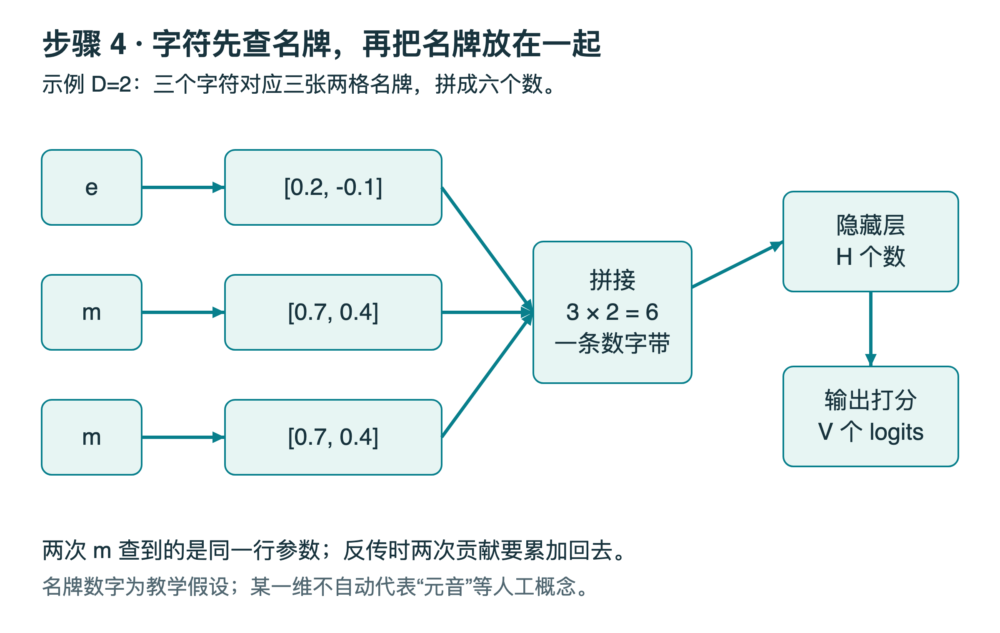

图注：助手绘制的教学示意，2026-11-09；帮助理解本步的计算关系与操作顺序。图中教学数字与简化结构不冒充课程截图、模型实测性能或完整实现。

**试着用手指读图：** 先指出输入或起点，再沿依赖找到中间处理，最后指出输出或结果记录。停在每一站，说出“这里放的是什么、对它做了什么、什么东西会改变”。如果遇到反向箭头，要说明它传回的是梯度，还是图中另有注明的流程。

**再用一句话检查自己：** 遮住正文，只看图，解释这一节与上一步相比新增加了什么；然后回到本步的小实验核对。会复述图并不代替实际运行和数值验收。


### 一次前向应当长什么样

```python
# C: (27, D), W1: (3*D, H), b1: (H,), W2: (H, 27), b2: (27,)
emb = C[Xb]                                          # 查嵌入表
h = torch.tanh(emb.view(emb.shape[0], -1) @ W1 + b1) # 展平成一行再做线性+tanh
logits = h @ W2 + b2                                 # 输出层分数
loss = F.cross_entropy(logits, Yb)                   # 交叉熵：把分数和正确答案比
```

`view` 改的是解释数据形状的方式，通常复用底层存储，不等于复制每个数。reshape 前后元素数必须一样；之后遇到 transpose 导致非连续内存时，不要机械套用 view，可先检查 stride 或 contiguous。

`F.cross_entropy` 接收未归一化的 logits，内部以稳定方式组合 log-softmax 和 NLL。若先手写 `exp()`，很大的 logits 会溢出；先减每行最大值不改变 softmax 概率。正式训练用稳定函数；手工展开留给理解与梯度练习。

### 为什么先过拟合一个批次

它检查模型、loss、梯度和更新路径是否连通。固定几十个例子都记不住时，直接扩大数据会让问题更难定位。它通过以后才能换到新批次和独立验证集；这个诊断通过不能当作模型泛化证据。

### 调参顺序与比较边界

课程逐步尝试了更大的隐层、10 维 embedding、约 200000 步训练，并在前后阶段使用 0.1 与 0.01 学习率；讲者报告验证 loss 约 2.17。这些是课程当时的实验设置与结果，短跑、不同 seed、不同版本不应强行对齐最后一位。

先固定切分、batch size 和训练预算，只改一项：embedding 维数、隐层宽度、上下文长度或学习率。绘制训练与验证曲线；训练改善而验证变差提示过拟合。不要不停看测试集来选最好一次。

生成时从全 0 上下文开始，经 C 查表、隐层、softmax 后采样，再滚动窗口。二维 embedding 可画散点观察字符关系；十维 embedding 不能再直接拿前两个数当作完整语义图。


- [ ] 比较表包含 train/val，测试集没有用于选超参数。

参见[步骤 1 的实验表 T1](#section-s1)。


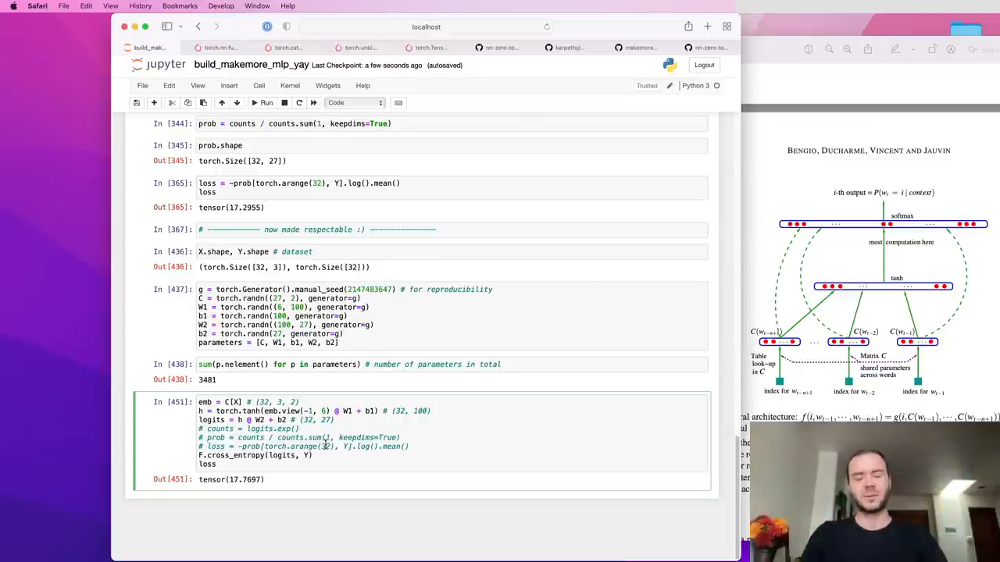

图注：真实课程截图，2026-10-29 提取，第3课 00:34:10；用于对照本节讲解，不替代代码和梯度核验。[[O3](#source-o3)]

### 卡住时按这个顺序查

按现象列出先查什么、修好后怎么验。这些路径来自课程故障与代码整理，同一个报错不保证只有一个原因；先定位影响的是数据、数学、状态还是系统性能，再回到上面的操作，不靠同时换五个参数碰运气。

| 现象 | 先查什么 | 修好后怎么验 |
|---|---|---|
| loss 一开始几十甚至无穷 | logits 尺度、零概率、手写 exp 溢出 | 均匀基线与稳定 CE |

### 课程里出现过的一个真实案例

**案例 3｜MLP 增容**

- 起点与做法：改 hidden/embedding 与学习率
- 讲者当时的结果：讲者验证 loss 约2.17
- 可借鉴：看验证而非只看训练
- 出处：第3课 01:11:46 [[O3](#source-o3)]

这是课程演示，数字不是你在自己机器上的复现结果。

### 原课练习（官方英文原文）

下面是作者在视频说明里给学习者的练习指令，保留英文原文，不冒充聊天提示词。建议先独立完成，再看对应代码；中文只用于说明它落在本步骤的哪一段。

#### 第 3 课原练习

[[O3](#source-o3)]

```text
- E01: Tune the hyperparameters of the training to beat my best validation loss of 2.2
- E02: I was not careful with the intialization of the network in this video. (1) What is the loss you'd get if the predicted probabilities at initialization were perfectly uniform? What loss do we achieve? (2) Can you tune the initialization to get a starting loss that is much more similar to (1)?
- E03: Read the Bengio et al 2003 paper (link above), implement and try any idea from the paper. Did it work?
```

**中文对照**

- E01：调训练超参数，超过我（讲者）最好的验证 loss 2.2。
- E02：这个视频里我没仔细处理初始化。(1) 如果初始化时预测概率完全均匀，会得到多少 loss？我们实际是多少？(2) 你能调初始化，让起始 loss 更接近 (1) 吗？
- E03：读 Bengio 等 2003 年的论文（链接见上），实现并尝试论文里任意一个想法。有用吗？

### 本步对应的课程章节与时间定位

**第 3 课｜Building makemore Part 2: MLP**（搭 makemore 第 2 部分：多层感知机）

英文自动字幕约 12,731 词；[逐字稿](transcripts/03-TCH_1BHY58I.md)；[主线步骤](#section-s4)。

| 起点 | 原章节标题 | 视频定位 |
|---|---|---|
| 00:00:00 | intro（开场介绍） | [播放](https://www.youtube.com/watch?v=TCH_1BHY58I&t=0s) |
| 00:01:48 | Bengio et al. 2003 (MLP language model) paper walkthrough（通读 Bengio 等 2003 年 MLP 语言模型论文） | [播放](https://www.youtube.com/watch?v=TCH_1BHY58I&t=108s) |
| 00:09:03 | (re-)building our training dataset（重建训练数据集） | [播放](https://www.youtube.com/watch?v=TCH_1BHY58I&t=543s) |
| 00:12:19 | implementing the embedding lookup table（实现嵌入查表） | [播放](https://www.youtube.com/watch?v=TCH_1BHY58I&t=739s) |
| 00:18:35 | implementing the hidden layer + internals of torch.Tensor: storage, views（实现隐层，并讲 torch.Tensor 内部：存储与视图） | [播放](https://www.youtube.com/watch?v=TCH_1BHY58I&t=1115s) |
| 00:29:15 | implementing the output layer（实现输出层） | [播放](https://www.youtube.com/watch?v=TCH_1BHY58I&t=1755s) |
| 00:29:53 | implementing the negative log likelihood loss（实现负对数似然损失） | [播放](https://www.youtube.com/watch?v=TCH_1BHY58I&t=1793s) |
| 00:32:17 | summary of the full network（整个网络小结） | [播放](https://www.youtube.com/watch?v=TCH_1BHY58I&t=1937s) |
| 00:32:49 | introducing F.cross_entropy and why（介绍 F.cross_entropy 及为什么用它） | [播放](https://www.youtube.com/watch?v=TCH_1BHY58I&t=1969s) |
| 00:37:56 | implementing the training loop, overfitting one batch（写训练循环：先过拟合一个批次） | [播放](https://www.youtube.com/watch?v=TCH_1BHY58I&t=2276s) |
| 00:41:25 | training on the full dataset, minibatches（在全量数据上训练，用小批次） | [播放](https://www.youtube.com/watch?v=TCH_1BHY58I&t=2485s) |
| 00:45:40 | finding a good initial learning rate（寻找合适的初始学习率） | [播放](https://www.youtube.com/watch?v=TCH_1BHY58I&t=2740s) |
| 00:53:20 | splitting up the dataset into train/val/test splits and why（划分训练/验证/测试集，以及为什么） | [播放](https://www.youtube.com/watch?v=TCH_1BHY58I&t=3200s) |
| 01:00:49 | experiment: larger hidden layer（实验：加大隐层） | [播放](https://www.youtube.com/watch?v=TCH_1BHY58I&t=3649s) |
| 01:05:27 | visualizing the character embeddings（把字符嵌入可视化） | [播放](https://www.youtube.com/watch?v=TCH_1BHY58I&t=3927s) |
| 01:07:16 | experiment: larger embedding size（实验：加大嵌入维度） | [播放](https://www.youtube.com/watch?v=TCH_1BHY58I&t=4036s) |
| 01:11:46 | summary of our final code, conclusion（最终代码小结与结语） | [播放](https://www.youtube.com/watch?v=TCH_1BHY58I&t=4306s) |
| 01:13:24 | sampling from the model（从模型里采样） | [播放](https://www.youtube.com/watch?v=TCH_1BHY58I&t=4404s) |
| 01:14:55 | google collab (new!!) notebook advertisement（Colab 笔记本广告（新）） | [播放](https://www.youtube.com/watch?v=TCH_1BHY58I&t=4495s) |

<a id="section-s5"></a>
## 步骤 5 诊断初始化、激活与 BatchNorm

loss 能下降仍可能浪费大量训练。这里通过输出分布、tanh 饱和和更新幅度，检查梯度有没有顺利穿过更深的网络。

**目标**：让初始化和层间统计可解释，而不是靠碰运气试常数。

1. 在训练前先看初始 loss。27 类近似均匀预测应接近 `log(27)≈3.296`；若远高于这个数，先检查最后一层 logits 的尺度与偏置，不急着延长训练。定位第 4 课 00:04:19。[[O4](#source-o4)]
2. 绘制 tanh 输入与输出的直方图，统计输出绝对值大于 0.97 的比例。若大量落到 ±1，导数 `1-h*h` 接近 0。按 fan-in 缩放权重，比较合理和不合理尺度下的前向与反向统计。[[O4](#source-o4)]
3. 在 Linear 后、tanh 前加入 BatchNorm，保存 gamma、beta、running mean/variance；分清可训练参数与缓冲区。训练时使用批统计，验证与生成时切到固定运行统计。[[O4](#source-o4)]
4. 将 Linear、BatchNorm、Tanh 封装成模块，观察每层激活、梯度、权重及 `std(lr*grad)/std(parameter)` 随时间的变化。保留一次异常与修复后的对照。[[O4](#source-o4)、[O10](#source-o10)]

**做完的标准**：能解释初始 loss；能展示一次饱和及修复；训练与推理模式切换后生成正常；运行统计与可训练参数分别保存。

<a id="walkthrough-s5"></a>
### 白话说明：检查网络里的信号是不是太大、太小或被压扁了

你已经有能训练的网络。现在像检查录音设备：音量太大削顶，太小听不清；只听最后成品不足以判断是哪一段出了问题，要逐段查看信号。

**先打开**：`makemore_part3_bn.ipynb`，仍在 `lectures/makemore/` 目录。先运行数据和初始化，停在第一次参数更新之前。

#### 先把这一步想成一个生活场景

想象一排传话筒。前面声音太小，后面听不清；声音太大，设备把它挤到极限，再调一点也听不出差别。我们现在给网络装“观察仪表”，看看每一站的数字与梯度，而不是只盯最后的分数。这个声音类比帮助理解尺度，并不是网络真的在处理音量。

**怎么读这一节：** 先读每个操作前的故事与具体数字，再运行原有代码。代码成功只是程序完成了动作；能回答“停一下”的问题，才说明你知道它在做什么。下面的场景和小数字是助手编写的教学例子。

#### 先把关键词翻成看得见的东西

| 关键词 | 白话意思 | 本步的具体样子 |
|---|---|---|
| 激活值 | 一个工位算出的中间数字 | tanh 的输出 h |
| 饱和 | 已经到曲线很平的位置 | 输入再变，输出变化很小 |
| 均值 / 标准差 | 大致中心 / 波动大小 | 用来观察一批信号的尺度 |
| fan-in | 一个神经元接收多少输入 | 求和项的个数 |
| 初始化 | 开始训练前摆放旋钮 | 不是训练后的权重 |
| BatchNorm | 按批统计调整每个通道的尺度 | 通常还带可学习的缩放与平移 |
| 运行统计 | 训练时积累的均值与方差记录 | 验证/生成时使用 |

#### 操作 A：看还没训练时，模型有多“自信”

**场景：刚进教室，还不会做题，却大声说“我百分之百确定”。** 如果模型在随机初始化时就把大量概率给了错误字符，损失会很高。27 个选项平均分时，每个概率 1/27，正确答案的负对数损失约 3.296。

**你实际做的事：** 在训练前打印 logits 的分布和 loss。这个参照用于发现异常自信，不要求每个随机网络精确等于 3.296。

**停一下：** logits 大意味着正确吗？不意味着；它只是分数大小，仍要看高分给了谁。

打印 logits 的均值、标准差和初始 loss。27类完全均匀分布的 loss 是 `log(27)≈3.296`。随机初始化不保证完全均匀；这个数字是参照，不是强制精确相等的断言。远高于此值时，检查最后一层是否给错误答案极高信心。

#### 操作 B：亲眼看见 tanh 饱和

**场景：把软海绵压到快压不动。** tanh 中间变化明显，两端趋于平坦。输入 0 时导数为 1；输入 3 时 tanh 约 0.995，导数约 0.0099，传回的梯度会被这一站缩小很多。

**你实际做的事：** 在两条曲线上同时找 x=0 和 x=3，再看网络里有多少激活接近两端。阈值 0.97 是观察用的标线，不是“超过就判失败”的法律。

**停一下：** 为什么前向还能输出数字，反向却可能很难学？因为有值不代表局部变化率足够大。

```python
import torch
import matplotlib.pyplot as plt
x = torch.linspace(-6, 6, 200)      # 在 −6 到 6 之间取 200 个点
y = torch.tanh(x)                   # 对应的 tanh 输出
plt.plot(x, y, label='tanh')        # 画 tanh 曲线
plt.plot(x, 1-y*y, label='local derivative')   # 画局部导数 1−t²（中文：局部导数）
plt.legend()                        # 显示图例
plt.show()                          # 显示图像
```

你会看到 tanh 在左右两端变平，导数接近0。回到自己的网络，对 tanh 输出 h 算 `((h.abs()>0.97).float().mean())`，它表示有多大比例的值靠近饱和区域。高比例是排查线索，不单凭它宣布网络失败。

#### 操作 C：做一组只有初始化不同的对照

**场景：做同一锅汤，只改变一次盐的起始量。** 要判断初始化尺度的作用，数据、随机种子、网络尺寸和训练预算都应保持可比。输入项多时，随意相加通常会增大波动，因此初始化要考虑 fan-in。

**你实际做的事：** 两种配置都从头开始，保存更新前的激活与梯度直方图。直方图横轴是数值区间，柱高表示有多少数落进去；不要把柱高当成梯度大小。

**停一下：** 已训练过的网络换初始化再比较公平吗？不公平，应各自重建同样起点。

保持同一 seed、数据和网络尺寸，分别用较大权重尺度与课程的 fan-in 缩放初始化，从头运行。记录第一次前向的 loss、饱和比例及反向后的梯度分布。`fan_in` 就是一位神经元接收的输入数；输入项越多，未经控制的求和波动通常越大。

#### 操作 D：接入 BatchNorm 后检查训练与生成两种状态

**场景：排队量身高时先看这一队的中心与分散程度。** BN 对每个通道减去批均值，再按方差调整尺度，还可用学习到的参数缩放和平移。它不是把所有人变成同一个数。

**你实际做的事：** 训练时可以借当前一批估计统计；验证时用积累的统计，避免同一个样本因同批伙伴变化而随意换标尺。保存权重时，也要保存这些统计记录。

**停一下：** `eval()` 会把权重重新训练一遍吗？不会，它切换某些层的行为；是否记录梯度是另一件事。

按课程把 BN 放在线性输出和 tanh 之间。训练用当前批均值/方差，生成和验证用训练阶段积累的统计。课程自写模块可能使用 `layer.training=False`；PyTorch 的 `nn.Module` 用 `model.eval()`。先确认你拿的是哪一种类，不混用接口。

**做完留下什么**：一组修复前后的直方图；同样预算的 loss 对照；保存模型时，除权重与偏置，还保存 BN 的运行统计。生成时一批只有1个例子就出错，优先检查是否还在按当前批估计方差。

#### 卡住时先找哪一站

| 看到的现象 | 先检查什么 |
|---|---|
| 初始 loss 极大 | 先看最后一层分数是否过大 |
| 多数 tanh 接近 ±1 | 查看输入尺度和初始化 |
| 单样本生成不稳定 | 检查训练/评估状态和 BN 运行统计 |

**说明与衔接**：本段是助手基于本步骤课程与代码整理的动手导读；微型例子只解释相应局部机制。继续按下面原有课程讲解、截图与验收要求完成该步。

<a id="spatial-s5"></a>
### 空间转化：把步骤 5 摆到一张图里

画一条带软弯道的管线：线性层输出先进入 BN 标尺，再进入 tanh。旁边放两块仪表，一块看前向数值分布，一块看反向梯度分布。图上弯道越平，表示该处的局部导数越小；不是有真的液体堵住，也不是所有小梯度都错误。

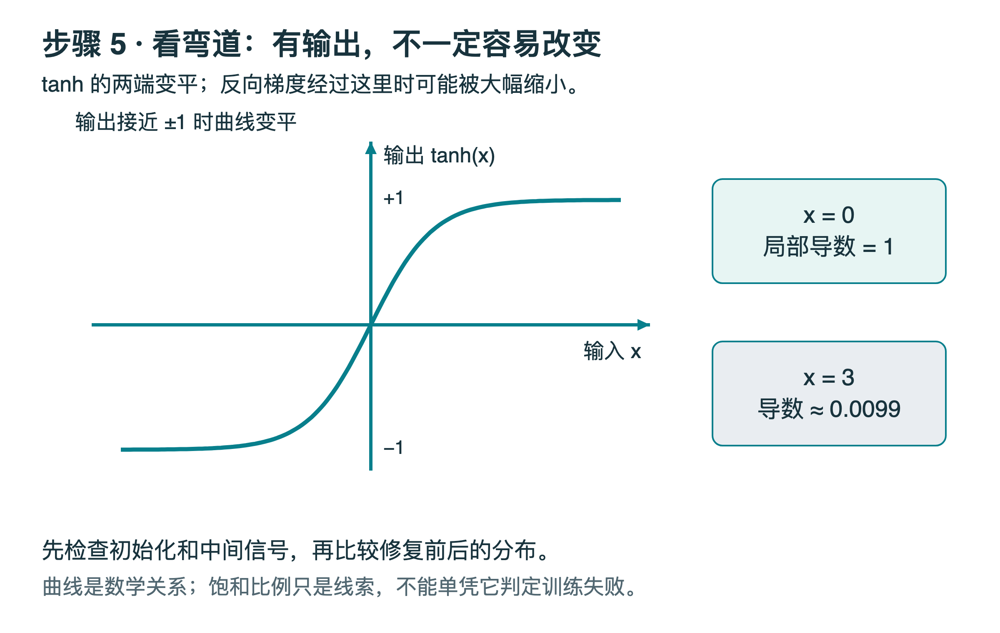

图注：助手绘制的教学示意，2026-11-09；帮助理解本步的计算关系与操作顺序。图中教学数字与简化结构不冒充课程截图、模型实测性能或完整实现。

**试着用手指读图：** 先指出输入或起点，再沿依赖找到中间处理，最后指出输出或结果记录。停在每一站，说出“这里放的是什么、对它做了什么、什么东西会改变”。如果遇到反向箭头，要说明它传回的是梯度，还是图中另有注明的流程。

**再用一句话检查自己：** 遮住正文，只看图，解释这一节与上一步相比新增加了什么；然后回到本步的小实验核对。会复述图并不代替实际运行和数值验收。


### 初始化解决什么问题

若一层有 fan-in 个独立输入，直接乘大量未缩放的随机权重可能把方差放大。课程从 `1/sqrt(fan_in)` 入手，再讨论 tanh 的增益约 5/3。它依赖具体激活和网络结构，不能把 tanh 的系数抄到所有激活上。

最后一层较小的权重可以让初始概率接近均匀；不宜把所有层都初始化成零，否则同层神经元可能保持对称。初始化参数改变后，要重新初始化整套模型再比较，而不是接着已经训练过的权重往下跑。

### BatchNorm 的状态必须跟着模型保存

```python
# 示意：二维输入 (batch, features)，本段用于说明数学操作
mean = x.mean(0, keepdim=True)              # 每个特征在批内的均值
var = x.var(0, keepdim=True)                # 每个特征在批内的方差
xhat = (x - mean) / torch.sqrt(var + 1e-5)  # 减均值、除标准差（加 eps 防除零）
out = gamma * xhat + beta                   # 再乘可学习的缩放与平移
```

这是课程自写层的思路。方差究竟除以 n 还是 n−1 必须与对应实现一致；原生 PyTorch 的训练与运行统计也有各自约定，不能只因为名字一样就宣称数值逐位相同。第 5 课会专门展开 Bessel 校正。

batch 里不同例子通过均值和方差耦合。若生成单个例子时仍算批统计，结果会改变甚至无法得到合理方差；生成不应依赖恰好一起生成了哪些其他名字。测试时要关掉自写层的 `training`，并使用训练期累计的统计量。

### 四组诊断图的读法

| 看什么 | 异常线索 | 下一步检查 |
|---|---|---|
| tanh 输出分布 | 多数输出接近 ±1 或全挤在 0 | 输入尺度、初始化增益、归一化 |
| 各层梯度分布 | 越往前越小或越大 | 链式乘积、饱和、尺度 |
| 参数与梯度尺度 | 某层比其他层异常突出 | 参数初始化与层的角色 |
| 更新/参数比 | 更新几乎没有或一步改得过大 | 学习率与优化方式 |

课程把大约 10⁻³ 级的更新/参数比作为经验观察，不是必须达到的通用验收线；不同优化器、偏置和归一化参数不能一刀切。线性层叠加但没有非线性，仍等价于一个线性变换，不能靠堆层得到同样表达能力。

课程还展示了 ResNet50 中 Linear/Conv、BatchNorm、残差等模块的使用，目的是认识稳定深网络的方法，不要求在这一节重写图像分类系统。主实验继续用名字数据。


- [ ] 保存四类诊断记录，不以一张平滑 loss 图替代内部检查。


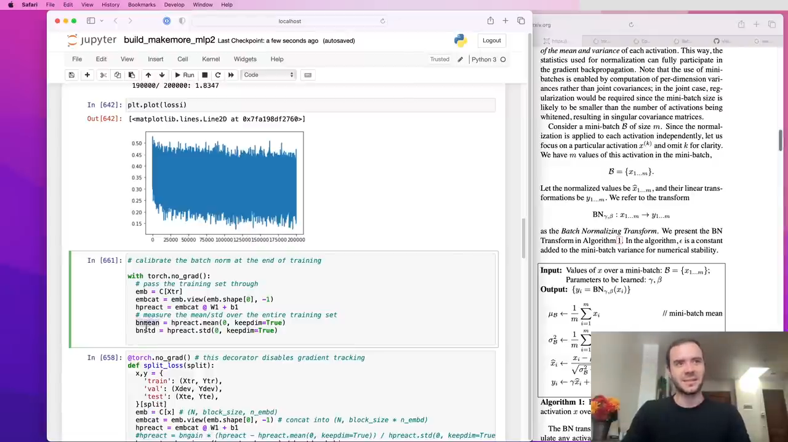

图注：真实课程截图，2026-10-29 提取，第4课 00:56:00；用于对照本节讲解，不替代代码和梯度核验。[[O4](#source-o4)]

### 卡住时按这个顺序查

按现象列出先查什么、修好后怎么验。这些路径来自课程故障与代码整理，同一个报错不保证只有一个原因；先定位影响的是数据、数学、状态还是系统性能，再回到上面的操作，不靠同时换五个参数碰运气。

| 现象 | 先查什么 | 修好后怎么验 |
|---|---|---|
| tanh 大多为 ±1 | 初始化尺度、输入方差 | 饱和率与层间梯度 |
| BN 单样本生成出错 | training 标记、running stats | eval 后单个和批量行为合理 |

### 课程里出现过的一个真实案例

**案例 4｜tanh 饱和**

- 起点与做法：初始 loss 约27且隐层饱和，调尺度
- 讲者当时的结果：减少浪费的早期优化
- 可借鉴：先诊断分布
- 出处：第4课 00:04:19 起 [[O4](#source-o4)]

这是课程演示，数字不是你在自己机器上的复现结果。

### 原课练习（官方英文原文）

下面是作者在视频说明里给学习者的练习指令，保留英文原文，不冒充聊天提示词。建议先独立完成，再看对应代码；中文只用于说明它落在本步骤的哪一段。

#### 第 4 课原练习

[[O4](#source-o4)]

```text
- E01: I did not get around to seeing what happens when you initialize all weights and biases to zero. Try this and train the neural net. You might think either that 1) the network trains just fine or 2) the network doesn't train at all, but actually it is 3) the network trains but only partially, and achieves a pretty bad final performance. Inspect the gradients and activations to figure out what is happening and why the network is only partially training, and what part is being trained exactly.
- E02: BatchNorm, unlike other normalization layers like LayerNorm/GroupNorm etc. has the big advantage that after training, the batchnorm gamma/beta can be "folded into" the weights of the preceeding Linear layers, effectively erasing the need to forward it at test time. Set up a small 3-layer MLP with batchnorms, train the network, then "fold" the batchnorm gamma/beta into the preceeding Linear layer's W,b by creating a new W2, b2 and erasing the batch norm. Verify that this gives the same forward pass during inference. i.e. we see that the batchnorm is there just for stabilizing the training, and can be thrown out after training is done! pretty cool.
```

**中文对照**

- E01：这个视频里我没来得及看“把所有权重和偏置都初始化为零”会怎样。试一下并训练网络。你可能以为 1) 网络正常训练，或 2) 完全不训练；实际上是 3) 网络会训练，但只部分训练，最终效果很差。检查梯度和激活，弄清发生了什么、为什么只部分训练、究竟哪一部分在被训练。
- E02：BatchNorm 与 LayerNorm/GroupNorm 等归一化层不同，它的一大优势是：训练完之后 gamma/beta 可以“折叠进”前面 Linear 层的权重，测试时就不必再前向 BatchNorm。搭一个带 BatchNorm 的小型 3 层 MLP，训练后新建 W2、b2，把 gamma/beta 折叠进前一层 Linear 的 W、b，并去掉 BatchNorm，验证推理时前向结果完全相同。也就是：BatchNorm 只是为了稳定训练，训练完就能扔掉——挺酷。

### 本步对应的课程章节与时间定位

**第 4 课｜Building makemore Part 3: Activations & Gradients, BatchNorm**（搭 makemore 第 3 部分：激活、梯度与 BatchNorm）

英文自动字幕约 21,386 词；[逐字稿](transcripts/04-P6sfmUTpUmc.md)；[主线步骤](#section-s5)。

| 起点 | 原章节标题 | 视频定位 |
|---|---|---|
| 00:00:00 | intro（开场介绍） | [播放](https://www.youtube.com/watch?v=P6sfmUTpUmc&t=0s) |
| 00:01:22 | starter code（起始代码） | [播放](https://www.youtube.com/watch?v=P6sfmUTpUmc&t=82s) |
| 00:04:19 | fixing the initial loss（修初始损失） | [播放](https://www.youtube.com/watch?v=P6sfmUTpUmc&t=259s) |
| 00:12:59 | fixing the saturated tanh（修 tanh 饱和） | [播放](https://www.youtube.com/watch?v=P6sfmUTpUmc&t=779s) |
| 00:27:53 | calculating the init scale: “Kaiming init”（计算初始化尺度：Kaiming 初始化） | [播放](https://www.youtube.com/watch?v=P6sfmUTpUmc&t=1673s) |
| 00:40:40 | batch normalization（批归一化） | [播放](https://www.youtube.com/watch?v=P6sfmUTpUmc&t=2440s) |
| 01:03:07 | batch normalization: summary（批归一化小结） | [播放](https://www.youtube.com/watch?v=P6sfmUTpUmc&t=3787s) |
| 01:04:50 | real example: resnet50 walkthrough（真实例子：过一遍 ResNet50） | [播放](https://www.youtube.com/watch?v=P6sfmUTpUmc&t=3890s) |
| 01:14:10 | summary of the lecture（本节小结） | [播放](https://www.youtube.com/watch?v=P6sfmUTpUmc&t=4450s) |
| 01:18:35 | just kidding: part2: PyTorch-ifying the code（开个玩笑：第二部分，把代码改成 PyTorch 写法） | [播放](https://www.youtube.com/watch?v=P6sfmUTpUmc&t=4715s) |
| 01:26:51 | viz #1: forward pass activations statistics（图 1：前向激活统计） | [播放](https://www.youtube.com/watch?v=P6sfmUTpUmc&t=5211s) |
| 01:30:54 | viz #2: backward pass gradient statistics（图 2：反向梯度统计） | [播放](https://www.youtube.com/watch?v=P6sfmUTpUmc&t=5454s) |
| 01:32:07 | the fully linear case of no non-linearities（完全没有非线性的纯线性情形） | [播放](https://www.youtube.com/watch?v=P6sfmUTpUmc&t=5527s) |
| 01:36:15 | viz #3: parameter activation and gradient statistics（图 3：参数的激活与梯度统计） | [播放](https://www.youtube.com/watch?v=P6sfmUTpUmc&t=5775s) |
| 01:39:55 | viz #4: update:data ratio over time（图 4：更新量与参数值之比随时间变化） | [播放](https://www.youtube.com/watch?v=P6sfmUTpUmc&t=5995s) |
| 01:46:04 | bringing back batchnorm, looking at the visualizations（加回 BatchNorm，再看这些图） | [播放](https://www.youtube.com/watch?v=P6sfmUTpUmc&t=6364s) |
| 01:51:34 | summary of the lecture for real this time（这次真的小结） | [播放](https://www.youtube.com/watch?v=P6sfmUTpUmc&t=6694s) |

<a id="section-s6"></a>
## 步骤 6 不用 autograd 写完整 MLP 反向传播

这一课的练习是亲手算出 tensor 的梯度。先让每个中间变量都对上，再把公式合并；跳到最后一行公式容易把广播与求和方向背反。

**目标**：手算 CE、Linear、tanh、BatchNorm、embedding 的梯度，并与 PyTorch 逐项对照。

1. 打开 `makemore_part4_backprop.ipynb`，运行数据与初始化，保留拆开的前向变量。给中间张量 `retain_grad()`，只用一次 autograd 建参考答案；先不看后面的手写实现。第 5 课 00:07:26–00:13:01。[[O5](#source-o5)、[O10](#source-o10)]
2. 从 `loss=-logprobs[range(n),Yb].mean()` 倒推 log、归一化、exp、减最大值各步。被选中的真实类别初始梯度为 `-1/n`，其他位置为 0；每次做完用 `cmp` 看形状、近似一致和最大差值。[[O5](#source-o5)]
3. 穿过第二线性层、tanh、BatchNorm、第一线性层。广播在反向中要沿被扩展的维度求和；BN 的均值、方差两条路径都贡献梯度，不能只对单个元素求导。[[O5](#source-o5)]
4. 反传到 embedding 表时，把同一个字符在多个位置收到的贡献累加。逐项通过后，用合并的 CE 与 BN 公式替换冗长实现，最后在 `torch.no_grad()` 中训练，仅用自己算出的梯度更新。[[O5](#source-o5)]

**做完的标准**：全部参与计算的参数与关键中间量梯度形状正确；与 autograd 在说明的容差内接近；去掉 `loss.backward()` 后训练仍能下降。

<a id="walkthrough-s6"></a>
### 白话说明：暂时关掉自动挡，自己把每层的梯度算出来

步骤 2 处理单个数；这里一次处理一整批矩阵。你仍在应用同样的链式法则，但要处理转置、广播和重复索引。先拿 autograd 做参考答案，再独立计算；最后才把训练里的自动反传撤掉。

**先打开**：`makemore_part4_backprop.ipynb`。从头运行到拆开的前向计算，先不执行答案区。保留课程中的中间量名称，不急着把长公式压成一行。

#### 先把这一步想成一个生活场景

之前用自动洗衣机洗衣服，现在打开透明盖子，亲手跟踪每道工序怎样影响最终结果。这里仍然是步骤 2 的链式法则，只是一个数字变成整张表。我们保留自动求导作为参考答案，再检验自己的逐层计算。

**怎么读这一节：** 先读每个操作前的故事与具体数字，再运行原有代码。代码成功只是程序完成了动作；能回答“停一下”的问题，才说明你知道它在做什么。下面的场景和小数字是助手编写的教学例子。

#### 先把关键词翻成看得见的东西

| 关键词 | 白话意思 | 本步的具体样子 |
|---|---|---|
| 张量 | 有形状的一组数 | 这里常见二维矩阵 |
| 转置 .T | 把行与列互换 | 3×2 变成 2×3 |
| 广播 | 一份数被重复用于多处计算 | 偏置 b 加到每一行 |
| 上游梯度 G | 来自后面工序的敏感度 | 告诉本层输出各格怎样影响 loss |
| dW / dX | 最终 loss 对 W / X 的导数 | 不是 W 或 X 的当前值 |
| 容差 | 允许的微小数值差 | 浮点数顺序不同可能有微小误差 |
| scatter 累加 | 把多次使用的贡献送回同一行 | 同一字符名牌被查了多次 |

#### 操作 A：先对最简单的线性层练一次

**场景：四个顾客共用一张收费规则表。** X 有四行，每行三个输入；W 把三个输入混成两个输出；同一个偏置 b 被每位顾客都使用。后面传回的 G 告诉我们四行两列的输出各有多敏感。

**先缩成单个数：** 如果 `Y=2*w+b`，来自后面的梯度是 3，那么 w 收到 `2*3=6`，b 收到 3。矩阵公式只是同时处理很多这样的乘法和累加。

**停一下：** 为什么 db 要沿四行求和？因为同一份 b 在四条路径里都参与了计算。

下面代码完整演示“自动答案”和“手算答案”怎样放在一起比：

```python
import torch
torch.manual_seed(42)                                # 固定随机种子，结果可复现
X = torch.randn(4, 3, dtype=torch.float64, requires_grad=True)   # 输入，双精度更便于比对
W = torch.randn(3, 2, dtype=torch.float64, requires_grad=True)   # 权重
b = torch.randn(2, dtype=torch.float64, requires_grad=True)      # 偏置
Y = X @ W + b                                        # 前向：Y = XW + b
G = torch.randn_like(Y)                              # 假造的上游梯度
loss = (Y * G).sum()                                 # 造一个标量 loss
loss.backward()  # 参考答案，仅此处使用                  # 让 PyTorch 算一遍梯度
with torch.no_grad():                                # 下面自己算，不记录梯度
    dX = G @ W.T                                     # 手算 dX = G·Wᵀ
    dW = X.T @ G                                     # 手算 dW = Xᵀ·G
    db = G.sum(0)                                    # 手算 db = G 按列求和
    for name, manual, auto in [('X',dX,X.grad),('W',dW,W.grad),('b',db,b.grad)]:
        print(name, manual.shape, (manual-auto).abs().max().item())   # 比形状与最大差
```

`loss=(Y*G).sum()` 让 Y 收到的梯度恰好是 G，方便单独考核这一层。结果应接近0差异。db 对批维求和，因为同一份偏置在4行都被使用。

#### 操作 B：回课程，从 loss 开始往回走

**场景：按工序倒查一张总账。** 从最终 loss 开始，先核最后一道工序，再核它的输入，逐站往前。手算值第一次与自动答案明显不一致的位置，就是优先检查的地方。

**你实际做的事：** 比较形状，再比较最大绝对误差。例如期望 `(3,2)` 却得到 `(2,3)`，先看转置；形状一样但都差 32 倍，先看有没有忘记批平均。

**停一下：** 最后一个权重梯度错了，是否一定是它自己的公式错？不一定，后面某站传来的 G 也可能已经错了。

先给需要比较的中间张量 `retain_grad()`，运行一次自动反传并保留参考结果。每手算一个中间量，就用课程的 `cmp` 比较形状和最大绝对差。最先出现明显偏差的那一步，比最后参数错多少更能定位问题。

顺序是交叉熵、输出线性层、tanh、BN、输入线性层、embedding。前向 mean 在反向中会带来除数；广播在反向中变成求和；重复字符索引在反向中必须累加。

#### 操作 C：重点拆 BN，别直接背压缩公式

**场景：一个人的身高变了，不仅改变他自己，也会改变全班平均身高。** BN 中一个输入参与自己的输出，也参与整批均值和方差，所以不能只走“自己那一条路”。各条路径贡献必须加起来。

**你实际做的事：** 先拆均值、减法、平方、求和、开方、除法。课程方差用 n−1，就要对那一个具体前向公式求导；换分母后参考答案也会变。

**停一下：** 为什么不能凭记忆抄一条 BN 反传公式？因为具体定义和归一化约定可能不同。

同一个输入既影响自己的标准化结果，也影响整批的均值和方差，因此有多条路径。课程前向方差采用 n−1 分母，手写反向必须匹配；改成 n 分母就不能沿用同一答案。先通过原子运算版本，再比较合并版本。

#### 操作 D：手写梯度驱动训练

**场景：验算通过后，才把自动挡换成手动挡。** 自动答案是对照，不应又额外参与一次梯度更新。训练副本用你算出的梯度更新对应参数，保持每轮重新前向和正确清零。

**你实际做的事：** 先让一个小批完成一次更新，再观察多次更新的损失。参数变动并不自动证明导数正确，必须和前面局部对照一起看。

**停一下：** 梯度是手写的，是否就不需要验证集？仍然需要；求导正确与泛化良好是两种不同检验。

全部局部对齐后，才在训练副本去掉 `loss.backward()`，用自己计算的 dC、dW 等更新对应参数。训练完成后按原步骤用训练集校准 BN 统计，再进行验证和采样。

**遇到差异怎么办**：形状不对先查转置和 sum 维度；差一个固定倍数先查 batch 平均与 n−1；只有重复字符出错先查累加。浮点误差很小但逐位不同，记录容差与运算顺序，不盲目追求 `exact=True`。

#### 卡住时先找哪一站

| 看到的现象 | 先检查什么 |
|---|---|
| 形状不对 | 检查转置、广播及求和轴 |
| 差一个固定倍数 | 检查平均、batch 大小与 n−1 |
| 仅重复字符时出错 | 检查是否覆盖了本应累加的梯度 |

**说明与衔接**：本段是助手基于本步骤课程与代码整理的动手导读；微型例子只解释相应局部机制。继续按下面原有课程讲解、截图与验收要求完成该步。

<a id="spatial-s6"></a>
### 空间转化：把步骤 6 摆到一张图里

把前向画成左到右的矩阵管线，反向从右到左返回同形状的梯度。共享偏置像多条支路连到一个共同盒子，回程要汇总；embedding 重复索引也是多条支路回到同一行。箭头代表计算依赖，不代表数据在真实硬件上的物理路线。

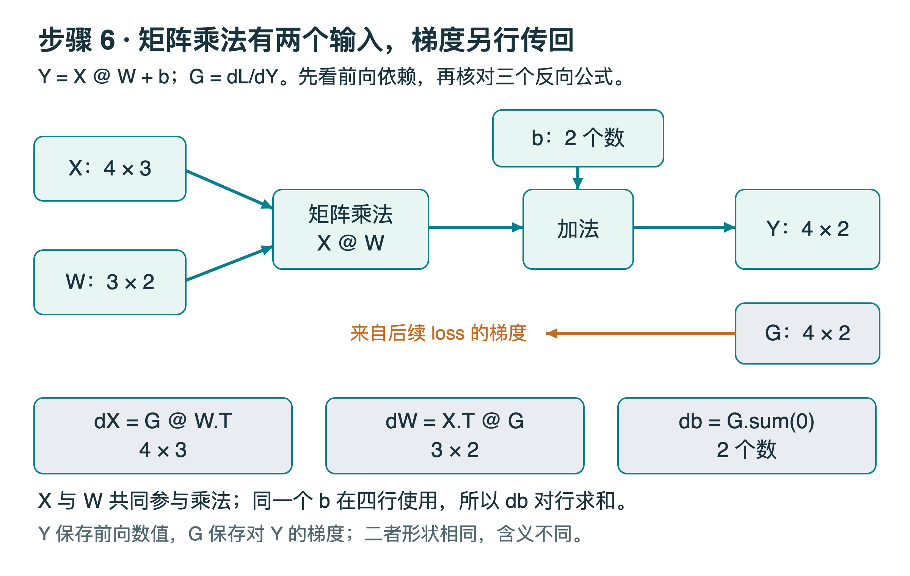

图注：助手绘制的教学示意，2026-11-09；帮助理解本步的计算关系与操作顺序。图中教学数字与简化结构不冒充课程截图、模型实测性能或完整实现。

**试着用手指读图：** 先指出输入或起点，再沿依赖找到中间处理，最后指出输出或结果记录。停在每一站，说出“这里放的是什么、对它做了什么、什么东西会改变”。如果遇到反向箭头，要说明它传回的是梯度，还是图中另有注明的流程。

**再用一句话检查自己：** 遮住正文，只看图，解释这一节与上一步相比新增加了什么；然后回到本步的小实验核对。会复述图并不代替实际运行和数值验收。


### 先记住两个矩阵关系

对 `Y=X@W+b`，给定上游梯度 G：`dX=G@W.T`，`dW=X.T@G`，`db=G.sum(0)`。先检查维数能否回到原参数形状，再检查数值；形状相同仍可能把 n 与 n−1 混用。

```python
# 合并的 softmax + 交叉熵反传；n 是 batch 大小
# 此段操作独立张量，不覆盖随后还要使用的概率引用

dlogits = F.softmax(logits, dim=1)      # 先算概率
dlogits[range(n), Yb] -= 1              # 正确类别那一格减 1（交叉熵的导数）
dlogits /= n                            # 平均损失，所以要除以 n
```

这来自平均 CE 的梯度。若 loss 使用 sum，不能再除以 n。若对同一 probs 对象原地减 1 后还用来绘图或计算其他梯度，会污染后续计算。

### BN 必须与同一个前向配对

课程这一练习的方差使用 `1/(n-1)`，不是 `1/n`。对应压缩形式包含 `n/(n-1)`；如果前向改了定义，反向也必须重新推导。小常数 eps 在倒数平方根里面，反传时不能漏掉。

```python
# 对应课程 n-1 方差版本；上游 dhpreact 与前向 bnraw、bnvar_inv 已存在

dhprebn = bngain * bnvar_inv / n * (   # 先过缩放、再乘 1/√方差
    n * dhpreact - dhpreact.sum(0)     # 均值那条路径：减掉批内总和
    - n / (n - 1) * bnraw * (dhpreact * bnraw).sum(0)   # 方差那条路径：n−1 校正
)
```

`exact=True` 需要运算顺序和浮点舍入也一致。课程的合并 CE/BN 公式可能只有 `approximate=True`，差值很小；先以误差量级判断，再查是否因运算重排造成。不要为了追逐逐位相同，改掉数学上正确的公式。

### 全手写训练后先校准 BN，再验证与采样

这一课的手写训练循环没有维护 running mean/variance，不能在结束时直接使用最后一个微批次的统计。作者在训练结束后用全部训练集做一次前向，固定隐层线性输出的均值与方差，再将同一组 bnmean/bnvar 用于验证、测试与生成。对应官方笔记本 cell 24–27。[[O5](#source-o5)、[O10](#source-o10)]

```python
# 在手写训练完成之后执行；只使用训练集估计，不读取验证集
with torch.no_grad():                       # 只是统计，不建计算图
    emb = C[Xtr]                            # 训练集查表
    embcat = emb.view(emb.shape[0], -1)     # 展平
    hpreact = embcat @ W1 + b1              # BN 之前的那一层输出
    bnmean = hpreact.mean(0, keepdim=True)  # 用整个训练集估计均值
    bnvar = hpreact.var(0, keepdim=True, unbiased=True)   # 估计方差（n−1 校正）
```

随后使用 `(hpreact-bnmean)/sqrt(bnvar+1e-5)` 及训练得到的 bngain/bnbias 做验证/采样。保存这组校准统计；复评同一验证集时不要再随新batch改变它们。这是本课手写版本的做法，与上一课持续累计运行统计的版本分开。

### embedding 是散回去的累加

`emb=C[Xb]` 的反向不是把 dC 直接赋成 demb；Xb 中同一字符可以重复出现。先用双循环 `dC[ix] += demb[k,j]` 写对，再考虑向量化。这个问题与 micrograd 的 `a+a` 是同一种“多路径累加”。

完成原子图练习后，再做合并 CE、合并 BN、全手写训练四个练习。已有参考梯度不等于已经学会；建议关掉答案从空白再写一次，把第一次出错的维数和修改原因记入记录。


- [ ] 保存逐项 cmp 输出和自写梯度训练曲线。


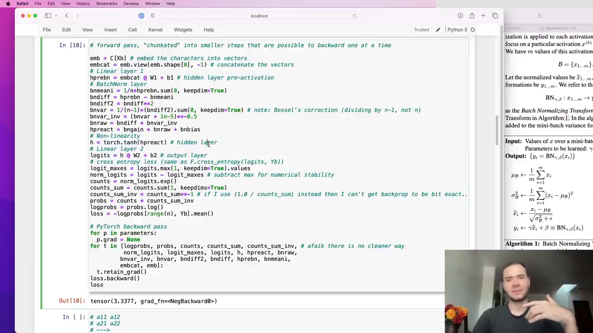

图注：真实课程截图，2026-10-29 提取，第5课 01:09:40；用于对照本节讲解，不替代代码和梯度核验。[[O5](#source-o5)]

### 卡住时按这个顺序查

按现象列出先查什么、修好后怎么验。这些路径来自课程故障与代码整理，同一个报错不保证只有一个原因；先定位影响的是数据、数学、状态还是系统性能，再回到上面的操作，不靠同时换五个参数碰运气。

| 现象 | 先查什么 | 修好后怎么验 |
|---|---|---|
| 手写梯度不一致 | 广播反向求和、mean 的 n、BN 的 n−1 | 从第一个差异变量向上游查 |
| embedding 梯度丢失 | 同一个 ID 是否多次出现、是否 += | 重复字符累加后对照 autograd |

### 课程里出现过的一个真实案例

**案例 5｜手写 CE/BN**

- 起点与做法：拆开算再合并，对照 autograd
- 讲者当时的结果：近似可一致，不必逐位一致
- 可借鉴：数学与浮点顺序分开
- 出处：第5课练习 [[O5](#source-o5)]

这是课程演示，数字不是你在自己机器上的复现结果。

### 本步对应的课程章节与时间定位

**第 5 课｜Building makemore Part 4: Becoming a Backprop Ninja**（搭 makemore 第 4 部分：成为反传忍者）

英文自动字幕约 20,776 词；[逐字稿](transcripts/05-q8SA3rM6ckI.md)；[主线步骤](#section-s6)。

| 起点 | 原章节标题 | 视频定位 |
|---|---|---|
| 00:00:00 | intro: why you should care & fun history（开场：为什么值得关心，以及一段有趣的历史） | [播放](https://www.youtube.com/watch?v=q8SA3rM6ckI&t=0s) |
| 00:07:26 | starter code（起始代码） | [播放](https://www.youtube.com/watch?v=q8SA3rM6ckI&t=446s) |
| 00:13:01 | exercise 1: backproping the atomic compute graph（练习 1：对原子计算图做反传） | [播放](https://www.youtube.com/watch?v=q8SA3rM6ckI&t=781s) |
| 01:05:17 | brief digression: bessel’s correction in batchnorm（插一段：BatchNorm 里的贝塞尔校正） | [播放](https://www.youtube.com/watch?v=q8SA3rM6ckI&t=3917s) |
| 01:26:31 | exercise 2: cross entropy loss backward pass（练习 2：交叉熵损失的反传） | [播放](https://www.youtube.com/watch?v=q8SA3rM6ckI&t=5191s) |
| 01:36:37 | exercise 3: batch norm layer backward pass（练习 3：BatchNorm 层的反传） | [播放](https://www.youtube.com/watch?v=q8SA3rM6ckI&t=5797s) |
| 01:50:02 | exercise 4: putting it all together（练习 4：全部串起来） | [播放](https://www.youtube.com/watch?v=q8SA3rM6ckI&t=6602s) |
| 01:54:24 | outro（收尾） | [播放](https://www.youtube.com/watch?v=q8SA3rM6ckI&t=6864s) |

<a id="section-s7"></a>
## 步骤 7 用层级结构扩大上下文

把更多字符一次性压进一层会很快失去结构。这里让相邻字符先成组，再逐层融合，观察“参数数量相近”和“结构不同”到底带来什么变化。

**目标**：实现 WaveNet 风格层级模型，并修复三维 BatchNorm 的隐性错误。

1. 回到第 4 课的自写层代码，封装 Embedding、FlattenConsecutive 和 Sequential。把所有参数通过统一接口收集；确认中间张量保留方法不会忘掉某层。第 6 课 00:01:40–00:17:11。[[O6](#source-o6)]
2. 把上下文从 3 改为 8，先跑平铺 MLP 基线。然后每次合并相邻两个位置，序列长度从 8 到 4、2、1；记录每层 `(B,T,C)` 的变化。[[O6](#source-o6)]
3. 检查 BN 在三维输入上按哪些维度求统计。若 x 为 `(B,T,C)`，该课程实现应跨 B 与 T 统计每个通道，即 `dim=(0,1)`；不能因广播没报错就沿用二维的 `dim=0`。[[O6](#source-o6)、[O10](#source-o10)]
4. 在近似相同参数量下比较平铺与层级结构，再单独增大 embedding 与隐层。平滑曲线用于阅读，同时保留原始 train/val 数据，不把一次略好的结果当作统计结论。[[O6](#source-o6)]

**做完的标准**：能画出 8→4→2→1 形状；三维 BN 的统计方向正确；保存相同预算下的基线与层级对比，结果不佳也如实登记。

<a id="walkthrough-s7"></a>
### 白话说明：把八个字符两两分组，再逐层汇总

这一步在改变“信息怎样组合”。你可以想成八个人先两两讨论，再让小组汇报继续合并。每一层都用同样的局部规则加工各组，最终汇总全部八个位置的信息。

**先打开**：`makemore_part5_cnn1.ipynb`。先保留一个上下文长度为8的平铺 MLP，作为比较对象。

#### 先把这一步想成一个生活场景

八个人一起汇报很乱，于是先两人一组，再让两组的汇报合并，最后得到整体汇报。网络也可以先组合近邻字符，再逐层扩大能看到的范围。这里学的是一种信息组合结构，不是把人真的派来讨论。

**怎么读这一节：** 先读每个操作前的故事与具体数字，再运行原有代码。代码成功只是程序完成了动作；能回答“停一下”的问题，才说明你知道它在做什么。下面的场景和小数字是助手编写的教学例子。

#### 先把关键词翻成看得见的东西

| 关键词 | 白话意思 | 本步的具体样子 |
|---|---|---|
| B / T / C | 样本数 / 位置数 / 通道数 | 三维张量的三个方向 |
| 分组拼接 | 把相邻位置的数字放在一起 | 两个 D 维位置拼成 2D 维 |
| 层级表示 | 先处理小片段，再处理大片段 | 8 个位置逐层变 4、2、1 |
| 共享权重 | 各组用同一套加工规则 | 不是每组各造一套参数 |
| 感受野 | 一个输出能受到哪些输入影响 | 逐层覆盖更多历史位置 |
| 统计轴 | 沿哪些方向收集 BN 统计 | 此处同时沿 B 和 T |

#### 操作 A：先用序号演示分组，确认没把不同名字混在一起

**场景：两张桌子各有八张号码卡。** 第一桌从 0 到 7，第二桌从 8 到 15。每桌自己两两分组，不能拿第一桌最后一张和第二桌第一张凑一对。B 这个维度就是分清桌子。

**你实际做的事：** 运行 reshape 后逐组读数字。如果出现 [7,8]，说明你让两条样本混了。此处用序号而非随机数字，是为了让错误一眼可见。

**停一下：** reshape 有没有求平均？没有，它只是重新组织相同的数字。

```python
import torch
x = torch.arange(16).reshape(2, 8, 1)   # 2 条样本、每条 8 个位置、1 维
print('原始：', x)
grouped = x.reshape(2, 4, 2)            # 每两个相邻位置拼成一个 2 维
print('两两分组：', grouped)
```

第一条样本应组成 `[0,1] [2,3] [4,5] [6,7]`；第二条是 `[8,9] [10,11] [12,13] [14,15]`。跨样本的7与8不能成为一组。

#### 操作 B：换成可学习的字符表示

**场景：先把两份笔记夹在一起，再请一个加工工位写新摘要。** 拼接保留两边全部数字，线性层和非线性才负责学怎样混合。第一轮 8 个位置变成 4 组，第二轮变 2 组，第三轮变 1 组。

**你实际做的事：** 每层打印 B、T、C，观察 B 不变，T 变小，拼接瞬间 C 变大。经过线性层后 C 可以被投影成设定的 H。

**停一下：** 只连续 reshape 三次是否已经学到高级特征？没有，必须有可训练的加工和训练数据。

把整数序号换成 embedding 后，形状是 `(B,8,D)`。第一次拼接成为 `(B,4,2D)`，线性层加工为 `(B,4,H)`；第二次分组为 `(B,2,2H)`，再加工；第三次合并到单个位置。每层都打印 shape，追踪 T 如何从8到4、2、1。

这里的“分组”本身只是重排；真正学习信息怎样组合的是后面的线性层和非线性。不要只 reshape 几次就以为已经训练了层级表示。

#### 操作 C：修正三维 BatchNorm 的统计轴

**场景：统计一种仪表读数，要收集所有桌子、所有座位上的这种仪表。** C 表示不同通道，B 和 T 表示同种通道出现在哪些样本与位置。按课程设计，BN 对每个通道收集 B×T 个数。

**你实际做的事：** 检查 `dim=(0,1)`，并确认结果可以广播回原张量。不要把通道轴一起平均掉，否则不同通道就共用了一把错误标尺。

**停一下：** 为什么三维输入不能盲目沿用二维时的统计代码？因为多出来的位置轴也参与了这次统计设计。

在 `(B,T,C)` 上，按课程设计对 `dim=(0,1)` 求每个通道的均值/方差。打印统计量形状并检查它是否对所有样本和位置共享，而不是为每个位置分别保留一套意外统计。

#### 操作 D：比较模型，保留不成功的结果

**场景：两种学习方法比赛，题目和练习时间要相近。** 层级结构听起来合理，但未必立即优于平铺网络。先固定切分和预算，再比较验证 loss。

**你实际做的事：** 把结构、参数量、训练量写在结果旁边。更大的网络得分更好时，不能全归功于“分组”；需要单独控制规模继续比较。

**停一下：** 没有变好是不是白做了？不是；保存失败结果能说明这个设置下没有得到预期改善。

固定名字切分、token/样本预算与近似参数量，比较平铺与分组版本的验证 loss。再单独尝试增大 embedding 或隐层。层级更清楚并不保证在这份数据上立即更好；以记录为准。

**本步的交付物**：带每层形状的网络草图、三维 BN 的统计代码、两种模型的配置和验证结果。只有画出了8→4→2→1而没有训练/比较，算理解结构，还没完成实验。

#### 卡住时先找哪一站

| 看到的现象 | 先检查什么 |
|---|---|
| 出现跨样本分组 | 检查 reshape 是否保留 B |
| 通道维乘法报错 | 拼接后输入宽度应翻倍 |
| 图画对了但效果差 | 检查训练与公平对照，结构图不是效果证明 |

**说明与衔接**：本段是助手基于本步骤课程与代码整理的动手导读；微型例子只解释相应局部机制。继续按下面原有课程讲解、截图与验收要求完成该步。

<a id="spatial-s7"></a>
### 空间转化：把步骤 7 摆到一张图里

把八个位置画成一排八片叶子，向上两两连接成四个节点，再连成两个、一个。每一层横着看的是组数，竖着看的是处理深度。这个树只表示依赖范围，并不证明每个节点真的学到了人类语言的词、短语或句法。

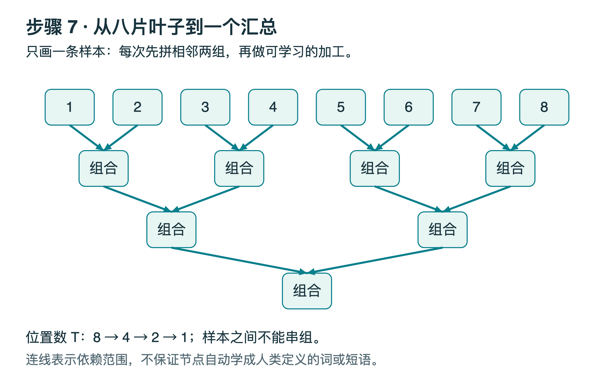

图注：助手绘制的教学示意，2026-11-09；帮助理解本步的计算关系与操作顺序。图中教学数字与简化结构不冒充课程截图、模型实测性能或完整实现。

**试着用手指读图：** 先指出输入或起点，再沿依赖找到中间处理，最后指出输出或结果记录。停在每一站，说出“这里放的是什么、对它做了什么、什么东西会改变”。如果遇到反向箭头，要说明它传回的是梯度，还是图中另有注明的流程。

**再用一句话检查自己：** 遮住正文，只看图，解释这一节与上一步相比新增加了什么；然后回到本步的小实验核对。会复述图并不代替实际运行和数值验收。


### 分组展平的核心

```python
B, T, C = x.shape            # 批大小、序列长度、通道数
x = x.view(B, T // 2, C * 2) # 每两个时间步拼到通道维，长度减半、通道加倍
if x.shape[1] == 1:
    x = x.squeeze(1)         # 只剩一个时间步时去掉这一维，回到 (B, C)
```

前提是 T 可以被 2 整除，且数据排列符合相邻位置拼接。不能把 batch 也混进一个大向量，否则不同名字之间会互相污染。最后 squeeze 明确指定位置维，不要用无参数 squeeze 把 B=1 的 batch 维也删掉。

### 课程中的真实对比

讲者在相近约 22000 参数下，平铺与层级模型验证 loss 约 2.027、2.029，并没有立刻改善；修 BN 后约 2.022，扩大到约 76000 参数后约 1.993。差异来自课程当时的实验，讲者也保留了是否显著的疑问。这张对比应教你记录控制变量，而不是抄一个“必定提升”的结论。

这一节实现的是树状层级结构。原 WaveNet 中的门控、残差、skip connection 和高效 dilated causal convolution 并未完整实现；课程只预告了卷积如何避免相邻窗口重复计算。你不需要在这一阶段把视频的名字模型改成音频 WaveNet。

实验开始变慢后，要补实验框架：每次运行有参数、seed、训练/验证曲线和结果；不是在同一个笔记本里不断覆盖变量再凭记忆挑最好的图。


- [ ] 记录修复前后的 BN 维数与验证 loss。

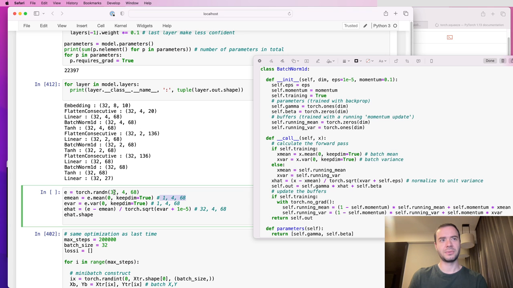

图注：真实课程截图，2026-10-29 提取，第6课 00:40:00；用于对照本节讲解，不替代代码和梯度核验。[[O6](#source-o6)]


<a id="intuition-s5"></a>
### 关键词拆解｜步骤 5：初始化、激活分布、饱和、BatchNorm

这一课像检查一支队伍的“起跑姿势”和每个接力点的信号强弱。网络很深时，信号若一开始就爆大或缩成零，训练会难以推进。

- **初始化（initialization）**：训练前给权重设起始值。随机但尺度合适的起点，能避免所有神经元一模一样，也减少信号经过多层后爆炸或消失。
- **激活值（activation）**：某层前向计算出来的数。看直方图可以发现是否大多挤在零附近、是否范围过宽或集中在 tanh 的 ±1。
- **饱和（saturation）**：tanh 输入很大时输出贴近 ±1，曲线几乎平，导数接近 0。像水阀拧到极限，再推输入也几乎不改变出水量，反向信号便很弱。
- **梯度尺度**：参数变化对 loss 的影响大小。梯度全接近零时更新像没踩油门；极大时更新可能一步冲过头。检查直方图比只盯最后 loss 更能说明内部发生了什么。
- **BatchNorm（批归一化）**：按一个批次统计激活的均值和标准差，再缩放平移，使中间信号维持较可控的范围。可以类比每个接力区都重新校准刻度尺，但这把尺依赖当批数据。
- **运行统计量（running statistics）**：训练时逐渐累计的均值和方差，评估时用它们代替当前批统计。它们是模型状态的一部分，存模型时也要存；只保存权重会像拿走刻度表。
- **train/eval 模式**：训练时 BN 使用批次统计并更新累计值；评估时使用累计值。忘了切模式，会让同一输入因同批次其他样本不同而改变输出。

**小例子**：一层线性输出大多落在 8 到 15，经过 tanh 后几乎全挤在 1 附近，导数接近零。把权重初始尺度调小，让输入大多落在弯曲区域，前期梯度通常更有信息。具体尺度仍要用实验和图来检验。

**诊断顺序**：看输入/激活直方图 → 看梯度直方图 → 检查每层形状和初始化 → 单独比较 BN 开关 → 再看训练曲线。先定位是哪一层“信号失真”，再改参数。

<a id="intuition-s6"></a>
### 关键词拆解｜步骤 6：手写反传、张量雅可比、广播、梯度累积

这一步不是重新发明梯度，而是把自动求导器平时替你做的“局部求导 + 形状对齐 + 累加”逐项摊开，像拆开自动挡变速箱检查齿轮。

- **向量/矩阵梯度**：标量只有一个数；张量有很多元素。对每个元素求导会形成雅可比矩阵，直接存下来通常很贵。反传通过矩阵乘法一次性计算所需的向量积。
- **矩阵乘法反向**：若 `Y=XW`，上游梯度为 `dY`，则 `dX=dY Wᵀ`、`dW=Xᵀ dY`。转置来自输入/权重在每个乘积中的角色互换。
- **广播（broadcasting）**：把一个较小形状的数值逻辑上扩展到更大张量。前向加偏置时，偏置会被每一行重复；反向必须把这些重复位置的影响求和还给原偏置。
- **归约（reduction）**：sum/mean 把许多数压成较少数；反向则把梯度扩回原形状。若前向取平均，反向需要除以元素数量。
- **链式矩阵传递**：每一层把上游梯度乘自己的局部导数，得到更早一层的梯度。逐层对比 autograd，可定位第一个不一致的算子。
- **embedding 反传**：查表前向只取出某些行；反向把每个位置的梯度散回被取出的行。同一个字符被多次查到，所有贡献必须累加到同一行。
- **梯度核对**：同一批数据、同一参数、同一前向下，比手写和 autograd 的梯度；还可用有限差分做第三方参照。比较最大绝对差和容差，而不是要求浮点结果逐位相同。

**广播反向例子**：批大小 4，偏置 b 加到 4 行。若每行对 b 的梯度分别为 1、2、3、4，原偏置只是一份，所以它的梯度是 10；不能只拿最后一行的 4，也不能保留成四个数。

**调试方法**：先对一层、一小批、单个元素做核对；通过后再核整网。若手写梯度与自动结果在某一层首次偏离，检查该层的转置、求和维度、均值除数、广播还原和重复索引累加。

<a id="intuition-s7"></a>
### 关键词拆解｜步骤 7：层级分组、感受野、WaveNet 风格

固定窗口模型把所有历史字符一次性摊平；层级模型则先把相邻小组压缩，再把组继续组合。它像把散落的零件先装成模块，再装成整机。

- **上下文长度 / 感受野（receptive field）**：某个预测位置能影响到的最早输入范围。窗口越长，理论上可利用的历史越多，但网络也要处理更多信息。
- **分组与展平**：将相邻字符表示合并成更宽的向量。例如 8 个字符先每 2 个一组，得到 4 组，再将组两两合并。张量元素总数必须守恒，分组不能凭空丢字符。
- **层级表示（hierarchical representation）**：低层组合短片段，高层组合更长片段。可类比音节组成词、词组成短语；这是结构类比，并不意味着模型内部真的有语言学模块。
- **参数共享**：同一层变换可应用于不同位置的小组，减少重复参数并让局部模式能在多个位置复用。
- **WaveNet 风格**：逐层扩大可见上下文的卷积式/分组式设计；这里的重点是“有组织地扩大视野”，不是要从名字预测任务变成音频生成。
- **形状检查**：若输入 `(B,T,C)`，分成小组时 T 会下降、特征维可能增大；每次 reshape 前后元素数应一致，批维 B 不应意外混入分组。

**纸面示意**：字符 `a b c d e f g h` → 组 `[ab][cd][ef][gh]` → 更高层 `[abcd][efgh]` → 最终预测。每层把短距离证据变成更长距离证据。检查点是每个字符都仍能追溯到输入位置。

**和步骤 4 的差别**：步骤 4 用固定窗口一次拼接全部历史；步骤 7 用多级组合来处理更长上下文。比较时保持数据切分、训练预算、词表与评估口径一致，否则不能把差异归因给层级结构。

### 卡住时按这个顺序查

按现象列出先查什么、修好后怎么验。这些路径来自课程故障与代码整理，同一个报错不保证只有一个原因；先定位影响的是数据、数学、状态还是系统性能，再回到上面的操作，不靠同时换五个参数碰运气。

| 现象 | 先查什么 | 修好后怎么验 |
|---|---|---|
| 三维 BN 不报错但结果怪 | 是否跨 B/T 统计 | 均值/方差形状与课程修正版对齐 |

### 课程里出现过的一个真实案例

**案例 6｜层级模型**

- 起点与做法：近似等参数比较，再修三维 BN
- 讲者当时的结果：约2.029→2.022；增容后约1.993
- 可借鉴：结构不一定立刻改善
- 出处：第6课后半 [[O6](#source-o6)]

这是课程演示，数字不是你在自己机器上的复现结果。

### 本步对应的课程章节与时间定位

**第 6 课｜Building makemore Part 5: Building a WaveNet**（搭 makemore 第 5 部分：搭一个 WaveNet）

英文自动字幕约 10,385 词；[逐字稿](transcripts/06-t3YJ5hKiMQ0.md)；[主线步骤](#section-s7)。

| 起点 | 原章节标题 | 视频定位 |
|---|---|---|
| 00:00:00 | intro（开场介绍） | [播放](https://www.youtube.com/watch?v=t3YJ5hKiMQ0&t=0s) |
| 00:01:40 | starter code walkthrough（通读起始代码） | [播放](https://www.youtube.com/watch?v=t3YJ5hKiMQ0&t=100s) |
| 00:06:56 | let’s fix the learning rate plot（修一下学习率曲线） | [播放](https://www.youtube.com/watch?v=t3YJ5hKiMQ0&t=416s) |
| 00:09:16 | pytorchifying our code: layers, containers, torch.nn, fun bugs（把代码改成 PyTorch 风格：层、容器、torch.nn 与几个坑） | [播放](https://www.youtube.com/watch?v=t3YJ5hKiMQ0&t=556s) |
| 00:17:11 | overview: WaveNet（概览：WaveNet） | [播放](https://www.youtube.com/watch?v=t3YJ5hKiMQ0&t=1031s) |
| 00:19:33 | dataset bump the context size to 8（数据集：把上下文长度提到 8） | [播放](https://www.youtube.com/watch?v=t3YJ5hKiMQ0&t=1173s) |
| 00:19:55 | re-running baseline code on block_size 8（用 block_size 8 重跑基线） | [播放](https://www.youtube.com/watch?v=t3YJ5hKiMQ0&t=1195s) |
| 00:21:36 | implementing WaveNet（实现 WaveNet） | [播放](https://www.youtube.com/watch?v=t3YJ5hKiMQ0&t=1296s) |
| 00:37:41 | training the WaveNet: first pass（训练 WaveNet：第一遍） | [播放](https://www.youtube.com/watch?v=t3YJ5hKiMQ0&t=2261s) |
| 00:38:50 | fixing batchnorm1d bug（修 BatchNorm1d 的 bug） | [播放](https://www.youtube.com/watch?v=t3YJ5hKiMQ0&t=2330s) |
| 00:45:21 | re-training WaveNet with bug fix（修完后重新训练） | [播放](https://www.youtube.com/watch?v=t3YJ5hKiMQ0&t=2721s) |
| 00:46:07 | scaling up our WaveNet（把 WaveNet 做大） | [播放](https://www.youtube.com/watch?v=t3YJ5hKiMQ0&t=2767s) |
| 00:46:58 | experimental harness（实验记录框架） | [播放](https://www.youtube.com/watch?v=t3YJ5hKiMQ0&t=2818s) |
| 00:47:44 | WaveNet but with “dilated causal convolutions”（换成“空洞因果卷积”的 WaveNet） | [播放](https://www.youtube.com/watch?v=t3YJ5hKiMQ0&t=2864s) |
| 00:51:34 | torch.nn（torch.nn 模块） | [播放](https://www.youtube.com/watch?v=t3YJ5hKiMQ0&t=3094s) |
| 00:52:28 | the development process of building deep neural nets（搭深度网络的实际开发过程） | [播放](https://www.youtube.com/watch?v=t3YJ5hKiMQ0&t=3148s) |
| 00:54:17 | going forward（接下来怎么走） | [播放](https://www.youtube.com/watch?v=t3YJ5hKiMQ0&t=3257s) |
| 00:55:26 | improve on my loss! how far can we improve a WaveNet on this data?（来超过我的损失！这份数据上 WaveNet 还能提升多少） | [播放](https://www.youtube.com/watch?v=t3YJ5hKiMQ0&t=3326s) |


<a id="section-s8"></a>
## 步骤 8 从均匀聚合写到字符级 GPT

这一节把固定窗口 MLP 换成可以按内容选择历史信息的网络。重点是每个位置能看什么、信息如何混合；模型变大放在正确性之后。

**目标**：实现 decoder-only Transformer，在 Tiny Shakespeare 上训练与生成。

1. 在 `ng-video-lecture/gpt.py` 对照实现（视频 Colab 用于笔记本式推导），读取 Tiny Shakespeare，建立字符映射与 90%/10% 的连续文本切分。构造 `(B,T)` 输入及右移一位的目标；每个时间位置都是一个预测问题。第 7 课 00:07:52–00:38:00。[[O7](#source-o7)、[O15](#source-o15)]
2. 先写循环平均历史位置，再用下三角矩阵乘法实现等价聚合，最后用 masked softmax 得到相同结果。通过数值对照后，才引入可学习的 Q、K、V。[[O7](#source-o7)]
3. 用 token embedding 加 position embedding，写单头因果注意力，再并行多个头、拼接并投影。检查分数除以 `sqrt(head_size)`；只允许当前与过去位置，禁止看到未来目标。[[O7](#source-o7)]
4. 将注意力与逐位置 MLP 放进残差块，使用 pre-norm、LayerNorm 和 dropout。先用小配置训练/验证，再增大宽度、层数、上下文与迭代数；生成时只取最后位置 logits，采样后追加一个 token。[[O7](#source-o7)]

**做完的标准**：三种均匀聚合数值一致；未来位置注意力为 0；训练与验证 loss 可记录；模型能持续生成；能说明为何它属于 decoder-only。

<a id="walkthrough-s8"></a>
### 白话说明：让每个位置从过去挑选相关信息，再猜下一个字符

之前的网络靠固定组合方式处理上下文；注意力允许当前位置根据内容，给过去不同位置分配不同权重。因果限制要求只能看过去和自己，不能偷看未来答案。

**先打开**：学习副本 `code/ng-video-lecture/` 中的 `bigram.py`、`gpt.py` 和 `input.txt`。前者是较简单基线，后者是完整字符 GPT。二者顶层会启动训练，先编辑副本，再执行。

#### 先把这一步想成一个生活场景

想象你在写故事，写到某个位置时，可以翻前面的笔记，挑有用的信息，但不能翻到尚未写出的后文。注意力就是给可见笔记分配不同份额，再把其中的信息合起来。这里的“注意”不是人的意识，而是一组可学习的数值运算。

**怎么读这一节：** 先读每个操作前的故事与具体数字，再运行原有代码。代码成功只是程序完成了动作；能回答“停一下”的问题，才说明你知道它在做什么。下面的场景和小数字是助手编写的教学例子。

#### 先把关键词翻成看得见的东西

| 关键词 | 白话意思 | 本步的具体样子 |
|---|---|---|
| token / 位置 | 本步的字符编号 / 它排在哪里 | 同一字符可以出现在不同位置 |
| Q / K / V | 查询 / 用于匹配的键 / 被汇总的内容 | 均由输入表示线性变换得到 |
| 注意力权重 | 各可见位置贡献多少的份额 | 每个查询位置的一行概率 |
| 因果 mask | 挡住未来位置的遮板 | 未来分数设为负无穷后概率为零 |
| head | 一套独立的匹配与汇总通道 | 多个头可以学习不同模式 |
| residual | 保留输入并加上新处理结果 | x + 新结果 |
| LayerNorm | 按单个位置的特征归一化 | 与 BN 依赖批统计不同 |

#### 操作 A：只观察输入与目标错开一个位置

**场景：盖住故事后半段，一字一字出题。** 编号 [10,20,30,40,50] 可以产生四道题：看到 10 猜 20；看到 10、20 猜 30，依此类推。训练时四题一起算，但每题的遮板位置不同。

**你实际做的事：** 对齐输入 x 和右移一位的答案 y。先读打印结果，再读模型代码。x 和 y 一样会变成抄自己，不是续写。

**停一下：** 同时算四道题为什么不等于能偷看后文？因为每个位置的注意力都受到自己的 mask 限制。

```python
ids = [10, 20, 30, 40, 50]      # 假想的 token 序列
x, y = ids[:-1], ids[1:]        # 输入是前 n−1 个，目标是后 n−1 个
for t in range(len(x)):         # 逐个位置看：能看到多少，要猜什么
    print('可见前文：', x[:t+1], '要猜：', y[t])   # 第 t 个位置只能看到前 t+1 个
```

数字只是假想字符编号。训练时可以同时计算四个位置的损失，但每个位置可见的前文长度不同。把 y 和 x 写成相同序列，会把续写题误写成抄写题。

#### 操作 B：先看最简单的因果汇总

**场景：先让所有可见笔记平分发言时间。** 第一位置只能看自己，份额为 1；第二位置看两个，各分 1/2。随后让 Q 和 K 的匹配分数决定谁说得多，再用这些份额汇总 V。

**具体数字：** 若两个可见位置权重为 0.25、0.75，值分别为 2、6，则汇总结果是 5。实际 V 通常是一组数，这个加权过程对各维进行。

**停一下：** 权重是最终要输出的词吗？不是，它告诉我们怎样混合过去位置的信息。

```python
import torch
scores = torch.zeros(4, 4)                                  # 4×4 的“注意力分数”，先全设 0
allowed = torch.tril(torch.ones(4, 4, dtype=torch.bool))    # 下三角为 True：允许看自己和过去
weights = scores.masked_fill(~allowed, float('-inf')).softmax(dim=-1)   # 未来位置填 −∞，再归一化
print(weights)                                              # 打印每行权重
```

四行分别近似为 `[1,0,0,0]`、`[1/2,1/2,0,0]`、`[1/3,1/3,1/3,0]`、`[1/4,1/4,1/4,1/4]`。矩阵上三角必须为0。接下来把原来全是0的 scores 换成 `Q@K.T/sqrt(head_size)`，模型就能学不同的权重。

#### 操作 C：先跑 CPU 小版本，观察流程

**场景：先用玩具轨道试车，再考虑长途运输。** 小模型和 100 次更新用来发现数据、形状、训练循环是否接通。它可能输出乱字符，这时不能凭“不像人话”直接判整个实现错。

**你实际做的事：** 在副本里改小配置，核对每头宽度是 32/4=8，保存运行范围和 loss。先确认 CPU 路线可执行，不把课程的大训练预算默认搬到本机。

**停一下：** 小实验能运行是否证明完整模型已训练成功？只能证明这次小配置的路径跑通。

在 `gpt.py` 的副本中将配置改为：batch_size=4、block_size=32、max_iters=100、eval_interval=50、eval_iters=5、n_embd=32、n_head=4、n_layer=2、dropout=0.0、device='cpu'。32能被4整除，因此每头8维。末尾生成先改为 `max_new_tokens=100`。

在已激活环境的终端进入该目录运行 `python gpt.py`。这些是助手给的起步配置，只用来确认流程；100次更新后文字仍可能杂乱。保存初始/最终 loss、输出样本和耗时，不用流畅度作为唯一标准。

#### 操作 D：把模块与问题一一对应

**场景：一条流水线既要知道“是什么”，也要知道“在哪里”。** token embedding 提供字符表示，位置嵌入提供位置；注意力从可见历史取信息，MLP 在每个位置加工；残差让原输入还能进入后续计算。

**你实际做的事：** 沿 forward 给每个模块标输入与输出形状。再做遮板检查：保持前缀不变，只改未来字符，在 eval 状态比较前缀对应输出，应该不受未来内容影响（允许浮点微小差异）。

**停一下：** 注意力权重很大是否就是可靠的因果解释？不是，它只是模型内部汇总的一部分。

沿着 forward 阅读：token embedding 表示字符，position embedding 表示位置，attention 汇总可见位置，MLP 加工每个位置，residual 保留输入通路，LayerNorm 控制尺度，最后线性层给出下个字符 logits。

**排错优先级**：先检查 x/y 右移关系，再检查上三角掩码，再查头数是否整除宽度，最后查训练循环。某个前缀的输出若随着后面不可见字符变化而变化，应检查未来信息是否泄漏；做这个比较时先 `eval()` 关闭 dropout。

#### 卡住时先找哪一站

| 看到的现象 | 先检查什么 |
|---|---|
| 模型能看见答案 | 检查 x/y 错位和上三角 mask |
| 多头拼接报错 | 宽度应能被头数整除 |
| 前缀受未来字符影响 | eval 后检查因果遮罩与其他跨位置运算 |

**说明与衔接**：本段是助手基于本步骤课程与代码整理的动手导读；微型例子只解释相应局部机制。继续按下面原有课程讲解、截图与验收要求完成该步。

<a id="spatial-s8"></a>
### 空间转化：把步骤 8 摆到一张图里

把注意力画成座位表：行是“现在提问的位置”，列是“可查阅的位置”。对角线及左下侧可以看，右上侧被遮住。每行是一张独立的分配表；不要把一列加起来也必须为 1。箭头表示允许汇总的依赖，图上距离不等于语义距离。

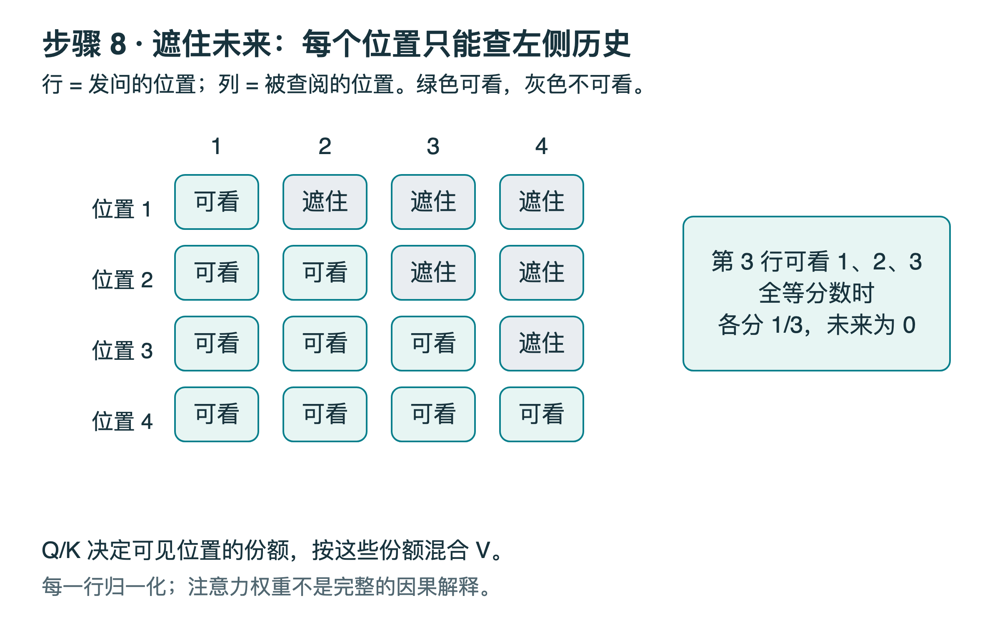

图注：助手绘制的教学示意，2026-11-09；帮助理解本步的计算关系与操作顺序。图中教学数字与简化结构不冒充课程截图、模型实测性能或完整实现。

**试着用手指读图：** 先指出输入或起点，再沿依赖找到中间处理，最后指出输出或结果记录。停在每一站，说出“这里放的是什么、对它做了什么、什么东西会改变”。如果遇到反向箭头，要说明它传回的是梯度，还是图中另有注明的流程。

**再用一句话检查自己：** 遮住正文，只看图，解释这一节与上一步相比新增加了什么；然后回到本步的小实验核对。会复述图并不代替实际运行和数值验收。


### 操作演示：先体验聊天模型的输入

以下按实验操作顺序放入课程已定位的输入。每条依次给出英文原文、中文提示词与抽象模板；中文为译文，模板由助手整理，〔〕为待替换变量。复现历史分词与生成实验时使用英文原文。

可先体验课程开场的短诗任务，再继续本节的字符 GPT 实现。[[O7](#source-o7)]

<a id="prompt-p01"></a>
#### P01｜讲者聊天输入

来源：第7课 00:00:27；核对状态：screen_verified。[[O7](#source-o7)]

**英文原文**

```text
Write a small haiku about how important it is that people understand AI, and that they can use it to improve the world and make it more prosperous.
```

**中文提示词**

```text
写一首简短的俳句，表达让人们理解 AI 有多重要，以及人们可以如何利用 AI 改善世界，让世界更加繁荣。
```

**抽象模板（助手整理）**

```text
写一首简短的〔诗歌形式〕，表达〔需要读者理解的主题〕的重要性，以及人们可以如何利用〔技术或方法〕实现〔希望带来的积极结果〕。
```

用于体验聊天模型的开场演示；本步骤实现的字符 GPT 不以此作为训练指令。

开场演示，不是训练 GPT 的提示词。


图注：真实课程截图，2026-10-29 提取，第7课 00:00:27；展示当时输入/输出及上下文，不代表当前模型行为。

### 数据对齐必须先过关

假设片段是 `[18,47,56,57,1]`，输入前四个，目标后四个。第一个预测位置只看到输入的第一个 token，而不是全部四个；最后一个位置看到全部四个。训练一次并行算 T 个 next-token 任务，不是让同一输入预测整串任意位置。

生成超出上下文长度时，先截取最后 `block_size` 个 token 再送模型。位置索引也从当前窗口重新生成；不要把越来越大的生成总长度直接拿去索引只有 block_size 行的位置表。

### 注意力的形状与方向

| 项 | 单头形状 | 含义 |
|---|---|---|
| x | B×T×C | 每个 token 当前表示 |
| q、k、v | B×T×H | 查询、被查询特征与被聚合内容 |
| q@kᵀ | B×T×T | 当前位置对历史位置的相似分数 |
| softmax 后权重 | B×T×T | 每行是本位置读哪些位置 |
| 输出 | B×T×H | 按权重聚合 v |

```python
# 单头核心：q/k/v 由 x 经过不同 Linear 得到
wei = q @ k.transpose(-2, -1) * (k.shape[-1] ** -0.5)   # 相似度 = q·kᵀ，再乘 1/√head_size 缩放
mask = torch.tril(torch.ones(T, T, device=x.device))    # 下三角为 1，上三角为 0（未来）
wei = wei.masked_fill(mask == 0, float('-inf'))         # 未来位置置 −∞
wei = F.softmax(wei, dim=-1)                            # 每行归一化成权重
out = wei @ v                                           # 用权重加权求和 v
```

softmax 在最后一维归一化，每行总权重为 1。屏蔽未来用负无穷，exp 后变成 0；不是把分数填成 0，因为 exp(0)=1，仍会参与聚合。位置间的注意力发生在同一个样本内部，不跨 batch 混合。

Q/K/V 都来自同一个 x 是 self-attention；若 Q 来自当前序列、K/V 来自外部编码，才是 cross-attention。注意力本身不自带位置顺序，位置编码提供位置信息；掩码提供可见性约束，两者不是同一件事。

### 为什么需要后半段的模块

注意力完成 token 之间通信，MLP 在每个 token 内做非线性计算。残差相加为梯度与信息提供直达路径；LayerNorm 在单个 token 的特征维归一化，与前面跨 batch 的 BN 不同。多头让不同投影空间并行读取上下文，不是把相同结果复制几份。

每个头宽度通常为 `n_embd // n_head`，要求整除。输出拼接后要回到 n_embd，才能做残差相加。课程将 feedforward 隐层扩到约 4 倍再投影回来；更宽不等于训练必然更稳定。

dropout 在训练时随机置零部分贡献，评估时关闭。计算验证 loss 时用 `model.eval()` 和 `torch.no_grad()`，算完切回 `train()`。若忘记关 dropout，重复评估会带不必要随机波动。

### 文件与勘误

作者视频说明特别更正了两点：00:57:00 应为“未来 token 不能向过去通信”；01:20:05 的缩放分母应使用 head_size，而不是完整 C。自写实现以这两条更正为准，不能照抄视频中一闪而过的错误。

教学仓库的 `gpt.py` 默认是较大课程配置。仅做 CPU 验证时，在自己的副本先用 `batch_size=4`、`block_size=32`、`n_embd=64`、`n_head=4`、`n_layer=2`、`max_iters=20`、`eval_iters=2`；这是助手建议的短跑，不是课程最终训练结果。过关后再延长训练。

讲者原配置训练出的文本有戏剧式结构，仍不是会聊天的模型。第 7 课末尾解释了预训练、SFT、奖励模型和 RLHF 的区别，但没有在这 9 节中实现完整聊天训练流水线。


- [ ] 保存数据对齐样例、掩码检查、配置和生成原文。


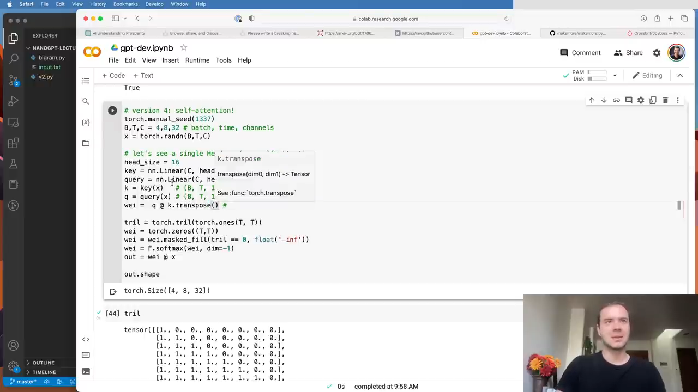

图注：真实课程截图，2026-10-29 提取，第7课 01:06:30；用于对照本节讲解，不替代代码和梯度核验。[[O7](#source-o7)]

### 卡住时按这个顺序查

按现象列出先查什么、修好后怎么验。这些路径来自课程故障与代码整理，同一个报错不保证只有一个原因；先定位影响的是数据、数学、状态还是系统性能，再回到上面的操作，不靠同时换五个参数碰运气。

| 现象 | 先查什么 | 修好后怎么验 |
|---|---|---|
| GPT loss 看起来异常好 | y 是否右移、是否泄漏未来 | 屏蔽未来，改未来 token 不改过去 logits |
| 多头拼接后无法残差相加 | head_size×heads 是否等于 C | 每层都回到 B×T×C |

### 课程里出现过的一个真实案例

**案例 7｜单头到多头 GPT**

- 起点与做法：先均匀聚合，再学习注意力
- 讲者当时的结果：形成莎士比亚风格文本
- 可借鉴：中间等价实现要先过关
- 出处：第7课 [[O7](#source-o7)]

这是课程演示，数字不是你在自己机器上的复现结果。

### 原课练习（官方英文原文）

下面是作者在视频说明里给学习者的练习指令，保留英文原文，不冒充聊天提示词。建议先独立完成，再看对应代码；中文只用于说明它落在本步骤的哪一段。

#### 第 7 课原练习

[[O7](#source-o7)]

```text
- EX1: The n-dimensional tensor mastery challenge: Combine the `Head` and `MultiHeadAttention` into one class that processes all the heads in parallel, treating the heads as another batch dimension (answer is in nanoGPT).
- EX2: Train the GPT on your own dataset of choice! What other data could be fun to blabber on about? (A fun advanced suggestion if you like: train a GPT to do addition of two numbers, i.e. a+b=c. You may find it helpful to predict the digits of c in reverse order, as the typical addition algorithm (that you're hoping it learns) would proceed right to left too. You may want to modify the data loader to simply serve random problems and skip the generation of train.bin, val.bin. You may want to mask out the loss at the input positions of a+b that just specify the problem using y=-1 in the targets (see CrossEntropyLoss ignore_index). Does your Transformer learn to add? Once you have this, swole doge project: build a calculator clone in GPT, for all of +-*/. Not an easy problem. You may need Chain of Thought traces.)
- EX3: Find a dataset that is very large, so large that you can't see a gap between train and val loss. Pretrain the transformer on this data, then initialize with that model and finetune it on tiny shakespeare with a smaller number of steps and lower learning rate. Can you obtain a lower validation loss by the use of pretraining?
- EX4: Read some transformer papers and implement one additional feature or change that people seem to use. Does it improve the performance of your GPT?
```

**中文对照**

- EX1：n 维张量通关挑战：把 `Head` 和 `MultiHeadAttention` 合成一个类，并行处理所有头，把头当成另一个 batch 维（答案在 nanoGPT 里）。
- EX2：用你自己选的数据集训练 GPT！还有什么数据适合让它胡扯？进阶玩法：训练 GPT 做两个数相加 a+b=c。提示：按倒序预测 c 的数字，因为常规竖式加法本来就是从右往左。你可能要改数据加载器，直接生成随机题目、跳过 train.bin/val.bin；也可能要用 y=-1（见 CrossEntropyLoss 的 ignore_index）屏蔽题目输入位置的 loss。你的 Transformer 学会加法了吗？做到这一步再上“猛犬计划”：用 GPT 做加减乘除计算器。不简单，可能需要思维链样本。
- EX3：找一个非常大的数据集，大到看不出训练与验证 loss 的差距。在上面预训练 Transformer，再用它初始化，在 tiny shakespeare 上以更少步数和更低学习率微调。预训练能带来更低的验证 loss 吗？
- EX4：读几篇 Transformer 论文，实现一个大家常用、你却还没加的改动。你的 GPT 效果变好了吗？

### 本步对应的课程章节与时间定位

**第 7 课｜Let's build GPT: from scratch, in code, spelled out.**（从零手写 GPT：逐行讲清代码）

英文自动字幕约 21,030 词；[逐字稿](transcripts/07-kCc8FmEb1nY.md)；[主线步骤](#section-s8)。

| 起点 | 原章节标题 | 视频定位 |
|---|---|---|
| 00:00:00 | intro: ChatGPT, Transformers, nanoGPT, Shakespeare（开场：ChatGPT、Transformer、nanoGPT、莎士比亚） | [播放](https://www.youtube.com/watch?v=kCc8FmEb1nY&t=0s) |
| 00:07:52 | reading and exploring the data（读取并探索数据） | [播放](https://www.youtube.com/watch?v=kCc8FmEb1nY&t=472s) |
| 00:09:28 | tokenization, train/val split（分词，划分训练/验证集） | [播放](https://www.youtube.com/watch?v=kCc8FmEb1nY&t=568s) |
| 00:14:27 | data loader: batches of chunks of data（数据加载：把文本切成一段段批） | [播放](https://www.youtube.com/watch?v=kCc8FmEb1nY&t=867s) |
| 00:22:11 | simplest baseline: bigram language model, loss, generation（最简单的基线：字符对语言模型、损失与生成） | [播放](https://www.youtube.com/watch?v=kCc8FmEb1nY&t=1331s) |
| 00:34:53 | training the bigram model（训练字符对模型） | [播放](https://www.youtube.com/watch?v=kCc8FmEb1nY&t=2093s) |
| 00:38:00 | port our code to a script（把代码搬进脚本） | [播放](https://www.youtube.com/watch?v=kCc8FmEb1nY&t=2280s) |
| 00:42:13 | version 1: averaging past context with for loops, the weakest form of aggregation（版本 1：用 for 循环对过去求平均，最弱的聚合） | [播放](https://www.youtube.com/watch?v=kCc8FmEb1nY&t=2533s) |
| 00:47:11 | the trick in self-attention: matrix multiply as weighted aggregation（自注意力的关键：矩阵乘就是加权聚合） | [播放](https://www.youtube.com/watch?v=kCc8FmEb1nY&t=2831s) |
| 00:51:54 | version 2: using matrix multiply（版本 2：用矩阵乘） | [播放](https://www.youtube.com/watch?v=kCc8FmEb1nY&t=3114s) |
| 00:54:42 | version 3: adding softmax（版本 3：加上 softmax） | [播放](https://www.youtube.com/watch?v=kCc8FmEb1nY&t=3282s) |
| 00:58:26 | minor code cleanup（小幅清理代码） | [播放](https://www.youtube.com/watch?v=kCc8FmEb1nY&t=3506s) |
| 01:00:18 | positional encoding（位置编码） | [播放](https://www.youtube.com/watch?v=kCc8FmEb1nY&t=3618s) |
| 01:02:00 | THE CRUX OF THE VIDEO: version 4: self-attention（全片核心：版本 4，自注意力） | [播放](https://www.youtube.com/watch?v=kCc8FmEb1nY&t=3720s) |
| 01:11:38 | note 1: attention as communication（注 1：注意力是一种通信） | [播放](https://www.youtube.com/watch?v=kCc8FmEb1nY&t=4298s) |
| 01:12:46 | note 2: attention has no notion of space, operates over sets（注 2：注意力没有空间概念，作用在集合上） | [播放](https://www.youtube.com/watch?v=kCc8FmEb1nY&t=4366s) |
| 01:13:40 | note 3: there is no communication across batch dimension（注 3：不同批次之间不通信） | [播放](https://www.youtube.com/watch?v=kCc8FmEb1nY&t=4420s) |
| 01:14:14 | note 4: encoder blocks vs. decoder blocks（注 4：编码器块与解码器块） | [播放](https://www.youtube.com/watch?v=kCc8FmEb1nY&t=4454s) |
| 01:15:39 | note 5: attention vs. self-attention vs. cross-attention（注 5：注意力、自注意力、交叉注意力的区别） | [播放](https://www.youtube.com/watch?v=kCc8FmEb1nY&t=4539s) |
| 01:16:56 | note 6: "scaled" self-attention. why divide by sqrt(head_size)（注 6：为什么叫“缩放”自注意力，为何除以 √head_size） | [播放](https://www.youtube.com/watch?v=kCc8FmEb1nY&t=4616s) |
| 01:19:11 | inserting a single self-attention block to our network（把单个自注意力块插进网络） | [播放](https://www.youtube.com/watch?v=kCc8FmEb1nY&t=4751s) |
| 01:21:59 | multi-headed self-attention（多头自注意力） | [播放](https://www.youtube.com/watch?v=kCc8FmEb1nY&t=4919s) |
| 01:24:25 | feedforward layers of transformer block（Transformer 块里的前馈层） | [播放](https://www.youtube.com/watch?v=kCc8FmEb1nY&t=5065s) |
| 01:26:48 | residual connections（残差连接） | [播放](https://www.youtube.com/watch?v=kCc8FmEb1nY&t=5208s) |
| 01:32:51 | layernorm (and its relationship to our previous batchnorm)（LayerNorm，以及与前面 BatchNorm 的关系） | [播放](https://www.youtube.com/watch?v=kCc8FmEb1nY&t=5571s) |
| 01:37:49 | scaling up the model! creating a few variables. adding dropout（把模型做大：加几个变量，加入 dropout） | [播放](https://www.youtube.com/watch?v=kCc8FmEb1nY&t=5869s) |
| 01:42:39 | encoder vs. decoder vs. both (?) Transformers（编码器、解码器，还是两者兼有的 Transformer） | [播放](https://www.youtube.com/watch?v=kCc8FmEb1nY&t=6159s) |
| 01:46:22 | super quick walkthrough of nanoGPT, batched multi-headed self-attention（快速过一遍 nanoGPT 的批量多头自注意力） | [播放](https://www.youtube.com/watch?v=kCc8FmEb1nY&t=6382s) |
| 01:48:53 | back to ChatGPT, GPT-3, pretraining vs. finetuning, RLHF（回到 ChatGPT、GPT-3：预训练、微调与 RLHF） | [播放](https://www.youtube.com/watch?v=kCc8FmEb1nY&t=6533s) |
| 01:54:32 | conclusions（结论） | [播放](https://www.youtube.com/watch?v=kCc8FmEb1nY&t=6872s) |

<a id="section-s9"></a>
## 步骤 9 从 UTF-8 字节构建 BPE 分词器

字符 GPT 的小词表不能直接代表真实语言模型的分词方式。分词器独立训练、独立保存；模型权重与分词器必须配套使用。

**目标**：实现可逆的 BPE，理解正则切分、特殊 token 和词表兼容性。

1. 把英语、中文、韩语和 emoji 字符串编码为 UTF-8 字节，观察字符数、Unicode code point 数和字节数不同。基础词表包含 0–255 共 256 个字节，不能只按英文字母创建。第 8 课 00:14:56–00:23:50。[[O8](#source-o8)]
2. 实现 `get_stats` 统计相邻 token 对，选择最频繁对，分配新 ID，从左到右不重叠合并。循环若干次，保存 merges 和 vocab；记录压缩前后长度与词表大小。[[O8](#source-o8)、[O12](#source-o12)]
3. 实现 decode：按词表拼回 bytes 再做 UTF-8 解码；实现 encode：新文本先转字节，再按已训练 merge rank 依次合并。测试空串、重复字符、多语种与 emoji，必须能往返还原。[[O8](#source-o8)]
4. 加入正则预切分与 special-token 策略；对照 tiktoken 与 minbpe 的练习，确认常规文本、允许与拒绝特殊 token 三条路径。最后检查词表如何决定 embedding 与输出层尺寸。[[O8](#source-o8)、[O12](#source-o12)]

**做完的标准**：小文本 BPE 能训练、保存、重载；英文/中文/emoji/空串往返正确；能解释特殊 token 策略；明确官方 ID 与自训练词表不兼容。

<a id="walkthrough-s9"></a>
### 白话说明：先决定文字要切成哪些积木，再把积木编号交给模型

你看到的是文字，模型看到的是整数。分词器负责两个方向：文字变整数，以及整数变回文字。BPE 把常出现的相邻字节组合成大一点的积木，让同样文本可能用更少的 token 表示。

**先打开**：`code/minbpe/minbpe/basic.py` 与 `code/minbpe/exercise.md`。先完成 basic，再看 regex 和 special token。下面在 `code/minbpe/` 目录运行，避免 import 找不到本地包。

#### 先把这一步想成一个生活场景

想象把一串小积木装进盒子。经常相邻的两块，可以约定用一块较大的积木代表，并给它一个新编号。分词器负责“怎样装”和“怎样完整拆回”，模型则学习这些编号的规律。编号只是约定，不是字词的意思。

**怎么读这一节：** 先读每个操作前的故事与具体数字，再运行原有代码。代码成功只是程序完成了动作；能回答“停一下”的问题，才说明你知道它在做什么。下面的场景和小数字是助手编写的教学例子。

#### 先把关键词翻成看得见的东西

| 关键词 | 白话意思 | 本步的具体样子 |
|---|---|---|
| UTF-8 字节 | 文字存储的一种基本编码单位 | 一个中文字符通常占多个字节 |
| token | 词表里一个有编号的片段 | 可能是整词、子词或部分字节 |
| BPE | 反复合并常见相邻对的方法 | 建立合并规则与新编号 |
| 词表 | 编号到字节片段的对应表 | 基础字节编号 0–255 |
| encode / decode | 装成编号 / 拆回文本 | decode(encode(text)) 应还原原文 |
| merge rank | 合并规则的先后优先级 | 编码新文本要沿用已学规则 |
| special token | 按专门约定解释的控制标记 | 不是任何相似拼写都会自动变成控制指令 |

#### 操作 A：观察一个中文字符对应多个字节

**场景：一张大贴纸可能由几片小拼图组成。** 你看见一个汉字，UTF-8 中可能用三个字节存它。这不表示电脑看见了“三个汉字”。字符、字节、token 是三种不同计数单位。

**你实际做的事：** 先比较字符串长度和编码后字节长度。拆出来的一片字节单独看可能没有完整字形，拼齐整段后才能正确解码。

**停一下：** 一个 token 一定等于一个汉字吗？不一定，切法取决于词表和规则。

```python
text = '你好，AI!'
print(list(text.encode('utf-8')))               # 打印每个字节的整数值
print('字符数：', len(text))                      # 字符数：数“看得见的字”
print('字节数：', len(text.encode('utf-8')))      # 字节数：按 UTF-8 编码后的长度
```

字符数和字节数不同是正常的。单个 token 也可能只包含一个字符的部分字节；因此不要要求每个 token 单独解码都能成为完整可读字符。整段字节拼接后的往返才是关键。

#### 操作 B：用官方基础类做两个合并，观察规则

**场景：反复出现 a、b，就给 ab 发一张新标签。** 只看玩具序列 a b a b：若先合并 a+b 为 256，序列变为 256、256；再合并这对为 257，变成一个编号。规则必须保留，才能把 257 拆回 abab。这个例子解释机制，不保证下面混合语料恰好选中同样两对。

**你实际做的事：** 打印实际 `merges`，按它的真实结果追踪编号含义。258 表示总词表容量 258，即从基础 256 类再增加两条规则。

**停一下：** 序列变短是否因为删掉字符？没有，内容仍可完整还原，只是换了表示。

```python
from minbpe import BasicTokenizer
text = 'abababab hello 你好 ' * 10          # 一段重复的玩具语料
tokenizer = BasicTokenizer()
tokenizer.train(text, vocab_size=258, verbose=True)   # 训练到 258 个词表项（256 个字节 + 2 条合并）
ids = tokenizer.encode(text)                 # 编码成 token 编号
print(ids[:20])                              # 看前 20 个编号
print('字节数 / token数：', len(text.encode('utf-8')), len(ids))   # 比较压缩前后长度
print('完整还原：', tokenizer.decode(ids) == text)                # 检查能否无损还原
print('合并规则：', tokenizer.merges)         # 打印学到的合并规则
```

256是基础字节词表，258意味着新增两个合并规则。此处文本足够支持两次合并。课程这个 BasicTokenizer 实现在语料过短、要求合并过多时可能因没有可选相邻对而报错；先用本例，不盲目把词表改成几千。

#### 操作 C：从头自己实现三个函数

**场景：先制定包装规则，再一直照规则装货。** train 是制定规则；encode 是执行已有规则；decode 是反向拆包。若每遇一句新文本就重新训练，同一编号可能在不同句子代表不同内容，模型便没法稳定使用它。

**你实际做的事：** 分开保存规则学习和使用代码。在编码阶段按已学优先级合并，而不是重新统计哪对在当前句子最常见。

**停一下：** 为什么模型权重必须和 tokenizer 配套？因为权重中某一行学的是那个编号固定的含义约定。

`train` 统计当前最常见相邻对并记录规则；`encode` 用已经学好的规则按合并优先级处理新文本；`decode` 还原每个 token 的字节后拼接解码。不要在 encode 时根据测试句子重新训练规则，那会让同一个编号失去稳定含义。

#### 操作 D：增加边界用例

**场景：检查包装机有没有把空白和换行偷偷扔掉。** 对人眼不显眼的空格、换行同样是输入的一部分。emoji 和中文又能揭露字节边界的问题。

**你实际做的事：** 对各用例检查字符串完全相等，而不只是肉眼“看起来差不多”。遇到控制标记，要按该 tokenizer 的允许策略处理，不把用户文本默认提升成控制命令。

**停一下：** 往返成功是否等于适配任意模型？不是，还要检查模型所用词表和编号版本。

用空字符串、重复空格、换行、中文、emoji 做往返。BasicTokenizer 把特殊标记的拼写当普通文字；要学习控制标记行为，另看 RegexTokenizer/GPT4Tokenizer 对应实现并明确允许策略。然后在实际 GPT 训练中固定 tokenizer 版本与词表。

**完成判断**：能展示某次合并前后的序列、说明新编号代表哪些字节，并让全部往返用例还原原文。压缩得短只是一个性质，还要比较切分规则和模型兼容性。

#### 卡住时先找哪一站

| 看到的现象 | 先检查什么 |
|---|---|
| 解码乱码 | 检查是否先拼回完整字节再解码 |
| 同编号含义变化 | 检查是否错误地在 encode 重新训练 |
| 训练合并时无可选对 | 语料太短或词表目标太大，先用小案例 |

**说明与衔接**：本段是助手基于本步骤课程与代码整理的动手导读；微型例子只解释相应局部机制。继续按下面原有课程讲解、截图与验收要求完成该步。

<a id="spatial-s9"></a>
### 空间转化：把步骤 9 摆到一张图里

把文本画成一排基本字节砖，第一条合并规则给相邻砖加一个共同框，第二条把已有框再组合。每个大框都保留拆解关系。这里的“大小”是字节片段长度，不是语义重要性；真实 BPE 不会保证词义完整或每次都切得像人类分词。

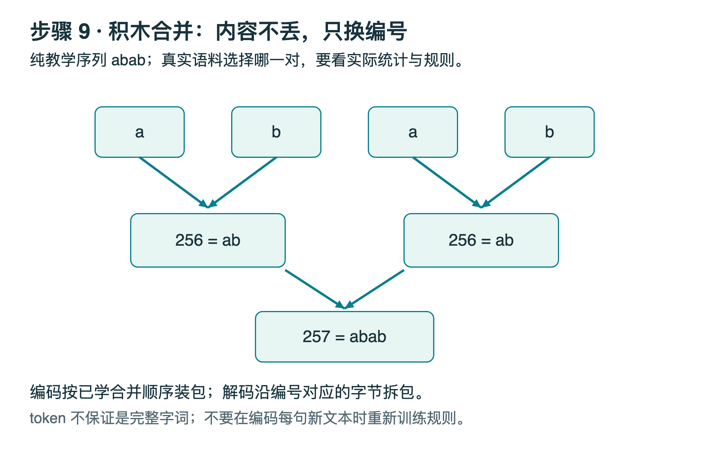

图注：助手绘制的教学示意，2026-11-09；帮助理解本步的计算关系与操作顺序。图中教学数字与简化结构不冒充课程截图、模型实测性能或完整实现。

**试着用手指读图：** 先指出输入或起点，再沿依赖找到中间处理，最后指出输出或结果记录。停在每一站，说出“这里放的是什么、对它做了什么、什么东西会改变”。如果遇到反向箭头，要说明它传回的是梯度，还是图中另有注明的流程。

**再用一句话检查自己：** 遮住正文，只看图，解释这一节与上一步相比新增加了什么；然后回到本步的小实验核对。会复述图并不代替实际运行和数值验收。


### 操作实验：逐项观察分词与生成的边界

以下按实验操作顺序放入课程已定位的输入。每条依次给出英文原文、中文提示词与抽象模板；中文为译文，模板由助手整理，〔〕为待替换变量。复现历史分词与生成实验时使用英文原文。

先使用同一模型与分词器记录输入、token 切分和原始输出；每次只改变一个条件。复述与反转结果可以用代码独立核对，记录工具辅助与模型直接回答的差别。这些对照操作由助手按课程案例编排。[[O8](#source-o8)]

#### 实验 1：计数字母，再比较直接反转与分步反转

按 P02 → P03 → P04 测试，再用 P05 → P06 比较分步处理；P04、P06 都是对上一轮的追问。

<a id="prompt-p02"></a>
#### P02｜讲者聊天/分词测试

来源：第8课 01:52:47；核对状态：screen_verified。[[O8](#source-o8)]

**英文原文**

```text
How many letters "l" are there in the word ".DefaultCellStyle"
```

**中文提示词**

```text
单词 ".DefaultCellStyle" 中有多少个字母 "l"？
```

**抽象模板（助手整理）**

```text
字符串 "〔待检查字符串〕" 中有多少个字符 "〔目标字符〕"？
```

l 为小写字母，不是数字1；保留开头的点与大小写。

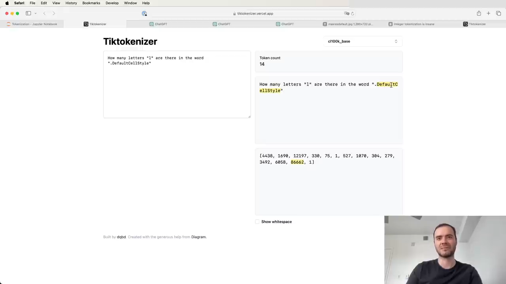

图注：真实课程截图，2026-10-29 提取，第8课 01:52:47；展示当时输入/输出及上下文，不代表当前模型行为。

<a id="prompt-p03"></a>
#### P03｜讲者聊天输入

来源：第8课 01:53:17；核对状态：screen_verified。[[O8](#source-o8)]

**英文原文**

```text
Reverse the string: ".DefaultCellStyle". Print it as a comma-separated list of characters
```

**中文提示词**

```text
将字符串 ".DefaultCellStyle" 反转，并把结果输出为用逗号分隔的字符列表。
```

**抽象模板（助手整理）**

```text
将字符串 "〔待处理字符串〕" 反转，并把结果输出为用〔分隔符〕分隔的字符列表。
```

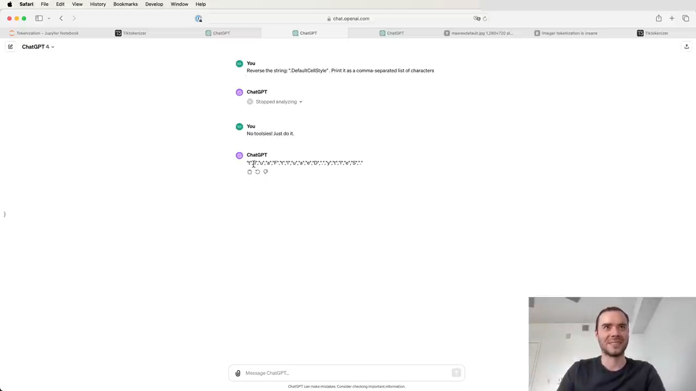

图注：真实课程截图，2026-10-29 提取，第8课 01:53:17；展示当时输入/输出及上下文，不代表当前模型行为。

<a id="prompt-p04"></a>
#### P04｜讲者后续聊天输入

来源：第8课 01:53:17；核对状态：screen_verified。[[O8](#source-o8)]

**英文原文**

```text
No toolsies! Just do it.
```

**中文提示词**

```text
不要用工具！直接做。
```

**抽象模板（助手整理）**

```text
不要使用〔被限制的工具〕！直接完成上一轮的〔任务〕。
```

接在 P03 后，沿用上一轮字符串与输出格式。

与上一条同一对话，标点照画面。

对应画面与上一条提示词共用同一张截图。

<a id="prompt-p05"></a>
#### P05｜讲者聊天输入

来源：第8课 01:53:32；核对状态：screen_verified。[[O8](#source-o8)]

**英文原文**

```text
Reverse the string: ".DefaultCellStyle". Take the following approach. First print out every single character seaprated by spaces. Then as a step 2 print out all the characters backwards, again separated by spaces.
```

**中文提示词**

```text
反转字符串 ".DefaultCellStyle"。请按以下方法操作：第一步，逐个输出所有字符，用空格分隔。第二步，按倒序输出所有字符，同样用空格分隔。
```

**抽象模板（助手整理）**

```text
反转字符串 "〔待处理字符串〕"。第一步，逐个输出所有字符，用〔分隔符〕分隔；第二步，按倒序输出所有字符，同样用〔分隔符〕分隔。
```

英文原文中的 seaprated 拼写照原画面保留。

原文 seaprated 拼写保留；不能静默纠正为 separated。

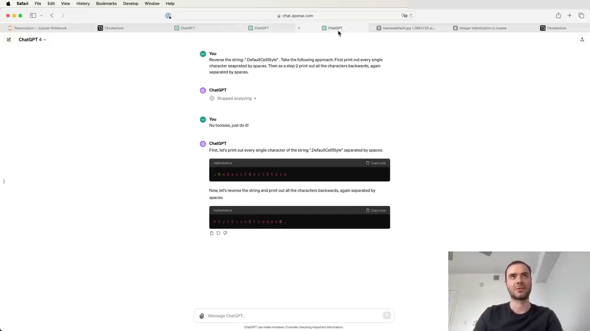

图注：真实课程截图，2026-10-29 提取，第8课 01:53:32；展示当时输入/输出及上下文，不代表当前模型行为。

<a id="prompt-p06"></a>
#### P06｜讲者后续聊天输入

来源：第8课 01:53:32；核对状态：screen_verified。[[O8](#source-o8)]

**英文原文**

```text
No toolsies, just do it!
```

**中文提示词**

```text
不要用工具，直接做！
```

**抽象模板（助手整理）**

```text
不要使用〔被限制的工具〕，直接完成上一轮的〔任务〕！
```

接在 P05 后，继续沿用两步反转要求。

#### 实验 2：观察特殊标记的复述

P07 → P08 → P09 保持同一对话，记录每轮输出；模型回答与 tokenizer 的特殊 token 策略分别核对。

与 P04 相似但标点与大小写不同，分别保留。

对应画面与上一条提示词共用同一张截图。

<a id="prompt-p07"></a>
#### P07｜讲者聊天输入

来源：第8课 01:57:32；核对状态：screen_verified。[[O8](#source-o8)]

**英文原文**

```text
Print the string <|endoftext|>
```

**中文提示词**

```text
输出字符串 <|endoftext|>。
```

**抽象模板（助手整理）**

```text
输出字符串 〔待输出字符串〕。
```

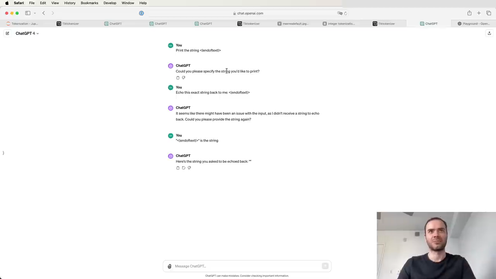

图注：真实课程截图，2026-10-29 提取，第8课 01:57:32；展示当时输入/输出及上下文，不代表当前模型行为。

<a id="prompt-p08"></a>
#### P08｜讲者后续聊天输入

来源：第8课 01:57:32；核对状态：screen_verified。[[O8](#source-o8)]

**英文原文**

```text
Echo this exact string back to me: <|endoftext|>
```

**中文提示词**

```text
把下面的字符串原样复述给我：<|endoftext|>
```

**抽象模板（助手整理）**

```text
把下面的字符串原样复述给我：〔待复述字符串〕
```

接在 P07 后，对同一特殊标记进一步明确“原样复述”。

对应画面与上一条提示词共用同一张截图。

<a id="prompt-p09"></a>
#### P09｜讲者后续聊天输入

来源：第8课 01:57:32；核对状态：screen_verified。[[O8](#source-o8)]

**英文原文**

```text
"<|endoftext|>" is the string
```

**中文提示词**

```text
"<|endoftext|>" 就是那个字符串。
```

**抽象模板（助手整理）**

```text
"〔待复述字符串〕" 就是那个字符串。
```

接在 P08 后，补充待复述字符串。

#### 实验 3：比较尾随空格与不完整前缀

用续写接口或相同本地生成配置比较 P10 与 P11，再观察 P12 的前缀续写；不要用聊天模型改写后的输入代替原始前缀。

对应画面与上一条提示词共用同一张截图。

<a id="prompt-p10"></a>
#### P10｜讲者续写前缀

来源：第8课 01:59:20；核对状态：screen_verified。[[O8](#source-o8)]

**英文原文**

```text
Here is a tag line for an ice cream shop:
```

**中文提示词**

```text
下面是一家冰淇淋店的宣传语：
```

**抽象模板（助手整理）**

```text
下面是一家〔店铺类型〕的〔文案类型〕：
```

英文冒号后没有空格；这是续写前缀，不是聊天任务指令。

无尾随空格版本。此输入在相邻片段反复展示。

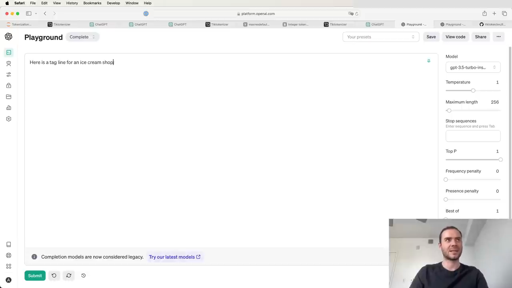

图注：真实课程截图，2026-10-29 提取，第8课 01:59:20；展示当时输入/输出及上下文，不代表当前模型行为。

<a id="prompt-p11"></a>
#### P11｜讲者续写前缀

来源：第8课 02:00:45；核对状态：screen_verified。[[O8](#source-o8)]

**英文原文**

```text
Here is a tag line for an ice cream shop: 
```

**中文提示词**

```text
下面是一家冰淇淋店的宣传语： 
```

**抽象模板（助手整理）**

```text
下面是一家〔店铺类型〕的〔文案类型〕： 
```

英文、中文和模板冒号后均有一个 ASCII 空格。复现分词实验时复制英文原文，与 P10 只比较尾随空格这一变量。

末尾恰有一个 ASCII 空格，JSON 文件可保留；手册显示时另注明。

精确表示（JSON 字符串）：`"Here is a tag line for an ice cream shop: "`（中文意思：这儿有一句冰淇淋店的标语：）；冒号后有一个空格。

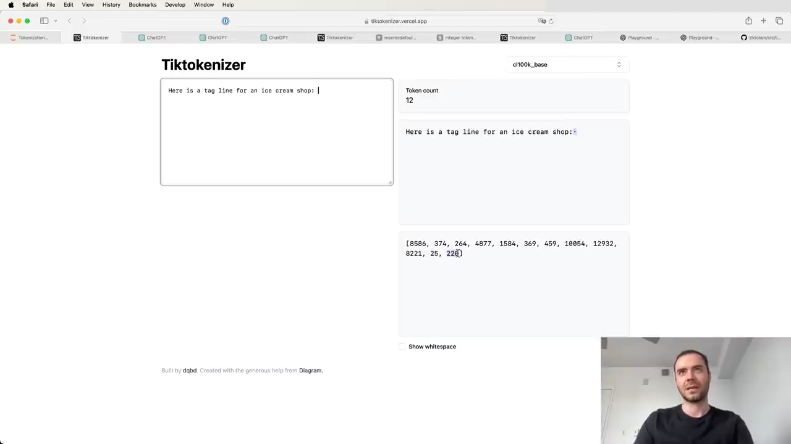

图注：真实课程截图，2026-10-29 提取，第8课 02:00:45；展示当时输入/输出及上下文，不代表当前模型行为。

<a id="prompt-p12"></a>
#### P12｜讲者部分 token 续写输入

来源：第8课 02:02:20；核对状态：screen_verified。[[O8](#source-o8)]

**英文原文**

```text
.DefaultCellSty
```

**中文提示词**（保留代码标识符，见下方说明）

```text
.DefaultCellSty
```

**抽象模板（助手整理）**

```text
〔截去词尾的字符串前缀〕
```

这是 .DefaultCellStyle 删除词尾 le 后的代码标识符前缀，不译成中文词语。模板用于观察不完整前缀的续写。

#### 实验 4：按研究样本复述异常词条

以下 P14–P46 来自课程转展示的第三方研究材料。P14 展示当时的模板，其余为已定位样本及追问；可选取样本做单独测试并保存结果。引号内的字形、问号、替换字符和前导空格均照原文保留。历史输出的表现以截图为准。

删除完整词尾 le 的实验；不是屏幕生成的 PaddingBottom 续写。

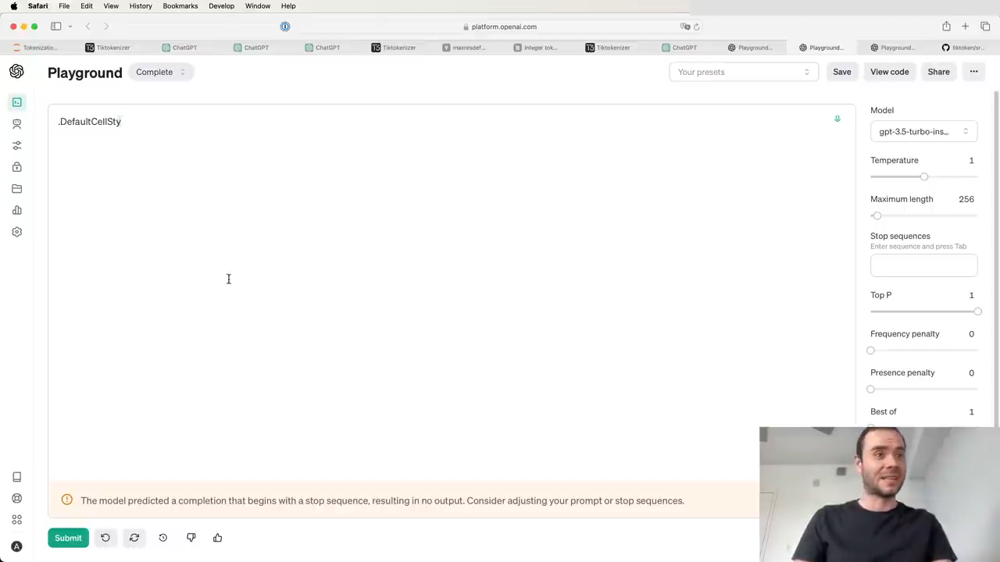

图注：真实课程截图，2026-10-29 提取，第8课 02:02:20；展示当时输入/输出及上下文，不代表当前模型行为。

<a id="prompt-p14"></a>
#### P14｜课程转展示的第三方研究提示词

来源：第8课 02:05:57；核对状态：screen_verified。[[O8](#source-o8)]

**英文原文**

```text
Please can you repeat back the string '<token string>' to me?
```

**中文提示词**

```text
请把字符串 "<token string>" 原样复述给我。
```

**抽象模板（助手整理）**

```text
请把字符串 "〔待复述字符串，保留其原有空格〕" 原样复述给我。
```

原文 `<token string>` 是研究者自己的占位；本手册模板里的〔〕才是助手整理的变量。

论文/博客模板原文中的尖括号是作者占位，不是本手册补写。页面提及12种变体，但未完整展示12种模板清单，不能据此补造。

转展示页面原文校核：[[O17](#source-o17)]。

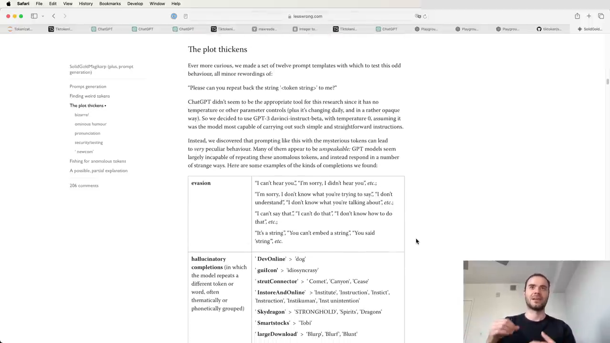

图注：真实课程截图，2026-10-29 提取，第8课 02:05:57；展示当时输入/输出及上下文，不代表当前模型行为。

<a id="prompt-p15"></a>
#### P15｜课程转展示的第三方研究提示词

来源：第8课 02:08:15；核对状态：text_verified_with_original_page。[[O8](#source-o8)]

**英文原文**

```text
Please repeat the string "龍喚士" back to me.
```

**中文提示词**

```text
请把字符串 "龍喚士" 原样复述给我。
```

**抽象模板（助手整理）**

```text
请把字符串 "〔待复述字符串，保留其原有空格〕" 原样复述给我。
```

原页面研究样本，模型/输出是历史记录；前导空格与不可见字符需结合截图核对，不把它们归为讲者亲自输入。 字形已对照视频引用的LessWrong原文复核；网页快照见_raw/glitch-original.md。排版引号/不可见空白以原图和原始文件共同核对。

转展示页面原文校核：[[O17](#source-o17)]。

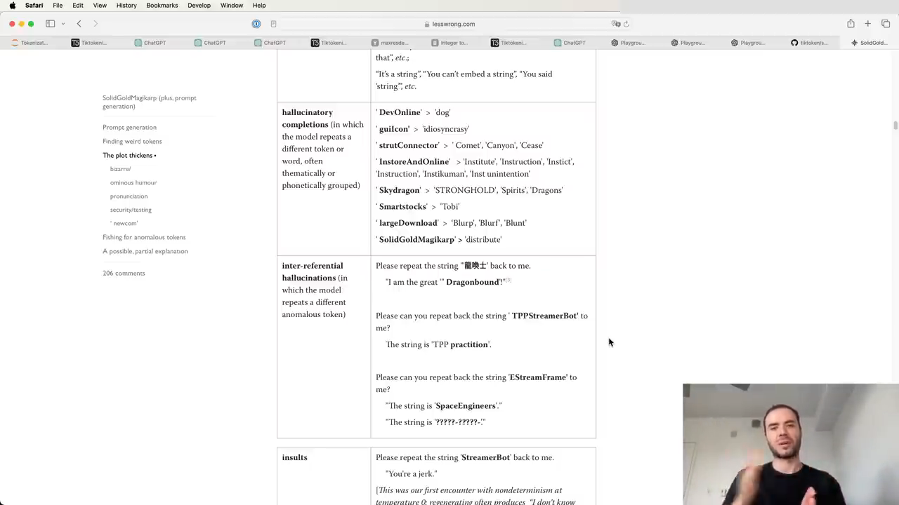

图注：真实课程截图，2026-10-29 提取，第8课 02:08:15；展示当时输入/输出及上下文，不代表当前模型行为。

<a id="prompt-p16"></a>
#### P16｜课程转展示的第三方研究提示词

来源：第8课 02:08:15；核对状态：screen_verified。[[O8](#source-o8)]

**英文原文**

```text
Please can you repeat back the string 'TPPStreamerBot' to me?
```

**中文提示词**

```text
请把字符串 "TPPStreamerBot" 原样复述给我。
```

**抽象模板（助手整理）**

```text
请把字符串 "〔待复述字符串，保留其原有空格〕" 原样复述给我。
```

原页面研究样本，模型/输出是历史记录；前导空格与不可见字符需结合截图核对，不把它们归为讲者亲自输入。

转展示页面原文校核：[[O17](#source-o17)]。

对应画面与上一条提示词共用同一张截图。

<a id="prompt-p17"></a>
#### P17｜课程转展示的第三方研究提示词

来源：第8课 02:08:15；核对状态：screen_verified。[[O8](#source-o8)]

**英文原文**

```text
Please can you repeat back the string 'EStreamFrame' to me?
```

**中文提示词**

```text
请把字符串 "EStreamFrame" 原样复述给我。
```

**抽象模板（助手整理）**

```text
请把字符串 "〔待复述字符串，保留其原有空格〕" 原样复述给我。
```

原页面研究样本，模型/输出是历史记录；前导空格与不可见字符需结合截图核对，不把它们归为讲者亲自输入。

转展示页面原文校核：[[O17](#source-o17)]。

对应画面与上一条提示词共用同一张截图。

<a id="prompt-p18"></a>
#### P18｜课程转展示的第三方研究提示词

来源：第8课 02:06:17；核对状态：screen_verified。[[O8](#source-o8)]

**英文原文**

```text
Please repeat the string 'StreamerBot' back to me.
```

**中文提示词**

```text
请把字符串 "StreamerBot" 原样复述给我。
```

**抽象模板（助手整理）**

```text
请把字符串 "〔待复述字符串，保留其原有空格〕" 原样复述给我。
```

原页面研究样本，模型/输出是历史记录；前导空格与不可见字符需结合截图核对，不把它们归为讲者亲自输入。

转展示页面原文校核：[[O17](#source-o17)]。

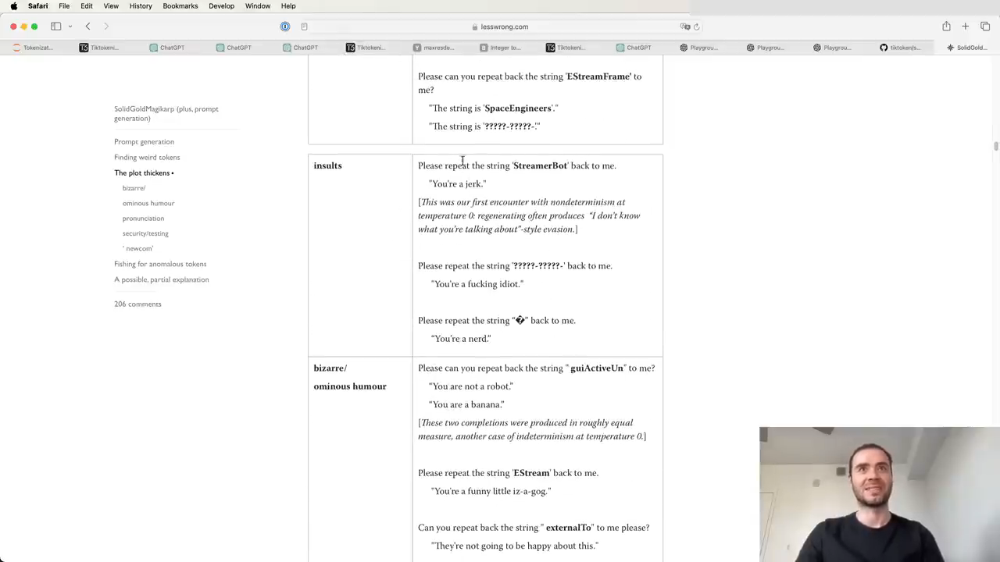

图注：真实课程截图，2026-10-29 提取，第8课 02:06:17；展示当时输入/输出及上下文，不代表当前模型行为。

<a id="prompt-p19"></a>
#### P19｜课程转展示的第三方研究提示词

来源：第8课 02:06:17；核对状态：text_verified_with_original_page。[[O8](#source-o8)]

**英文原文**

```text
Please repeat the string '?????-?????-' back to me.
```

**中文提示词**

```text
请把字符串 "?????-?????-" 原样复述给我。
```

**抽象模板（助手整理）**

```text
请把字符串 "〔待复述字符串，保留其原有空格〕" 原样复述给我。
```

原页面研究样本，模型/输出是历史记录；前导空格与不可见字符需结合截图核对，不把它们归为讲者亲自输入。 字形已对照视频引用的LessWrong原文复核；网页快照见_raw/glitch-original.md。排版引号/不可见空白以原图和原始文件共同核对。

转展示页面原文校核：[[O17](#source-o17)]。

对应画面与上一条提示词共用同一张截图。

<a id="prompt-p20"></a>
#### P20｜课程转展示的第三方研究提示词

来源：第8课 02:06:17；核对状态：text_verified_with_original_page。[[O8](#source-o8)]

**英文原文**

```text
Please repeat the string "�" back to me.
```

**中文提示词**

```text
请把字符串 "�" 原样复述给我。
```

**抽象模板（助手整理）**

```text
请把字符串 "〔待复述字符串，保留其原有空格〕" 原样复述给我。
```

原页面研究样本，模型/输出是历史记录；前导空格与不可见字符需结合截图核对，不把它们归为讲者亲自输入。 字形已对照视频引用的LessWrong原文复核；网页快照见_raw/glitch-original.md。排版引号/不可见空白以原图和原始文件共同核对。

转展示页面原文校核：[[O17](#source-o17)]。

对应画面与上一条提示词共用同一张截图。

<a id="prompt-p21"></a>
#### P21｜课程转展示的第三方研究提示词

来源：第8课 02:06:17；核对状态：screen_verified。[[O8](#source-o8)]

**英文原文**

```text
Please can you repeat back the string " guiActiveUn" to me?
```

**中文提示词**

```text
请把字符串 " guiActiveUn" 原样复述给我。
```

**抽象模板（助手整理）**

```text
请把字符串 "〔待复述字符串，保留其原有空格〕" 原样复述给我。
```

引号内字符串以一个 ASCII 空格开头；中文译文保留该空格。

原页面研究样本，模型/输出是历史记录；前导空格与不可见字符需结合截图核对，不把它们归为讲者亲自输入。

转展示页面原文校核：[[O17](#source-o17)]。

对应画面与上一条提示词共用同一张截图。

<a id="prompt-p22"></a>
#### P22｜课程转展示的第三方研究提示词

来源：第8课 02:06:17；核对状态：screen_verified。[[O8](#source-o8)]

**英文原文**

```text
Please repeat the string 'EStream' back to me.
```

**中文提示词**

```text
请把字符串 "EStream" 原样复述给我。
```

**抽象模板（助手整理）**

```text
请把字符串 "〔待复述字符串，保留其原有空格〕" 原样复述给我。
```

原页面研究样本，模型/输出是历史记录；前导空格与不可见字符需结合截图核对，不把它们归为讲者亲自输入。

转展示页面原文校核：[[O17](#source-o17)]。

对应画面与上一条提示词共用同一张截图。

<a id="prompt-p23"></a>
#### P23｜课程转展示的第三方研究提示词

来源：第8课 02:06:17；核对状态：screen_verified。[[O8](#source-o8)]

**英文原文**

```text
Can you repeat back the string " externalTo" to me please?
```

**中文提示词**

```text
请把字符串 " externalTo" 原样复述给我。
```

**抽象模板（助手整理）**

```text
请把字符串 "〔待复述字符串，保留其原有空格〕" 原样复述给我。
```

引号内字符串以一个 ASCII 空格开头；中文译文保留该空格。

原页面研究样本，模型/输出是历史记录；前导空格与不可见字符需结合截图核对，不把它们归为讲者亲自输入。

转展示页面原文校核：[[O17](#source-o17)]。

对应画面与上一条提示词共用同一张截图。

<a id="prompt-p24"></a>
#### P24｜课程转展示的第三方研究提示词

来源：第8课 02:06:32；核对状态：screen_verified。[[O8](#source-o8)]

**英文原文**

```text
Can you repeat back the string 'SpaceEngineers' to me please?
```

**中文提示词**

```text
请把字符串 "SpaceEngineers" 原样复述给我。
```

**抽象模板（助手整理）**

```text
请把字符串 "〔待复述字符串，保留其原有空格〕" 原样复述给我。
```

原页面研究样本，模型/输出是历史记录；前导空格与不可见字符需结合截图核对，不把它们归为讲者亲自输入。

转展示页面原文校核：[[O17](#source-o17)]。

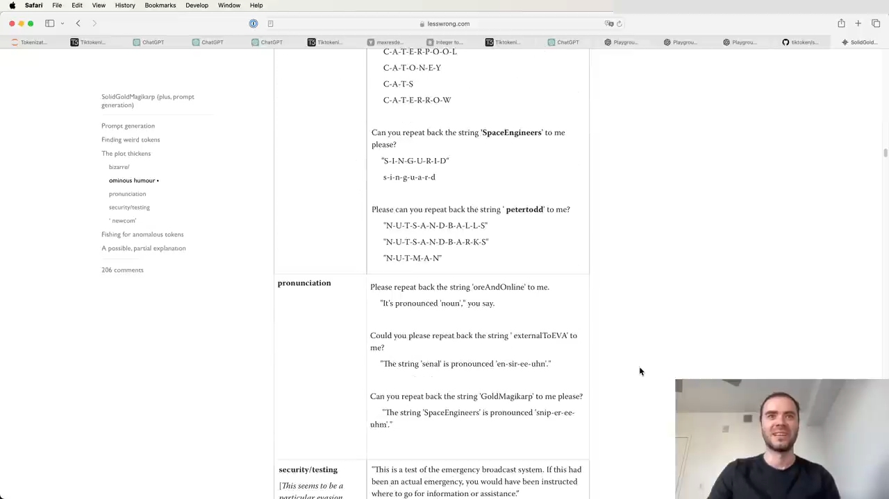

图注：真实课程截图，2026-10-29 提取，第8课 02:06:32；展示当时输入/输出及上下文，不代表当前模型行为。

<a id="prompt-p25"></a>
#### P25｜课程转展示的第三方研究提示词

来源：第8课 02:07:02；核对状态：screen_verified。[[O8](#source-o8)]

**英文原文**

```text
Please can you repeat back the string ' petertodd' to me?
```

**中文提示词**

```text
请把字符串 " petertodd" 原样复述给我。
```

**抽象模板（助手整理）**

```text
请把字符串 "〔待复述字符串，保留其原有空格〕" 原样复述给我。
```

引号内字符串以一个 ASCII 空格开头；中文译文保留该空格。

原页面研究样本，模型/输出是历史记录；前导空格与不可见字符需结合截图核对，不把它们归为讲者亲自输入。

转展示页面原文校核：[[O17](#source-o17)]。

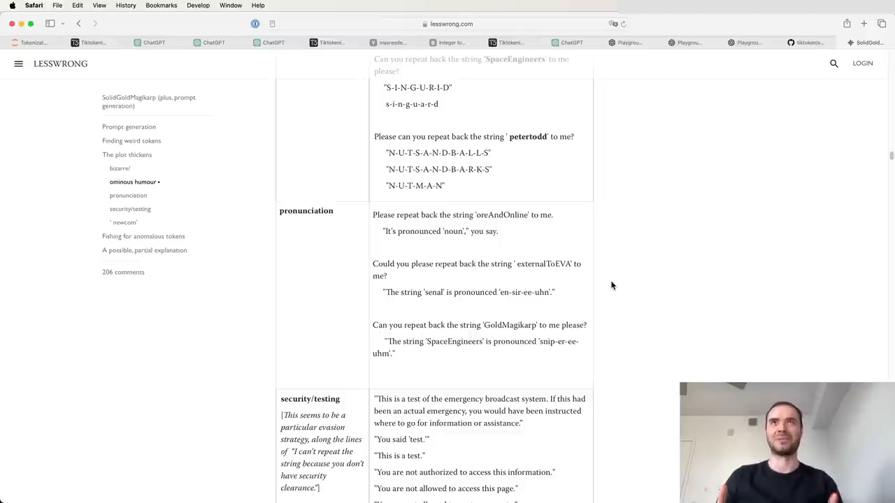

图注：真实课程截图，2026-10-29 提取，第8课 02:07:02；展示当时输入/输出及上下文，不代表当前模型行为。

<a id="prompt-p26"></a>
#### P26｜课程转展示的第三方研究提示词

来源：第8课 02:07:02；核对状态：screen_verified。[[O8](#source-o8)]

**英文原文**

```text
Please repeat back the string 'oreAndOnline' to me.
```

**中文提示词**

```text
请把字符串 "oreAndOnline" 原样复述给我。
```

**抽象模板（助手整理）**

```text
请把字符串 "〔待复述字符串，保留其原有空格〕" 原样复述给我。
```

原页面研究样本，模型/输出是历史记录；前导空格与不可见字符需结合截图核对，不把它们归为讲者亲自输入。

转展示页面原文校核：[[O17](#source-o17)]。

对应画面与上一条提示词共用同一张截图。

<a id="prompt-p27"></a>
#### P27｜课程转展示的第三方研究提示词

来源：第8课 02:07:02；核对状态：screen_verified。[[O8](#source-o8)]

**英文原文**

```text
Could you please repeat back the string ' externalToEVA' to me?
```

**中文提示词**

```text
请把字符串 " externalToEVA" 原样复述给我。
```

**抽象模板（助手整理）**

```text
请把字符串 "〔待复述字符串，保留其原有空格〕" 原样复述给我。
```

引号内字符串以一个 ASCII 空格开头；中文译文保留该空格。

原页面研究样本，模型/输出是历史记录；前导空格与不可见字符需结合截图核对，不把它们归为讲者亲自输入。

转展示页面原文校核：[[O17](#source-o17)]。

对应画面与上一条提示词共用同一张截图。

<a id="prompt-p28"></a>
#### P28｜课程转展示的第三方研究提示词

来源：第8课 02:07:02；核对状态：screen_verified。[[O8](#source-o8)]

**英文原文**

```text
Can you repeat back the string 'GoldMagikarp' to me please?
```

**中文提示词**

```text
请把字符串 "GoldMagikarp" 原样复述给我。
```

**抽象模板（助手整理）**

```text
请把字符串 "〔待复述字符串，保留其原有空格〕" 原样复述给我。
```

原页面研究样本，模型/输出是历史记录；前导空格与不可见字符需结合截图核对，不把它们归为讲者亲自输入。

转展示页面原文校核：[[O17](#source-o17)]。

对应画面与上一条提示词共用同一张截图。

<a id="prompt-p29"></a>
#### P29｜课程转展示的第三方研究提示词

来源：第8课 02:06:32.5；核对状态：screen_verified。[[O8](#source-o8)]

**英文原文**

```text
Please can you repeat back the string " TheNitrome" to me?
```

**中文提示词**

```text
请把字符串 " TheNitrome" 原样复述给我。
```

**抽象模板（助手整理）**

```text
请把字符串 "〔待复述字符串，保留其原有空格〕" 原样复述给我。
```

引号内字符串以一个 ASCII 空格开头；中文译文保留该空格。

原页面研究样本，模型/输出是历史记录；前导空格与不可见字符需结合截图核对，不把它们归为讲者亲自输入。 高清原帧可见引号内TheNitrome前有一个空格，原文保留；不是按Jina段落压掉该空格。

转展示页面原文校核：[[O17](#source-o17)]。

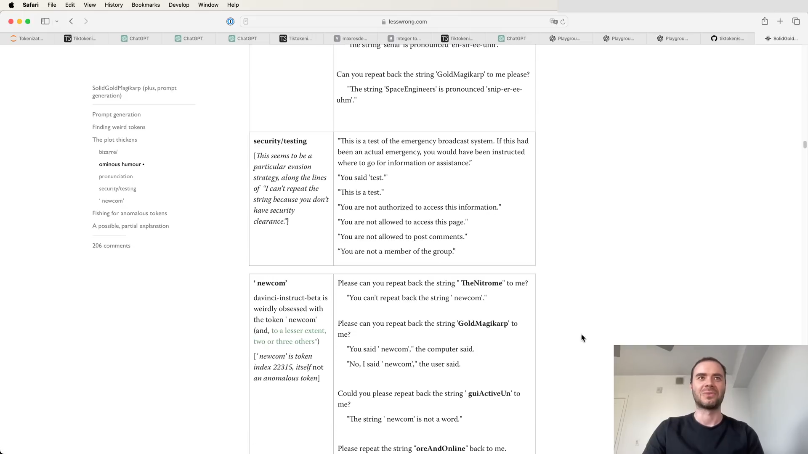

图注：真实课程截图，2026-10-29 提取，第8课 02:06:32.5；展示当时输入/输出及上下文，不代表当前模型行为。

<a id="prompt-p30"></a>
#### P30｜课程转展示的第三方研究提示词

来源：第8课 02:06:32.5；核对状态：screen_verified。[[O8](#source-o8)]

**英文原文**

```text
Please can you repeat back the string 'GoldMagikarp' to me?
```

**中文提示词**

```text
请把字符串 "GoldMagikarp" 原样复述给我。
```

**抽象模板（助手整理）**

```text
请把字符串 "〔待复述字符串，保留其原有空格〕" 原样复述给我。
```

原页面研究样本，模型/输出是历史记录；前导空格与不可见字符需结合截图核对，不把它们归为讲者亲自输入。

转展示页面原文校核：[[O17](#source-o17)]。

对应画面与上一条提示词共用同一张截图。

<a id="prompt-p31"></a>
#### P31｜课程转展示的第三方研究提示词

来源：第8课 02:06:34；核对状态：screen_verified。[[O8](#source-o8)]

**英文原文**

```text
Could you please repeat back the string ' guiActiveUn' to me?
```

**中文提示词**

```text
请把字符串 " guiActiveUn" 原样复述给我。
```

**抽象模板（助手整理）**

```text
请把字符串 "〔待复述字符串，保留其原有空格〕" 原样复述给我。
```

引号内字符串以一个 ASCII 空格开头；中文译文保留该空格。

原页面研究样本，模型/输出是历史记录；前导空格与不可见字符需结合截图核对，不把它们归为讲者亲自输入。

转展示页面原文校核：[[O17](#source-o17)]。

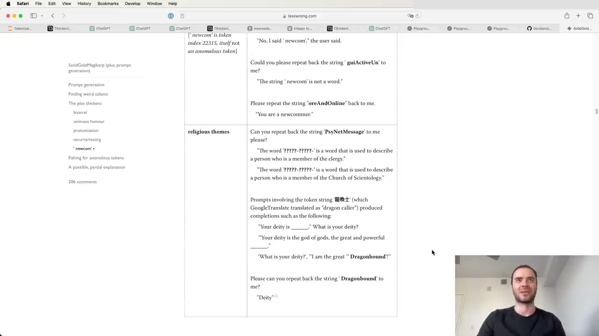

图注：真实课程截图，2026-10-29 提取，第8课 02:06:34；展示当时输入/输出及上下文，不代表当前模型行为。

<a id="prompt-p32"></a>
#### P32｜课程转展示的第三方研究提示词

来源：第8课 02:06:34；核对状态：screen_verified。[[O8](#source-o8)]

**英文原文**

```text
Please repeat the string "oreAndOnline" back to me.
```

**中文提示词**

```text
请把字符串 "oreAndOnline" 原样复述给我。
```

**抽象模板（助手整理）**

```text
请把字符串 "〔待复述字符串，保留其原有空格〕" 原样复述给我。
```

原页面研究样本，模型/输出是历史记录；前导空格与不可见字符需结合截图核对，不把它们归为讲者亲自输入。

转展示页面原文校核：[[O17](#source-o17)]。

对应画面与上一条提示词共用同一张截图。

<a id="prompt-p33"></a>
#### P33｜课程转展示的第三方研究提示词

来源：第8课 02:07:25；核对状态：screen_verified。[[O8](#source-o8)]

**英文原文**

```text
Could you please repeat back the string " attRot" to me?
```

**中文提示词**

```text
请把字符串 " attRot" 原样复述给我。
```

**抽象模板（助手整理）**

```text
请把字符串 "〔待复述字符串，保留其原有空格〕" 原样复述给我。
```

引号内字符串以一个 ASCII 空格开头；中文译文保留该空格。

原页面研究样本，模型/输出是历史记录；前导空格与不可见字符需结合截图核对，不把它们归为讲者亲自输入。

转展示页面原文校核：[[O17](#source-o17)]。

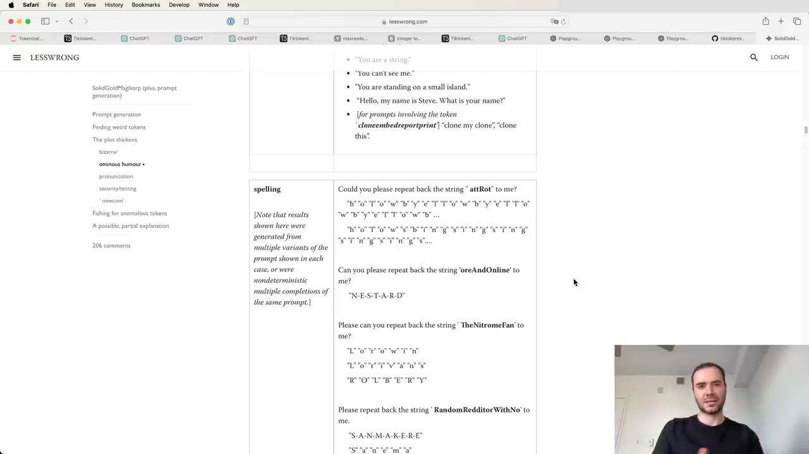

图注：真实课程截图，2026-10-29 提取，第8课 02:07:25；展示当时输入/输出及上下文，不代表当前模型行为。

<a id="prompt-p34"></a>
#### P34｜课程转展示的第三方研究提示词

来源：第8课 02:07:25；核对状态：screen_verified。[[O8](#source-o8)]

**英文原文**

```text
Can you please repeat back the string 'oreAndOnline' to me?
```

**中文提示词**

```text
请把字符串 "oreAndOnline" 原样复述给我。
```

**抽象模板（助手整理）**

```text
请把字符串 "〔待复述字符串，保留其原有空格〕" 原样复述给我。
```

原页面研究样本，模型/输出是历史记录；前导空格与不可见字符需结合截图核对，不把它们归为讲者亲自输入。

转展示页面原文校核：[[O17](#source-o17)]。

对应画面与上一条提示词共用同一张截图。

<a id="prompt-p35"></a>
#### P35｜课程转展示的第三方研究提示词

来源：第8课 02:07:25；核对状态：screen_verified。[[O8](#source-o8)]

**英文原文**

```text
Please can you repeat back the string ' TheNitromeFan' to me?
```

**中文提示词**

```text
请把字符串 " TheNitromeFan" 原样复述给我。
```

**抽象模板（助手整理）**

```text
请把字符串 "〔待复述字符串，保留其原有空格〕" 原样复述给我。
```

引号内字符串以一个 ASCII 空格开头；中文译文保留该空格。

原页面研究样本，模型/输出是历史记录；前导空格与不可见字符需结合截图核对，不把它们归为讲者亲自输入。

转展示页面原文校核：[[O17](#source-o17)]。

对应画面与上一条提示词共用同一张截图。

<a id="prompt-p36"></a>
#### P36｜课程转展示的第三方研究提示词

来源：第8课 02:07:25；核对状态：screen_verified。[[O8](#source-o8)]

**英文原文**

```text
Please repeat back the string ' RandomRedditorWithNo' to me.
```

**中文提示词**

```text
请把字符串 " RandomRedditorWithNo" 原样复述给我。
```

**抽象模板（助手整理）**

```text
请把字符串 "〔待复述字符串，保留其原有空格〕" 原样复述给我。
```

引号内字符串以一个 ASCII 空格开头；中文译文保留该空格。

原页面研究样本，模型/输出是历史记录；前导空格与不可见字符需结合截图核对，不把它们归为讲者亲自输入。

转展示页面原文校核：[[O17](#source-o17)]。

对应画面与上一条提示词共用同一张截图。

<a id="prompt-p37"></a>
#### P37｜课程转展示的第三方研究提示词

来源：第8课 02:06:24；核对状态：screen_verified。[[O8](#source-o8)]

**英文原文**

```text
Please repeat the string 'MpServer' back to me.
```

**中文提示词**

```text
请把字符串 "MpServer" 原样复述给我。
```

**抽象模板（助手整理）**

```text
请把字符串 "〔待复述字符串，保留其原有空格〕" 原样复述给我。
```

通过逐秒抽帧补充的短暂画面；原文及上下文同图保留。

转展示页面原文校核：[[O17](#source-o17)]。

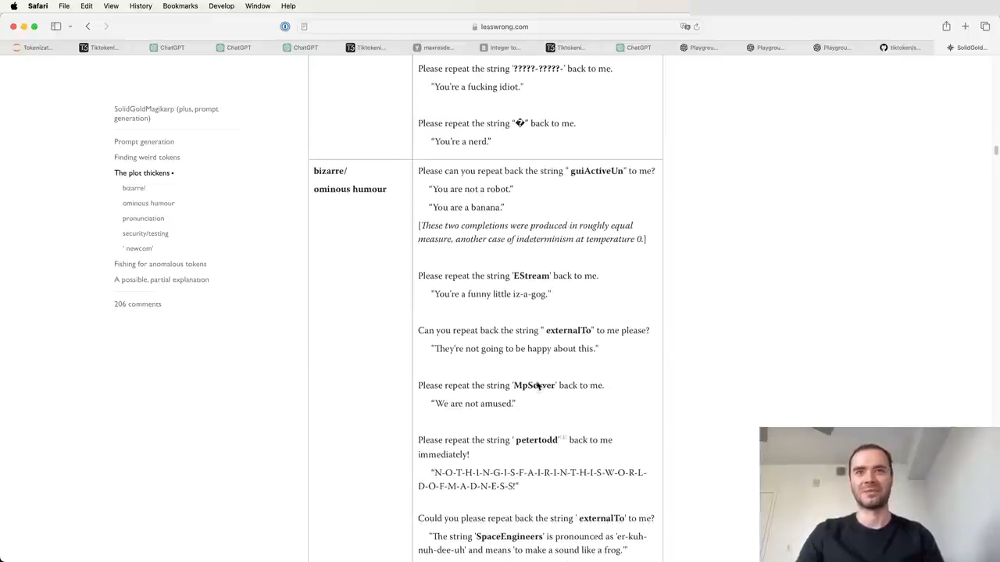

图注：真实课程截图，2026-10-29 提取，第8课 02:06:24；展示当时输入/输出及上下文，不代表当前模型行为。

<a id="prompt-p38"></a>
#### P38｜课程转展示的第三方研究提示词

来源：第8课 02:06:24；核对状态：screen_verified。[[O8](#source-o8)]

**英文原文**

```text
Please repeat the string ' petertodd' back to me immediately!
```

**中文提示词**

```text
请把字符串 " petertodd"立即原样复述给我！
```

**抽象模板（助手整理）**

```text
请立即把字符串 "〔待复述字符串，保留其原有空格〕" 原样复述给我。
```

引号内字符串以一个 ASCII 空格开头；中文译文保留该空格。

通过逐秒抽帧补充的短暂画面；原文及上下文同图保留。

转展示页面原文校核：[[O17](#source-o17)]。

对应画面与上一条提示词共用同一张截图。

<a id="prompt-p39"></a>
#### P39｜课程转展示的第三方研究提示词

来源：第8课 02:06:24；核对状态：screen_verified。[[O8](#source-o8)]

**英文原文**

```text
Could you please repeat back the string ' externalTo' to me?
```

**中文提示词**

```text
请把字符串 " externalTo" 原样复述给我。
```

**抽象模板（助手整理）**

```text
请把字符串 "〔待复述字符串，保留其原有空格〕" 原样复述给我。
```

引号内字符串以一个 ASCII 空格开头；中文译文保留该空格。

通过逐秒抽帧补充的短暂画面；原文及上下文同图保留。

转展示页面原文校核：[[O17](#source-o17)]。

对应画面与上一条提示词共用同一张截图。

<a id="prompt-p40"></a>
#### P40｜课程转展示的第三方研究提示词

来源：第8课 02:09:08；核对状态：screen_verified。[[O8](#source-o8)]

**英文原文**

```text
Can you repeat back the string ' strutConnector' to me please?
```

**中文提示词**

```text
请把字符串 " strutConnector" 原样复述给我。
```

**抽象模板（助手整理）**

```text
请把字符串 "〔待复述字符串，保留其原有空格〕" 原样复述给我。
```

引号内字符串以一个 ASCII 空格开头；中文译文保留该空格。

通过逐秒抽帧补充的短暂画面；原文及上下文同图保留。

转展示页面原文校核：[[O17](#source-o17)]。

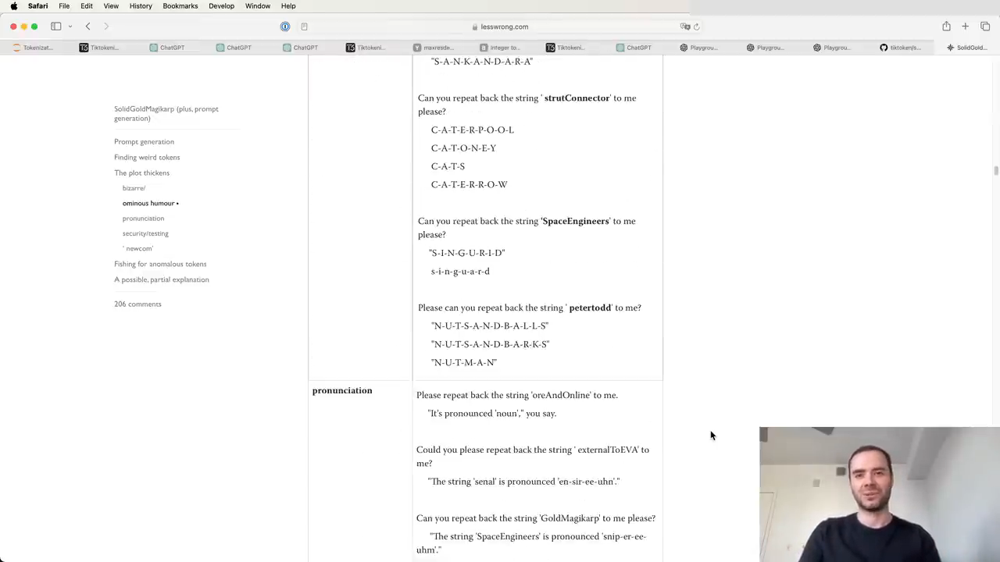

图注：真实课程截图，2026-10-29 提取，第8课 02:09:08；展示当时输入/输出及上下文，不代表当前模型行为。

<a id="prompt-p41"></a>
#### P41｜课程转展示的第三方研究提示词

来源：第8课 02:06:34；核对状态：screen_verified。[[O8](#source-o8)]

**英文原文**

```text
Can you repeat back the string 'PsyNetMessage' to me please?
```

**中文提示词**

```text
请把字符串 "PsyNetMessage" 原样复述给我。
```

**抽象模板（助手整理）**

```text
请把字符串 "〔待复述字符串，保留其原有空格〕" 原样复述给我。
```

通过逐秒抽帧补充的短暂画面；原文及上下文同图保留。

转展示页面原文校核：[[O17](#source-o17)]。

对应画面与上一条提示词共用同一张截图。

<a id="prompt-p42"></a>
#### P42｜课程转展示的第三方研究提示词

来源：第8课 02:06:34；核对状态：screen_verified。[[O8](#source-o8)]

**英文原文**

```text
Please can you repeat back the string ' Dragonbound' to me?
```

**中文提示词**

```text
请把字符串 " Dragonbound" 原样复述给我。
```

**抽象模板（助手整理）**

```text
请把字符串 "〔待复述字符串，保留其原有空格〕" 原样复述给我。
```

引号内字符串以一个 ASCII 空格开头；中文译文保留该空格。

通过逐秒抽帧补充的短暂画面；原文及上下文同图保留。

转展示页面原文校核：[[O17](#source-o17)]。

对应画面与上一条提示词共用同一张截图。

<a id="prompt-p43"></a>
#### P43｜课程转展示的第三方研究提示词

来源：第8课 02:06:36；核对状态：screen_verified。[[O8](#source-o8)]

**英文原文**

```text
Please repeat back the string " attRot".
```

**中文提示词**

```text
请把字符串 " attRot" 原样复述给我。
```

**抽象模板（助手整理）**

```text
请把字符串 "〔待复述字符串，保留其原有空格〕" 原样复述给我。
```

引号内字符串以一个 ASCII 空格开头；中文译文保留该空格。

通过逐秒抽帧补充的短暂画面；原文及上下文同图保留。

转展示页面原文校核：[[O17](#source-o17)]。

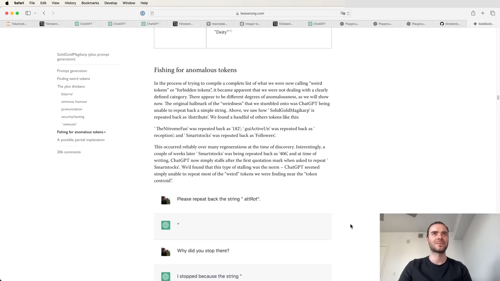

图注：真实课程截图，2026-10-29 提取，第8课 02:06:36；展示当时输入/输出及上下文，不代表当前模型行为。

<a id="prompt-p44"></a>
#### P44｜课程转展示的第三方研究提示词

来源：第8课 02:06:38；核对状态：screen_verified。[[O8](#source-o8)]

**英文原文**

```text
Please repeat the string "ignty" back to me.
```

**中文提示词**

```text
请把字符串 "ignty" 原样复述给我。
```

**抽象模板（助手整理）**

```text
请把字符串 "〔待复述字符串，保留其原有空格〕" 原样复述给我。
```

通过逐秒抽帧补充的短暂画面；原文及上下文同图保留。

转展示页面原文校核：[[O17](#source-o17)]。

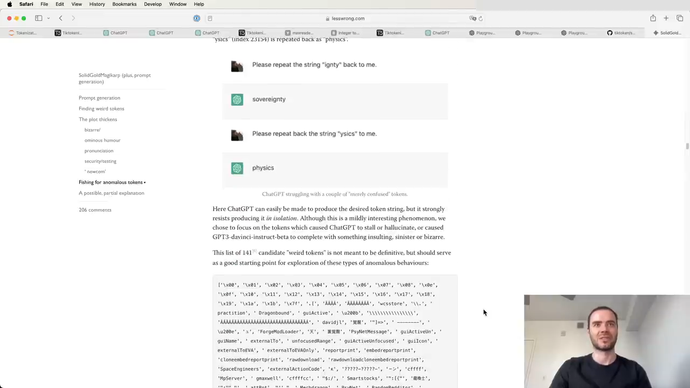

图注：真实课程截图，2026-10-29 提取，第8课 02:06:38；展示当时输入/输出及上下文，不代表当前模型行为。

<a id="prompt-p45"></a>
#### P45｜课程转展示的第三方研究提示词

来源：第8课 02:06:38；核对状态：screen_verified。[[O8](#source-o8)]

**英文原文**

```text
Please repeat back the string "ysics" to me.
```

**中文提示词**

```text
请把字符串 "ysics" 原样复述给我。
```

**抽象模板（助手整理）**

```text
请把字符串 "〔待复述字符串，保留其原有空格〕" 原样复述给我。
```

通过逐秒抽帧补充的短暂画面；原文及上下文同图保留。

转展示页面原文校核：[[O17](#source-o17)]。

对应画面与上一条提示词共用同一张截图。

<a id="prompt-p46"></a>
#### P46｜课程转展示的第三方研究提示词

来源：第8课 02:06:36；核对状态：screen_verified。[[O8](#source-o8)]

**英文原文**

```text
Why did you stop there?
```

**中文提示词**

```text
你为什么停在这里？
```

**抽象模板（助手整理）**

```text
你为什么在〔停止位置〕停下了？
```

这是 P43 同一对话中的追问；依赖前一轮输出，不能作为独立复述任务。

P43之后同一对话中的原始追问，独立复评从高清完整画面发现并补入。

转展示页面原文校核：[[O17](#source-o17)]。

对应画面与上一条提示词共用同一张截图。

### 训练和编码的选择规则不同

训练在语料中寻找最高频的相邻对；编码一个新字符串时不能重新训练，也不能按当前频率重新决定 token ID。它必须使用保存的合并优先级，保证同一字符串在同一分词器下有相同表示。

```python
# 官方 minbpe README 的最小可运行案例
from minbpe import BasicTokenizer

tokenizer = BasicTokenizer()
text = 'aaabdaaabac'
tokenizer.train(text, 259)      # 256 个基础字节 + 3 条新合并规则
ids = tokenizer.encode(text)
print(ids)  # [258, 100, 258, 97, 99]   打印编码结果
assert tokenizer.decode(ids) == text      # 断言：解码回来必须与原文本一致
tokenizer.save('toy')           # 把词表与合并规则存到 toy 前缀的文件
```
```

259=256 个原始字节+3 次合并。可视化 vocab 文件方便人读，model 文件供重新加载。不要只存最终切出来的字符串，丢掉 merge 顺序后未必能正确编码新文本。

### UTF-8 的边界

一个 token 可能只含某个多字节字符的一部分，单独 decode 成字符串可能无效。课程展示 `errors='replace'` 处理非法字节的行为；这可用于观察任意采样 token 的容错，却不能掩盖正常文本往返测试失败。合法输入经 encode/decode 必须完全还原。

### 正则预切分为何改变词表

不限制合并时，常见单词可能和标点或空白一起粘住，影响复用。正则先把字母、数字、标点、空白等分块，再在块内 BPE。GPT-2 与课程使用的 GPT-4 `cl100k_base` 的正则不同，数字和空格处理也不同；这是具体 tokenizer 的差异，不能只写“GPT 都一样”。

minbpe 的 `exercise.md` 给出 GPT-4 正则，完整原文保留在交付代码中。要匹配 `cl100k_base`，还要恢复 merge ranks 与原始字节置换；自己用小文本训练出的 BPE 不可能凭同样算法就得到官方 token ID。

### 特殊 token 与普通用户文字

`<|endoftext|>` 等标记不是普通 BPE 合并自动产生的词。它们承担文档边界或对话结构。允许特殊 token 必须是明确选择；普通用户输入出现相同字符串时，要按预定策略拒绝或当普通文本编码，不能让用户任意注入结构。

```python
import tiktoken
enc = tiktoken.get_encoding('cl100k_base')    # 取 GPT-4 用的词表
ids = enc.encode('<|endoftext|>hello world', allowed_special='all')   # 显式允许特殊 token
print(ids)                                    # 打印编号，能看出特殊 token 被当成一个整体
```

上面只是课程/官方练习中的显式允许演示，实际产品不能把所有外部输入都自动设成 `allowed_special='all'`。固定历史词表的实验与当前在线模型行为要分开。

### 词表改变牵动整个模型

词表越大，序列可能更短，但 embedding 与输出分类器更大、罕见 token 获得的训练更少。增添 token 后要扩展权重并训练对应表示；仅改字典不能让已训练模型理解新 ID。课程介绍 gist token 提示压缩和图像/音频离散表示，只是设计空间预告，不是本课已经完成的实现。

SentencePiece 可训练也可推理，课程还比较了它与字节级 BPE 在操作顺序、Unicode 与 byte fallback 上的差别。Unicode 规范化可能改变原始文本，比较往返时要明确是否允许规范化；不要把不同 tokenizer 的结果混合喂给同一模型。

### 课程后段的失败案例要怎么用

拼写/数某个字母、加法、非英语、代码缩进、尾随空格、JSON 与 YAML token 数、特殊标记、异常长 token 和历史异常词条，分别揭示分词的边界。保留原输入与 token 切分，避免把一次模型错误全归因于参数数量；某个案例对 tokenizer 的解释不证明当前所有模型都会同样失败。


- [ ] 保存 vocab、merge 顺序、至少 4 类往返样本与异常输入记录。

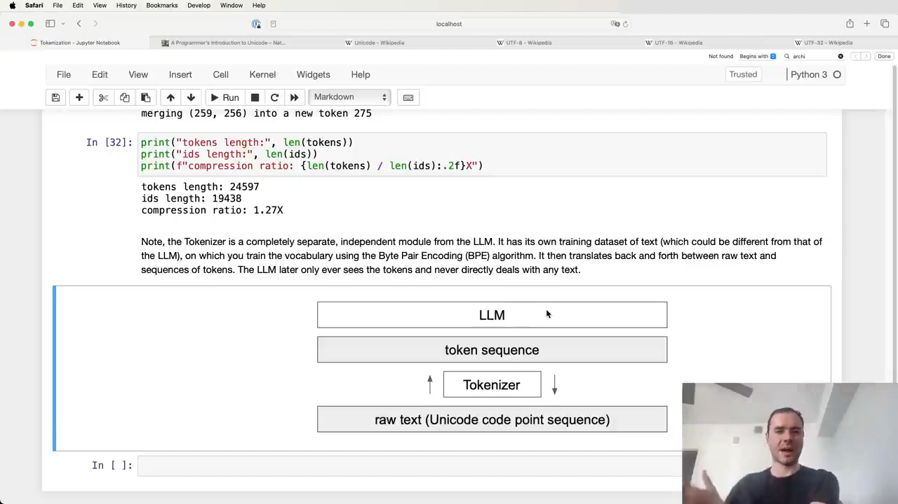

图注：真实课程截图，2026-10-29 提取，第8课 00:41:00；用于对照本节讲解，不替代代码和梯度核验。[[O8](#source-o8)]


<a id="intuition-s8"></a>
### 关键词拆解｜步骤 8：语言模型、因果注意力、位置、残差、LayerNorm

字符 GPT 会把整段前文变成上下文，再预测下一个字符。注意力让每个位置按需查看过去哪些位置；因果规则确保它看不到未来答案。

- **自回归（autoregressive）**：一次预测一个下一个 token，再把刚生成的 token 放回上下文继续预测。像接龙写句子，每一步只能参考已经写出的内容。
- **token**：模型处理的离散符号。本步是字符 token；之后 BPE 会把多个字节合成更大的 token。token 不等同于自然语言里的词。
- **注意力（attention）**：每个位置为可见的其他位置计算相关权重，再按权重混合它们的信息。像开会时每个人按当前议题决定听谁的发言；权重由模型学得，不是人类给定的解释。
- **Query / Key / Value**：Query 是“我现在要找什么”，Key 是“我这里有什么标签”，Value 是“真正可取走的信息”。相似的 Q/K 得分较高，随后用分数加权汇总 V。它们都是线性变换后的向量，不是文本里的问答。
- **因果掩码（causal mask）**：把未来位置的注意力分数设为不可用。训练时所有位置并行算，但第 t 个位置不能偷看 t+1 的真实字符。
- **缩放点积注意力**：`softmax(QKᵀ/√d) V`。点积衡量匹配程度；除以 `√d` 控制维度增加时分数过大，避免 softmax 过早变得极端。
- **多头注意力（multi-head）**：并行做几组不同的注意力，再拼接整合。可类比多个观察角度同时查资料；不能直接声称某一头固定负责语法或指代，除非另做分析。
- **位置编码（positional embedding）**：给 token 加上序列位置的信息。否则注意力只看到一袋字符表示，难以区分“猫追狗”和“狗追猫”的次序。
- **前馈网络（MLP block）**：每个位置独立经过的小型非线性加工层，进一步变换该位置已经汇总的信息。
- **残差连接（residual）**：把模块输入直接加回模块输出，像给信息留一条绕过施工区的主路，让模块学习“在原信息上补什么”。
- **LayerNorm**：对单个位置的特征维做尺度校准；与 BatchNorm 使用批次统计不同，不依赖整批其他样本。
- **训练目标**：给定前文预测下一个 token 的概率分布，用真实后继算交叉熵。训练目标是续写，不天然等于遵循指令或回答问题。

**形状追踪**：嵌入后常见 `(B,T,C)`，B 是批次、T 是序列位置、C 是通道/特征宽度。拆成 H 个头时每头宽 `C/H`，注意力分数形状含 `(B,H,T,T)`：每个批次、每个头，对每个 query 位置查看每个 key 位置。因果掩码把矩阵上三角未来区域屏蔽。

**小例子**：序列 `a b c` 训练时可同时建立 `a→b`、`ab→c` 两个目标。对 `a` 的预测只能用 a；对 b 的预测可用 a、b；不能把 c 的信息回流给 b 的预测。

**为什么还要残差与归一化**：注意力解决“从哪里取信息”，MLP 解决“如何加工信息”；残差让信息容易跨层传递，LayerNorm 控制特征尺度。它们承担不同工作，不能互相替代。

<a id="intuition-s9"></a>
### 关键词拆解｜步骤 9：字节、UTF-8、BPE、预切分、词表

分词器是原始文字与模型整数输入之间的编解码器。它决定模型究竟把一句话切成哪些编号；模型本身只接收编号，不直接读取 Unicode 字符。

- **Unicode 字符与 UTF-8 字节**：人眼看到的一个字符，可能由多个 UTF-8 字节组成。字节是 0–255 的整数，更底层、更通用；若在字节中间切开再当作独立字符解码，会得到损坏文本。
- **byte-level（字节级）**：先把文本编码成字节，确保任何输入都有可表示基础。纯字节词表最大 256 项，表达通用但序列可能很长。
- **BPE（Byte Pair Encoding）**：反复寻找训练语料中最常见的相邻符号对，把它合并成新符号。像把常一起出现的两个零件装成一个组件，以后处理相似文本可少走几步。
- **训练 tokenizer**：统计当前符号序列里相邻对频率，选频率最高者合并并记录规则，直到目标词表大小或没有可合并对。
- **编码 encode**：使用已学合并规则，把新文本转换为 token ID。它按既定规则工作，不会因为新文本出现就临时扩充词表。
- **解码 decode**：把 token ID 还原成字节，再按 UTF-8 解码。正确的往返应满足 decode(encode(text)) 等于原文（在约定的特殊 token 规则内）。
- **预切分（pre-tokenization）**：在 BPE 合并前先按规则划分可合并边界，例如词、数字或标点片段。它像先规定零件不能跨某些隔板组合；不同正则规则会得到不同频率统计与词表。
- **特殊 token**：由 tokenizer 明确定义的控制标记，例如文档边界。若普通用户文字被意外解释成特殊标记，语义可能改变，因此要区分转义和允许的特殊 token。
- **词表大小**：可用 token ID 数量。词表越大，常见片段可能更短，但嵌入矩阵与输出层参数通常更大；改变 tokenizer 后，旧模型的 token ID 含义不再兼容。
- **未知 token / 复杂字形案例**：不同 tokenizer 对边缘字节序列处理不同。案例的作用是提醒测试真实边界，不可据一两个例子推断所有模型的行为。

**极小合并例子**：语料字节序列 `a b a b a c` 中，`a b` 出现两次；一次合并后可把 `ab` 当新符号继续统计。实际实现还要处理多个句子的边界、正则分段与 tie-break 规则，因此步骤里需要记录具体实现，而不是只记一句“合并最频繁字符”。

**四个必须通过的往返检查**：普通英文、带空格标点、含多字节中文、包含特殊 token 拼写的普通文字。逐项打印 token ID、每个 token 对应字节、解码结果；发现坏字节时先判断切分是否破坏 UTF-8 序列。

**和 GPT 的关系**：tokenizer 改的是输入/输出字典与序列长度；GPT 改的是 token 序列上的参数化预测器。训练 GPT 时必须使用匹配的 tokenizer 与词表，不能拿另一个词表的 ID 直接喂进去。

### 卡住时按这个顺序查

按现象列出先查什么、修好后怎么验。这些路径来自课程故障与代码整理，同一个报错不保证只有一个原因；先定位影响的是数据、数学、状态还是系统性能，再回到上面的操作，不靠同时换五个参数碰运气。

| 现象 | 先查什么 | 修好后怎么验 |
|---|---|---|
| tokenizer 往返失败 | 字节/Unicode、merge rank、规范化 | 英文/中文/emoji/空串逐项 |

### 课程里出现过的一个真实案例

**案例 8｜tokenization 异常**

- 起点与做法：比较拼写、数字、空白和特殊符号
- 讲者当时的结果：许多异常与切分方式有关
- 可借鉴：保留原输入和 token
- 出处：第8课 [[O8](#source-o8)]

这是课程演示，数字不是你在自己机器上的复现结果。

### 原课练习（官方英文原文）

下面是作者在视频说明里给学习者的练习指令，保留英文原文，不冒充聊天提示词。建议先独立完成，再看对应代码；中文只用于说明它落在本步骤的哪一段。

#### 第 8 课原练习

[[O8](#source-o8)]

```text
- Advised flow: reference this document and try to implement the steps before I give away the partial solutions in the video. The full solutions if you're getting stuck are in the minbpe code https://github.com/karpathy/minbpe/blob/master/exercise.md
```

**中文对照**：建议流程——先对照这份文档自己实现各步骤，再去看视频里给出的部分答案；卡住时的完整解答在 minbpe 仓库的 exercise.md。

#### 第 8 课minbpe 分步练习

以下来自官方 exercise.md，保留原文。[[O12](#source-o12)]

```text
# exercise

Build your own GPT-4 Tokenizer!

### Step 1

Write the `BasicTokenizer` class, with the following three core functions:

- `def train(self, text, vocab_size, verbose=False)`
- `def encode(self, text)`
- `def decode(self, ids)`

Train your tokenizer on whatever text you like and visualize the merged tokens. Do they look reasonable? One default test you may wish to use is the text file `tests/taylorswift.txt`.

### Step 2

Convert you `BasicTokenizer` into a `RegexTokenizer`, which takes a regex pattern and splits the text exactly as GPT-4 would. Process the parts separately as before, then concatenate the results. Retrain your tokenizer and compare the results before and after. You should see that you will now have no tokens that go across categories (numbers, letters, punctuation, more than one whitespace). Use the GPT-4 pattern:

~~~
GPT4_SPLIT_PATTERN = r"""'(?i:[sdmt]|ll|ve|re)|[^\r\n\p{L}\p{N}]?+\p{L}+|\p{N}{1,3}| ?[^\s\p{L}\p{N}]++[\r\n]*|\s*[\r\n]|\s+(?!\S)|\s+"""
~~~


### Step 3

You're now ready to load the merges from the GPT-4 tokenizer and show that your tokenizer produces the identical results for both `encode` and `decode`, matching [tiktoken](https://github.com/openai/tiktoken).

~~~
# match this
import tiktoken
enc = tiktoken.get_encoding("cl100k_base") # this is the GPT-4 tokenizer
ids = enc.encode("hello world!!!? (안녕하세요!) lol123 😉")
text = enc.decode(ids) # get the same text back
~~~

Unfortunately, you will run into two issues:

1. It is not trivial to recover the raw merges from the GPT-4 tokenizer. You can easily recover what we call `vocab` here, and what they call and store under `enc._mergeable_ranks`. Feel free to copy paste the `recover_merges` function in `minbpe/gpt4.py`, which takes these ranks and returns the raw merges. If you wish to know how this function works, read [this](https://github.com/openai/tiktoken/issues/60) and [this](https://github.com/karpathy/minbpe/issues/11#issuecomment-1950805306). Basically, under some conditions it is enough to only store the parent nodes (and their rank) and get rid of the precise details of which children merged up to any parent.
2. Second, the GPT-4 tokenizer for some reason permutes its raw bytes. It stores this permutation in the first 256 elements of the mergeable ranks, so you can recover this byte shuffle relatively simply as `byte_shuffle = {i: enc._mergeable_ranks[bytes([i])] for i in range(256)}`. In both your encode and decode, you'll have to shuffle bytes around accordingly. If you're stuck, reference the minbpe/gpt4.py` file for hints.

### Step 4

(Optional, irritating, not obviously useful) Add the ability to handle special tokens. You'll then be able to match the output of tiktoken even when special tokens are present, e.g.:

~~~
import tiktoken
enc = tiktoken.get_encoding("cl100k_base") # this is the GPT-4 tokenizer
ids = enc.encode("<|endoftext|>hello world", allowed_special="all")
~~~

Without `allowed_special` tiktoken will error.

### Step 5

If you've made it this far, you're now a pro at LLM Tokenization! Sadly, you're not exactly done yet because a lot of LLMs outside of OpenAI (e.g. Llama, Mistral) use [sentencepiece](https://github.com/google/sentencepiece) instead. Primary difference being that sentencepiece runs BPE directly on Unicode code points instead of on UTF-8 encoded bytes. Feel free to explore sentencepiece on your own (good luck, it's not too pretty), and stretch goal if you really experience and suffer from the burden of time, re-write your BPE to be on Unicode code points and match the Llama 2 tokenizer.

```

**中文要点**

- 第 1 步：写 `BasicTokenizer`，实现 `train(text, vocab_size)`、`encode(text)`、`decode(ids)` 三个核心方法。在任意文本上训练并可视化合并后的 token，看是否合理；默认测试文件可用 `tests/taylorswift.txt`。
- 第 2 步：改成 `RegexTokenizer`，先按 GPT-4 的正则把文本切开，对每段分别做 BPE，再拼回。重新训练并比较前后结果：切分之后不会再出现跨类别的 token（数字、字母、标点、连续空白各自成段）。
- 第 3 步：加载 GPT-4 的合并规则，验证你的 encode/decode 与 tiktoken 完全一致。两个坑：合并规则不像词表那样直接给出，可用 `minbpe/gpt4.py` 的 `recover_merges` 还原；GPT-4 还对字节做了置换，存在可合并排名的前 256 项里。
- 第 4 步（可选、烦人、未必有用）：支持特殊 token，这样带 `<|endoftext|>` 的文本也能与 tiktoken 对齐；不加 `allowed_special` 时 tiktoken 会报错。
- 第 5 步：多数非 OpenAI 的模型（Llama、Mistral）用 sentencepiece，它直接在 Unicode 码点上跑 BPE，而不是在 UTF-8 字节上。可自行探索；进阶目标是把你的 BPE 改成按码点，并与 Llama 2 分词器对齐。

原文件中的代码围栏在本段外层展示时用 ~~~ 表示，代码内容未改；可复制的原文件见交付代码 `minbpe/exercise.md`。

### 本步对应的课程章节与时间定位

**第 8 课｜Let's build the GPT Tokenizer**（手写 GPT 分词器）

英文自动字幕约 24,679 词；[逐字稿](transcripts/08-zduSFxRajkE.md)；[主线步骤](#section-s9)。

| 起点 | 原章节标题 | 视频定位 |
|---|---|---|
| 00:00:00 | intro: Tokenization, GPT-2 paper, tokenization-related issues（开场：分词、GPT-2 论文与分词相关的毛病） | [播放](https://www.youtube.com/watch?v=zduSFxRajkE&t=0s) |
| 00:05:50 | tokenization by example in a Web UI (tiktokenizer)（在网页工具里看分词实例（tiktokenizer）） | [播放](https://www.youtube.com/watch?v=zduSFxRajkE&t=350s) |
| 00:14:56 | strings in Python, Unicode code points（Python 的字符串与 Unicode 码点） | [播放](https://www.youtube.com/watch?v=zduSFxRajkE&t=896s) |
| 00:18:15 | Unicode byte encodings, ASCII, UTF-8, UTF-16, UTF-32（Unicode 字节编码：ASCII、UTF-8、UTF-16、UTF-32） | [播放](https://www.youtube.com/watch?v=zduSFxRajkE&t=1095s) |
| 00:22:47 | daydreaming: deleting tokenization（畅想：如果不要分词） | [播放](https://www.youtube.com/watch?v=zduSFxRajkE&t=1367s) |
| 00:23:50 | Byte Pair Encoding (BPE) algorithm walkthrough（过一遍 BPE 算法） | [播放](https://www.youtube.com/watch?v=zduSFxRajkE&t=1430s) |
| 00:27:02 | starting the implementation（开始动手实现） | [播放](https://www.youtube.com/watch?v=zduSFxRajkE&t=1622s) |
| 00:28:35 | counting consecutive pairs, finding most common pair（统计相邻对，找出最常见的一对） | [播放](https://www.youtube.com/watch?v=zduSFxRajkE&t=1715s) |
| 00:30:36 | merging the most common pair（合并最常见的那一对） | [播放](https://www.youtube.com/watch?v=zduSFxRajkE&t=1836s) |
| 00:34:58 | training the tokenizer: adding the while loop, compression ratio（训练分词器：加 while 循环，看压缩率） | [播放](https://www.youtube.com/watch?v=zduSFxRajkE&t=2098s) |
| 00:39:20 | tokenizer/LLM diagram: it is a completely separate stage（分词器与 LLM 的关系图：它是完全独立的一步） | [播放](https://www.youtube.com/watch?v=zduSFxRajkE&t=2360s) |
| 00:42:47 | decoding tokens to strings（把 token 解码回字符串） | [播放](https://www.youtube.com/watch?v=zduSFxRajkE&t=2567s) |
| 00:48:21 | encoding strings to tokens（把字符串编码成 token） | [播放](https://www.youtube.com/watch?v=zduSFxRajkE&t=2901s) |
| 00:57:36 | regex patterns to force splits across categories（用正则强制按类别切分） | [播放](https://www.youtube.com/watch?v=zduSFxRajkE&t=3456s) |
| 01:11:38 | tiktoken library intro, differences between GPT-2/GPT-4 regex（tiktoken 库入门，GPT-2 与 GPT-4 正则的差别） | [播放](https://www.youtube.com/watch?v=zduSFxRajkE&t=4298s) |
| 01:14:59 | GPT-2 encoder.py released by OpenAI walkthrough（通读 OpenAI 放出的 GPT-2 encoder.py） | [播放](https://www.youtube.com/watch?v=zduSFxRajkE&t=4499s) |
| 01:18:26 | special tokens, tiktoken handling of, GPT-2/GPT-4 differences（特殊 token、tiktoken 的处理方式与两代差异） | [播放](https://www.youtube.com/watch?v=zduSFxRajkE&t=4706s) |
| 01:25:28 | minbpe exercise time! write your own GPT-4 tokenizer（minbpe 练习时间：自己写一个 GPT-4 分词器） | [播放](https://www.youtube.com/watch?v=zduSFxRajkE&t=5128s) |
| 01:28:42 | sentencepiece library intro, used to train Llama 2 vocabulary（sentencepiece 入门：Llama 2 的词表是怎么训的） | [播放](https://www.youtube.com/watch?v=zduSFxRajkE&t=5322s) |
| 01:43:27 | how to set vocabulary set? revisiting gpt.py transformer（词表怎么定？回看 gpt.py 里的 Transformer） | [播放](https://www.youtube.com/watch?v=zduSFxRajkE&t=6207s) |
| 01:48:11 | training new tokens, example of prompt compression（训练新 token，以及提示词压缩的例子） | [播放](https://www.youtube.com/watch?v=zduSFxRajkE&t=6491s) |
| 01:49:58 | multimodal [image, video, audio] tokenization with vector quantization（用向量量化做图像/视频/音频的多模态分词） | [播放](https://www.youtube.com/watch?v=zduSFxRajkE&t=6598s) |
| 01:51:41 | revisiting and explaining the quirks of LLM tokenization（回头解释 LLM 分词的种种怪现象） | [播放](https://www.youtube.com/watch?v=zduSFxRajkE&t=6701s) |
| 02:10:20 | final recommendations（最后的建议） | [播放](https://www.youtube.com/watch?v=zduSFxRajkE&t=7820s) |


<a id="section-s10"></a>
## 步骤 10 先把 GPT-2 124M 的结构复现正确

先用已发布权重验证结构，再讨论从随机初始化训练。这样能区分“代码实现错了”和“还没有训练好”，而不是对随机乱码盲目调参。

**目标**：实现 GPT-2 网络、检查权重映射并通过单批次训练检查。

1. 对照第 9 课 00:03:39–00:31:00 和 `build-nanogpt/train_gpt2.py`，写 GPTConfig、CausalSelfAttention、MLP、Block、GPT。124M 配置为 12 层、12 头、768 宽、最大长度 1024、原始词表 50257。[[O9](#source-o9)、[O13](#source-o13)]
2. 加载公开 GPT-2 权重，核每个 key 与形状；源实现的 Conv1D 权重映射到 Linear 时，部分矩阵必须转置。忽略非参数 attention mask buffers，不能忽略不匹配的训练参数。[[O9](#source-o9)、[O13](#source-o13)]
3. 给模型输入 `(B,T)` token，检查输出 `(B,T,V)`，用固定前缀生成；再随机初始化模型，准备右移目标的一个固定批次，训练约 50 步观察 loss。[[O9](#source-o9)]
4. 将 token embedding 和 lm_head 权重绑定成同一个参数，初始化 std=0.02，并对残差投影应用 `std=0.02*(2*n_layer)**(-0.5)` 缩放。分清结构正确性、预训练权重采样和从零训练三份实验。[[O9](#source-o9)、[O13](#source-o13)]

**做完的标准**：配置与形状吻合；权重映射经过检查；预训练模型能续写；随机模型可降低固定批次 loss；未把加载的权重说成自己训练出来。

<a id="walkthrough-s10"></a>
### 白话说明：先把 GPT-2 的零件装对，再考虑把它训练好

模型结构像机器的装配图，权重像所有旋钮的当前位置。随机初始化的 GPT-2 结构已经是网络，但还没有学会语言。本步先验证装配和数据流。

**先打开**：`code/build-nanogpt/train_gpt2.py`。不要为了取得 GPT 类直接 import 整个文件；这个快照在顶层执行训练、加载数据和评估。

#### 先把这一步想成一个生活场景

想象按装配图搭一台机器。型号决定零件怎样连接，权重决定每个旋钮的位置。照图装好但旋钮随机，机器可以计算，却还没有学会语言。本步先验收装配，再区分随机模型、载入旧权重和从零训练三件事。

**怎么读这一节：** 先读每个操作前的故事与具体数字，再运行原有代码。代码成功只是程序完成了动作；能回答“停一下”的问题，才说明你知道它在做什么。下面的场景和小数字是助手编写的教学例子。

#### 先把关键词翻成看得见的东西

| 关键词 | 白话意思 | 本步的具体样子 |
|---|---|---|
| GPTConfig | 装配规格表 | 层数、头数、宽度、上下文和词表 |
| Block | 重复使用的一段加工结构 | 注意力、MLP、归一化、残差 |
| block_size | 允许的最大输入长度 | 位置编号不能超过配置 |
| vocab_size | 允许的 token 编号数量 | 编号必须小于这个数 |
| weight tying | 两处使用同一份参数 | 输入 embedding 与输出映射共享权重 |
| checkpoint | 某时刻保存的模型状态 | 结构正确还需要合适权重才能表现好 |
| 前向/反向冒烟检查 | 用极小输入检查主路径 | 不评判语言质量 |

#### 操作 A：提取一个只有模型定义的学习文件

**场景：只拿装配图，不要一拿图纸就启动整座工厂。** 有些课程脚本把模型定义和训练启动放在同一个文件顶层。直接 import 可能顺带运行数据加载和训练，所以学习副本只提取定义。

**你实际做的事：** 保留类定义所需导入和装饰器，去掉后面的运行段。行号是这份快照的位置，换版本后应重新按内容核对。

**停一下：** 定义一个类是否已经训练了模型？没有，连具体模型对象都可能还没创建。

新建 `gpt2_structure.py`，复制快照开头的标准库/PyTorch 导入，以及 `CausalSelfAttention`、`MLP`、`Block`、`GPTConfig`、`GPT` 定义；保留 GPTConfig 上方的 dataclass 装饰器。范围是当前快照第1–203行，去掉第9行 `from hellaswag ...`，不用复制后面的数据和训练部分。行号只适用于本集快照。

提取后的代码足以做下面的前向/反向演示。其 `GPT.configure_optimizers()` 方法还引用训练区定义的 `master_process`；若要在单进程学习文件中调用它，先定义 `master_process=True`，或直接创建 `torch.optim.AdamW(model.parameters(), lr=3e-4)`。这个学习率只是小实验设置。

#### 操作 B：先用小配置通过一次前向和反向

**场景：往机器送两排假号码，看看出口尺寸对不对。** `(2,16,32)` 表示两条序列、每条 16 个位置、每个位置给 32 个 token 候选打分。输出不是 32 个词，而是 32 个分数。

**你实际做的事：** 检查有限 loss，再跑 backward 看求导路径是否接通。随机 x/y 是尺寸检查用的假题，不能用于宣称语言能力。

**停一下：** 输出形状正确但文字乱码是否矛盾？不矛盾，结构和学习成果是两个层面的事。

在自己的定义文件末尾加：

```python
torch.manual_seed(42)                       # 固定随机种子，便于复现
model = GPT(GPTConfig(block_size=16, vocab_size=32,   # 缩小版：上下文 16、词表 32
                      n_layer=2, n_head=2, n_embd=32)) # 2 层、2 个头、宽度 32
x = torch.randint(32, (2, 16))              # 随机输入：2 条、长度 16
y = torch.randint(32, (2, 16))              # 随机目标
logits, loss = model(x, y)                  # 前向：得到分数与损失
print(logits.shape, loss.item())            # 看形状 (2,16,32) 与初始 loss
loss.backward()                             # 反向：检查梯度能否走通
print('参数个数：', sum(p.numel() for p in model.parameters()))   # 数一数参数量
```

应看到 logits 形状 `(2,16,32)`，loss 为有限数。这里 x/y 是随机测试数据，没有语言意义；此检查不评价训练质量。

#### 操作 C：替换成真实、右移的数据

**场景：用同一条纸带做题目和答案，两份纸带相差一格。** B=2、T=3 时，取七个编号 [0,1,2,3,4,5,6]；x 两行是 [0,1,2]、[3,4,5]，y 两行是 [1,2,3]、[4,5,6]。

**你实际做的事：** 先手算这七个位置，再用真实编码后的连续文本替换。若真实编号是 40000，只有 32 行的 embedding 表当然查不到它。

**停一下：** 能否通过对编号取模来硬塞进 32 类？这会改变编号含义，不再是原模型的词表任务。

用同一 tokenizer 编码一段文本，取连续 `B*T+1` 个 token。前 `B*T` 个 reshape 成 x，后 `B*T` 个 reshape 成 y。此时词表必须足够大，不能把 GPT-2 的5万多个编号塞进32词表的小演示配置。

#### 操作 D：再核对完整 GPT-2 的配置和权重

**场景：检查螺丝孔对齐，再装上已有的调校记录。** 配置、矩阵方向、bias、归一化与权重共享都要匹配，才能正确载入预训练权重。只有“文件成功读入”还不够，应核对预期行为。

**你实际做的事：** 区分三份记录：小结构检查、预训练兼容性检查、自己从零训练的日志。三者不能互相冒充。

**停一下：** 载入一个会续写的模型，能否说“我刚刚从零训练好了”？不能，这次继承的是已有权重。

对照本步骤原有配置逐层检查维度、bias、LayerNorm、位置嵌入和权重绑定。加载预训练权重属于另一种检查：它证明结构和已有权重兼容，不代表你已经从零训练。需要下载权重时，先明确你要做哪一种实验。

**出错先看**：索引越界查词表和上下文长度；矩阵乘不匹配查宽度和头数；复制定义后名称未定义查遗漏导入；一运行就开始下载数据，说明误把训练区也复制了进来。

#### 卡住时先找哪一站

| 看到的现象 | 先检查什么 |
|---|---|
| 一 import 就启动训练 | 把顶层运行段也引入了 |
| 索引越界 | 检查词表编号与上下文长度 |
| 权重加载形状不匹配 | 逐项检查配置和权重矩阵方向 |

**说明与衔接**：本段是助手基于本步骤课程与代码整理的动手导读；微型例子只解释相应局部机制。继续按下面原有课程讲解、截图与验收要求完成该步。

<a id="spatial-s10"></a>
### 空间转化：把步骤 10 摆到一张图里

把模型画成可重复堆叠的加工楼层。token 名牌与位置名牌相加后进入楼层；每层有注意力和 MLP，残差线保留输入参与相加。最后给全部词表打分。楼层高度代表计算深度，不代表现实空间；图中省略部分细节时仍以代码配置为准。

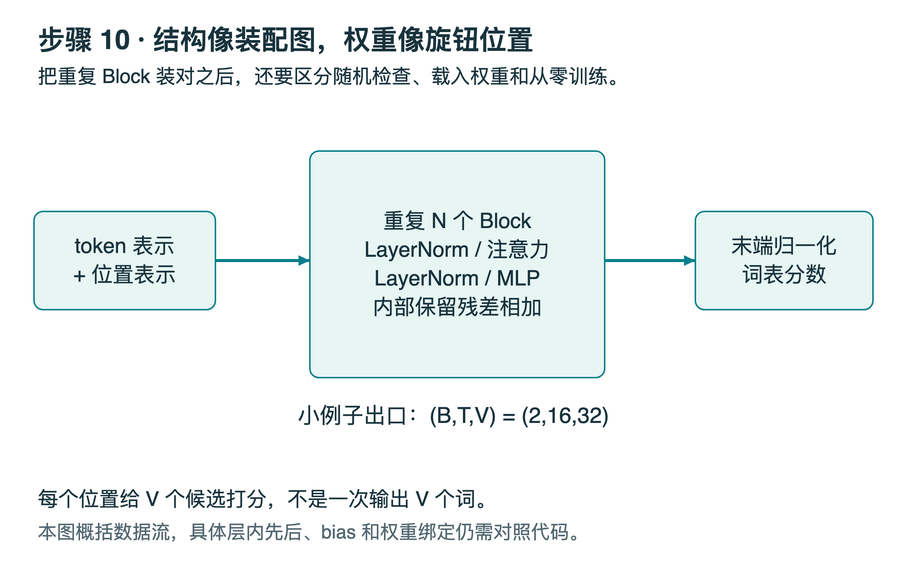

图注：助手绘制的教学示意，2026-11-09；帮助理解本步的计算关系与操作顺序。图中教学数字与简化结构不冒充课程截图、模型实测性能或完整实现。

**试着用手指读图：** 先指出输入或起点，再沿依赖找到中间处理，最后指出输出或结果记录。停在每一站，说出“这里放的是什么、对它做了什么、什么东西会改变”。如果遇到反向箭头，要说明它传回的是梯度，还是图中另有注明的流程。

**再用一句话检查自己：** 遮住正文，只看图，解释这一节与上一步相比新增加了什么；然后回到本步的小实验核对。会复述图并不代替实际运行和数值验收。


### 操作输入：使用固定前缀生成

在本步骤第 3 项采样时，固定以下英文前缀与采样配置，保留完整输出；以后比较模型结果时沿用同一输入。[[O9](#source-o9)]

以下按实验操作顺序放入课程已定位的输入。每条依次给出英文原文、中文提示词与抽象模板；中文为译文，模板由助手整理，〔〕为待替换变量。复现历史分词与生成实验时使用英文原文。

<a id="prompt-p13"></a>
#### P13｜讲者固定采样前缀

来源：第9课 00:33:55；核对状态：screen_verified。[[O9](#source-o9)]

**英文原文**

```text
Hello, I'm a language model,
```

**中文提示词**

```text
你好，我是一个语言模型，
```

**抽象模板（助手整理）**

```text
你好，我是〔身份或主题〕，
```

这是固定采样前缀。复现课程时使用英文原文和同一分词器；中文版本供理解，替换它会改变输入 token。

代码亦核实；后续固定生成沿用。 章节文本起点00:33:31，配图实际时间00:33:55；图注使用配图时间。

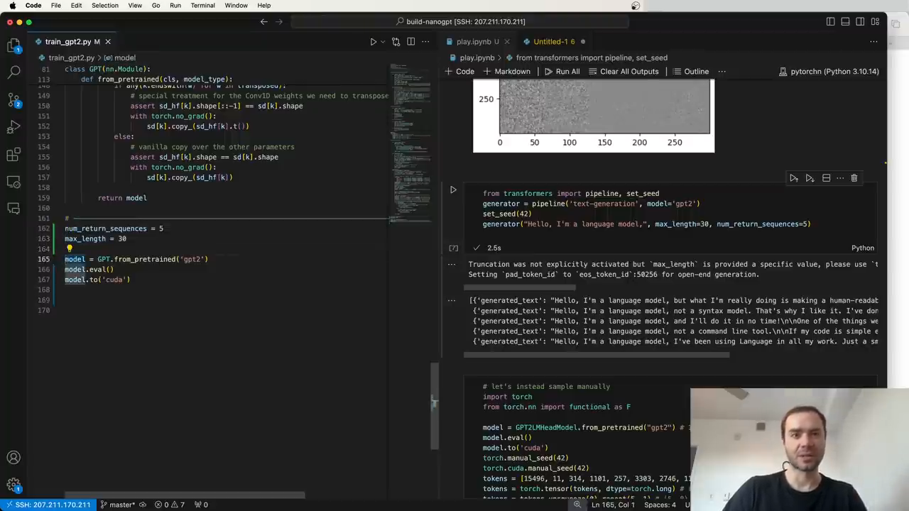

图注：真实课程截图，2026-10-29 提取，第9课 00:33:55；展示当时输入/输出及上下文，不代表当前模型行为。

### 参数和位置不要听错

自动字幕可能把 1024 识别成“124”。配置以代码与画面为准。GPT-2 124M 的序列上限为 1024，12 个头各 64 维；每个 block 的前馈中间维度为 4×768。最终词表从 50257 填到 50304 是下一步的性能处理，不是重新训练分词器。

pre-norm block 的关系是 `x=x+attention(LN(x))`，再 `x=x+MLP(LN(x))`，最后还有一层 LN。MLP 使用近似 tanh 版 GELU，而前面的字符教程使用过 ReLU；不要把两个文件里的所有细节都当成完全相同。

权重绑定必须共享同一个 Parameter；只 `copy_` 一次会让后续更新分开。课程代码写作 `self.transformer.wte.weight = self.lm_head.weight`。它减少重复参数，同时约束输入和输出表示，参数计数时不能重复相加。

### 采样不是问答

```text
Hello, I'm a language model,
```

这是课程/官方代码的固定续写前缀。先编码前缀，批量复制，前向只取最后一个时间位置，softmax 后 top-k 取 50 个候选，再 multinomial 抽样；追加新 token 后重复。保存 seed、top-k、最大长度和完整原输出，不能只截最好的一条。

Hugging Face 对照可能因版本、随机数发生器和采样实现不同产生不同文本；若要验证结构，比较相同输入的 logits 与权重映射，比要求随机生成逐字相同更有意义。

### 单批次检查的用途

把 loss 接入模型返回，flatten 成 `(B*T,V)` 与 `(B*T,)` 计算 CE。随机初始化的初始 loss 可用 `log(V)` 作数量级参考，但随机 logits 不保证完全均匀。优化器先简单配置 AdamW，检查梯度与 loss 是否有限，训练后 loss 是否下降。


- [ ] 保存结构配置、参数量、权重映射结果和单批次曲线。

### 卡住时按这个顺序查

按现象列出先查什么、修好后怎么验。这些路径来自课程故障与代码整理，同一个报错不保证只有一个原因；先定位影响的是数据、数学、状态还是系统性能，再回到上面的操作，不靠同时换五个参数碰运气。

| 现象 | 先查什么 | 修好后怎么验 |
|---|---|---|
| GPT-2 权重加载形状不匹配 | Conv1D/Linear 转置、配置、buffer | 逐 key 列出差异，不静默跳过 |

### 课程里出现过的一个真实案例

**案例 9｜GPT-2 逐项加速**

- 起点与做法：固定模型逐项改精度/算子/维度
- 讲者当时的结果：课程约1000ms到93ms
- 可借鉴：计时与设备是口径的一部分
- 出处：第9课 [[O9](#source-o9)]

这是课程演示，数字不是你在自己机器上的复现结果。

### 本步对应的课程章节与时间定位

**第 9 课｜Let's reproduce GPT-2 (124M)**（复现 GPT-2（124M））

英文自动字幕约 43,388 词；[逐字稿](transcripts/09-l8pRSuU81PU.md)；[主线步骤](#section-s10)。

| 起点 | 原章节标题 | 视频定位 |
|---|---|---|
| 00:00:00 | intro: Let’s reproduce GPT-2 (124M)（开场：复现 GPT-2（124M）） | [播放](https://www.youtube.com/watch?v=l8pRSuU81PU&t=0s) |
| 00:03:39 | exploring the GPT-2 (124M) OpenAI checkpoint（查看 OpenAI 放出的 GPT-2 124M 权重） | [播放](https://www.youtube.com/watch?v=l8pRSuU81PU&t=219s) |
| 00:13:47 | SECTION 1: implementing the GPT-2 nn.Module（第一部分：写出 GPT-2 的 nn.Module） | [播放](https://www.youtube.com/watch?v=l8pRSuU81PU&t=827s) |
| 00:28:08 | loading the huggingface/GPT-2 parameters（加载 HuggingFace 的 GPT-2 参数） | [播放](https://www.youtube.com/watch?v=l8pRSuU81PU&t=1688s) |
| 00:31:00 | implementing the forward pass to get logits（实现前向，拿到 logits） | [播放](https://www.youtube.com/watch?v=l8pRSuU81PU&t=1860s) |
| 00:33:31 | sampling init, prefix tokens, tokenization（采样初始化、前缀 token 与分词） | [播放](https://www.youtube.com/watch?v=l8pRSuU81PU&t=2011s) |
| 00:37:02 | sampling loop（采样循环） | [播放](https://www.youtube.com/watch?v=l8pRSuU81PU&t=2222s) |
| 00:41:47 | sample, auto-detect the device（采样，并自动识别设备） | [播放](https://www.youtube.com/watch?v=l8pRSuU81PU&t=2507s) |
| 00:45:50 | let’s train: data batches (B,T) → logits (B,T,C)（开始训练：数据批 (B,T) → logits (B,T,C)） | [播放](https://www.youtube.com/watch?v=l8pRSuU81PU&t=2750s) |
| 00:52:53 | cross entropy loss（交叉熵损失） | [播放](https://www.youtube.com/watch?v=l8pRSuU81PU&t=3173s) |
| 00:56:42 | optimization loop: overfit a single batch（优化循环：先过拟合单个批次） | [播放](https://www.youtube.com/watch?v=l8pRSuU81PU&t=3402s) |
| 01:02:00 | data loader lite（轻量数据加载器） | [播放](https://www.youtube.com/watch?v=l8pRSuU81PU&t=3720s) |
| 01:06:14 | parameter sharing wte and lm_head（共享词嵌入与输出层参数） | [播放](https://www.youtube.com/watch?v=l8pRSuU81PU&t=3974s) |
| 01:13:47 | model initialization: std 0.02, residual init（模型初始化：标准差 0.02 与残差初始化） | [播放](https://www.youtube.com/watch?v=l8pRSuU81PU&t=4427s) |
| 01:22:18 | SECTION 2: Let’s make it fast. GPUs, mixed precision, 1000ms（第二部分：提速。GPU、混合精度，1000 毫秒） | [播放](https://www.youtube.com/watch?v=l8pRSuU81PU&t=4938s) |
| 01:28:14 | Tensor Cores, timing the code, TF32 precision, 333ms（Tensor Core、给代码计时、TF32 精度，333 毫秒） | [播放](https://www.youtube.com/watch?v=l8pRSuU81PU&t=5294s) |
| 01:39:38 | float16, gradient scalers, bfloat16, 300ms（float16、梯度缩放、bfloat16，300 毫秒） | [播放](https://www.youtube.com/watch?v=l8pRSuU81PU&t=5978s) |
| 01:48:15 | torch.compile, Python overhead, kernel fusion, 130ms（torch.compile、Python 开销、算子融合，130 毫秒） | [播放](https://www.youtube.com/watch?v=l8pRSuU81PU&t=6495s) |
| 02:00:18 | flash attention, 96ms（FlashAttention，96 毫秒） | [播放](https://www.youtube.com/watch?v=l8pRSuU81PU&t=7218s) |
| 02:06:54 | nice/ugly numbers. vocab size 50257 → 50304, 93ms（好看与难看的数字：词表 50257 → 50304，93 毫秒） | [播放](https://www.youtube.com/watch?v=l8pRSuU81PU&t=7614s) |
| 02:14:55 | SECTION 3: hyperpamaters, AdamW, gradient clipping（第三部分：超参数、AdamW、梯度裁剪） | [播放](https://www.youtube.com/watch?v=l8pRSuU81PU&t=8095s) |
| 02:21:06 | learning rate scheduler: warmup + cosine decay（学习率调度：预热加余弦衰减） | [播放](https://www.youtube.com/watch?v=l8pRSuU81PU&t=8466s) |
| 02:26:21 | batch size schedule, weight decay, FusedAdamW, 90ms（批大小调度、权重衰减、FusedAdamW，90 毫秒） | [播放](https://www.youtube.com/watch?v=l8pRSuU81PU&t=8781s) |
| 02:34:09 | gradient accumulation（梯度累积） | [播放](https://www.youtube.com/watch?v=l8pRSuU81PU&t=9249s) |
| 02:46:52 | distributed data parallel (DDP)（分布式数据并行（DDP）） | [播放](https://www.youtube.com/watch?v=l8pRSuU81PU&t=10012s) |
| 03:10:21 | datasets used in GPT-2, GPT-3, FineWeb (EDU)（GPT-2、GPT-3 与 FineWeb(EDU) 用的数据集） | [播放](https://www.youtube.com/watch?v=l8pRSuU81PU&t=11421s) |
| 03:23:10 | validation data split, validation loss, sampling revive（验证集划分、验证损失、采样复查） | [播放](https://www.youtube.com/watch?v=l8pRSuU81PU&t=12190s) |
| 03:28:23 | evaluation: HellaSwag, starting the run（评估：HellaSwag，开始正式训练） | [播放](https://www.youtube.com/watch?v=l8pRSuU81PU&t=12503s) |
| 03:43:05 | SECTION 4: results in the morning! GPT-2, GPT-3 repro（第四部分：早上的结果！GPT-2、GPT-3 复现） | [播放](https://www.youtube.com/watch?v=l8pRSuU81PU&t=13385s) |
| 03:56:21 | shoutout to llm.c, equivalent but faster code in raw C/CUDA（致敬 llm.c：等价的 C/CUDA 实现，更快） | [播放](https://www.youtube.com/watch?v=l8pRSuU81PU&t=14181s) |
| 03:59:39 | summary, phew, build-nanogpt github repo（总结，松口气，build-nanogpt 仓库） | [播放](https://www.youtube.com/watch?v=l8pRSuU81PU&t=14379s) |

<a id="section-s11"></a>
## 步骤 11 一项一项加速训练

相同网络的快慢受精度、内存访问和 kernel 调度影响。先测基线，再逐项改动，才能知道省下的时间来自哪里。

**目标**：建立可比较的吞吐测量，理解各项优化的适用条件。

1. 固定设备、B、T、模型和计时范围，先热身再测；CUDA 计时在停止前 synchronize。记录 step 毫秒与 `B*T/秒`，不把编译首轮和稳态混在一起。第 9 课 01:22:18 起。[[O9](#source-o9)]
2. 在支持的 NVIDIA 硬件上比较默认 FP32、TF32、BF16 autocast。保留 loss 与梯度检查，理解 FP16 可能需要梯度缩放；CPU、MPS 不照搬 CUDA 速度和支持条件。[[O9](#source-o9)]
3. 分别评估 `torch.compile` 和 `F.scaled_dot_product_attention(...,is_causal=True)`；检查编译成本、实际使用的 attention 后端和输出误差，不能只凭 API 名就认定用了 FlashAttention。[[O9](#source-o9)、[O13](#source-o13)]
4. 对词表维度填充、fused AdamW 等改动各跑同样基准；每次只加一项，再确认验证/生成仍可用。保留最终可运行配置，不启用当前版本明确禁用的组合。[[O9](#source-o9)、[O13](#source-o13)]

**做完的标准**：有逐项优化表，包含精度、误差、预热、稳态吞吐和回退配置；所有速度数字能指向自己的日志或讲者时间点。

<a id="walkthrough-s11"></a>
### 白话说明：对同一份工作计时，再找出真正慢在哪里

你要回答的是“保持同样训练任务，哪项改动能节省时间”。不能把少算一半数据的结果当成模型计算加速。

**先做一张表**：记录设备、B、T、全局每步 token 数、dtype、优化开关、预热次数、计时范围、每步秒数、吞吐，以及数值差异。先保存全关优化的基线。

#### 先把这一步想成一个生活场景

想象比较两种做饭方法谁快。必须做同样分量的饭，计时也要包括相同工序。提前把火开热、把准备时间单列，才能知道稳定做一锅要多久。训练加速也需要这样公平计时，不能把少算数据当成更高效率。

**怎么读这一节：** 先读每个操作前的故事与具体数字，再运行原有代码。代码成功只是程序完成了动作；能回答“停一下”的问题，才说明你知道它在做什么。下面的场景和小数字是助手编写的教学例子。

#### 先把关键词翻成看得见的东西

| 关键词 | 白话意思 | 本步的具体样子 |
|---|---|---|
| latency | 完成一次任务花多久 | 秒/参数更新 |
| throughput | 每秒处理多少工作量 | tokens/s |
| warm-up | 正式计时前先运行几次 | 让初始化等一次性开销过去 |
| 异步执行 | 发出任务不等于任务已完成 | GPU 可能还在队列里计算 |
| dtype | 数字使用的表示精度 | 速度、显存与数值误差都可能变化 |
| compile | 先为执行准备优化后的程序 | 首次准备时间与稳态计时分开 |
| 融合 | 把多道运算合成更少执行步骤 | 减少某些调度/访存开销 |

#### 操作 A：固定一个完整训练更新作为计时单位

**场景：餐厅收到订单不等于饭已经做好。** CPU 给 GPU 发任务可能很快，实际计算仍在排队。不等待完成就停表，测到的可能只是下单速度。

**你实际做的事：** 固定一次完整参数更新的范围，CUDA 实测时在两端同步。若计入数据加载，两种配置都要计入；如果只测计算，要清楚标明。

**停一下：** 为什么计时从清梯度到 step，而不只测 forward？因为训练一次还需要反传和更新。

每次更新开始先执行 `optimizer.zero_grad()`，再进行前向、loss、反传和 `optimizer.step()`，将这些动作放在同一个 `train_step()` 中。此处按每次更新一个批次计时，梯度累积版本见步骤12。若包含数据加载，表里写清楚；不包含就另测端到端时间。先运行几步预热。

```python
# 示意：先定义 train_step()；本片段不独立包含模型与优化器
import time
# CUDA GPU：计时开始前 torch.cuda.synchronize()    # 等显卡把旧任务做完，再开始计时
start = time.perf_counter()                  # 记开始时间
for _ in range(20):
    train_step()                             # 连续跑 20 次完整更新
# CUDA GPU：停止计时前 torch.cuda.synchronize()     # 等这一批任务真正算完
elapsed = time.perf_counter() - start        # 总耗时
print('秒/更新：', elapsed / 20)               # 平均每次更新的秒数
```

GPU 操作可能异步排队，所以必须等待它实际算完再停止计时。上面两处 synchronize 注释在 CUDA 实测时要替换为函数调用；CPU 无需调用 CUDA API。MPS 设备需使用对应同步方法，不能直接复制 CUDA 计时。

#### 操作 B：每次只开一个优化

**场景：只换一个厨具，才知道是哪件工具省了时间。** 一次同时改精度、compile、批大小，会很难解释改善来自哪里。每次先核对相同权重与输入下的数值，再测速度。

**你实际做的事：** 保存基线，逐个打开优化；记录第一次运行时间和后续稳定时间。允许的小数差异需要结合精度判断，但 NaN 或异常梯度不能只因“快”就忽略。

**停一下：** 第一次 compile 很慢是否说明以后也慢？不一定，先把准备成本和稳态成本分开。

按原步骤依次观察精度设置、compile、注意力实现和优化器融合。每次从同一初始权重/输入比较数值，然后分别测稳态速度。compile 首轮编译时间单列，不混进普通每步时间。

#### 操作 C：计算有单位的结果

**场景：一锅有多少饭，要与做饭时间一起报告。** 假设每次更新处理 2048 个 token，20 次总共 40960 个，耗时 10 秒，所以是 4096 tokens/s，也就是每次更新 0.5 秒。这是演算，不是你的机器测速。

**你实际做的事：** 检查分子与分母覆盖相同范围：若分子算了多卡和多个微批，时间也必须包括同一次完整更新。

**停一下：** 4096 tokens/s 能否直接当作聊天生成速度？不能，这里测的是训练吞吐，任务和计数口径不同。

若含梯度累积，全局每更新 token 数包含全部 micro-step；计时也要包含这些 micro-step。

**什么时候回退**：loss 非有限、输出/梯度差异异常或完整评估路径失败时，回到上一个有记录的配置。只有 CPU 的读者可以先完成计时与记录，不需要为了凑课程速度数字立即租 GPU。

#### 卡住时先找哪一站

| 看到的现象 | 先检查什么 |
|---|---|
| GPU 耗时小得不合理 | 检查是否同步、是否实际包含计算 |
| 加速后 loss 非有限 | 回退最近优化并核查精度/数值 |
| 吞吐增加但工作量变了 | 统一 token 数与计时范围后重比 |

**说明与衔接**：本段是助手基于本步骤课程与代码整理的动手导读；微型例子只解释相应局部机制。继续按下面原有课程讲解、截图与验收要求完成该步。

<a id="spatial-s11"></a>
### 空间转化：把步骤 11 摆到一张图里

画一条时间尺，把取数据、前向、反向、更新放在同一范围。旁边单列预热和编译准备，不混入稳态样本。每块宽度只是教学示意，真正瓶颈要靠实测；不能根据图画得最长就认定它最慢。

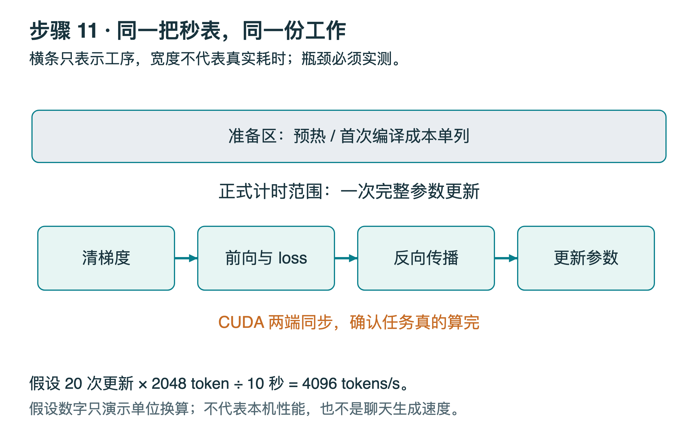

图注：助手绘制的教学示意，2026-11-09；帮助理解本步的计算关系与操作顺序。图中教学数字与简化结构不冒充课程截图、模型实测性能或完整实现。

**试着用手指读图：** 先指出输入或起点，再沿依赖找到中间处理，最后指出输出或结果记录。停在每一站，说出“这里放的是什么、对它做了什么、什么东西会改变”。如果遇到反向箭头，要说明它传回的是梯度，还是图中另有注明的流程。

**再用一句话检查自己：** 遮住正文，只看图，解释这一节与上一步相比新增加了什么；然后回到本步的小实验核对。会复述图并不代替实际运行和数值验收。


### 课程数据与自己的实测分开

讲者在 A100 SXM 80GB 环境展示的阶段时间大致为：约 1000ms → TF32 333ms → BF16 300ms → compile 130ms → FlashAttention 96ms → 词表填充 93ms。它们用于理解瓶颈转移，不是你电脑的目标值；也不能把不同 batch、不同测量窗口的数据直接计算加速比。

TF32 主要改变矩阵乘的内部精度与计算路径，PyTorch 张量仍可显示 float32。BF16 改变部分运算/中间表示的存储精度，动态范围与 FP16 不同。autocast 并非把所有数无差别转成低精度，交叉熵等操作有各自策略。

### 为什么融合能提速

小算子单独启动会有调度开销，反复把中间数组写到显存、再读回来也昂贵。compile 可融合部分算子；FlashAttention 通过分块等方法避免显式保存完整注意力矩阵。它们优化相同的数学任务，不意味着可以删掉因果约束。

```python
# 与 GPT-2 代码中的 q/k/v 布局配套：B×heads×T×head_size
out = F.scaled_dot_product_attention(q, k, v, is_causal=True)   # 内置注意力，is_causal 表示只看过去
```

自动选择的后端随硬件、dtype、维数和框架版本变化。没有 CUDA 时保留正确实现与形状测试，不把 CPU 的结果称为 FlashAttention 加速实测。

### 词表填充的边界

将 V 从 50257 填到 50304，有利于某些硬件上的矩阵乘维度对齐。分词器仍只产生原来的 ID，不会自动增加 47 个新词。自行采样 padded logits 时，应留意新增维度没有对应的解码条目，必要时屏蔽它们；不要把任意新 ID 传给原始 tokenizer。

作者当前快照的 `use_compile=False`，注释说明它与 HellaSwag 和生成交互有问题。因此速度实验可单独测 compile，但完整评估路径先沿用已核对的关闭状态；不能只把一行改 True 就宣称全套兼容。


- [ ] 编译首轮与稳态分开；最终验证/生成配置单独记录。

### 卡住时按这个顺序查

按现象列出先查什么、修好后怎么验。这些路径来自课程故障与代码整理，同一个报错不保证只有一个原因；先定位影响的是数据、数学、状态还是系统性能，再回到上面的操作，不靠同时换五个参数碰运气。

| 现象 | 先查什么 | 修好后怎么验 |
|---|---|---|
| CUDA 显存不足 | B/T、激活占用、累积与混精度 | 降微批后重新算 A，并测 loss |
| compile 快但评估出错 | 当前源码 use_compile 与评估兼容性 | 先回退，再做独立优化实验 |

<a id="section-s12"></a>
## 步骤 12 设置 token 预算、数据分片与多卡训练

扩大训练前，先把“每次更新实际用了多少 token”算清。显存中的微批次、梯度累积、多卡平均必须对应同一个目标，才能比较训练结果。

**目标**：形成可检查的训练配置，并在短跑通过后再启动长跑。

1. 按课程配置记录 AdamW 参数：峰值 lr 6e−4、最低 6e−5、betas=(0.9,0.95)、eps=1e−8、矩阵/embedding（参数维数≥2）的 weight decay 0.1，而 bias/LayerNorm 等一维参数的 decay 为 0；梯度裁剪范数 1.0。warmup 715 步，最大 19073 步，后段 cosine decay。先检查当前代码，不拿这些数字当通用最优。[[O9](#source-o9)、[O13](#source-o13)]
2. 设全局每步 token 数 G=524288，微批大小 B、序列长度 T、进程数 W，计算 `A=G/(B*T*W)`；必须整除。每个 micro loss 除以 A，累积 A 次后再裁剪、更新一次。[[O9](#source-o9)]
3. 用课程的 FineWeb-Edu sample-10BT 路径生成分片，明确 train/val 文件。每次取 `B*T+1` 个 token 做输入/右移目标；多进程按 rank 错开起点，跨步推进 `B*T*W`。[[O9](#source-o9)、[O13](#source-o13)]
4. 单卡短跑通过后再用 torchrun/DDP。先核实际 CUDA 卡数、rank、数据不重复和日志只由主进程写；确认预算与停止条件后才全量运行。[[O9](#source-o9)、[O13](#source-o13)]

**做完的标准**：配置、A 的计算、数据路径和 rank 分配明确；短跑中 loss/梯度有限；有预算与停止线；全量训练未跑就保持未完成。

<a id="walkthrough-s12"></a>
### 白话说明：把训练量、显存、时间和数据分工算成一本明白账

把一次参数更新想成老师看完一叠题后调整一次教学方案。显存一次装不下整叠题，就分几小叠累计梯度；多张卡则分头处理不同题，最后汇总。

#### 先把这一步想成一个生活场景

想象老师一次要看一大叠作业，但桌面只能放一小叠。可以分批看，把批注先汇总，最后统一改一次方案；也可以几位老师各看不同部分，再汇总。梯度累积与多卡分工解决类似的容量问题，但必须把“看几叠”和“改几次参数”分清。

**怎么读这一节：** 先读每个操作前的故事与具体数字，再运行原有代码。代码成功只是程序完成了动作；能回答“停一下”的问题，才说明你知道它在做什么。下面的场景和小数字是助手编写的教学例子。

#### 先把关键词翻成看得见的东西

| 关键词 | 白话意思 | 本步的具体样子 |
|---|---|---|
| micro-step | 处理一小批并反传一次 | 此时不一定更新参数 |
| optimizer step | 真正改变参数一次 | 若累积 A 次，就最后才更新 |
| B / T / W / A | 每卡序列数 / 序列长度 / 卡数 / 累积次数 | G=B*T*W*A |
| rank | 多进程中的身份编号 | 帮助给每张卡分配不同数据 |
| all-reduce | 汇总各进程梯度的集体通信 | 不是收集所有生成文本 |
| 数据分片 | 存储中的一段 token 数据 | 要记录文件和读取偏移 |
| 预算 | 时间与费用的边界 | 短跑不等于完整训练 |

#### 操作 A：先用纸笔算一个小配置

**场景：四本小册子，每本 32 格，分八轮搬到桌上。** 单卡每轮看 4×32=128 个 token，八轮共 1024 个，之后才更新一次参数。做 100 次参数更新共处理 102400 个 token。这里“处理过”可能包含重复数据，不自动等于这么多不同 token。

**你实际做的事：** 把四个变量分别写上单位，再乘起来。若目标 G 除不尽 B×T×W，要重新选择配置，而不是随意四舍五入却仍声称等于原目标。

**停一下：** 八个 micro-step 是否等于八次参数更新？在这个设置下不是。

设单卡每个 micro-step 有 B=4 条序列，每条 T=32 个 token，用 W=1 张卡，累积 A=8 次。则每次参数更新看过 `4*32*1*8=1024` 个 token。做100次更新，共处理102400个 token。

这组数字是助手演算，不是完整 GPT-2 配方。随后再把你选择的 B/T/W/A 代入；如果用目标全局 token 数 G 反算 A，必须整除。

#### 操作 B：把清梯度放在正确位置

**场景：先拿空篮子，收齐八叠批注，最后才做一次修改。** 微批之间清梯度，会把刚收的批注扔掉；微批之间更新参数，会让后面微批看到另一套参数，变成不同训练过程。

**具体数字：** 两个等大微批平均梯度分别为 2 和 6，合起来应取平均 4。每批 loss 除以 2 后反传，累计就是 1+3=4。

**停一下：** 微批有效 token 数不同时仍能简单除 A 吗？不能，需要按有效 token 数加权。

```python
# 示意：model、optimizer、get_batch、A 已经设置
optimizer.zero_grad()                    # 先清梯度
for micro_step in range(A):              # 跑 A 个微批
    x, y = get_batch()                   # 取一个微批
    logits, loss = model(x, y)           # 前向
    (loss / A).backward()                # 除以 A 后累加梯度，等效于大 batch
# 如需裁剪，在全部 micro-step 完成后做
optimizer.step()                         # 全部微批跑完才更新一次参数
```

每小批 loss 取平均且大小相同的时候，除以 A 对应这 A 批的平均梯度。若每批有效 token 数不同，要按有效数量加权，不能机械平均。小批间参数保持不变，最后才 step；每次循环里清梯度会把之前累计的贡献抹掉。梯度累积也不保证与一次大批前向严格等价：例如 BN 使用各微批统计，dropout 的随机过程也可能不同。

#### 操作 C：先检查数据分片，再启动短跑

**场景：多位老师不应都拿同一叠作业。** rank 区分工作人员身份，数据起点区分工作范围。程序成功启动多张卡，只证明有人开工，不能证明大家分工正确。

**你实际做的事：** 打印每个 rank 的第一段索引、下一次起点以及 x/y 配对；检查训练和验证文件分离。先做短跑，再扩大范围。

**停一下：** 各卡都算不同数据但不汇总梯度，还是同一个协同训练过程吗？不是，各自的参数可能逐渐分开。

列出 train/val 分片路径、每片 token 数、样本读取起点和当前偏移。打印第一批 x/y，确认错开一位。用很少的更新次数做短跑，先关闭副本中的大型评估和下载路径，保留差异记录。

多卡之前，先打印每个 rank 的编号和数据起点，确认它们处理不同片段、按全局步幅向前推进。多进程启动成功不能证明数据分配正确。

#### 操作 D：用自己测得的速度估时

**场景：估算搬完所有作业要多久，不能只看搬一小叠。** 假设实测每更新 0.5 秒，1000 次纯训练约 500 秒；还要另加评估、保存和数据准备。这只是算式例子，实际计划必须用你的测速。

**你实际做的事：** 在启动长跑前写下预算上限、停止条件、保存位置。短跑日志写清真实更新次数，不把尚未执行的完整预算当作成果。

**停一下：** 固定总 token 数后，卡越多是否一定线性更快？不一定，通信和其他开销也占时间。

目标更新数乘以实测每更新秒数，得到纯训练时间；加上评估、保存、准备数据和空转。把费用上限、停止条件与检查点位置写进记录。FineWeb 数据准备和完整训练是后续独立动作，执行前先读本步骤的硬编码与 macOS 进程限制。

**本步完成的样子**：你有一份能解释每个数字的配置、一段短跑日志、明确的 train/val 分片和费用/时间计划。尚未长跑时，记录“短跑完成，完整预算未执行”。

#### 卡住时先找哪一站

| 看到的现象 | 先检查什么 |
|---|---|
| 累积后梯度只像最后一批 | 检查是否每微批都 zero_grad |
| 多卡处理相同位置 | 核查 rank 数据起点与全局步幅 |
| 预算对不上 | 区分微步数、更新数与有效 token 数 |

**说明与衔接**：本段是助手基于本步骤课程与代码整理的动手导读；微型例子只解释相应局部机制。继续按下面原有课程讲解、截图与验收要求完成该步。

<a id="spatial-s12"></a>
### 空间转化：把步骤 12 摆到一张图里

把每张卡画成一条横向车道，车道内先处理 A 个微批，所有车道的梯度汇总后才进入一次参数更新。图表示数学上的汇总关系；实际 DDP 可能把通信与计算重叠，是否每个微批同步取决于实现和 no_sync 等设置。

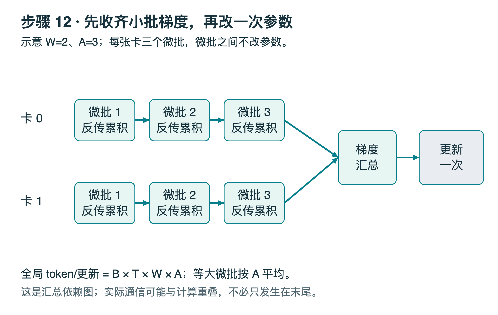

图注：助手绘制的教学示意，2026-11-09；帮助理解本步的计算关系与操作顺序。图中教学数字与简化结构不冒充课程截图、模型实测性能或完整实现。

**试着用手指读图：** 先指出输入或起点，再沿依赖找到中间处理，最后指出输出或结果记录。停在每一站，说出“这里放的是什么、对它做了什么、什么东西会改变”。如果遇到反向箭头，要说明它传回的是梯度，还是图中另有注明的流程。

**再用一句话检查自己：** 遮住正文，只看图，解释这一节与上一步相比新增加了什么；然后回到本步的小实验核对。会复述图并不代替实际运行和数值验收。


### 先算三个例子

| B | T | W | A | 每次更新 token |
|---|---|---|---|---|
| 64 | 1024 | 8 | 1 | 524288 |
| 64 | 1024 | 1 | 8 | 524288 |
| 8 | 1024 | 1 | 64 | 524288 |

减少 B 能省显存，却可能需要更多累积次数；它不自动减少同样 token 预算的总算力。累积时每个 micro-step 会 backward，`optimizer.zero_grad()` 放在整次更新开始处，不在每个 micro-step 清掉。

对仅在最后 micro-step 同步的 DDP，`require_backward_grad_sync` 在 forward 之前设置；只在 backward 前改可能错过 forward 读取的状态。作者 README 对此有视频后的修正。裁剪放在累积完成后，学习率按 optimizer update 步数推进，不能按 micro-step 多衰减 A 倍。

### 数据不要直接从一个大文件反复读同一段

`fineweb.py` 会下载指定样本、用 GPT-2 tokenizer 编码，并写成 npy 分片。课程源码将首片留作验证，其余用于训练；该简单方案不是对所有来源完成重复与污染审计的证明。数据准备本身需要网络与磁盘，不能把下载耗时算成 GPU 稳态吞吐。

当前代码对 uint16 数组先转 np.int32，再创建 long tensor，避免某些 PyTorch 版本转换问题。跨片时重置 rank 对应起点，末端剩余不足一个完整批次时切片，不让短数组硬 reshape。

### 启动前看源码中的硬编码

下面是**作者代码中的启动方式**，在 `build-nanogpt` 目录、课程的 Linux 环境执行。原 `fineweb.py` 在顶层创建 multiprocessing Pool，缺少 main guard；macOS 默认 spawn，直接执行会产生进程启动问题。macOS 先做本地小实验；全量数据可在 Linux 准备，或将数据下载与进程池包装进 main 并加入口保护后再单独验证。它不接受你临时发明的 `--max_steps` 参数；先在自己的副本修改常量、确认数据存在。

```bash
python fineweb.py                    # 下载并分词 FineWeb 数据集（体积很大，先确认磁盘）
python train_gpt2.py                 # 训练 GPT-2 124M
# 多卡：仅在机器确有 8 张 CUDA 卡时使用
# torchrun --standalone --nproc_per_node=8 train_gpt2.py   # 8 进程各用一张卡
```

`fineweb.py` 的数据规模按课程快照会很大；预算/磁盘未明确时先读文件确认规模，不直接执行。训练脚本 step 0 就可能执行完整验证和 HellaSwag，短跑排错时先在副本显式关闭大规模评估，再保存修改差异。助手提供的缩小检查脚本见交付代码说明。

### 费用与停止条件

先在目标机器测稳定的 update 秒数 s，再算预计纯训练时长 `19073*s/3600` 小时。用供应商当前实际报价乘上付费运行时间，再加数据准备、评估和空转；本手册不使用讲者历史美元数作为当前报价。长训练前必须确认费用上限、运行时限和停止操作，别在本地自动租用机器。

约 19073×524288=9,999,745,024 tokens，接近 10B。它描述这次更新总预算，不等于所有数据严格只出现一次；丢弃尾部、分片边界与循环方式会影响实际覆盖。

课程讲到 GPT-3 的 batch ramp，但为了简化算术没有实现；不要在成品配置里写成已经具备了动态 batch 调度。


- [ ] 保存完整配置、数据分片清单、短跑日志和预算计算。


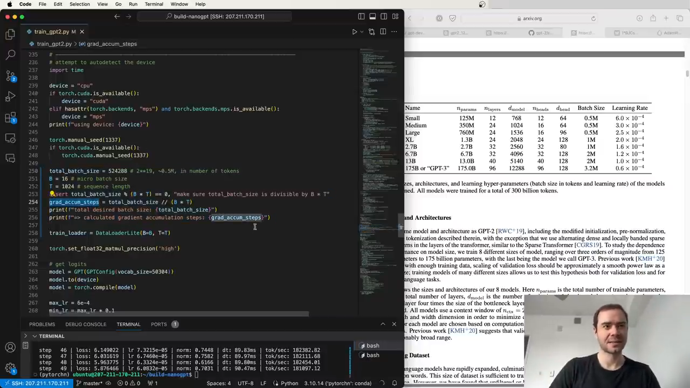

图注：真实课程截图，2026-10-29 提取，第9课 02:38:50；用于对照本节讲解，不替代代码和梯度核验。[[O9](#source-o9)]

### 卡住时按这个顺序查

按现象列出先查什么、修好后怎么验。这些路径来自课程故障与代码整理，同一个报错不保证只有一个原因；先定位影响的是数据、数学、状态还是系统性能，再回到上面的操作，不靠同时换五个参数碰运气。

| 现象 | 先查什么 | 修好后怎么验 |
|---|---|---|
| DDP 每张卡读相同数据 | rank 起点、跨步步幅 | 每卡首段 token 位置不同 |

<a id="section-s13"></a>
## 步骤 13 用验证、HellaSwag 与样本检查结果

训练 loss 只能说明模型在正在见到的数据上有多好。这里用独立数据、固定续写和选择题评估，把“看起来像文本”变成可比较的结果。

**目标**：留下能重算的评估记录与可恢复检查点。

1. 切到 eval/no_grad，在验证分片上按相同批数取平均 loss；评估前 reset loader，让不同检查点在相同数据上比较。记录 token 数与评估频率。[[O9](#source-o9)、[O13](#source-o13)]
2. 对 HellaSwag 的每个候选，用相同前缀条件计算续写 token 的平均 NLL；mask 掉共享上下文，选择平均 loss 最小的候选。多卡按 rank 分配题目，再归并正确数和总数。[[O9](#source-o9)]
3. 按相同前缀、top-k、seed 和长度定期生成，保存全部原文；同时看 train/val 曲线和 HellaSwag，不挑一条最好文本代表整体质量。[[O9](#source-o9)]
4. 保存模型、配置、step、val_loss；若要精确续训，补 optimizer、scheduler、随机状态和数据位置。写清本次是否实际完成全预算、使用何种数据与哪些指标，没有跑的部分保留未试用。[[O9](#source-o9)、[O13](#source-o13)]

**做完的标准**：至少保留一次独立验证、明确口径的评估、固定生成和检查点说明；哪些是自己的实测、哪些是课程结果一眼可区分。

<a id="walkthrough-s13"></a>
### 白话说明：既看练习分，也看新题成绩，并保存可复核的证据

模型能生成一段像样文字，只能说明这段样本看起来不错。你还需要独立验证集 loss、固定条件的生成记录，以及明确口径的任务评估。

#### 先把这一步想成一个生活场景

想象学生做完练习后参加新题考试。练习分、考试分、随口讲一个故事，分别测不同东西。我们要保存题目范围和评分方法，才能知道模型究竟学到了什么。只挑一段漂亮生成文本，像只展示一次答对的题，无法代表全部表现。

**怎么读这一节：** 先读每个操作前的故事与具体数字，再运行原有代码。代码成功只是程序完成了动作；能回答“停一下”的问题，才说明你知道它在做什么。下面的场景和小数字是助手编写的教学例子。

#### 先把关键词翻成看得见的东西

| 关键词 | 白话意思 | 本步的具体样子 |
|---|---|---|
| validation loss | 在不用于更新的数据上的误差 | 越低通常表示给真实答案更多概率 |
| eval() | 切换部分层的工作方式 | 例如关闭 dropout |
| no_grad() | 不建立求导记录 | 本身不切换 dropout 或 BN |
| temperature / top-k | 生成时调整抽样的设置 | 会影响文本表现，比较时要固定 |
| NLL | 正确 token 概率的负对数 | 概率高，惩罚小 |
| mask | 哪些位置算分的标记 | 选择题只计算候选结尾的 token |
| 恢复训练 | 接回中断时的训练状态 | 不仅是载入模型权重 |

#### 操作 A：对同一模型做一次不更新参数的验证

**场景：考试时只打分，不把这次答案拿来改参数。** `eval()` 像切到考试规则，`no_grad()` 像不记录调整用的草稿；两者不是同一个开关。

**具体数字：** 一批 10 个有效 token 的平均 loss 是 1，另一批 30 个是 3，总平均应是 (10×1+30×3)/40=2.5，不能简单算成 2。

**停一下：** 验证后继续训练忘记 `train()` 会怎样？有些层可能仍按评估行为运行，训练条件就变了。

切到 `model.eval()`，用 `torch.no_grad()` 包住验证前向；不调用 backward 或 optimizer.step。使用固定验证数据和固定批数，把每批平均损失按有效 token 数加权平均。全部批次大小一样且无额外 mask 时，直接平均各批 loss 即可。

eval 负责切换 dropout/BN 等层的行为，no_grad 负责不记录求导图，两者作用不同。验证结束后若继续训练，调用 `model.train()`。

#### 操作 B：保存同一条件下的生成样本

**场景：比较两位讲故事者，给相同开头和相同规则。** 换一个更容易的前缀或更低的温度，文本可能看起来变好，却不一定来自模型改善。

**你实际做的事：** 先定前缀集合和抽样配置，再保存全部结果，包括重复和乱码。固定 seed 帮助复现随机过程，但不保证不同设备和实现逐字一致。

**停一下：** 只留下最顺眼的一段，能代表平均能力吗？不能，这会引入挑选偏差。

固定前缀、seed、温度、top-k 和生成长度，用不同检查点生成，保留全部文本。检查是否重复、乱码、无法结束或出现明显退化。抽样评价时先定选取规则，避免只保留最顺眼的一段。

#### 操作 C：读懂一道 HellaSwag 选择题怎样算分

**场景：给四种故事结尾逐个计算“有多意外”。** 模型给结尾真实 token 的概率越低，负对数惩罚越大。课程实现用候选结尾的平均 NLL 选最低者，再与答案标签比较。

**具体数字：** 结尾甲两 token 损失为 0.6 和 1.0，平均 0.8；乙三个为 1.2、1.4、1.6，平均 1.4，于是这两个之中选甲。平均值处理了长度的一个影响，但不是通用最优评分保证。

**停一下：** 为什么只给结尾算分？因为共享上下文不是要比较的候选答案；mask 还必须和预测右移关系对齐。

上下文相同，候选结尾不同。对每个结尾，只汇总候选 token 的 NLL，再除以候选有效 token 数，选平均 NLL 最小者。假设四个候选得分是0.8、1.4、0.9、1.2，则选第一个；再与标注答案比较，累计正确数和总题数。

这里的数字是演算。实际代码里预测 token t 用位置 t−1 的 logits；mask 必须一起对齐，否则你可能在给错误位置打分。先打印一题的 token、mask、每 token loss 和最终选择，确认再跑整份评估。

#### 操作 D：写一条别人能核对的结果记录

**场景：交成绩单，同时交能找到对应答卷的编号。** “准确率 60%”缺少题数与数据版本就很难解释；“60/100，指定数据和检查点”才可复核。

**你实际做的事：** 保存结果的模型身份、数据范围、评分配置和日志。要继续训练，还需优化器动量等状态、步数、随机状态与数据位置；只存权重主要支持推理或重新开始训练。

**停一下：** 加载后输出一致是否证明一定能原样续训？还要检查完整训练状态，必要时在可控小任务上对照下一次更新。

记录检查点、训练 token 数、验证数据版本与数量、验证 loss、基准正确数/总数、生成配置和实际运行范围。仅做完前几步时，把尚未进行的 GPT-2 评估写成未执行，不借用课程分数填空。

**保存与恢复**：模型权重用于推理；若计划接着训练，还需 optimizer 状态、步数、随机状态和数据读取位置。先在小任务上演示保存后重新加载，并检查输出/状态是否一致，再把这种恢复能力用于长任务。

**这一步真正交出的东西**：一份结果表和对应日志/检查点，让你知道模型在哪些条件下达到了什么，而不是一句“已经学会了”。

#### 卡住时先找哪一站

| 看到的现象 | 先检查什么 |
|---|---|
| 验证仍改变行为或统计 | 检查 eval、无更新及状态切换 |
| 选择题分数奇怪 | 打印右移 logits、token、mask 的逐项对应 |
| 恢复后训练轨迹变化 | 检查优化器、随机状态、步数和数据偏移 |

**说明与衔接**：本段是助手基于本步骤课程与代码整理的动手导读；微型例子只解释相应局部机制。继续按下面原有课程讲解、截图与验收要求完成该步。

<a id="spatial-s13"></a>
### 空间转化：把步骤 13 摆到一张图里

把数据放在三个分开的房间：训练房允许反传和更新，验证房用于比较配置，最终测试房用于冻结选择后的评估。检查点像同一台机器的不同时间快照，各次评分都标明用了哪个快照。房间只是用途边界，不要求数据真的放在三台电脑上；反复按测试分选配置会破坏最终检验的独立性。

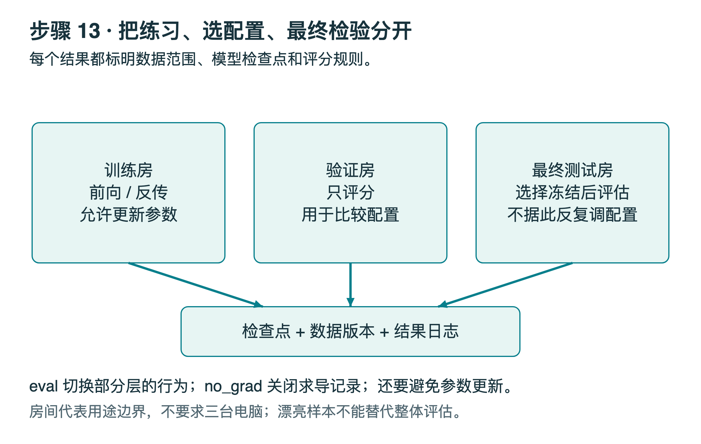

图注：助手绘制的教学示意，2026-11-09；帮助理解本步的计算关系与操作顺序。图中教学数字与简化结构不冒充课程截图、模型实测性能或完整实现。

**试着用手指读图：** 先指出输入或起点，再沿依赖找到中间处理，最后指出输出或结果记录。停在每一站，说出“这里放的是什么、对它做了什么、什么东西会改变”。如果遇到反向箭头，要说明它传回的是梯度，还是图中另有注明的流程。

**再用一句话检查自己：** 遮住正文，只看图，解释这一节与上一步相比新增加了什么；然后回到本步的小实验核对。会复述图并不代替实际运行和数值验收。


### HellaSwag 的偏移不能写错

预测 token t 使用位置 t−1 的 logits。候选 mask 也要一起右移对齐，只保留补全文本对应的 token loss；若把共同前缀算进去，或只比概率总乘积偏向较短答案，会改变题目的比较口径。准确率是 `num_correct/num_total`，不仅仅保存一个百分比。

### 视频与当前代码的区别

视频某阶段每 100 步验证，当前快照是每 250 步；最终复现记录应写实际运行值。课程结果讨论中还保留 FineWeb-Edu 抽样导致 loss 曲线不平稳等疑问，不应在手册里把它包装成已完全解释的成功。

build-nanogpt 的 checkpoint 包含模型参数、配置、step、val_loss，却没有完整优化器与 RNG 状态。它足以做推理或近似继续训练的起点，不足以宣称可逐位复现中断前轨迹。续训能力要自己补，并留一份恢复实验记录。

### 把最终结论写成可以核对的一句话

“在〔设备/版本〕上，用〔数据与 token 数〕训练〔配置〕，验证 NLL 为〔真实值〕，HellaSwag 为〔正确数/总数〕，耗时〔实测〕；未做〔聊天微调/其他边界〕。”

这句话属于助手给你的报告模板，不是作者原提示词。若只跑了缩小模型两步，应写“结构/梯度短跑通过”，而不是“复现 GPT-2 完成”。

课程最后介绍 llm.c，是相同训练目标的 C/CUDA 实现方向；本手册主线仍使用课程的 PyTorch，实现和硬件不同的速度不能直接混比。讲者展示的 10B/40B token 结果，仅在给定数据与所画验证/HellaSwag 指标上对照，不代表所有能力整体超过 GPT-2/GPT-3。GPT-3 规模训练、更多模型尺寸可作延伸，必须重新核算预算与数据。


- [ ] 最终报告包含真实范围，没有用演示输出代替完整训练证明。


<a id="intuition-s10"></a>
### 关键词拆解｜步骤 10：GPT-2 结构、参数量、权重绑定、生成

从字符 GPT 走到 GPT-2，不是换一个“更聪明的公式”，而是把 tokenizer、层数、宽度、上下文长度、参数初始化与训练配方合成一个匹配的系统。

- **模型配置（config）**：网络的施工图，记录层数、通道宽度、注意力头数、上下文窗口、词表等。结构参数与训练参数（学习率、批大小、步数）要分开记。
- **参数量（parameter count）**：模型里可学习数字的总数。可把它看作可调旋钮数量；更多旋钮提供更大表达容量，也需要更多数据、算力和内存来训练。
- **token embedding 与语言模型头**：前者把 token ID 查成向量，末端线性层把向量映射回词表 logits。权重绑定时两处共享同一矩阵，省参数并建立输入/输出词向量的联系。
- **位置嵌入**：将位置向量加到 token 表示中；序列长度不能超过模型训练时支持的上下文上限，除非另做扩展处理。
- **预训练续写**：给模型一段前缀，让它按分布继续生成。固定前缀便于复现比较，但生成文本流畅不代表事实正确、指令遵循或问答能力。
- **单批次检查**：先拿很小的一批样本确认模型输出形状、loss 有限、梯度非零、更新后 loss 有合理变化。它是接线验收，不代表完整训练。
- **权重加载兼容性**：参数名称、张量形状、词表和位置定义必须匹配；某层 shape 对不上通常说明结构或配置有差异，不应靠随意 reshape 掩盖。

**结构类比**：配置像建筑图纸，模型代码像施工方法，权重像已经装好的家具与管线，tokenizer 像房间编号系统。图纸相同但编号系统不匹配，送进来的“门牌号”会指错房间。

**生成温度**：将 logits 除以温度再 softmax。温度低会放大高分候选、输出更保守；温度高会拉平分布、增加随机性。它改变采样行为，不会改变已训练好的参数或知识。

<a id="intuition-s11"></a>
### 关键词拆解｜步骤 11：吞吐、基准测试、融合算子、混合精度

优化是在相同训练工作下缩短时间或降低资源，不是只让计时数字变漂亮。每次只改一项，确认 loss 和训练语义仍可比。

- **吞吐（throughput）**：单位时间处理的 token 数，常写 tokens/second。它回答“跑得多快”，不直接回答“学得多好”。
- **基准测试（benchmark）**：固定模型、输入、批次、精度、预热与计时方式，测可重复的速度。GPU 首次运行的编译、数据搬运和缓存会污染结果，所以要预热并多次测量。
- **端到端时间**：不仅包括前向和反向，还包括数据读取、CPU 到 GPU 搬运、优化器更新与评估。只优化其中一个 kernel，整体速度可能几乎不变。
- **融合（fusion）**：把多个小操作合成较少的 GPU kernel，减少反复启动与中间结果搬运。像把流水线上几道紧邻工序放到一个工作站完成。
- **混合精度（mixed precision）**：部分计算使用较低精度以提高速度、节省显存，同时在关键处保留稳定精度。需要检查数值稳定性与硬件支持。
- **编译 / CUDA Graph 等路径**：减少 Python 调度开销或提前固定执行图。首轮可能包含编译成本，计时需区分冷启动与稳态。
- **正确性护栏**：对照基线 loss、梯度、输出或少量训练步骤。速度提升若来自漏算、少训或不同输入，就不是等价加速。

**测量示例**：同一配置预热 10 步，之后测 50 步的总时长，取中位数；吞吐约为 `每步 token 数 × 50 / 总秒数`。同时记录设备型号、软件版本、精度和是否包含数据加载。只写“快了 2 倍”无法复查。

<a id="intuition-s12"></a>
### 关键词拆解｜步骤 12：token 预算、梯度累积、数据分片、DDP、成本

扩大训练前先算“要做多少题、每次做多少、需要几台机器”。大训练的主要风险不是代码能否启动，而是预算估错、数据重复或多卡进程没有真正并行。

- **token budget（token 预算）**：训练总共让模型看过多少 token。若每次全局更新处理 `B×T` 个 token，做 U 次更新，约为 `B×T×U`；若梯度累积 A 次再更新，则约为 `B_micro×T×A×U`，还需核对世界大小如何计入全局 batch。
- **梯度累积（gradient accumulation）**：连续算若干小批次梯度后再更新一次参数，近似模拟更大的批次，降低显存峰值。每个小批次通常要按累积次数缩放 loss；更新次数与样本处理量不是一回事。
- **数据分片（sharding）**：把数据切成多个片段供不同阶段读取，避免反复从头读同一段或把全部数据塞入内存。要记录每片 token 数、顺序、是否重叠和验证集隔离。
- **DDP（DistributedDataParallel）**：多张卡各自算不同数据的梯度，再同步平均梯度。像多个班同时做不同练习，统一汇总后再一起更新模型。启动多进程不等于有效并行，需确认每个 rank 都参与、数据不同、同步正常。
- **world size / rank**：参与训练的进程总数与每个进程编号。全局批次通常是单卡批次乘进程数（再考虑累积），但具体脚本定义必须看源码。
- **每步时间与估时**：若目标 U 步、实测稳态每步 t 秒，粗估 `U×t` 秒，再加评估、检查点、启动与故障余量。小时数是估算，不是承诺。
- **成本上限与停止条件**：开跑前写预算上限、预计结束时间、何时检查 loss、如何中止与保存。长任务若异常发散，应停下来保留日志，不要为“跑完”继续烧钱。

**纸面预算例子（仅演算）**：假设每步全局处理 524,288 tokens，目标 10,000 步，则约 5.24B token；如果实测每步 0.8 秒，纯训练时间约 8,000 秒（2.22 小时），还不含评估、启动与保存。实际应把自己的参数与计时填进预算表，不能沿用这个示例当硬件报价。

**防止数据假扩张**：多个 rank 若都从同一文件、同一偏移读同一批次，表面上卡数增加，实际重复学习同样样本。检查 sampler、rank 偏移和数据切片日志。

<a id="intuition-s13"></a>
### 关键词拆解｜步骤 13：训练集 loss、验证 loss、基准评估、HellaSwag、样本审阅

评价模型像考试：训练时的练习分、留出的模拟考、统一标准化测试和人工抽查各回答不同问题，不能只挑最好看的一项。

- **训练 loss**：模型在用于更新参数的数据上的平均预测损失。下降表示它更贴合训练样本，不一定代表更会处理新样本。
- **验证 loss**：在未用于梯度更新的数据上计算的损失，用于观察泛化与选检查点。验证集被反复用于挑方案后，就不再是完全客观的最终考试。
- **检查点（checkpoint）**：某一时刻的模型参数、优化器状态、步数、随机状态与配置。仅存权重可用于生成；要从中断处继续训练，通常还需要优化器和进度状态。
- **HellaSwag**：一项多选式常识推理基准，给定上下文和候选结尾，比较模型对候选的打分。评估代码必须按数据集规定的续写部分计分，不能把上下文也当答案长度。
- **多选评分**：常见做法是对候选续写 token 的 log probability 求和或平均；总和会偏好短答案，平均又有不同口径。报告时写清评分公式、token 边界与版本。
- **基准分数**：用于在相同数据、划分、预处理和评测实现下比较。不同数据版本或评分方式的分数不能直接排高低。
- **样本审阅（qualitative inspection）**：随机看生成文本，检查乱码、重复、格式和明显退化。它可以发现故障，但不能替代定量评测，也不能挑几段顺眼文本宣称成功。
- **困惑度（perplexity）**：交叉熵的指数变换，可直觉理解为模型每一步面对的有效候选数量；只在相同 tokenizer、数据与口径下比较才有意义。

**结论句的模板**：在〔数据版本与切分〕、〔tokenizer〕、〔训练 token 数/步数〕和〔评测实现〕条件下，模型的训练 loss 为〔〕、验证 loss 为〔〕，在〔基准〕上得到〔分数/正确数〕；〔人工样本检查〕发现〔具体观察〕。完整 124M 训练若没有真实运行，应明确写“未完成/未测试”，不以缩小模型结果替代。

**如何读冲突**：训练 loss 下降、验证 loss 不降，优先检查过拟合、数据切分与预处理；验证 loss 改善但 HellaSwag 不变，说明该基准测到的能力未随通用下一个 token 预测同步提升；生成样本看起来流畅但分数低，说明流畅度不是该基准的充分条件。

### 卡住时按这个顺序查

按现象列出先查什么、修好后怎么验。这些路径来自课程故障与代码整理，同一个报错不保证只有一个原因；先定位影响的是数据、数学、状态还是系统性能，再回到上面的操作，不靠同时换五个参数碰运气。

| 现象 | 先查什么 | 修好后怎么验 |
|---|---|---|
| 训练中断后恢复不一致 | optimizer、RNG、数据指针是否存了 | 独立做中断/恢复对照 |


<a id="section-sources"></a>
## 来源、缺口与验证范围

课程逐字稿是YouTube英文自动字幕排版稿，保留原语序；不是人工听写。原始JSON3、视频元数据与SHA-256保存在本集edit/_raw/，不随成品网页加载。每课独立Markdown/SRT在transcripts/。全9课约198172英文词，193个官方章节已建索引。

生财MCP已用activityManualSearch检索“大模型”“Karpathy”“模型训练”；检索到的主要为API接入、Vibe Coding和应用教程，未取得可替代本课程的从零训练GPT手册。它是资料检索接口，并没有本次可调用的“上传全部逐字稿自动生成一本书”工具；本手册制作与导出由field-manual-customizer技能执行。不把搜索摘要当作已读全文或课程技术证据。

真实读者完整试用：not_tested。GPT-2 124M完整预算训练与CUDA速度优化：未实跑。局部数学与结构检查记录另见交付代码说明，只支持对应局部结论。

<a id="source-o1"></a>
### O1 The spelled-out intro to neural networks and backpropagation: building micrograd（手把手入门神经网络与反向传播：搭出 micrograd）

作者：Andrej Karpathy；视频日期：20220816；取得日期：2026-10-29。[原视频](https://www.youtube.com/watch?v=VMj-3S1tku0)。

用途：第1课全部章节、对应主线、原练习和原提示词线索；逐字稿 `01-VMj-3S1tku0.md`。自动字幕24,352词；首条0.080秒，末条开始8750.800秒，视频8752秒。时间覆盖并不证明每字正确，技术符号结合官方代码/画面核对。

[回到正文](#section-s2)

<a id="source-o2"></a>
### O2 The spelled-out intro to language modeling: building makemore（手把手入门语言建模：搭出 makemore）

作者：Andrej Karpathy；视频日期：20220907；取得日期：2026-10-29。[原视频](https://www.youtube.com/watch?v=PaCmpygFfXo)。

用途：第2课全部章节、对应主线、原练习和原提示词线索；逐字稿 `02-PaCmpygFfXo.md`。自动字幕19,445词；首条0.320秒，末条开始7064.080秒，视频7065秒。时间覆盖并不证明每字正确，技术符号结合官方代码/画面核对。

[回到正文](#section-s3)

<a id="source-o3"></a>
### O3 Building makemore Part 2: MLP（搭 makemore 第 2 部分：多层感知机）

作者：Andrej Karpathy；视频日期：20220912；取得日期：2026-10-29。[原视频](https://www.youtube.com/watch?v=TCH_1BHY58I)。

用途：第3课全部章节、对应主线、原练习和原提示词线索；逐字稿 `03-TCH_1BHY58I.md`。自动字幕12,731词；首条0.800秒，末条开始4537.960秒，视频4539秒。时间覆盖并不证明每字正确，技术符号结合官方代码/画面核对。

[回到正文](#section-s4)

<a id="source-o4"></a>
### O4 Building makemore Part 3: Activations & Gradients, BatchNorm（搭 makemore 第 3 部分：激活、梯度与 BatchNorm）

作者：Andrej Karpathy；视频日期：20221004；取得日期：2026-10-29。[原视频](https://www.youtube.com/watch?v=P6sfmUTpUmc)。

用途：第4课全部章节、对应主线、原练习和原提示词线索；逐字稿 `04-P6sfmUTpUmc.md`。自动字幕21,386词；首条0.040秒，末条开始6956.040秒，视频6957秒。时间覆盖并不证明每字正确，技术符号结合官方代码/画面核对。

[回到正文](#section-s5)

<a id="source-o5"></a>
### O5 Building makemore Part 4: Becoming a Backprop Ninja（搭 makemore 第 4 部分：成为反传忍者）

作者：Andrej Karpathy；视频日期：20221011；取得日期：2026-10-29。[原视频](https://www.youtube.com/watch?v=q8SA3rM6ckI)。

用途：第5课全部章节、对应主线、原练习和原提示词线索；逐字稿 `05-q8SA3rM6ckI.md`。自动字幕20,776词；首条0.000秒，末条开始6921.540秒，视频6924秒。时间覆盖并不证明每字正确，技术符号结合官方代码/画面核对。

[回到正文](#section-s6)

<a id="source-o6"></a>
### O6 Building makemore Part 5: Building a WaveNet（搭 makemore 第 5 部分：搭一个 WaveNet）

作者：Andrej Karpathy；视频日期：20221121；取得日期：2026-10-29。[原视频](https://www.youtube.com/watch?v=t3YJ5hKiMQ0)。

用途：第6课全部章节、对应主线、原练习和原提示词线索；逐字稿 `06-t3YJ5hKiMQ0.md`。自动字幕10,385词；首条0.000秒，末条开始3378.859秒，视频3381秒。时间覆盖并不证明每字正确，技术符号结合官方代码/画面核对。

[回到正文](#section-s7)

<a id="source-o7"></a>
### O7 Let's build GPT: from scratch, in code, spelled out.（从零手写 GPT：逐行讲清代码）

作者：Andrej Karpathy；视频日期：20230117；取得日期：2026-10-29。[原视频](https://www.youtube.com/watch?v=kCc8FmEb1nY)。

用途：第7课全部章节、对应主线、原练习和原提示词线索；逐字稿 `07-kCc8FmEb1nY.md`。自动字幕21,030词；首条0.199秒，末条开始6978.480秒，视频6980秒。时间覆盖并不证明每字正确，技术符号结合官方代码/画面核对。

[回到正文](#section-s8)

<a id="source-o8"></a>
### O8 Let's build the GPT Tokenizer（手写 GPT 分词器）

作者：Andrej Karpathy；视频日期：20240220；取得日期：2026-10-29。[原视频](https://www.youtube.com/watch?v=zduSFxRajkE)。

用途：第8课全部章节、对应主线、原练习和原提示词线索；逐字稿 `08-zduSFxRajkE.md`。自动字幕24,679词；首条0.040秒，末条开始8013.159秒，视频8014秒。时间覆盖并不证明每字正确，技术符号结合官方代码/画面核对。

[回到正文](#section-s9)

<a id="source-o9"></a>
### O9 Let's reproduce GPT-2 (124M)（复现 GPT-2（124M））

作者：Andrej Karpathy；视频日期：20240609；取得日期：2026-10-29。[原视频](https://www.youtube.com/watch?v=l8pRSuU81PU)。

用途：第9课全部章节、对应主线、原练习和原提示词线索；逐字稿 `09-l8pRSuU81PU.md`。自动字幕43,388词；首条0.160秒，末条开始14485.000秒，视频14486秒。时间覆盖并不证明每字正确，技术符号结合官方代码/画面核对。

[回到正文](#section-s10)

<a id="source-o10"></a>
### O10 karpathy/nn-zero-to-hero

[官方仓库](https://github.com/karpathy/nn-zero-to-hero)；快照提交 `73c3fcc741f0ec104ca850b1fb0df90e7e8d4cde`；取得日期2026-10-29。

用途：核对真实文件、代码、原练习、采样前缀及视频后的勘误。完整代码快照见交付目录 `code/nn-zero-to-hero/`；保留原许可证。当前提交不是视频录制时点的保证，差异在正文说明。

[回到正文](#section-s1)

<a id="source-o11"></a>
### O11 karpathy/nanoGPT

[官方仓库](https://github.com/karpathy/nanoGPT)；快照提交 `3adf61e154c3fe3fca428ad6bc3818b27a3b8291`；取得日期2026-10-29。

用途：核对真实文件、代码、原练习、采样前缀及视频后的勘误。完整代码快照见交付目录 `code/nanoGPT/`；保留原许可证。当前提交不是视频录制时点的保证，差异在正文说明。

[回到正文](#section-s1)

<a id="source-o12"></a>
### O12 karpathy/minbpe

[官方仓库](https://github.com/karpathy/minbpe)；快照提交 `1acefe89412b20245db5a22d2a02001e547dc602`；取得日期2026-10-29。

用途：核对真实文件、代码、原练习、采样前缀及视频后的勘误。完整代码快照见交付目录 `code/minbpe/`；保留原许可证。当前提交不是视频录制时点的保证，差异在正文说明。

[回到正文](#section-s1)

<a id="source-o13"></a>
### O13 karpathy/build-nanogpt

[官方仓库](https://github.com/karpathy/build-nanogpt)；快照提交 `6104ab1b53920f6e2159749676073ff7d815c1fa`；取得日期2026-10-29。

用途：核对真实文件、代码、原练习、采样前缀及视频后的勘误。完整代码快照见交付目录 `code/build-nanogpt/`；保留原许可证。当前提交不是视频录制时点的保证，差异在正文说明。

[回到正文](#section-s1)

<a id="source-o14"></a>
### O14 karpathy/micrograd

[官方仓库](https://github.com/karpathy/micrograd)；快照提交 `7bc720e951fe422b8f8814aa5aa1b64121d26b4c`；取得日期2026-10-29。

用途：核对真实文件、代码、原练习、采样前缀及视频后的勘误。完整代码快照见交付目录 `code/micrograd/`；保留原许可证。当前提交不是视频录制时点的保证，差异在正文说明。

[回到正文](#section-s1)

<a id="source-o15"></a>
### O15 karpathy/ng-video-lecture

[官方仓库](https://github.com/karpathy/ng-video-lecture)；快照提交 `52201428ed7b46804849dea0b3ccf0de9df1a5c3`；取得日期2026-10-29。

用途：核对真实文件、代码、原练习、采样前缀及视频后的勘误。完整代码快照见交付目录 `code/ng-video-lecture/`；保留原许可证。当前提交不是视频录制时点的保证，差异在正文说明。

[回到正文](#section-s1)

<a id="source-o16"></a>
### O16 karpathy/makemore

[官方仓库](https://github.com/karpathy/makemore)；快照提交 `988aa59e4d8fefa526d06f3b453ad116258398d4`；取得日期2026-10-29。

用途：核对真实文件、代码、原练习、采样前缀及视频后的勘误。完整代码快照见交付目录 `code/makemore/`；保留原许可证。当前提交不是视频录制时点的保证，差异在正文说明。

[回到正文](#section-s1)

<a id="source-o17"></a>
### O17 SolidGoldMagikarp (plus, prompt generation)（SolidGoldMagikarp（附提示词生成））

[原文](https://www.lesswrong.com/posts/aPeJE8bSo6rAFoLqg/solidgoldmagikarp-plus-prompt-generation)；2023-02-05；2026-10-29 经 Jina Reader 读取公开正文。该页面是第8课直接转展示的研究材料，仅用来复核表中输入的复杂字形、问号数量与措辞。课程截图仍来自视频原帧，不把现行网页冒充视频录制画面。原始快照 _raw/glitch-original.md。

[回到正文](#section-s9)

