# w1 实战手册：用 AI 从需求到交付 Project Alpha

> 手册类型：定制版

<a id="section-intro"></a>
## 阅读说明

本手册把第一周五讲合成一条能动手做的路线：先学会准备资料、检查引用和指挥 Agent，再完成课程的 Ticket 管理工具 Project Alpha。前四讲的学习方法、工具和 NotebookLM 两课都有独立步骤；项目主线从步骤 6 开始。先沿路线图阅读；原提示词、案例、模板和代码差异放在附录，正文有跳转。

整理日期：2026-10-29。课堂界面和模型属于录课时版本，不当作今天的订阅价格、权限或产品承诺。逐字稿为本地机器转写，经过疑似段重识别，仍非人工逐字校订；专名、提示词和工程细节优先对照原文件与真实视频帧。逐字稿中的口误和误识别不直接抄成操作命令。[[O1](#source-o1)、[O2](#source-o2)、[O3](#source-o3)、[O4](#source-o4)、[O5](#source-o5)]

原提示词保留拼写、大小写、原路径和已有重复字。〔〕表示助手模板中的虚构占位，使用前替换；模板不是讲者原输入。聊天文件与课堂屏幕并非始终相同，差异另列。课堂的“十几天变成一两个小时”、代码行数和测试通过数属于讲者现场结果或材料自述，不是你完成课程的保证。[[O5](#source-o5)、[O6](#source-o6)]

来源编号 O1 等在此统一表示本地原始资料，点击到末尾条目，再点“回到正文”返回。视频截图保留原画面；它证明当时屏幕显示了什么，不证明今天已在你的机器复现。没有真实试用记录的项目仍记 `not_tested`。

<a id="section-route"></a>
## 三天路线图

| 阶段 | 做什么 | 对应章节 |
|---|---|---|
| 第一天上午 | 建立文档驱动工作流，确认工具与账号；熟悉 NotebookLM 来源与输出 | [步骤 1](#section-step1) · [步骤 2](#section-step2) · [步骤 3](#section-step3) |
| 第一天下午 | NotebookLM 实做、来源可靠性实验；准备独立练习目录和连接 | [步骤 4](#section-step4) · [步骤 5](#section-step5) · [步骤 6](#section-step6) |
| 第二天 | 明确需求设计、生成计划；按阶段完成后端、种子数据、API | [步骤 7](#section-step7) · [步骤 8](#section-step8) · [步骤 9](#section-step9) · [步骤 10](#section-step10) |
| 第三天 | 前端、界面改进、数据库与端到端验收、收尾 | [步骤 11](#section-step11) · [步骤 12](#section-step12) · [步骤 13](#section-step13) · [步骤 14](#section-step14) |

这一阶段先不做多用户认证、线上部署和数据库查询工具；以后再看[附录 E](#section-later)。三天是助手建议的 24 小时学习安排，遇到安装、权限或代码故障，将剩余动作顺延到下个可用时段，不跳过验收。

<a id="section-conditions"></a>
## 本次条件

| 项目 | 本次采用的条件 |
|---|---|
| 读者 | 你，一个人做 AI 工具和内容，正在跟课程；有 Python、uv 和基本终端经验 |
| 项目对象 | 课程 Project Alpha：PostgreSQL、FastAPI、React、TypeScript、Vite、Tailwind、Shadcn |
| 时间 | 周一至周三 10:00–19:00，午休 13:00–14:00；每天 8 小时 |
| 产物 | 需求设计、计划、代码、可重复运行说明、实际验收记录；不是只收藏提示词 |
| 原课程 | 只读，练习在独立副本；不把你自己的 video-mcp 代入课程主线 |
| 未确认条件 | 现有工具订阅、数据库版本和运行状态尚未知；先核后用 |

### 条件不同时怎么调

时间更少：保留学习工作流、来源核对、需求/计划和一条完整 Ticket 操作链，NotebookLM 更多输出与 UI 微调放第二轮。已经熟悉 NotebookLM：完成步骤 5 的来源污染实验后直接进入项目。没有 NotebookLM 权限：先做本地项目步骤，保留学习模板，不能伪造平台操作。没有 PostgreSQL：先读设计、生成计划和前端；完整完成时间触发器验证须待数据库可用，SQLite 不能替代这个验收。

<a id="section-results"></a>
## 要完成什么

| 结果 | 数量/要求 | 所在步骤 |
|---|---|---|
| 学习与运行记录 | 1 份持续更新 | 1、6、14 |
| NotebookLM 练习 | 主题探索、产品分析、个人笔记引用实验各一轮 | 3–5 |
| 需求和设计 | 1 个主版本；Claude 对照版保留区别 | 7 |
| 实施计划 | 1 份，phase 0–6逐阶段验收 | 8 |
| 本地应用 | Ticket/Tag/搜索筛选/完成切换的前后端链路 | 9–13 |
| 演示数据 | 原提示词要求50个Ticket和几十个Tag；实际以数据库计数为准 | 10 |
| 验收证据 | 每条记录期望、实际、命令、截图或日志，不以勾选数冒充通过 | 13–14 |

<a id="section-gaps"></a>
## 动手前的阻断缺口

- G1 账号与工具：没有可用 Agent/NotebookLM 时，相应在线步骤暂停；能先读本地需求和代码。课程旧价格与“近乎无限”用量不作为购买依据。
- G2 数据库：未确认本机 PostgreSQL、角色和连接。先在步骤 6 做只读连接核查；不要把示例账号密码当成现有账号。
- G3 输入保真：`.chats/w1.md` 八节全文可读，但 P6 风格输入未在已核帧中定位；P7/P8 属数据库项目材料；不得把它们装成 Alpha 已演示步骤，见[附录 B](#section-prompts)。
- G4 复现边界：本手册已对照文件和关键视频帧，尚无完整应用运行与真实读者试用记录；具体已知差异见[附录 D](#section-code-gaps)。

<a id="section-schedule"></a>
## 建议时间表

| 日期时段 | 任务 | 小时 | 留下什么 |
|---|---|---:|---|
| 周一10–13 | 看学习法、工具和NotebookLM基础，完成步骤1–3 | 3 | 工作流卡、工具清单、来源池 |
| 周一14–17 | NotebookLM输出和来源实验 | 3 | 可核查笔记、实验结论 |
| 周一17–19 | 副本、环境、连接核查 | 2 | 环境表与阻断记录 |
| 周二10–13 | 需求设计review、实施计划review | 3 | 两份冻结文档 |
| 周二14–17 | 后端基础、迁移、API | 3 | 可访问的健康检查/API |
| 周二17–19 | 种子数据与API验收 | 2 | 数据计数与请求记录 |
| 周三10–13 | 前端开发、构建、UI反馈 | 3 | 可使用的Ticket界面 |
| 周三14–17 | 完成切换、标签、搜索和测试差异核查 | 3 | 端到端验收表 |
| 周三17–19 | 文档、启动停止、review和收尾 | 2 | 复现记录、未完成项 |

总计24小时，含约3小时7分5秒原视频。安排是助手建议，不包含不可预测的账号开通等待、数据库安装与长时间代码修复。

<a id="section-step1"></a>
## 步骤 1 把“让 AI 写代码”改成可检查的工作流

本章把第一讲的学习法变成你的操作准则。你要练的是提出边界、review 文档、提供反馈和核验结果，而不只是观察代码不断生成。

**目标**：写出本次项目的输入、输出、规则和验证方式。

1. 按“想法、需求、设计、计划、分阶段实现、验证、review、下一轮”的顺序建一张工作流卡；在每次文档review处留出人工决定。第1讲16:30–24:30解释了这套流程。[[O1](#source-o1)]
2. 把语言、框架、目录、代码风格、提交前检查写成上下文规则；将“做完”改成可观察行为，例如创建一个Ticket并刷新仍在。[[O1](#source-o1)]
3. 给复杂任务分phase。每阶段产物经验证后再继续；简单任务可合并，但仍保留结果核验。[[O1](#source-o1)]
4. 当Agent反复修一个测试、出现只为测试特判或丢失全局目标时，暂停当前循环，重述问题与约束，并要求从整体检查原因。第1讲04:30–06:10把此类现象称为上下文饱和、隧道视野。[[O1](#source-o1)]

**做完的标准**：工作流卡包含本次目标、不做范围、当前文档路径、每阶段验收与出错时的下一动作。

- [ ] 已明确谁review需求/设计/最终代码。
- [ ] 已写验证动作，不只写“质量高”“功能完善”。

### 讲者如何组织工作

需求不清时先交流或用深度探索补资料；再review需求，删掉不需要的可观测性等扩展；设计里明确语言和依赖；计划按阶段执行。验证可以包含格式、代码审查、编译、单元、集成、端到端、性能和人工操作，按项目需要选择，不为了列全名词假装都做过。[[O1](#source-o1)]

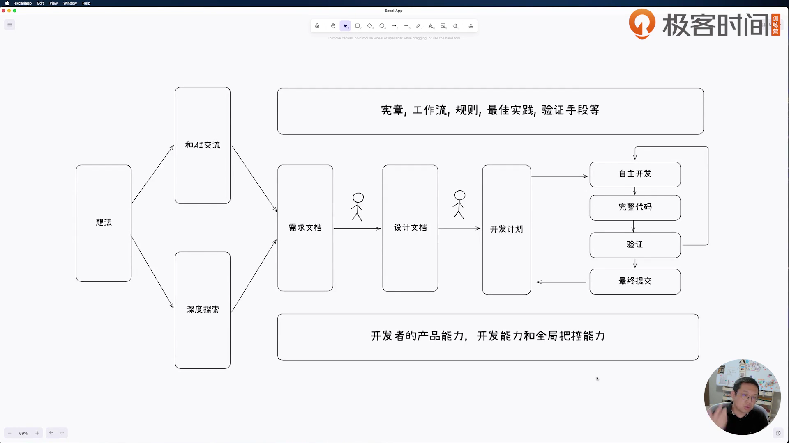

图注：真实视频帧，第1讲00:17:20；画面把需求、设计、计划、验证与人工把控放在同一流程。整理于2026-10-29；这是讲者教学图的课堂截图，不是助手重绘。

参见[模板 T1 工作流与上下文](#template-t1)。第一讲关于上下文扩展、扩散式代码生成、AI直接操作语法树等内容是未来展望，保留在[附录 E](#section-later)，不当作已实现能力。

<a id="section-step2"></a>
## 步骤 2 选清楚每种工具做什么

第二讲不是要求把所有付费工具买齐。先让一种可用 Agent 能读写练习副本，再区分资料探索、文档review和实际代码执行的职责。

**目标**：建立可用工具表，并确认本轮主工具。

1. 记录实际可用的通用对话工具、NotebookLM、IDE Agent、CLI Agent。课堂中ChatGPT/Gemini/Claude负责不同交流或探索，NotebookLM围绕资料，Cursor/Claude Code/Codex能参与代码工作。[[O2](#source-o2)]
2. 在Cursor打开课程练习副本，确认能看到目录、编辑文档与进入Agent对话；第5讲主要用Cursor Agent完成基础项目。不要把“必须切换到某个录课时模型”当成操作前提。[[O2](#source-o2)、[O5](#source-o5)]
3. 对CLI工具只记录你实际安装的命令和版本；进入练习目录再启动。第2讲10:37–15:30讲了Claude Code安装登录及Bedrock备选，16:00后介绍Codex；现行安装与服务资格以你当前客户端为准，旧命令不盲抄。[[O2](#source-o2)]
4. 记录限制：登录失败、权限不足、429限流各自分开；发生429时先按服务提示等待，再减小任务或调整可用额度，不以重试次数掩盖未成功。[[O2](#source-o2)]

**做完的标准**：工具表写清“用途、当前能否使用、工作目录、失败信息”；至少一种Agent能读取练习目录。

- [ ] 主工具已确定；对照工具只在比较文档时使用。
- [ ] 订阅、地区和费用未知项已记录，没有写成已满足。

### 课堂工具分工与历史配置

| 工具 | 课堂用途 | 本轮怎么用 |
|---|---|---|
| ChatGPT、Gemini、Claude App | 通用交流、深度分析、生成辅助内容 | 已有工具足够就先用已有的 |
| NotebookLM | 指定来源的问答、笔记、音视频、导图和报告 | 步骤3–5实做来源核查 |
| Cursor | 编辑/review文档、Agent mode、Composer实现 | Alpha基础开发 |
| Claude Code | CLI执行、生成对照spec和计划 | 对比生成结果、补充工作 |
| Codex CLI | 少量代码任务，后续读源码 | 本周不是强制主线 |

课堂Bedrock示例在 `~/.claude/settings.json` 的 `env` 中显示 `CLAUDE_CODE_USE_BEDROCK`、`AWS_REGION`、`AWS_BEARER_TOKEN_BEDROCK`。它解释了为何界面可能显示API usage billing以及为何遇到限流，**本手册不把旧区域、旧套餐价格或凭据配置当成当前开通指南**。这不影响已经能使用Agent的读者继续项目。[[O2](#source-o2)]

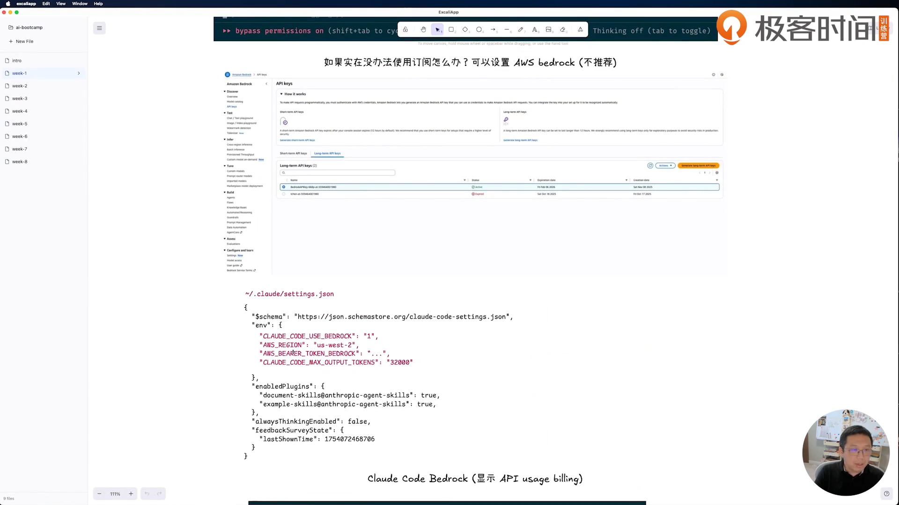

图注：真实视频帧，第2讲00:12:40；课堂展示Bedrock示例配置和API usage billing说明，凭据位置是省略号。整理于2026-10-29；只作历史配置阅读，不代表当前账户权限或服务规则。

参见[模板 T2 工具与环境表](#template-t2)。

<a id="section-step3"></a>
## 步骤 3 用 NotebookLM 建一个能核查的资料池

第三讲从“最近的AI进展”开始，连续发现资料、导入、删去打不开或不相关内容。重要产物是一组能追溯的来源，而非来源数量本身。

**目标**：建一个主题清楚、来源能打开、问题能落到原资料的Notebook。

1. 创建Notebook；在左侧Sources用Add加入已拥有的PDF、Google文档或其他适用材料，或用Discover搜索。第3讲00:21–02:30展示入口和输入。[[O3](#source-o3)]
2. 发[原输入 N1](#prompt-n1)；课堂建议探索时用英文、输出可设中文。将发现结果导入后逐项看标题与可用状态，打不开或明显无关的来源删除或另记。[[O3](#source-o3)]
3. 用N2把同一主题限制到YouTube，再用arXiv方向补学术材料。自然语言的来源限制并非严格过滤；课堂结果仍有非YouTube条目，必须自己核实际来源。[[O3](#source-o3)]
4. 在输出语言设置选择你需要的语言；选中本轮使用的来源后，提出[原输入 N4](#prompt-n4)。回答出来后点引用回原来源，核对它真的支持这句话。[[O3](#source-o3)、[O4](#source-o4)]

**做完的标准**：留下一个Notebook、来源清单和至少一段已点开原引用核对的回答；失效/无关资料有处理记录。

- [ ] 英文检索与中文输出分开设置。
- [ ] 来源限制按实际结果核过，不以prompt要求当成事实。

### 课堂原输入与可套用方式

N1、N2、N4在[原输入附录](#section-notebook-prompts)保留完整画面可读文字；N3的arXiv输入已补核到提交前完整画面。可套用版本见[模板 T3](#template-t3)。你研究自己问题时，把主题、时间窗、来源类型、要验证的判断分别填写，不要只把“AI”换成另一个大词。

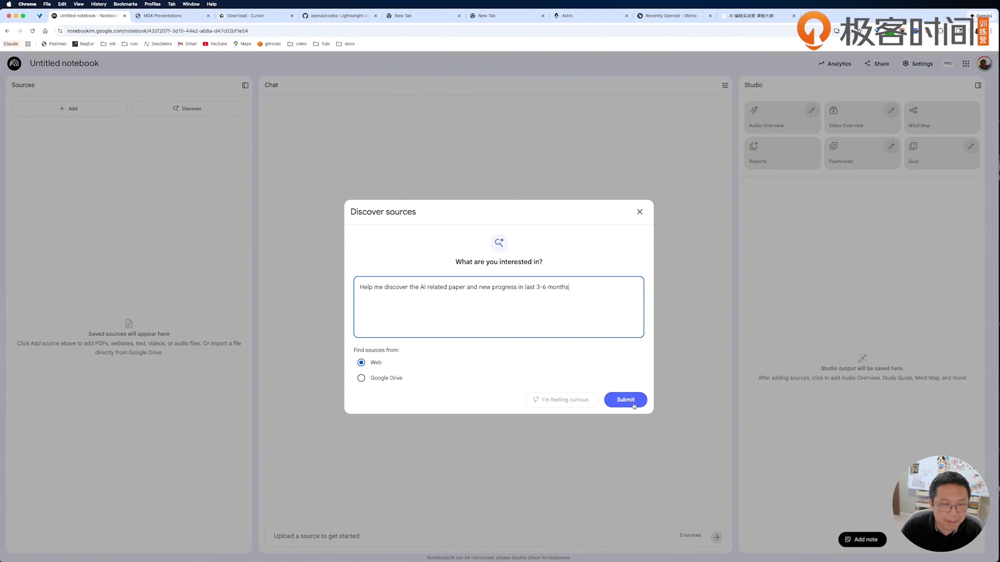

图注：真实视频帧，第3讲00:02:26；Discover输入完整显示AI相关论文和近3–6个月进展的检索要求。整理于2026-10-29；录课时入口，当前界面可能变化。

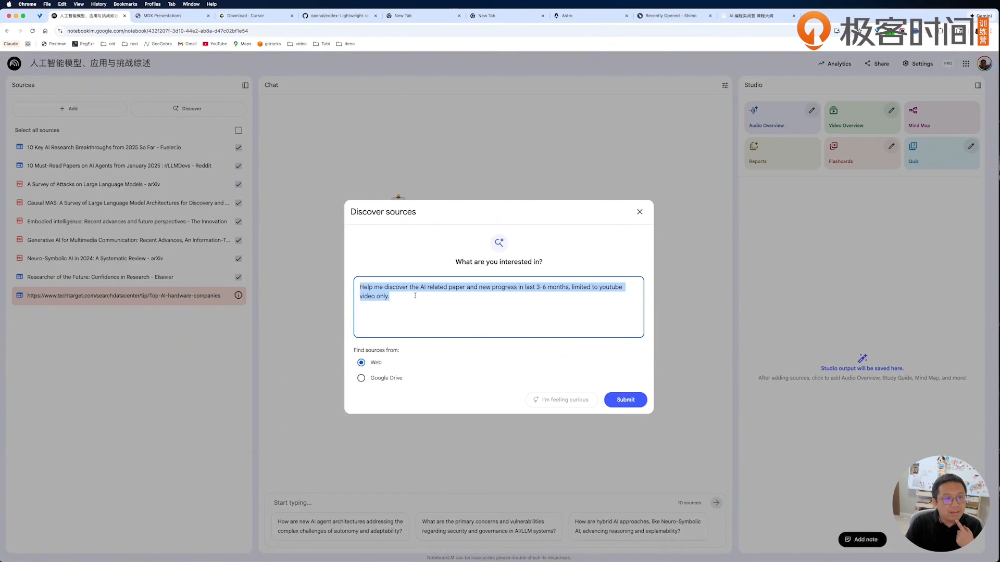

图注：真实视频帧，第3讲00:03:21；完整输入增加“limited to youtube video only.”，左侧仍有多种来源，说明指令需要结果核查。整理于2026-10-29；不能从本帧推断搜索严格只返回YouTube。

<a id="section-step4"></a>
## 步骤 4 把资料变成笔记、导图和可用报告

第三讲还演示了第二个主题：研究教孩子vibe coding的AI教育工具。它让你看到“找到资料”和“生成符合意图的产物”之间还隔着review。

**目标**：生成一项能帮助你理解主题的产物，并说明哪些结果需要改。

1. 对满意回答点Save to note并起可识别名称。课堂在约06:58及19:59附近提醒刷新后聊天历史丢失；这是当时界面行为，可靠做法是把重要结论单独保存，不把聊天滚动区当唯一记录。[[O3](#source-o3)]
2. 在Studio按目标选Mind Map、Reports、Flashcards、Quiz、Audio Overview或Video Overview；并行生成时分别观察状态，完成后再打开，不把“Generating”当结果。[[O3](#source-o3)]
3. 建第二个Notebook，按[原输入 N5/N6](#prompt-n5)探索儿童AI编程教育产品；课堂连续补搜，部分结果偏广义教育市场。用你的研究问题检查相关性，再提问、生成报告。[[O3](#source-o3)]
4. review报告对象、用途和证据。课堂Strategic Plan偏向给学区做数字化建设，不符合讲者原先产品研究意图，应重写问题/报告要求，不能只因报告完整就接受。[[O3](#source-o3)]
5. 播放音视频并拖动到另一时点比较。第4讲00:00–00:45明确更正前一讲的初步印象：Video Overview有随解说变化的多页幻灯片；不要保留“只是静态背景”的旧结论。[[O3](#source-o3)、[O4](#source-o4)]

**做完的标准**：一份保存的笔记、一项已打开检查的产物和一条review结论；若内容偏题，留下修改要求。

- [ ] 对报告的目标读者和问题做了核对。
- [ ] 已检查真实产物，不只看生成按钮或标题。

### 保存与生成的真实界面

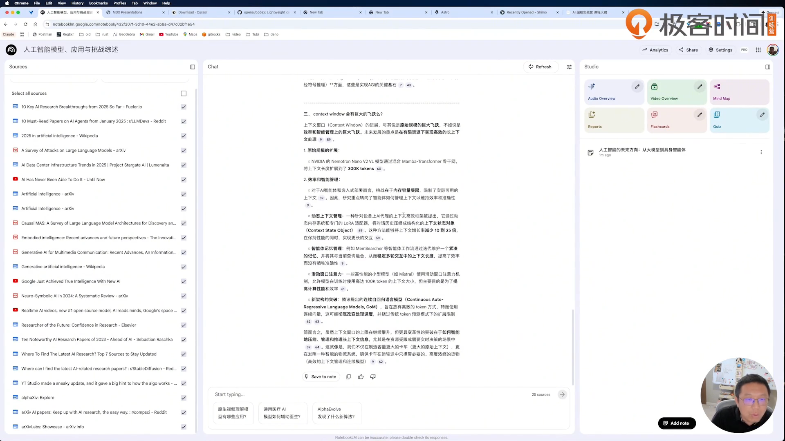

图注：真实视频帧，第3讲00:07:06；回答底部Save to note、右侧已保存笔记可见。整理于2026-10-29；生成内容本身未经本手册逐项事实验证。

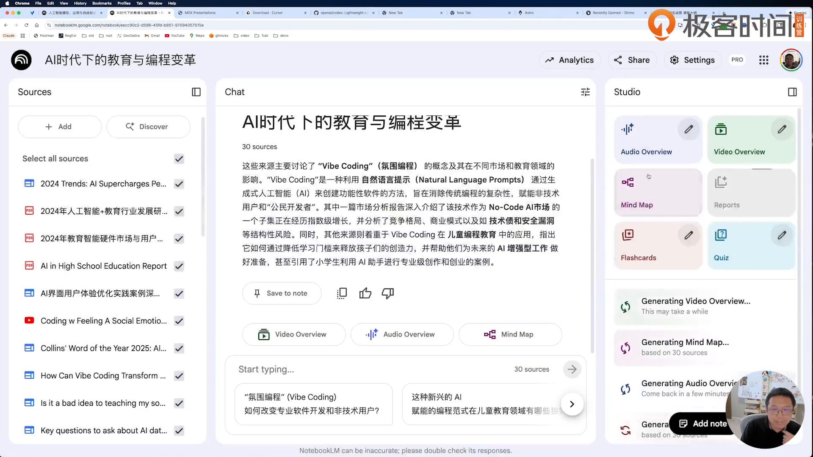

图注：真实视频帧，第3讲00:17:00；Studio显示音频、视频、导图、报告等入口及生成中状态。整理于2026-10-29；“30 sources”是课堂当时资料数，不是本手册最低要求。

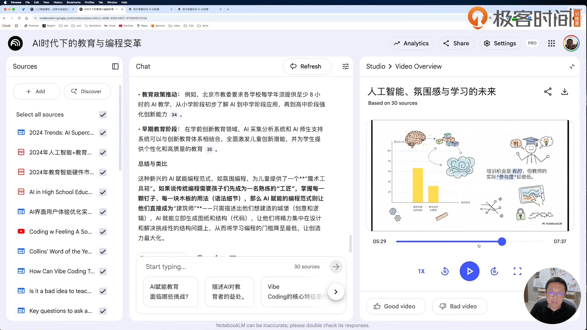

图注：真实视频帧，第4讲00:00:40；视频播放头已在05:29，展示一页课堂生成的幻灯片。结合本讲开头更正说明，应按多页叙述视频理解。整理于2026-10-29；不借其图中教育数据作外部事实依据。

参见[模板 T4 产物review](#template-t4)。讲者还提到把音频下载后学习、取对话文本改写，或用其他声音工具处理；这些是可选内容制作方向，不是Alpha项目依赖，见[附录 E](#section-later)。

<a id="section-step5"></a>
## 步骤 5 做一次“自己的推断被引用”的实验

第四讲最值得动手的不是背诵向量数据库名词，而是看见输入资料如何影响结论。一段你自己写的看法被转成Source之后，也可能被回答称作“专家预测”。

**目标**：能区分“有引用”和“引用可靠”。

1. 在Studio用Add note创建个人笔记，明确写“这是个人推断”；先记录它尚不是外部研究。课堂笔记完整原文见[原输入 N7](#prompt-n7)。[[O4](#source-o4)]
2. 点笔记下方Convert to source，使它进入Sources；观察新来源是否选中、是否处理完成。课堂09:54–10:20显示这个过程。[[O4](#source-o4)]
3. 发[问题 N8](#prompt-n8)，等回答后点引用；核对引用是否回到你自己的笔记。若同名来源出现多次，不因有两个编号就当成两个独立证据。[[O4](#source-o4)]
4. 把回答中的预测语气、作者归属、来源性质逐一对照原笔记；在记录表写“资料支持什么、没有支持什么”，然后删除实验资料或清楚保留其性质，避免后续研究误用。[[O4](#source-o4)]

**做完的标准**：能举出一条“引用存在，但只支持作者个人预测”的具体例子，并把它与已验证事实分开。

- [ ] 已实际打开引用，不只看编号。
- [ ] 自己的推断没有升级成行业共识。

### 课堂输入、来源转换与结果

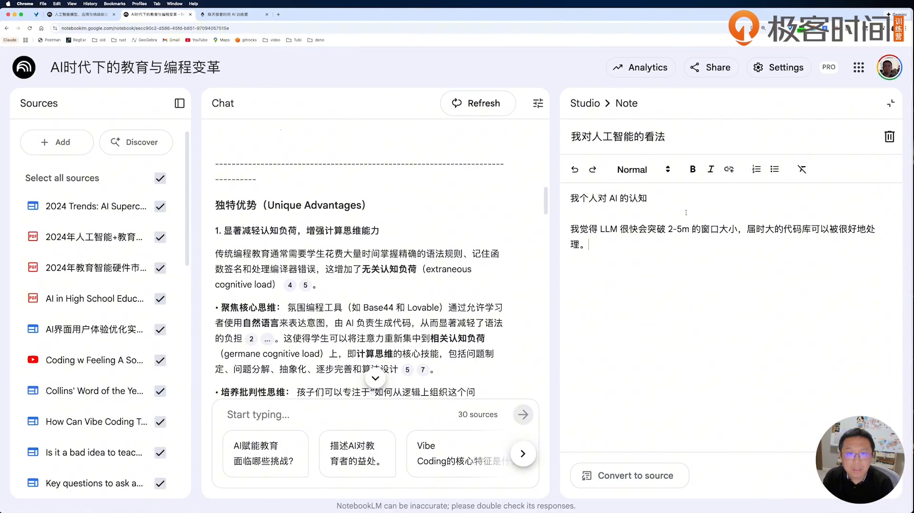

图注：真实视频帧，第4讲00:09:48；个人笔记谈LLM窗口未来达到2–5m，Convert to source可见。整理于2026-10-29；这是讲者预测的实验文本，不是窗口规格。

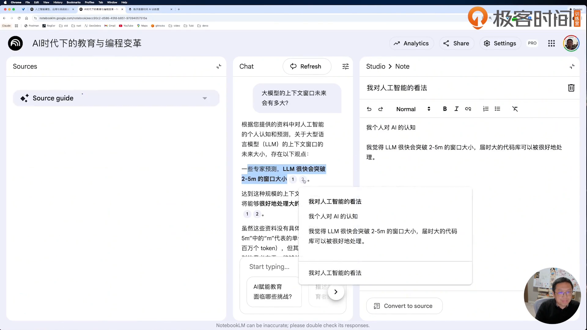

图注：真实视频帧，第4讲00:11:10；回答出现“一些专家预测”，引用浮层实际回到“我对人工智能的看法”。整理于2026-10-29；展示来源性质核查，不能把引用编号当权威认证。

第4讲02:00–08:20还用课程网站讲解资料解析、embedding、向量搜索、上下文组装、模型生成和引用。你可把它作为检索增强生成（RAG）的理解模型：先找相关资料再生成回答。这里的具体内部模型、存储方式和“不用于训练”等是讲者/课程网站当时说明，本手册未取得NotebookLM内部实现或现行隐私政策证据，不据此安排敏感资料上传。[[O4](#source-o4)]

参见[模板 T5 来源可靠性核对](#template-t5)。

<a id="section-step6"></a>
## 步骤 6 准备独立练习目录与本地连接

从这里开始进入Alpha项目。先消除路径与环境差异，后面发prompt时Agent才不会把代码写进错误目录。

**目标**：让Agent、终端、数据库连接和文档路径指向同一练习项目。

1. 从原课程复制 `w1/project-alpha` 和 `w1/specs` 到你选的练习目录；不要复制依赖缓存、真实.env或凭据。已有代码用于对照与复现；想从零生成时另建空目录并保留完成版作只读参照。[[O5](#source-o5)、[O7](#source-o7)]
2. 核对 `python3 --version`、`uv --version`、`node --version`、`yarn --version`、`psql --version`；版本写进环境表。主README写Python3.11+、Node18+、PostgreSQL14+，后端README又写PG17+；实际锁了Vite7，不能仅凭README认定最低版本都兼容。[[O7](#source-o7)、[O9](#source-o9)]
3. 先运行 `lsof -nP -iTCP:8000 -sTCP:LISTEN` 与 `lsof -nP -iTCP:5173 -sTCP:LISTEN` 看端口是否已有别的服务。已有服务就为练习选择空闲端口，连同前端API地址与后端CORS同步调整，不停止其他项目。然后进入练习 `project-alpha/backend`，用 `uv sync` 安装锁定依赖。若要复制 `.env.example`，先打开确认它只有示例值；修改练习.env的DATABASE_URL为自己本机角色/数据库，不沿用讲者机器路径。[[O7](#source-o7)]
4. 用只读连接检查确认数据库角色、库名和端口；需要新练习库时创建独立库。课堂使用本机PostgreSQL、5432端口和projectalpha，但你的机器可用名称以实际为准。[[O5](#source-o5)、[O7](#source-o7)]

**做完的标准**：环境表有实际版本和路径；能解释哪个库是练习库，哪个库专供测试；连接失败已留错误而不是继续执行迁移。

- [ ] 没有把真实凭据写进提示词或截图。
- [ ] 终端当前目录与Agent工作目录一致。

### 路径先统一

| 内容 | 课堂/原prompt路径 | 当前课程文件路径 |
|---|---|---|
| 需求设计 | `./specs/w1/0001-spec.md` | `w1/specs/0001-spec.md` |
| 实施计划 | `./specs/w1/0002-implementation-plan.md` | `w1/specs/0002-implementation-plan.md` |
| 代码 | `w1/project-alpha` | `w1/project-alpha` |
| API手工用例 | `w1/project-alpha/docs/test.rest` | 同路径 |

原文附录不改路径；你发送的可套用版要按**当前工作目录**改。例如在课程根工作时用 `w1/specs/...`，在w1目录工作时用 `specs/...`。这项差异来自仓库当前布局，不意味着讲者当时输错。[[O5](#source-o5)、[O6](#source-o6)、[O8](#source-o8)]

只读连接检查示例（替换为实际连接，示例没有现成账号）：

```bash
psql 'postgresql://你的角色@localhost:5432/你的练习库' -c 'SELECT current_database(), current_user, version();'
```

安全示例配置见项目 `backend/.env.example`；快照若未包含该文件，就从课程原目录只读打开该示例，不能因此复制真实.env。参见[模板 T2](#template-t2)。

<a id="section-step7"></a>
## 步骤 7 发第一条需求并review设计

原想法只有几行，但生成文档含数据结构、API、前后端和部署。你要判断新增内容是否适合本次范围，而不是把长文档当成完成证明。

**目标**：得到内容一致、目录正确、可用来实现的需求设计。

1. 在instructions文件记录[完整P1原文](#prompt-p1)，再用[模板 T6](#template-t6)填本次真实路径发送给Agent。第一轮先产文档，不同时让它开始实现。[[O5](#source-o5)、[O6](#source-o6)]
2. 核对用户行为：创建、编辑、删除、完成、取消完成Ticket；添加/移除标签；按标签列出；按title搜索；无用户系统。超出这组能力的多用户、通知或复杂部署先标以后再看。[[O6](#source-o6)、[O8](#source-o8)]
3. review三张表：tickets、tags、ticket_tags；检查主键/外键类型一致、标签唯一、删除关联的行为和时间字段。课堂约12:00–14:00特别看了ID类型、索引、级联和触发器。[[O5](#source-o5)、[O8](#source-o8)]
4. 核对API请求/响应、错误码和前端组件与需求一一对应；把不需的Docker部署替换成本地PostgreSQL，把包管理器、栈版本和CORS端口写清。课堂明确先用本地库、允许5173前端。[[O5](#source-o5)]
5. 保存review后的版本和更改理由；不要把Claude对照文档与Cursor主文档混成一套字段限制。[[O5](#source-o5)、[O8](#source-o8)]

**做完的标准**：文档明确功能范围、三表关系、接口、前端入口、环境及验收；能解释每个额外功能是否本轮采用。

- [ ] 没有用户认证系统。
- [ ] 字段、API与执行目录只有一个主版本。

### 原输入与review重点

P1全文在[原输入附录](#prompt-p1)，不是用摘要代替。课堂先在编辑器写、选中后送入Agent；你也按这个办法保存后续轮次，便于复盘。

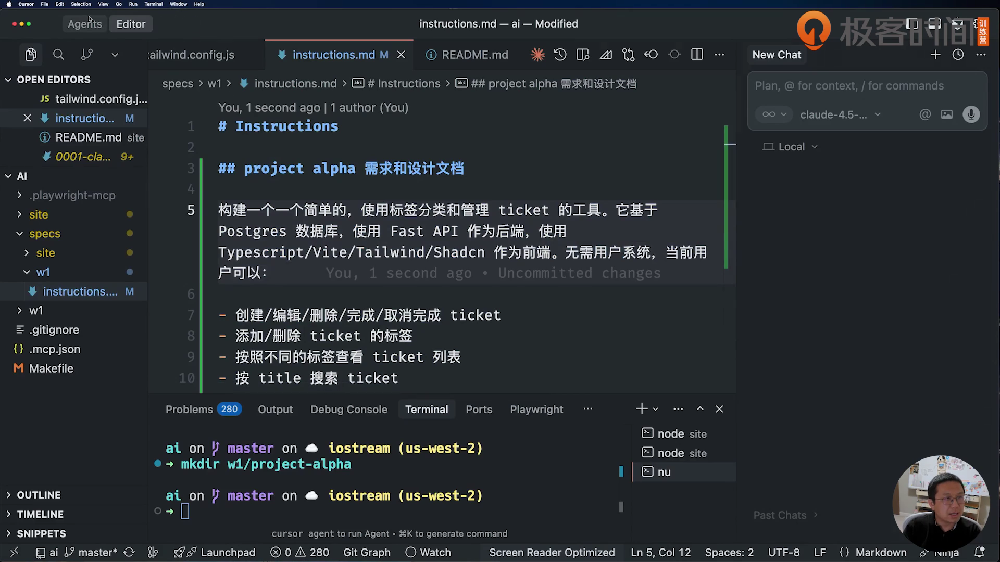

图注：真实视频帧，第5讲00:08:42；首段与四项用户行为完整可读，末尾输出指令在另一帧。整理于2026-10-29；课堂目录为specs/w1。

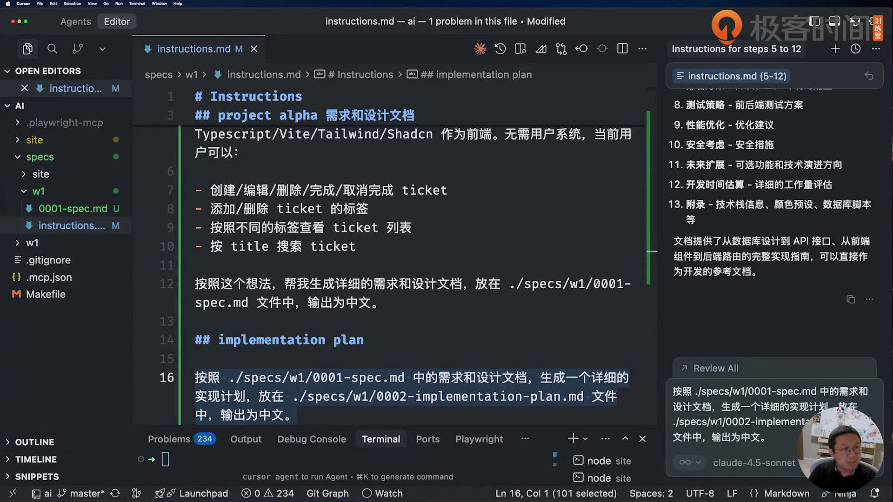

图注：真实视频帧，第5讲00:20:28；上半段续显P1的输出路径，下半段已经写P2计划输入。整理于2026-10-29；这是跨时点续图，不能说同一帧显示P1全文。

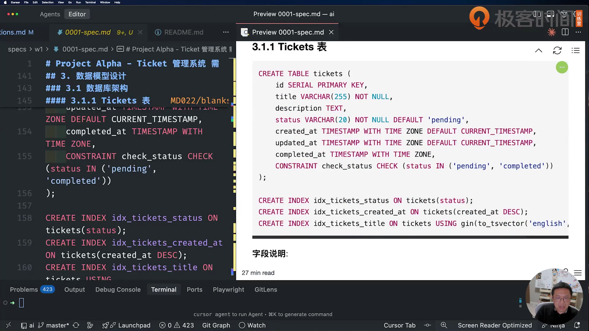

图注：真实视频帧，第5讲00:12:35；讲者查看tickets字段、状态约束和索引。整理于2026-10-29；课堂显示的SERIAL设计与后续仓库实现须分别核对，不能凭此图宣布最终数据库已验证。

主版schema对应标题255、描述10000字符；Claude版是200、5000。课程生成文档含大量代码，讲者认为过长会占用上下文，建议设计/计划先保留必要接口、约束和验收，不把整份实现重复写入文档。[[O5](#source-o5)、[O8](#source-o8)、[O9](#source-o9)]

<a id="section-step8"></a>
## 步骤 8 生成计划，明确每个phase的完成条件

第二条原输入很短，质量取决于上一份文档是否稳定。计划的价值是把依赖和验收分开，让Agent能在阶段边界停下来。

**目标**：形成能逐段执行的phase 0–6计划。

1. 发[P2原文](#prompt-p2)的当前路径版本；要求只生成计划，代码放 `w1/project-alpha`。课堂约21:00发现目录不对便中断补充项目位置。[[O5](#source-o5)、[O6](#source-o6)]
2. 按下表核阶段依赖；每阶段都要有“改哪些文件、如何验证、输出什么”。数据库/模型先于依赖它们的API，API契约先于前端联调。[[O8](#source-o8)]
3. 删减重复实现代码，保留接口与验证。计划太长、到字数上限时，先检查重复和过度设计，不让新上下文再次重读一堆无用细节。[[O5](#source-o5)]
4. 用相同初始需求让Claude Code生成对照spec/plan时，另存 `*-by-claude.md`；对比阶段、字段、API和复杂度，而不是凭文件长度选优。[[O5](#source-o5)、[O8](#source-o8)]

**做完的标准**：每phase有输入、可检查产物和通过标准；主版本与对照版已标清。

- [ ] 计划目录与实际工作目录一致。
- [ ] “生成计划”没有直接变成实现所有功能。

### 课程主计划的阶段表

| phase | 工作 | 最少观察的结果 |
|---|---|---|
| 0 | 初始化与目录 | 配置、依赖、目录能定位 |
| 1 | 数据库与后端基础 | 模型、迁移、配置和基础服务 |
| 2 | 后端API | Ticket/Tag/关联、搜索过滤和错误响应 |
| 3 | 前端基础 | Vite、类型、状态、API客户端、布局 |
| 4 | 前端功能 | 表单、列表、标签、搜索过滤、批量操作 |
| 5 | 集成与优化 | 测试、交互、性能与失败修复 |
| 6 | 文档与启动 | 使用说明、启动停止、交付检查 |

计划写10–13天，讲者比较了人工工期与Agent现场速度；该数字不是你的学习排期。Claude版又给另一套阶段和6–8工作日估计，不能把两个时间表拼起来。[[O5](#source-o5)、[O8](#source-o8)]

参见[模板 T7 计划与review](#template-t7)。

<a id="section-step9"></a>
## 步骤 9 实现后端基础，亲自看一次迁移与服务输出

第三条原输入只做phase1。课堂虽然计划很详尽，执行中仍出现迁移和启动问题；这正说明文档不能代替运行反馈。

**目标**：phase1真实完成，phase2API随后可测。

1. 发[P3完整原输入](#prompt-p3)，替换当前计划路径；用[模板 T8](#template-t8)限制本轮phase范围。新会话时明确读哪份设计、计划和规则，不依赖旧聊天记忆。[[O5](#source-o5)、[O6](#source-o6)]
2. review `backend/app/config.py`、`database.py`、`models/`、`schemas/`、`alembic/versions/` 的实际存在和引用关系；不要因Agent说“完成”就继续前端。[[O9](#source-o9)]
3. 在练习后端安装依赖、配置连接、创建独立练习库后跑 `uv run alembic upgrade head`；若报错，保留完整错误、当前目录和当前迁移版本，再把错误交回Agent修复。[[O5](#source-o5)、[O7](#source-o7)]
4. 启动 `uv run uvicorn app.main:app --reload --port 8000`，另一个终端访问 `/health` 与 `/api/v1/docs`。基础通过后再让Agent实现phase2，按同样方式reviewAPI。[[O7](#source-o7)、[O9](#source-o9)]

**做完的标准**：迁移命令真实退出成功、健康检查可读、API文档可打开；若只有文件生成则仍未完成此步。

- [ ] 运行记录含命令、实际退出状态或报错。
- [ ] 数据库迁移与服务启动分开核过。

### 运行顺序

下列命令在独立练习 `project-alpha/backend` 运行；数据库和凭据以步骤6确认值为准：

```bash
uv sync
cp .env.example .env
# 编辑练习.env，配置独立练习数据库连接
uv run alembic upgrade head
uv run uvicorn app.main:app --reload --port 8000
```

在另一终端：

```bash
curl -i http://127.0.0.1:8000/health
```

源码实际返回 `status` 和 `service` 两个字段；docs/setup的简化示例只写status，不应因此认为真实服务错了。Swagger入口是 `http://127.0.0.1:8000/api/v1/docs`。[[O7](#source-o7)、[O9](#source-o9)]

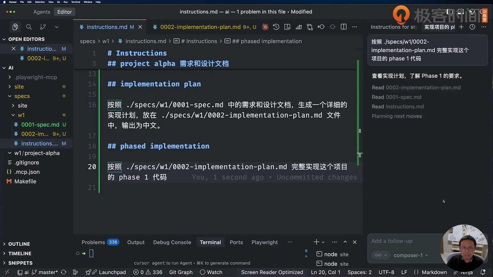

图注：真实视频帧，第5讲00:27:32；编辑器和右侧已发送消息都显示phase1完整实现输入。整理于2026-10-29；不是灰色自动补全建议，原路径保留在附录。

<a id="section-step10"></a>
## 步骤 10 生成有意义的数据，逐项测API

空列表只能证明接口返回了空数组。课堂为此补了种子数据，再测标签、状态、搜索和分页；你要同时检查响应和实际数据变化。

**目标**：让API验收覆盖有数据、无结果与状态变更。

1. 要求Agent生成REST Client用例，课堂可读原文见[R1](#prompt-r1)；当前 `docs/test.rest` 已有完整请求，先核baseUrl/apiPrefix，再运行。[[O5](#source-o5)、[O10](#source-o10)]
2. 发[P4原输入](#prompt-p4)的本项目版本；在独立练习库导入 `seed.sql`。它是INSERT和按名称关联，不是可随意重复运行的初始化器；已有数据时先计数、判断是否重复，不照抄清库命令。[[O5](#source-o5)、[O6](#source-o6)、[O9](#source-o9)]
3. 测标签列表/创建、Ticket列表、pending/completed过滤、title搜索、分页；保存状态码和响应。原文件中的资源ID须改为你实际创建或查询的ID。[[O10](#source-o10)]
4. 建一个专用验收Ticket，测创建、编辑、添加/移除标签、完成、取消完成、删除；分别确认状态字段、completed_at及刷新后的持久化结果。[[O9](#source-o9)、[O10](#source-o10)]
5. 把错误按请求、输入数据、后端日志和数据库现状分开记录；不要在缺种子数据时凭“没有标签”判断过滤写错。[[O5](#source-o5)]

**做完的标准**：API验收表含成功与失败证据；数据数量来自查询，状态切换后的值真实可见。

- [ ] 未对真实业务库执行TRUNCATE。
- [ ] 50个是原输入要求，实际条数另记。

### 可直接参考的请求

在练习后端启动的前提下：

```bash
curl -i 'http://127.0.0.1:8000/api/v1/tickets?status=pending&skip=0&limit=10'
curl -i 'http://127.0.0.1:8000/api/v1/tickets?search=CDN'
curl -i 'http://127.0.0.1:8000/api/v1/tags'
```

添加Ticket标签的实际路由使用裸JSON数组，例如请求体 `[1,2]`，不是随手组装 `{"tag_ids":[1,2]}`；创建Ticket的schema又确实有tag_ids字段，这两个入口要分开看。[[O9](#source-o9)]

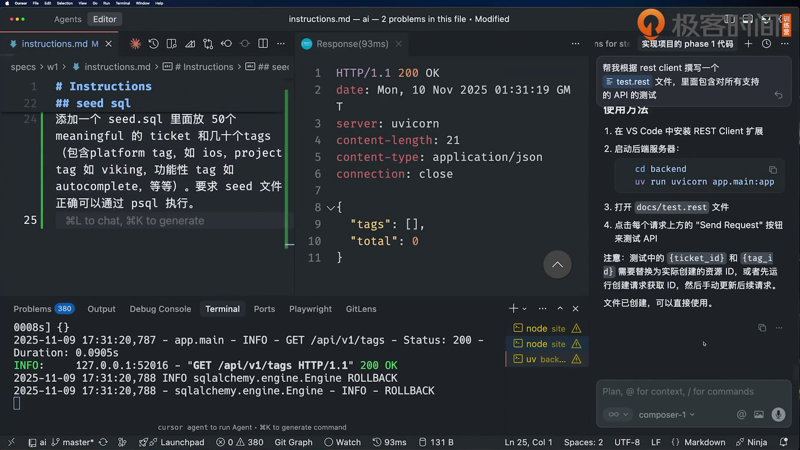

图注：真实视频帧，第5讲00:43:00；完整P4写在instructions中，右侧还显示REST Client使用说明。整理于2026-10-29；一帧不证明SQL执行成功。

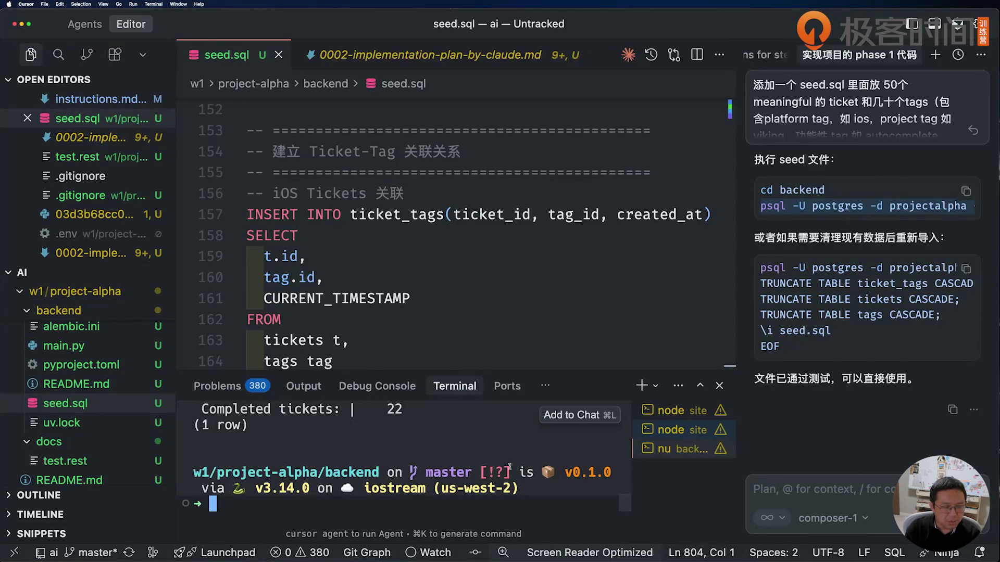

图注：真实视频帧，第5讲00:45:03；终端可见Completed tickets为22，旁边显示导入和清库建议。整理于2026-10-29；清库建议不作为本手册执行命令，实际总数须自己计数。

参见[模板 T9 种子数据](#template-t9)与[模板 T10 API/端到端验收表](#template-t10)。

<a id="section-step11"></a>
## 步骤 11 接上前端，先证明功能链可用

课堂phase3搭前端基础、phase4完成交互。你会遇到“构建完成但样式没加载”和“界面好看但API失败”两类不同问题，先分开诊断。

**目标**：前端能访问后端并完成一条Ticket操作链。

1. 让Agent按主计划实现phase3和4；明确读取已确认API契约。当前代码包含 `src/lib/api.ts`、`store/useTicketStore.ts`、Ticket/Tag组件与类型文件。[[O5](#source-o5)、[O9](#source-o9)]
2. 在练习 `frontend` 运行 `yarn install`、`yarn dev`，打开 `http://localhost:5173`；若后端改端口，连同前端API地址和后端ALLOWED_ORIGINS一起核对，不能只改浏览器地址。[[O7](#source-o7)、[O9](#source-o9)]
3. 依次测试新建、编辑、完成/取消、标签、状态过滤、搜索和清除筛选。先用确实存在的标题关键字；无结果时先清筛选，再检查请求和后端返回。[[O5](#source-o5)、[O7](#source-o7)]
4. 跑 `yarn build` 与 `yarn lint`，记录实际结果；当前package.json没有test脚本，不能照docs中的“yarn test”把测试写成已完成。[[O9](#source-o9)]

**做完的标准**：前后端同时运行；一个验收Ticket可从创建到删除完整操作，页面刷新后行为与数据库一致。

- [ ] 构建、样式加载、接口调用分别检查过。
- [ ] 出错时保存浏览器提示和后端日志。

### 认清源码里的职责

| 文件/目录（project-alpha内） | 做什么 | review时问什么 |
|---|---|---|
| frontend/src/lib/api.ts | HTTP请求 | URL、参数和响应字段与后端一致吗 |
| frontend/src/store/useTicketStore.ts | 维护Ticket、标签、筛选与排序状态 | 改完后是否重新拉取数据，有没有旧状态 |
| components/tickets/TicketForm.tsx | 创建/编辑 | 必填、长度、提交失败怎样提示 |
| components/tickets/TicketList.tsx | 展示列表与批量操作 | 空列表、加载、错误怎样显示 |
| components/layout/FilterSidebar.tsx | 状态和标签筛选 | 不是数据库列表，不是schema树 |
| components/tags/TagManager.tsx | 全局标签操作 | 删除关联影响是否清楚 |

前端按本次API响应的列表排序，后端固定按created_at倒序分页；所以“按标题排序”不自动等于全库标题排序。多标签实现是 `Tag.id.in_` 的“任一标签”筛选，不能宣称任意AND/OR切换。[[O9](#source-o9)]

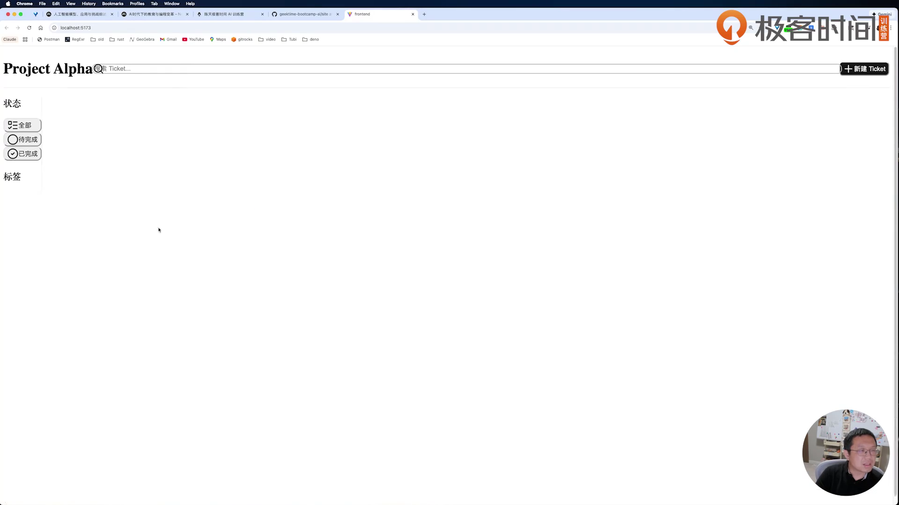

图注：真实视频帧，第5讲00:50:23；页面能显示Project Alpha和控件，但整体缺预期样式。整理于2026-10-29；课堂随后定位Tailwind CSS配置，不能把该图归因于数据库故障。

参见[模板 T8](#template-t8)与[模板 T10](#template-t10)。

<a id="section-step12"></a>
## 步骤 12 用具体反馈优化UI，别把“像Apple”当验收

P5给出一个审美方向，课堂又经历CSS修复、状态切换错误和后续风格改进。每轮只改清楚要改善的部分，并保留原有行为检查。

**目标**：界面改进可观察，同时Ticket功能不退化。

1. 对照[P5原文](#prompt-p5)发送本轮UI要求；若使用[模板 T11](#template-t11)，写具体参照、要改的层次/间距/输入反馈及需保留的行为，不把助手补写当讲者原文。[[O5](#source-o5)、[O6](#source-o6)]
2. 页面无样式时先核Tailwind/PostCSS/入口CSS配置与构建日志。课堂约51–53分钟就是CSS接入问题，不是需要重新设计整个产品。[[O5](#source-o5)、[O9](#source-o9)]
3. 复测完成切换和筛选。课堂约54分钟把500错误发给Agent，它定位枚举名称/值的差异；你要检查数据库enum、ORM映射和迁移触发器相互一致，再测完成与取消完成。[[O5](#source-o5)、[O9](#source-o9)]
4. 保存修改前后真实截图，并重新执行步骤11的关键链路；把仍不好用的居中、搜索、批量删除等问题逐条反馈。[[O5](#source-o5)]

**做完的标准**：改前/改后图可比较；创建、编辑、完成、筛选和删除仍能工作；未解决问题有具体描述。

- [ ] 不以“更高级”“质感好”替代可检查的行为。
- [ ] 没把数据库项目P7/P8侧边栏需求混进Alpha。

### 课堂两个版本的UI输入

第5讲00:51:20画面显示P5后面还有“放在 ./specs/w1/0003-ui-ux-optimization.md 文件中，输出为中文。”，且是编辑器灰色建议区域的一部分；这与 `.chats/w1.md:28` 的短版不同，不能据此说长版已发送。附录分别保留文件原文与画面可见差异。P6“style.md、site token”在本讲已核关键片段未定位到对应发送画面，因此只作为待归属输入保存，不在此补造一轮课堂动作。[[O5](#source-o5)、[O6](#source-o6)]

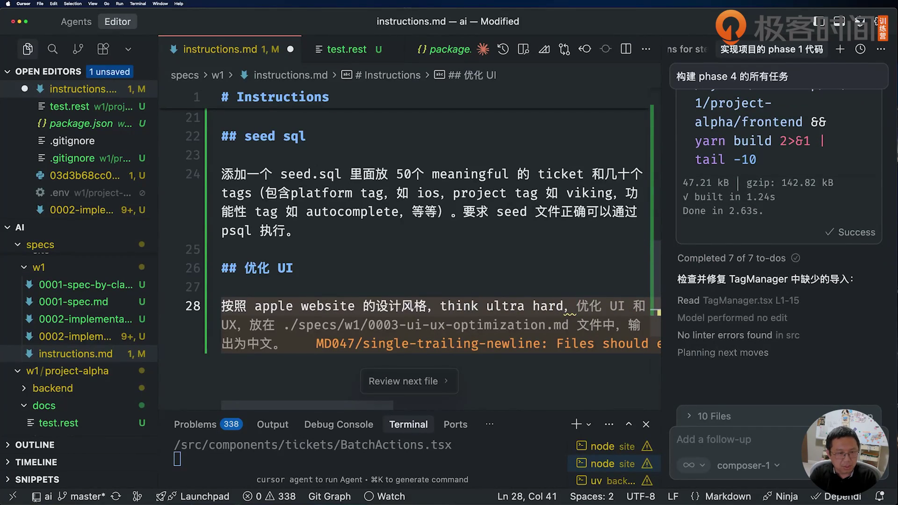

图注：真实视频帧，第5讲00:51:20；可见Apple风格提示及后续灰色补全建议。整理于2026-10-29；灰色文字不是已发送消息，不能将整段自动当成作者最终输入。

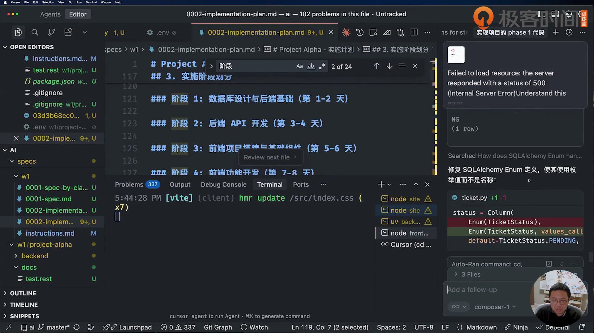

图注：真实视频帧，第5讲00:54:34；右侧可见500错误和SQLAlchemy Enum修复讨论。整理于2026-10-29；这是课堂中间版本，当前源码enum与触发器另见附录D。

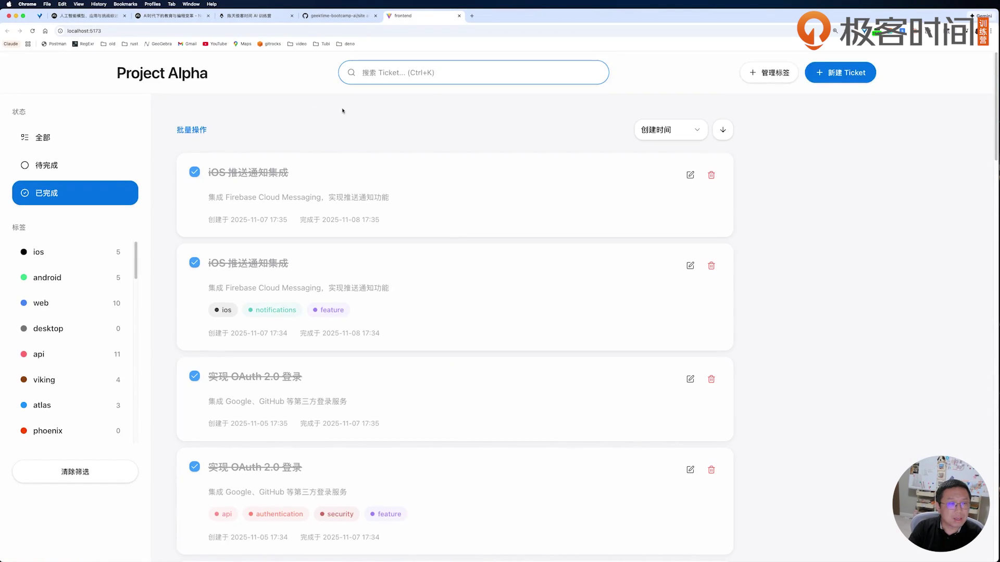

图注：真实视频帧，第5讲01:14:50；状态侧栏、标题搜索、标签、管理/新建入口及完成卡片可见。整理于2026-10-29；重复标题也可见，不把视觉完成等同于数据无重复。

<a id="section-step13"></a>
## 步骤 13 用独立测试库核完成时间与真实验收

课程代码把completed_at交给PostgreSQL触发器，测试配置却可默认用SQLite。你必须知道每个结果覆盖到哪里，不能把一条绿色日志扩大成全项目通过。

**目标**：区分静态核对、数据库测试、前端操作与真实用户试用。

1. 先读 `backend/tests/conftest.py`；它从DATABASE_URL取数据库，测试结束会TRUNCATE三张表。只用专属空测试库，确认库名后才运行测试；不将练习主库/业务库连接传给它。[[O9](#source-o9)、[O11](#source-o11)]
2. 在独立测试库运行Alembic两条迁移，再运行后端测试。第二条迁移创建updated_at/completed_at触发器；仅 `Base.metadata.create_all()` 不会替你建这些触发器。[[O9](#source-o9)、[O11](#source-o11)]
3. 手工创建一个验收Ticket，完成后核completed_at非空，取消后为空；并核接口状态与数据库值。SQLite未装同一触发器时，这项不能算完整覆盖。[[O9](#source-o9)]
4. 在前端用步骤10同一组验收动作再做一次，记录浏览器、后端、数据库各自结果；批量删除只用本轮专用测试Ticket。[[O7](#source-o7)、[O10](#source-o10)]
5. 将每项写成passed/failed/not_tested并附证据；没有自己或真实读者做完，就保持试用 `not_tested`。课堂CHANGELOG自述15/15、89%不是本次测试结果。[[O11](#source-o11)]

**做完的标准**：每项结论都有明确测试范围与证据；没有误删真实数据，也没有以SQLite结果代替PG触发器验收。

- [ ] 数据库名称已二次确认属于专用测试库。
- [ ] 前端无test脚本的缺口仍被显式保留。

### 独立测试库命令结构

下面是阅读用模板，不含你的现成连接。替换〔〕并确认库独立后，才在练习backend执行：

```bash
DATABASE_URL='〔仅供测试的PostgreSQL连接〕' uv run alembic upgrade head
DATABASE_URL='〔同一个独立测试库连接〕' uv run pytest -v
```

不要把这个命令的环境变量设成你正在使用的真实数据库。测试fixture清表是源码中真实存在的行为，不是泛泛风险提示。本次制作未运行会清库的测试，当前结论仅为静态核对。[[O9](#source-o9)]

参见[模板 T10](#template-t10)和[附录 D代码差异](#section-code-gaps)。

<a id="section-step14"></a>
## 步骤 14 收尾文档、启动停止和下一轮工作

能在一个终端跑起来，和别人能按文档重现，是两回事。课堂最后补了README、用户手册、pre-commit、CI和Makefile，过程中同样发生配置位置、类型检查和停止命令的问题。

**目标**：留下能重现、能解释剩余问题的项目记录。

1. 完成phase5/6后，reviewREADME、API说明、安装说明、用户指南和测试说明；确认写到的命令在当前目录真实存在。没有test脚本的yarn test等说明要删改或标待补。[[O5](#source-o5)、[O7](#source-o7)]
2. 区分开发启动与preview：开发时用后端uvicorn和前端yarn dev；仓库根 `make w1-start` 实际使用yarn preview，须先yarn build，不能把preview当自动开发热更新。[[O12](#source-o12)]
3. 如采用pre-commit/CI，核配置在Git仓库根以及路径限定。课堂把mypy暂时禁用以通过流程，应保留“类型检查未完成”，不能报全质量门槛通过。[[O5](#source-o5)、[O11](#source-o11)]
4. 验证停止命令只处理本项目启动的进程；根Makefile含按8000/5173端口停止的兜底，先确认端口属于练习服务，不在其他项目占用时照抄。[[O12](#source-o12)]
5. 保存本次验收与待办，review后再在自己的练习仓库提交；本手册不替你提交原课程，也不把讲者的“完整完成”当成本次复现结论。[[O5](#source-o5)]

**做完的标准**：新终端能按记录找到目录、配置、启动、访问和停止；剩余类型/测试/数据问题各自有下一动作。

- [ ] 运行方法与实际包脚本一致。
- [ ] 所有未完成项保留，没有为交付删掉真实缺口。

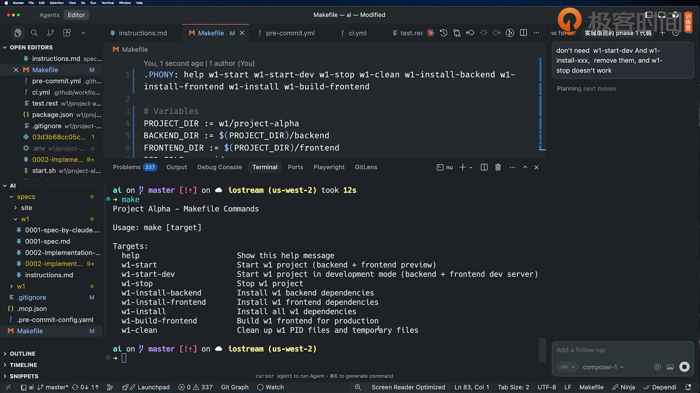

图注：真实视频帧，第5讲01:19:20；已发送消息指出w1-stop不工作，并要求删去多余目标，终端列出当时目标。整理于2026-10-29；截图为中间修订，当前Makefile以快照为准。

参见[模板 T12 收尾review](#template-t12)。

<a id="section-notdo"></a>
## 附录 A｜不做、依据与替代

本章帮助你控制范围，同时保留课程里有价值的分支。遇到新想法先在这里判断，避免主项目被不断扩成另一个工具。

| 这轮不做 | 依据 | 改为 |
|---|---|---|
| 用户注册、权限、多租户 | P1明确无需用户系统 | 用独立本地练习数据演示单用户流程 |
| 把数据库列表/schema/SQL编辑器塞进侧栏 | P7/P8对象与w2数据库查询工具一致，Alpha侧栏实际管状态/标签 | 保留原输入和归属说明，数据库项目另做 |
| 把最长的spec当最好 | 第5讲批评重复代码消耗上下文 | 以接口、约束、依赖、验收和实现一致性review |
| 只用空列表验API | 第5讲40分钟后专门补seed | 建真实分布的演示数据，再测过滤与搜索 |
| 禁用检查后宣布全通过 | 课堂mypy临时停用 | 记录未覆盖门槛和修复任务 |
| 把NotebookLM引用当正确保证 | 第4讲个人note进入source的反例 | 逐条点引用，区分作者预测与事实 |
| 为当前项目安装所有工具/订阅 | 第二讲是工具概览和个人偏好 | 先用已有可用工具，只补会阻断动作的能力 |


<a id="section-prompts"></a>
## 附录 B｜原提示词全文与截图边界

本章完整保留 `.chats/w1.md` 的八节输入。它是作者整理的文件记录；视频另有临时编辑、自动补全和继续追问，不能把灰色建议或助手模板混成原文。文件范围八节完整，不等于已穷尽视频中每一条短追问与未展示模板。[[O6](#source-o6)]

<a id="prompt-p1"></a>
### P1 project alpha 需求和设计文档

出处：`.chats/w1.md:5–12`。类别：作者聊天输入。Project Alpha需求。对应第5讲00:08:42正文图与00:20:28末尾续图；前者展示5–10行，后者展示12行。原文重复“一个一个”保留。原路径与当前课程布局不同，执行模板另改。

```text
构建一个一个简单的，使用标签分类和管理 ticket 的工具。它基于 Postgres 数据库，使用 Fast API 作为后端，使用 Typescript/Vite/Tailwind/Shadcn 作为前端。无需用户系统，当前用户可以：

- 创建/编辑/删除/完成/取消完成 ticket
- 添加/删除 ticket 的标签
- 按照不同的标签查看 ticket 列表
- 按 title 搜索 ticket

按照这个想法，帮我生成详细的需求和设计文档，放在 ./specs/w1/0001-spec.md 文件中，输出为中文。
```

[回到步骤](#section-step7)。

<a id="prompt-p2"></a>
### P2 implementation plan

出处：`.chats/w1.md:16–16`。类别：多轮追问。计划输入。第5讲00:20:28完整显示、00:21:08右侧已发送；见步骤7续图和下图。

```text
按照 ./specs/w1/0001-spec.md 中的需求和设计文档，生成一个详细的实现计划，放在 ./specs/w1/0002-implementation-plan.md 文件中，输出为中文。
```

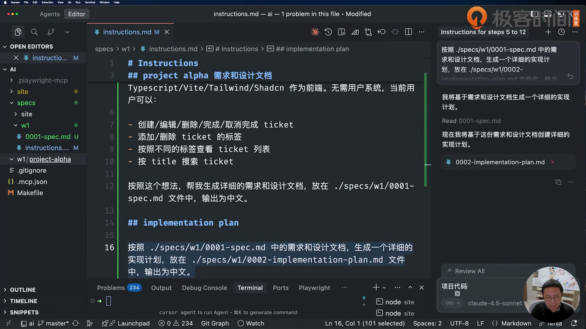

图注：真实视频帧，第5讲00:21:08；左侧完整P2与右侧发送后的回应可见。整理于2026-10-29；画面中的旧路径不静默修改。

[回到步骤](#section-step8)。

<a id="prompt-p3"></a>
### P3 phased implementation

出处：`.chats/w1.md:20–20`。类别：多轮追问。阶段1实现。第5讲00:27:32编辑器及已发送消息同时可读，见步骤9。00:27:20附近灰色“放在...0003-phase-1-code.md”属于补全建议，未纳入作者原文。

```text
按照 ./specs/w1/0002-implementation-plan.md 完整实现这个项目的 phase 1 代码
```

[回到步骤](#section-step9)。

<a id="prompt-p4"></a>
### P4 seed sql

出处：`.chats/w1.md:24–24`。类别：作者聊天输入。种子数据。第5讲00:43:00完整可读、00:43:18可见已发送上下文，见步骤10。50个Ticket是要求，源码静态统计50条Ticket VALUES与38条Tag VALUES，不证明运行已成功。

```text
添加一个 seed.sql 里面放 50个 meaningful 的 ticket 和几十个tags（包含platform tag，如 ios，project tag 如 viking，功能性 tag 如 autocomplete，等等）。要求 seed 文件正确可以通过 psql 执行。
```

[回到步骤](#section-step10)。

<a id="prompt-p5"></a>
### P5 优化 UI

出处：`.chats/w1.md:28–28`。类别：多轮追问。UI优化短版。第5讲00:51:20编辑器显示原句和后续灰色建议，见步骤12。后续第5讲01:10:55已发送框和编辑器均完整显示短版原句，已补图核对。

```text
按照 apple website 的设计风格，think ultra hard，优化 UI 和 UX。
```

[回到步骤](#section-step12)。

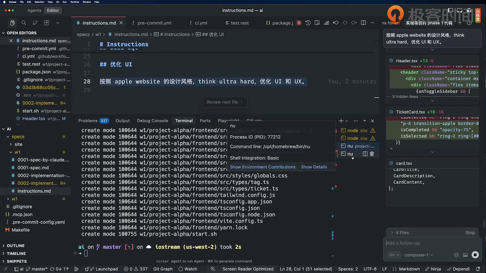

图注：真实视频帧，第5讲01:10:55；已发送消息和编辑器中均为P5短版，明确区别于51:20的灰色建议。整理于2026-10-29；保留课堂实际版本。

<a id="prompt-p6"></a>
### P6 前端风格

出处：`.chats/w1.md:32–32`。类别：多轮追问。风格输入，归属未证实。当前style示例实际在课程根 `.cursor/rules/style.md`，site亦有token；这些文件存在不能证明本条在Alpha课堂发送。第5讲已核真帧主要是Apple风格，未找到本条发送帧，保持待核；不强行纳入Alpha步骤。

```text
使用 style.md 中的风格，学习 ./site 中 token 的定义，优化整体的 UI 和 UX。
```

[回到步骤](#section-step12)。

<a id="prompt-p7"></a>
### P7 侧边栏

出处：`.chats/w1.md:36–36`。类别：多轮追问。跨项目数据库输入。对象是数据库连接列表、metadata和查询界面，与 `.chats/w2.md:15–28`吻合；Alpha当前侧栏仅状态/标签。保留原文，不在本项目执行。未定位对应视频帧。

```text
侧边栏目前用途不大，可以放所有已有的数据库，并且把添加数据库，删除已有的数据库的功能放在侧边栏。侧边栏也要使用新的 token 风格。然后主页直接显示第一个数据库的 metadata 信息和查询界面，这样用户可以减少一次点击进入到 database display 页面。一个页面囊括所有功能。
```

[回到步骤](#section-step12)。

<a id="prompt-p8"></a>
### P8 schema tree view

出处：`.chats/w1.md:40–40`。类别：多轮追问。跨项目数据库输入。schema树、db name、SQL editor和metrics不属于Alpha。Image #2/#3是原文中的附件标记，本文件未含对应图片；本手册不能补造。原文保留，附件/发送时间待数据库项目核对。

```text
[Image #2] schema 边栏应该直接铺满除了db name 外整个高度，db name + refresh button 是一个 top bar，使用偏黄色的 token style color；schema 内部的 treeview 应该铺满整个 schema；[Image #3] 这些 metrics 和main sql editor 放在一个容器，他们可以更小一些，不需要占这么多空间。
```

[回到步骤](#section-step12)。

<a id="section-notebook-prompts"></a>
## 附录 B2｜NotebookLM与课堂补充输入

这些输入不在`.chats/w1.md`八节之内，按真实视频帧另行提取。只对可见文本说全文已核；画面未显示的字符不靠ASR补全成“原文”。英文保留课堂语法，不静默润色。

<a id="prompt-n1"></a>
### N1 发现AI进展

第3讲00:02:26，作者搜索输入，完整画面可读；文末无可见句号。

```text
Help me discover the AI related paper and new progress in last 3-6 months
```


图注：真实视频帧，第3讲00:02:26；用于核对上述文字及上下文。整理于2026-10-29；仅代表录课时界面和可见范围。

<a id="prompt-n2"></a>
### N2 限定YouTube

第3讲00:03:21，作者搜索输入，全选状态全文可读；展示换行是输入框自动折行，不另造手动换行。

```text
Help me discover the AI related paper and new progress in last 3-6 months, limited to youtube video only.
```


图注：真实视频帧，第3讲00:03:21；用于核对上述文字及上下文。整理于2026-10-29；仅代表录课时界面和可见范围。

<a id="prompt-n3"></a>
### N3 限定arXiv

第3讲00:04:20，提交前画面全文可读；保留arxiv.org与原句。

```text
Help me discover the AI related paper and new progress in last 3-6 months, limited to arxiv.org papers.
```

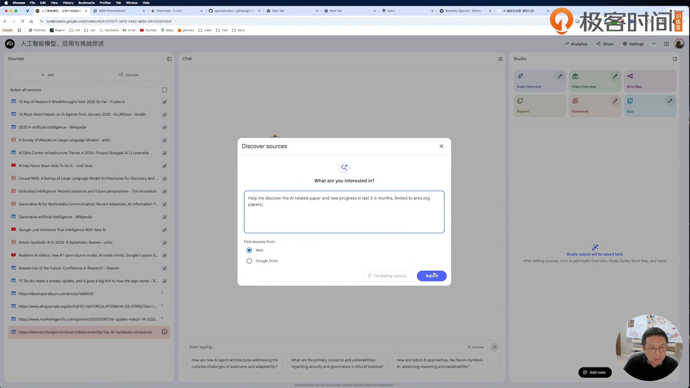

图注：真实视频帧，第3讲00:04:20；用于核对上述文字及上下文。整理于2026-10-29；仅代表录课时界面和可见范围。

<a id="prompt-n4"></a>
### N4 询问AI未来方向

第3讲00:06:18，作者聊天输入，完整可见；中英文之间的可见空格按画面转录，无法证明编辑器底层空白字节。

```text
未来 AI 会有什么主要的发展方向？大模型会走向 AGI 么？context window 会有巨大的飞跃么？
```

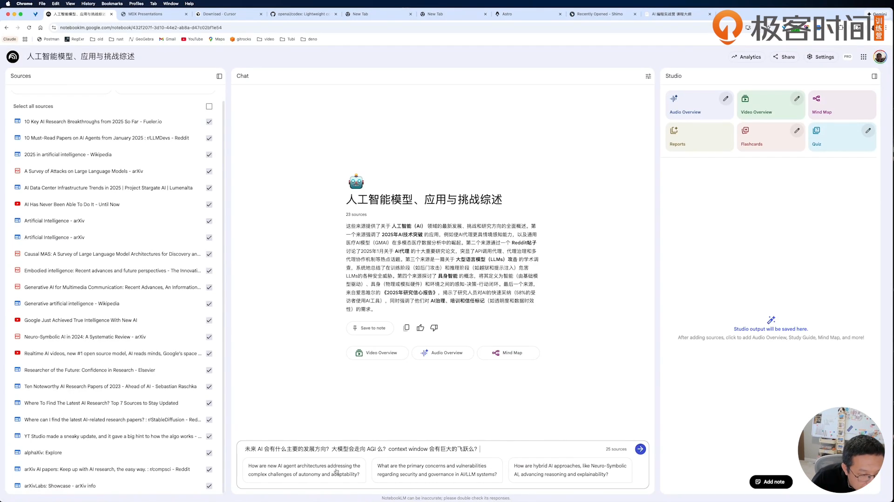

图注：真实视频帧，第3讲00:06:18；用于核对上述文字及上下文。整理于2026-10-29；仅代表录课时界面和可见范围。

<a id="prompt-n5"></a>
### N5 儿童AI编程产品研究

第3讲00:13:16，作者搜索输入，全文可见；这是产品探索练习，未据此声称市场结论已验证。

```text
Help me to do market analysis on AI based education tool to teach kid vibe coding. What are the existing products, how's their usage, how's users general feeling and how to improve.
```

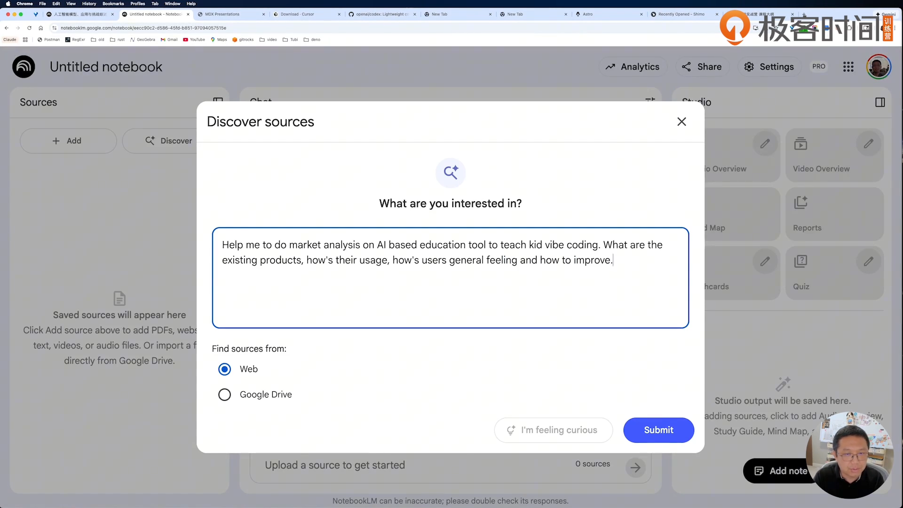

图注：真实视频帧，第3讲00:13:16；用于核对上述文字及上下文。整理于2026-10-29；仅代表录课时界面和可见范围。

<a id="prompt-n6"></a>
### N6 补找近半年YouTube产品资料

第3讲00:13:51，作者搜索输入，全文全选可见；保留与N5的共同前文，不能只存末尾追加句。

```text
Help me to do market analysis on AI based education tool to teach kid vibe coding. What are the existing products, how's their usage, how's users general feeling and how to improve. Search for youtube video in last 6 months.
```

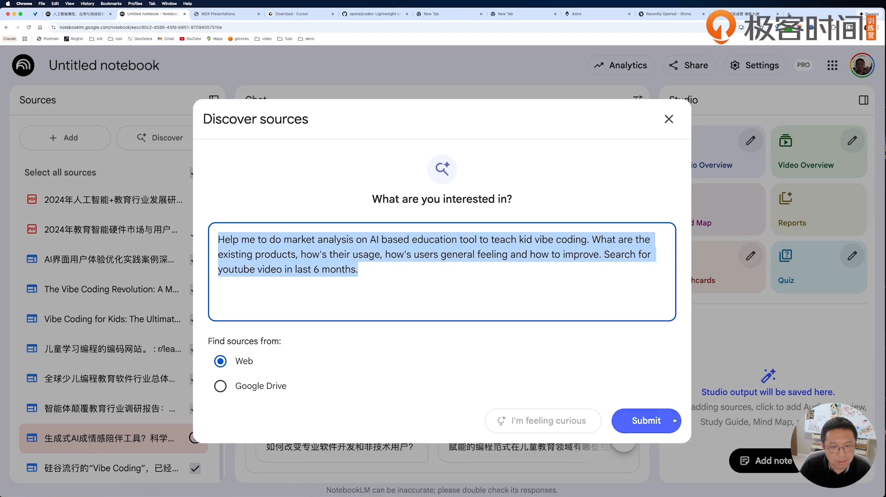

图注：真实视频帧，第3讲00:13:51；用于核对上述文字及上下文。整理于2026-10-29；仅代表录课时界面和可见范围。

<a id="prompt-n7"></a>
### N7 个人笔记原文

第4讲00:09:48，作者笔记数据，不是发给聊天的prompt；笔记标题为“我对人工智能的看法”。

```text
我个人对 AI 的认知

我觉得 LLM 很快会突破 2-5m 的窗口大小，届时大的代码库可以被很好地处理。
```


图注：真实视频帧，第4讲00:09:48；用于核对上述文字及上下文。整理于2026-10-29；仅代表录课时界面和可见范围。

<a id="prompt-n8"></a>
### N8 围绕个人笔记提问

第4讲00:10:38，输入框待发送版本；随后00:11:10回答中显示“未来会有多大?”，两帧有版本差异，不静默合并。

```text
大模型的上下文窗口会有多大？
```

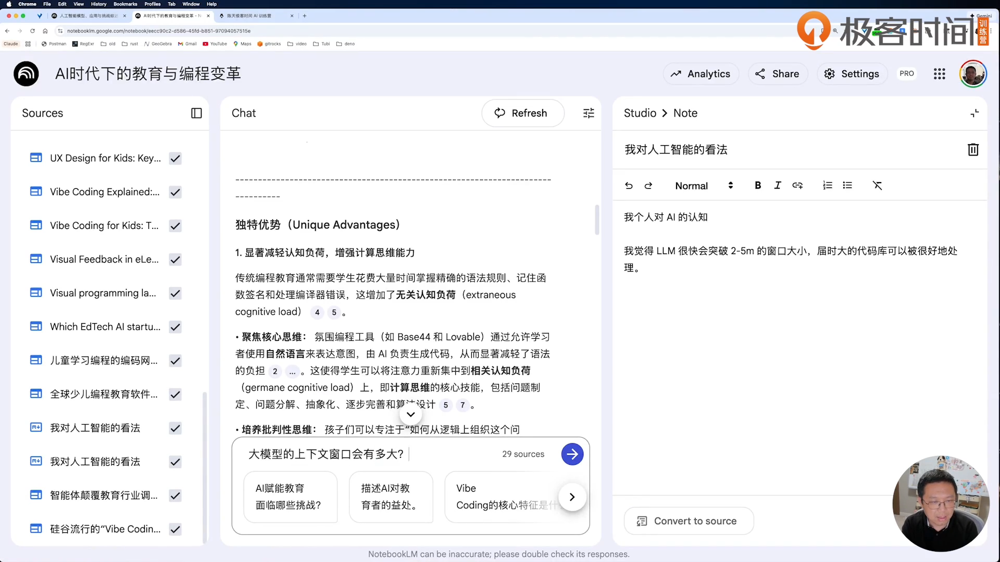

图注：真实视频帧，第4讲00:10:38；用于核对上述文字及上下文。整理于2026-10-29；仅代表录课时界面和可见范围。

<a id="prompt-r1"></a>
### R1 生成REST Client测试文件

第5讲00:42:45画面右侧发送消息完整可读，见步骤10种子输入图。此条来自视频，不在八节聊天文件中。原文中的test.rest是引用文件chip，下面按可见文件名转录：

```text
帮我根据 rest client 撰写一个 test.rest 文件，里面包含对所有支持的 API 的测试
```

### R2 后续阶段短输入（画面原文）

第5讲00:38:20右侧已发送消息：

```text
开发 phase 2的全部功能
```

第5讲00:49:50右侧已发送消息：

```text
构建 phase 4 的所有任务
```

两条均见下方原帧，不能以此推断其间phase3输入全文。第5讲00:55:45已发送消息另有：

```text
完成 phase 5 & 6
```

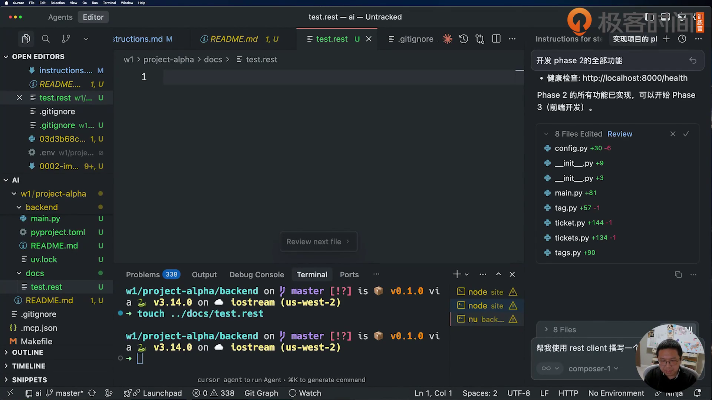

图注：真实视频帧，第5讲00:38:20；右侧已发送“开发 phase 2的全部功能”。整理于2026-10-29；下方正在编辑REST请求不当作已发送全文。

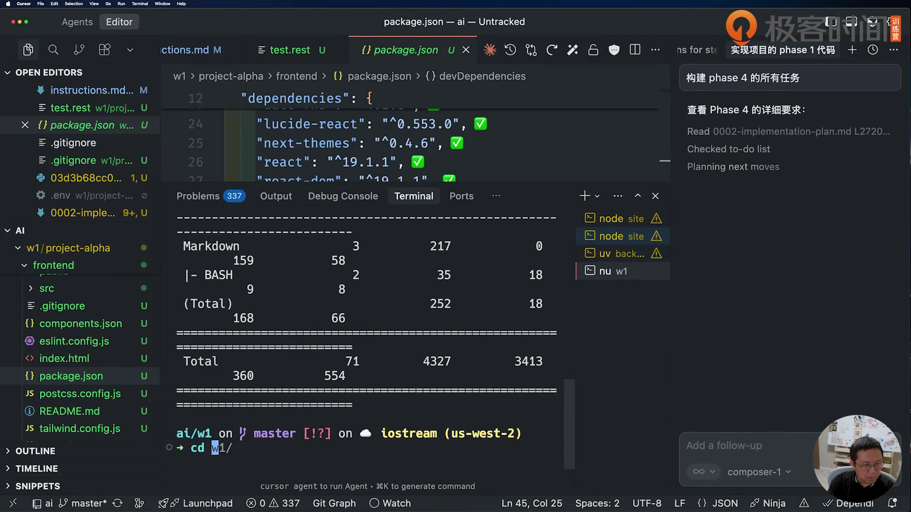

图注：真实视频帧，第5讲00:49:50；右侧已发送“构建 phase 4 的所有任务”。整理于2026-10-29；中间是代码/行数输出，不是前端运行结果。

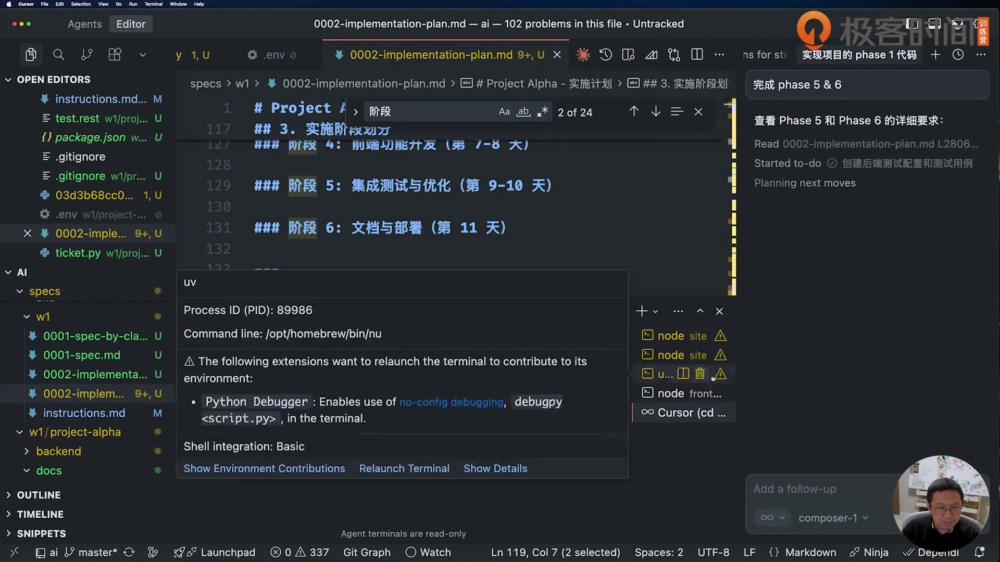

图注：真实视频帧，第5讲00:55:45；右侧已发送“完成 phase 5 & 6”，并读取计划中的两阶段。整理于2026-10-29；不以Agent列表勾选证明检查已通过。

### R3 修Makefile目标（画面原文）

第5讲01:19:20右侧已发送消息，见步骤14：

```text
don't need w1-start-dev And w1-install-xxx, remove them, and w1-stop doesn't work
```

### 第三方建议与模板的边界

第3讲建议问题中可读一条：

```text
How are new AI agent architectures addressing the complex challenges of autonomy and adaptability?
```

这是NotebookLM建议问题，讲者读过它，不当作讲者原创prompt。Reports的Study Guide/Blog Post/Strategic Plan等预置内容由产品提供；本次未逐项展开其中隐藏的生成prompt，不能声称全文已保留。第2讲Learning guide模式与聊天风格设置有演示，但它不是一段已提供完整原文的自定义system prompt。第1讲Slack Coder演示里“help me make login better”是其他项目案例输入，不移入Alpha开发步骤。[[O1](#source-o1)、[O2](#source-o2)、[O3](#source-o3)]

<a id="section-templates"></a>
## 附录 C｜可直接填写的模板

以下是助手根据课程动作抽出的复用骨架，**不是讲者原提示词**。〔〕内为虚构占位，先填实际信息再使用；来源不清的要求先记待核。下载用文件在手册同目录 `templates/`，适合复制进你自己的学习项目。

<a id="template-t1"></a>
### 模板 T1：工作流与上下文

```text
本次目标：〔做完能观察到的行为〕
不做：〔范围〕
当前需求：〔路径〕
设计：〔路径〕
实施计划：〔路径〕
当前阶段：〔phase及依赖〕
语言/框架/包管理：〔实际约束〕
验证：〔格式、构建、接口、数据库和浏览器操作〕
阶段结束交付：变更文件、执行命令、实际结果、未解决问题。
连续失败时：先总结失败证据和可能根因，从全局检查，不加只为测试通过的特判。
```

<a id="template-t2"></a>
### 模板 T2：工具与环境记录

```text
日期：〔〕
练习副本绝对路径：〔〕
Agent工作目录：〔〕
主工具/版本/是否可用：〔〕
对照工具及用途：〔〕
Python/uv/Node/yarn/psql实际版本：〔〕
练习数据库名称与角色（不写密码）：〔〕
专用测试数据库名称：〔〕
后端端口/前端端口：〔〕
失败：〔登录/权限/429/依赖/连接〕
下一动作与证据文件：〔〕
```

<a id="template-t3"></a>
### 模板 T3：NotebookLM发现、问答与来源表

```text
Discover输入：
Help me discover 〔topic〕 in 〔explicit time period〕, focusing on 〔source types〕.

问答输入：
仅根据当前选中的来源回答〔具体问题〕。对每项结论给出处，分开写来源事实、作者观点和你的推断；证据不足明确写不足。

来源表：标题｜作者/机构｜日期｜原链接/文件｜可打开｜支持哪个问题｜剔除原因
保存笔记：问题｜回答摘要｜核过的引用｜未知｜下一问题
```

<a id="template-t4"></a>
### 模板 T4：NotebookLM产物review

```text
资料范围：〔哪些来源，哪些未选〕
目标读者：〔〕
要解决的一个问题：〔〕
产物：〔报告/导图/音频/视频/卡片〕
必须覆盖：〔〕
不需要：〔〕
完成后核对：对象是否正确；事实是否有来源；引用是否支持结论；是否混入个人推断；能否帮助下一步决策。
偏题时的修订要求：〔具体哪段，为什么，改成什么〕
```

<a id="template-t5"></a>
### 模板 T5：来源可靠性实验

```text
我的实验笔记（明确标个人推断）：〔〕
转换为source前：来源列表〔〕
转换为source后：来源列表〔〕
问题：〔〕
回答中哪句引用了我：〔〕
引用原文：〔〕
原文性质：〔个人预测/作者经验/研究结果/规则/未核〕
回答是否升级了确定性或作者地位：〔〕
下一动作：〔修改标注、剔除、补证据〕
```

<a id="template-t6"></a>
### 模板 T6：需求与设计输入

```text
构建一个〔目标工具〕，主要管理〔核心对象〕。
数据库〔〕；后端〔〕；前端〔〕；包管理器〔〕。
本轮无需〔认证/其他暂不做范围〕。
当前用户可以：
- 〔创建/编辑/删除等行为〕
- 〔关联对象/分类〕
- 〔筛选与搜索〕
生成中文需求和设计文档，保存到〔当前工作目录下真实路径〕。
明确数据模型、API输入输出、前端交互、错误与验收；先写必要接口与约束，不复制整份实现代码。
不要开始写项目代码。
```

<a id="template-t7"></a>
### 模板 T7：计划与review

```text
按照〔主需求设计路径〕生成中文实施计划，保存在〔计划路径〕，代码目录固定为〔路径〕。
每个phase写输入、依赖、变更文件、实现范围和可执行验收；先不要实现。
review重点：阶段依赖是否正确；目录是否真实；接口与设计是否一致；是否有无必要的重复代码；每阶段失败时如何定位。
主版本：〔〕；对照版本：〔〕；采用/舍弃与理由：〔〕。
```

<a id="template-t8"></a>
### 模板 T8：分阶段实现与错误反馈

```text
读取〔需求路径〕、〔计划路径〕、〔规则路径〕。本轮只实现phase〔起止范围〕，代码放〔目录〕。
前置阶段已验证：〔具体证据〕；未验证：〔〕。
完成后运行本阶段约定检查，列出命令、退出状态、实际结果与未解决项，不把后续阶段提前做完。

若失败，附：当前目录〔〕；精确命令〔〕；期望〔〕；实际错误全文〔〕；相关文件〔〕；数据库名称（无密码）〔〕。
先解释根因与受影响链路，再做最小修复，重新验证同一个失败行为。
```

<a id="template-t9"></a>
### 模板 T9：有意义的种子数据

```text
为〔工具/领域〕生成〔文件路径〕，包含〔数量〕个有意义的〔主对象〕和〔数量/维度〕标签。
数据覆盖〔平台/项目/功能/状态/边界〕，标签关联能用于验证筛选，空结果也有可解释案例。
数据库与schema：〔版本与迁移路径〕；执行工具〔〕。
要求正确可执行；说明重复执行行为、计数查询和验证方法。未经明确确认不清理已有数据。
实际导入结果另记，不把要求数量当完成数量。
```

<a id="template-t10"></a>
### 模板 T10：API与端到端验收

```text
编号｜行为/前置数据｜命令或界面操作｜期望｜实际｜状态｜证据
A01｜新建验收Ticket｜〔〕｜返回ID/刷新仍在｜〔〕｜not_tested｜〔〕
A02｜编辑标题/描述｜〔〕｜持久化更新｜〔〕｜not_tested｜〔〕
A03｜添加和移除标签｜〔〕｜关系变化但标签本体规则正确｜〔〕｜not_tested｜〔〕
A04｜完成/取消完成｜〔〕｜status与completed_at对应｜〔〕｜not_tested｜〔〕
A05｜状态/标签/搜索/分页｜〔〕｜结果与原数据一致｜〔〕｜not_tested｜〔〕
A06｜删除专用验收Ticket｜〔〕｜刷新后不存在｜〔〕｜not_tested｜〔〕
A07｜错误/空状态｜〔〕｜错误清晰，旧数据不冒充新结果｜〔〕｜not_tested｜〔〕
```

<a id="template-t11"></a>
### 模板 T11：UI/UX改进

```text
现有界面：〔截图/文件〕；风格参照：〔真实来源〕。
本轮改进：〔层次、间距、颜色token、表单反馈、响应式等具体项〕。
必须保留：〔新建、编辑、标签、完成、搜索等行为〕。
不要改成另一个产品，不新增〔本轮外功能〕。
先说明方案与影响文件，再实现；附改前后截图，构建/检查结果和关键行为回归。
原样式规范真实路径：〔〕；若缺失先指出，不猜token。
```

<a id="template-t12"></a>
### 模板 T12：收尾review与复现说明

```text
项目目录：〔〕
需求/计划主版本：〔〕
安装与配置：〔实际命令，敏感值不入文档〕
数据库迁移：〔〕
开发启动/preview启动区别：〔〕
访问入口：〔〕
停止方法与归属进程：〔〕
文件/构建检查：〔通过/失败/未做及证据〕
API/数据库/前端核对：〔分别记录〕
真实试用：not_tested（有真实记录后再改）
未完成：〔问题、影响、下一动作〕
review后再提交自己的练习副本。
```

<a id="section-code-gaps"></a>
## 附录 D｜文件事实、版本差异与排错

本章区分“文档想做什么”“课堂中间版本做了什么”和“当前快照实际怎样”。需要修代码时先确定针对哪一版，不把截图上的临时修改直接覆盖到最终仓库。

| 检查对象 | 已核到的事实 | 如何处理 |
|---|---|---|
| 需求字段长度 | 主spec及真实schema标题255、描述10000；Claude spec标题200、描述5000 | 固定主版本；测试边界用主版值 |
| 多标签 | 主spec写AND/OR；CRUD实际join后用`Tag.id.in_` | 现有实现按任一标签理解；AND需求须另立修复任务 |
| 总数 | join后的`query.count()`在取数前执行 | 同一Ticket命中多标签时可能重复计总数；用有两标签的一个Ticket验证，未实测不报修复成功 |
| 排序 | 后端固定created_at降序；前端对本次返回数组再排序 | 分页与全量排序需求要分开验 |
| 搜索 | 真实CRUD用title.ilike，不搜索description | 不把描述中的词搜不到当title搜索失败；中文行为单独实测 |
| title为空白 | schema最小长度1，不等于去掉空白后非空 | 字段验证是否符合spec需要用空格标题测试；未实测 |
| tag_ids参数 | 路由直接按逗号split再int转换 | 非数字值的错误处理需补测，不能预设一定返回友好的422 |
| 完成/取消完成 | CRUD只改status；PG触发器设置/清空completed_at | 迁移和状态更新一起核，SQLite不能覆盖同一触发器 |
| 枚举中间修复 | 课堂画面试过values_callable；当前ORM `Enum(TicketStatus, native_enum=True)`，迁移按大写PENDING/COMPLETED比较 | 课堂修复是中间版本；要对齐当前数据库enum与当前迁移，不盲加一行映射 |
| seed数据 | 源码静态数有50条Ticket VALUES、38条Tag VALUES；状态在SQL中以大写枚举值写入 | 只是静态记录数；关联、重复导入与库里实际数量要另查 |
| 前端测试 | package.json只有dev/build/lint/preview，无test | 不执行虚构脚本；测试计划与已实现测试分开 |
| Node/PG最低版本 | 文档内有Node18、PG14与PG17不同说法，依赖实际Vite7 | 留版本差异，记录实际安装和结果，不声称最低兼容已测 |
| 健康检查 | 真代码返回status及service | 文档示例少字段不影响正确响应 |
| 测试数据库 | conftest从DATABASE_URL读取并清表 | 独立库，连接二次核对；本次制作未执行该测试 |
| 根Makefile | w1-start前端是preview；w1-stop还有按端口停止兜底 | 先build；开发热更新用yarn dev；停止前核端口归属 |
| 文档位置 | README示意project-alpha/specs，真实spec在w1/specs；CHANGELOG提backend/TESTING，但实际在docs/TESTING.md | 按实际文件定位，保留出处差异 |
| 设计规范 | P6引用style.md，快照位于tooling/.cursor/rules/style.md；site有样式token | 文件存在不代表本轮已用，P6归属仍待发送画面证据 |

以上分别依据项目README/docs、主/Claude spec、真实CRUD/schema/API、迁移、package.json、Store与Makefile。[[O7](#source-o7)、[O8](#source-o8)、[O9](#source-o9)、[O11](#source-o11)、[O12](#source-o12)]

### 排错时依次看哪一层

| 现象 | 先核什么 | 下一动作 |
|---|---|---|
| 找不到spec | 当前目录与w1/specs、specs/w1差异 | 先列文件真实路径，修改执行模板 |
| 迁移报错 | DATABASE_URL、库是否创建、迁移历史、实际错误 | 保存日志后交给Agent定位，不直接删库 |
| 后端起不来 | app.main入口、依赖、端口是否占用 | 在backend单独启动观察日志 |
| 前端空白或无样式 | dev/build日志、CSS入口、Tailwind/PostCSS配置 | 分开修渲染与样式问题 |
| 完成按钮500 | 后端日志、状态枚举、触发器、ORM | 核同一版本再改；完成和取消都复测 |
| 搜索无结果 | 当前状态/标签筛选、实际title、网络请求 | 清筛选再测现存标题；不凭旧截图判成功 |
| make启动前端无内容 | 是否已有dist、preview是否真正启动 | 先构建或改用yarn dev |
| 测试结果与课堂不同 | PG/SQLite、迁移、代码版本、实际测试范围 | 标差异并保存证据，不套讲者成绩 |

<a id="section-cases"></a>
## 附录 D2｜课堂案例卡

这些卡片保留真实决策、失败和更正。结果只在课堂/文件证据支持的范围内写，不借案例数量推断课程已被完整复现。

### 案例1：过长计划挤占上下文

- 起点：Cursor按简短需求生成非常长的设计和计划。
- 做法：讲者指出已有spec里放了大量代码，计划又重复，建议以后要求只留接口，不重复整份实现。
- 结果：当前主计划3429行，对照Claude计划2028行；这是文件长度事实，不等于短版功能更正确。
- 可借鉴：review文档的必要信息与重复内容，让上下文服务当前任务。
- 出处：第5讲约22:00–26:00及两套spec。[[O5](#source-o5)、[O8](#source-o8)]

### 案例2：空API需要有意义的数据

- 起点：健康检查正常，标签列表为空，难以验证筛选。
- 做法：要求50个有意义的Ticket、几十个多维标签，生成seed.sql，用psql执行后再跑REST请求。
- 结果：课堂随后看到多标签和pending/completed列表；当前源数据静态计数50/38，不把课堂后续数据库100条混作文件含100条。
- 可借鉴：测试数据要覆盖业务关系，并记录是否重复导入。
- 出处：第5讲40:10–46:54、seed.sql。[[O5](#source-o5)、[O9](#source-o9)]

### 案例3：前端能显示不代表样式已接通

- 起点：初次页面控件和标题可见，样式明显不对。
- 做法：讲者把问题反馈给Agent，定位Tailwind CSS配置。
- 结果：约53分钟后页面布局改善；本手册保存50:23异常帧和后期74:50界面供对照。
- 可借鉴：先判断是CSS、渲染还是API层问题，避免无目标重做UI。
- 出处：第5讲50:00–53:30。[[O5](#source-o5)]

### 案例4：状态按钮触发枚举错误

- 起点：状态过滤能看，toggle完成时出现500。
- 做法：提交错误信息，Agent分析SQLAlchemy枚举名称与值映射。
- 结果：讲者在54–55分钟复测toggle；当前仓库enum与迁移又是后续版本，不按中间截图覆盖。
- 可借鉴：修复要看数据、ORM、数据库enum、触发器整条链。
- 出处：第5讲54:00–55:20；当前模型及迁移。[[O5](#source-o5)、[O9](#source-o9)]

### 案例5：类型检查未过却能让流程变绿

- 起点：课堂配置pre-commit时遇到位置和类型问题。
- 做法：将配置放在Git根，修格式问题，并暂时禁用mypy。
- 结果：流程继续，但Python类型检查仍未完成；这是明确技术债。
- 可借鉴：报告“哪些检查过了、哪些没做”，不混成全通过。
- 出处：第5讲60:28–68:50。[[O5](#source-o5)]

### 案例6：精美报告仍可能偏题

- 起点：研究教儿童vibe coding的AI产品，自动生成Strategic Plan。
- 做法：讲者阅读内容，发现偏向学区教育数字化建设。
- 结果：讲者明确表示不是自己想要的战略计划，未给出符合产品需求的最终修订稿。
- 可借鉴：模板名称和排版不保证对象、目标与问题吻合。
- 出处：第3讲18:50–21:50。[[O3](#source-o3)]

### 案例7：自己的观点变成“专家预测”

- 起点：个人判断LLM窗口很快到2–5m。
- 做法：手写note，转换为source，再问未来上下文窗口大小。
- 结果：回答带引用称“一些专家预测”，点开其实就是自己的note，重复编号也指同一类笔记。
- 可借鉴：引用可追溯不等于结论权威，资料本身的性质要保留。
- 出处：第4讲09:15–11:40。[[O4](#source-o4)]

### 案例8：下一讲纠正上一讲的观察

- 起点：第3讲初看Video Overview以为只是背景图和声音。
- 做法：第4讲重新播放并拖动，查看多页PPT随解说切换。
- 结果：讲者明确更正，承认视频功能比初次观察完整。
- 可借鉴：后来的直接证据应回写前文，不把两个相反说法并列成“都对”。
- 出处：第3讲末尾与第4讲00:00–00:45。[[O3](#source-o3)、[O4](#source-o4)]

<a id="section-glossary"></a>
## 附录 D3｜术语与本项目中的意思

遇到不熟悉的词先查这一页，再回到步骤动手。这里解释概念，不要求你先学完整框架。

| 词 | 白话解释 | 本项目例子 |
|---|---|---|
| Ticket | 一条待办/工作项 | 标题、描述、完成状态 |
| Tag | 可复用的分类标签 | ios、viking、autocomplete |
| Spec | 描述需求或设计的文档 | 0001-spec.md |
| phase | 有输入、输出和验收的实现阶段 | phase1数据库基础 |
| Agent | 能围绕目标调用工具并循环执行的助手 | Cursor Agent、CLI Agent |
| Context | Agent此刻能看到的规则、文件和对话 | 主spec、当前代码、错误日志 |
| CRUD | 创建、读取、更新、删除 | Ticket接口 |
| ORM | 用程序对象表达数据库模型 | SQLAlchemy Ticket模型 |
| Schema | 数据结构与验证约定 | Pydantic请求/响应模型；与数据库schema语境区分 |
| Migration | 按版本改变数据库结构的脚本 | Alembic两条迁移 |
| Trigger | 数据变化时数据库自动执行的规则 | 自动设置completed_at |
| Enum | 一组固定可选值 | pending/completed及数据库大写名称差异 |
| CORS | 浏览器跨来源请求的许可设置 | 5173前端请求8000后端 |
| RAG | 先找相关资料，再把资料作为上下文回答 | 第4讲讲解NotebookLM工作模型 |
| Embedding | 把内容编码成便于相似检索的数值表示 | 第4讲向量搜索示意 |
| Token | 模型处理文字/代码的计量片段 | 上下文容量不是字数 |
| preview | 查看已经构建好的前端文件 | Makefile的yarn preview |
| pre-commit | 提交前运行检查的机制 | 格式、静态检查；不等于所有测试 |

<a id="section-later"></a>
## 附录 E｜以后再看与课外迁移边界

前四讲包含工具路线、技术展望和可选创作方向，这些保留供查阅，不挤进Alpha每一步。开始新的项目时再决定哪些值得采用。

- 第一讲八周地图：w1工具和文档驱动、w2 Cursor、w3 Claude Code、w4读库与文档、w5 MCP/Skill、w6理解Coding Agent实现、w7复杂项目、w8回顾和DevAgent。这里是讲者课程安排，后续按各周实际材料学习。[[O1](#source-o1)]
- 第一讲未来展望：更大上下文、更强端到端推理、AI原生工具、扩散式代码生成和直接操作AST。它们是录课时的推断与讨论，不保证时点、窗口大小或模型能力。[[O1](#source-o1)]
- 第一讲Agent组成：基础system prompt、可插拔项目规则、工具/CLI/MCP/Skill、短中长期记忆。先理解怎样提供上下文、怎样验证；不要求本周实现一个Agent框架。[[O1](#source-o1)]
- 第二讲工具偏好和套餐是讲者个人经验。Claude Code、Cursor、Codex排序以及订阅“近乎无限”的说法不升级成当前客观排名/额度；实际预算与权限自己核。[[O2](#source-o2)]
- NotebookLM内容创作：导图、卡片、测验帮助理解；音频用于听读；报告可做文章草稿再review；音频转对话、另用声音工具属可选创作路线，本手册没有执行，也不要求付费。[[O3](#source-o3)]
- NotebookLM原理与隐私：课程用RAG/向量存储帮助理解，具体内部实现、加密、训练用途、套餐上限未在本次核现行官方原文，不能据此处理敏感资料。[[O4](#source-o4)]
- Project Alpha后续：多用户、导出、线上部署、完善类型检查、前端自动化与AND筛选都可形成独立任务。先保留本轮验收证据，再按真实需要选下一项。[[O8](#source-o8)、[O9](#source-o9)]
- 迁移到video-mcp属于课外扩展：可以复用“目标→需求→设计→phase→验收”的方法；视频和图文都应沿各自真实输入验证，本手册不新增接口或代替课程项目。

<a id="section-source-scope"></a>
## 来源、缺口与核对范围

五讲机器逐字稿全文已阅读；关键工程步骤另看实际文件、关键输入帧和结果帧。没有全量人工逐字校订，也没有宣称视频每一帧已审。截图是原视频提取，已逐张打开核对采用内容。`.chats/w1.md`八个h2正文已按文件逐字保留；NotebookLM新增输入按画面另列，未显示的预置prompt、原附件、输入尾部和P6归属保持缺口。

这次制作做了静态路径、包脚本、Python语法、提示词原文和图片引用检查；没有安装运行整个前后端，没有在真实数据库运行清表测试，也没有真实读者照本完成的记录。试用状态为 `not_tested`。文件检查、内容核对、实际运行和读者试用是不同结论。

<a id="section-sources"></a>
## 来源

<a id="source-o1"></a>
### O1 第1讲 如何学习AI编程实战营

本地资料，读取/整理日期2026-10-29。定位：`_raw/transcripts/L01/transcript.json`，04:30–06:10；16:30–30:00；30:00后课程地图。用途与边界：学习法、上下文、文档驱动与未来预测。[回到正文](#section-step1)。

<a id="source-o2"></a>
### O2 第2讲 AI编程工具简介

本地资料，读取/整理日期2026-10-29。定位：`_raw/transcripts/L02/transcript.json`，03:49–10:30；10:37–18:20。用途与边界：工具分工和历史设置；未核当前订阅规则。[回到正文](#section-step2)。

<a id="source-o3"></a>
### O3 第3讲 学会使用NotebookLM

本地资料，读取/整理日期2026-10-29。定位：`_raw/transcripts/L03/transcript.json`，02:00–07:10；11:30–21:50；22:00以后音视频。用途与边界：发现资料、问答、保存、产品研究、生成产物；机器转写非人工逐字校订。[回到正文](#section-step3)。

<a id="source-o4"></a>
### O4 第4讲 深度探索NotebookLM

本地资料，读取/整理日期2026-10-29。定位：`_raw/transcripts/L04/transcript.json`，00:00–00:45；02:00–08:20；09:15–11:40。用途与边界：纠正视频观察、原理讲解、个人笔记引用实验；非内部实现或现行隐私政策证明。[回到正文](#section-step5)。

<a id="source-o5"></a>
### O5 第5讲 制作一个项目管理工具

本地资料，读取/整理日期2026-10-29。定位：`_raw/transcripts/L05/transcript.json`，03:27–27:32；28:18–46:54；47:00–55:29；56:00以后收尾。用途与边界：Alpha主线、失败修复与真实截图；机器转写非全量人工校订。[回到正文](#section-step7)。

<a id="source-o6"></a>
### O6 作者聊天摘录w1

本地资料，读取/整理日期2026-10-29。定位：`_raw/chats/w1.md`，3–40行，8个h2。用途与边界：文件内八节输入完整保留；P6待归属、P7/P8跨数据库项目。[回到正文](#section-prompts)。

<a id="source-o7"></a>
### O7 项目README与安装使用文档

本地资料，读取/整理日期2026-10-29。定位：`_raw/course/project-alpha/README.md`，26–73、99–148；backend/README、docs/setup、docs/user-guide。用途与边界：安装命令与功能入口；最低版本/测试脚本与真实代码有差异。[回到正文](#section-step6)。

<a id="source-o8"></a>
### O8 主版与Claude版需求设计和实施计划

本地资料，读取/整理日期2026-10-29。定位：`_raw/course/specs/0001-spec.md`，功能/数据/API各节；0002阶段0–6；同目录两个by-claude文档。用途与边界：主骨架与对照引用；不拼接不同版本字段/API/工期。[回到正文](#section-step8)。

<a id="source-o9"></a>
### O9 项目真实代码与配置

本地资料，读取/整理日期2026-10-29。定位：`_raw/course/project-alpha/backend/app/crud/ticket.py`，11–45、100–121；同项目schema/API/model/alembic；frontend/src和package.json。用途与边界：文件、接口、触发器、枚举、筛选排序与测试配置；静态核不等于运行。[回到正文](#section-code-gaps)。

<a id="source-o10"></a>
### O10 REST Client用例

本地资料，读取/整理日期2026-10-29。定位：`_raw/course/project-alpha/docs/test.rest`，所有请求；使用前核apiPrefix和实际资源ID。用途与边界：API验收路径与请求体；本次未运行。[回到正文](#section-step10)。

<a id="source-o11"></a>
### O11 测试指南与更改记录

本地资料，读取/整理日期2026-10-29。定位：`_raw/course/project-alpha/docs/TESTING.md`，25–75、78–129；docs/CHANGELOG:3–39。用途与边界：PG/SQLite差异和材料自述测试成绩；不是本次结果。[回到正文](#section-step13)。

<a id="source-o12"></a>
### O12 根Makefile与设计参考

本地资料，读取/整理日期2026-10-29。定位：`_raw/tooling/Makefile`，17–21、35–79、82–90；tooling/.cursor/rules/style.md与site样式。用途与边界：preview/build和停止行为；样式文件存在不证明P6已发送。[回到正文](#section-step14)。
