# GenSlides 实战手册：从线框图到 AI 图片幻灯片

> 手册类型：定制版

<a id="section-intro"></a>
## 阅读说明

这本手册带你复现 W7 的完整开发过程：把一张带交互说明的图变成 PRD 和设计规格，分别约束前后端，再一轮轮修到风格、图片选择、刷新和播放行为一致。练习对象始终是课程 GenSlides，最终产物是纯图片幻灯片，本地运行。

三讲原视频共约 2 小时 40 分钟。随附逐字稿是本地 Whisper 自动转录，保留细节和时间戳，不是人工逐字认证；文中 Claude Code、CLAUDE.md、Blake3、YAML 等技术名按源码校正，原ASR不静默改写。全程使用课程资料，O 编号表示本次原课程/本地验证材料，**不表示现行官方规则认证**。<a id="cite-o1-1"></a>[[O1](#source-o1)]

讲者说约三到四小时做出项目，是讲者现场经验；他的 API 开通、费用和成品画面不等于你已跑通。本手册安排24小时，包含观看、暂停、操作与核对。源码的模型名、0.134美元常量和画面金额只按课程版本解释，不当今日价格或可用性承诺。<a id="cite-o3-1"></a><a id="cite-o10-1"></a>[[O3](#source-o3)、[O10](#source-o10)]

提示词分成三类：P01–P18 是聊天文件全文，V01–V04 是额外核到的屏幕输入，R01–R03 是程序传给模型的模板。每条原提示词下方的“可套用模板”是助手抽象版本；T01–T16 是按步骤整理的综合模板。部分视频帧只显示某条输入的一部分，图注会明确；文件全文和截图覆盖范围不可混为一谈。原件只供你学习复现。

本次发现课程原件缺失 SlideList 组件；已在独立练习副本补最小实现，并核过前端编译。原课程文件未改。剩余三条原有lint错误、后端/真实生成/完整UI试用未测，详见最后的核对范围。先看缺口再动手。

<a id="section-route"></a>
## 三天路线图

| 阶段 | 做什么 | 对应步骤 |
|---|---|---|
| 第一天：想清楚 | 准备副本、调研、画图、PRD、接口和规范 | [1准备](#section-step-1) · [2调研与图](#section-step-2) · [3PRD](#section-step-3) · [4设计](#section-step-4) · [5SDK](#section-step-5) · [6骨架](#section-step-6) |
| 第二天：做出来 | 分工实现、启动、接口、颜色布局与风格回读 | [7实现](#section-step-7) · [8启动](#section-step-8) · [9接口](#section-step-9) · [10界面](#section-step-10) · [11风格](#section-step-11) |
| 第三天：反复验证 | 文字与图、默认图、非阻塞、播放、复盘 | [12生成入口](#section-step-12) · [13默认图](#section-step-13) · [14异步](#section-step-14) · [15播放](#section-step-15) · [16验收](#section-step-16) |

这一阶段先不做多用户、云部署、数据库与 PPTX；以后再看[扩展附录](#section-later)。

<a id="section-conditions"></a>
## 本次条件

| 项目 | 本次安排 |
|---|---|
| 你已有的基础 | Python、uv、Makefile；跟陈天AI训练营，愿意看源码与改动依据 |
| 人手与时间 | 一人，周一至周三10:00–19:00，13:00–14:00午休，每天8小时 |
| 想拿到的结果 | 独立运行副本、两份中文规格、清晰的API与文件存储、完整原提示词、可复用模板与验收表 |
| 当前材料问题 | 原仓库缺前端 slides 组件；助手已补一个最小组合组件，区别于讲者版本 |
| 外部条件 | Gemini key、访问和额度由你本地确认；本次不代开通、不调用付费生成 |

### 条件不同时怎么调

- 时间只有半天：先完成2–6步，拿到一张图、PRD和API契约；不要直接跳进完整UI修复。
- 没有 Gemini key：可先编译前端、看原视频成品、完成文档和测试替身的存储核对。原代码的图片列表接口也会构造Gemini客户端，不能假定“只看图就不需要key”。
- 只学提示词方法：按图→PRD→设计→骨架→实现→逐轮修复阅读，每步T模板可复制；不必实际生成一套付费图片。
- 要迁移video-mcp：课程复现做完后再看扩展附录，视频与图文仍是同一套内容流程，不替换课程主对象。

<a id="section-results"></a>
## 要完成什么

| 结果 | 数量与口径 | 位置 |
|---|---|---|
| 原始课程逐字稿 | 3讲，带时间戳；机器转录 | deliver/transcripts/ |
| 需求与设计 | 1张原图、1份PRD、1份设计规格 | 练习副本specs/；原规格也随模板提供 |
| 提示词 | 18段文件原文；另有4条屏幕输入与3条运行时模板 | 对应步骤与[输入索引](#section-prompts) |
| 可套用模板 | 16份，每关键动作一份 | 本文T01–T16与deliver/templates/ |
| 工程 | 1份独立课程副本＋1个最小助手补丁 | edit/practice/ |
| 验收 | 一份环境/动作/预期/实际/证据表，失败和未测分开 | T16 |
| 图片与ZIP | 真实调用成功后按实际数量填，不预填成功 | backend/slides/与下载目录 |

<a id="section-gaps"></a>
## 阻断缺口（动手前先看）

- G1 源码不完整：原仓库缺 `frontend/src/components/slides/`，原版build实际报TS2307。本集独立副本新增SlideList.tsx后编译成功，但没有浏览器试用；别将它当讲者原组件。<a id="cite-o13-1"></a>[[O13](#source-o13)]
- G2 真实图像链路未试：模型在你的账号下是否可用、额度与费用均未核；本手册不把页面示例当API已成功。本地构造客户端还可能让图片列表在无key时失败。<a id="cite-o9-1"></a>[[O9](#source-o9)、[O10](#source-o10)]
- G3 原件仍有状态/成本问题：风格候选费未持久化、同hash再生覆盖、快速切页竞争、并发YAML写回风险，详见[实现边界](#section-boundaries)。编译通过不会消除这些问题。
- G4 截图范围未穷尽：18段文件原文已完整保存，部分对应视频帧只呈现片段或相关结果。未以ASR或重画界面补造屏幕原文；具体表见[提示词索引](#section-prompts)。

<a id="section-schedule"></a>
## 三天时间表

以下是助手建议，总计24小时。视频原长约159分54秒；按暂停操作拆进时段，既不等同观看时长，也不等同讲者三到四小时的自述。

| 日与时间 | 内容 | 用时 | 当段产物 |
|---|---|---|---|
| 周一10–11 | 第1讲＋画图需求核对 | 1小时 | 图与目标/非目标 |
| 周一11–13 | 第2讲＋PRD差异review | 2小时 | PRD、SDK问题清单 |
| 周一14–16 | 接口/存储契约 | 2小时 | API动作对照表 |
| 周一16–19 | 骨架与两端规范 | 3小时 | 目录、配置与验收计划 |
| 周二10–13 | 第3讲前半＋分工实现 | 3小时 | 前后端代码与交接 |
| 周二14–16 | 启动/404/颜色与布局 | 2小时 | 命令与故障记录 |
| 周二16–19 | 风格回读、编辑、插入与排序 | 3小时 | 本地状态记录 |
| 周三10–13 | 第3讲后半＋默认图/异步 | 3小时 | 多入口选图、切页验收 |
| 周三14–17 | 播放完整画幅/ZIP/成本 | 3小时 | 结果截图与问题清单 |
| 周三17–19 | 回归、复盘与归档 | 2小时 | T16与下一次只修一项的计划 |

生成API等待和排错算在以上操作时间内；当天没跑通就记录停点，不挤掉核对步骤去凑“完成”。

<a id="section-step-1"></a>
## 步骤 1 准备只读原件与独立练习目录

先分清课程原件、你准备生成的代码、助手为缺失文件补的实现。后面任何修复都在练习目录里发生，才能回头对照讲者到底给了什么。

**目标**：可明确定位原图、规格、聊天、三讲逐字稿与独立副本。

1. 核课程根 `/Users/ziye/Desktop/tyr/geektime-bootcamp-ai`，确认 `w7/specs/`、`w7/genslides/`、`.chats/w7.md` 和 `w7/videos/`。当前真实规格目录是w7/specs，原提示词保留历史specs/w7写法。<a id="cite-o4-1"></a><a id="cite-o5-1"></a>[[O4](#source-o4)、[O5](#source-o5)]
2. 需要现成练习入口时，使用本集 `edit/practice/genslides/`；要从零复现时，另建一个空练习目录，将w7/specs复制到它的specs中。两条路线不要混用，现成副本上不运行uv init或Vite初始化覆盖文件。<a id="cite-o7-1"></a>[[O7](#source-o7)、[O13](#source-o13)]
3. 记录 `python3 --version`、`uv --version`、`node --version`、`npm --version`；按锁文件安装，保留讲者“用最新依赖”的原话与本次复现版本两个口径。<a id="cite-o2-1"></a><a id="cite-o8-1"></a>[[O2](#source-o2)、[O8](#source-o8)]
4. 先打开 practice/README.md 和 assistant-repair.patch，再看build-before/after与lint-after；确认新增SlideList是助手补齐，不是课程找回原件。[[O13](#source-o13)]

**做完的标准**：原件和练习目录不重叠；环境表能写出每个材料路径、版本、是否含助手补写。

- [ ] 可明确定位原图、规格、聊天、三讲逐字稿与独立副本。
- [ ] 原件和练习目录不重叠；环境表能写出每个材料路径、版本、是否含助手补写。

### 现成工程与从零生成如何选择

想学完整方法，按后面步骤重新生成到空目录，参考成品查差异；想先体验，直接用本集副本。本集补丁集中在一个SlideList文件，复用课程的store/API/Modal和选图工具；实现了选择、图上文下、编辑、删除、原生拖拽和插入线回车。它通过编译，浏览器行为仍需你按T16验证。

该准备动作没有独立的作者“复制目录”原提示词；第2讲00:00:48讲者使用uv初始化项目，第3讲00:06:26进入backend安装依赖，是本步课程依据。不能把下方助手模板称作讲者原文。[[O2](#source-o2)、[O3](#source-o3)]

<a id="template-t01"></a>
### 可套用模板 T01｜环境与目录

助手按本步骤整理；〔〕均为虚构占位，替换后再发送/执行。

```text
原件根：〔只读课程根〕
练习根：〔独立目录〕
原图：〔路径〕；PRD：〔路径〕；设计：〔路径〕
Python/uv/Node/npm：〔实际版本〕
复现路线：〔从空目录重做 / 使用课程副本〕
助手补写：〔文件、原因、已核范围〕
当前能运行的命令：〔命令及工作目录〕
还没运行：〔具体项目〕
```

<a id="section-step-2"></a>
## 步骤 2 先调研实现思路，再把交互画进图里

第1讲的关键不在于画得精美，而是让图承担需求：哪个区域显示什么、点击或回车后发生什么、状态存在哪里。研究报告只是帮你找约束，产品边界仍由你确定。

**目标**：一张带动作、状态、路径与非目标的图，足以交给AI生成PRD。

1. 读第1讲00:01:43–00:04:29的Deep Research提问，提取“同类方案、实现原理、纯图片、统一风格”四个研究问题；本次使用已给课程结果，不另跑广搜。[[O1](#source-o1)]
2. 打开真实genslide.jpg，按顶部/左栏/主图/缩略图/播放逐区抄动作：单击、双击、插入线+回车、从当前页全屏。每个动作写输入与结果。[[O5](#source-o5)]
3. 固定数据主键：slug标识整个演示项目，sid标识其中一页，文字hash标识这页内容版本。用YAML保存文字、风格、顺序和默认图；图片放磁盘。<a id="cite-o6-1"></a>[[O1](#source-o1)、[O6](#source-o6)]
4. 列目标：流畅、可并行、风格一致、成本可见；列非目标：PPTX、数据库、权限。把“纯图片不能像文本框那样编辑”写成产品取舍。[[O1](#source-o1)、[O6](#source-o6)]

**做完的标准**：图上每个按钮都有动作；每种状态都有保存位置；你能说明为什么第一版不引入数据库或PPTX。

- [ ] 一张带动作、状态、路径与非目标的图，足以交给AI生成PRD。
- [ ] 图上每个按钮都有动作；每种状态都有保存位置；你能说明为什么第一版不引入数据库或PPTX。

<a id="prompt-v01"></a>
### 讲者屏幕原文 V01｜调研问题

第1讲00:04:23核到完成输入；不在.chats文件，按屏幕手工核读，保留nana banana pro拼写。

```text
帮我研究一下市面上关于使用 AI 进行 slides 生成的工具，尤其是 Manus 和 NotebookLM 的 slide 功能。探索它实现的原理。另外，探索如果使用 google 最新推出的 nana banana pro 来做 slides 生成（思考：根据文本生成图片，把所有图片以幻灯片的形式连起来播放，就构成了 slides，类似 NotebookLM 里的 slides 生成，要求：图片的视觉风格要统一，用户可以提供一个视觉风格图片或者文字描述）。
```

<a id="template-v01-a"></a>
### 可套用模板 V01-A｜竞品与技术可行性调研

助手根据上方调研问题抽象；将〔〕替换为自己的项目条件后使用。

```text
我要为〔目标用户〕做一个〔产品类型〕，帮助他们完成〔核心任务〕。

请调研市面上实现这类任务的工具，重点分析〔竞品 A〕和〔竞品 B〕的〔具体功能〕：
1. 用户从输入到得到结果，经历哪些步骤？支持哪些输入、输出和修改方式？
2. 根据官方文档、公开演示和可验证资料，分析其实现思路。把已公开事实、合理推测和无法确认的部分分开，并附来源和日期。
3. 哪些设计值得借鉴？有哪些质量、速度、成本和使用限制？

另外，评估使用〔候选模型 / API / 技术〕实现同类产品的可行性。
我的初步设想是：〔用户输入〕→〔关键处理过程〕→〔中间产物〕→〔最终呈现 / 使用方式〕。
必须满足：〔关键质量要求，例如多次生成的风格一致〕。
用户可以提供：〔参考图片 / 文字描述 / 文件等〕。
项目边界：〔运行方式、预算、技术限制〕；第一版先不做〔非目标〕。

请给出：
- 竞品对比表：核心流程、输入输出、修改能力、可借鉴点与限制。
- 对上述设想的可行性判断：所需能力、关键依赖、主要风险，以及尚待确认的问题。
- 推荐的最小实现方案：功能边界、前后端分工、数据与文件如何流转，并说明选择理由。
- 优先验证的 3 个问题：每个给出最小实验、通过标准和失败后的备选方案。

本轮先完成调研和方案判断，不写代码。
```

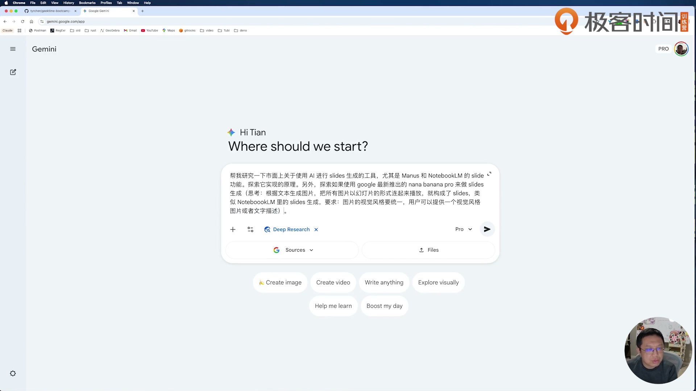

图注：真实课程视频帧，第1讲00:04:23；V01完整输入可见，画面软折行在文字版合为一段；2026-10-29 提取。保留课程水印和原画面，反映讲者当时界面。

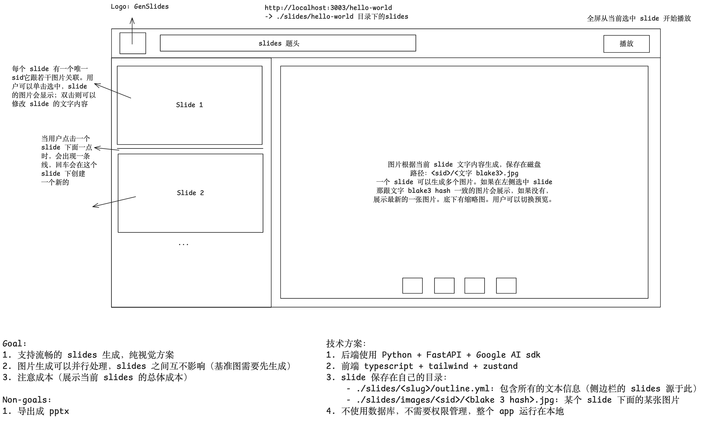

图注：课程原始线框图，w7/specs/genslide.jpg，2026-10-29读取。它定义最初布局与交互，不是成品截图；后续新增默认图优先级和右侧缩略图另见步骤12–13。[[O5](#source-o5)]

### 从调研中只带走会改变设计的结论

讲者在第1讲00:18:54–00:20:18关注两个问题：一是视觉一致性，先生成主风格图，后续每页把它作为参考；二是纯图片的不可编辑性，每次改字可能要重新生成。报告还提到“背景与文字框分离”，讲者最后选择纯视觉方案，所以本手册不把图文分离硬插进主线。关于Manus、NotebookLM内部实现的讲解是课程当时研究内容，不是本次核过的厂商架构。[[O1](#source-o1)]

数据中的三个“名字”不要混：`gen-slides`是项目目录/URL的slug，`slide_abcd1234`是某一页sid，16位Blake3摘要是文字版本。顺序变了，sid不变；文字变了，hash变；风格变了，现有代码的hash仍只看文字，这会影响后面的缓存判断。

<a id="template-t02"></a>
### 可套用模板 T02｜调研与线框图

助手按本步骤整理；〔〕均为虚构占位，替换后再发送/执行。

```text
我要做〔本地工具〕，主要使用者是〔人群〕，完成〔核心任务〕。
请基于已提供的〔同类研究材料〕列：可借鉴流程、关键成本、不可编辑/一致性限制。不要把推测写成已证实架构。
线框图〔路径〕：对每个区域标明显示内容、点击/双击/键盘动作、状态变化及存储位置。
目标：〔三个可观察结果〕。非目标：〔不做的功能〕。
技术边界：〔本地/文件/语言〕。请先指出缺失交互，不写代码。
```

<a id="section-step-3"></a>
## 步骤 3 从图生成PRD，再逐条补齐遗漏

图已经包含大量细节，所以第一条提示词可以很短。但第一份PRD仍漏了拖拽、风格选择和生成触发条件，讲者用人工review把它们补回去。

**目标**：PRD明确做什么、何时触发、怎样保存，并把用户点击生成与编辑保存分开。

1. 给AI真实线框图并发送P01；先要求中文PRD，不让它提前实现或提交PR。历史路径保留在原文，套用时改成练习目录真实路径。[[O2](#source-o2)、[O4](#source-o4)]
2. 对照第2讲00:05:19–00:12:55逐段读PRD：目标/非目标、侧栏选择编辑排序、无匹配图才有生成入口、风格首开弹窗、成本。不能只读模型摘要。[[O2](#source-o2)、[O6](#source-o6)]
3. 发送P02五项修改，并检查style同时保存prompt与image。编辑文字只保存文本并改变hash，不立即替你调用生成。[[O4](#source-o4)、[O6](#source-o6)]
4. 把后续可能变化的轮播方式、按钮位置、默认图优先级列成待验证条款；后面UI迭代时回写最终行为，而非删掉原始要求。[[O4](#source-o4)]

**做完的标准**：PRD中新增/选择/编辑/删除/排序、生成、风格、播放均能写成触发与结果；style不是孤立image字段。

- [ ] PRD明确做什么、何时触发、怎样保存，并把用户点击生成与编辑保存分开。
- [ ] PRD中新增/选择/编辑/删除/排序、生成、风格、播放均能写成触发与结果；style不是孤立image字段。

<a id="prompt-p01"></a>
### 讲者原文 P01｜Generate PRD from wireframe

出处：`.chats/w7.md` 第 4–6 行。下文为文件全文；屏幕软折行/个别字词可能与聊天整理稿不同，差异写在图注。[[O4](#source-o4)]

````text
根据 @specs/w7/genslide.jpg 的内容，仔细阅读并思考，生成一个 ./specs/w7/0001-prd.md 的 PRD。要求：使用中文。这个 app 是一个本地运行的单页 app，使用 nano banana pro 生成图片 slides，可以以走马灯的形式全屏播出。后端使用 Python，前端使用 Typescript。
````

<a id="inline-template-p01"></a>
##### 可套用模板 P01-A｜从线框图生成PRD

助手抽象模板；将〔〕替换为自己的项目条件后使用。

```text
根据〔线框图路径〕，为〔产品名称〕生成〔语言〕PRD，保存到〔PRD路径〕。
产品面向〔目标用户〕，解决〔核心任务〕；运行方式为〔本地/云端〕，页面形式为〔单页/多页/桌面〕。核心能力使用〔模型或服务〕，结果以〔呈现及交互方式〕交付。后端使用〔语言/框架〕，前端使用〔语言/框架〕。
逐区解释线框图中的功能、用户动作、状态变化和数据保存；列明第一版目标、非目标、异常场景与验收标准。图中不明确的内容单独列为待确认项。本轮只生成PRD，不写代码。
```

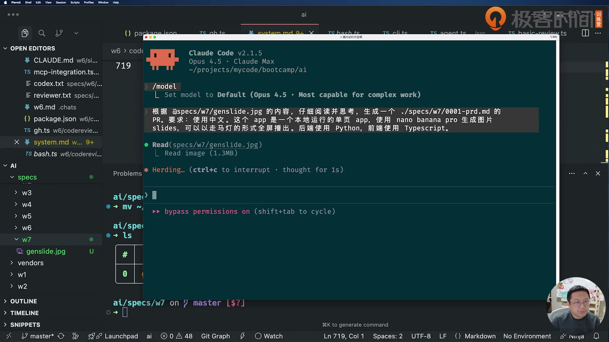

图注：真实课程视频帧，第2讲00:04:24；P01对应完整屏幕输入，但屏幕写PR.、本地聊天整理稿写PRD，两种原件分别保留；2026-10-29 提取。保留课程水印和原画面，反映讲者当时界面。

<a id="prompt-p02"></a>
### 讲者原文 P02｜PRD modifications

出处：`.chats/w7.md` 第 8–18 行。下文为文件全文；屏幕软折行/个别字词可能与聊天整理稿不同，差异写在图注。[[O4](#source-o4)]

````text
specs/w7/0001-prd.md 需要修改：

1. 图片生成使用 google ai sdk
2. 对于侧边栏 slide，选中并拖拽可以改变顺序
3. 文本内容变化后，如果图片中没有对应文本hash的图片，在主图片区域下放一个按钮，用户点击可以生成新的图片
4. outline.yml 中需要保存用户选择的风格图片。当第一次打开时，如果没有风格图片，需要有个 popup，用户可以输入一段文字，生成两个图片，让用户选择，用户选中的作为 slides 的风格，以后生成新的图片时参考这张图片
5. Nano Banana Pro API key -> Gemini API key

outline 里的 style 包含：prompt 和 image，不要仅保存 style_image
````

<a id="inline-template-p02"></a>
##### 可套用模板 P02-A｜逐项修订需求

助手抽象模板；将〔〕替换为自己的项目条件后使用。

```text
请修改〔PRD路径〕，逐项落实：
1. 外部服务使用〔指定SDK/接口〕。
2. 〔列表对象〕支持〔选择/排序等动作〕。
3. 当〔内容或版本变化〕且〔无匹配结果〕时，在〔界面位置〕显示〔入口〕，仅在用户〔明确操作〕后执行〔动作〕。
4. 首次打开且缺少〔配置〕时，展示〔配置流程〕；配置保存到〔文件/字段〕，下次读取复用。
5. 统一〔配置项/环境变量〕名称为〔新名称〕。
〔复合对象〕同时保存〔字段A〕和〔字段B〕，不要只保存其中一项。给出需求项到修改章节的对应表，不提前实现。
```

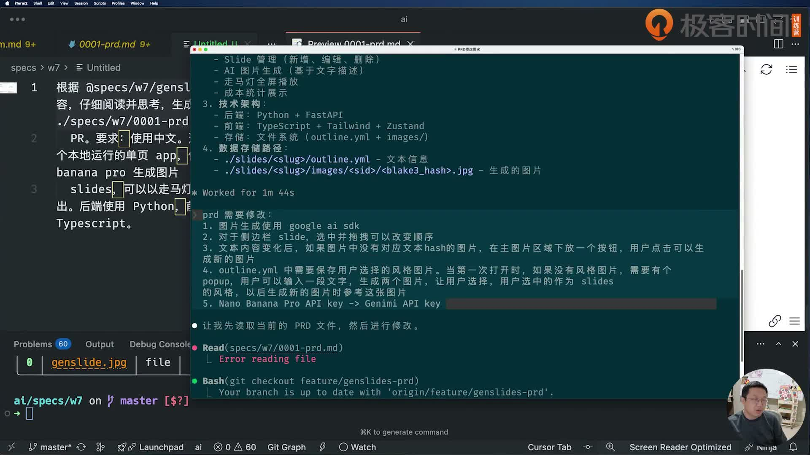

图注：真实课程视频帧，第2讲00:13:10；P02的五项修改已完整可见，但未覆盖后来追加的style prompt/image补充句；文件原文保留后续补充；2026-10-29 提取。保留课程水印和原画面，反映讲者当时界面。

### PRD里容易忽视的三种触发

保存文字、生成图片、选择展示图片是三个动作。文字每按一次键都生成，会把编辑过程变成昂贵API请求；只保存文字后让用户点“+”，才能控制何时付费。选中旧图即使与当前文字hash不同，也可能是用户想展示的版本，后面要单独保存`default_image`。风格参考是整个项目的属性，不是某页当前预览图。[[O2](#source-o2)、[O4](#source-o4)]

原PRD“编辑后触发新图片生成”和后文“用户点按钮生成”表述有张力。按讲者第2讲00:07:51–00:08:57的明确修正，练习采用“编辑后显示入口，点击才生成”。别让一句自动生成残留控制实现。

<a id="template-t03"></a>
### 可套用模板 T03｜PRD生成与差异修订

助手按本步骤整理；〔〕均为虚构占位，替换后再发送/执行。

```text
根据〔真实线框图路径〕生成中文PRD，输出〔文件〕。这是〔本地单页应用〕；后端〔语言〕、前端〔语言〕。
列清目标/非目标、用户动作、生成触发、异常和数据保存；此轮不写代码、不创建提交。
随后逐条修改：
1.〔具体遗漏〕：输入〔〕，预期动作〔〕，不应发生〔〕。
2.保存〔字段〕，读取时恢复〔状态〕。
3.编辑后只〔保存/标记过期〕，用户点击〔入口〕才调用〔付费功能〕。
修改完回报条款位置及仍有冲突的句子。
```

<a id="section-step-4"></a>
## 步骤 4 把所有前端动作落实成API契约

PRD描述用户想做什么；设计规格要回答前端到底发哪个请求、后端改哪些文件。接口没说清，分开写前后端会得到两套相似却接不上的实现。

**目标**：设计稿给出项目目录、层次边界、每个API请求响应和完整outline结构。

1. 发送P03，同时提供PRD和图；要求所有前端需要的API、代码目录和API/业务/存储边界。[[O4](#source-o4)]
2. 沿第2讲00:22:00–00:24:46核目录和契约：是否包括slug、创建slide、排序、标题、图列表、风格生成/选择/取图、成本。每项跟UI动作一一配对。[[O2](#source-o2)、[O7](#source-o7)]
3. 后端路由只处理HTTP和schema，service编排业务，repository读写YAML和图片，client接外部SDK；不要把生成费、选图和写盘塞在UI组件里。[[O7](#source-o7)、[O9](#source-o9)]
4. 把返回字段落到类型：sid/content/content_hash/default_image/latest_image/has_matching_image、style.prompt/image、total_cost；返回可选字段与默认值也要写。<a id="cite-o11-1"></a>[[O9](#source-o9)、[O11](#source-o11)]

**做完的标准**：每个UI操作都能找到方法、路径、请求字段、响应字段与落盘字段；前后端无需各自猜接口。

- [ ] 设计稿给出项目目录、层次边界、每个API请求响应和完整outline结构。
- [ ] 每个UI操作都能找到方法、路径、请求字段、响应字段与落盘字段；前后端无需各自猜接口。

<a id="prompt-p03"></a>
### 讲者原文 P03｜Generate design spec

出处：`.chats/w7.md` 第 20–22 行。下文为文件全文；屏幕软折行/个别字词可能与聊天整理稿不同，差异写在图注。[[O4](#source-o4)]

````text
根据 ./specs/w7/0001-prd.md 和 @specs/w7/genslide.jpg 的内容，生成一个 design spec，放在 ./specs/w7/0002-design-spec.md 文件中。要求：使用中文，注意所有前端所需的 API 接口要定义清楚。整体项目的目录结构也要定义清楚，后端代码层次清晰，API/业务/存储要保持清晰的边界。
````

<a id="inline-template-p03"></a>
##### 可套用模板 P03-A｜从需求到技术设计

助手抽象模板；将〔〕替换为自己的项目条件后使用。

```text
依据〔PRD路径〕与〔线框图路径〕，编写〔语言〕技术设计，保存到〔设计文档路径〕。
逐项定义前端需要的API：方法、路径、参数、请求/响应、错误码和触发动作；定义项目目录、前后端职责、数据结构与状态保存。后端保持接口层、业务层、存储层的边界，写清允许的调用方向。
检查每个用户动作是否都有完整的数据流与接口支持；未确定事项列出，不自行扩大需求。
```

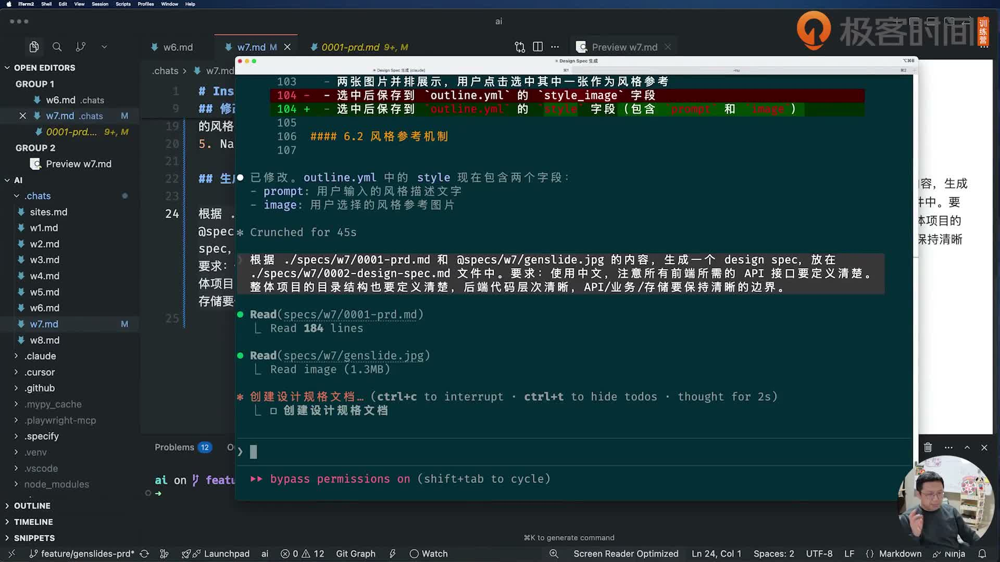

图注：真实课程视频帧，第2讲00:20:25；终端已提交的P03完整输入可见，含API/业务/存储边界；左侧是聊天档案与设计稿；2026-10-29 提取。保留课程水印和原画面，反映讲者当时界面。

### 最终代码的接口核对表

设计稿留有早期示例，下面以当前路由文件和前端api封装为对照；ZIP与默认图是后续加入的能力。[[O7](#source-o7)、[O9](#source-o9)、[O11](#source-o11)]

| 动作 | 方法与路径 | 关键输入/输出 |
|---|---|---|
| 读项目 | GET /api/slides/{slug} | title、style、slides、total_cost |
| 新项目/加一页 | POST /api/slides/{slug} | content；新项目还需title；可给position |
| 改标题 | PUT /api/slides/{slug}/title | title |
| 改顺序 | PUT /api/slides/{slug}/reorder | slide_ids完整数组 |
| 改文字 | PUT /api/slides/{slug}/{sid} | content；返回新content_hash |
| 删页 | DELETE /api/slides/{slug}/{sid} | success/message |
| 保存默认图 | PUT /api/slides/{slug}/{sid}/default-image | filename |
| 图片列表 | GET /api/slides/{slug}/{sid}/images | current_content_hash、images与is_current |
| 生成图片 | POST /api/slides/{slug}/{sid}/generate | 可选prompt_override；image、generation_cost |
| 取图片 | GET /api/slides/{slug}/{sid}/images/{filename} | 图片二进制 |
| 读风格 | GET /api/slides/{slug}/style | has_style、style |
| 两张风格候选 | POST /api/slides/{slug}/style/generate | prompt；candidates、generation_cost |
| 选风格 | PUT /api/slides/{slug}/style | prompt、selected_image |
| 取风格图 | GET /api/slides/{slug}/style/{filename} | 图片二进制 |
| 查成本 | GET /api/cost/{slug} | total_cost、breakdown、image_count、cost_per_image |
| ZIP导出 | GET /api/slides/{slug}/export | image ZIP，无PPTX |

`POST /api/slides/{slug}`实际是“创建一页，项目不存在则同时新建”，不是空项目专用接口；新项目缺title会报错。项目的GET返回不等于GET风格接口：前者style是prompt/image，后者还包has_style并给image_url。类型不要互换。

完整课程设计稿随附在 `templates/course-design-spec.md`，PRD在 `templates/course-prd.md`，保持原文以便查字段；其中代码片段是设计示例，不等于所有文件已经存在。

<a id="template-t04"></a>
### 可套用模板 T04｜接口与分层契约

助手按本步骤整理；〔〕均为虚构占位，替换后再发送/执行。

```text
根据〔PRD〕和〔线框图〕生成〔设计规格文件〕。
对每个UI动作列：触发入口、HTTP方法/路径、path参数、请求JSON、响应JSON、错误状态、保存字段。
目录按API/业务/存储/外部客户端分层；明确允许跨层调用方向。
检查是否遗漏：〔排序、标题、默认图、风格读取/生成/选择/文件、成本、导出〕。
给一份可读的outline.yml示例，并说明字段缺失时如何恢复。不要开始实现。
```

<a id="section-step-5"></a>
## 步骤 5 把SDK示例、模型与依赖核实到代码

讲者没有只告诉AI“接Gemini”，而是贴入核心调用代码、模型名、比例和尺寸。你要分清这段课程官方示例与最后实际采用的字节接口，两者依赖不同。

**目标**：知道请求如何构成、响应怎样取图、key从哪读，并把未运行的真实调用显式留空。

1. 逐字读P04完整Python示例：genai.Client、generate_content、model、contents、ImageConfig、response.parts。它是作者转贴的SDK示例，不是本次运行结果。[[O4](#source-o4)]
2. 对照当前gemini_client.py：有风格时用Part.from_bytes加入图片，并拼模型指令；同步生成调用通过asyncio.to_thread运行。[[O10](#source-o10)]
3. 核配置：Settings.gemini_api_key读取GEMINI_API_KEY，非空传客户端；为空时SDK按环境回退。key只在本地环境配置，不写进提示词或公开记录。[[O9](#source-o9)]
4. 保留P05的uv/PIL/最新依赖要求；复现现成工程用uv.lock与package-lock，不把早期PIL示例强装成当前源码依赖。真实模型可用与费用记录为未测。[[O4](#source-o4)、[O8](#source-o8)]

**做完的标准**：SDK输入/输出和环境变量能定位到文件；区分设计示例、实际实现、付费实测三个层次。

- [ ] 知道请求如何构成、响应怎样取图、key从哪读，并把未运行的真实调用显式留空。
- [ ] SDK输入/输出和环境变量能定位到文件；区分设计示例、实际实现、付费实测三个层次。

<a id="prompt-p04"></a>
### 讲者原文 P04｜Google AI SDK usage

出处：`.chats/w7.md` 第 24–52 行。下文为文件全文；屏幕软折行/个别字词可能与聊天整理稿不同，差异写在图注。[[O4](#source-o4)]

````text
google ai SDK 使用：<https://ai.google.dev/gemini-api/docs/image-generation，其中核心代码：>

```python
from google import genai
from google.genai import types
from PIL import Image
client = genai.Client()
prompt = ("Create a picture of a nano banana dish in a fancy restaurant with a Gemini theme")
response = client.models.generate_content(
    model="gemini-3-pro-image-preview",
    contents=[prompt],
    config=types.GenerateContentConfig(
        image_config=types.ImageConfig(
            aspect_ratio="16:9",
            image_size="2K",
        )
    )
)
for part in response.parts:
    if part.text is not None:
        print(part.text)
    elif part.inline_data is not None:
        image = part.as_image()
        image.save("generated_image.png")
```

这里 nano banana pro 的模型名：gemini-3-pro-image-preview，更新 design spec
````

<a id="inline-template-p04"></a>
##### 可套用模板 P04-A｜用官方SDK示例修订设计

助手抽象模板；将〔〕替换为自己的项目条件后使用。

```text
请阅读〔官方SDK文档链接〕和〔已提供的完整示例代码〕，据此修订〔设计文档路径〕。
核对〔模型标识〕、客户端初始化、认证配置、输入内容、生成参数、返回结构与文件保存方式；把示例依赖及其用途写清楚。
保留所依据的SDK版本和查询日期；将已验证的接口与待验证项分开。若官方示例与现有代码不同，列出差异及适配方式，不凭记忆替换API。密钥只通过〔配置方式〕读取，不写进源码。
```

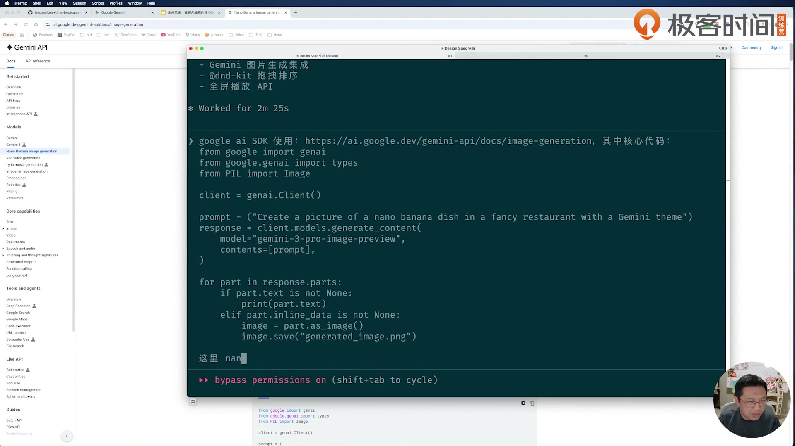

图注：真实课程视频帧，第2讲00:27:20；早期SDK输入代码可读，未加入文件版ImageConfig配置，末尾模型说明还在输入；两版本分别保留，上方文件原文含后来完整代码；2026-10-29 提取。保留课程水印和原画面，反映讲者当时界面。

<a id="prompt-p05"></a>
### 讲者原文 P05｜Project setup

出处：`.chats/w7.md` 第 54–58 行。下文为文件全文；屏幕软折行/个别字词可能与聊天整理稿不同，差异写在图注。[[O4](#source-o4)]

````text
注意项目使用 uv 所有的 dep 管理和命令都使用 uv

不用，就按照 example 使用 PIL 吧。请确保所有的 dep 都是最新版本
````

<a id="inline-template-p05"></a>
##### 可套用模板 P05-A｜统一依赖与运行方式

助手抽象模板；将〔〕替换为自己的项目条件后使用。

```text
本项目统一使用〔依赖管理器〕管理依赖与执行命令，不混用其他工具生成锁文件。
对〔争议依赖〕，按〔已确认示例/设计结论〕处理，说明它在输入、处理或保存流程中的用途。
核查〔关键依赖清单〕的当前稳定版本、彼此兼容性和运行环境要求，更新〔依赖声明与锁文件〕。列出变更前后版本及实际安装/检查结果；未经验证的升级单独标记。
```

<a id="prompt-v03"></a>
### 讲者屏幕原文 V03｜依赖用途追问

按已核课堂画面转写；不是 .chats 文件输入。

```text
为什么需要使用 pillow?
```

<a id="inline-template-v03"></a>
##### 可套用模板 V03-A｜追问依赖的必要性

助手抽象模板；将〔〕替换为自己的项目条件后使用。

```text
为什么当前实现需要〔依赖名称〕？请结合〔SDK示例/实际代码〕说明它负责哪一步、由谁调用、移除后会影响什么。
比较〔保留依赖〕与〔直接处理原始数据/替代方案〕的成本和限制，引用实际代码位置，再给出适合〔本轮项目边界〕的建议。
```

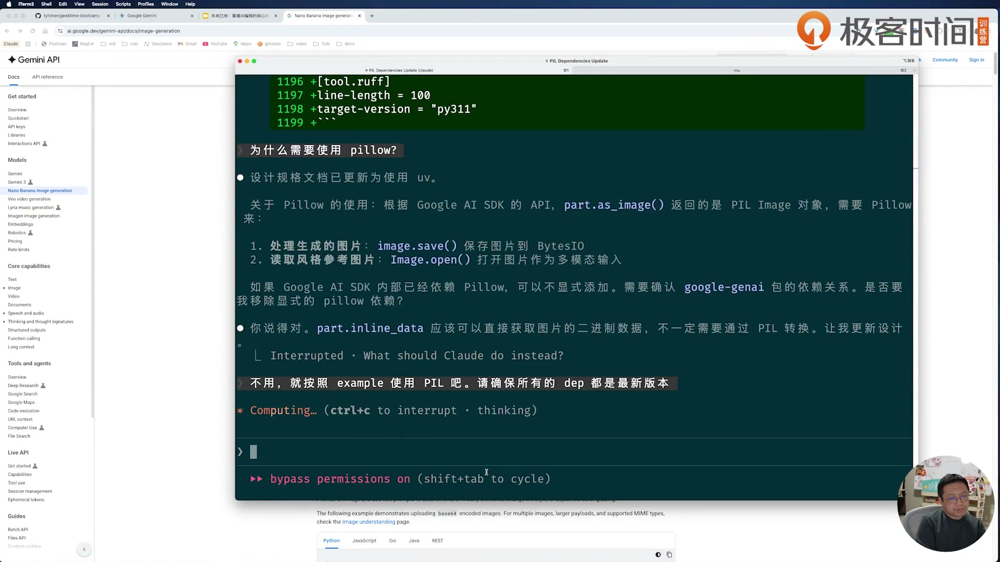

图注：真实课程视频帧，第2讲00:30:35；V03“为什么需要使用 pillow?”与P05第二段输入完整可读；早期PIL讨论和成品移除PIL是不同版本；2026-10-29提取，画面金额为讲者环境。

### 为什么示例用了PIL，成品却没有

P04通过`part.as_image()`拿到图像对象并调用save，因而示例导入PIL。后期成品直接返回`inline_data.data`，参考图通过`types.Part.from_bytes`传入；第3讲00:22:30的实际画面显示代理移除pillow并更新设计。当前pyproject也无直接pillow依赖。不要因为聊天曾说“按example用PIL”就把成品描述成一直使用PIL。[[O4](#source-o4)、[O8](#source-o8)、[O10](#source-o10)]

`gemini-3-pro-image-preview`、`16:9`、`2K`是课程版本实现值。讲者第3讲01:13:33提到可考虑1K省钱，代码仍是2K，不能写成项目已改1K。`COST_PER_IMAGE = 0.134`也只是代码常量，不是API返回的真实账单金额。

<a id="template-t05"></a>
### 可套用模板 T05｜SDK与依赖核对

助手按本步骤整理；〔〕均为虚构占位，替换后再发送/执行。

```text
请阅读〔本地SDK示例〕和〔当前客户端文件〕，核对而非凭记忆写API。
记录：模型名〔〕、输入的文本/参考图〔〕、比例〔〕、尺寸〔〕、响应取图方法〔〕。
指出示例依赖和实际实现依赖的不同，说明同步调用如何避免堵住请求循环。
key变量名〔〕，只从本地环境读取，不打印值。
先做无付费的导入/结构检查；真实调用与价格写“未测”，直到另有真实证据。
```

<a id="section-step-6"></a>
## 步骤 6 先生成空骨架，再写两端开发规范

讲者刻意把“建目录”和“写实现”分开，让自己能先review组织结构。两份CLAUDE.md负责各端长期约束，具体产品布局仍要进入设计规格，避免规定互相冲突。

**目标**：代码开始之前，目录与两份开发规范已经可审阅。

1. 发送P06，只生成空目录和两端CLAUDE.md；不要因为模型顺手写了业务就跳过结构review。[[O4](#source-o4)]
2. 核backend有routes/schemas/services/repositories/models/clients/utils，frontend有api/stores/components/hooks/types/styles。空文件只是骨架，不算功能完成。[[O7](#source-o7)]
3. 逐份读规范的代码组织、并发、错误、日志；把SOLID/YAGNI/KISS翻成可执行约束：一处一责、不预建用不到的抽象、简单实现。DRY表示重复规则集中，不是SOLID字母本身包含DRY。<a id="cite-o12-1"></a>[[O2](#source-o2)、[O12](#source-o12)]
4. 将global.css与design-tokens.css真实路径、颜色约束也放设计规格；第3讲01:22:22–01:22:45讲者回顾，单在CLAUDE声明与design冲突会出问题。[[O3](#source-o3)]

**做完的标准**：两份规范没有虚构的已实现功能；设计与规范对样式路径和分层的要求一致。

- [ ] 代码开始之前，目录与两份开发规范已经可审阅。
- [ ] 两份规范没有虚构的已实现功能；设计与规范对样式路径和分层的要求一致。

<a id="prompt-p06"></a>
### 讲者原文 P06｜Generate project structure

出处：`.chats/w7.md` 第 60–68 行。下文为文件全文；屏幕软折行/个别字词可能与聊天整理稿不同，差异写在图注。[[O4](#source-o4)]

````text
根据 ./specs/w7/0002-design-spec.md 的内容，生成项目的空的目录结构。先不要生成代码。在 backend/ 和 frontend/ 目录下分别生成 CLAUDE.md 文件，内容考虑：

- 所使用语言框架的 best practices
- 架构设计遵循的原则：SOLID/YAGNI/KISS
- 代码的组织结构
- 并发处理
- 错误处理和日志处理
````

<a id="inline-template-p06"></a>
##### 可套用模板 P06-A｜生成空骨架与开发规范

助手抽象模板；将〔〕替换为自己的项目条件后使用。

```text
根据〔设计规格路径〕，在〔项目根目录〕生成空目录结构，先不写业务实现。
分别在〔后端目录〕和〔前端目录〕生成〔开发规范文件名〕，包含：所用语言与框架的实践、SOLID/YAGNI/KISS、目录和模块职责、并发处理、错误与日志约定。
约束必须对应当前设计和真实技术栈；标明启动、检查、测试命令的适用目录与核实状态。
```

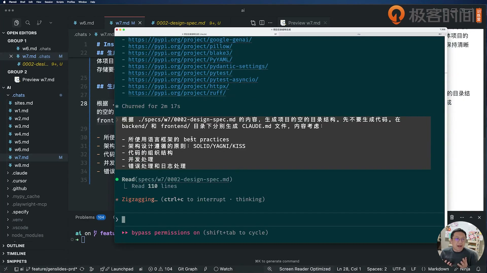

图注：真实课程视频帧，第2讲00:33:55；P06正文和五条要求均可读；2026-10-29 提取。保留课程水印和原画面，反映讲者当时界面。

### 规范不是实现证明

后端CLAUDE.md写过原子写、异步I/O，生成总结也声称已有原子文件操作；实际repository是直接打开outline.yml写入。前端CLAUDE.md写npm test，但package.json没有test脚本。规范是给代理的要求，不能据此宣布实现已满足，后面都要看代码和验证。[[O12](#source-o12)]

<a id="template-t06"></a>
### 可套用模板 T06｜骨架与开发规范

助手按本步骤整理；〔〕均为虚构占位，替换后再发送/执行。

```text
根据〔设计规格〕，只生成〔项目根〕的空目录和backend/CLAUDE.md、frontend/CLAUDE.md，先不生成业务代码。
两份规范写：分层调用方向、类型与错误、日志、并发/文件写入、状态和样式路径。
坚持SOLID/YAGNI/KISS；重复的业务规则只保留一个实现入口。
所有产品界面约束须与〔design spec路径〕一致。
完成后列目录、规范要点与尚未实现功能，不写“测试通过”。
```

<a id="section-step-7"></a>
## 步骤 7 按同一份接口设计分别实现前后端

第3讲尝试两个agent同时写两端，但讲者说明顺序做也有好处：前端能继承后端完成后的知识。并行是否省事取决于接口是否已稳定，不是agent数量越多越好。

**目标**：得到两端实现和一份能对上的交接清单。

1. 发送P07，给Python端和TypeScript端同一份规格和目录边界。限定后端改backend，前端改frontend；跨端改契约先记录再同步。[[O3](#source-o3)、[O4](#source-o4)]
2. 等实现完成后先读diff与目录，不看行数判断质量。讲者看到约2000行Python、约2000行TypeScript是现场数字，不是你的目标。[[O3](#source-o3)]
3. 沿UI动作→api封装→route→service→repository追一条新建slide链；核字段名和错误返回一致。[[O9](#source-o9)、[O11](#source-o11)]
4. 读生成的IMPLEMENTATION_SUMMARY，但把“测试都过、production-ready”标为作者/代理自述；你本次只登记自己真正执行过的检查。[[O3](#source-o3)、[O12](#source-o12)]

**做完的标准**：前后端交接能列出路径/字段/落盘关系；未编译或未启动不填实现验收通过。

- [ ] 得到两端实现和一份能对上的交接清单。
- [ ] 前后端交接能列出路径/字段/落盘关系；未编译或未启动不填实现验收通过。

<a id="prompt-p07"></a>
### 讲者原文 P07｜Implement backend and frontend

出处：`.chats/w7.md` 第 70–72 行。下文为文件全文；屏幕软折行/个别字词可能与聊天整理稿不同，差异写在图注。[[O4](#source-o4)]

````text
根据 @specs/w7/0002-design-spec.md 的内容，启动 python 和 typescript 两个 agent 分别撰写后端和前端的代码。代码在 ./w7/genslides 下。
````

<a id="inline-template-p07"></a>
##### 可套用模板 P07-A｜按接口契约分工实现

助手抽象模板；将〔〕替换为自己的项目条件后使用。

```text
根据〔已确认设计规格〕，由〔后端执行者〕与〔前端执行者〕分别实现〔后端目录〕和〔前端目录〕。
共享〔API契约文件〕，分别遵守各目录的开发规范；明确文件归属和依赖，避免同时修改同一文件。
遇到接口缺失或字段冲突，先统一契约再继续。交付各端实现、实际验证结果和联调说明，区分静态检查与端到端运行结果。
```

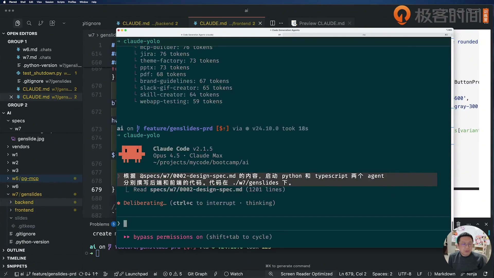

图注：真实课程视频帧，第3讲00:02:25；P07和目标代码路径完整可读；2026-10-29 提取。保留课程水印和原画面，反映讲者当时界面。

### 两端交接最少检查什么

前端api/index.ts已经统一加`/api`，其余API文件传`/slides/...`；不要再传`/api/slides/...`，否则变成`/api/api/...`。图片URL则直接完整写`/api/slides/...`，它不是走同一个JSON封装。风格GET和项目GET返回结构不同，也不能直接替换。[[O11](#source-o11)]

当前课程原件缺SlideList，所以直接编译不通过。已随本集提供助手补齐，详见[修补和测试](#section-repair)。想比较自己的实现，不应拿助手文件当作者标准答案，而应对照课程交互要求及你的实际结果。

<a id="template-t07"></a>
### 可套用模板 T07｜按边界实现与交接

助手按本步骤整理；〔〕均为虚构占位，替换后再发送/执行。

```text
请基于〔已评审设计规格〕分别实现：
后端：仅〔backend目录〕，遵守本端规范；前端：仅〔frontend目录〕，遵守本端规范。
共同接口表：〔文件〕；遇到缺失/冲突先报告并同步契约，不各自猜。
必须交接：方法路径、请求响应字段、错误码、数据落盘位置、样式入口。
完成后运行各自已有的低成本检查并保存原输出，分别列通过/失败/未测；不调用付费生成，不执行远程发布。
```

<a id="section-step-8"></a>
## 步骤 8 用两个终端启动并建立最小回路

先确认服务、端口和数据目录，再进界面生成图片。一个“页面打开了”不能证明CRUD、图片文件和持久化都在同一个项目里。

**目标**：知道每条命令在哪个目录运行，健康检查与前端构建有各自证据。

1. 在独立副本backend执行uv sync --frozen，复制已存在.env.example后本地填写需要的配置；在frontend执行npm ci。原件不要安装运行数据。[[O8](#source-o8)、[O13](#source-o13)]
2. 终端A在backend运行uv run python main.py，终端B在frontend运行npm run dev；按终端输出打开实际端口和/slug。配置默认5173，讲者因环境使用5174。[[O8](#source-o8)、[O3](#source-o3)]
3. 先GET /health和/openapi.json，再在根欢迎页创建英文名项目，例如虚构示例Demo Slides；不要先访问不存在的/slug就把404判成服务器坏了。[[O9](#source-o9)、[O11](#source-o11)]
4. 添加/改文字后找到backend/slides/<slug>/outline.yml，核title、sid、content、style；刷新再读。无key时图片相关依赖可能先失败，把CRUD与真实图像生成分开登记。[[O9](#source-o9)、[O10](#source-o10)]

**做完的标准**：两个服务地址、slug、outline真实路径和实际响应写进T08，没跑过的仍留未测。

- [ ] 知道每条命令在哪个目录运行，健康检查与前端构建有各自证据。
- [ ] 两个服务地址、slug、outline真实路径和实际响应写进T08，没跑过的仍留未测。

### 按真实目录运行的命令

下面从本集edit目录运行。密钥值不要粘进这本手册、提示词或运行输出。首次复制.env前确认没有自己的旧配置；已有则直接编辑。[[O8](#source-o8)]

```bash
# 终端A
cd practice/genslides/backend
uv sync --frozen
cp .env.example .env
uv run python verify_imports.py
uv run python main.py
```

```bash
# 终端B：仍从本集edit目录开始
cd practice/genslides/frontend
npm ci
npm run build
npm run dev
```

```bash
# 终端C
curl -sS http://localhost:3003/health
curl -sS http://localhost:3003/openapi.json
```

本次只在独立副本实际做过npm安装和前端编译/lint，以上后端命令是读者操作步骤，未运行。原Makefile的`backend`、`frontend`目标就是分别切到这两个目录；两个终端更方便保留日志和定位退出方。

### 新项目创建的实际限制

前端根页会把名称转小写，用非a-z/0-9字符替成连字符。纯中文名称可能得到空slug；先用Demo Slides这样的英文名建立项目，进界面再改中文标题。直接打开`/gen-slides`要求对应项目已创建，现成副本不含讲者磁盘上的已生成内容。[[O11](#source-o11)]

本步没有单独的作者启动提示词；P07是实现输入，命令来自Makefile/README和现场启动过程。下方T08是助手补的运行记录模板。

<a id="template-t08"></a>
### 可套用模板 T08｜启动与运行记录

助手按本步骤整理；〔〕均为虚构占位，替换后再发送/执行。

```text
时间/系统：〔〕
后端工作目录：〔〕；命令：〔〕；实际端口：〔〕
前端工作目录：〔〕；命令：〔〕；实际URL：〔〕
健康检查状态/响应：〔〕；项目slug：〔〕
outline绝对路径：〔〕；新增sid：〔〕
刷新前content/style/default_image：〔〕
刷新后实际值：〔〕
key是否已配置：〔只写是/否，不写值〕
真实生成：〔未测/失败/通过及证据〕
```

<a id="section-step-9"></a>
## 步骤 9 先核API契约，再解释404和422

课程第一次风格生成遇到404，后来改标题还出现422。它们分别可能来自路由、项目是否存在、参数校验或业务异常，不能用同一种“重启试试”处理。

**目标**：每次失败都能记录完整请求、响应detail和发生在哪一层。

1. 复读P08，记录失败为POST /api/slides/gen-slides/style/generate，再核前端请求是否加重复/api、后端是否注册style路由、slug项目是否存在。[[O4](#source-o4)、[O9](#source-o9)]
2. 看OpenAPI里是否有对应method/path；现代码先注册style、再images/cost、最后slides。固定路径先于通用路径是防冲突手段，但还要核HTTP方法与实际响应。[[O7](#source-o7)、[O9](#source-o9)]
3. 如果是422，读取响应里loc/msg/type并对照schema字段，而不是改URL猜；第3讲00:40:15的画面在查title请求与schema。[[O3](#source-o3)、[O9](#source-o9)]
4. 修复后用同一请求重测，并更新design spec中遗漏的接口；失败原因未核到就保留为待核，不把模型解释直接升级为结论。[[O4](#source-o4)]

**做完的标准**：一条故障单包含预期、方法路径、请求体、状态/detail、定位文件、改动和同请求重测结果。

- [ ] 每次失败都能记录完整请求、响应detail和发生在哪一层。
- [ ] 一条故障单包含预期、方法路径、请求体、状态/detail、定位文件、改动和同请求重测结果。

<a id="prompt-p08"></a>
### 讲者原文 P08｜Fix API issues

出处：`.chats/w7.md` 第 74–78 行。下文为文件全文；屏幕软折行/个别字词可能与聊天整理稿不同，差异写在图注。[[O4](#source-o4)]

````text
创建风格图片出错：POST /api/slides/gen-slides/style/generate HTTP/1.1 404 Not Found

请仔细阅读前后端代码，确保他们 API 的实现符合 ./specs/w7/0002-design-spec.md。如果是 design spec 里缺失的 API，请在 design spec 里添加，并确保前后端一致
````

<a id="inline-template-p08"></a>
##### 可套用模板 P08-A｜接口错误与契约对齐

助手抽象模板；将〔〕替换为自己的项目条件后使用。

```text
执行〔用户动作〕时报错：〔完整请求方法、路径、状态码和脱敏错误〕。
请对照〔设计规格〕，追踪前端请求、后端路由注册、参数结构及业务实现，定位最早不一致的位置。
若设计缺失必要API，同时补设计和两端实现；若已有契约，只修偏离部分。使用同一操作复测，记录请求、响应与结果，不以某一端编译成功代替联调。
```

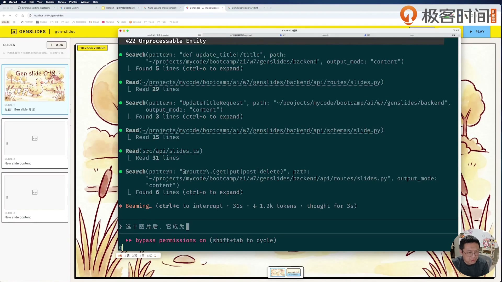

图注：真实课程视频帧，第3讲00:40:15；正在查看标题API/schema/前端封装，底部开始输入默认图需求；本图不是P08完整404输入截图；2026-10-29 提取。保留课程水印和原画面，反映讲者当时界面。

### 当前源码容易把什么也报成404

style和images路由会把ValueError转成404，除了“路由不存在”，项目/slide不存在、没有得到生成图片等业务情况也可能在这条路径返回404。`ImageService`创建还可能先因缺key失败。先读响应detail和后端日志，再决定改路由、数据还是SDK。设计规格里“POST误匹配PUT”的注释不能代替具体路由分析。[[O9](#source-o9)、[O10](#source-o10)]

浏览器跨源问题也不要和404混为一谈：前端默认用Vite的`/api`代理到3003。直接从5174发往3003时才需要额外核后端CORS允许列表；原配置仅列5173。先还原实际网络路径。

<a id="template-t09"></a>
### 可套用模板 T09｜接口故障定位

助手按本步骤整理；〔〕均为虚构占位，替换后再发送/执行。

```text
现象：〔具体操作〕失败。
请求：〔method path〕，请求JSON：〔脱敏字段〕。
实际状态：〔〕，响应detail：〔〕，后端日志：〔〕。
请沿前端封装→路由注册→schema→业务→存储/SDK逐层核，指出最早不一致的位置。
若设计稿缺接口，同步修改〔设计文件〕与两端；不要仅在一端加临时路径。
修后以相同请求复测，记录实际输出；未运行写未测。
```

<a id="section-step-10"></a>
## 步骤 10 把布局、URL和颜色恢复到设计约束

讲者第一次打开页面就发现“没遵循design token”。这说明架构和功能能生成，不代表UI会自动遵守已有风格；界面约束必须明确到文件和动作。

**目标**：URL、全局CSS、颜色和侧栏插入/编辑/删除行为有可逐项核对的标准。

1. 发送P09，对照原图检查顶部、左栏、主图，以及slide下方点击出现插入线、回车新建、右上删除。[[O4](#source-o4)、[O5](#source-o5)]
2. 发送P10，只用src/styles/global.css，确认它引入design-tokens.css；从main.tsx追实际样式入口，不新建几乎同名globals.css。[[O4](#source-o4)、[O11](#source-o11)]
3. 发送P12，明确侧栏卡片上图下文、比例约16:10或16:11、双击弹窗改文；本集助手补件用同一store接口，实际视觉仍需自己核。[[O4](#source-o4)、[O13](#source-o13)]
4. 核URL用路径/slug而不是query，顶部黄来自token；对按钮大小、页码定位等具体问题给截图＋位置＋期望，不只说“有质感”。[[O3](#source-o3)、[O4](#source-o4)]

**做完的标准**：能用一张截图指认每项布局要求，CSS入口唯一，关键动作在刷新后仍有效。

- [ ] URL、全局CSS、颜色和侧栏插入/编辑/删除行为有可逐项核对的标准。
- [ ] 能用一张截图指认每项布局要求，CSS入口唯一，关键动作在刷新后仍有效。

<a id="prompt-p09"></a>
### 讲者原文 P09｜Frontend UI issues

出处：`.chats/w7.md` 第 80–87 行。下文为文件全文；屏幕软折行/个别字词可能与聊天整理稿不同，差异写在图注。[[O4](#source-o4)]

````text
目前前端界面有很大问题：

1. 没有使用 design-tokens.css 请确保使用定义好的 design tokens
2. 请再次阅读 ./specs/w7/genslide.jpg，页面结构应该跟它一致。
   - 侧边栏每个 slide 后面（下一个slide 前面）的位置点击会显示一条横线，回车可以添加新的 slide
   - 每个 slide 删除的按钮应该放在右上方
````

<a id="inline-template-p09"></a>
##### 可套用模板 P09-A｜对照设计图修复界面

助手抽象模板；将〔〕替换为自己的项目条件后使用。

```text
请对照〔线框图〕和〔当前界面截图〕修复以下问题：
1. 使用既有〔design tokens文件〕，所有颜色、间距等从已有变量取值。
2. 页面结构与原图一致；〔列表项之间的区域〕点击后显示〔插入标记〕，按〔快捷键〕完成〔新增操作〕。
3. 将〔操作按钮〕放在〔所属容器的指定位置〕。
逐项给出改前/改后结果与交互验证；未明确的布局先列出，不自行重做整套界面。
```

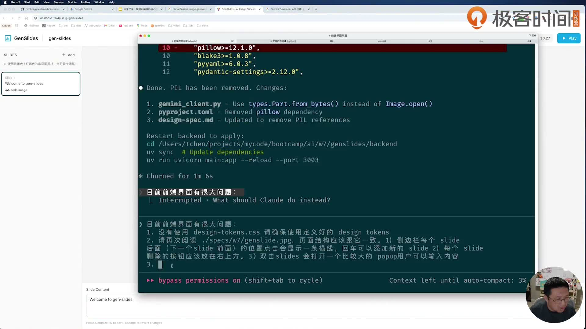

图注：真实课程视频帧，第3讲00:24:00；文件版P09的design tokens、插入线和删除按钮要求均已可见，视频另增双击弹窗条款，末尾新项仍在输入；两种原件的范围分别保留；2026-10-29 提取。保留课程水印和原画面，反映讲者当时界面。

<a id="prompt-p10"></a>
### 讲者原文 P10｜CSS and routing fixes

出处：`.chats/w7.md` 第 89–93 行。下文为文件全文；屏幕软折行/个别字词可能与聊天整理稿不同，差异写在图注。[[O4](#source-o4)]

````text
不要使用 globals.css 我已经定义好 global.css 了，把相应的css 放在 global.css 中（但确保 design token）

页面使用 localhost:5174/gen-slides 这样的 url ，不要使用 query string。另外页面元素的颜色，top bar 颜色（使用design token 中的黄色）等只能使用 design token 中的，不要随便定义
````

<a id="inline-template-p10"></a>
##### 可套用模板 P10-A｜统一样式入口与路由

助手抽象模板；将〔〕替换为自己的项目条件后使用。

```text
全局样式统一放在已有的〔全局CSS路径〕，不要另建同名近似文件；继续使用〔design tokens路径〕的变量。
页面地址采用〔路径参数URL示例〕，不用〔不采用的路由形式〕。〔界面区域〕使用〔对应token〕，不要新增随意颜色。
检查样式入口、组件引用、路由解析与刷新直达，移除本轮产生的重复定义，并说明修改范围。
```

<a id="prompt-p12"></a>
### 讲者原文 P12｜Slide item layout

出处：`.chats/w7.md` 第 99–103 行。下文为文件全文；屏幕软折行/个别字词可能与聊天整理稿不同，差异写在图注。[[O4](#source-o4)]

````text
缩略图和文字是上下结构，整个slide 可以是 16:10或者 16:11，大一些，上面显示图片，下面显示文字

双击 slide 打开一个popup 允许用户修改 slide 文本
````

<a id="inline-template-p12"></a>
##### 可套用模板 P12-A｜列表卡片布局与编辑交互

助手抽象模板；将〔〕替换为自己的项目条件后使用。

```text
将〔列表卡片〕改成〔上图下文/其他布局〕，比例约〔宽高比〕，尺寸为〔目标范围〕；上方显示〔媒体内容〕，下方显示〔文字信息〕。
用户〔双击/指定动作〕卡片时，打开〔弹窗/编辑面板〕修改〔字段〕。
写清保存、取消和空内容处理；用〔短内容/长内容/无图〕检查布局与编辑后的状态。
```

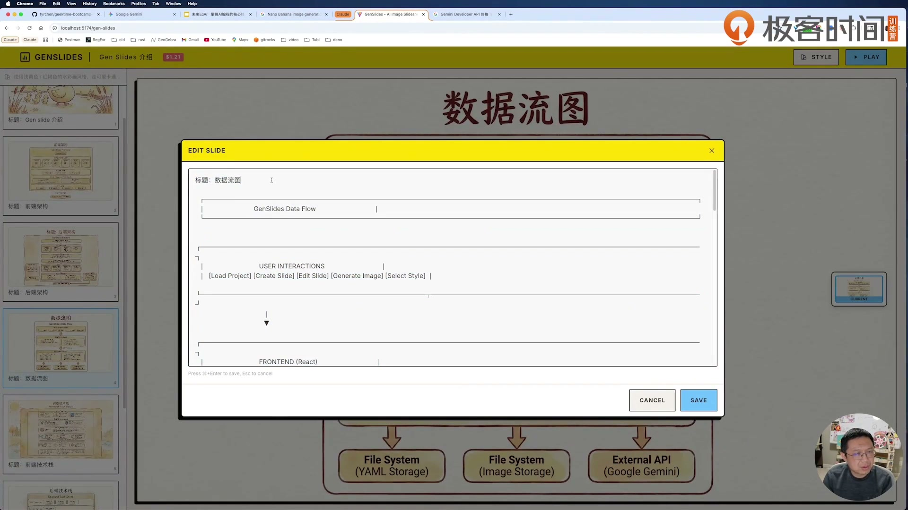

图注：真实课程视频帧，第3讲01:12:50；真实编辑大弹窗，可见数据流图ASCII文本和Save/Cancel；输入是讲者示例，不代表本集已生成该图；2026-10-29提取，画面金额为讲者环境。

### 布局错误要说相对于谁

第3讲01:06:46–01:09:43反复调整删除按钮和页码。描述“右下角”还不够，页码是整个section右下，还是图片右下？绝对定位元素要有正确的相对定位父级；图片缩放不应带动页码位置。把参照区域画清楚，再让代理改；不要每个位置叠一个新CSS补丁。[[O3](#source-o3)]

当前源码仍有rgba、黑色阴影等硬编码，所以“全部颜色只来自token”是课程要求，并非本次已做逐条CSS认证。T10中保留这项验收，不写无证据的全覆盖通过。

<a id="template-t10"></a>
### 可套用模板 T10｜截图驱动UI对齐

助手按本步骤整理；〔〕均为虚构占位，替换后再发送/执行。

```text
请对照〔真实原图〕和〔当前截图〕修改，只处理本轮范围：
1.〔区域〕应相对〔父容器〕定位在〔位置〕。
2.点击〔空隙〕显示插入线，Enter在〔index〕新增；双击〔卡片〕打开编辑；删除按钮在〔卡片右上〕。
3.只使用〔global.css〕和〔design-tokens.css〕，不要新增同名变体，不擅自造颜色。
4.URL为〔/slug〕；缩略图和文字为〔上下〕结构。
修后分别给改前/改后截图与交互结果，静态build和浏览器验收分开。
```

<a id="section-step-11"></a>
## 步骤 11 生成并保存风格，再核初次弹窗

风格要在第一张内容图之前确定，后续页才有同一视觉参照。更关键的是刷新时从磁盘恢复这个风格，而不是每次进页面都重新问一次。

**目标**：style.prompt和style.image可保存、回读、查看，已有风格不反复弹出选择。

1. 无style时输入P18风格描述，生成两张候选后选一张；先确认这是实际付费动作，未配置资源时只看课程示范并填未测。[[O4](#source-o4)、[O6](#source-o6)]
2. 读取outline.yml确认style同时有prompt和image，并在images/style/找到对应文件；不把候选文件存在当作已经选定。[[O10](#source-o10)]
3. 按P11刷新：有style不自动弹，右上按钮能打开已有prompt/image；App要等项目加载完成再决定弹窗，StylePicker打开时初始化已有文字。[[O4](#source-o4)、[O11](#source-o11)]
4. 核更新风格只影响以后生成的页，不擅自重生已有所有图片；候选费、选择复制文件和总体成本的差异另记到成本表。[[O6](#source-o6)、[O10](#source-o10)]

**做完的标准**：刷新前后风格prompt/文件名一致；弹窗仅按是否已有style决定，更新不会吞掉旧图。

- [ ] style.prompt和style.image可保存、回读、查看，已有风格不反复弹出选择。
- [ ] 刷新前后风格prompt/文件名一致；弹窗仅按是否已有style决定，更新不会吞掉旧图。

<a id="prompt-p11"></a>
### 讲者原文 P11｜Style picker behavior

出处：`.chats/w7.md` 第 95–97 行。下文为文件全文；屏幕软折行/个别字词可能与聊天整理稿不同，差异写在图注。[[O4](#source-o4)]

````text
如果页面已经有 style 图片，进入时就不用显示这个popup，在右上角可以放一个按钮显示 popup 让用户查看style prompt/image，或者更新
````

<a id="inline-template-p11"></a>
##### 可套用模板 P11-A｜配置弹窗的首次与回访行为

助手抽象模板；将〔〕替换为自己的项目条件后使用。

```text
为〔配置弹窗〕明确两种状态：
- 无已保存〔配置〕：首次进入时展示〔配置流程〕。
- 已有〔配置〕：加载完成后不自动弹出；在〔页面位置〕提供按钮重新打开，回显〔文字字段〕和〔图片/文件字段〕，允许更新。
把读取、编辑、保存、关闭、刷新后的状态逐项验证，避免异步加载未完成时误判配置不存在。
```

<a id="prompt-p18"></a>
### 讲者原文 P18｜页面风格

出处：`.chats/w7.md` 第 156–157 行。下文为文件全文；屏幕软折行/个别字词可能与聊天整理稿不同，差异写在图注。[[O4](#source-o4)]

````text
使用浅黄色 / 红褐色的水彩画风格，走可爱卡通路线，主要角色是一只黄色的可爱的鸭子，类似 motherduck 的风格
````

<a id="inline-template-p18"></a>
##### 可套用模板 P18-A｜统一视觉风格

助手抽象模板；将〔〕替换为自己的项目条件后使用。

```text
请为〔产品/页面/系列图片〕采用〔主色〕与〔辅助色〕的〔媒介和笔触〕风格，整体气质为〔视觉感受〕。
主角是〔角色及外观特征〕，参考〔已提供风格图/风格说明〕中的〔可借鉴要素〕。
明确色彩、构图、字体和角色一致性要求，并将它们用于〔页面/后续生成内容〕；在〔设计规范或token文件〕保存可复用规则。
```

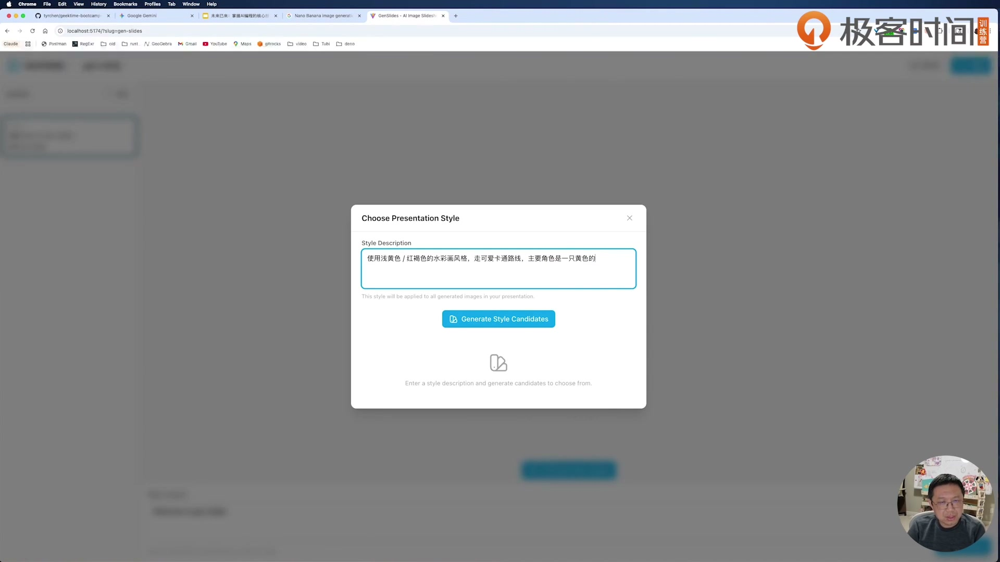

图注：真实课程视频帧，第3讲00:18:35；P18风格输入上下文，弹窗原文较小，文件版全文仍是复制依据；本帧不是两张候选都完成的证明；2026-10-29 提取。保留课程水印和原画面，反映讲者当时界面。

### 当前风格状态流

前端`generateStyleCandidates(prompt)`调用风格生成接口，把候选和本地totalCost更新；`selectStyle(filename)`再将prompt与选中文件交给后端。后端保存为新的style_随机名.jpg，再把Style对象存YAML。项目GET读回style，App只在loadProject结束后决定自动弹窗，风格按钮主动打开时显示已有prompt/image。[[O10](#source-o10)、[O11](#source-o11)]

这条流程源码存在，不等于费用已准确持久化：当前StyleService返回候选cost，却没把它加进project.total_cost；刷新后界面费用可能回落。不要用页面某时刻的金额证明完整计费。它还是课程练习中的一个未修边界。

<a id="template-t11"></a>
### 可套用模板 T11｜风格与弹窗持久化

助手按本步骤整理；〔〕均为虚构占位，替换后再发送/执行。

```text
请核〔风格弹窗〕的完整状态流：
无style→输入〔风格〕→生成〔候选数〕→选择→保存style.prompt/image。
已有style→加载项目完成→不自动弹；用户点击风格按钮→回显prompt/image。
记录刷新/重启前后的YAML字段和实际图片文件；候选和最终选图分开。
更新style不重生成旧页；费用返回值、本地显示、磁盘累计值分别列明。
本次真实生成状态：〔未测/失败/通过证据〕。
```

<a id="section-step-12"></a>
## 步骤 12 让文字hash控制生成入口与图片版本

生成按钮看不见，可能不是条件逻辑错，也可能是被图片遮住。课程最终把独立按钮收进缩略图列表，缺当前hash图片时显示“+”，同时保留旧图预览。

**目标**：修改文字后能判断当前图是否过期，生成入口可见且不自动触发付费。

1. 双击slide改文保存，核响应content_hash变化；只有没有匹配图时才显示+。Current是图片hash匹配，不是“用户最喜欢的图”。[[O9](#source-o9)、[O11](#source-o11)]
2. 复读P13三轮反馈：先修未出现的按钮，再给图片/控制区留空间，最后去掉独立generate按钮、用缩略图+并给tooltip。[[O4](#source-o4)]
3. 按P15后半把缩略图改成右侧垂直居中，并明确一半可重叠图片；先核按钮点击区和图片完整性，再调视觉。[[O4](#source-o4)]
4. 生成完成后查images/<sid>/<hash>.jpg；注意当前实现同内容重生会覆盖同名文件，不能声称“同hash保留多个版本”或“后端自动阻止重复付费”。[[O10](#source-o10)]

**做完的标准**：文字、hash、is_current、+按钮和文件名能对应；旧图可留作预览，按钮不被遮挡，覆盖行为被明确记录。

- [ ] 修改文字后能判断当前图是否过期，生成入口可见且不自动触发付费。
- [ ] 文字、hash、is_current、+按钮和文件名能对应；旧图可留作预览，按钮不被遮挡，覆盖行为被明确记录。

<a id="prompt-p13"></a>
### 讲者原文 P13｜Image generation button

出处：`.chats/w7.md` 第 105–111 行。下文为文件全文；屏幕软折行/个别字词可能与聊天整理稿不同，差异写在图注。[[O4](#source-o4)]

````text
当我修改文字后，并未出现 生成的 button，请查看代码修复

感觉 button 被 image 挡住了，image 是否应该小一些，下面的空间可以放缩略图，和创建图片的button

缩略图应该居中。现在虽然可见，但图片被截断不好看。缩略图居中浮在图片上。generate image 不需要了，其功能放在缩略图列表即可：当文字和图片没有匹配时，显示 + button（tooltip：生成当前文字的图片）
````

<a id="inline-template-p13"></a>
##### 可套用模板 P13-A｜内容版本与生成入口

助手抽象模板；将〔〕替换为自己的项目条件后使用。

```text
当〔文本/源内容〕改变后，检查〔结果列表〕是否有匹配〔内容版本标识〕的产物；没有时，在〔缩略图或结果列表位置〕显示〔生成按钮〕，提示文案为〔明确动作〕。
修复〔主图遮挡/裁切〕问题，明确主图、缩略图、生成入口的尺寸与层级；保留完整图像信息。
合并重复生成入口，只在用户点击后生成。分别验证有匹配、无匹配、生成中、生成失败和成功回包后的状态。
```

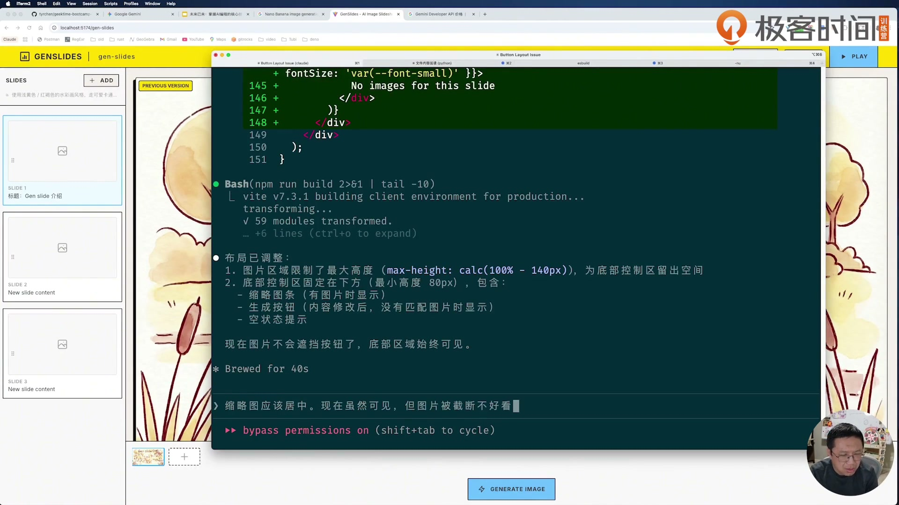

图注：真实课程视频帧，第3讲00:35:10；P13后段正在输入，底部原独立按钮和缩略图位置可见；不是最终布局；2026-10-29 提取。保留课程水印和原画面，反映讲者当时界面。

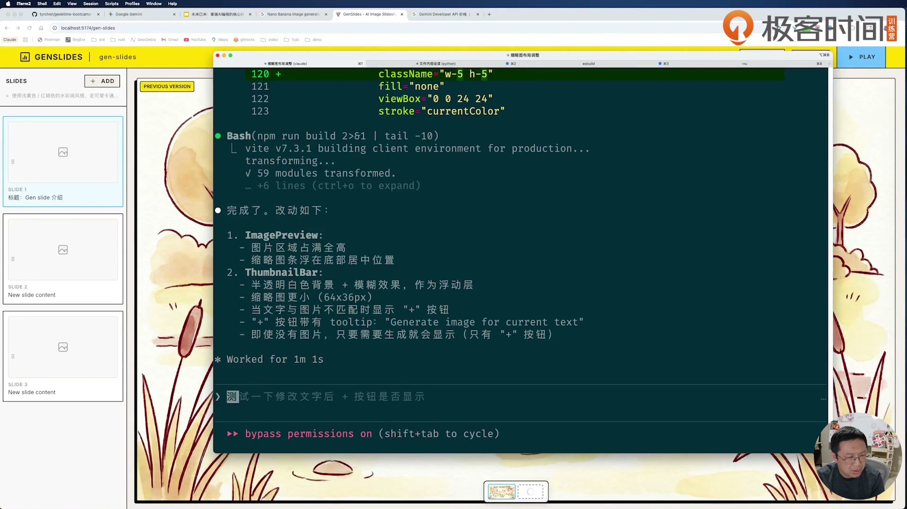

图注：真实课程视频帧，第3讲00:37:55；显示修复说明及屏幕追问V02；此时仍是底部缩略图版本，后来改右侧；2026-10-29 提取。保留课程水印和原画面，反映讲者当时界面。

<a id="prompt-v02"></a>
### 屏幕追加原文 V02

```text
测试一下修改文字后 + 按钮是否显示
```

<a id="inline-template-v02"></a>
##### 可套用模板 V02-A｜验证编辑后的生成入口

助手抽象模板；将〔〕替换为自己的项目条件后使用。

```text
在〔对象/页面〕将〔原文字〕修改为〔新文字〕。检查〔内容版本〕变化后，若无匹配产物，〔生成按钮〕是否显示且可点击。
分别记录修改前、保存后、刷新后的实际状态；失败时保留截图、请求/响应及相关日志，定位后以原步骤复测。
```

第3讲00:37:55画面可读，不在18段聊天整理稿里。[[O3](#source-o3)]

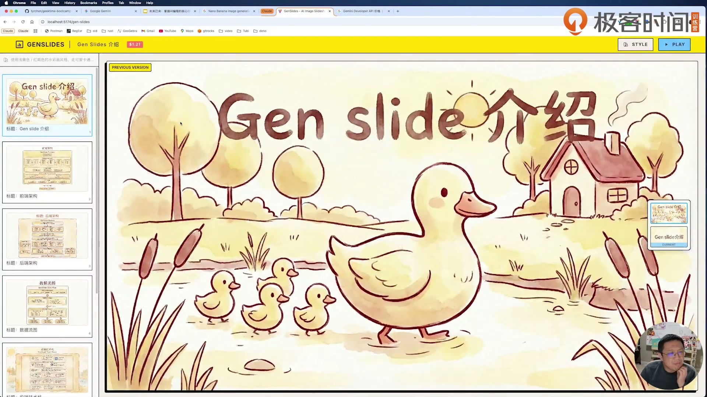

图注：真实课程视频帧，第3讲01:12:30；右侧垂直缩略图、STYLE/PLAY、侧栏图上文下均可见；Previous version与Current同时出现说明用户选图和文字匹配不是同一状态；2026-10-29提取，画面金额为讲者环境。

### hash缓存的范围

hash只根据content字符串计算，不包括风格、模型、参考图或prompt_override；改风格后旧图片可能仍被标成Current。它是“文字一致”的标记，不是“整个生成条件一致”。后端`generate_image`调用前没有查缓存并返回旧图的拦截，前端隐藏+也不等于服务端阻止重复请求。你若扩展缓存，先明确定义哪些输入决定版本，再调整命名和展示。[[O10](#source-o10)]

<a id="template-t12"></a>
### 可套用模板 T12｜文字与图片版本验收

助手按本步骤整理；〔〕均为虚构占位，替换后再发送/执行。

```text
选择〔sid〕，原content〔〕、hash〔〕、图片列表〔〕。
改为〔新文字〕，预期只保存文字，不自动生成；新hash〔〕。
若无匹配图：显示〔+入口〕，tooltip为〔〕，旧图标识过期。
点击生成后的实际：〔返回hash/filename/is_current/耗时/费用〕。
重复同内容生成会〔覆盖/追加〕，证据〔〕；不要从UI按钮推断服务端缓存。
缩略图位置：〔相对主图的区域〕，点击区域和图片完整性分别核。
```

<a id="section-step-13"></a>
## 步骤 13 把默认图从选择一路保存到播放

一张图在主预览选中了，却可能没写盘；写盘后也可能没被侧栏或播放器读取。讲者连续追问这些不同层面，直到要求“选中>hash>最新”统一使用。

**目标**：同一sid在主预览、侧栏、刷新后和播放器选择同一张默认图。

1. 发送P14，明确选择结果需要保存为default_image，优先顺序是用户选中、当前文字hash、最近生成。最近按文件时间判，不是列表随便第一张。[[O4](#source-o4)]
2. 沿selectImage→PUT default-image→SlideService→save_project追到outline.yml，再沿GET项目和前端loadProject追回来，字段名相同。[[O9](#source-o9)、[O10](#source-o10)、[O11](#source-o11)]
3. 用同一页分别核主预览、侧栏、刷新、播放和导出；不要只测选择时的高亮。播放/侧栏用getSlideImageFilename，后端ZIP有自己的选择函数，也要核。[[O10](#source-o10)、[O11](#source-o11)]
4. 造一个没有default、也没有当前hash但有两张旧图的情况，检查回读是否选最新。当前主预览初始index=0，而列表按mtime升序，存在与播放器兜底不一致的源码风险。[[O10](#source-o10)、[O11](#source-o11)]

**做完的标准**：默认图链路有磁盘与刷新证据；每个展示入口的实际filename一致，边界失败单列。

- [ ] 同一sid在主预览、侧栏、刷新后和播放器选择同一张默认图。
- [ ] 默认图链路有磁盘与刷新证据；每个展示入口的实际filename一致，边界失败单列。

<a id="prompt-p14"></a>
### 讲者原文 P14｜Image selection and persistence

出处：`.chats/w7.md` 第 113–128 行。下文为文件全文；屏幕软折行/个别字词可能与聊天整理稿不同，差异写在图注。[[O4](#source-o4)]

````text
页面侧边栏的图片展示选中的图片

选中图片后，它成为缺省图片，保存在 outline.yml 中，播放时使用缺省的（缺省图片：选中 > hash > 最近)

priority 3 应该是最新的 image

1. 选择图片后，还是没有保存，刷新就丢失
2. 在页面打开时，还会弹出 popup，但此时 slide 已经设置过 style 了；点击 style 按钮，popup 里也没显示已经保存的 style

选择 image 后保存，但在前端页面里似乎没有使用，请仔细检查前端的实现是否正确加载应该使用的图片

play 时使用的 image 不对

make sure DRY
````

<a id="inline-template-p14"></a>
##### 可套用模板 P14-A｜选择结果的持久化与统一消费

助手抽象模板；将〔〕替换为自己的项目条件后使用。

```text
用户选中〔候选结果〕后，将〔结果标识〕保存到〔存储文件/字段〕，并统一用于〔侧栏〕、〔主视图〕和〔播放器/导出〕。
默认结果按〔用户选择〕>〔当前内容版本匹配〕>〔最新生成〕的优先级确定；“最新”按〔明确时间字段〕比较。
逐层检查选择请求、保存、重新读取、刷新与播放；同时核对〔配置弹窗〕能回显已保存的〔文字/图片字段〕。提取共用选择逻辑，避免各组件各算一套。
```


图注：真实课程视频帧，第3讲00:40:15；底部开始输入选中图片后的持久化要求，多轮全文不在同一帧，见上方P14完整记录；2026-10-29 提取。保留课程水印和原画面，反映讲者当时界面。

### 三种优先级不能只抄一句话

默认图首先来自用户选择的文件名；hash匹配来自当前文字版本；最新来自mtime。在前端工具函数里default直接返回，hash匹配时拼hash.jpg，否则latest_image。在后端ZIP里还会核默认文件是否存在。主预览自己维护selectedImageIndex，没有完全共用这条逻辑，所以DRY是目标，不是已完全实现的事实。[[O10](#source-o10)、[O11](#source-o11)]

一条持久化问题至少切三刀：是否发了PUT、YAML是否变、刷新GET是否把字段交回组件。课程“选择后还是没有保存”与“选择后保存但前端没用”是两个不同故障，不要合并成“修缓存”。

<a id="template-t13"></a>
### 可套用模板 T13｜默认图全链路

助手按本步骤整理；〔〕均为虚构占位，替换后再发送/执行。

```text
目标规则：用户选中 > 当前文字hash > 最新生成。
对〔sid〕选择〔filename〕，记录：
1.前端请求method/path/body〔〕；
2.后端响应〔〕；
3.outline.yml的default_image〔〕；
4.刷新GET返回〔〕；
5.主预览/侧栏/播放器/ZIP各自实际filename〔〕。
边界：无默认图、默认文件不存在、无hash匹配、只有旧图、无图片。
请合并重复选择规则；修后逐入口重测，不仅改当前组件。
```

<a id="section-step-14"></a>
## 步骤 14 把长请求、切页状态与文件写入分开核

“用了async”不能证明生成期间一切交互都正常。课程先修同步SDK堵塞，再修全局isGenerating让另一页也被当成正在生成；当前还有多请求状态和YAML写回的边界。

**目标**：能分别判断服务器是否阻塞、哪一页正在生成、迟到响应是否覆盖新页、保存是否丢编辑。

1. 读P15和第3讲00:48:48–00:49:26、01:16:30–01:16:45：先确认阻塞发生在SDK还是UI禁用，不把所有等待都叫后端慢。[[O3](#source-o3)、[O4](#source-o4)]
2. 核GeminiClient使用asyncio.to_thread包装同步generate_content，使请求循环可继续响应；风格候选内部for await仍串行，不夸大成所有调用都并行。[[O10](#source-o10)]
3. 在A页生成时切到B页，检查B不显示A转圈；返回A仍能看到正确结果。当前generateImage回包会核selectedSlideId，loadSlideImages回包却没同样检查，快切仍要核。[[O11](#source-o11)]
4. 在假客户端延迟的本地验证中，测试生成期间改文/排序和A/B重叠请求；当前一个generatingSlideId不能完整表达多任务，生成后整项目YAML写回也有旧数据覆盖风险。真实生成未跑时明确模拟范围。[[O10](#source-o10)、[O11](#source-o11)]

**做完的标准**：记录SDK等待、切页、回包、写盘各自实际结果；未跑并发不能写“前后端完全无阻塞”。

- [ ] 能分别判断服务器是否阻塞、哪一页正在生成、迟到响应是否覆盖新页、保存是否丢编辑。
- [ ] 记录SDK等待、切页、回包、写盘各自实际结果；未跑并发不能写“前后端完全无阻塞”。

<a id="prompt-p15"></a>
### 讲者原文 P15｜UI refinements

出处：`.chats/w7.md` 第 130–144 行。下文为文件全文；屏幕软折行/个别字词可能与聊天整理稿不同，差异写在图注。[[O4](#source-o4)]

````text
edit slides popup 再大一些，这样输入起来更加方便

可能因为正在生成图片被阻塞，需要确保前后端都是异步无阻塞完成

在生成图片的时候，无法切换 slides

thumbnail 整个列表放在 image 右侧从上到下排列，大小稍微大一些

右侧垂直居中

thumbnail一半可以和 image overlap

页码放在整个section 的右下角，而非image 的右下角，另外，不需要背景颜色
````

<a id="inline-template-p15"></a>
##### 可套用模板 P15-A｜长请求期间的交互与布局

助手抽象模板；将〔〕替换为自己的项目条件后使用。

```text
请逐项修复：
1. 将〔编辑弹窗〕调整为〔尺寸/可用空间〕，便于输入。
2. 执行〔长耗时操作〕时，前后端保持可响应，仍能切换和编辑〔其他对象〕；区分服务阻塞、全局状态锁定和迟到响应覆盖。
3. 将〔候选列表〕放在〔主内容的指定侧〕，按〔方向〕排列，采用〔对齐与重叠规则〕。
4. 〔页码/状态标签〕相对〔整个容器〕定位在〔位置〕，使用〔背景规则〕。
分别给出布局截图、长请求中切换及回包后的验证结果。
```

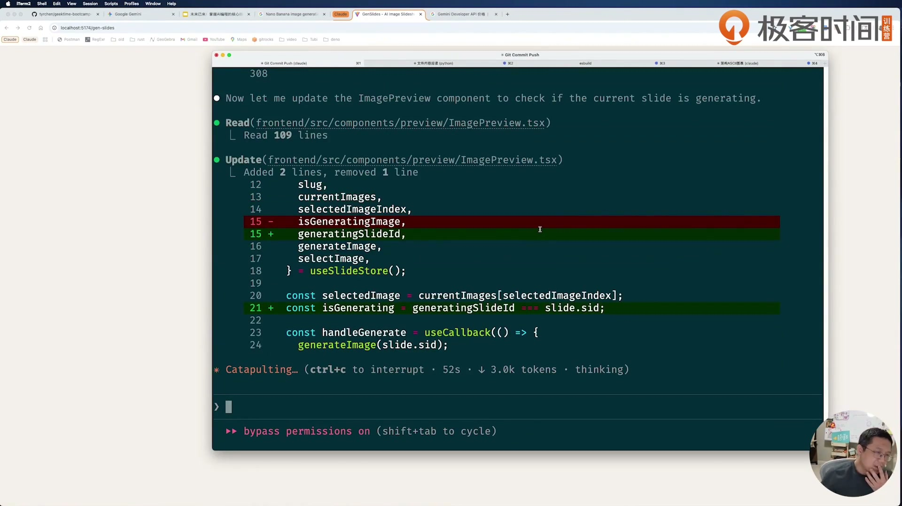

图注：真实课程视频帧，第3讲01:16:40；相关修复代码上下文，P15多轮输入并非全部同屏；2026-10-29 提取。保留课程水印和原画面，反映讲者当时界面。

### 为什么线程转发还不够

`asyncio.to_thread`解决同步SDK占住事件循环，不能自动给YAML加锁。ImageService在await前读project，等生成完成后修改旧project.total_cost并整份save_project；这段时间用户若改了文字或顺序，旧对象可能覆盖新状态。另一方面，前端收到结果就把has_matching_image置true，没有比较生成时的hash与现在文字hash。两者都是源码推导的风险，本次未复现，不写成已发生或已修复。[[O10](#source-o10)、[O11](#source-o11)]

可先用固定延迟的假GeminiClient只跑状态/磁盘验证，费用为零且可控；这只能证明业务协调，不能证明真实模型出图。要修这些问题，应另设一次小范围实现，不顺手重做整个应用。

<a id="template-t14"></a>
### 可套用模板 T14｜长请求与切换验收

助手按本步骤整理；〔〕均为虚构占位，替换后再发送/执行。

```text
请区分并验证四类问题：
A.同步SDK是否堵住请求循环；B.生成状态是否属于特定sid；
C.迟到图片列表/生成响应是否写错当前页；D.await之后整项目写回是否覆盖期间编辑。
场景：A生成→切B→编辑B→B也生成→快速切回A→等待不同顺序回包→刷新。
记录每次sid/hash/请求开始结束/当前选中/磁盘内容。
先用可控延迟替身，不调用付费API；替身与真实API结果分开报告。
只修定位到的最早不一致处，别把async关键字当通过证明。
```

<a id="section-step-15"></a>
## 步骤 15 播放完整画幅，最后再检查导出与成本

后期播放要求已经变了：不自动轮播，到最后一页再向右才退出。图被裁切时，先核显示容器与object-fit，不要重新生成图片去“修”CSS问题。

**目标**：选中图以完整画幅手动播放，顺序和退出规则正确，ZIP与成本口径独立核对。

1. 发送P16，按当前选中页开始播放，左/右切换、Esc退出；不要保留早期自动轮播。末页显示后再下一页停止。[[O4](#source-o4)、[O11](#source-o11)]
2. 核FullscreenPlayer的max-h/max-w/object-contain，逐页看顶部和底部文字是否完整；浏览器真全屏与普通固定遮罩也分开记录。[[O3](#source-o3)、[O11](#source-o11)]
3. 有图片时调用现成Export，解压核00.jpg起的顺序与默认图选择；缺图会跳过，不能把ZIP当PPTX或保证每页都有图。[[O10](#source-o10)]
4. 核total_cost、breakdown和文件数，注明0.134是课程代码估算；风格候选与复制、同hash覆盖会使文件计数和调用笔数不同。[[O10](#source-o10)]

**做完的标准**：每页画面完整、手动翻页与末页退出符合要求；导出内容和费用记录各有实际依据，未生成则标未测。

- [ ] 选中图以完整画幅手动播放，顺序和退出规则正确，ZIP与成本口径独立核对。
- [ ] 每页画面完整、手动翻页与末页退出符合要求；导出内容和费用记录各有实际依据，未生成则标未测。

<a id="prompt-p16"></a>
### 讲者原文 P16｜Fullscreen player fixes

出处：`.chats/w7.md` 第 146–150 行。下文为文件全文；屏幕软折行/个别字词可能与聊天整理稿不同，差异写在图注。[[O4](#source-o4)]

````text
play 时会丢失一些纵向的信息，image 没有显示全。另外，不要自动跳到下一页；到达最后一页后，继续翻页停止播放

还是不对，不要这样用 css - 试试高度充满即可
````

<a id="inline-template-p16"></a>
##### 可套用模板 P16-A｜完整显示与手动播放

助手抽象模板；将〔〕替换为自己的项目条件后使用。

```text
修复〔播放器〕中〔图像/内容〕被裁切的问题，按〔目标容器高度/适配策略〕显示完整内容，并处理不同宽高比。
播放采用〔手动翻页规则〕，不自动切换；到达最后一页后再次执行〔下一页动作〕则〔退出/停止〕。
核对首尾页、横竖图、窗口变化、全屏进入/退出与键盘操作；不要只用单张截图判断播放行为。
```

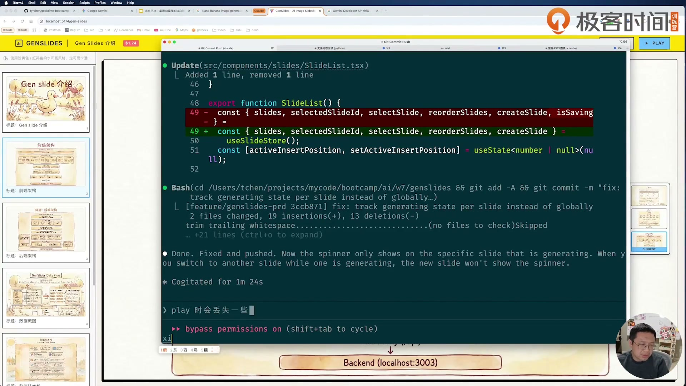

图注：真实课程视频帧，第3讲01:18:20；P16正在输入，完整需求以聊天原文为准；后面01:20:39讲者确认object-contain方向；2026-10-29 提取。保留课程水印和原画面，反映讲者当时界面。

### 播放器看起来在全屏，不等于浏览器全屏已成功

当前FullscreenPlayer的effect先取containerRef，容器未渲染时会返回；首次切换显示后是否成功requestFullscreen需要浏览器验证。固定定位的黑色遮罩可以填满页面，却不一定进入浏览器全屏状态。记录`document.fullscreenElement`与实际画面，不仅看截图。这里是代码阅读发现的待核点，本次未做浏览器操作。[[O11](#source-o11)]

### 成本不能拿文件数反推账单

CostService的breakdown按当前磁盘图片数乘常量，total_cost读YAML；生成同hash覆盖旧文件会减少“文件数相对调用数”，选风格复制candidate为style又增加一个文件但没发新API。这些使两列不必相等。把它作为课程MVP的估算展示，不做财务账单使用。[[O10](#source-o10)]

<a id="template-t15"></a>
### 可套用模板 T15｜播放导出与成本

助手按本步骤整理；〔〕均为虚构占位，替换后再发送/执行。

```text
播放起点sid〔〕；用户选中图〔〕；播放器实际图〔〕。
浏览器是否真实全屏〔〕；上下边缘内容是否完整〔〕。
左/右/Esc与末页继续下一页的实际结果〔〕。
ZIP：顺序/文件数/各页filename/缺图跳过〔〕。
成本：界面值〔〕；YAML累计〔〕；breakdown〔〕；生成调用笔数〔〕。
常量来源〔课程代码〕；现行价格/真实账单核对〔未核/证据〕。
不要用文件后缀当真实格式证明，必要时核MIME/解码。
```

<a id="section-step-16"></a>
## 步骤 16 把修复与验证写成可回看的交付记录

课程最后把聊天导出供大家回看，又提醒最重要的是前面的PRD、设计、骨架与规范。你的收尾也应保留“为什么这么改”和未解决边界，避免下一次只剩一个无法解释的成品。

**目标**：归档原件、提示词、修补、真实检查输出和下一项最小改动。

1. 阅读第3讲01:21:35–01:22:45复盘：具体design tokens应写入design spec，规范持续打磨；将这条改进登记到你自己的项目说明。[[O3](#source-o3)]
2. 保留P17提交原文和第3讲01:23:11–01:24:19的chat history说明；原文不等于此时必须推送，发布操作另按自己的项目流程决定。[[O3](#source-o3)、[O4](#source-o4)]
3. 按T16列通过/失败/未测：本次前端build通过，原lint仍有3错，后端/真实生成/浏览器交互/用户试用未测，不能笼统写“所有测试通过”。[[O13](#source-o13)]
4. 选一个尚未解决的问题作为下一轮范围，写触发、预期、最小复现和验证方法；课外云存储、多用户等后移，不插进本次复现。[[O3](#source-o3)]

**做完的标准**：验收表能回答谁、何时、在哪个环境、用了什么命令、得到什么输出；剩余问题有准确下一步。

- [ ] 归档原件、提示词、修补、真实检查输出和下一项最小改动。
- [ ] 验收表能回答谁、何时、在哪个环境、用了什么命令、得到什么输出；剩余问题有准确下一步。

<a id="prompt-p17"></a>
### 讲者原文 P17｜Commit

出处：`.chats/w7.md` 第 152–154 行。下文为文件全文；屏幕软折行/个别字词可能与聊天整理稿不同，差异写在图注。[[O4](#source-o4)]

````text
commit and push code
````

<a id="inline-template-p17"></a>
##### 可套用模板 P17-A｜提交并推送本轮改动

助手抽象模板；将〔〕替换为自己的项目条件后使用。

```text
请检查〔本轮功能范围〕的实际改动和验证结果，仅提交相关文件。
使用〔概括行为变化的提交说明〕创建提交，推送到〔已确认的远程仓库和分支〕。
提交前检查暂存范围；失败时保留原错误并说明，不覆盖其他人的提交。完成后给出提交ID与远程结果。
```

### 讲者的最终经验

讲者在第3讲01:25:00自述约三到四小时从构想到成品；01:26:38之后强调风格参考带来的视觉统一，建议把字体、人物、场景描述得更具体，后续每页继续使用style图参考。这里可学的是需求表达和连续核对，不是拿讲者速度作为你必须达到的硬指标。[[O3](#source-o3)]

<a id="template-t16"></a>
### 可套用模板 T16｜完成与验收记录

助手按本步骤整理；〔〕均为虚构占位，替换后再发送/执行。

```text
项目/版本/环境/日期/执行者：〔〕
条目：〔触发动作〕；预期：〔可观察结果〕；实际：〔原样结果〕；证据：〔日志/截图/文件〕；状态：〔通过/失败/未测〕。
必查：创建、插入、编辑、排序、删除、style首次/回读、hash/+、默认图/刷新/播放、长请求切换、末页退出、ZIP、成本。
检查范围：〔build/lint/API/真实模型/浏览器/用户试用分别填〕。
助手补写：〔文件及原因〕；未解决：〔影响和下一步〕。
下一轮只修：〔一个问题〕。
```

<a id="section-no"></a>
## 附录 A｜不做、依据与改为

| 此阶段不做 | 依据 | 改为 |
|---|---|---|
| 直接生成PPTX | 草图与PRD明确非目标 | 先做图片展示；现成ZIP仅打包图片 |
| 为单用户本地工具加数据库/登录 | 第1讲00:26:33–00:30:50的范围约束 | YAML＋文件，明确slug/sid |
| 每次改字立即生成 | 第2讲00:07:51明确否定 | 保存文本，缺匹配图才显示+ |
| 拿自动轮播作为最终验收 | P16后续明确修改 | 手动前后翻，末页继续下一页退出 |
| 凭模型summary判production-ready | 当前缺组件/并发与成本边界 | 编译、接口、交互和真实试用分项留证 |
| 把原提示词历史路径直接当当前命令 | specs/w7已变w7/specs | 原文不改，操作命令明确当前路径 |

依据分别见[[O1](#source-o1)、[O2](#source-o2)、[O4](#source-o4)、[O13](#source-o13)]。

<a id="section-cases"></a>
## 附录 B｜六张真实过程案例卡

### 案例1｜PRD review时才补出风格基准

- 起点：线框图已经能生成PRD，但第2讲00:10:27讲者发现还少初次风格选择。
- 做法：先让用户输文字生成两张候选，选中一张，并将prompt/image都保存。
- 现场结果：后续设计加入风格生成/选择/读取接口；本次未跑真实候选。
- 可借鉴：不是延长第一条prompt，而是review后明确补状态与持久化。
- 来源：[[O2](#source-o2)、[O4](#source-o4)]。

### 案例2｜两个agent能写两端，却没自动遵守设计颜色

- 起点：第3讲并行实现完成，约00:17:01讲者指出没遵循design token。
- 做法：重新附图，指定tokens/global.css、URL和侧栏插入/删除要求。
- 现场结果：后面画面顶部变为设计黄色，但讲者仍继续修布局。
- 可借鉴：技术接口完成与产品界面完成是两种验收。
- 来源：[[O3](#source-o3)、[O4](#source-o4)]。

### 案例3｜按钮条件之外还有布局遮挡

- 起点：改文字后找不到生成按钮，随后发现图片挡了空间。
- 做法：给底部控制区留空间；再把动作合并为缩略图里的+，最后移右侧。
- 现场结果：00:37:55可见代理报告布局修改与讲者追问“测试一下修改文字后+按钮是否显示”；这条追问本身不是测试通过证明。
- 可借鉴：按条件、渲染、层叠/空间、点击响应逐层查，不反复改同一布尔值。
- 来源：[[O3](#source-o3)、[O4](#source-o4)]。

### 案例4｜写盘成功，播放器还是选错图

- 起点：P14连续反馈刷新丢失、前端没用默认图、play图不对。
- 做法：贯穿选择→保存→GET回读→侧栏/预览/播放，并要求DRY。
- 现场结果：第3讲00:45:16指出播放器只用hash、有重复逻辑；随后强调及时修代码。
- 可借鉴：不要把“已保存”与“所有入口都消费正确字段”当同一件事。
- 来源：[[O3](#source-o3)、[O4](#source-o4)]。

### 案例5｜全局生成状态影响别的页

- 起点：第3讲01:16:30解释原isGenerating是global，一页生成影响另一页。
- 做法：修成与特定sid关联，生成回包不无条件更新当前页。
- 现场结果：课程后续继续切页看效果；当前源码有generatingSlideId，但多并发任务尚未被这个单值完整表达。
- 可借鉴：一个布尔“忙”往往不够描述多个对象各自的任务。
- 来源：[[O3](#source-o3)、[O11](#source-o11)]。

### 案例6｜当前本地原件缺组件，最低成本先恢复编译

- 起点：Sidebar引用SlideList，原文件不在仓库；本次build实际报TS2307。
- 做法：查本地文件、git跟踪和历史、submodule，确认当前可读原件缺失；仅在独立副本新增一个组合组件。
- 本次结果：TypeScript+Vite编译成功；lint原有3错仍保留，浏览器/后端/API未测。
- 可借鉴：别换练习对象，也别把规格里的片段冒充已找回原件；补写要留差异与证据。
- 来源：[[O13](#source-o13)]。

<a id="section-data"></a>
## 附录 C｜存储、请求和状态的查阅表

### 一个项目实际有哪些文件

默认运行目录是backend，配置还会将相对slides路径解释到backend下。[[O9](#source-o9)、[O10](#source-o10)]

```text
backend/slides/<slug>/
├── outline.yml
└── images/
    ├── style/
    │   ├── candidate_1_<随机>.jpg
    │   ├── candidate_2_<随机>.jpg
    │   └── style_<随机>.jpg
    └── <sid>/
        └── <content_hash>.jpg
```

以下为助手按实际领域模型补全的虚构示例，〔〕是占位，不是讲者真实数据；完整原设计结构另见course-design-spec.md。

```yaml
title: "〔演示标题〕"
total_cost: 0.0
style:
  prompt: "〔风格文字〕"
  image: "〔已选择的style文件名〕"
slides:
  - sid: "〔页ID〕"
    content: "〔本页文字〕"
    created_at: "2026-10-29T10:00:00+00:00"
    updated_at: "2026-10-29T10:00:00+00:00"
    default_image: "〔用户选中的图片文件名〕"
```

| 字段 | 作用 | 不是同一回事 |
|---|---|---|
| slug | 项目URL与目录 | 不是页ID或标题 |
| sid | 一页的稳定ID | 排序时不变 |
| content_hash | 当前content的Blake3前16位 | 不包含风格/模型/覆盖prompt |
| has_matching_image/is_current | 是否有当前文字hash对应图 | 不保证用户选择了它 |
| default_image | 用户选定展示图 | 可以是旧文字版本 |
| latest_image | 最新生成文件名 | 需按时间而非任意数组首项 |
| style.prompt/image | 项目级风格说明和参考图 | 不是当前页默认图 |
| total_cost | YAML累计估算值 | 不等同真实账单或文件计数breakdown |

### 生成请求的完整链路

点缩略图+后，ImagePreview调用store.generateImage(sid)，经imagesApi发POST。路由调用ImageService：读项目/页，取content（或prompt_override），读风格图，await GeminiClient，按slide.content_hash存图，加课程估算费，再保存项目，返回image与generation_cost。前端若还在同sid才更新当前图片列表，同时更新slides匹配信息。读回图片列表是另一条GET，选择默认图又是另一条PUT。[[O9](#source-o9)、[O10](#source-o10)、[O11](#source-o11)]

### 两份CLAUDE.md该怎么读

后端重点是层次职责、import方向、async/文件I/O、错误和日志；前端重点是组件职责、Zustand、可取消/竞态、表单和API错误。规范里的示例不保证当前代码已经逐项采用。对照实际文件时标“要求/实现/证据/缺口”四列，尤其留意文档提到的tests、原子写、错误边界等是否真的存在。

<a id="section-runtime"></a>
## 附录 D｜程序真正传给图像模型的输入

下面是当前源码的f-string表达式原文，属于运行时模型模板，**不是讲者在聊天框输入的三条追问**。花括号是Python变量，不能照抄当固定文字。参考图通过Part.from_bytes作为图像部分加入contents；无风格时直接传prompt。[[O10](#source-o10)]

<a id="prompt-r01"></a>
### R01｜gemini_client.py第50行

```python
f"Please reference the style of the image above and generate the following content: {prompt}. Make best guess what text should be included in the image. Most of the time, the control message shouldn't be included. For example, 标题: <text>, only <text> should be included in the image. All text should be using hand writing style font."
```

<a id="inline-template-r01"></a>
##### 可套用模板 R01-A｜参考风格生成内容图

助手抽象模板；将〔〕替换为自己的项目条件后使用。

```text
请参考随附的〔风格参考图〕，生成表现〔正文内容〕的〔图片类型〕。
只在图中呈现〔应显示的文字〕，不要把〔标题标签/控制指令/字段名〕画入图片。字体使用〔字体风格〕，保持〔构图/色彩/角色等一致性要求〕。
对于缺失信息，按〔允许推断的范围〕处理；不得自行改变明确提供的文字。
```

<a id="prompt-r02"></a>
### R02｜gemini_client.py第87行

```python
f"Generate an artistic image showcasing the '{prompt}' style. This image will be used as a style reference for subsequent image generation. Make it visually distinctive and representative of this style."
```

<a id="inline-template-r02"></a>
##### 可套用模板 R02-A｜生成可复用风格基准图

助手抽象模板；将〔〕替换为自己的项目条件后使用。

```text
生成一张体现〔目标视觉风格〕的艺术参考图，用作后续〔系列内容〕的统一风格基准。
突出〔色彩、媒介、笔触、光线、角色或构图要素〕，确保风格鲜明、可辨识，并满足〔使用限制〕。
```

<a id="prompt-r03"></a>
### R03｜gemini_client.py第90行

```python
f"{style_prompt} (variation {i + 1}, make it unique)"
```

<a id="inline-template-r03"></a>
##### 可套用模板 R03-A｜同一风格生成差异候选

助手抽象模板；将〔〕替换为自己的项目条件后使用。

```text
基础风格：〔已确认的风格描述〕。
生成第〔候选编号〕个风格候选：在保持〔共同风格要素〕一致的前提下，改变〔允许变化的构图/纹理/细节〕，与其他候选可区分，便于用户选择。
```

R01负责参考风格与“标题:只画正文、控制消息不入图、手写字体”；R02生成风格基准；R03对候选加入variation编号。第3讲00:50:27–00:53:22现场发现“标题”二字也被画进图，随后修改提示词，这正是R01后半的用途。纯图输出中的字不是可编辑文本；这类问题先区分提示词控制信息与实际要呈现的文本。[[O3](#source-o3)、[O10](#source-o10)]

<a id="section-prompts"></a>
## 附录 E｜原输入、模板与真实截图索引

聊天h2是资料整理边界，P14/P15等含多轮反馈，不能推成只有18次聊天。下表全文链接指向原文区，截图是本次实际视频帧；“部分”或“相关结果”表示没有把该条完整输入都截在屏幕中。原文件全文已核，但不宣称视频里所有未朗读输入已穷尽。

| ID | 原文位置 | 模板/步骤 | 截图覆盖 |
|---|---|---|---|
| [P01](#prompt-p01) | .chats/w7.md:4–6 | 对应正文步骤 | full_screen_variant：画面写PR.，本地聊天整理稿写PRD，非逐字符相同；w7-l02-0264.jpg |
| [P02](#prompt-p02) | .chats/w7.md:8–18 | 对应正文步骤 | partial：五项完整可见，后续style字段补充不在同帧；w7-l02-0790.jpg |
| [P03](#prompt-p03) | .chats/w7.md:20–22 | 对应正文步骤 | full：终端提交后的完整输入；w7-l02-1225.jpg |
| [P04](#prompt-p04) | .chats/w7.md:24–52 | 对应正文步骤 | related_code_frame：SDK早期输入版本可见但没有文件版ImageConfig，末句编辑中；两版本不混同；w7-l02-1640.jpg |
| [P05](#prompt-p05) | .chats/w7.md:54–58 | 对应正文步骤 | partial：对PIL和依赖的追问/结果，完整多轮以文件为准；w7-l02-1835.jpg |
| [P06](#prompt-p06) | .chats/w7.md:60–68 | 对应正文步骤 | full：骨架提示词和5条要求完整可读；w7-l02-2035.jpg |
| [P07](#prompt-p07) | .chats/w7.md:70–72 | 对应正文步骤 | full：分工与代码路径完整可读；w7-l03-0145.jpg |
| [P08](#prompt-p08) | .chats/w7.md:74–78 | 对应正文步骤 | related_result：修复SDK/PIL结果，404原输入本帧未显示；w7-l03-1160.jpg |
| [P09](#prompt-p09) | .chats/w7.md:80–87 | 对应正文步骤 | partial：输入仍在编辑，删除按钮要求未同屏完整；w7-l03-1440.jpg |
| [P10](#prompt-p10) | .chats/w7.md:89–93 | 对应正文步骤 | related_result：P09后续界面反馈上下文，P10原输入截图未定位；不能当P10全文截图；w7-l03-1450.jpg |
| [P11](#prompt-p11) | .chats/w7.md:95–97 | 对应正文步骤 | related_result：侧栏布局修复与V04追问；P11原输入截图未定位；w7-l03-1610.jpg |
| [P12](#prompt-p12) | .chats/w7.md:99–103 | 对应正文步骤 | related_result：编辑/布局修复代码，非完整输入；w7-l03-1705.jpg |
| [P13](#prompt-p13) | .chats/w7.md:105–111 | 对应正文步骤 | partial：缩略图追问编辑中；后续结果和追问续见37:55；w7-l03-2110.jpg |
| [P14](#prompt-p14) | .chats/w7.md:113–128 | 对应正文步骤 | partial：默认图追问编辑中，后续多轮未穷尽同屏；w7-l03-2415.jpg |
| [P15](#prompt-p15) | .chats/w7.md:130–144 | 对应正文步骤 | related_result：每slide生成状态修复代码，非全部UI追问输入；w7-l03-4600.jpg |
| [P16](#prompt-p16) | .chats/w7.md:146–150 | 对应正文步骤 | partial：全屏裁图反馈编辑中，非完整输入；w7-l03-4700.jpg |
| [P17](#prompt-p17) | .chats/w7.md:152–154 | 对应正文步骤 | related_result：提交结果与后续回顾，不当作原输入截图；w7-l03-4945.jpg |
| [P18](#prompt-p18) | .chats/w7.md:156–157 | 对应正文步骤 | related_input：风格弹窗文字较小，以文件全文为准，不能称已逐字核同；w7-l03-1115.jpg |

<a id="prompt-v04"></a>
### 讲者屏幕原文 V04｜重新核对线框图

按已核课堂画面转写；不是 .chats 文件输入。

```text
仔细看这个 wireframe
```

<a id="inline-template-v04"></a>
##### 可套用模板 V04-A｜要求重新核对线框图

助手抽象模板；将〔〕替换为自己的项目条件后使用。

```text
请重新仔细阅读〔线框图路径〕，逐区对照〔当前界面截图/实现〕，检查布局、比例、信息层级、按钮位置和关键交互。
先列出“原图要求—当前差异—对应组件”，再只修复本轮确认的偏差。完成后提供相同视角截图与交互验证。
```

V01：[调研完整屏幕原文](#prompt-v01)，第1讲00:04:23；V02：[修改文字后+按钮追问](#prompt-v02)，第3讲00:37:55。V03为第2讲00:30:35的`为什么需要使用 pillow?`；V04为第3讲00:26:50的`仔细看这个 wireframe`，都是额外核到的屏幕原文；句中空格按画面转写，不认证原始字节。R01–R03见上一附录。原SDK代码完整放在P04，没有截短；规格/CLAUDE中的86个完整代码与配置块已保存在内部原文台账，可通过随附完整原规格与规范回看，不把它们都归为作者聊天prompt。

每步的T01–T16同时保存为deliver/templates/独立文件。原PRD与设计稿也一并提供用于复制review；助手模板用〔〕标占位，不能拿模板里的虚构字段当真实项目结果。

<a id="section-boundaries"></a>
## 附录 F｜当前实现边界与故障排查

以下都是本次对照代码发现的现状或风险，除编译/lint记录外未实际复现。先把它们列入验收，后续选一个问题一次修透。

| 现象/风险 | 先查哪里 | 如何核，不猜什么 |
|---|---|---|
| 无key却只是看图也失败 | dependencies/get_image_service | 图片GET也构建Gemini客户端；读失败detail，不说“GET绝不需key” |
| 风格生成费用刷新后少 | StyleService与YAML total_cost | 生成候选返回fee但未加持久累计；比较刷新前后 |
| 相同文字重生旧图消失 | ImageRepository.save_image | 文件名只有hash，会覆盖；不是无限版本缓存 |
| 生成时编辑稍后丢失 | ImageService await前后/Repository写整份YAML | 用假延迟客户端和并发编辑核旧对象覆盖；线程转发不是锁 |
| 没默认/没hash主预览选最旧 | loadSlideImages初始index0，repo升序 | 与latest_image兜底对照，两张不同mtime旧图核 |
| 快速切页图串页 | loadSlideImages回包 | 查回包时当前sid；不能只核generateImage的同页检查 |
| 多页生成转圈错 | 单一generatingSlideId | 交叠任务开始/结束顺序分别记；单值不等于任务集合 |
| 生成时又改字却标Current | store返回后无条件has_matching_image=true | 比对请求开始hash、返回hash与当前content_hash |
| 图列表正常但取文件404 | routes/images.py自行new repo的相对路径 | 固定从backend启动或使用绝对存储路径，再核文件位置 |
| 图片后缀jpg却格式不符 | inline_data原始字节直接写盘 | 核真实MIME/解码；不要把后缀当转码 |
| 默认图丢/没显示 | 选择PUT→YAML→GET→各组件 | 每层分别留filename证据，保存失败只console.error尤其要看网络 |
| 播放只有遮罩不是真全屏 | FullscreenPlayer ref/effect | 核document.fullscreenElement；截图铺满不证明API已成功 |
| build成功但lint失败 | 原App/StylePicker的effect设置state | 保存实际三条规则错误；不以编译替代代码规范检查 |

完整文件行号与静态推导在edit/source-analysis.md。依据：[[O9](#source-o9)、[O10](#source-o10)、[O11](#source-o11)、[O13](#source-o13)]。

### 排错顺序

先固定同一输入、记录原请求/响应/文件，再沿调用链查最早不一致处。UI显示问题先核数据是否对，再核组件是否消费对，再核布局；数据错误先核写入再核回读；长请求分开核阻塞、状态归属、回包顺序、持久化。每次修改后重做原触发动作，而不是换个更容易成功的演示。

<a id="section-repair"></a>
## 附录 G｜助手最小修补与本次验证

### 修补为何必要

原件Sidebar导入SlideList，但仓库里没有components/slides目录。本次已经查全仓路径、git跟踪、该路径全部本地历史；submodule只包含与此无关的codex/open-notebook。设计稿和CLAUDE里有片段，不是可直接编译的原组件。没有换掉课程项目。

助手仅在本集 `edit/practice/genslides/` 新增 `frontend/src/components/slides/SlideList.tsx`，用单文件组合选择、图/文卡片、编辑Modal、删除、原生拖拽、插入线回车；复用课程的store/API和默认图工具。补丁是 `edit/practice/assistant-repair.patch`，不改原仓库和证据快照。它恢复前端编译入口，尚不是原课程组件的一比一还原。

### 本次真实执行的结果

| 检查 | 实际结果 | 证据 |
|---|---|---|
| 环境 | Node v24.14.0；按课程锁文件npm安装197包 | practice/README.md |
| 原版前端build | 失败TS2307：找不到@/components/slides/SlideList | edit/build-before.txt |
| 新增组件后build | TypeScript+Vite通过；54模块，保留Browserslist旧数据提醒 | edit/build-after.txt |
| lint | 失败3条react-hooks/set-state-in-effect；App.tsx:22/35、StylePickerModal.tsx:31 | edit/lint-after.txt |
| 新增文件lint | 全局lint输出未列新增SlideList错误 | 同上；不等于交互已测 |
| 后端/接口/真实生成 | 未运行 | 不用源码阅读或视频画面代替 |
| 浏览器交互/全屏/导出 | 本地副本未实测；只有课程视频真实帧 | 分清讲者与本人环境 |
| 真实用户照做 | not_tested | 没有用内容核对冒充试用 |

以上结果见[[O13](#source-o13)]。

<a id="section-glossary"></a>
## 附录 H｜术语与ASR技术词校正

| 词 | 白话解释 |
|---|---|
| PRD | 产品需求文档，写要做什么与边界 |
| Design spec | 靠近代码的设计规格，写接口/数据/目录 |
| Wireframe | 线框图，用区域和文字表达交互 |
| slug/sid | 一个项目的URL名字/一页的稳定ID |
| Blake3 hash | 从文字算出的摘要，用来认内容版本 |
| YAML / outline.yml | 可读的结构文件，保存项目与各页信息 |
| Zustand store | 前端集中存状态与动作的地方 |
| API schema | 请求和响应字段的正式形状 |
| Repository | 负责文件读写的代码层 |
| asyncio.to_thread | 把同步耗时函数交给线程，避免占住事件循环 |
| design tokens | 统一颜色、尺寸等设计常量 |
| DRY | 同一规则减少重复实现，修一次多处一起生效 |
| object-contain | 按比例放进容器，尽量展示完整图而非裁切填满 |

ASR中的Cloud/Clock Code按源码与画面理解为Claude Code，cloud.md为CLAUDE.md，black3/blakesand等为Blake3，outline.yaml口述按实际outline.yml写命令；“分隔图片”依语境核为“风格图片”。版本数不从ASR猜，依pyproject/package/锁文件与实际画面。原转录保留不改，这些只影响手册解释。

<a id="section-later"></a>
## 附录 I｜以后再看与课外迁移

| 扩展 | 什么时候需要 | 依据或边界 |
|---|---|---|
| 多用户/组织/云端对象存储 | 本地复现完成后，有真实多人需求 | 第3讲01:25:18–01:26:24提S3与索引；当前未实现 |
| 背景与文字分离 | 要可编辑正文、减少改字重生费用 | 第1讲00:20:01提思路；当前纯图片方案 |
| 更细的风格锁定 | 稳定字体/人物/场景后需要长期产图 | 第3讲01:27:00建议具体描述与参考图 |
| 正式成本账本/并发存储 | 从练习走向频繁生成 | 先解决当前YAML写回、版本命名与费用口径 |
| PPTX | 真正要交付可编辑演示文件 | 当前非目标，不能靠改后缀获得 |

### 课外扩展：迁移到video-mcp

这里只迁移方法：先画brief→召回爆款参考→取素材转文本→拆解→复刻方案，再为视频和图文并列定义content_type和输入输出。用T04给各动作定接口和存储，用T07分边界实现，用T13追状态从选择到回读，用T16记录结果。不要把GenSlides的图片hash规则生搬到全部内容；缓存键要根据video-mcp真实输入另定。这是助手推演，未替你实现或发布。

<a id="section-sources"></a>
## 来源、缺口与核对范围

<a id="source-o1"></a>
### O1 第1讲：项目前期规划与调研

读取/取得日期：2026-10-29。来源：`_raw/transcripts/L01/transcript.json`。定位：00:01:43–00:04:29调研；00:04:33–00:14:34线框交互；00:18:54–00:20:18风格与不可编辑；00:20:39–00:30:50目标/非目标/文件存储。怎么用与核对范围：用于规划与决策；全文机器转录已读，技术词按源码/画面校正；不把研究报告当现行厂商架构。[回到正文](#cite-o1-1)

<a id="source-o2"></a>
### O2 第2讲：生成产品设计文档

读取/取得日期：2026-10-29。来源：`_raw/transcripts/L02/transcript.json`。定位：00:02:26–00:13:15 PRD与review；00:18:06–00:24:46设计；00:24:52–00:30:53 SDK；00:31:01–00:40:58骨架规范。怎么用与核对范围：逐段全文已读；SDK与依赖按最终源码对照；未复现讲者API开通。[回到正文](#cite-o2-1)

<a id="source-o3"></a>
### O3 第3讲：项目的代码实现

读取/取得日期：2026-10-29。来源：`_raw/transcripts/L03/transcript.json`。定位：00:00:57–00:14:49实现启动；00:17:01–00:49:26界面/状态修复；00:50:27–00:53:22模型提示词；01:16:30–01:20:45生成/播放；01:21:35–01:27:21复盘。怎么用与核对范围：逐段全文已读并提真实帧；讲者三到四小时、测试和费用都保留自述口径；非本次真实运行。[回到正文](#cite-o3-1)

<a id="source-o4"></a>
### O4 讲者原聊天文件

读取/取得日期：2026-10-29。来源：`.chats/w7.md`。定位：本集快照_raw/chats/w7.md:1–157。怎么用与核对范围：18个h2全文已对原始行区间校验；P04含完整SDK代码，多轮保留顺序；屏幕与整理稿差异未抹平。[回到正文](#cite-o4-1)

<a id="source-o5"></a>
### O5 GenSlides真实线框图

读取/取得日期：2026-10-29。来源：`_raw/course/specs/genslide.jpg`。定位：整图，URL/侧栏/主图/播放/目标与技术边界。怎么用与核对范围：已打开核图并按原图交付；不是应用实际截图。[回到正文](#cite-o5-1)

<a id="source-o6"></a>
### O6 GenSlides原PRD

读取/取得日期：2026-10-29。来源：`_raw/course/specs/0001-prd.md`。定位：功能需求/数据/API/非目标。怎么用与核对范围：全文读取；后期聊天修改与早期PRD不同，正文保留演化关系。[回到正文](#cite-o6-1)

<a id="source-o7"></a>
### O7 GenSlides设计规格

读取/取得日期：2026-10-29。来源：`_raw/course/specs/0002-design-spec.md`。定位：1–8章：目录/接口/模型/SDK/配置/初始化。怎么用与核对范围：原设计全文随templates提供；代码块全文台账留存；示例与最终实现分开。[回到正文](#cite-o7-1)

<a id="source-o8"></a>
### O8 课程依赖和命令

读取/取得日期：2026-10-29。来源：`_raw/course/genslides/Makefile`。定位：backend/pyproject.toml、uv.lock、frontend/package.json、package-lock.json、vite.config.ts。怎么用与核对范围：入口和版本声明已核；只在副本npm安装/编译，不宣称当今最新。[回到正文](#cite-o8-1)

<a id="source-o9"></a>
### O9 后端入口/依赖/路由

读取/取得日期：2026-10-29。来源：`_raw/course/genslides/backend`。定位：main.py:42–46；config.py:20–27；api/dependencies.py；api/routes/*.py。怎么用与核对范围：静态核到API与依赖；后端接口未运行；GET图依赖Gemini客户端的边界已说明。[回到正文](#cite-o9-1)

<a id="source-o10"></a>
### O10 后端业务/存储/模型客户端

读取/取得日期：2026-10-29。来源：`_raw/course/genslides/backend`。定位：services/*.py；repositories/*.py；clients/gemini_client.py:12–107。怎么用与核对范围：核心全文读；运行时模板全文保留；费用与并发问题为代码现状/推导，未实际复现。[回到正文](#cite-o10-1)

<a id="source-o11"></a>
### O11 前端状态/接口/组件

读取/取得日期：2026-10-29。来源：`_raw/course/genslides/frontend/src`。定位：App.tsx；stores/slideStore.ts；playerStore.ts；api/*；utils/slideImage.ts；preview/style/player组件。怎么用与核对范围：核心全文读；缺SlideList已单列；快速切页和全屏等为待核风险，不当已发生故障。[回到正文](#cite-o11-1)

<a id="source-o12"></a>
### O12 课程开发规范与生成总结

读取/取得日期：2026-10-29。来源：`_raw/course/genslides/backend/CLAUDE.md`。定位：另有frontend/CLAUDE.md、backend/README.md、IMPLEMENTATION_SUMMARY.md。怎么用与核对范围：规范/示例与实现分开；不采用无运行证明的production-ready和测试全过结论。[回到正文](#cite-o12-1)

<a id="source-o13"></a>
### O13 本集独立副本最小修补及前端检查

读取/取得日期：2026-10-29。来源：`practice/assistant-repair.patch`。定位：practice/README.md、build-before.txt、build-after.txt、lint-after.txt。怎么用与核对范围：本次实际npm/build/lint输出；编译恢复，原lint3错保留；无后端/真实模型/浏览器/用户试用。一次npm ci误在roadmap根因无lock退出，随后在副本frontend正确完成，未改课程原件。[回到正文](#cite-o13-1)

本稿内容由助手逐段对照三讲机器逐字稿、原聊天、规格、代码和选定真实视频帧整理。文件原文覆盖与屏幕截图覆盖分别登记；G2/G3/G4仍有明确边界。没有真实新手从头照做完成的试用记录，usability/trial为not_tested。HTML/PDF与最终文件检查由主制作流程另行导出和登记。
